# 把小红书资料生意搬到抖音，半年做到百万 GMV：从选品到达人带货的完整复盘

260908 副业 SC 精华

整理：公众号懒人搜索，懒人专属群精选

懒人微信：lazyhelperl

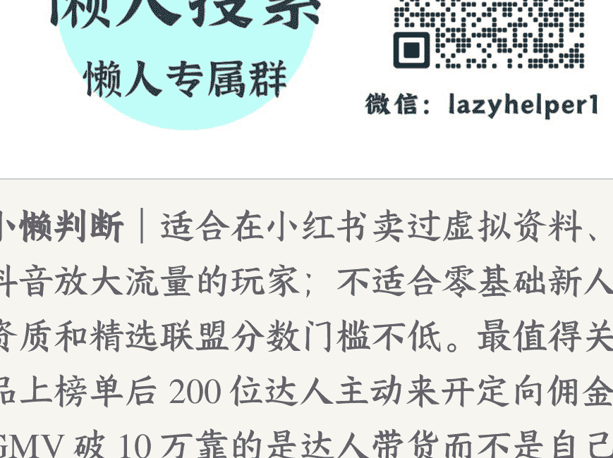

> **小懒判断**｜这套方法更适合已经在小红书做过虚拟资料、准备把成熟产品搬到抖音放大流量的人，不太适合完全没有经验的新手。原因很现实：抖音对店铺资质、商品类目和精选联盟分数都有要求。案例中最关键的增长节点，是商品进入榜单后，吸引了约 200 位达人主动申请定向佣金，月 GMV 突破 10 万主要依靠达人分销，而不是账号自身持续发内容。需要特别警惕带货团长：即使原本给达人设置了 45% 佣金，报名团长活动后，也可能被团长固定抽走 30%；此外，教育资料类目目前审核趋严，虚拟发货渠道基本只剩部分读书卡老店。

大家好，我是蓝子鱼。

过去几年，我主要在小红书做项目。2022 年曾经运营过一个 40 万粉丝的大号，也做过同城获客、教育资料和小程序等业务。虽然此前没有抖音电商经验，但我把在小红书验证过的资料产品重新放到抖音测试，没投流，半年累计完成了 100 万 GMV，最高单月成交额超过 46 万。

这次主要分享几个方面：

- 如何判断教育资料赛道是否值得做；
- 产品应该怎么设计和定价；
- 抖音店铺及商品如何上架；
- 图文、视频素材怎么准备；
- 怎样寻找并管理带货达人；
- 实操过程中遇到的规则和风险。

希望能给正在做资料类、轻交付项目的朋友一些参考。

## 数据罗盘

抖音电商数据，就用罗盘

- 首页
- 交易
- 搜索
- 商品
- 市场
- 服务
- **成交分析**
- 退款分析new
- 收支投放分析new
- 近30天

## 指标概览

- 全店
- 不限载体
- 投放时段
- **看环比**
- 看同行

成交金额 ¥46.12万 ↑295.62%｜千川券占比 0%

支出金额 ¥8.6万 ↑538.51%｜投放消耗占比 0.3%

用户支付金额 ¥45.87万 ↑295.49%｜成交订单数 9,401 ↑291.22%｜结算金额 ¥42.3万 ↑295.68%

退款金额 ¥3.88万 ↑321.75%｜商品曝光人数 163.49万 ↑140.78%｜商品点击人数 5.7万 ↑180.07%

成交人数 9,318 ↑291.35%｜客单价 ¥49.23 ↑1.06%｜退款率 8.26% ↓0.02%

我要反馈

- 成
- **趋势**
- 分布

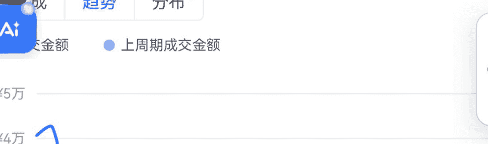

## 为什么选择抖音做教育资料？

在我看来，教育资料非常适合超级个体。

它的优势在于：产品交付成本低、服务链条短、标准化程度高。前期把资料产品打磨好，后续主要精力就可以放在内容曝光和渠道分发上。

那为什么不继续只做小红书，而要把产品放到抖音？

一个重要原因是，抖音的整体流量规模至少是小红书的数倍。过去也有朋友反馈，在抖音一个月的成交量，甚至超过了此前在小红书半年积累的结果。

我在去年年底刷抖音时，频繁看到图文内容被推荐。刚开始甚至不知道该怎么切回视频，这让我意识到平台正在明显增加图文内容的分发。而我原本就在小红书做图文资料，迁移到抖音时，内容生产方式几乎不用重做，于是开始尝试抖音图文带货。

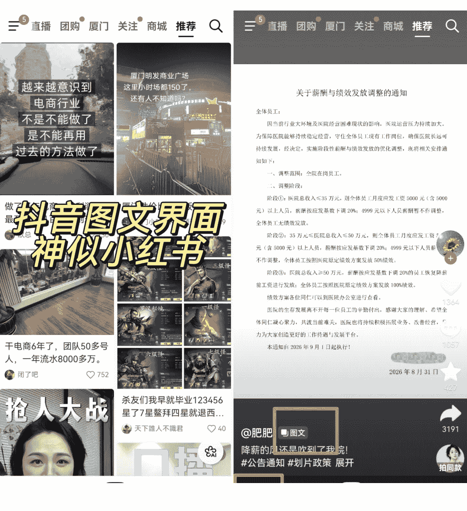

最初做抖店时，我并没有现成经验，基本是把小红书虚拟资料的打法重新走了一遍。

店铺规则、商品发布、内容分发和达人合作，都是自己边做边学，遇到问题再逐一解决。下面这套复盘，也是在不断试错之后整理出来的。

# 一、先做对产品，决定后续增长上限

资料产品能卖到什么规模，很多时候在制作完成的那一刻就已经确定了。

不少人做虚拟资料，往往是自己觉得有意思，或者看到别人正在卖，就直接照着做。但真正决定销量的，不是产品看起来是否精致，而是目标人群够不够大、需求够不够明确。

做产品之前，最好先判断三件事：

1. 有多少人需要它；
2. 用户愿意为什么付费；
3. 这个市场是否有持续扩大的空间。

举个例子，小红书上曾经有一款“i 人社会化指南”，累计销量接近 30 万单。它能够跑出多个高销量店铺，核心就在于目标受众数量足够大，且用户需求高度集中。

我在抖音测试的第一个产品，则来自一次线下观察。

当时我去一位客户的工作室喝茶，看到桌上放着几套少儿英语资料。后来了解到，她们在销售英语学习机，并且每周都会组织家长和孩子进行英语训练。

我当时判断：很多家长并不是不想教孩子，而是不知道应该从哪里开始，也缺少具体的学习材料和陪练方式。因此，这套产品具备比较清晰的使用场景。

最终设计的产品包括：

- 少儿英语训练资料；
- 配套英语学习视频；
- 每晚通过腾讯会议进行少儿英语朗读练习。

它对应了家长的三个核心需求：有内容可学、有视频可看、有人带着练。

产品售价设为 49 元，最初的商业目标不仅是销售资料，也希望通过资料产品筛选和沉淀有学习机需求的家长。

第一款产品验证成功后，我们又陆续上线了英语学习、K12 等相关资料，累计成交 GMV 最终超过 100 万。

# 二、商品发布：现在的规则已经明显收紧

目前抖音对课程、教育资料等类目的审核非常严格，开店资质和商品资质都比以前高。

我当时能够顺利操作，很大程度上是赶上了相对宽松的阶段。现在不少商品已经要求实物发货，想做虚拟资料，通常需要具备相关类目的老店条件。

在 2026 年 1 月之前，只要营业执照中包含教育咨询相关经营范围，发布商品时往往可以选择教育资料类目，再通过阿奇索或抖音后台的短信发货功能完成虚拟交付。

后来教育资料类目被下架，我们改成发布英语学习资料，并借助快递卡片进行实物发货，卡片内放置对应的微信二维码。

但平台审核一直在加强，听说不少读书卡类目的店铺也被关闭，我们自己的老店同样遇到了类似问题，目前正在尝试重新开设店铺。

现阶段如果想进入这个方向，大致有几种选择：

- 将商品发布为学习工具类产品；
- 寻找已经开通学习卡类目的店铺合作；
- 通过第三方平台发布商品，但通常要支付约 10% 的服务费。

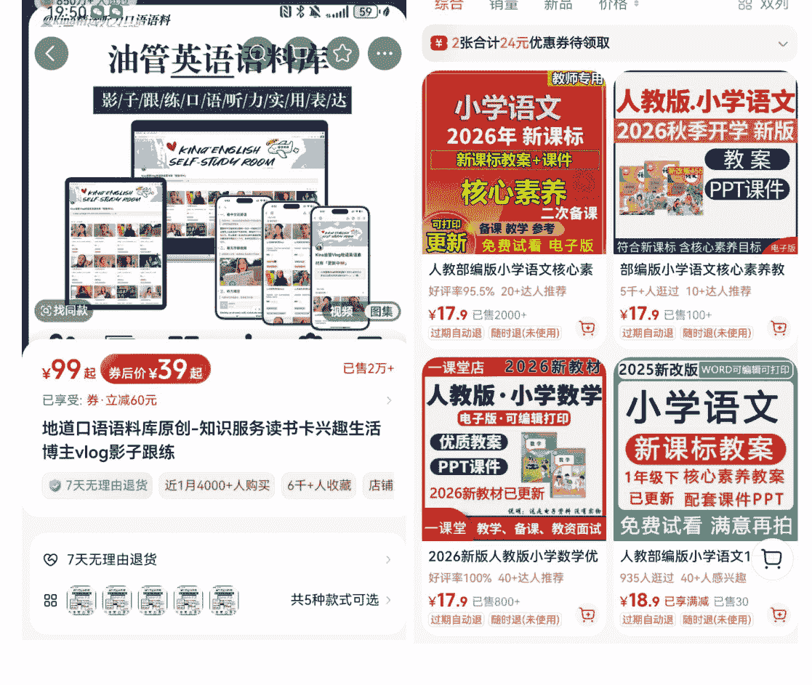

如果你之前已经做过小红书虚拟资料，产品和交付方式基本不会陌生。当前最难的部分，往往不是资料本身，而是店铺资质、商品审核和合规交付。

# 三、账号与内容：商品上架只是开始

很多人以为商品审核通过后，接下来发内容就能自然成交。实际在抖音，带货账号的准入和运营要求都比小红书高。

## 1. 抖音带货账号的限制

抖音带货账号需要完成实名认证，一个人通常只能绑定一个实名账号。也可以通过个体户开通账号，但需要缴纳 500 元保证金。

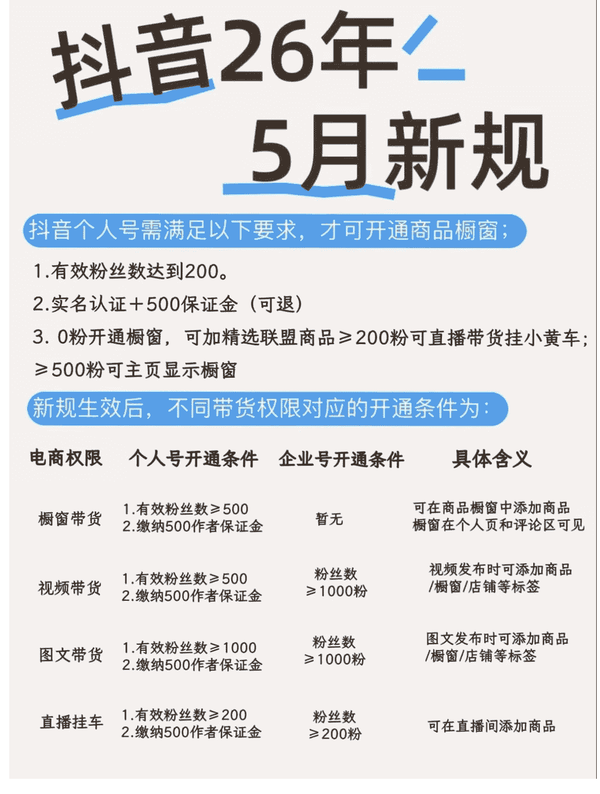

此外，账号还存在粉丝门槛。

粉丝数量不足时，很多人会选择购买粉丝，但平台看重的是有效粉丝，而不是单纯的数字。按照当时的市场成本，大致为：

- 1000 粉丝：约 240—300 元；
- 1000 粉丝：每天发布 2 条挂车内容；
- 3000 粉丝：每天发布 5 条挂车内容；
- 10000 粉丝：每天发布 10 条挂车内容。

这套要求已经会挡住不少新入场者。

相比之下，小红书目前只需要主账号达到 1000 粉丝，才能开通电子资源类目，其他关联账号不一定有粉丝要求，一个店铺还可以绑定 4 个小红书账号。

我自己一共运营过 6 个抖音账号：

- 表现最好的账号成交约 24 万；
- 另外 3 个账号分别成交 3—5 万左右；
- 剩下 2 个账号基本没有明显出单。

到了 3 月之后，自有账号的自然流量明显下降，后续增长重点逐渐转向达人合作。

## 2. 素材到底怎么做？

很多人卡在素材和文案上：不知道拍什么、不会写文案，或者内容发布后有曝光却没有成交。

其实我一开始也不是靠专业团队完成的，后来招了几位实习生帮忙做素材，她们之前也没有小红书运营经验。

借助豆包等工具，员工很快就能完成基础内容制作并开始产生订单。但工具只是提高效率，真正决定转化的还是以下几个因素：

- 是否真正理解目标客户；
- 是否清楚用户为什么购买；
- 解决的问题是否足够具体；
- 产品卖点是否足够丰富；
- 内容发布数量是否足够。

刚开始做抖音时，流量波动也很大。后来听了富贵老师的建议，把重点放在封面上，并将小红书的高点击封面迁移到抖音，整体效果明显提升。

小红书和抖音的内容究竟有什么不同？

我个人的理解是：不要过度纠结图文还是视频。真正需要研究的是人群和需求。两边的用户可能是同一批人，购买动机也没有本质变化，关键在于内容有没有把产品价值讲清楚。

### 常见的几种素材形式

#### 第一类：重点信息海报

大字报式内容一直都有效。

它的优势是信息直给，用户一眼就知道这篇内容在讲什么，特别适合突出资料主题、适用人群、核心卖点和价格。

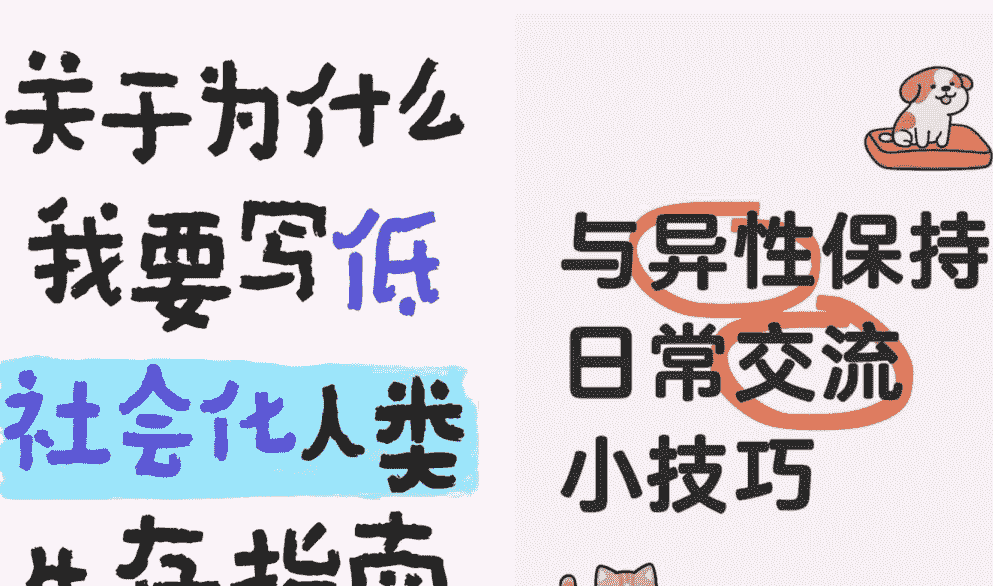

#### 第二类：产品实拍

可以把资料打印出来拍摄，也可以直接展示电脑、平板上的资料页面。

重点不是拍得多精美，而是让用户直观看到：你确实有一套完整、具体、可使用的内容。

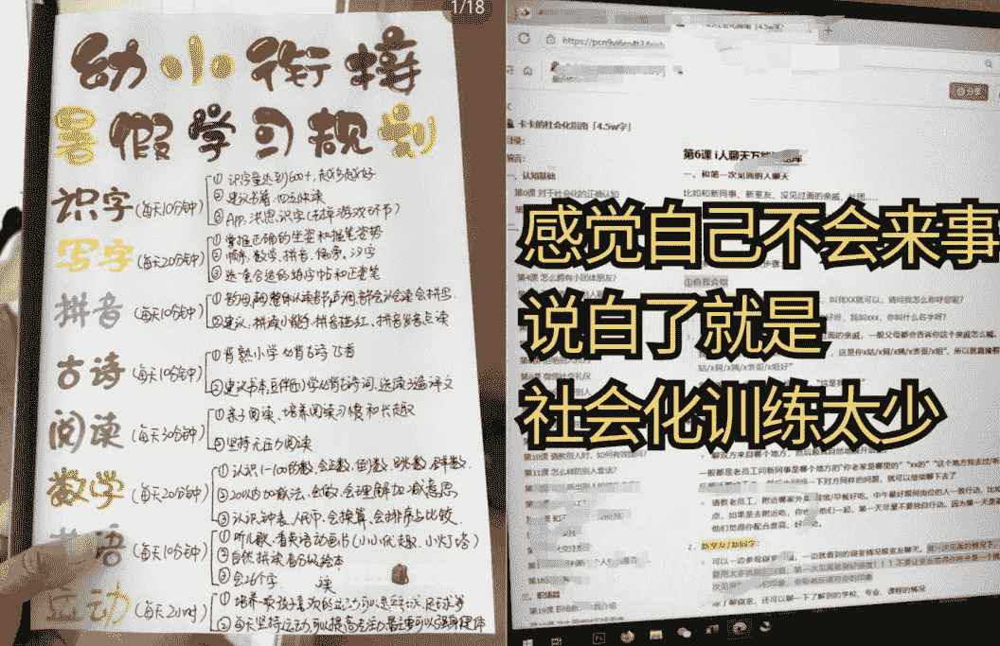

#### 第三类：内页展示

内页内容的逻辑和小红书图文相似：

- 一张图片突出一个卖点；
- 配合资料截图或实物照片；
- 按照用户关注的问题逐层展示；
- 让用户看完后知道买到的具体是什么。

#### 第四类：录屏型视频

以“跟着油管学英语”为例，视频可以直接录制资料使用过程、页面结构和具体内容。

【此处有两个视频，大家可见群里分享的在线版】

这种素材不需要复杂剪辑，最核心的任务是把产品内容展示出来。

用户能看到资料形式、学习流程和具体内容后，如果刚好满足自己的需求，就更容易完成下单。

如果你已经在做小红书资料，可以先把原有图文内容重新调整比例、封面和文案，再同步到抖音测试，不必从零开始生产。

# 四、达人分销：从单账号销售转向规模化成交

让月 GMV 突破 10 万的关键，不是我突然找到了更好的内容，而是开始有达人主动帮忙销售。

这是抖音相较于小红书非常明显的优势：平台拥有成熟的达人带货体系，很多达人本身就专门做商品分销，甚至会自己投放流量。

3 月份时，我的产品通过自有账号成交并进入精选联盟榜单。之后陆续有约 200 位达人加我微信，希望获取定向佣金。

这意味着，不需要每天都依赖自己发内容，也能获得额外的分销流量。这个分销机制，在小红书上很难体验到。

## 达人合作的两种方式

### 方式一：等待达人主动联系

可以在精选联盟中完善微信和手机号信息，达人有机会直接添加你。

另外，抖店后台的达人消息中，也可能收到达人发来的合作咨询，例如询问是否可以带货、是否能够设置专属佣金等。

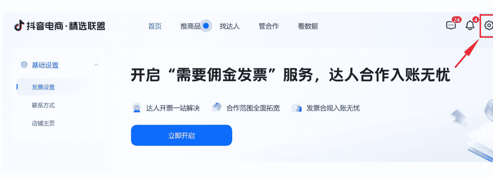

### 方式二：主动寻找达人

进入达人广场，按照自己的商品类目筛选匹配达人，再主动发送合作信息。

合作确认后，可以通过达人的 UID 设置定向佣金。佣金可以根据产品利润、交付成本和预期投流情况进行安排，同时还能区分日常佣金和投流佣金。

同行常见的佣金区间大约在 30%—50%，具体比例要结合自己的承受能力，也可以参考同类商品的设置。

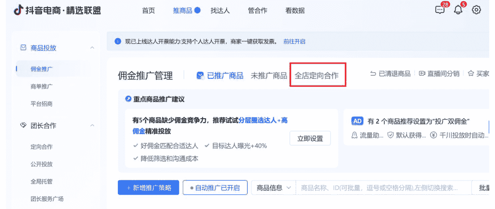

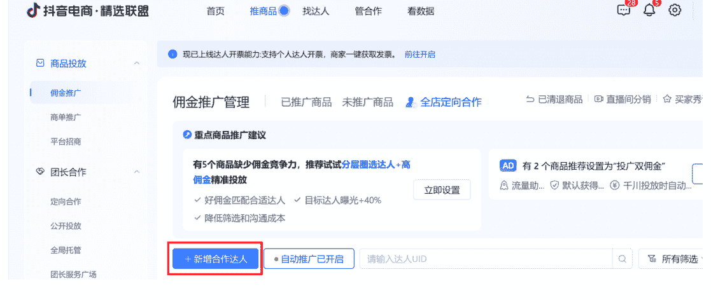

达人一旦把产品推起来，成交规模可能会迅速放大。

之前有一位达人单日就卖出了 4 万 GMV。对于能够稳定出单的商品，达人通常也愿意持续推广。

当时店铺后台累计合作达人超过 300 位，其中产生订单的达人超过 200 位。

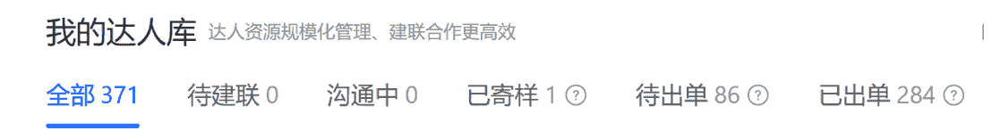

# 五、实操中最容易忽略的风险

从完全不了解抖音规则，到累计 GMV 超过百万，中间踩过不少坑。下面几个问题尤其需要提前注意。

## 1. 精选联盟分数

抖音精选联盟对店铺和商品都有评分要求。

如果分数低于平台标准，商品可能被移出精选联盟，达人也就无法继续通过联盟推广。

目前需要关注的指标包括：

- 店铺评分不低于 70 分；
- 商品评分不低于 65 分。

日常一定要及时查看商品评价。出现差评后，要尽快处理售后和用户体验问题，必要时做好体验分维护，否则一旦掉出精选联盟，之前积累的达人渠道可能会立刻中断。

## 2. 谨慎对待带货团长

带货团长并非全部不靠谱，但佣金规则一定要看清楚。

我曾经遇到过这样的情况：

原本商品给达人设置的总佣金是 45%。报名团长活动后，系统被调整为团长佣金 30%、达人佣金 15%。

问题在于，报名之后，无论最后是哪位达人完成成交，团长都可能自动获得 30% 的佣金。也就是说，原本直接给达人 45% 的佣金，被团长拿走了大部分，而团长未必实际提供了相应服务。

当然，市场上也有真正能够提供选品、招商和投流服务的团长，只是合作前必须确认：

- 团长到底提供什么服务；
- 佣金如何分配；
- 原有达人出单是否也会产生团长费用；
- 退出活动后规则是否恢复。

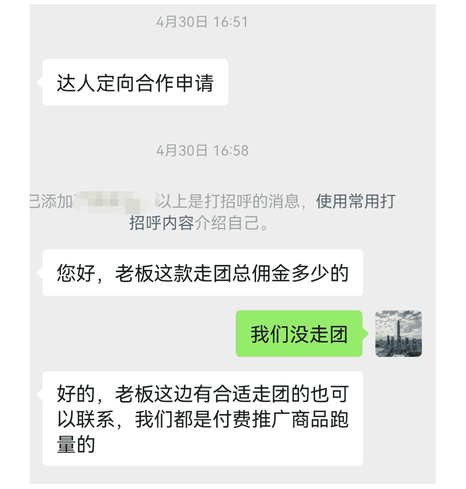

## 3. 爆款很容易被复制

抖音的爆款跟进速度非常快。

一旦你的商品登上榜单，同行就能看到相关数据，很可能迅速复刻内容，甚至以低于你一半的价格销售。

因此，虚拟资料最好提前考虑版权和知识产权保护，尽早申请相关版权，至少为后续维权留出依据。

## 4. 不要忽略直播承接

当商品进入放量阶段，可以考虑通过直播承接已有流量。

直播能够进一步展示产品、回答用户问题，并提升整体转化率。最近也能看到不少做小程序、虚拟资料的账号，通过直播间持续完成成交。

# 六、最后总结

我认为，已经在小红书验证过的资料产品，都值得在抖音重新测试一次。

过去几年，很多人习惯在小红书销售资料，但抖音的流量池更大。只要产品本身经过验证，内容不需要完全推倒重来，店铺、账号和分销体系跑通后，往往有机会获得更大的成交规模。

我也只是偶然开始尝试抖音，没想到最后真的把项目做了起来。虽然抖音的店铺与账号门槛更高，但也因此减少了一部分竞争者。

## 分割线

看完这篇 SOP，你可能会觉得方法已经掌握了。但现实是，绝大多数人真正开始执行时，仍然会卡在第一步。

工具和教程只是基础门槛，真正拉开差距的，往往是马上行动，以及能否获得持续更新的一手信息。

如果你想了解全网最新的变现玩法，并和一群执行力强、愿意真正下场的人一起实践，欢迎关注我的核心私域：【懒人专属群】。

这里不讲空泛概念，只拆解商业闭环，并研究如何借助 AI 提升执行效率。系统内已经沉淀了 1000+ 个跑通的套利实战案例。

- 查阅圈子完整数字资产与上车门槛：

https://lazysso.com/insider/

认可这套价值、准备亲自执行的朋友，可以扫码添加我的微信：lazyhelper1

添加时备注：【实操上车】，不闲聊。

