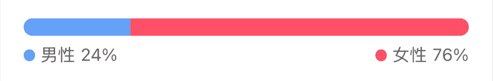
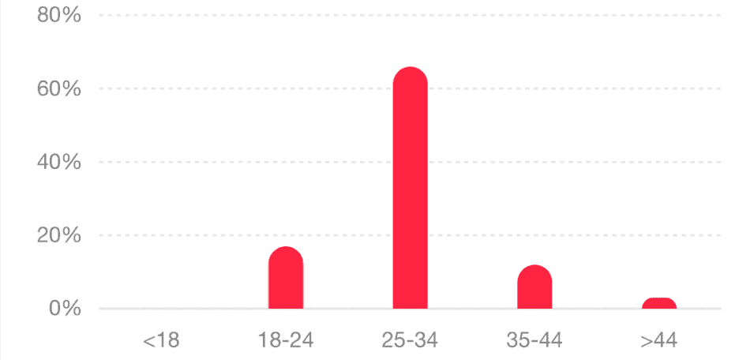
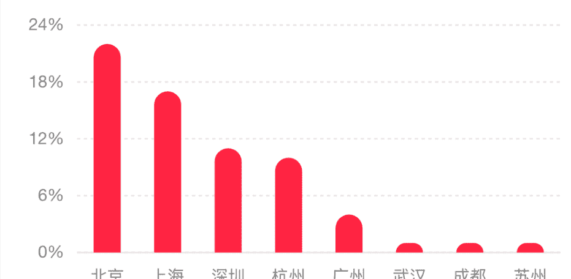
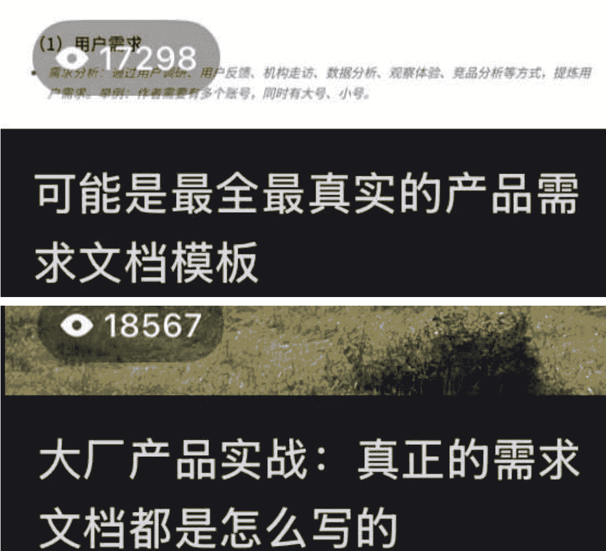
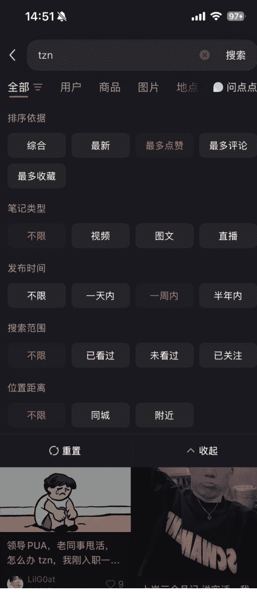
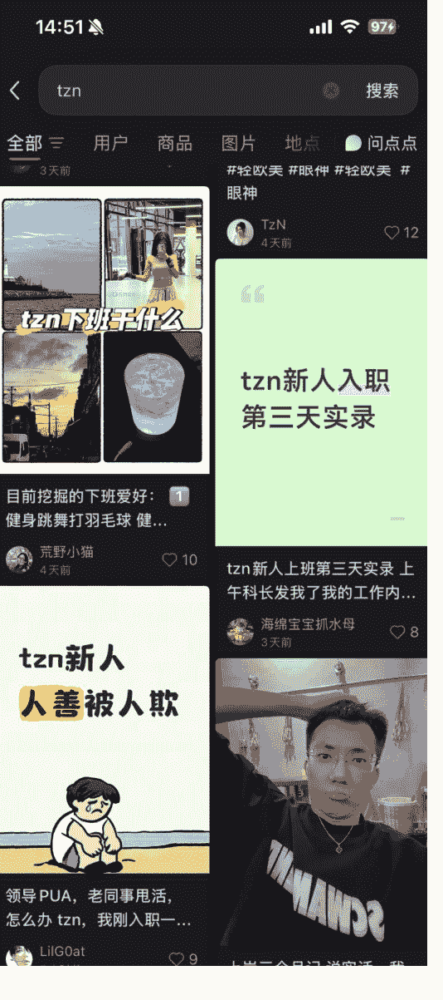
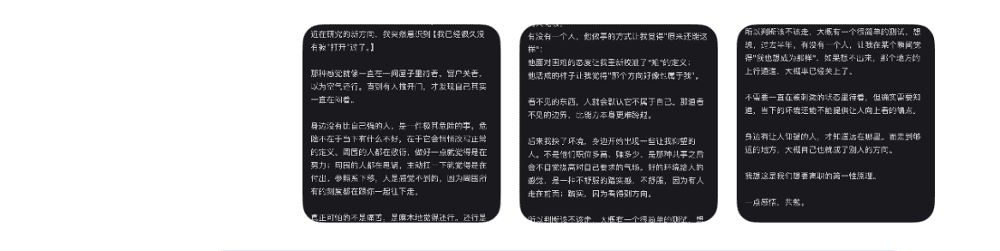
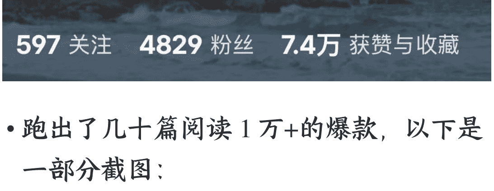
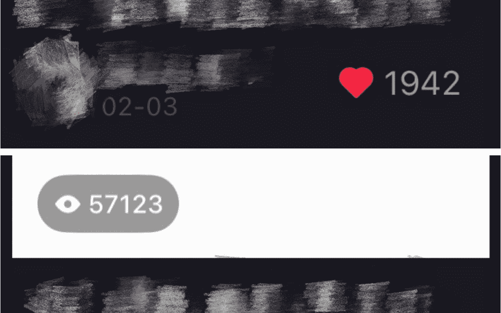
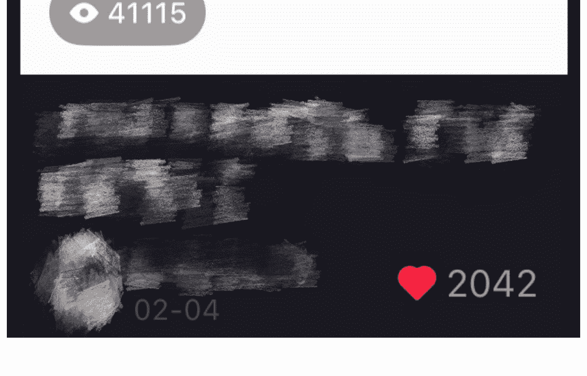

# 4 个月，我用📕垂直小号累计变现 2 万元：打工人最适合的第一个项目（喂饭版）

我，7年产品经理，用📕垂直小号4个月变现2万：打工人第一个副业项目亲测实录

如果你正处在一个“什么都会，但又好像什么都不属于自己”的阶段——干活已经很顺手，却从没验证过脱离平台之后，自己还能不能独立挣到钱——那今天这篇文章，也许是一份不错的参考。

我是龙哥，互联网产品经理，工作7年。去年，我用业余时间启动了一个📕职场垂直号，零零散散做了4个月，积累了4000多位粉丝，出了几十篇阅读过万的笔记，累计变现约2万元。

这笔成绩放在副业圈子里，确实不值一提。但对我来说，它真正的价值在于：第一次完整走通了“发现需求—做出产品—找到客户—完成成交”的全过程。而这恰恰是大多数职场人最难迈出的一步——我们太擅长执行了，却很少独立面对市场。

在详细拆解之前，先放几条核心结论，方便你对号入座。

这套玩法适合“在一个行业沉底了五年以上、一直在找第一个落地项目”的职场人；不适合想做规模化生意的人——一对一咨询的本质是卖时间，天花板很清晰。

最值得关注的几个点：📕600多粉就能开张；商品从评论区里找，用户反复要什么，你就做什么；9.9元的轻量模板负责筛选人群、建立信任，399元1小时的咨询承接深度需求、贡献主要收入；选题用“人群×场景×需求”的框架，就能拆出一个永远写不完的选题库。

提醒两个坑：绩效、晋升类需求有明显淡旺季；不要闷头憋大课，先发内容，让用户用付费投票，告诉你什么值得做。

以下是完整复盘。

一、商业起点：你习以为常的，可能正是别人的稀缺

一年多前我裸辞，在Gap期里反复想一个问题：除了继续找下一份工作，我还能靠什么吃饭？

回顾在大厂做产品经理的六年，我发现自己最擅长的一件事，是把复杂模糊的工作问题，整理成可执行的方法、SOP和工作流。带团队时，我经常给下属整理文档：怎么写需求文档、怎么做数据分析、怎么推进跨部门协作、怎么向上管理。

这些不是搜索引擎里一抓一大把的泛泛概念，而是我在真实项目里反复验证过的实操沉淀。而很多大厂职场人，恰恰缺这些——他们未必有幸碰到一个愿意把活儿掰开揉碎讲清楚的领导或前辈。网上一搜“产品经理需要什么能力”全是框架，但没人告诉你：

需求文档到底应该怎么写才合格；
跨部门项目推不动的时候怎么办；
绩效总结怎么写才能体现价值；
晋升答辩怎么证明自己已经具备下一级的能力。

对我而言这是日常，对别人而言这就是稀缺。于是我决定，先把一部分经验整理出来，用一个足够垂直的小号，去验证是不是真的有人需要。

二、为什么选📕，而不是只做👸号

这类垂直职业内容，👸号也能承载。当时我选择📕，看中的是两件事。

第一，用户恰好匹配。📕上聚集了大量年轻、收入不错的一二线城市女性，她们更习惯为解决具体问题的内容和服务付费。成交数据也验证了这一点：付费用户里，90%以上是22到32岁、生活在一二线城市的女性。她们可能因为一篇职场干货关注我，也会因为《大厂工作至暗时刻》这类内容产生情绪共鸣，再通过持续阅读建立信任，最终为模板或咨询买单。

账号的粉丝画像也印证了这个判断——女性占76%，男性占24%；年龄、城市分布都明显向年轻一线城市倾斜，和付费用户高度重合。

第二，生产成本友好。👸号一篇文章要完整展开一个主题，而📕图文笔记只要1000字以内，讲透一个具体场景问题就够了。一篇👸号长文，往往能拆成好几条📕内容。比如“如何准备晋升答辩”就能拆成：晋升材料怎么写、评委提问怎么准备、故事怎么讲、晋升前有哪些信号。对业余时间有限的上班族来说，这意味着更容易发出第一条，也更容易坚持下来。

所以📕适合这个项目的根本原因，不全是流量，而是三个条件同时满足：目标人群集中、付费意愿清晰、内容生产成本低。

三、不做泛职场，做两类内容

我的目标用户非常具体：在大厂工作0到6年、初阶到中阶的职场人。这群人绕不开两类需求——

一类是缺方法。活知道自己要干，但没人告诉他具体的步子怎么迈。
另一类是缺出口。工作压力大，委屈、焦虑、倦怠需要有地方安放，也希望知道“原来不只是我这样”。

于是账号内容被分成两条线：
方法类内容，负责展示专业能力、建立信任，承接模板和咨询成交；
情绪类内容，负责扩大传播、吸引新粉，让更多目标用户走进来。

衡量标准也完全不一样：情绪内容看传播和涨粉，方法内容看信任和成交。前者让用户觉得“原来不止我一个人经历过这些”，后者让用户确认“这个人真的懂我的问题，而且有能力帮我解决”。流量和成交不一定要由同一篇内容完成，各司其职，反而能搭出一个更稳的获客转化闭环。

四、前两篇就爆了，然后被现实教育

开局比想象中顺利。

第一篇笔记，写的是大厂产品经理在真实工作中到底怎么落地一份需求文档。发出去没多久，阅读破万，评论区一堆人追问：能不能提供一份可以直接参考的模板？

我顺势发了第二篇，标题叫《可能是全网最真实的产品需求文档模板》，同样很快破万，评论区求分享的声音更多。

复盘这两篇能跑出来的原因，主要有两个：一是提供的是大厂内部真实在用的工作方法，而不是网上随处可见的概念；二是笔记里带了前东家的名字——在职的人不建议这么干，比较敏感——大厂背景天然增加了内容的可信度和好奇心。

评论区那么强烈的需求信号，让我意识到这份模板有变现的可能。后来，我把它整理成虚拟资料，挂上了📕店铺。

但连续两篇的数据让我产生了一个错觉：这个账号好像很好做。

等到第三篇开始发其他选题时，数据很快回落到了几百、几千。那一刻我才清醒：前两篇跑出来，只能说明这个方向有需求，并不代表我已经掌握了稳定产出爆款的方法。于是我开始老老实实找对标账号、拆选题、拆结构，从“凭感觉发内容”切换到“通过观察、拆解和测试找规律”。

五、选题：结构化拆解+追踪近期爆款

做内容，选题就是选品。品选错了，文案写得再漂亮也没人看。

我的选题方法有两条路。

一条是结构化拆解，按“人群×场景×需求”往下拆。

以我的账号为例：人群锁定大厂0—6年职场人；场景拆出两条线，一条是职业生命周期，从试用期、日常工作、OKR、绩效到晋升答辩，覆盖一个大厂人的完整成长轨迹；另一条是情绪与人际，被PUA、遇到卷王和嫡系、绩效不理想、长期内耗、总想跑路。

大场景还能继续拆。比如“试用期新人”可以拆成：怎么顺利通过试用期、新人怎么快速看懂团队关系、怎么搞定合作方、怎么在几个月内和领导建立信任。《大厂工作至暗时刻》系列就是这么来的——OKR期的至暗时刻、绩效考核的至暗时刻、体检指标异常十件套、那些卷王们和嫡系们，每一个都是先有场景，再长出内容。

这样拆下去，就会得到一张长期稳定的选题库，不用每天临时想发什么。这套方法也可以迁移到任何职业：先圈定人群，再列出职业周期、工作任务、情绪节点和人际关系，最后逐步细化成具体问题。

另一条路，追踪近期爆款。

每周挑两三个行业相关关键词去搜，看看最近一周哪些笔记跑得好，然后分析两个问题：这些爆款在聊什么？评论区里集中出现了哪些情绪和问题？

这一步可以人工完成，也可以把笔记截图丢给AI做归类总结；如果会用Claude Code、Codex这类工具，甚至可以把采集、选题分析、评论区分析做成自动化流程。比如想做体制内方向，可以搜“体制内”或用户常用的缩写“tzn”，从最近的热帖和评论里找信号。

当多个创作者在相近时间讨论同一个话题，评论区出现大量相似情绪时，这往往就不是某个人的偶然感受，而是这一批用户当下共同关注的问题。顺着再往下延伸，又能长出一批新选题：哪些人真的适合裸辞、想辞又不敢辞怎么判断、不辞职怎么降低内耗、裸辞后哪些能力可以迁移……

这里有一个变化需要提醒：📕的搜索排序逻辑已经变了，即使按“最多点赞”往下翻，也会混入大量数据不高的小新笔记，单纯靠搜索已经没那么好用了。

我现在的应对方式是：多关注垂直领域的同行账号，持续浏览同类内容，让推荐流替我做筛选。系统一旦识别出你的内容偏好，就会持续把这个小圈子里的新博主、新话题推过来，有时候反而比主动搜索更快捕捉到新动向。

所以现在是双轨制：结构化拆解，保证长期有内容可写；追踪近期爆款，保证跟得上用户此刻真正关心的问题。

六、写内容：结构借AI，灵魂自己给

我没做视频，一方面视频制作成本高，另一方面我不喜欢露脸口播。图文更适合我，也更适合普通职场人业余启动。

但我得承认，我并不擅长所有类型的文案。条理清晰的干货我能一口气写完，情绪向、故事感强的内容就比较吃力。

所以我的思路是：AI帮我把“不会的部分”补上，但“说真话的部分”永远自己来。

具体分三步。

第一步，平时刷📕，看到结构好的内容就收藏。不用和我是同一个主题，只要开头、节奏、正文结构有可迁移的地方就行。找对标账号时，不看几十万粉的成熟大号，而看同领域里粉丝不高、最近一年涨得很快的号——它们和新号的处境更接近，爆款也更能反映当下的口味。观察重点包括：近期哪些选题反复出高数据、哪些标题吸引人点进去、开头怎么让人迅速代入、正文的情绪和信息密度如何变化、结尾怎么引导互动。

第二步，把收藏的爆款笔记发给AI拆解。我自己做了一个📕爆款拆解和自动化写作的Skill，可以把可复用的结构、文风语料和手法沉淀到知识库。更简单的方法是用豆包：把笔记截图丢进去，问三个问题——为什么爆？整体结构是什么？有哪些能复用的方法？

这一步的价值，是把“我感觉这篇写得不错”翻译成“我知道它为什么能写好”。

第三步，把自己的真实观点、亲身经历和案例放进结构里。AI帮忙解决的是怎么组织和表达，但内容里到底要说什么，仍然来自我自己。你是谁、你亲历过什么、你观察到哪些别人没提过的细节，这些才是让账号被记住的东西，也是AI替代不了的部分。

七、变现：从评论区里找商品

整个变现路径其实很朴素：

先免费分享真实的经验；
观察评论区里用户反复索取什么；
再把它整理成可以付费购买的产品。

从粉丝只有600出头开始，这个号的店铺就已经开张了。低客单和高客单各司其职：9.9元一份文档模板，价格低到不需要犹豫，它的角色是筛子——过滤出愿意付费的人，完成第一次信任建立；真正贡献利润的是399元一小时的咨询，买过模板的人里，会有一部分继续购买咨询。这就是“低客单筛选信任，高客单承接深度需求”的组合打法。

八、结果、边界，和给想启动的人

最后，这个账号的成绩单是：四千多位粉丝、几十篇过万阅读的笔记、累积约两万元收入。对很多副业老手来说，这个数字不算什么。但作为职场人的第一个从0到1，它验证了一件事——用已有经验做垂直内容、找到精准用户、形成付费闭环，这条路是走得通的。

也要说清楚它的边界。一对一咨询本质是卖时间，天花板不高，不是一门可以无限放大的生意；绩效、晋升这类需求有明显淡旺季，收入也会有起伏。所以它真正适合的人群是：在一个行业积累了五六年、想做第一个落地项目的职场人。如果你追求的是可规模化的高天花板生意，这套模式解不了那道题。

给想启动的人一个起步方向：
先圈定你服务的人群，把你最熟悉的场景拆出十个具体问题，每条写成1000字以内的图文，连发两周，盯紧评论区。这个过程中，不要闭门憋什么“大课”，先让市场告诉你：用户愿意为什么付费。等那些“反复被索取”的东西浮出水面，你的第一个产品，就已经在那里了。

最后多说两句。我是夏树，这次分享也算是一篇新人报道帖。一个人做内容确实容易孤独，如果你也在做📕，或者手里有产品、服务但正好缺内容获客的人手，欢迎来聊聊，说不定我们有机会一起做点事。

做号起步时我并没有先去画商业蓝图。第一笔收入，是粉丝主动追着要来的。很多人问我：让AI起草为什么总觉得少点味道。核心差在判断、价值观和人格立场。AI不懂我对一件事的真实态度，也读不懂我是谁。我的做法是把笔记截图丢给豆包，用语音把选题、观点、案例讲一遍，反复打磨几轮得到可用的初稿，再由人手把不满意的部分改掉，配一张贴合情绪的封面就能发。一篇图文从构思到上线，基本能控制在1小时内。

我的复盘公式是：
**切中真实痛点的选题 × 经市场检验的结构 × 自身的行业沉淀、观点与人设辨识度**
AI能负责拆架、顺句、提速，但行业手感和最终拍板，它替代不了。

## 600粉时接到的首单

我没有先做课再找客，需求是自然长出来的。号做到约600关注时，一位读者私信：马上要面试，完全没头绪，能否付费聊聊。这条私信推动我在📕开店，上架了首个产品：单人付费辅导，定价399元/小时。

此后我持续发需求文档、绩效复盘、晋升答辩等实操内容，评论区大量索要可直接套用的范本。于是把工作方法标准化，做成9.9元一份的数字资料，很快产生销量。

至此，两条变现线逐渐清晰：

**1. 高价位直接成交——靠内容建立信任**
部分读者看完笔记，觉得方法扎实真实且来自大厂实战，直接进入主页下单。决策路径很短，常见的是先付款再约时间。运营一段时间后我发现，高频需求并非面试，而是绩效复盘和晋升答辩。📕讲面试的内容已经高度内卷，而真正走过大厂绩效评估、参与过答辩流程并能给出具体辅导的人并不多。于是我没有继续挤面试赛道，而是把服务重心转向绩效与晋升，这是我更具优势也更稀缺的细分。

**2. 低价引流——先用9.9元完成价值试探**
另一批读者不会立刻买399元的辅导，而是先花9.9元买一份资料。低价把首次交易的门槛压得很低，也给了对方一次低成本检验我的机会。资料用下来觉得靠谱，再遇到更复杂的职场难题时，更愿意升级为个体辅导。所以9.9元产品不只在赚钱，它在承担筛选、初步建立信任、为高价服务做承接的功能。

**3. 用真实案例降低高价服务的决策门槛**
最初想把买资料的用户导到私域，实际操作后发现链路过长，后来改成店铺自动发货。辅导用户则沉淀在🛰️私域，我设计了两条简单的复购与转介绍机制：下次复购打8折，介绍朋友同样打8折。另开了一个副号，专门记录真实的辅导案例，包含用户背景、卡点、给出分析与建议、最终反馈。副号入口挂在大号主页，相当于一面持续增厚的展示墙。

最终，高价位辅导形成了三条成交路径：
- 看完主号内容，认可专业度与可信度，直接下单；
- 先买9.9元资料验证价值后，再升级辅导；
- 在副号看到与自己情况相近的真实案例，疑虑消除后下单。

回看下来，跑通的不是一个孤立产品，而是一套轻闭环：
**专业内容建立信任 → 低价产品完成首单 → 真实案例降低风险 → 高价辅导贡献主要营收 → 私域承接复购与转介绍**
给新人的一点建议：别关起门做完整大课再出来找买家。先发布内容，观察大家反复追问什么、主动索要什么、愿意为哪类问题买单，再把已经冒出来的需求做成最小产品。启动成本更低，第一笔交易也来得更快。

## 4个月的数据

- 关注者：从0到4000+。最近半年工作繁忙，更新频率下降，涨粉变慢。

- 跑出几十篇阅读破万的笔记，部分截图：

- 累计变现约2万元，来自平台店铺和🛰️转账。

部分转账记录：

| 来源 | 辅导类型 | 金额 | 时间 |
| :--- | :--- | :--- | :--- |
| | | +160.00 | 11月3日 22:23 |
| | | +319.00 | 11月2日 09:46 |
| | -营销/... | +319.00 | 1月26日 13:50 |
| | 📕咨... | +319.00 | 1月24日 14:33 |

平台后台结算明细：

| 日期 | 类型 | 金额 | 状态 | 流水号 | 备注 |
| :--- | :--- | :--- | :--- | :--- | :--- |
| 2026-02-20 21:29:25 | 结算入账 | 395.61 | - | 1730.88 | 结算入账-订单号 |
| 2026-02-20 20:44:43 | 结算入账 | 9.84 | - | 1344.27 | 结算入账-订单号 |
| 2026-02-19 20:05:22 | 结算入账 | 9.84 | - | 1334.43 | 结算入账-订单号 |
| 2026-02-19 14:55:46 | 结算入账 | 9.84 | - | 1324.59 | 结算入账-订单号 |
| 2026-02-19 10:31:07 | 结算入账 | 9.84 | - | 1314.75 | 结算入账-订单号 |
| 2026-02-18 11:18:33 | 结算入账 | 395.61 | - | 1304.91 | 结算入账-订单号 |
| 2026-02-18 03:52:52 | 结算入账 | 9.84 | - | 908.39 | 结算入账-订单号 |

这个结果验证了一个判断：普通职场人内部沉淀的经验，并不只能锁在公司里。只要找到足够具体的痛点，把经验转化为内容与产品，再用垂直号建立信任，就能独立完成0到1的变现。整个过程几乎可以单人加AI跑通，启动成本极低。它不是先设计好完整商业模式再执行，而是在真实反馈中把内容、产品和成交路径一步步趟出来的。

## 这套打法适合谁，有哪些边界

复盘后我意识到，跑通的并不只是“大厂职场知识付费”，而是一条通用内容变现路径：在细分领域持续输出专业经验，用内容筑人设，吸引同频精准人群，再用资料、辅导或实物承接转化。这类号不需要几十万粉，人群够垂直，几百到几千关注也能产生不错回报。我第一次接到付费需求时只有600关注，做到4000多时已形成资料销售与辅导服务两条线。对垂直知识号而言，粉丝精准度远比数量重要。

### 1. 并非只适合网络大厂
我的素材来自大厂，但思路可迁移到任何行业。银行、中学、高校、体制内、国企央企、核电水电、地产以及各类传统行业，都存在大量外部搜不到、内部却人人需要的经验。一个从业5年以上的人，脑中大概存着一堆自己觉得“普通”的知识：新人如何入门、材料如何撰写、流程如何走、坑如何避、晋升如何选，以及只有圈内人才知道的潜规则。你眼里的日常，对刚入行的人来说可能是救命稻草。假如你已在一个领域待5年以上，又愿意总结表达，那你并非“没东西可卖”，只是尚未意识到经验本身就是内容资产。

### 2. 局限也很现实
这不是可无限放大的生意。首先，适配仍在行业一线或刚离场不久的人。垂直内容需要持续的一线信息输入，离场太久，对最新场景、用户情绪和组织变化会迟钝，内容会逐渐失真。其次，面试、绩效、晋升有明显淡旺季，需求会集中出现也会周期回落。更重要的是，单人辅导本质是出售时间，服务容量有限，客单价与收入都容易触顶。
我也考虑过把辅导录成标准课程，后来发现职场问题高度个性化。每个人公司环境、上司关系、目标卡点都不同，用户要的不只是答案，还有持续的方法支持、信息补充和情绪价值。因此若继续优化，我更倾向把单次辅导升级为高客单、深度的陪跑服务，而非录一套大而全的课。
即便如此，它依然是普通职场人值得尝试的首个0-1项目。天花板未必最高，却能以较低成本完整经历一次需求发现、内容生产、产品设计与完成交易的过程。

### 3. 7天起步建议
若你有5年以上工作经验，但从未做号，无须花数月搭建宏大模式。接下来7天可按下面五步走。

**第一步：盘点经验资产。** 从两个角度梳理：一是回忆过去几年里在哪些具体环节和场景遇到问题，当时如何解决；二是回想带新人、指导下属时反复强调过哪些方法、SOP和工作流程。把这些汇总，找出已形成方法论的部分。不擅长写作也无妨，可口述给AI，让它帮你整理成文档和SOP。

**第二步：找3个对标账号。** 对标不必找几十万粉的大号。我更建议看近一年内成长起来、粉丝在几千到2万之间、与你同类型或相似行业的号。研究他们近期热门内容，写了什么问题，标题和结构如何搭。这些已获真实市场验证，能帮你快速理解读者为何停留、点赞、关注。

**第三步：开始发，别等全部想清。** 起号阶段最关键的是发布与测试频率。无需规划数月，先想清明天写什么、本周测哪个选题即可。每发完一篇，做一次小复盘：为何这篇数据好，那篇差？是选题不够痛、封面标题不行，还是正文结构没接住读者？让每一篇都成为下一篇的输入。

**第四步：跑出爆款就复制。** 对零粉号而言，几千浏览已算小爆款；破万值得认真拆解并系列化。比如我的首个系列“全网最真实、最实操的xxx”，从需求文档延伸到晋升答辩模板、绩效模板等工作方法。标题与结构保持一致，只换具体问题，不断延伸，直至流量衰减。与此同时，继续测试新选题，跑出第二、第三套属于自己的爆款模型。账号前期不是靠每次重新发明，而是靠反复测试，再把验证过的成功放大。

**第五步：让主页形成稳定记忆点。** 持续在主页与笔记里突出自身经历、观点与核心标签，让读者知道你是谁、为何值得关注。最好做出系列感，读者看到熟悉的标题或结构即可联想到你。对垂直小号而言，这种稳定的关注理由，比偶尔冒出一篇爆款更重要。

整体路径可概括为：盘点经验→找对标→持续发布→逐篇复盘→复制爆款→形成系列与个人标签。

### 4. 分享前先守住边界
垂直经验的价值来自真实，但真实不等于直接公开前公司的内部材料。分享与产品化前需做好脱敏：严禁公开机密文件、客户信息、业务数据和内部决策，也不出售属于前公司的知识产权。可分享自己总结出的方法、框架与经验，但具体案例、公司名称和个人信息都应按风险处理。发布辅导案例时，也要隐藏用户身份与公司信息。涉及职业选择等重要决定时，辅导可提供分析方法与经验参考，但最终决定应由用户本人作出。
有边界的专业分享，才能真正积累长期信任。

## 从职场辅导到内容获客
这次经历让我越来越确定：普通职场人的工作积累本身就是一座被低估的资产。很多人做副业就急着学全新技能。但对已在某个行业深耕多年的人来说，最容易起步的方向可能是重新整理已有东西：把做过的事拆开，把目标用户反复遇到的问题讲透，把经验变成内容，把方法变成产品或服务。
你无需先成大V，也无需海量粉丝。一个足够垂直的小号，哪怕只有几百到几千精准关注者，也可能帮你完成首次独立变现。对我而言，最大收获并非4个月赚2万元，而是通过一次实践，验证了自己真正擅长的事。

### 1. 验证的三项能力
**第一，对内容和选题的敏感度。** 我理解的敏感度不是偶尔撞上好选题，而是能持续判断读者最近关心什么、情绪往何处走、哪些爆款结构可迁移，以及当一篇内容跑通后，如何把偶然成功沉淀为可复制系列。从“人群×场景×需求”结构化拆解，到追踪热门内容与评论区情绪，再到拆解并复制自己的爆款模型，这套方法就是敏感度的具体实践。

**第二，理解用户的真实需求。** 我会从具体工作场景、评论反馈和真实付费行为中，分辨用户嘴上关注什么、实际缺什么，以及愿意为哪类结果买单。需求文档下大量人求资料，让我看到低价产品的机会；绩效与晋升直接与收入、职业发展挂钩，让我看到高价辅导的机会；情绪内容与专业内容的不同表现，则帮我厘清“为何关注”和“为何付费”的差异。

**第三，把复杂问题拆解成可执行SOP。** 无论是工作经验、内容生产还是转化路径，我都习惯把零散模糊的东西整理成清晰步骤，让它可执行、可复盘、可持续迭代。
一句话总结：从真实场景中发现用户需求与内容机会，再把模糊问题变成一套可运转、可测试、可优化的流程。

### 2. 更想探索的是内容获客
职场辅导只是跑通的首个案例。我真正感兴趣的是内容如何为具体生意带来精准客户。旅行、家政、教育、兴趣培训、本地生活，以及大量专业服务行业，背后的内容获客逻辑其实相通：锁定足够垂直的人群，理解他们正在经历的场景，拆解情绪、痛点与真实诉求，再用持续内容建立信任，最后提供能解决问题产品或服务。
不同行业产品与交付方式差异很大，但前端链路几乎一致：
**垂直人群定位→场景与需求拆解→内容矩阵设计→信任建立→精准线索获取→产品服务承接**
通过这个平台小号，我已独立跑通从定位、选题、内容生产，到低价产品、高价服务、私域转化的全闭环。那2万元不只是一个收入结果，更像是这套能力的最小可行性证明。接下来，我希望把这套能力放入更多真实生意中，继续探索内容获客与线索获客的可能性，而非仅停留在职场付费辅导。

### 3. 想链接的伙伴
我期待认识两类人：一类是手里已有成熟产品、服务、行业资源或交付能力，但缺用户洞察、内容策划与获客路径搭建能力的创业者、老板；另一类是已在做内容获客，但团队里正缺懂内容、懂用户的人。行业不限，旅行、家政、教育、兴趣培训、本地生活，以及其他依赖精准线索的垂直领域均可聊。
我能提供的，不只是“帮你写几篇稿子”，而是与你一起完成：
**人群定位→场景与需求拆解→内容矩阵设计→内容生产SOP→线索承接→转化验证**
也希望找到在产品、资源与交付上互补的伙伴，把这套能力放到更多真实业务中，一起用结果说话。
如果你对内容获客、线索获客和平台垂直小号感兴趣，欢迎交流。你在做这个平台的话也可以链接；有相关群组也欢迎拉我。我仍是“搞钱”路上的新人，希望多认识圈友、多请教，谢谢大家。

————

看完这篇SOP，你可能觉得懂了。但实操时90%的人会卡在第一步。
工具和教程只是最低级的壁垒，真正的壁垒是“立刻动手”和“圈层信息差”。
如果你想看全网最新的变现玩法，并且和一群执行力极强的极客一起下场拿结果，
我们不聊虚的，只做商业闭环的拆解与AI效率的压榨。系统内已沉淀1000+跑通的套利实战局。
- 查阅圈子完整数字资产与上车门槛: https://lazyso.com/insider/
备注：【实操上车】，不闲聊

