# 零基础怎么把虚拟形象做成千万流量？这是我的完整复盘
作者：龙哥

**260911 副业 SC 精华**

> **小懒点评** | 想省事的人别来，适合有内容审美、愿意打磨细节的女生。这个案例最特别的不是工具，而是同样的模型和提示语，只换一个开头，传播效果就可能完全不同；起量也不是靠运气，而是靠拆解对标账号、筛图、扣细节这套流程。品牌愿意付费，本质上是为“虚拟偶像”的话题感买单。唯一要冷静的是：流程可以被复制，但她多年直播沉淀出来的内容感觉很难复制，零基础直接照搬，大概率会卡在审美判断上。

有人跟我说，别老藏着你的本事，让人看见才有机会。于是我来交作业了。我是龙哥，以前是服装类主播，今年春天转做虚拟形象账号。没投过任何流量，做下来累计播放到了千万级，品牌方主动来问的也超过一百个。今天把这段过程从头到尾讲一遍。

我自己都没想到，流量居然可以来得这么轻松。

## 一、先说说我拿到了什么结果

去年这个时候，我对AI一无所知，在品牌公司做前端，技术线的东西完全不碰。手里唯一会用的是豆包，ChatGPT对我来说只听过名字。

但这几十天走下来：

- 两个虚拟形象号合计涨粉超过17万，女性粉丝占比约98%，而且质量很高
- 抖音新号发第一条作品就直接拿到500万播放
- 📕新号的第一条视频也跑出接近190万播放
- 上百个品牌、平台及代理机构主动来问合作
- 后台私信里有100多人在追问：怎么做的？能不能教？有没有课？

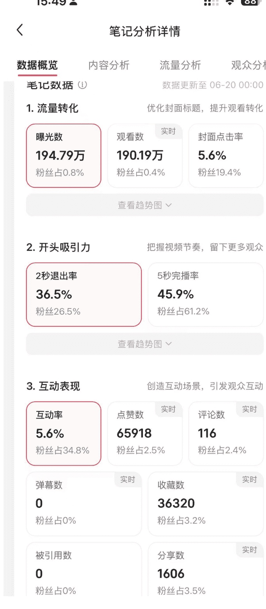

### 📕新号的第一条视频

**作品数据详情**

作品共获得1031流量激励

切换作品

总览 流量分析 观众分析

作品状态正常

**流量**

- 播放量: 515.7万

- 点赞量: 17.8万

- 评论量: 261

- 分享量: 1.9万

- 收藏量: 6.6万

- 弹幕量: 3

- 完播率: 37%

- 2s跳出率: 26.68%

新增 累计 每小时 每天

设置观测

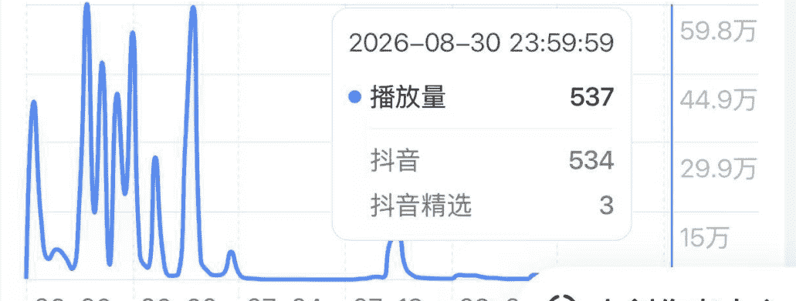

去创作者中心

投放DOU+可获得更多播放量和互动

### 抖音新号的第一条视频

**作品分析**

2026-08-15 17:41发布

切换作品

总览 流量分析 观众分析 喜爱分分析

**内容吸引力** ⓘ 部分数据产出延时

| 播放量 | 平均播放时长 | 封面点击率 |

| :--- | :--- | :--- |

| 93.4万 | 16.5秒 | 19.1% |

| 2秒跳出率 | 5秒完播率 | 完播率 |

| :--- | :--- | :--- |

| 12.2% | 77.1% | 37.9% |

新增 累计 每小时 每天

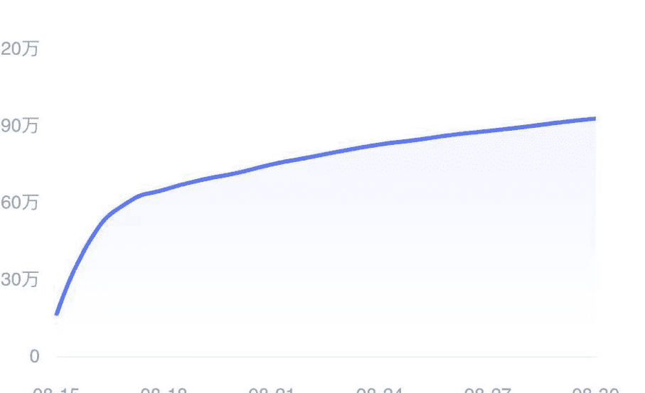

比往期均值高1859%，选题很受欢迎！

**观众互动** ⓘ 部分数据产出延时

| 点赞量 | 评论量 | 分享量 |

| :--- | :--- | :--- |

| 7.2万 | 405 | 6443 |

快手

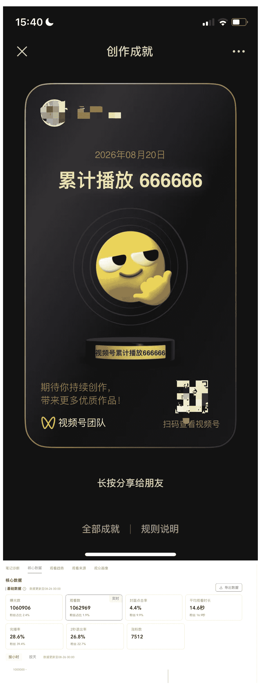

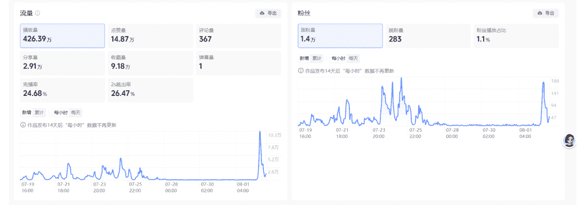

**抖音单条视频涨粉 1.4 万**

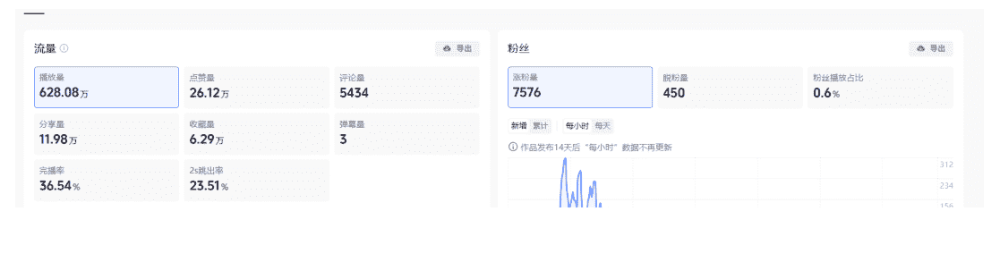

**600 万播放量啦**

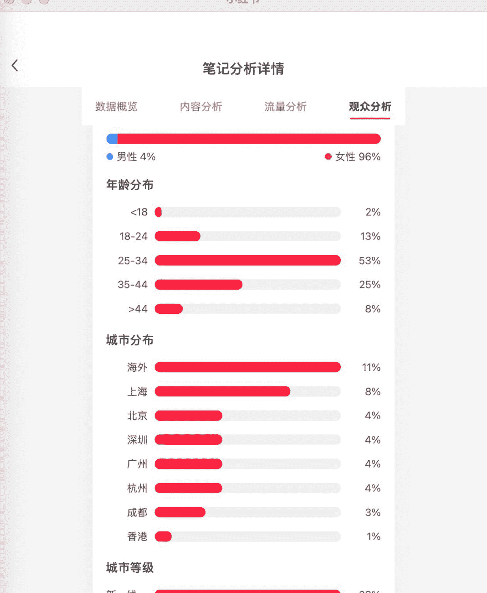

**账号的粉丝占比都是高净值女粉**

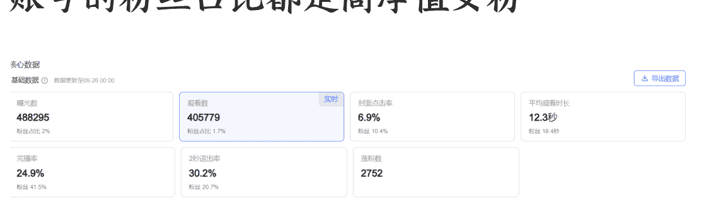

## 二、后来我才看懂：工具只是表面，判断才是核心

很多人好奇，百万播放的视频是怎么做的？如果只说成本，一次生成大概三五十块token费，我这边这样的内容前后出了18条。

可真要复盘为什么能成，我不会把功劳算在某款工具上。同一个模型、同一段提示词，只要把人物、服装或者开头动一下，结果可能完全是两个世界。

我做过很多轮对比。有的内容做起来又省事又便宜，一张脸、几句台词，就能从几千播放涨到几百万；有的内容换一个平台，依然能跑出来。

所以我慢慢形成了一个判断：真正能打的内容，放到哪里都有一战之力。

平台确实有自己的算法，但决定观众是否停下来的东西，其实没有变过。

她第一眼为什么想看？  
她为什么觉得“这说的就是我”？  
她为什么愿意看完，还点进你的主页？

这一个个问题，比“我用哪个模型”重要得多。

而这些感受，我是从直播间里泡出来的。

过去卖女装那几年，我经手了几十万件衣服，销售额早就过了亿。每天面对的都是真人真事：

“我肩宽，穿这个会不会显壮？”
“我肤色偏深，这颜色适合吗？”
“我个子小，这衣服会不会压身高？”

我原以为自己只是在卖货。等开始做虚拟形象才反应过来，积累下来的是对用户的感知力。AI起到的作用，只是让这份感知力被更多看见。

所以这篇分享不打算写成工具教程。

工具和流程照样会提到，但真正想聊的是：一个零基础的人，怎么把自己过去攒下的经验迁移到虚拟内容里，跑出播放、粉丝和合作。

过程肯定有不顺，我也是反复试。后来总结成五块：人物设计、画面呈现、选题方向、内容表达、生产SOP。下面一个个展开，聊聊我当时的判断、哪些动作有效、后面又怎么调整。

工具会换，平台会变，今天管用的做法，过一阵子未必还管用。

但我更愿意复盘的是：一条内容为什么有人愿意看？一个人为什么愿意关注？品牌为什么愿意来聊？这些问题，长期都有价值。

下面是几支我自己比较满意的作品（完整视频请看在线文档版本）。

第一支是技术还没成熟时做的，毛病不少；
第二支是最近用 MiniMax 出的，我特别喜欢；
第三支算是我真正意义上的第一条百万播放。

## 三、为什么我不继续直播，而是选择虚拟形象

总有人问我：“你外形不差，为什么不干脆自己出镜带货？”在外界看来，直播是我最顺的路。

但做了几年直播后，我越来越确定，我不想只做直播。我更想把过去那些积累换一个容器，在AI里重新开始，试出一套属于未来的打法。直播是我曾经发光的地方，不是我的终点。

在品牌的时候，身边一直有助理、摄影和置景团队。光线不好我提一句，背景不对我提一句，衣服不合适马上有人换。我要做的只是在镜头前把状态拉满，给用户一个买的理由。

后来我脱离品牌，自己拍了整整一个月。为了找一个光线合适的拍摄位，我花了三天。架灯、找角度、布置场景、搭配衣服、拍素材、剪视频……以前动动嘴就完成的事，落到一个人身上可能要磨一周。

也是那时候我才清醒：过去我以为是自己的本事，其实一直有团队在背后支撑。

假如继续走真人出镜，我无非是从一个直播间挪到另一个直播间，从依靠团队变成一个人硬扛。我不出镜，内容就停；我状态不好，生产也停。

这不是我想要的下一站。

AI来了以后，我开始琢磨：能不能做一件更长期、更能留得下来的事？

我最终选择虚拟形象，不是因为它轻松。正好相反，开头非常不轻松。

但它提供了一种新的可能：内容不必绑定“今天我有没有站在镜头前”。一个虚拟人物可以被长期经营，一套内容方法可以被反复验证，最后慢慢沉淀成自己的资产。

所以前90天，我没有任何收入。

我做过跟钱离得很近的生意，太清楚流量来了应该怎么变现。但这一次，我想慢一点。不想刚有起色就追着广告跑，也不想哪个品牌找来就把内容往哪个方向迁就。

我就想看看：先不急着赚钱，这个账号到底能长成什么。

现在回头看，我得谢谢当时的“慢”。一个虚拟账号刚开始，最值钱的不是这个月能接几单，而是它最终会成为什么。有没有自己的内容和风格，有没有人愿意一直追，能不能从一个好作品长成十个好作品，从一个号长成一套可持续的内容资产。

这些一旦立住，商业化只是顺水推舟。后来的品牌合作、付费咨询，乃至课程，都不是我强推的，而是自然发生的。

下面这张图，是📕上线头一个月收到的品牌合作咨询，数量太多，没法全部截进来。

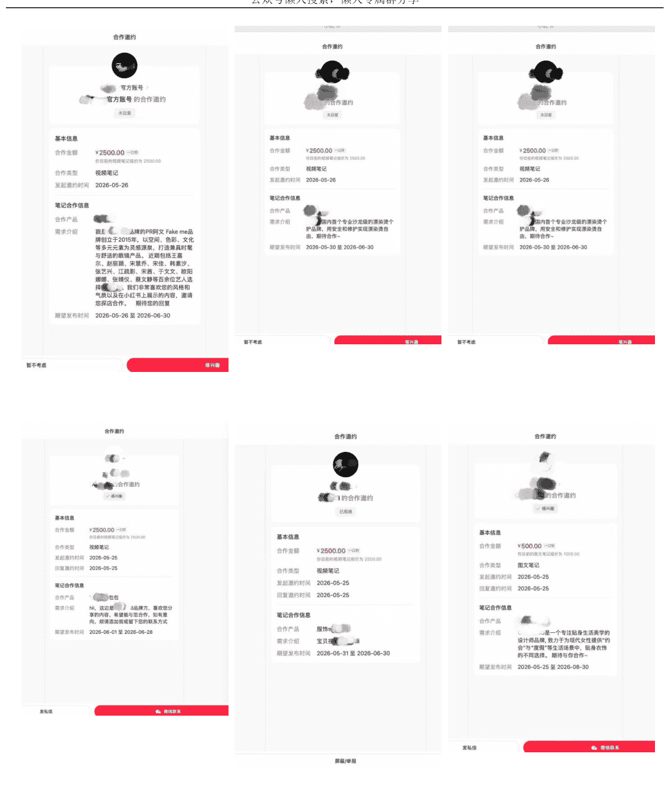

前面两个多月我依然没有接任何商业合作，但合作报价已经逐渐累积到五千量级。我也在试探：市场到底愿意为一个虚拟形象付出多高的价格？

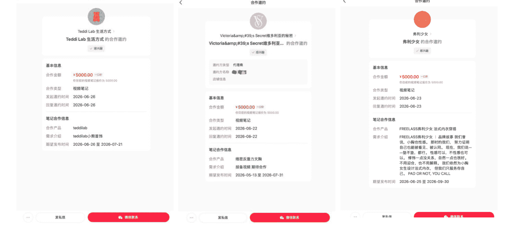

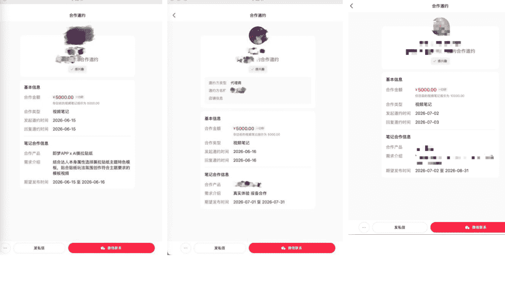

## 四、从0到第一批高播放内容：我踩过的关键步骤

想做出热门内容，第一步永远是让观众觉得“这事和我有关”。

技术类创作者很容易自嗨，以为算法难、设备贵、效果炫，大家就会点赞。但观众看到这些，内心多半是：“哦，很厉害，可这跟我有什么关系？”

好的内容要回到人身上。它要把专业翻译成大白话，戳中普通人日常里最在意的点。比如我的视频选题，常从“偏深肤色怎么穿”“换个发型像换了个人”这种很具体的问题切入，大家一眼就能共情。

而且视频前五秒，我不会介绍自己多厉害，也不会铺垫工具和流程。我会直接把最有冲击力的画面丢出来。现在用户没耐心，开头抓不住就等于白做。同时，你还要用别人不知道的行业细节，制造一种认知反差。

我有次跟手机品牌的人聊天，他提到：拍照要放大时，最好使用1倍、2倍、3倍这种整数倍数，不要用1.2倍、2.9倍。因为整数倍是直接用镜头输出画质，小数倍数其实是把画面裁出来再放大。

这在行业内不算秘密，但普通人真不一定知道。把这种小常识放进具体生活场景里，就是很有用的内容素材。

## 五、真正沉淀下来的，从来不是提示词

### 1. 先看人：她是谁，凭什么被记住

虚拟人物不是一张漂亮的脸。脸是门票，不是全部，能让人留下来的，是人设。

我从不把她当成AI来运营，而是当成一个真实的人：她的年龄设定、气质风格、穿衣调性、微表情、生活方式，必须保持统一。她是不是真实得足以让人相信？她的审美是不是稳定？用户看完会不会记得她？

最近很火的那个虚拟女孩，因为一个“遭遇裁员”的故事而刷屏，全网播放量过了3亿，还登上了顶级时尚刊物，单条广告能报到25万。

为什么她能这么值钱？最大原因就是：她太像一个真人了。她不是那种精致到发光的AI脸，也不会让人一眼就觉得“这是假的”。她会分享做饭、跑步、约会和日常琐事，连五官都保留着几分不够完美的地方。

刷她内容时，你不会老想着“这是个AI”，反而会忍不住好奇：她今天又在过什么日子？

运营团队从一开始就没有按普通博主来做，更像是在推一个艺人：先用那支出圈的裁员短片让大家认识她，再慢慢铺起个人账号、日常分享和商务合作。

品牌和媒体看中的，从来不是粉丝列表有多长，而是她已经成为有话题、有故事、有辨识度的角色。她敢报25万一条，也不是只靠流量，更靠稀缺性。

品牌愿意投她，表面上是买一条内容，本质上是在买“虚拟偶像”这个新鲜概念。

所以我现在觉得，做虚拟人物的重点不是把人做得多精致，而是让用户愿意相信：她是真的在生活。

她最有辨识度的地方，就是那款标志性刘海，以及脸上两粒小痣。

### 她登上的那本时尚大刊

关于“捏脸”，对圈子里的朋友来说其实很简单。真正拉开效果的，往往是五官比例、面部轮廓和整体气质这些不容易量化的细节。

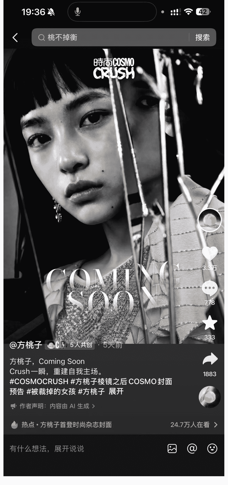

我调整面孔的目标，不是做成千篇一律的AI网感脸，而是在保留本人辨识度的同时，混入一种自然的异域感。出来的效果要像她，又比原来的她更立体、更耐看。

我拿自己的脸反复做了很多轮测试，下面是其中几个版本。

气质比精致重要太多。为了定一张脸，我经常要花三天，抽卡抽到人家以为我疯了。

老实说，现在这些版本我仍然不满意。时间紧，人又抠细节，脸型、轮廓、五官比例和神态只要有任何不和谐，我都会继续返工。

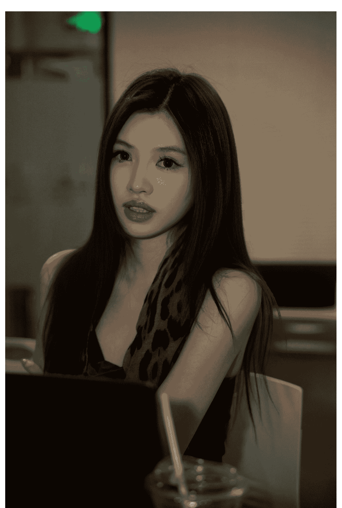

**实拍图**

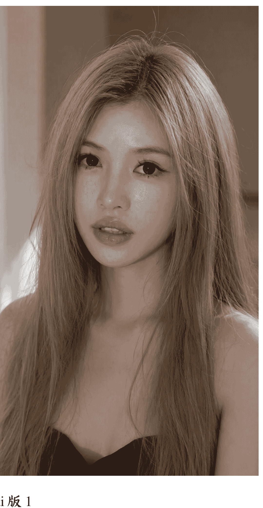

ai 版 1

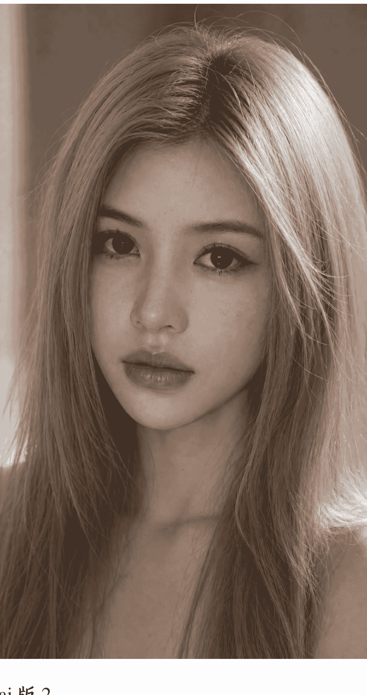

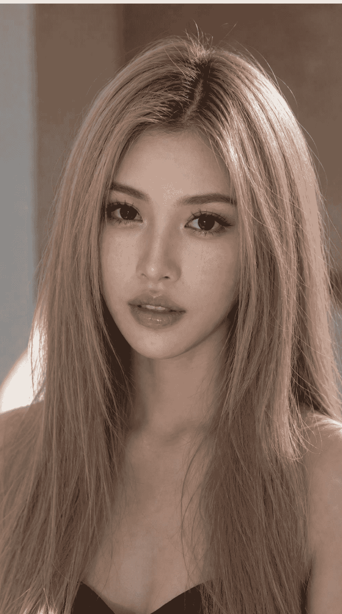

ai 版 3

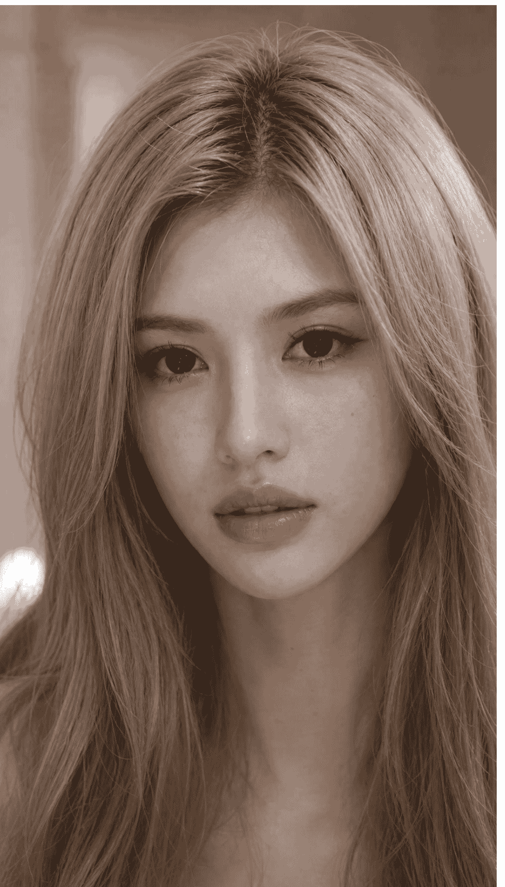

ai 版 4

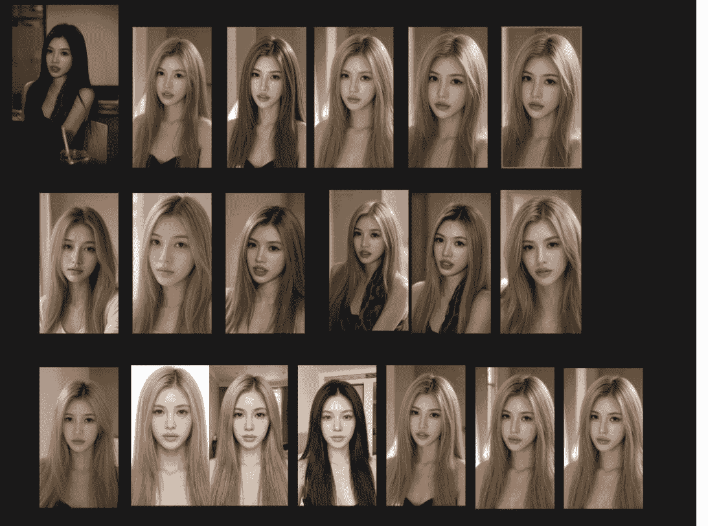

这就是那张脸迭代过程中的不同版本。

我用的工具主要是 Lovart 的 Image 2。市面上能生成人像的模型已经很多，用哪个不是决定性因素，决定性因素是你自己知不知道：想保留什么、想改什么、最后要给人什么样的气质。

这一轮我只看三件事：人物原本的辨识度还在不在，五官比例对不对，脸上有没有真实的骨骼支撑和立体感。

所以我的流程里从来没有“一键定稿”，只有一轮轮对比、筛选和微调，直到人物稳定下来。

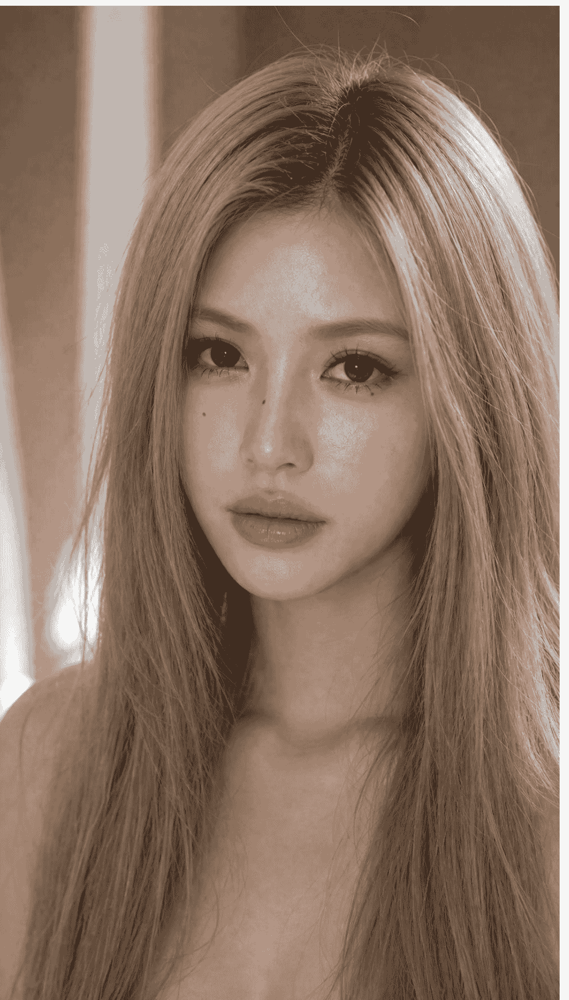

等脸部稳定后，我会继续增加细节。

我不想让她仅仅“好看”，我想让她看起来像真实的人。所以我会重点处理皮肤质感、光影变化、五官细节，包括那几粒特征性的痣。

重点不是把皮肤修到无瑕，而是保留毛孔、纹理和一点点瑕疵。太光滑、太标准的脸，观众记不住，也很容易露出AI味。（其实这张图还是有点假，只是暂时来不及重做了。）

在这之后，我每轮提示都会围绕人物辨识度、混血气质、真实肤质、面部标识和拍摄质感来做限制，避免角色每次生成都变成一张新面孔。

我的提示词:

生成一张超写实女性人脸特写肖像，画面为脸部近景特写，人物头部和少量肩颈入境，双眼清晰对焦，真实人像摄影质感。

[核心目标:两张脸真实融合，不是单纯像图1] 最终人物必须是图1与图2的人脸融合版本，不是图1原样复制，也不是图2直接替换。整体要求保留图1人物的基础辨识度，但必须明显融入图2的混血感、立体骨相和精致五官特征。最终效果要达到:第一眼能看出是基于图1的人物，人物不要张嘴，变成正脸照脸不要侧脸，人物不要张嘴!!但同时也能明显看出融合了图2的五官风格与混血感，不是"几乎和图1没区别"，而是"图1人物经过融合后，明显更有欧美混血感的版本"。

[人脸融合比例] 图1作为基础身份参考，图2作为强风格参考。融合方向建议为:60% 图1 人物辨识度 + 40% 图2 混血感与立体骨相不要把图1锁死成 1:1 照搬，允许在保留图1基础辨识度的前提下，明显引入图2的骨相与五官气质。

[图1保留内容] 保留图1人物的基础脸型轮廓、整体五官分布、原始神态气质、眼神感觉和大致辨识度。要求最终人物依然能让人感觉"是图1这个人融合后的版本"。

[图2必须明确融合进来的特征] 必须清晰融入图2的以下特征，而且要肉眼可见:更强的混血感，更深邃的眼窝，眉骨结构参考图2，只参考骨相立体度，不参考其他，更高更挺的鼻梁，更精致清晰的鼻尖和鼻翼结构，更明显的面中立体度，更清晰的颧骨与面部明暗转折，更精致的唇形和嘴部边界，整体五官更加立体、深邃、精致，呈现自然的欧美混血气质。注意:混血感不是只靠妆容实现，而是通过骨相、眼窝、鼻骨、面部结构和五官立体度真实体现出来。

[重要限制]禁止最终人脸几乎和图 1 一模一样;禁止只做轻微优化;禁止只增加一点鼻梁高光就算“混血感”;禁止完全变成图 2;禁止变成陌生人脸。最终人脸必须是一个真正融合后的新结果:既像图 1，又明显拥有图 2 的欧美混血感和立体骨相。

[发型]发色改为浅金色长直发。头发为自然浅金色、米金色、蜂蜜金之间的色调，不要假发黄，不要荧光，不要过白的白金色。长发顺直自然垂落，发丝必须真实清晰，有细碎发丝、自然毛流、轻微层次感，发根、发中、发尾过渡自然，发际线真实，头发具有自然柔顺光泽，不能像塑料片，不能结块。

[皮肤质感]保留真实皮肤质感:毛孔、细微皮纹、轻微肤色不均、鼻翼纹理、眼周细节、唇纹、自然骨骼转折、面部轻微绒毛。皮肤状态要细腻但真实，禁止过度磨皮，禁止塑料皮，禁止蜡像感，禁止油亮假面感，禁止陶瓷肌。

[妆容]整体妆容自然精致，偏高级感轻欧美妆。重点突出五官立体度和混血感，底妆轻薄，眉毛毛流清晰，睫毛自然浓密，眼妆干净，可有轻微眼线和淡淡阴影强化眼窝，唇色自然裸粉或低饱和豆沙色。妆容只是辅助，重点仍然是骨相和五官融合后的真实混血感。

[构图与拍摄要求]脸部特写近景，人物脸部在画面中占比高，额头、下巴完整保留，不要裁切五官，不要夸张歪头，不要过强侧脸，镜头视角与眼睛平，背景简洁自然虚化，柔和漫射光，真实摄影质感，双眼最清晰，整体高清、干净、自然。[最终效果总结]生成一张超写实女性脸部特写照，人物是图1与图2真实融合后的人脸，保留图1基础辨识度，但必须明显拥有图2的混血感、深邃感、立体骨相和精致五官。浅金色长直发，真实发丝，真实皮肤质感，高级自然，无明显AI痕迹。GPTImage 2.中9:16.1张

我以为做AI视频是“输入咒语等出片”，直到自己跑完一条才明白：这其实是一条内容生产线。

把一个视频项目拆成几个步骤来做，远比直接喊AI生成一整段画面靠谱。

第一步，我会先搭一个“爆款素材池”。

日常刷📕、抖音和Ins，看的不是热闹，而是每条视频到底在解决什么问题：是单纯展示一件衣服，还是讲一种穿搭方法？是强调颜色、身材比例，还是还原某个使用场景？再或者是分享口红、妆容、服装之间的搭配公式，用整体造型来营造氛围？

每个平台，我也看得不太一样。Ins上我会盯着高播放内容，📕上则更在意点赞、收藏、评论这些互动指标。遇到有价值的参考，我会用Codex写的小插件快速收进飞书素材库，方便之后分类和挑选题。

但我也不是什么都囤。只有和账号定位、目标用户、时尚业务相关的内容，比如服装、穿搭、口红、妆容、配饰和整体形象管理，才会被优先留下来。

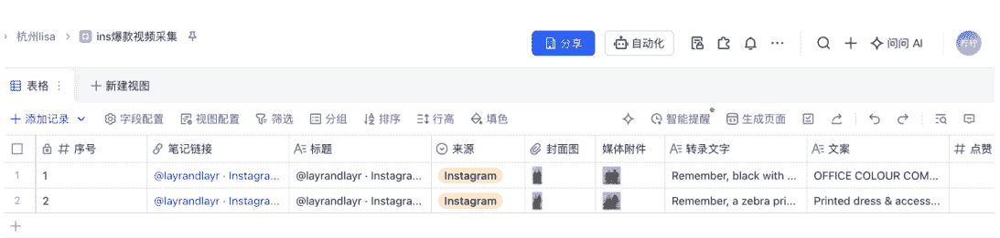
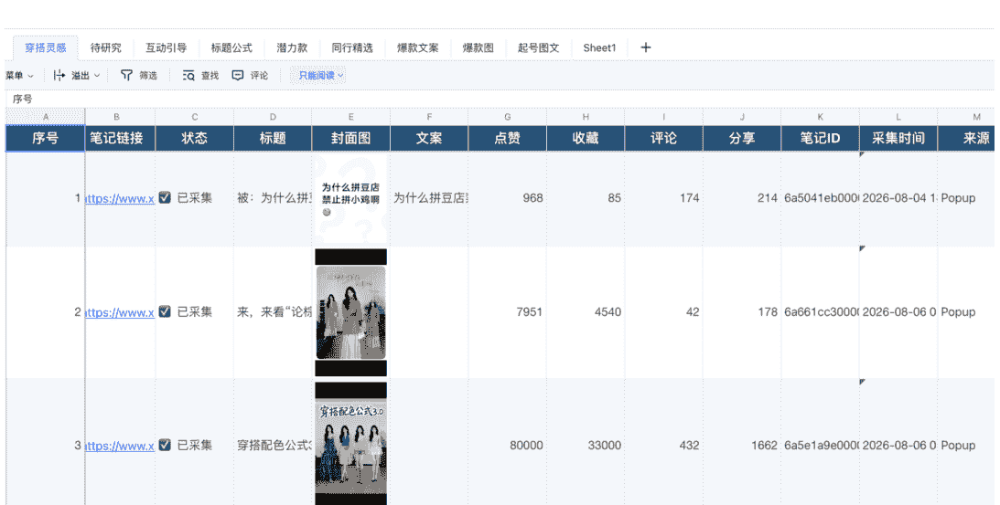

第二步，选题从真实问题里长出来，而不是空想。

“今天做什么好看”这种念头，基本不能当选题用。真正有效的来源是三个：直播间里反复被问到的真问题、对标账号里互动特别高的内容、以及平台上正在发酵的热门话题。

我举几个曾经跑出百万播放的选题：领口要怎么呼应发型？配饰怎么才能把整套穿搭补齐？黄黑皮到底适合什么颜色？这些问题的共同点是：足够具体，用户刷到的时候会立刻觉得“这说的就是我”。

很多行业知识本身并不神秘，但一旦放进真实生活场景，变成大家看得懂、用得上、上手就能抄的内容，停留和互动率就会明显上来。以前在女装直播里，类似“发型和领口搭配”“配饰穿搭公式”这种话题，也是被用户反复问到，我才越来越确定它们值得做。

选定选题后，我还会把同类高互动内容拆开看：第一眼吸引力在哪里？为什么让人想看下去？它解决的到底是哪个具体痛点？有没有把服装、口红、妆容和配饰的关系讲透？最后，我会用自己的人物、审美和视角重新演绎，而不是复制别人的外壳。这样产出的内容，既能展示衣服，也能自然延伸到妆容、配饰和整体造型。

第三步，先拆参考视频，再设计自己的画面。

拿到选题，我会找一条参考视频，然后像解剖一样拆开：里面有几套衣服？妆容和造型有没有变化？第一套和第二套之间是什么关系？镜头是怎么切的？人物有没有走路、转身、整理衣服这类动作？

看起来很简单的换装视频，拆完往往就是：两个镜头、两套风格完全不同的衣服、一个强烈的前后对比、以及几个卡上音乐节拍的动作。参考结构之后，我会全部替换成自己的服装、人物和审美，再根据衣服素材去定站姿、动作、镜头角度和画面比例。

我特别爱用极致反差，比如用妆容、服装、滤镜三层来制造前后冲击力。

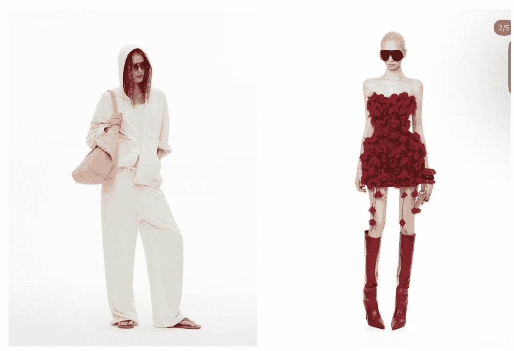

（完整的对比演示，可以在在线文档版本里看。）

第四步，先生成图片，再一轮一轮筛。

画面设计完成，先出图。人物图和服装图是重中之重：人物要稳住身份，服装要尽量还原版型、颜色、材质和细节。

AI一次就生成完美结果的可能性很低，所以我会反复检查：五官、发型、妆容有没有忽然变化？衣服颜色和版型有没有跑偏？手部、饰品、身体比例是不是自然？背景、机位和人物占比是不是统一？

我通常一次生成很多张，再挑最稳、最适合做视频的一套，不会“第一张能看就往下走”。因为对细节有执念，图片经常要生成好几轮、反复对比，才敢放进下一步。

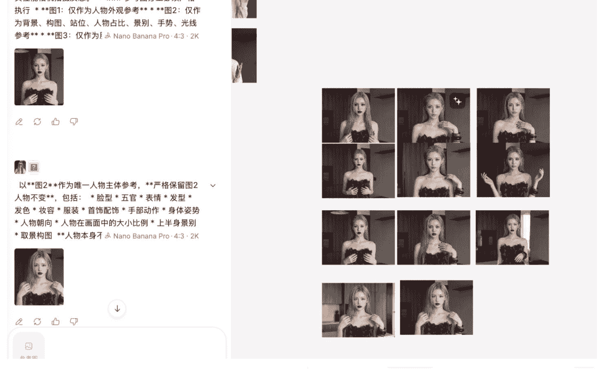
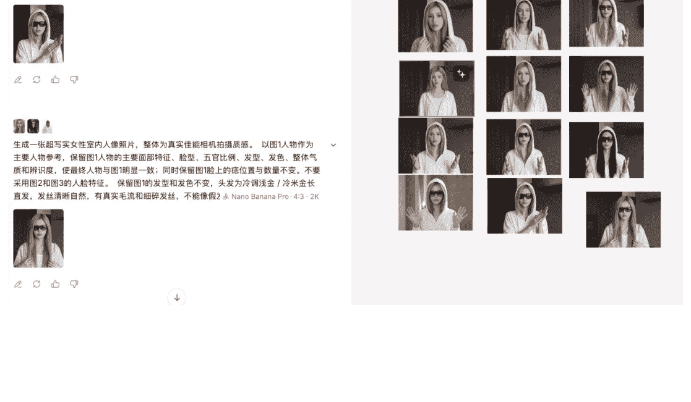

当时为了让“人物、服装、背景”三个维度精确合体，我写过非常长的提示词。比如一版里规定：图1只能用来定人脸，连痣的位置和数量都要保留；图3只提供服装和眼镜；图2则决定了取景范围、人物在画面里的位置大小和整体构图，而且画面里不能出现包。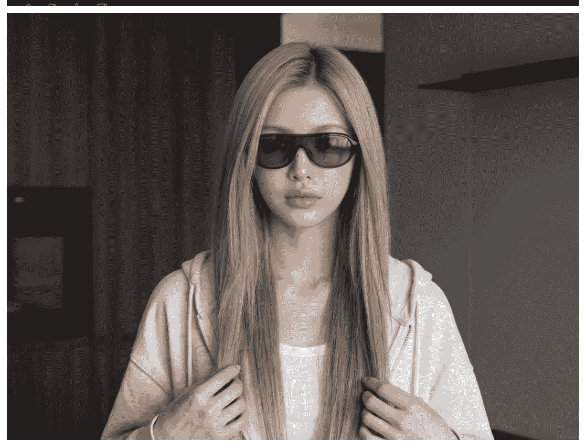 另一版更狠，五张参考图各管一件事：图1管脸，图2管背景和手势，图3管衣服，图4管妆容，图5管发型，连发丝的湿线条、黑色美甲、佳能50mm镜头的真实质感都要写清楚。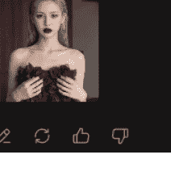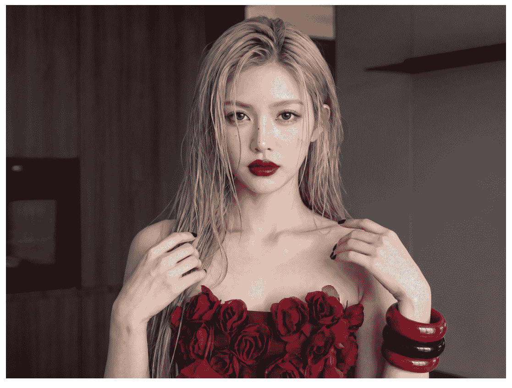

第五步，再写动态提示词，生成视频片段。

静态图片确认后，才进入视频生成。这一步不是把图片“按个播放键”，而是要把动作想得很具体：动作从哪开始、到哪结束？镜头是固定、推进还是跟随？衣服要展示哪个细节？手、头发、身体该怎么配合？背景和光线要不要一直稳定？

这次我用了Seedance 2.0的全能参考，先把参考视频拆成提示词，再丢进视频模型里试。等流程顺了以后，其实可以慢慢脱离万能参考，直接用“提示词+参考图”也能把动作和画面说清楚。

提示词不用堆得很复杂，但关键动作、镜头运动、服装展示和画面限制必须明确。比如“转身”“走近镜头”这类指令，越具体，后期筛选和返工越省事。

当时两条视频提示词就很有代表性。一条要求结尾转身必须完整流畅，人物从头到尾不能换脸，不能出现字幕和美甲。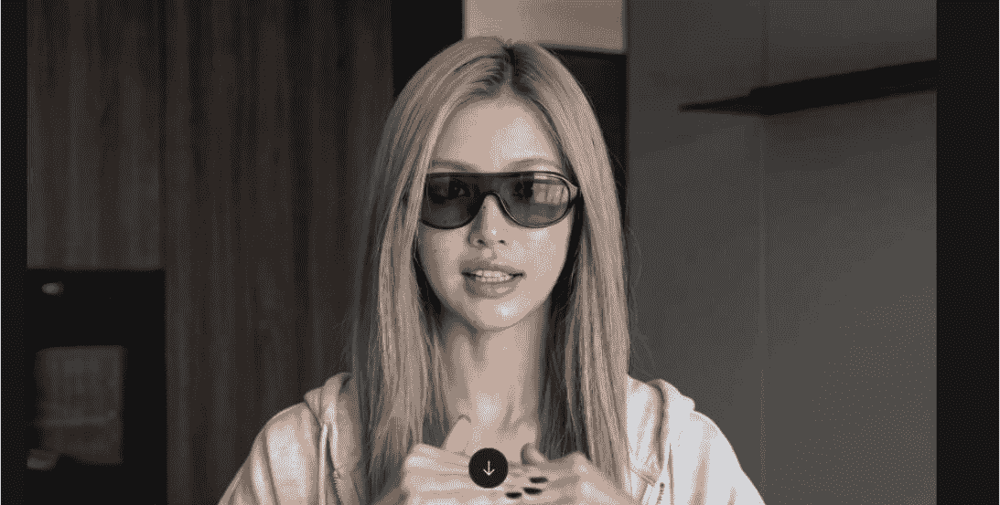 另一条是变装转场，开头必须是一个连续的“侧面转正面”的身体动作，中间自然完成变装，角色全程保持黑色美甲，眼神冷感、有张力，但不说话、不张嘴。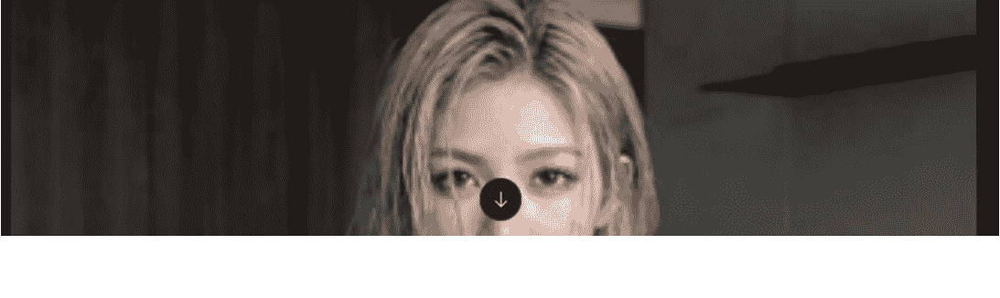

第六步，筛选、剪辑、包装、发布、复盘。

视频片段出来后，先别急着剪。我会重点看：人物在不同镜头里是否一致？动作是否自然？手部、头发、衣服有没有穿帮？服装在运动时有没有变形？镜头切换是否连贯？画面有没有真正传递出服装和人物的状态？

有些片段单独看没事，拼到一起就暴露出人物变化、光线不一致、动作接不上等问题，这时候只能重新筛。

确定片段后，再做剪辑、配乐、字幕和封面。有些画面明明不错，但开头太慢，或者字幕没把重点拎出来，观众照样划走。所以剪辑不是简单拼接，而是让画面、节奏、内容成为一个整体。（这部分的成片效果，也收录在在线文档版本里。）

发布之后，我还会记录这条视频的主题、内容和数据。这样下一轮制作就不是拍脑袋，而是直接调用验证过的经验。以前做女装直播也是同样的循环：选款、搭配、试穿、讲解、观察反馈，再调整。现在只是把直播间搬到了AI视频流程里。所以我不太把AI视频理解成“输入几个词等出片”，它更像一套完整的内容工作流：先弄明白观众想看什么，再设计怎么呈现，最后用数据判断哪些方法值得沉淀成SOP。

商业化信号：播放量之外，合作也来了

这几个月让我开心的事，不只有播放量，还有越来越多的合作邀约。服饰、内衣、包包、美妆，以及平台和其他行业的咨询都出现过。希音、快手、百度、爱奇艺、淘宝等平台的入驻或合作邀请，也陆续有收到。

这些反馈让我重新理解虚拟IP的价值：它不只是用来炫技的账号，还可能接商单、做种草，甚至能看出有没有人愿意为相关内容付费学习。

我也在观察品牌到底看重什么。有的看人物风格，有的看服装展示效果，有的问能不能稳定量产，还有的想知道这个账号能不能变成长期合作的内容载体。

就拿希音来说，对方直接来问有没有AI平面/AI视频的承接能力，说希望对接具备跨境审美能力的AI机构，还让我发公司作品集和报价。

快手官方运营也来邀请了，说入驻后同步站外作品就行，有百万流量助推和现金奖励，参与期内不签约、不收费。

爱奇艺服务商也找了上来，说看中作品质量，想聊官方流量合作。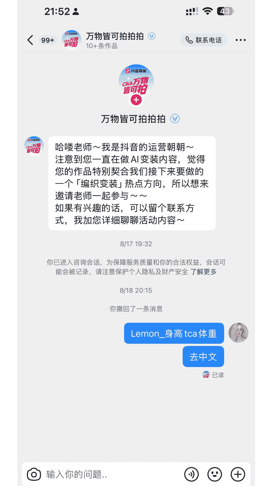

还有不少平台运营主动邀约共创，直接把资源位和激励放到面前。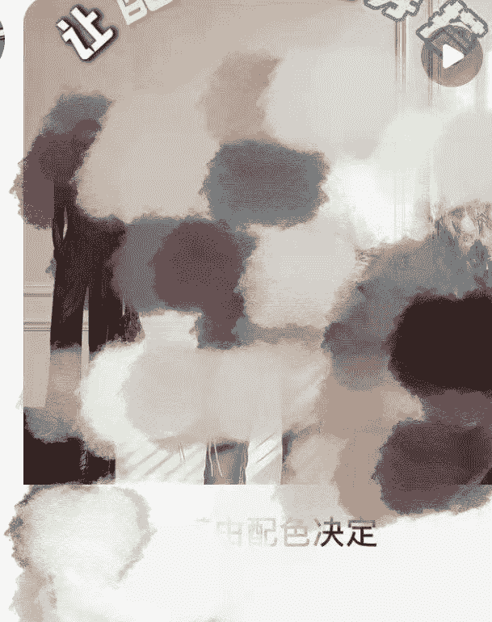

📕更是持续给我投流。时尚薯和美妆薯先后私信过，让我带话题参与活动。比如加上#colorfit，官方会安排投流；带#本命穿搭和#柔性穿搭，就有5万到20万不等的流量激励。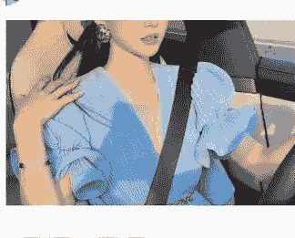 只要把tag加好，对方还会主动留言说“我们直接安排助推投流”。

后来，好几条视频都被判为话题优质内容，接连收到“恭喜获得话题活动流量激励”的官方通知，一来就是好几条。

淘宝的MCN也来约过，说看到📕上的图文和视频很优质，邀请参加短视频采买活动，只要同步作品就有月度激励，右上不封顶，商单收益另算。

这些信号让我更确定一件事：AI视频不是玄学，而是一条可以被拆解、复盘的流水线。只要流程扎实，内容能带来数据，商业机会也会顺着内容自然长出来。

最近收到一条让我眼前一亮的私信——发信人自称是《偏爱之恋》节目组的选角导演。这档节目来头不小，背后是优酷平台S+综艺《势均力敌的我们》第一季的原班制作团队。对方说在社交平台上看到了我的内容，觉得匹配度很高，问我有没有兴趣深入聊聊。说真的，被恋综导演“翻牌子”，还是挺开心的。

不过，比这更让我在意的，是私信里开始出现越来越多类似这样的问题：除了品牌合作邀约，有人问我“AI变装能不能学”“AI视频到底是怎么做的”“有没有完整的制作流程”。这让我意识到，观众的目光已经从“这条视频真好看”转向“这背后是怎么做出来的”。换句话说，内容和结果之外，方法和过程也开始被需要。

这件事也让我认真想了想：过去积累的审美、内容判断力和AI制作经验，也许真的有机会沉淀成一套更标准化的能力。当然，一切还在验证中。我不会因为收到几份邀约，就急着宣称“已经跑通了商业闭环”。就目前看到的反馈来说，播放量只是一层表面结果，真正决定一个账号能走多远的，是内容有没有带来新的连接：有没有品牌愿意多聊几句？有没有观众愿意为你的内容付费？有没有人想把方法用到自己的业务里？这些信号，才是账号持续生长的底气。现在的后台私信，已经多到回不过来了。

借这个机会，我也想把几个容易踩的坑拿出来聊聊，都是真金白银换来的经验。

第一，生成不等于发布。AI虽然能帮你把画面生成出来，但它不会替你判断这条内容到底有没有价值。人物有没有记忆点？衣服细节展示清楚了吗？观众凭什么继续看下去？这些问题，只能靠你自己回答。

第二，别只追求漂亮。脸修得太过精美，画面像广告样片一样，反而少了真实感，观众很可能看一眼就划走，更别说记住你。真实和记忆点，比单纯的美重要得多。

第三，别把播放量当成唯一标准。数据很高，但既没新增关注，也没有收藏和私信，可能只是短暂的喧嚣。真正需要复盘的是：这条视频有没有推动观众做出下一步动作？

第四，别低估细节的打磨成本。机位、灯光、人物稳定度、服装质感、动作自然度、标题和封面，每一项都要慢慢磨。一条15秒的视频，背后可能是一遍又一遍的试错。

第五，出了爆款之后，也别急着去卖课。五月份就有人问我什么时候开课，但那时我更想把内容本身做扎实，希望先分清哪些做法是稳定可复现的，哪些只是一时运气。后来我换了不同的人物、不同的选题，也在多个平台上来回测试，才一点一点把那些稳定的东西剥离出来。现在这个阶段，我选择先把整个探索过程公开讲透，再把自己跑过、验证过的东西，慢慢打磨成一份能给别人参考的指南。

如果你也打算做AI内容获客，我的建议是：别急着把各种工具都学一遍。先做一个小实验就够了——选一个你本来就有经验的赛道，别去碰自己完全不了解的领域；找出三支你判断观众会愿意看到底的参考视频；把它们放到一起拆解，看看共同点在人物、画面、钩子、封面、评论区这些环节里是怎么体现的；然后做一条15到30秒的AI短视频，别等完美，先发出去；复盘时抓五个数：封面点击、平均观看、完播、收藏、涨粉和私信。走完这一轮，再决定要不要继续深入。说到底，AIGC这件事的起点，根本不在于你掌握了几个软件，而在于你能否用AIGC内容换来一次真实的用户反馈。

最后说几句心里话。加入赚钱之后，我最大的感触是，这里的成员都特别坦诚，愿意把做法、错误和修正过程都摊开来说，而不是只讲自己有多厉害。这种氛围真的影响了我。以前我总觉得，很多结果是靠运气、资源或天赋，后来才发现，所谓的好结果，往往就是不断试错、不断复盘、不断把动作拆到最细的人拼出来的。到现在，我也不敢说自己已经完整跑通了一个多大的商业闭环，但我越来越相信，虚拟IP有机会成为一条值得持续验证的内容获客路径。所以，如果你正在内容、品牌或电商领域里折腾，或者一直想让AIGC真正帮到自己的业务，欢迎随时来和我聊聊。

