# 从 371 粉到 63000 粉，变现 40 万+：我的 X（推特）从起号到变现全复盘

过去这一年，鱼总在X上从371个关注做到63000多，直接收入40万+。他把整个过程复盘了一遍，信息量很大，我把里面的核心逻辑整理出来，分享给大家。

鱼总本人是设计科班出身，做了8年APP和SaaS方向的产品经理。辞职创业这几年，他先后做过20多个APP和出海网站，累计用户500多万，单款产品最高做到12万美金营收——全程没有投放过广告，靠的是产品自身的自然增长和避开红海的选品判断。

但是在自媒体上，他走过不少弯路。早期在国内平台做到过10万粉，也组过团队做矩阵号，后来遭遇封号、限流，一度拿做产品的利润去填坑。他后来想明白了一件事：**做内容不能为了做内容，那是没有根基的空中楼阁。必须和真实的产品、真实的业务深度绑定，才能当做出海和个人品牌的杠杆。** 所以过去一年，他把精力全部集中到AI方向的出海业务与X平台的联动上。圈友来跟他交流，发现大家普遍卡在三个地方：

1. 起步期最难受——新号发出去只有几十次浏览，像在空房间里自言自语，完全得不到回应；
2. 内容方向摸不清——天天看别人出爆款，自己花大半天写的干货没人看，搞不懂推荐机制到底想要什么；
3. 赚钱路径想不明白——总觉得X只能闲聊吹水，接不到正经广告，也不知道怎么给自己产品导流。

2025年9月10日，他在赚钱的X航海上发出了第一条起号内容。那天他正陪妻子在医院做产检——老二还有两天出生。就在二宝出生的那两三天里，这条内容直接让他涨了3000多关注，最难的新号破冰期就这么跨过去了。

> 小懒判断：适合手头有产品或技能、想把X做成流量放大器的人。空手上阵、指望靠纯流量号赚快钱的，不适合。最值得学的是他起步期的两个动作：第一条内容磨了四个半小时，发布后1小时内找头部账号帮忙转发——被人点名带来的关注比例远超其他入口。最大的坑是互相刷关注的群，会把受众模型搞坏，还会被系统打上协同作弊的标签，最后变成被无声降权的幽灵号。

目前的成绩单：关注数从371做到63000+；6条长内容的阅读量破了百万，最高一条展示量268万；一条AI视频被全网搬运，合计播放量数千万；网易、百度、字节等大厂主动找上门合作，广告报价从0涨到单条6000-10000元；他组建的共享接单群，群内累计成交金额超过200万。

关于40多万的收入构成，涉及合作方保密协议和合规要求，具体数字不方便逐一公开，但各渠道的占比结构和跑通逻辑，他会完整拆解。

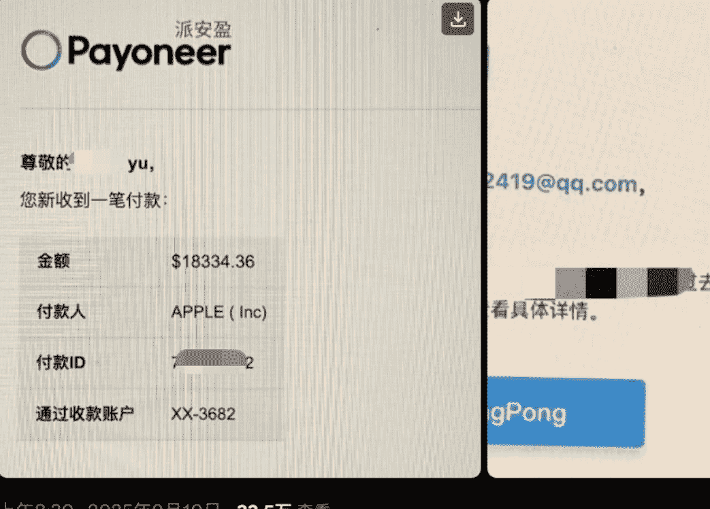

新号起步的具体操作步骤，这篇文章不再展开，之前的精华帖已经拆得非常细，建议结合那篇一起看：
> https://wx.szxq.com/group/1824528822/topic/5124258881122514

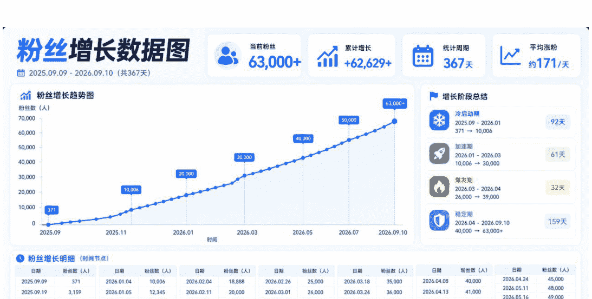

12个月后的结果：
- 关注数从371增长到63000+；
- 6条长内容阅读量破百万，单条最高展示268万；
- 做出一条被全网搬运到数千万播放的AI视频；
- 网易、百度、字节等大厂主动合作，报价从0涨到6000-10000元一条；
- 共享接单群累计成交超200万。

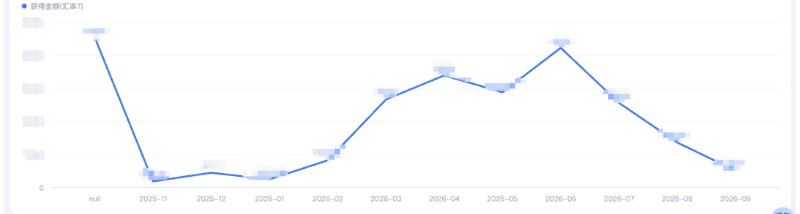

正式认识一下：鱼总。设计出身，8年APP和SaaS产品经理，现在全职创业，做出海工具、个人开发和X内容。做产品赚全球用户的订阅费，同时用X给产品引流、沉淀个人品牌。

去年9月发出第一条起号内容，靠它完成了从0到1。12个月后：关注数371→63000+，6条百万阅读长文，与X直接相关的收入（广告合作、工具分销、创作者官方激励）累计40万+，广告报价从0到6000-10000元，合作品牌包括网易、百度、字节等，共享接单群累计成交超200万。

一直有人问他：X到底怎么从零做起？干货没人看怎么办？除了吹水到底怎么赚钱？发了几个月还是没收入怎么回事？这半年情况又有了新变化——2026年X用Grok模型完全重写了推荐算法并开源，创作者激励政策也全面收紧。所以他把这一整年的所有实操、赚钱逻辑、踩过的坑，做了一次彻底复盘。只讲能落地的，不讲虚的。

这篇解决8个核心问题：
一、X增粉的底层公式是什么？为什么大号转一次比自己发十条有用？
二、Grok推荐系统到底看重什么？认真对话凭什么比点赞值钱？
三、起号之前必须想清楚哪三个问题？
四、第一条内容怎么磨？怎么借力大号破局？（附两个必踩的降权大坑）
五、6条百万阅读的爆款，选题逻辑和创作流程是什么？
六、X中文圈的层级结构什么样？怎么靠专业内容向上链接？
七、语言壁垒被打破后，中文内容的机会在哪里？
八、五条赚钱路径怎么选？广告怎么接、工具怎么带货？（附2026激励新政避坑指南）

### 12个月跑通40万+收入的渠道构成

> 说明：以上统计仅包含与X账号直接相关的三类现金收入，不含X持续给他的独立SaaS产品（如PaywallPro）和个人网站（yuzong.ai）带来的高净值用户与长期订阅收入。

先回答一个基础问题：X值不值得做？

很多人觉得X流量小、圈子小，但他这一年的体验是：这是一个被严重低估的流量富矿。理由四个：

- **用户质量高**：X的中文圈聚集了大量出海创业者、投资人、海外华人和技术大牛，付费意愿和购买力远超普通泛娱乐平台；
- **信任积累快**：实名或半实名持续输出一手干货，更容易形成高粘性个人IP，之后合作、融资、招聘都非常顺畅；
- **招人质量高**：在X上招到的人，自驱力和出海认知明显比国内传统平台高一截；
- **复利效应强**：关注到一定规模后，展示量非常稳定，挂一个产品链接就能带来持续注册和付费，转化路径极短。

### 全文目录

按实战顺序拆成十个部分：

一、增粉就一个公式：触达×转化（底层逻辑）
二、算法只在乎一件事：认真对话胜过点赞（Grok机制解读）
三、动手前先答三问：你是谁、给谁看、凭什么关注（账号定位）
四、从0到1：第一条内容值得磨4个半小时（起号实操与踩坑）
五、内容怎么火？先满足别人的硬需求（选题逻辑与爆款方法）
六、X中文圈的层级结构：看看你在第几层（圈层认知与向上连接）
七、语言墙倒了：中文内容全球都在看（出海新机会）
八、赚钱五条路：对号入座，总有一条适合你（广告/带货/激励/独立站/共享群）
九、赛道与避坑：这些能碰，这些别碰（高危操作与防封指南）
十、精力分配：别把X当主业（产品才是根本）
写在最后：真诚利他，主动出击（做号第一心法）

有人问他：全都公开了，不怕别人学会？

他的答案和赚钱的初心一致：真诚利他。他自己就是被圈内前辈无偿分享喂大的，所以坚信把真正有用的东西讲透，收获的信任和长期机会，远比捂着的那点信息差值钱。

整篇有两条主线贯穿：真诚利他，主动出击。增粉、写内容、混圈子、赚钱，底层都是同一套逻辑。

直接开始。

## 一、增粉就一个公式：触达 × 转化

市面上大多数「X增粉教程」讲的都是小技巧——几点发、封面怎么弄、标签加不加、怎么找大佬助力。这些东西有用，但只是优化项，不是核心驱动力。

真正核心的框架只有一个：

> 关注增长 = 触达人数 × 关注比例

但公式里的两个变量，来源不同，性质也完全不同。

### 触达的三个来源

第一，时间线内容流。你的内容出现在别人的推荐页或关注列表里。这是最大的触达来源，也是多数人唯一盯着的地方。

第二，个人页浏览。有人因为各种原因点进你的主页。这个来源被严重低估——大量关注行为其实发生在用户翻完你的主页之后：他看了你最近几条内容，觉得「这人有价值」，才按下关注键。

第三，被点名提及。别人在内容里@你、转载你、或在评论区提到你。这个来源量级通常不大，但关注转化率高得惊人。为什么？因为公开提及本身就是一种信任背书。很多头部账号到了一定阶段，就是靠这种互相推荐形成网络效应，比如宝玉、歸藏、小互、Orange老师他们。

### 关注比例的分层漏斗

触达有了，关注比例决定了多少触达最终变成关注。但比例不是固定值，取决于用户从哪个口子进来：

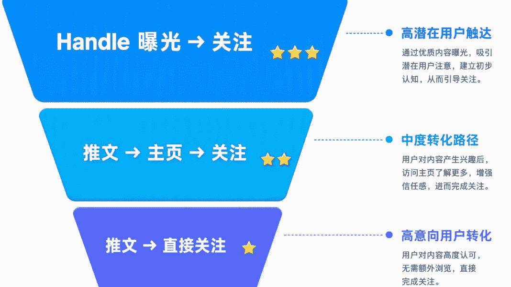

这个漏斗能解释三个常见现象：

- 为什么有些账号「看的人多但就是不增长」？因为内容能抓住眼球，但个人页没接住——用户点进去一看，历史内容要么是转发抽奖，要么是没人看的碎碎念，凭什么关注你？
- 为什么「大号转一次顶自己发十条」？因为被点名触达直接绕过了信任验证这一步，还叠加了从众心理。
- 信任是怎么建立的？不是你包装出来的，是你长期真诚帮助别人之后，别人替你「说」出来的。大号愿意转你，是因为内容确实帮到了人；粉丝愿意关注你，是因为看到你一直在认真解决某个问题。

利他不是口号，它是转化公式里最底层的变量，装不出来，也刷不出来。

### 对普通人的建议

对非名人来说，内容质量和被转载曝光是并列的第一优先级，其他都是锦上添花。

> ⚡ 一个关键细节：内容发布后第一个小时的互动数据极其重要，算法会根据这个窗口期的表现决定是否加大推荐。所以如果认识大号，在他发布后第一时间帮忙转发和互动，效果比事后补做要好得多。

理解了这套「触达×转化」框架，再来看算法给出的信号——方向完全一致。

## 二、算法只在乎一件事：认真对话胜过点赞

X是全球唯一两次开源推荐算法的主流平台：2023年3月第一次，2026年1月用xAI的Grok模型重写后再次开源，代码就挂在GitHub上，不需要靠猜。

对创作者来说，只需要记住一条：**对话深度远远碾压点赞数量**。在算法权重里，作者本人的回复、用户之间的真实讨论，分量远高于转载和点赞——一次有来有回的交流，比几十上百个赞都值钱。

大白话翻译一下：**算法奖励的是「认真」，认真落到人身上就是真诚。** 你认真回每条评论、认真帮人调试代码、认真跟同行讨论问题，算法全都认；花钱买的赞、群里约好的互点，算法一个都不认。所以别把算法当敌人，它其实在替你筛选——谁在真诚交流，谁在机械制造数据，它分得一清二楚。

那算法具体怎么运作？把官方开源代码翻译成人话，就是下面这套「上菜流程」。

### 一个比喻：For You 的「上菜流程」

把For You想象成一个手脚麻利的服务员。你走进一间巨大的食堂，里面同时有几十万道菜，服务员不可能全端上来，流程分四步：

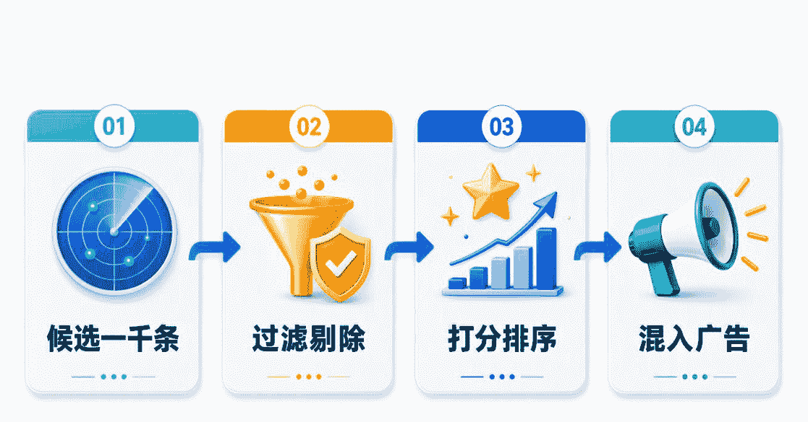

**第一步：先端一小车候选（大约一千多条）**

- 你关注的人刚发的内容（代码里叫Thunder）——存在内存里，毫秒级就能取出来，相当于你点过名的厨师刚出锅的菜，优先上车；
- 没关注的人里，猜你可能喜欢的（Phoenix召回 + SimClusters）——你最近老刷AI内容，它就多拿AI；你常看某类内容，它就往那个方向靠。

**第二步：把不该出现的筛掉**

你拉黑过的、点过「不感兴趣」的、设过屏蔽词的、明显违规的、刚看过的——全部拿掉。这一步只判断「能不能出现」，不看排名。

**第三步：给每道菜打分（最核心）**

它不问「这条在全网火不火」，而是问你：以你平时的刷法，你更可能多看几秒、点赞、回复、转载，还是划走、拉黑、举报？模型会为每条内容预测一系列行为概率（点赞、回复、转载、引用、点开、看视频、关注作者，以及不感兴趣、拉黑、举报），再按权重加总成一个分。

预测你会认真互动的往上排，预测你会烦的往下压。这里有个容易误读的细节：权重乘的是「预测概率」，不是全站真实动作数。网上流传的「1个举报抵468个赞」这类说法，官方注释里已经澄清不是这个意思。

**第四步：中间插入广告和「推荐关注」**

这些不是排序模型决定的，是另一套管线混进来的。

### 新手最该记住的五个结论

这也恰好印证了前面的框架：真正值钱的不是粉丝「刷到」了多少次，算法更看重「聊起来」的转化。你刷得越认真，这辆小车就越懂你；你只划不点，它就只能靠很粗的猜测。

## 三、动手前先答三问：你是谁、给谁看、凭什么关注你

定位是第一要务，但多数人把它想复杂了。只需要回答三个问题：

如果你是做Web3产品想拉新用户，就别拽高深术语。走下沉路线，写「三步买第一枚比特币」这种入门指南，才能吸引增量用户。

「别人凭什么关注你」翻过来就是利他——你能为哪群人持续解决什么问题。想清楚这一点，定位不再是包装，而是承诺：向一群人承诺持续提供价值，然后用内容一条条兑现。定位不是写给自己看的简历，而是写给读者看的「我能帮你什么」。

他自己的定位：**AI出海、独立开发、实战干货**。内容分两类——认知型思考和操作型教程。偶尔发点生活感悟、发点吐槽完全没问题，只要别跑偏太远。

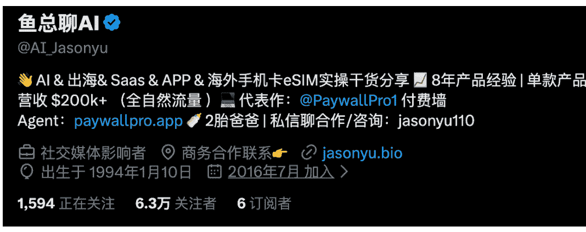

很多人讲过垂直领域，他理解的垂直不是「做AI就只发AI」。AI周边、目标人群需要的内容都可以发，比如接码、网络相关的话题，都没问题。

定位要清楚，但没必要、也不该把自己框死。

## 四、从0到1：第一条内容值得磨4个半小时

起步做不好，后面全白费。

他起号的第一条内容磨了4个半小时，改完又改，最终换来48小时3000+关注、24万展示。这是一个精心设计的开局。

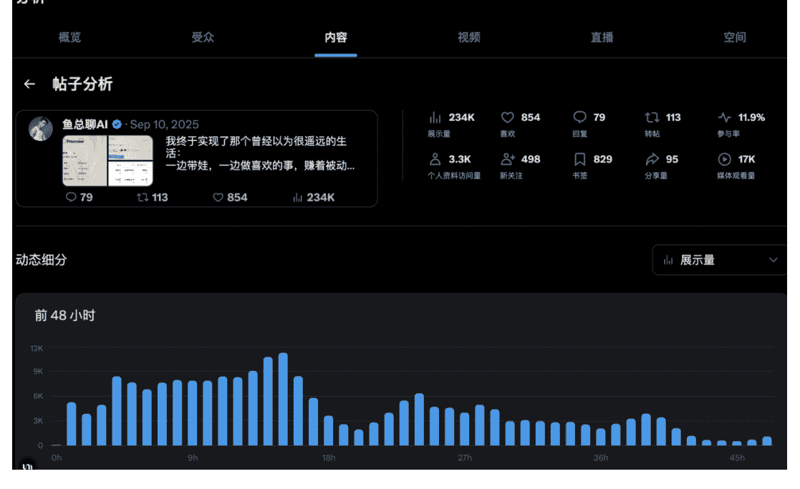

这条内容目前的展示量已经到33.5万了。

### 从0到1的三个关键要素

#### 1. 内容质量是地基

第一条内容必须打磨到极致。可以结合真实经历，也可以写干货教程。内容要对新手友好，把步骤拆到「小白也能看懂」的程度。很多人写教程爱省略步骤，觉得「这还用说」。错了，真有人不懂。你就当他们是零基础。

封面、排版、标题都要用心。他是设计出身，特别在意这些细节：封面简洁吸睛，排版舒服，字号合适——这些都直接影响「停留时长」这个算法信号。

#### 2. 找大号转载是突破口

内容再好，没人看见等于白写。起步阶段必须想办法让有影响力的人帮你转载。

> 大号转载 = 被点名触达 = 关注转化率最高的入口。有了初始互动数据，算法才会继续推。

他起步时请了哥飞、小排老师这些朋友帮忙。后来他指导过的小耳朵老师，内容经他一转载带动，也拿到了几十万浏览、涨了近2000关注。

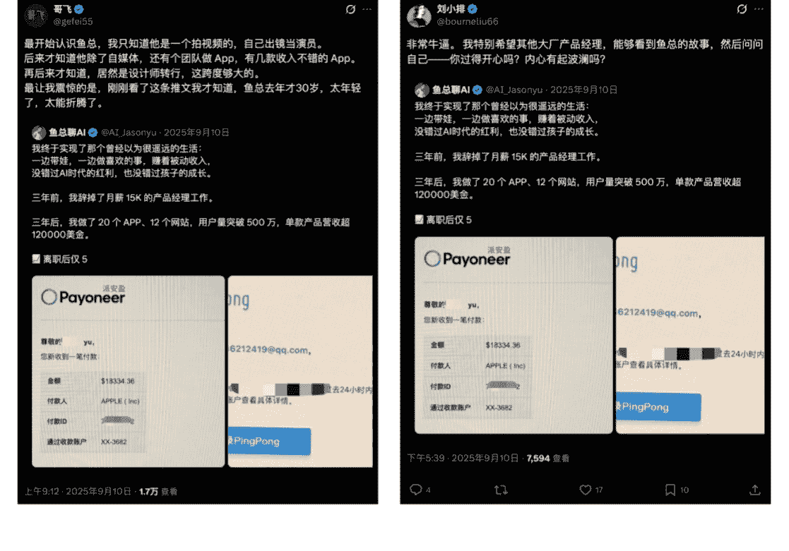

怎么找大号帮忙？有朋友就直接开口。没朋友就先攒人脉、多互动、混圈子——这确实没有捷径。但「没捷径」不等于「只能干等」：混圈子不是被动等别人发现你，而是主动去互动、主动去帮忙、主动去创造价值。他请到的几位朋友不是天上掉下来的，是之前很长时间里，主动真诚互动、互相帮衬，一点一点攒下的关系。

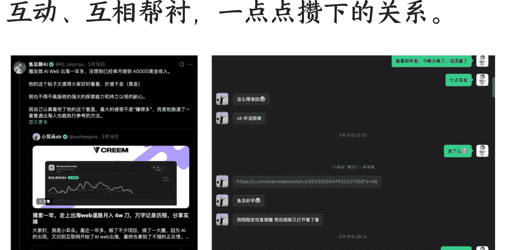

#### 3. 账号准备要做足

- **开通蓝V**：X Premium会给账号加分、提高推荐优先级，这笔钱千万别省。
- **养号**：新号别急着发转化内容，先发几条基础内容，把个人资料完善好。
- **个人资料**：突出核心关注领域，让人一眼看出你是做什么的。头像别用系统默认图。

从0到1完成后，关注到了2000左右，可以进相关社群——比如tutti等，里面有合作单和加热机会。也可以自己创建或加入共享接单群，大家一起共享订单、互相加热。

顺便说他建群的初衷：一开始真没想靠这个赚钱，就是自己单子接多了，想把好机会分享出去，大家有资源也往群里丢、互相成就。后来这群累计成交超200万——那是信任攒够之后自然长出来的，赚钱章节会细讲。

### 从0到1绝对不能碰的两个坑

起步阶段踩一个坑，可能让前面两个月的努力全部清零。他见过太多圈友栽在这两件事上：

**坑一：加入互相关注群**。有人为了让数据好看，加入那种你关注我、我关注你的互刷群，再互相点赞。表面数据飞涨，但这些人跟你的定位毫无关系，算法会判定你内容受众极不精准，降低推荐权重。更要命的是，互点行为会被系统判定为协同作弊，直接给账号打标签。一旦被无声降权，基本等于废了，后面靠正常内容再想把权重拉回来，难上加难。

**坑二：号没养熟就发转化内容**。新号权重本来就低，个人资料没完善，内容再好也容易被算法当成营销号。一定要先发几条基础内容养号，让系统有时间学习你的内容方向。

## 五、内容怎么火？先满足别人的硬需求

选题逻辑核心一句话：先解决别人的刚需，再做自己想做的事。

很多人写干货没人看，是因为一直在写「我想让你知道的」，而不是「你本来就想知道的」。能火的内容，本质都是帮人省时间或避坑。

他的6条百万阅读长文有一个共性：全是帮读者解决具体问题的教程型内容。比如拆解某个出海工具的操作流程，比如梳理某类产品的赚钱路径。

他的创作流程有一套自己的方法：先锁定目标人群的真实痛点，再列步骤拆到极致，最后用大家都能懂的语言写出来。排版上多用分点、加粗、表格，把阅读门槛降下来。

还有一个小技巧：把最核心的结论放在最前面，让人刷到第一屏就觉得值，停留时长自然就上去了。

## 六、X中文圈的层级结构：靠专业内容向上连接

X的中文圈里有一条隐藏的排序：底层是刚注册的新人，中间是有稳定输出的垂直作者，顶层是头部大号。多数人卡在中下层，不是不够努力，而是没找到向上的方法。

方法很简单：用专业内容吸引同频的人，用高质量的互动让头部注意到你。大佬不缺吹捧，缺的是真正有信息量的对话。

建议：敢表达、敢提问、敢帮忙。在AI和出海相关话题下，一条有深度、有事实依据的回复，比一百句「学习了」「谢谢分享」管用。

## 七、语言墙倒了：中文内容全球都在看

过去大家都觉得X是英文内容的主场。现在变了——X的翻译功能越来越强，Grok推荐系统天生支持多语言分发，中文内容完全能撬动全球流量。

他身边已经有人靠中文内容打开了日本、东南亚、欧洲的用户，完全不需要英文内容。关键在于内容本身要够硬，翻译之后依然有信息量、有启发、能解决问题。

这波机会的本质是：全球用户的注意力从来没离开过好内容，以前受语言限制，现在墙倒了。

## 八、赚钱五条路：对号入座，总有一条适合你

他把一年跑通的赚钱路径整理成五类：

**第一条：广告合作**。最直接也最大众。粉丝量、互动率、内容垂直度，是品牌方最看重的三个指标。他现在单条报价6000-10000元，合作方包括网易、百度、字节等大厂。避坑提醒：看清投放目标，是做品牌曝光还是拉新转化，割韭菜的广告坚决不接。

**第二条：工具分销**。适合自己有产品、或者会挑产品的人。通过分享真实好用的工具，用内容挂链、置顶链接等方式引导注册或付费，拿分销分成。核心是只推荐真正好用的东西——信任比佣金重要。

**第三条：创作者官方激励**。2026年X调整了创作者激励政策，原创内容奖励变多，长文、视频、高互动对话都能产生收益。但新政有个坑：平台对「低质量批量发帖」的打击力度大幅提升，靠搬运转发凑量的账号会被直接取消创作者资格，必须老老实实做原创。

**第四条：独立站沉淀**。这是很多人忽略的长线生意：在每条内容和个人主页挂自己网站的链接，把X的流量沉淀到自己的阵地，再用订阅、广告、卖产品长期变现。比如他的yuzong.ai和几个独立SaaS产品，长期收入远超短期广告单。

**第五条：共享接单群**。广告单接不完的时候，把资源分发到群里，大家一起接单、一起赚钱。他组的群累计成交已超200万。

总结：五条路有快有慢，核心一致——信任先行，赚钱在后。粉丝量不是第一位，信任才是第一位。

## 九、赛道与避坑：这些能碰，这些别碰

哪些赛道值得做？AI工具、出海服务、独立开发、Web3、投资理财认知——需求真实、付费能力强、内容天花板高。

哪些别碰？灰色地带：色情擦边、刷粉刷赞、搬运抄袭、虚假人设。短期可能见效，但迟早被打击。他见过太多账号一夜回到解放前。

三个防封心得：第一，保持真实感，不要全是干货没有生活气息；第二，坚持原创，慢一点也没关系，绝不搬运；第三，绝不买粉买赞，算法早晚会发现。

## 十、精力分配：别把X当主业

最后这部分可能是最重要的提醒：产品才是根本，X只是放大器。

见过太多人把全部精力扑在X上，为了数据好看而拼命发内容，结果账号做起来了，产品原地踏步。正确的姿势是：产品提供真实解决方案，X提供流量和信任，两者互相成就。

他过去一年70%的精力在产品和出海业务上，30%在X上，产出回报比反而最高。如果你现在没有产品，也没想清楚怎么赚钱，先别急着做X——先把产品做出来。

### 写在最后：真诚利他，主动出击

回头看这一年，所有看起来「运气好」的结果，背后都能归因到两个词：真诚利他，主动出击。

真诚利他，是起步时能请来大号转载、能被圈友信任、能把共享群做到200万的根本原因；主动出击，是内容被算法看见、人脉被撬动、合作单主动上门的必要条件。

在增粉公式里，利他藏在最底层的转化变量里；在圈层里，利他是建立信任最快的方式；在赚钱上，利他是商业合作最持久的护城河。主动出击让机会出现，真诚利他让机会留下。

这就是他从371关注做到63000关注、收入40万+的全部秘密。

做账号最怕什么？方向还没找对，就先掉进两个坑里。

第一个坑，是挤进各种点赞互关群。新号没流量，人一急就想抱团取暖，结果一圈兴趣完全不搭的人围在一起机械式点赞评论。推荐系统是按兴趣圈层给内容找人，你被这批人一搅，账号的受众画像直接就废了。更要命的是，短时间内高频集中的互动异常，一旦被风控识别为虚假互动，账号会被贴上一个非常坏的标签，信用值断崖式下滑，从此变成没人抬得动的透明号。

第二个坑，是内容还没沉淀几条，就急着放链接做转化。用户对你毫无认知，你就想着收网，算法只会觉得你在投喂广告。先给价值，再谈生意，这个顺序不能反。

## 爆款逻辑：先回答一个具体痛点

我今年写过六篇破百万浏览的帖子，选的题分别是：香港、荷兰、德国三地的电话号码申请与保号，解决出海人收码、注册境外服务的麻烦；平台创作激励的入门指引，讲清楚怎么达标、怎么绑卡收款；还有一份用 AI 整理的中文区 X 头部博主关注列表，数据也很亮眼。

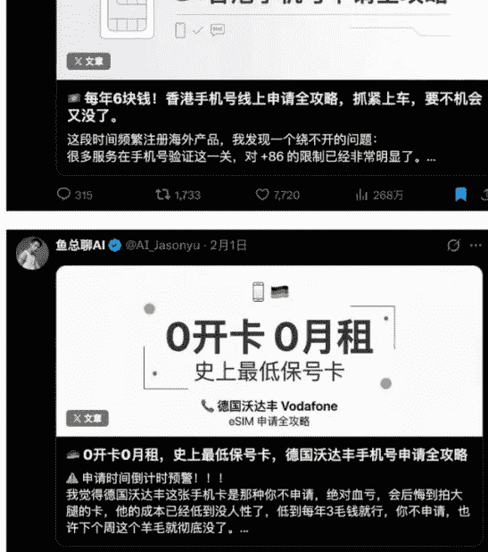
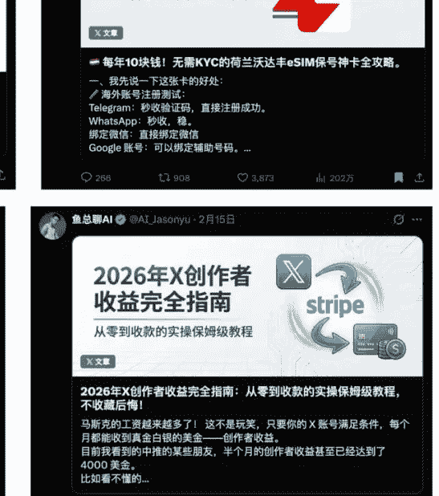

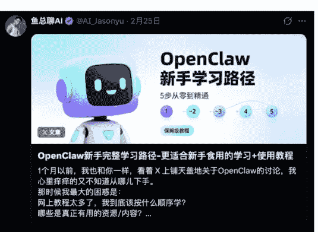
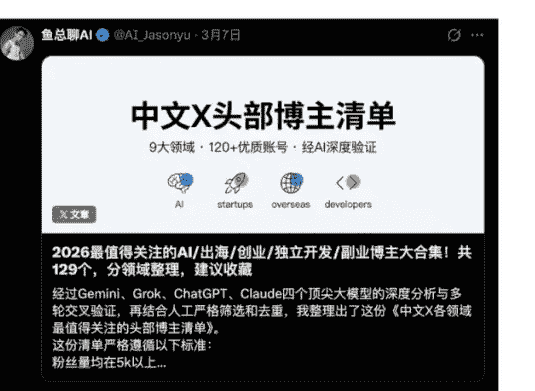
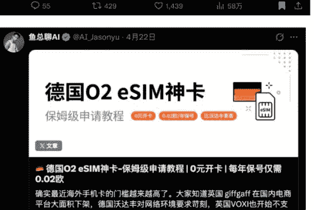
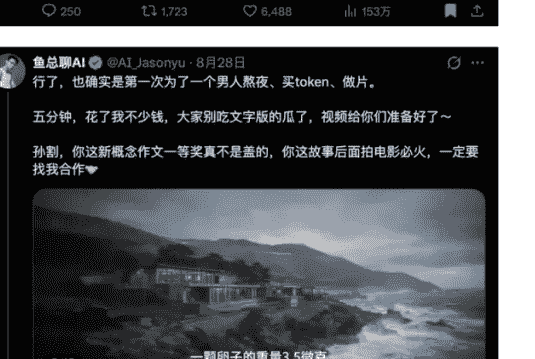

这些选题有个共同点：它们都不是拍脑袋想出来的，而是正卡在别人喉咙里的真问题。接码、收款、找资源，每一个都具体、反复出现、和利益直接挂钩。爆款的底层逻辑就是利他——先想清楚读者此刻最疼的地方在哪里，再动笔。我观察到的爆款，几乎没有哪个是天天自说自话的账号做出来的。

怎么写才实用？别扔一句“去设置里改一下”就完事，要把步骤拆到没法再拆：点页面右上角的齿轮图标 → 打开第三个选项卡 → 滑到安全设置 → 把第四个开关点开。颗粒度越细，读者越愿意照着做。

长期有流量的方向包括：网络工具、银行卡和信用卡、号码保号与接码、机票酒店优惠攻略、海外充值礼品卡、AI 工具清单。这些赛道需求很硬，盘子也稳。

要避开的内容也很清楚：擦边内容、传播🪜方法、住宅 IP、盯着国外大厂羊毛薅。这些轻则内容被删，重则账号直接没了，有些热度不值得冒风险。

## 我的创作流程

我自己的流程是：先收集资料，再自己从头到尾跑一遍，然后让大模型辅助扩成教程长文，人工核对修改，最后排版发布。

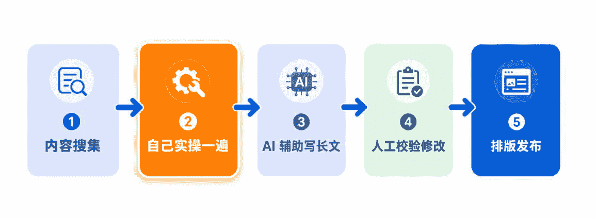

这套流程里最不能省的一步，就是「自己从头到尾跑一遍」。别人喂给你的方法，自己没验证过，写出来是没底气的。只有亲手踩过坑，你才知道哪个环节会出问题，也才敢对读者负责。这个习惯还有个附加好处：你平时用得顺手的工具，往往就是你以后最现成的变现抓手。

工具方面，我常用 Youmind 抓取 YouTube 等平台的内容，它会照着你已有的风格生成文章，排版也方便。专业版一个月 20 美元，但生成后的内容一定要人工复核。

https://youmind.com/pricing?ref=LTElKN&campaign=2026-618

总有人问我为什么不同步发公众号。不是看不起公众号，而是两边调性差太远。X 上说话能放开，内容敢写，链接也能直接放；公众号那边要加群、链接限制多，推荐逻辑也不看粉丝量，阅读数据起伏很大。精力就这么多，把一个平台吃透，比两个平台都做得半吊子强得多。

写长推文还有两个常见翻车点。

一是完全把写作丢给 AI，自己一步都不验证。有些人抢热点，把别人的英文内容扔给模型改一版就发。可工具随时会更新改版，参数变了、入口换了，你却没发现，教程就成了定时炸弹。一旦爆了，成百上千人照着做到一半卡住，评论区直接变事故现场，轻则被骂误导人，重则招来大量举报。我的原则是：教程里每个关键截图、每个操作步骤，我都必须自己在电脑上跑过。亲手试出来的真实感，AI 写不出来。

二是排版太潦草。X 是快节奏信息流，用户手指划得飞快。如果一段话五六行不换行、不设重点标记、没有标题层级，读者扫一眼就滑走，停留时间太短，算法就认为内容没价值，停止推荐。排版不是为了好看，而是帮读者省力气，也帮算法争取留人时间。

## 中推的层级结构

中文推圈看似松散，实际上内部层级分明，像金字塔一样。顶层的人可能不靠它吃饭，中间的人最吃香，再往下的人最卷，底层的人最危险。

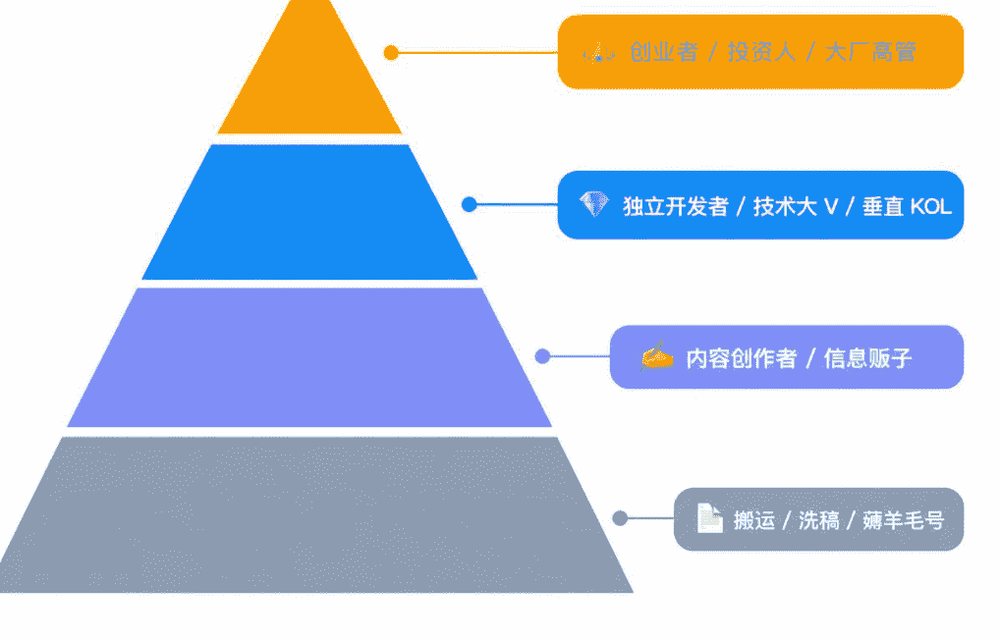

先看顶层：创始人和投资人、大厂高管。他们发推只是顺手发声，现实身份就是最好的信誉背书。比如傅盛，作为猎豹移动的创始人和投资人，2026 年仍活跃在 X 上谈 AI，一条动态可以跑到百万曝光量，但他显然不是在为流量发推。

第二档是圈子里最吃香的人：独立开发者、技术大 V、垂直 KOL，手里都有硬货。他们发的内容要么是独家认知，要么是拿来就能用的实操干货，粉丝质量高，商业转化也好。这一层发一条，效果可能顶下面的人发十条。宝玉、歸藏、Orange、哥飞都在这层。

第三档是大多数人的位置：内容创作者、信息倒卖者，包括刚开始做号的你我。靠流量活，接广告、做分销，能活但受制于算法。门槛低，人最多，也就最挤。你看到的那种发 AI 资讯合集、教人做号、晒收益截图挂课程的，基本都在这层。

第四档在金字塔底部，也最危险：搬运号、伪原创号、薅流量号，靠堆量续命，封一个换一个。2026 年原创奖励计划上线后，他们连平台分成这条路也走不通了。你刷信息流时一定见过：一天发几十条，没有一条带自己的观点，这种号已经越来越难活。

想往上走，不是让你硬跨层，而是在自己所在的那一层往上游。从第三档到第二档，靠的不是粉丝数量，而是内容质量发生质变：从复制信息，变成输出一手认知和实操方法论。从第二档到第一档，内容能帮的已经有限，现实世界里的产品、公司、投资做得怎么样，才是硬通行证。

中推鄙视链的核心，其实就是不可替代性。做产品的人看不上做内容的，做原创内容的看不上搬运的，这没什么可骂。价值越难被复制，位置就越稳。技巧可以被抄，选题可以被模仿，但你长期帮过多少人、积下多少真实的信任，别人拿不走。

向上社交也一样，别上来就发“求互关”，那种私信大人物早就看腻了。不如写一篇深度分析，@他说“受您之前那篇内容启发，我做了一个能落地的版本”，这才是体面又管用的敲门砖。

## 语言墙已经倒塌

2025 到 2026 年前后，X 上发生了两件规则级的变化：一是 Grok 接管推荐算法，能够理解每一种语言，并在不同语种之间做匹配；二是 AI 翻译水平明显提升，中文内容可以被全球用户无障碍阅读。

语言墙正在消失。

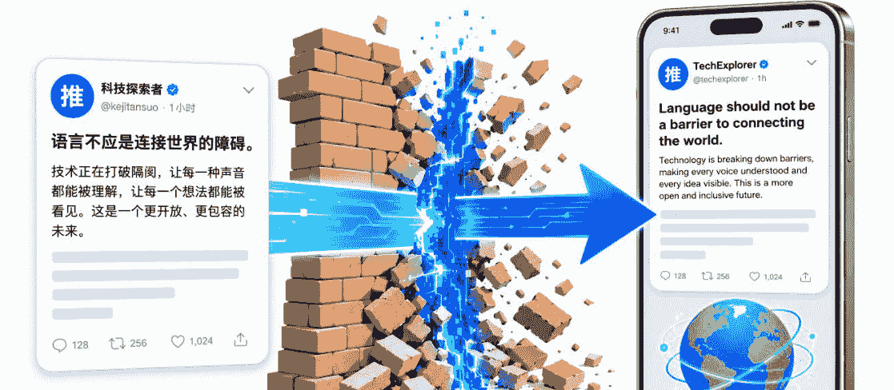

以前你写中文，基本只有中文读者看得到；现在一条中文帖子，完全可能被推荐给一个不懂中文但行为偏好相近的英文用户，他的客户端会自动翻译，体验几乎是无缝的。不同的变现路线，也应该搭配不同的语言布局。

## 五条变现路线

想靠 X 赚钱，目前大概有五条路。

第一，把流量引到自己的产品。路径很短：用户看完内容产生信任，点进主页链接，然后注册或付费。我做的 PaywallPro，是面向 iOS 订阅开发者的 SaaS，结合 App Store 数据和大量付费墙案例，帮开发者做高转化的订阅界面，很多新用户就是从 X 主页来的。我还有一个个人站 yuzong.ai，把所有产品、出海小项目、免费工具和保姆级教程都收在同一个屋檐下，一句话概括就是“AI 时代出海超级个体”。X 负责建立信任，网站负责把信任变成注册和付费。个人网站千万别做成简历，要当成产品经营，每个进来的人都值得被当作潜在客户对待。

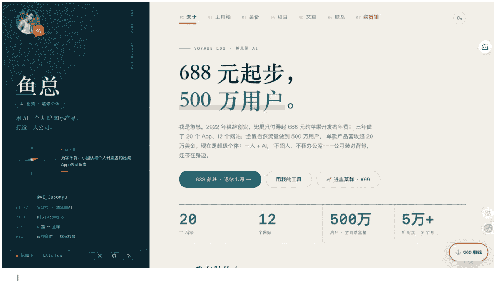

策略上要清醒：你输出的教程和认知分享，既是在展示能力，也是在筛选目标用户。内容本身就是产品的前置价值。

第二，接品牌方的单子。报价主要看三个数：粉丝体量、账号垂直度和近期数据。我目前一条合作报价在七千到一万人民币之间；有些十几万粉的泛流量号反而报不到这个数，甚至接不到单，因为人群不够精准，品牌方不认。做商业合作的核心心法，是把推广写成干货，比如“五步买第一枚比特币”“指纹浏览器实操教程”，品牌方的需求满足了，读者也学到了东西，数据自然好，下一次报价空间更大。接单要克制，只接自己用过、真正认可的产品，每接一条都在消耗粉丝的信任，不能当广告甩出去。

我也建了一个商单共享群。初衷并不复杂：自己单子接多了，看到合适的机会就想丢给更多人。群里有好资源也往群里扔，大家互相成就。最后这个群累计接单量超过 200 万，但这不是当初设计出来的结果，而是先利他之后，信任自然长出来的果实。

商业合作里有两个大坑要防。

一个是接单前不约定改稿次数、不承诺保量。新手第一次接大客户，容易什么都没谈就开工，结果品牌方拿小红书的标准来提需求，加一堆自嗨的公关话术，改五六遍，最后把博主自己的口吻全磨没了，读者一看就是硬广直接取关，品牌方还反过来怪你没效果。我现在的做法是开工前把三条红线说死：必须由我用我自己的口吻写干货；终稿确认后最多微调一次；社交流量受算法和热点波动影响，不承诺保底阅读。界限越清楚，对方反而越觉得你专业。

另一个是接高风险灰产广告。涉币、高息套利、无监管借贷，这类单子报价高得吓人，但雷也大。一旦项目爆掉，跟着上车的人亏钱，你的账号也会被圈子里声讨到社死。我的标准很俗：自己没跑通、不合规、对读者没有正向价值，给再多钱也不碰。

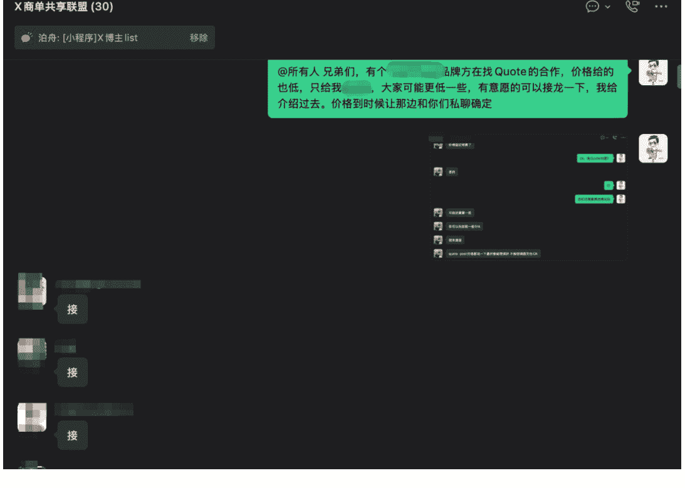

第三，按效果赚佣金。主动找产品方谈合作分成，比如银行卡、手机卡这类产品。把内容和带货结合起来，长线收益很不错。我的一条号码办理教程，单篇曾带来 1000 到 2000 美元的分成。

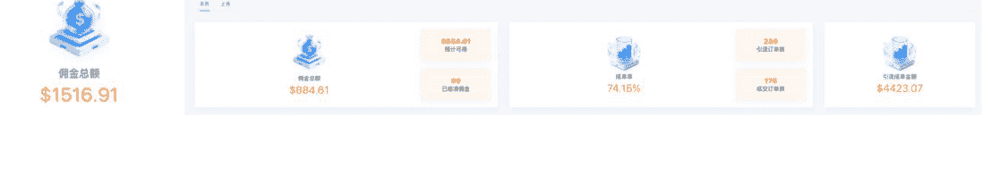

我的做法偏主动：不等品牌方来找我，而是盯住自己日常真实在用、确实觉得好的工具，主动去谈合作，联盟链接也好，定制内容也好。因为是真用过，推荐起来有底气，对读者是干货，不是硬广；对自己来说，每篇内容都不再做一次性消耗，而是能长期产生收益的资产。

核心策略就是主动。爱一行、用一行、推一行，你天天在用的东西，就是你最有说服力的变现资源。

第四，平台创作激励。这个收入上限很高，有人半个月拿 26000 美元，月封顶 50000 美元，视频内容还有额外扶持。不过 2026 年规则变了：老版广告分成计划 8 月 7 日起不再接受新申请，9 月 7 日正式退役，9 月 8 日由全新的“原创内容奖励计划”分批接管。新计划的核心只有一句：只给原创内容结算。聚合、照搬、轻改一下再发的内容都没有资格，老用户也要重新申请、重新过原创审核。平台已经能识别那些靠批量搬运小号来骗激励的大号，而且会把对应的广告收益划给原创作者。曾有一个 350 万粉的头部账号，因为盗用记者视频且不标注来源，一个周期的收益直接少了 90%。

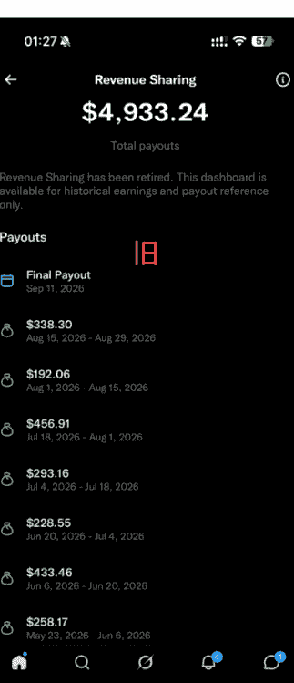
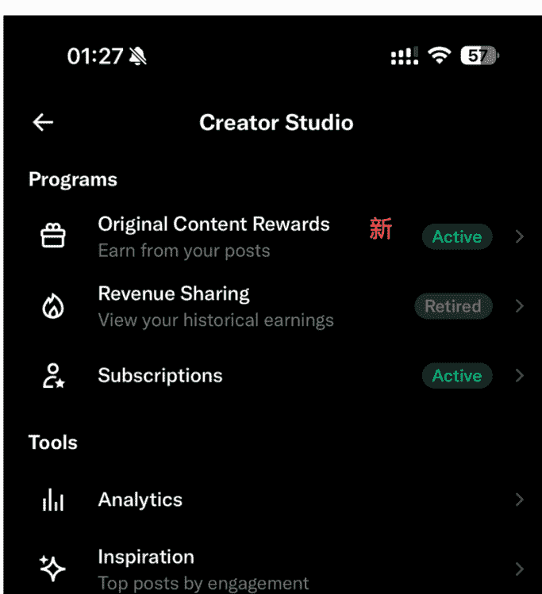

所以，还想着靠搬运、洗稿、矩阵号薅这笔钱的人，趁早收手。这条路已经不只是难走，而是被平台从机制上堵死了。想拿创作激励，只能做原创、做有增量价值的内容，这也和全文的主线一致：真诚利他不是一种姿态，而是最稳的护城河。

语言策略也要想清楚：中文内容也能拿到分成，但单价低。如果你的核心收入就是创作激励，那就应该往英文内容或视频方向走。

第五，卖社群和课程。这部分我反而不推荐。付费社群交付成本太重，交付不达标会把 IP 做烂；收费太低，赚得少还耗时间。如果真要做，就当成产品而不是副业：定清交付标准、算好运营成本、设置合理价格，定价太低也吸引不到优质用户。对有能力做出产品的人，同等精力放到 SaaS 上，投入产出比会更高。

## 赛道选择与防坑

赛道方面，比较稳的有：AI 和 Web3（这两个圈子正在交汇）、独立开发、号码服务、港股港卡、AI 摄影。尽量避开健身、育儿这类竞争激烈、受众窄、变现链路短的赛道，除非你已经顶着权威头衔。

发布时机也很关键。帖子发出后第一个小时的数据，会影响后面能推多广。所以发布后及时请认识的朋友点个赞、留个言，不是作弊，而是冷启动必要的动作。

最后要讲防封。很多账号做到几千上万粉，一夜之间被永久封禁，九成是因为网络环境不干净。最怕的就是用劣质机场节点来回切换，公共机场的 IP 池成百上千人共用，早就被标记成高风险，而且节点还会自动跳地区。上一秒在香港，下一秒跑到欧洲，X 的风控会怀疑是盗号，直接锁号。正确的做法是：起号前就配好固定的纯净独享静态 IP 或住宅 IP，发帖、刷推都固定在同一国家和设备；同时尽早开启 2FA 双重验证，推荐用 Authenticator 绑定。环境稳了，账号才活得久。

### 矩阵运营

矩阵这条路，现在是真走不通了。

平台官方已经明确表态：X 不欢迎矩阵化运营，AI 批量生产的内容也极易被系统标记。更关键的是，2026 年新推出的原创激励计划，直接把搬运号的变现通道给焊死了——高投入、低回报甚至零回报，矩阵生意的账，怎么算都不划算。

所以我的建议很直白：别碰矩阵。如果实在放不下，那就只做那些 100% 出自你手、能扛住任何一轮原创性审查的内容，同时心里要清楚——被清退的风险，随时都在。

## 聊聊精力分配：别急着把 X 当成饭碗

方法聊完，该说说心态了。能在 X 上走得长久的人，靠的从来不是咬牙切齿的“坚持”——支撑他们的，是背后有产品、有业务，或者一个清晰的目标。

> 记住这句话：X 是渠道，产品才是根。

拿我自己举例，我在 X 上投入的精力，严格控制在三成以内，剩下七成都放在产品打磨和真正赚钱的业务上。建议你也给自己划一条类似的线——内容这事儿，拼的是节奏感，不是爆发力。突击猛干三个月，远不如细水长流三年来得扎实。

把 X 当成放大器，它才能真正放大你；把 X 当成最后一根救命稻草，它只会把你拖下水。

## 写在最后：真诚是唯一的捷径

X 这个平台，用户质量高、变现路径多、复利效应强。只要你把内容做扎实、把互动做真诚，平台给到的回报是时间问题。说到底，最重要的就是五件事：

## 核心观点

> 算法和人性的方向，在这里第一次达成一致。

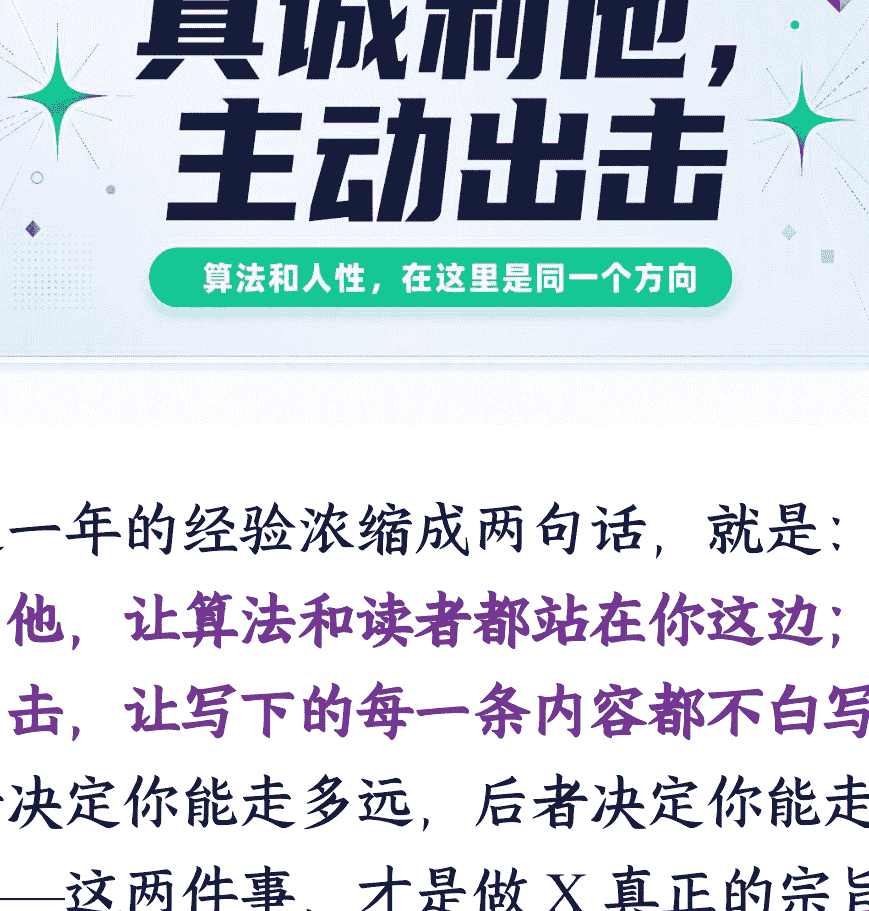

把这一年的经验浓缩成两句话，就是：

- 真诚利他，让算法和读者都站到你这一边；

- 主动出击，让每一笔写下的内容都不被浪费。

前者决定你能走多远，后者决定你能走多快——这两件事，才是做 X 的真正底层逻辑，也是这篇文章最想交付给你的东西。

我写这篇文章，本身就是一次“利他”的实践——我想把经验尽量完整地摊开来讲。如果你有自己的项目，真没必要把 X 当作唯一出路——除非你下定决心全职做内容，那它当然也能给你一份体面的收入。

最后还是一句话：别想太多，先干了再说。

——分割线——

看完这篇 SOP，你以为自己已经懂了。可现实是，90% 的人实操起来，第一步就卡住了。

工具和教程从来都不是真正的门槛，门槛只有两样：“立刻动手”和“圈层信息差”。

### 商业闭环与 AI 效率

我们不打太极，只做商业闭环的拆解与 AI 效率的极致压榨。系统内已经沉淀了 1000+ 跑通的套利实战局。

- 查阅圈子完整数字资产与上车门槛：[https://lazysO.com/insider/](https://lazysO.com/insider/)

认可价值、准备下场干活的，扫码加我微信（lazyhelper1）。

备注：【实操上车】，不闲聊

