# 从 0 到 1 做出游戏攻略站：两周跑通选词、建站、收录和迭代闭环 0902
作者：龙哥

这篇复盘，说实话，不是一份收入喜报，更像一张排雷地图。

先给想动手的朋友一个判断：林广恩这趟两周的实战，适合愿意把内容出海当长期项目、能接受前期进账几乎为零的人；那些想短期见到回报、追求快进快出的，可以跳过。他真正值钱的产出不是那4.24万次曝光，而是摸索出的一套工作法：**每轮只动一个变量、改完看预设指标、没变化就收手**，以及一张从搜索爬取到用户行为的排查地图——先锁定问题出在哪个环节，再决定动哪里，而不是看见点选率走低就急着改标题。

他选语言的做法也值得抄作业：优先做西班牙语和法语而不是日语，理由不是翻译难度，而是看目标市场的需求体量、同赛道竞争强度，以及官方是否已做本地化支持。

还有个坑必须说在前面：AI大批量产出的内容，一定要配上来源核查机制，否则一条错误信息就能让整站的可信度归零。

---

## 两周时间，这个站走过了什么

入行前，大多数人对攻略站的理解是：找词、让AI写稿、搭好页面就算完工。林广恩两周跑下来才知道，页面上线只是起跑线——AI写游戏信息会出错，Google给了曝光却没人点，广告代码装好几天后台纹丝不动。

他的第一站叫 MistriaFans，专门做《Fields of Mistria》这款游戏。从首页加十几个栏目页起步，两周多后长成四种语言、160个页面的结构，包含攻略总览、角色和物品专属页、任务指引、查询器和规划工具。

对照数据可以看得更清楚：截至2026年8月23日，Google Search Console的三个月区间显示，总曝光4.24万次、总点选778次、平均点选率1.8%、平均排名8.9。而开站首日（8月10日），GSC只记录到39次曝光、0次点选，GA4里自然搜索会话只有32次。

两组数字一比，结论很明确：站点已经被搜索引擎接受，开始持续获得自然流量。但要强调，这离"广告变现跑通"还有很长距离，更不能解读成"已经有稳定收入"。

广告数据也很诚实。Adsterra启用约10天后，统计面板上有了1082次曝光，累计收入1.37美元，平均CPM是1.266美元。钱是少得可怜，但至少证明广告不是"挂了个代码"而已，而是真的在产生展示和计费。如果域名成本压得够低，这笔钱甚至能覆盖域名开支。不过目前没有任何一个广告点选，样本太小，谈长期收益和广告位好坏都为时过早。

---

## 选游戏：三步缩小范围

林广恩挑游戏的路径很直接：

第一步，去SteamDB的Trending Games榜单里，把带火苗标识的游戏搜集进候选池。
第二步，把候选名单丢进Google Trends，选同一地区、同一时间窗口做热度对比。《Fields of Mistria》的曲线在对比里明显领先。
第三步，结合游戏生命周期判断机会。这游戏当时刚进入1.0正式版，玩家大量搜索新手入门、角色资料、送礼攻略、恋爱关系、作物种植、矿洞探索等内容，而中文以外语种的攻略供给明显不足。

他的思路很朴素：先做一个站把整条路线走通，不急着铺量，先保证质量和流程是对的。

---

## 上线后的玩法：一轮一个主题

网站上线后，林广恩没有按内容、SEO、设计、广告来分工推进，而是做诊断循环：发现问题、判断层级、只修这一层、用数据验证结果。

整个流程走下来，一共七轮。

### 第一轮：先把地基修到能放心施工

他用脚本把全站扫了一遍，找出三类硬性问题：

**第一类，语义标记缺失。** 39个内页的正文没有标记为网页主体内容，访客能正常阅读，但搜索引擎的代码层面根本不知道哪块是重点。

**第二类，语言混用。** 13个法语页面里残留西班牙语，比如图片描述写着"Galería de Juego"这种西语词组。

**第三类，高风险话题缺出处。** Switch支持、多人模式、Mods、版本历史、婚恋系统这五个话题，要么没有官方链接，要么内容看似完整，深挖发现是AI根据语境推测的，跟官方说辞对不上。

比这更麻烦的是工程隐患：西班牙语和法语的内容文件只存在他的电脑里，没有纳入版本管理。别人拿到项目仓库，只能重建13个英文页面和1个西语页面，剩下25个多语言页面直接缺档。

他的处理方式是把语言检查外包给另一个AI模型（ChatGPT Pro）独立过一遍，但凡是程序或模型标出来的问题，必须自己人工确认后才动刀——不完全信任机器判断。

这一轮他完全不看名次和流量。结构、语言、出处、链接都过关，后面才有所谓"基线"可言。

### 第二轮：解决抓取和网址不一致

典型的案例：访问 /farm-layout 直接404，但 /farm-layout.html 能正常渲染。整个站点39个内页都有这个毛病。另外，线上环境用的是 https://www.mistriefans.com，生成器却把所有页面的规范链接写成了不带www的地址。搜索引擎因此看到同一内容有多个URL，抓取和索引的信号被拆散。

他在GSC里的排查流程是：先到"网页"报告找404和重复页，复制示例网址，再进"网址检查"看Google选择的规范版本，最后打开原地址确认跳转行为。

修复动作：
- 统一全站域名，42个页面的规范声明、sitemap、robots.txt全部更新。
- 39个内页的无扩展名地址做301永久跳转到.html版本。
- 加了一道SEO回归测试，防止下次发布再出现origin不一致。
- 未知URL保持真实404，不把所有错误地址导流回首页。

验证方式：先确认旧地址只有一次跳转且为301，再去GSC提交验证。Google没完成重新抓取前，不再动这批页面。

### 第三轮：从关键词思维转向任务思维

一开始他也有"看到一个词就建一个页"的习惯，结果产生很多只有三两句的薄页面，还造成多页争抢同一批词。

后来他换了个角度：玩家此刻要解决的到底是什么任务？现有页面是否已经给出了完整答案？

找出问题的方法：打开GSC效果报告，按曝光量降序排列，标出"曝光高但点选极低"的词。确认一个词时，会跨越两个统计周期，排除偶发波动。然后回到Google搜一遍，看榜单前几位给的是短答、表格、图片集还是工具页。

当时圈出的数据长这样：

| 搜索词 | 曝光 | 点选 |
|---|---|---|
| fields of mistria house upgrade | 740 | 2 |
| seridia fields of mistria | 544 | 0 |
| house upgrade fields of mistria | 350 | 0 |
| mods of mistria installer | 303 | 0 |

按任务去合并后，两个房屋升级词合计1090次曝光、2次点选（0.18%点选率）；两个Seridia相关词合计902次曝光、3次点选（0.33%）。而farm layout有431次曝光、10次点选（2.32%），显然没到需要紧急处理的程度。

判断标准只有三条：这需求是不是独立任务？现有页面能不能自然承接？新开一页能不能给出比几句话更扎实的答案？拿Mods来说，用户需要下载地址、对应版本、安装步骤、备份提醒和故障处理，这些信息原页面给不全，才值得单独补一个页面。不构成独立任务的词，合并进已有页面处理。

后面新增赚钱攻略、传说鱼、Hayden、Balor、Eiland等页面时，他先写下两句话：用户带着什么任务进来？这页能提供别处没有的信息？写不出来就放弃开新页。

### 第四轮：首页从游戏说明书变川任务大厅

GA4数据里，首页跳出率87.5%，全站同期58.8%。但他没有急着下结论，而是先按来源拆开看：246次访问来自Direct，跳出率87.8%；自然搜索只有6次访问，样本太小，不能写成"搜索用户来了就跑"。Direct流量只说明GA4没识别到来源渠道，也无法推断这些人的意图。

他明确说，把首屏改成任务入口是一个产品假设，不是数据推导出来的结论。这个站已经覆盖送礼、赚钱、鱼类、矿洞、恋爱等具体玩法，但首屏还在讲游戏背景，用户进来不知道下一步能做什么。因此他把常用攻略入口提到首屏，观察后续行为。

验证指标在动手前就已定好：攻略卡点选、站内链接点选、第二页访问量三项一起上升，同时首页跳出率下降，才算假设成立。如果按钮点击涨了但第二页访问没动，说明入口有吸引力，但落地页没有接住人。如果全都没变化，就停掉这套改法。

### 第五轮：把速度优化当成独立问题

首页结构调整完后，他又单独把加载速度拎出来处理。理由很简单：页面慢，人没看到内容就走了；内容不对路，人看到了也不想继续。两者混在一起改，跳出率变动根本说不清归因。

移动端初始得分74，诊断问题集中在图片体积、首屏资源和缓存策略。他压缩图片、精简首屏内容、把预告片改为点击后再加载（首屏只保留本地海报，不加载YouTube播放器）。

他还专门测了"推迟分析脚本加载"的效果，对照组测完发现没有收益，就退回官方标准写法，不多留一行多余代码。最终移动端得分从74到97。但这个分数只说明性能优化验证成功，不能证明首页内容能引导用户继续深入——快不快看PageSpeed，留不留人看GA4，两组数据不可互相替代。

### 第六轮：校准GA4，别被自己的测试访问骗了

他发觉两个问题纠缠在一起：自己的测试访问和真实用户混在同一份报告里；scroll滚动事件被当作"用户完成目标"的记录。

处理方式是：把自己的设备标为内部流量并过滤；scroll事件降级为辅助观察指标，不再履约"任务完成"语义；为三个核心任务事件分别明确触发的动作条件。

验证标准有三个：测试行为能在DebugView里正常显示；测试数据不再出现在日常报表中；普通访客仍能正常触发事件事件。三个条件都成立，GA4才能作为后续运营决策的参考。

### 第七轮：把纪律写成规则

前面六轮跑完，他给自己立了一条规矩：**内容更新、首页调整、埋点改动、语言修正、广告发布，不能塞进同一次部署。** 判断方法很简单：如果这次发布的东西同时涉及两类以上，就拆开。拆不动，说明还没到发布时机。

每一轮动手前先写一命迭代目标，写不出来就说明自己的想法还没理顺。例如第五轮PageSpeed优化的目标列表就写得很具体。改完就看预设的那一两项指标有没有变化，动了就记录，没动就按停止条件结束。

---

## 三个关键决断

### 农场布局曝光高没人点，为什么不先动标题

Farm Layout页面在GSC里有296次曝光、0点选。他起初也想改标题，但做CTR分析时发现，搜索这个词的136次曝光全部落在英文页面上，不存在语言错配——问题不在标题，在于内容的呈现形态。

搜索结果第一名给的是布局图片、灵感和规划工具，他的页面则是文字建议配通用截图。用户想要的是一眼能用的案例参考，不是一堆描述文字。于是他把页面改成布局图集加农场规划工具，目前还在等待Google重新索引后的反馈。

### 精确词落进总览页，先补答案再建实体页

有用户搜具体角色或物品，却被带进Characters、Fish这种总览页。他的做法分两步：先在总览页补充直接答案和锚点，等这个词持续有需求、信息完整度足够独立时，再开实体页，并做双向链接。

一个值得记住的原则：实体页不是为了撑页面数，而是为了缩短用户从输入关键词到拿到答案的路径。

### 广告代码装好了，后台为什么还是零

这个坑他踩了三轮。

第一轮，加了用户同意弹窗，弹窗没确认前GA4和广告都不触发。后来确认这个站不需要全站同意弹窗，移除后基础数据才流动起来。

第二轮，为了保护页面性能，把广告放进独立小页面用iframe嵌入主站。结果Adsterra的代码运行在about:srcdoc环境里，不符合官方静态HTML接入要求，两个广告位加载8秒后自动收起，后台连续几天零记录。

第三轮，换用同源wrapper frame方案，frame还是在8秒后收起为空。

最终解决方式：按官方文档指引，把原始广告代码直接嵌入页面指定位置。去掉所有中间层之后，广告数据才正常产生。

此后他不再看"页面上能不能看到广告"来判定成功，而是到Adsterra面板查三个信号：曝光是否开始增长、不同广告位是否都有记录、收入是否逐日累计。

数据层面他更关注各广告位的CPM差异。截至8月31日，728×90广告位只有189次曝光，却带来0.72美元收入，CPM达到3.798美元。这个位子只贡献了全站约17%的曝光量，却带来了约53%的收入。相比之下，300×250和320×50曝光量更大，但CPM都只在0.7美元上下。就MistriaFans当前的数据而言，728×90的单位曝光收益明显更优。

---

## 最后

这篇复盘的主线始终是三条：

第一，怎么判断一个游戏值不值得做；第二，网站上线后，怎么从GSC和GA4的数据里定位真问题；第三，AI产出的内容怎么核实、SEO指标怎么解读、第三方服务接入后怎么验收。

林广恩没有讲怎么靠一个游戏站马上赚到钱。他分享的是一个初次独立做站的人，怎样靠AI辅助和真实数据，把一堆批量生成的页面打磨成一个能被验证、能持续优化、也有长期运营价值的站点。

页面生成只是起点，真正的功夫花在页面之外。如果你也在做自己的第一站，或者正卡在"上线后不知道该改哪里"的瓶颈，这篇复盘值得多看几遍——尤其是那套"每轮只动一个变量"的纪律和分层排查思路，那才是新手最缺的东西。

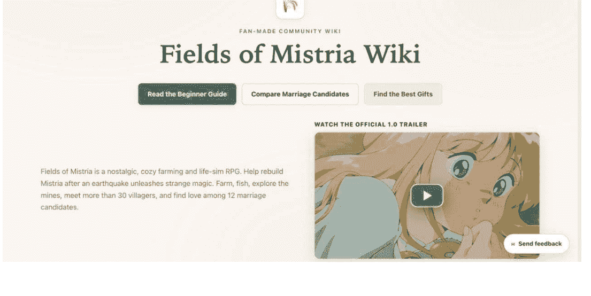

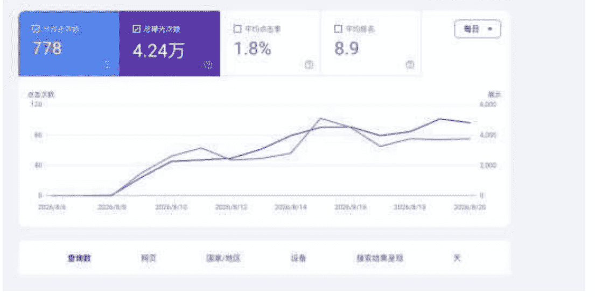

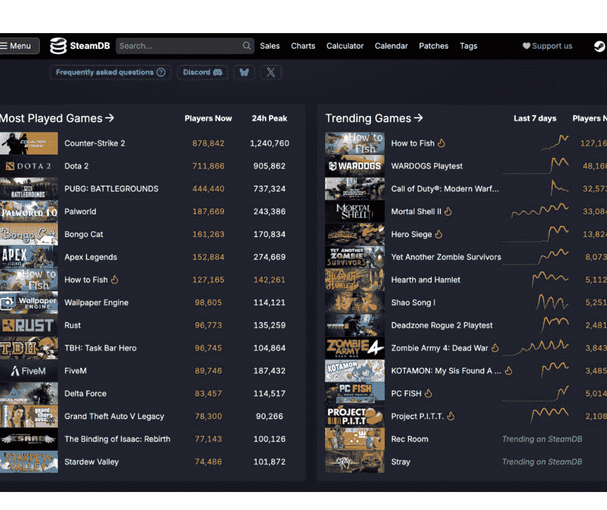

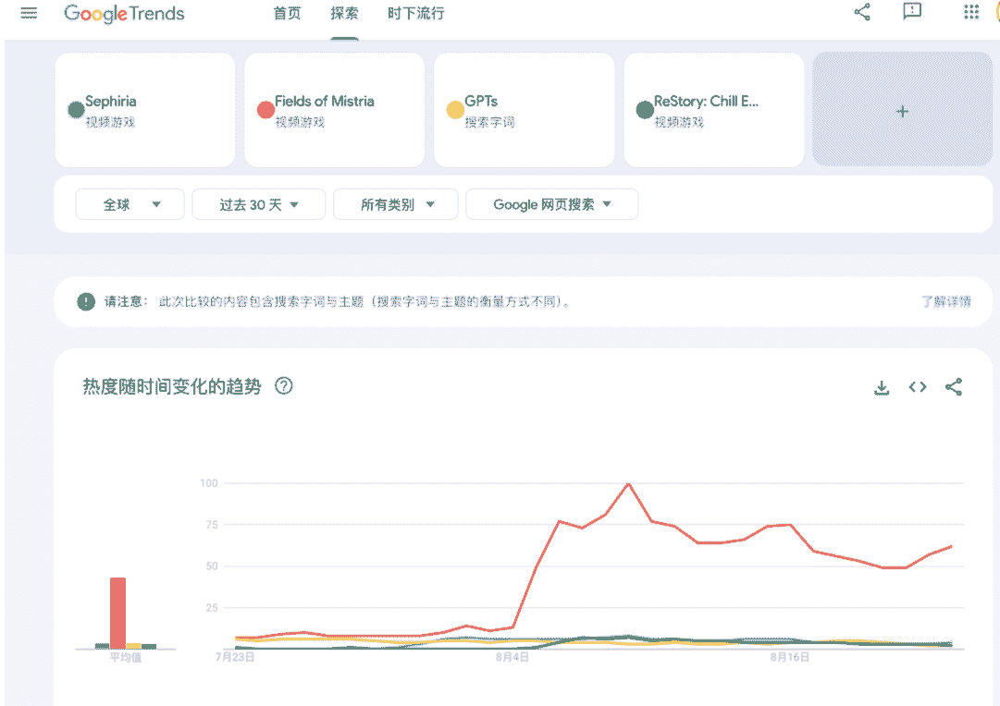

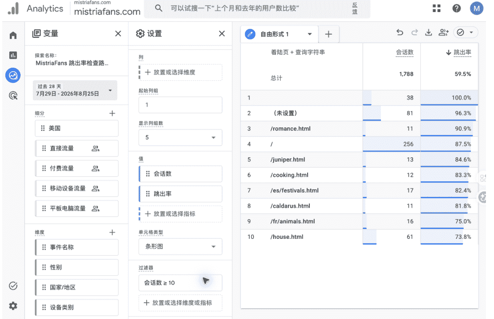

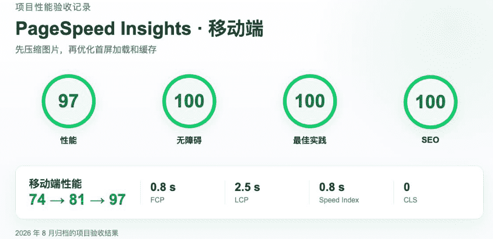

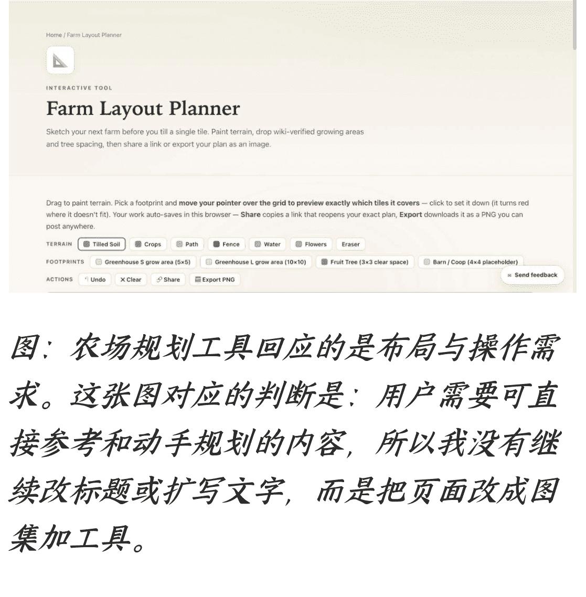

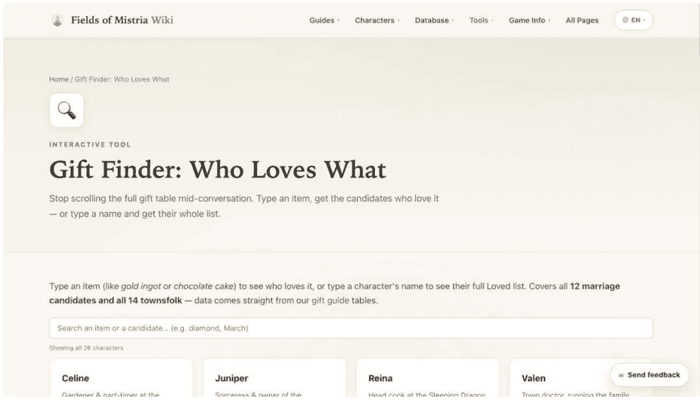

前阵子给一个游戏攻略站做广告位复盘，数据里有个很显眼的点：一个 728×90 的横幅，展示量只有 189 次，但全站 1.37 美元的收入里有 0.72 美元是它贡献的，占比超过一半。

按惯性思维，这广告位太“能打”了，是不是该推广到所有网站？先冷静。同一个账户下还有个叫 Lou’s Lagoon 的站，那边的 Native 广告 CPM 反而比 728×90 高；Tiny Eden 的样本量又太小，暂时没有参考价值。广告效果受到页面位置、访客地域、设备类型、用户有没有滚到广告位等多重因素影响，一个站的结论没法直接复制到别的站。

顺带发现一个记录层面的问题：后台数据只分了广告代码和尺寸，看不出某个位置到底是首页、正文中段还是文末。这个信息缺口只能靠后面补：给每个位置配上独立广告代码，跑上 7 到 14 天，再拿 CPM、展示占比和收入占比来比较，决定哪些保留、哪些调整。

广告的事先说到这儿，接下去想分享的是这几个月真正沉淀下来的东西——多语言版本的取舍、SEO 迭代的方法，以及 AI 内容生产流程。

**多语言为什么先做西语和法语，而不是日语**

日语不是没考虑过，但搜索页前排早就是成熟的日语攻略站；而西语和法语玩家明明有需求，专门内容却少得多。所以挑语言这件事，看的不是“哪门语言机器翻译最容易”，而是需求、竞争和官方本地化的成熟度。

上线后复核时发现西语版的术语和表达有问题。后来我把流程固定成：Codex 先产出初稿，ChatGPT Pro 再做一轮独立复核，重点盯语言和事实，最后按复核结果统一术语和语气。多 Agent 的价值不在于多跑一遍，而在于把起草、事实核对、语言校对拆给不同角色，互相查漏，减少单模型带来的盲区。 图中可以看到简体中文首页和英文站共用一套任务结构，文案和入口则按语言分别维护。

**最怕的是：明明改好了，重新生成又没了**

大多数页面是用统一模板批量生成的，所以有时图省事会直接改最终页面，当时看着没问题，可下次一重新生成，老模板就把修改悄悄盖掉了。正确做法是回到页面对应的源文件或模板，从源头动手，再重新生成。现在我的验收标准也变了，不只是看“当前页面是否正确”，而是重新生成两次，确认修改不会消失。

这些案例反复出现后，我总结出一套迭代方法论。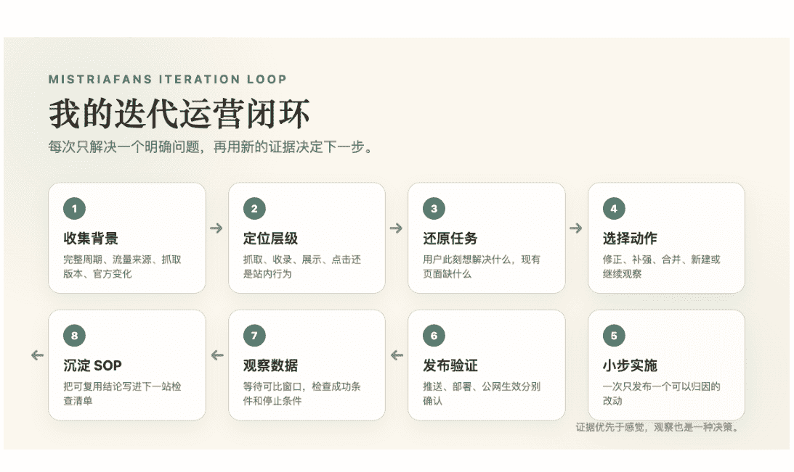 概括起来就是：先排除数据干扰，再定位问题层、选择一种动作，并且提前写好成功和停止条件。它让我改变了过去一次性改十项的习惯，转而让每一轮改动都可解释、可验证、可回退。

**第一步：把脏数据挡在门外**

指标难看别急着动页面，先问数据本身能不能信。

1. 数据窗口结算了吗？GSC 的“最近 24 小时”是临时值，之后会被修正。MistriaFans 刚上线那天我看到 1,920 次展示、38 次点击，第二天刷新数据变成 1,260、30，缩水三分之一。所以做判断至少用完整的 7 天窗口，别拿最后几小时的数据说事儿。

2. 自己的访问排除了吗？早期样本小，你本人点开一次，就可能让页面的跳出率从 50% 拉到 100%。去 GA4 的“管理 → 数据流 → 配置标签设置”里建一条 Internal Traffic 规则，按自己的 IP 过滤掉，并记下生效日期。生效日期之前的行为数据，基本都不可信。

3. Google 抓的是哪个版本？用 GSC 的网址检查工具查一下页面，里面会写上次抓取的时间。假如你昨天改了标题，Google 上次抓取却是一周前，那么 CTR 反映的是旧标题的表现，跟新标题没半分关系。这时候该做的是等 Google 重新抓取，而不是再改一次标题。

这一步达到什么标准算完？三个问题能清楚地回答：数据对应的时间窗口是什么？内部流量有没有排除？Google 抓的是改动前还是改动后的版本？三关过了，才进下一步。

**第二步：先定位，再动手**

数据可靠之后，沿着决策树从上往下走，第一个命中的层就是你当前要解决的问题所在。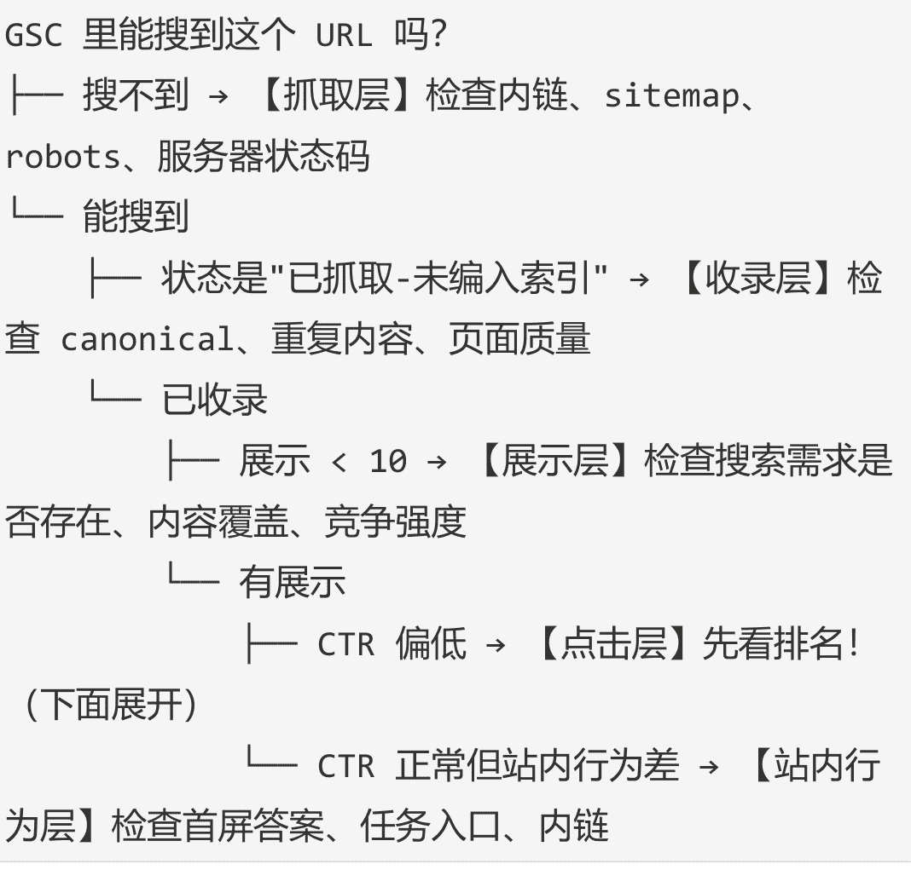 点进点击层时，千万别只看 CTR 一个数，至少要把查询词、落地页面、展示量、点击量、平均排名、国家和设备这些字段一起读出来，再结合现象判断：

- 排名在 1 到 6，展示高、CTR 低：先检查摘要有没有被截断、语言页有没有错配、SERP 里是否被精选摘要或品牌站挤压。对策是小范围测试 title 和 description，并核对该查询实际落到哪个页面。
- 排名在 7 到 10，CTR 低：这里有两个变量在同时起作用，排名和搜索意图。先去搜这个词，看看前排结果到底在答什么，再考虑给页面补独立价值和内链。
- 排名 10 名开外：这本质是排名问题，不是标题问题。优先改善内容深度、内链结构和权威信号，改标题解决不了根本问题。
- 精确查询落到通用页面：说明页面粒度不够。给这个查询增设精确章节，必要时单独建页。
- 英语查询落到西语或法语页：多半是语言页选择异常或者旧抓取。去查 GSC 的 query→page 映射、canonical、hreflang 和抓取日期。
- 刚发的新页面或新标题：数据还在描述旧版本。挑少量 URL 用网址检查工具请求重新抓取，然后等着，不要反复提交。

两个真实案例值得说一下。Farm Layout 页面有 342 次展示、0 次点击，看着像标题起砸了。但我跑到 SERP 里一搜，发现“farm layout”这个词背后，玩家想看的其实是布局灵感图、真实案例和规划工具，而页面里只有文字建议和一张通用截图。所以问题压根不在标题，而是内容没接住搜索意图。另一个是 Mods 页的语言错配：英语查询拿了 100 次展示，但 GSC 显示 86 次进的是西语页、14 次是法语页、英语页一个都没分到。这同样不是内容问题，而是 Google 选错了语言版本，该查 hreflang 和 canonical，而不是改文案。

核心原则就一句话：问题出在收录层，别去改首页文案；排名还在十名开外，别把 CTR 低的锅扣在标题头上。先找对层，再做对应动作。

五个层可以概括成：

- 抓取：Google 连页面都找不到。查 URL、站点地图、robots、服务器状态。
- 收录：抓到了但没进索引。查 canonical、重复内容、页面质量、语言关系。
- 展示：收录了但曝光太少。回看查询词、页面主题、内容质量和竞争强度。
- 点击：有展示但没人点。拆排名、查询匹配、标题摘要、摘要形态。
- 站内行为：点进来没继续操作。查推荐答案、任务入口、阅读结构和内容质量。

**第三步：不要只看搜索词，要看搜索词背后的任务**

确定问题层之后，每个准备迭代的页面都要填一张“任务卡”，五项写不清楚就别动手。这五项是：玩家到底在搜什么（目标查询）、搜这个词想完成什么事（玩家任务）、当前页面缺什么（当前缺口）、这页有什么是别人给不了的（独有价值）、信息从哪来（事实来源）。

拿 Farm Layout 页举例：目标查询是“fields of mistria farm layout”；玩家任务是想看到别人的农场布局，给自己规划农场的参考；当前缺口是没有真实布局图和规划工具，只有文字建议；独有价值可以设计成按季节分区的规划逻辑加可交互规划器；事实来源是 Wiki 种植数据、社区分享的布局截图和游戏内验证。

填这张卡最大的价值是让假设现形。如果“独有价值”填不出来，说明这个页面也许根本没有存在的必要；如果“玩家任务”和“当前缺口”明显对不上，那也不用再看更多数据了。

**第四步：每次迭代只选一种动作**

修正、补强、合并、新建、观察，五选一。

修正处理的是明确错误，比如事实错误、语言残留、死链、canonical 指错。之前法语页面里残留了西语片段“Galería de Juego”，就是在来源分片里替换掉，再重新生成的。

补强是页面主题没问题但答案不完整。比如 Fish 页收到“coelacanth”的精确查询，但页面只有通用钓鱼指南，缺少这种鱼的价格、地点和季节。

合并针对的是两个页面服务同一个玩家任务、关键词互相打架。合的时候保留展示效果更好的 URL，另一个做 301。

新建是查询本身有独立任务而现有页面扛不住。coelacanth 就属于这类：查询量大，Fish 页的 H2 章节根本承载不了完整需求，所以独立建一个实体页。

观察是样本不够，或者 Google 还没重新抓取你的改动。比如修完 canonical host 配置后，就得等 Google 把 42 个页面重新抓一遍，期间不做别的 SEO 调整。

别小看“观察”，它经常是五个选择里最聪明的那个。数据最不稳定的时候，如果你连续改标题、改结构、改语言配置，最后根本分不清是哪个动作起了作用。

**第五步：动手之前先写清成功标准和退出机制**

每次只解决一个问题，动手前写清楚七件事：改什么、怎么改、影响哪些页面、怎样算成功、什么情况下停止、观察多久、改坏了如何恢复。

拿一次真实的 Canonical Host 修复来说：改动名称是“统一 canonical host 为 www 版本”；动作属于修正；影响面是全站 42 个页面的 canonical 标签和 sitemap；成功标准是 GSC 网址检查里所有页面的 canonical 与生产 URL 一致，且不再出现“alternate page with proper canonical tag”；停止条件是 14 天内 Google 仍未重新抓取一半以上页面，那就检查 sitemap 提交状态；观察期设为 7 到 14 天；如果改坏了，把生成器的 SITE_ORIGIN 改回原值再重新构建。

改动记录不需要写得多正式，项目笔记里、issue 里都可以，关键是动手之前就明确“怎样算成功”和“什么时候该停”，而不是事后给结果硬找解释。

**第六步：一次发布只包含一类改动**

内容修正（修错误、补信息、清语言残留）、测量基础设施（GA4 事件、流量排除、GSC 验证）、首页与导航实验（信息架构、入口调整）、多语言扩展（新增语言、翻译修正）、广告与变现（广告位、广告代码、合规弹窗）——这五类改动不要混着发。

混在一起的问题在于：发布后指标要是变了，你根本说不清是哪一个改动干的，回滚也无从下手。MistriaFans 就踩过一回，一次发布同时塞了内容修改、首页改版、语言提示调整和埋点事件，结果指标变了完全无法归因。后来我严格每次只发一类。

发布前再自问三句：这次到底改了什么（列出 URL 清单）？出问题怎么退回（Git revert 加重新构建，还是需要额外动作）？打算多久后复盘（定个日期，到点就去看）？

**第七步：上线、观察、把结果记回去**

代码提交不等于上线。推上去以后，还要过三关：打开 Git 远程仓库确认提交已经到目标分支；去部署平台（Vercel、Netlify 等）确认最新构建成功；打开公网真实 URL，在浏览器里看源代码，确认改动已经生效——如果是 canonical 或 meta 标签，就直接搜关键字段。

三关都过了，才进入观察期。观察期结束后回到改动记录里填写结果：成功条件有没有达到，用数据说话；如果没达到，是改动本身无效，还是观察窗口太短；有没有出现意外的副作用。这些结论都写进项目记录，成功的、无效的都要记，否则同样的问题换个语言版本或换个新站就会重演。

**内容生产流程，比“让 AI 写”复杂多了**

很多人以为做 AI 内容站就是“丢给 AI 一篇攻略”，真不是。没有来源管理和校验机制，AI 会生产大量看着合理、实际错误的信息。

生产流程分八步，核心是前面两步。

第一步是素材准备。每个页面主题建一个素材文件夹，把游戏官方 FAQ、补丁说明、Steam 商店页面的价格和更新日志、社区 Wiki 的物品/角色/机制数据、社区帖子和 Discord 讨论、Mod 平台（NexusMods、Steam Workshop）的资料都收进去。要留意 Cloudflare 反爬可能导致部分 Mod 平台页面无法自动抓取，那就标记为数据缺口。这一步千万别省，AI 会编造合理数据，比如一条鱼的售价、某个道具的获取方式，没有一手来源对照很难发现。

第二步是来源矩阵。把素材整理成表，每行一条事实声明，附来源 URL、适用版本、核查日期和确定性等级。比如“腔棘鱼售价 800g”，确定性标“已验证（游戏内截图）”；“Switch 版本发售时间”，官方网站只写了“正在评估”，那就标“未确认”。这个“确定性”列是关键：标“已验证”的才能当事实写进正文；标“未确认”的必须在页面注明。之前我们差点把“支持 Switch”写出去，官方原话其实是“目前支持 Windows 和 Steam Deck，Switch 正在评估”，这差别足以误导玩家做购买决定。

第三步是 AI 生成初稿。输入是来源矩阵、页面目标（对应任务卡里的“玩家任务”）、页面应该回答的具体问题列表。别丢一句“帮我写一篇 Fields of Mistria Mods 的攻略”就完事，那样 AI 会自由发挥，塞进它自认为合理的“常识”。给它矩阵，它的任务是组织和表达已有事实，而不是创造事实。

第四步是独立复核。用另一个 AI（ChatGPT Pro）把初稿过一遍：事实是否与来源矩阵一致、有没有 AI 擅自添加的“合理推测”；多语言术语是否准确、社区实际用语是什么；有没有把“可能”写成“确定”、把“正在评估”写成“即将推出”。真实例子：西语 Mods 页面初稿在“modificaciones”和“mods”之间切换，一查西语游戏社区，玩家普遍用英语借词“mods”，统一之后读感明显改善。

第五步是统一术语和语气。建一张术语对照表（英语原词→各语言对应词），所有页面都参照。术语不一致的地方别挨个手动改，在内容分片里改一次，重新生成就全部统一了。

第六步是生成器构建：MistriaFans 的页面不是手写 HTML，而是用 Python 生成器读取内容分片（每种语言一组 JSON/Markdown 文件），按模板生成所有语言的静态页面。这样每次改完分片重新构建，就能保证全站一致。

整套方法绕来绕去，其实就一件事：让每一轮改动都可解释、可验证、可回退。广告数据的教训也好，任务卡也好，单类发布也好，来源矩阵也好，本质上都是把“好像”“感觉”变成“假设 + 验证”。在 AI 让内容生产变得无比容易的今天，这可能才是做出一个可信内容站最不该省略的一环。

早就想聊一次自己踩过的多语言站点坑。当时西班牙语和法语的内容切片只存在本机，没有进 Git。别人拿到仓库无法还原这两种语言的网页，我自己换了电脑也照样失败。从此我立下一条铁律：所有待发布的原料文件、各语种模块和生成脚本都必须纳入版本控制。验证方法很简单：新开一个全新克隆，跑整体重建；如果产物缺失或报错，就说明仓库里漏了东西。

另一个问题发生在跨语言翻译环节。法语网页中混入了西班牙语词汇“游戏画廊”，后来查清是批量翻译时模板片段对应错位。为此，我增加了一个跨语言扫描任务：每次构建完成后，自动检查每个语种的网页是否出现了其他语言的标志性词汇。

## 发布之前，先做三道验收

### 第一道：同一构建跑两遍，输出必须一致
同一份仓库从头跑两遍构建，再对比输出文件。两次结果若有差异，说明构建不可复现——可能调用了外部服务、字典遍历顺序不稳，或在输出时嵌入了运行时刻。只有两遍结果没有任何不同，才有底气说“以后重新生成也不会覆盖已经做好的修改”。

### 第二道：用真实浏览器验收
不要只看本地预览图。桌面端和移动端都要打开，四个语种各抽查至少两个 URL。逐页核实：正文是否齐全、配图能不能显示、正文中的链接是否可点、canonical 与 hreflang 标签是否正确。再在浏览器内部使用“查找”功能扫一遍网页源文件，看有没有混入别的语言。最后打开开发者工具中的 Console 与 Network 标签页，JS 报错和 404 都算不合格。

### 第三道：先建出处索引，再让 AI 写
AI 猜出来的数字不能直接当事实用。与其填一个貌似合理的数字，不如空着并标注“待核实”。凡是可能影响玩家决策的内容，证据必须放在正文旁边，不能只在页脚挂一条泛泛的参考链接。例如写“NS 移植是否推出仍在评估”时，紧邻位置要注明“依据：官方 Q&A，2026-08-10 已核对”。顺序也不能颠倒：先整理好引用底表，再开始生成内容。否则 AI 会下意识去找支持自身说法的证据，忽略掉矛盾信息。

## 上线之后的日常运营节奏

网站发布后不能“想起来才看一眼”，要按固定周期执行检查。

### 每日检查：10 分钟，交给自动化哨兵

我设置了一个每天定时运行的哨兵任务，只在有问题时通知我。检查范围包括：

- 主页与 3-5 个核心 URL 的 HTTP 状态码和响应时间，非 200 或耗时超标会告警；
- 正文主体与关键配图是否完整，是否出现空模板或 404 图片；
- Steam 官方动态和 Discord 公告频道是否有新补丁/新公告；
- 若官方版本有变，网站上记录的补丁号和日期是否同步；
- SSL 证书剩余天数少于 30 天或域名解析异常；
- Reddit 子版块与 Discord 求助频道里，同一问题被三名或更多玩家提到，或出现与网页内容相互矛盾的说法；
- 两三个竞品站点地图与主页是否有新增内容，尤其是我还没有覆盖的主题。

哨兵不会自动修改任何内容，它只产出日报。没异常时，日报就一句话“一切正常”；有问题才需要人来判断怎么处理。我也不会为了显得勤快而乱改网页。社区舆论和竞品情报不必天天细看，我每周翻两次汇总。

### 每周复盘：30-60 分钟

固定时间看数据，最后形成一条简短记录：这周发现什么信号，下周做什么。

GSC 部分（约 20 分钟）：
- 按搜索词排序查看效果报告，找新出现或持续上涨的词；
- 转到网页层级，找出“有曝光但没点击”的网页，这些是重点诊断对象；
- 进入存疑网页查看明细：它实际承接了哪些词、排在什么位置、是否让精确词落到了笼统的汇总页；
- 检查有没有英文检索词被带到非英文网页。

GA4 部分（约 10 分钟）：
- 观察非付费搜索带来的会话数与走势，过滤掉内部流量；
- 核对几个关键事件：攻略卡片点击、正文中的链接点击、外部链接点击、反馈提交；
- 某个事件出现断崖式归零，先查埋点有没有被其他代码覆盖，再考虑是不是真的没人触发。

决策部分（约 10 分钟）：
- 最多挑两三个把握较大的措施进入迭代流程；
- 其余信号留在备选清单里继续观察，因为绝大多数信号需要数周时间才能判断是长期走向还是随机波动。
我经历过一个例子：某款农场游戏的长尾检索词持续带来曝光，但全部被引到“鱼类”汇总页。盯了两周确认规律后，我才决定为这个主题单独创建内容页。

### 游戏发版当天：最高优先级

游戏发布新版本那天，暂停所有例行优化，集中处理时间敏感内容。少一份参考攻略，最坏只是玩家少一个答案；补丁信息一旦写错，玩家可能据此做出错误购买或游玩决策，代价完全不同。

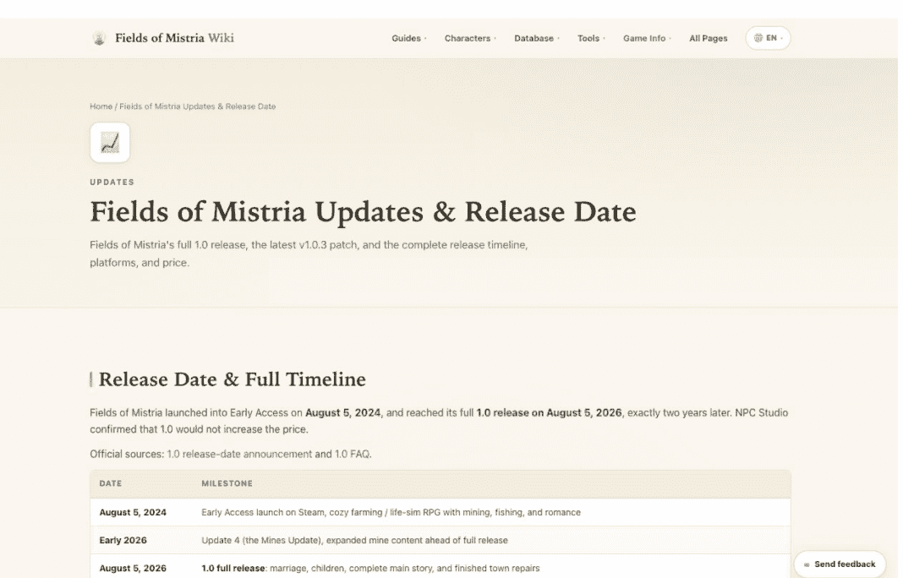

发版当天集中核对时，网页上需要同时呈现发布日期、补丁状态和官方出处。

### 月度回顾：1-2 小时

月度节奏不做优化，而是清理与复盘。

- 缺口分析：把近一个月 Google Search Console 中新增和上涨的搜索词导出，跟现有网页列表对照。哪些词有曝光但没有对应内容页？哪些网页赶不上搜索意图？
- 竞品观察：搜几个核心词，看同行站点本月多了什么内容。目的不是照搬，而是发现自己没注意到的玩家需求。
- 修改复盘：翻看这个月的变更历史，哪些达到了预设目标，哪些没有。没带来效果的措施不要直接沿用，要分辨是方法不对还是时间点不合适。
- 清理：删掉没有内链指向的孤页、死链与过期数据，避免这些问题拖累站点质量。

## 判断一个游戏是否值得做

我有一套初筛清单：

- 热度：SteamDB 走势 + Google 趋势近 28 天数据；
- 竞争：用目标语言搜索“游戏名 + guide 或 wiki”，垂直攻略站在检索结果里不超过三家；
- 内容空间：游戏的角色、系统、物品数量能否支撑超过二十个独立网页；
- 时效机会：是否刚发布，或刚刚经历大型版本更新；
- 多语种机会：至少有一种语言存在明显内容空缺。

评估是否新增语言时，我只会问三项疑问：这个语种的人会主动查攻略吗？现在能搜到的攻略够不够好？我们动手做之后，他们会愿意来吗？

第一步，确认需求。在 Google 趋势中搜索对应语言中的常见说法，例如 guía、guide、ガイド，观察 28 天内是否稳定波动。如果曲线一直贴着零轴，说明该语种玩家很少，或者他们根本不习惯查攻略。当时我观察西班牙语与法语都有明显曲线，日语也有但量级较小。

第二步，评估竞争强度。用目标语言在 Google 中搜索“游戏名 + guide”，只看排名最靠前的约二十个网页里有多少垂直攻略网站。这里说的垂直站，是指拥有独立域名、持续围绕该游戏更新内容的站点；Reddit 帖子、Steam 社区帖、Fandom 等通用 wiki 不计入，因为它们不会像垂直站那样做持续优化。前面约二十个网页里没有垂直站的，属于蓝海，但还要回头确认第一步的需求真实存在；有一两个的，可以切入，尤其是现有内容较浅或更新缓慢；超过三个的，已经比较拥挤，除非有不可替代的定位，否则跳过。

第三步，看官方语言支持。去 Steam 商店页和官方 Q&A 确认游戏是否提供该语言的界面与文本。这决定了你的攻略能不能和玩家的实际游戏体验对应上。组合判断很简单：有官方语言支持且没有垂直站，最佳窗口；有官方支持且有一两个同类站，能打但需要做出区别；没有官方支持且竞争者少，要谨慎，因为玩家可能直接看英文攻略；没有官方支持且竞争者密集，优先放弃。

这个站点的最终决策正是这样：日语区已经有成熟的攻略站，所以放弃；西班牙语和法语同时满足“官方语言支持、玩家搜索需求明确、垂直站几乎为零”三个条件；最后也覆盖了中文网页。

## 什么时候该暂停

出现这些信号，就要认真考虑暂停：
- 上线四周后，GSC 曝光量持续低于每周 100 次，也没有抬头迹象；
- 超过三个大型权威站长期占据目标搜索词前三名；
- 游戏不再更新，或 SteamDB 在线人数持续下滑；
- 自己开始为凑数量生造网页，而不是回应真实玩家需求；
- 经历两轮改动之后，指标没有出现任何变化。

搁置并不代表彻底退出。下一次大型版本更新可能让游戏重新回到搜索热点中，保留站点和监控，之后再决定是否重启。

## 给后来者的四条建议

1. 动笔之前先建素材库。截图、数据、链接按项目和语种分类，同时记下事实、补丁版本、出处和不确定信息。否则创作中途再翻聊天记录和浏览器书签，既容易丢思路，也容易漏掉细节。
2. 每次更新只调整一项。不要在同一轮发布中同时改内容、主页、监测代码、语言和广告位。动手前先说明：要解决什么、具体做什么、成功标准是什么、触发停下的条件是什么、出问题后如何回滚。
3. 数据到手后，先判断卡点在哪一环：没被抓取、没被收录、有曝光但没人点、还是点击后没有进一步行为？每一环对应的解法完全不同。不要看到点击率低就急着改标题，先确认排名位置。
4. 信任模型，但别把第一次生成的结果当终稿。核心内容可以交给一个智能体产出，再用另一个智能体检查事实和语言。AI 是执行助手，拍板的是你自己。凡是 AI 参与的改动，同样保留变更历史和可回退快照。

## 最后说说这次航程

前前后后返工很多次，但每次踩坑都让我把含混不清的“做游戏站”构想变成了更具体的清单、测试和停止标准。课程框架告诉我第一步做什么，项目数据告诉我之后该往哪走。

如果再来一次，我会更早确定站点导航与内容骨架，更早建立出处与衡量基线，更谨慎地控制新增网页数量。这个项目距离稳定赚钱还有距离，不过已经有首个可核对的广告收入；单看购买域名的开销，域名价格足够低时已经回本。对我而言，更重要的是我已经能仅凭自己将特定游戏词做成可运营网站，并依据真实数据持续调整，而不是上线后只能被动等待。

接下来我会重点做三项：根据真实检索词补充独立条目以及任务导向的页面；把版本与兼容性等时间敏感内容的更新体系做扎实；继续观察非付费搜索和广告数据，届时再安排扩张与投入。这套判断方法会带到后续的新项目中，但我不会照搬之前的页面。能继承的是判断方式和验收步骤，具体写什么，仍然要回到新游戏本身、玩家任务和检索返回结果里去找答案。

---

看完这篇 SOP，你可能以为自己已经懂了；但 90% 的人会在迈出第一步时卡住。

全部资料资产与加入方式：https://lazyso.com/insider/
