# 半年从零开始，我在这款App上做到稳定接单

260912 副业摘选
整理：LRSS | 专属群精选

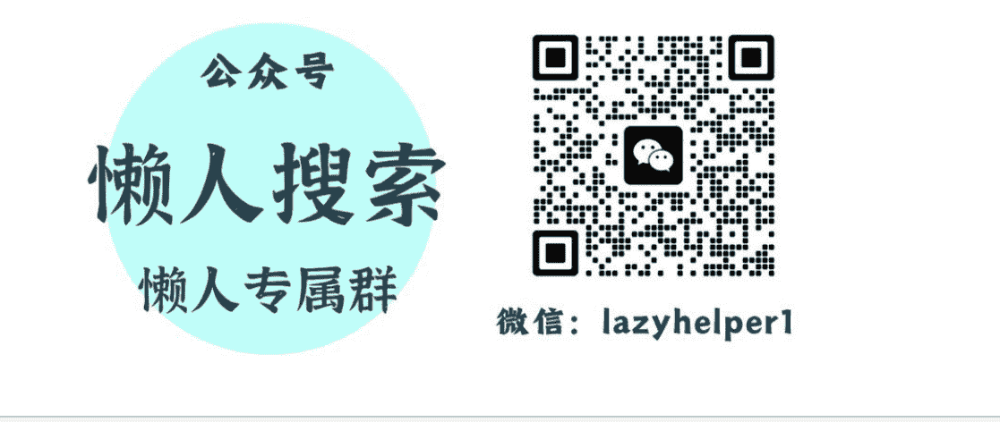

> **选读建议** | 适合没有基础、想通过种草内容接品牌推广的姑娘；做不到每天更新三十天的请绕行。最值得吸收的是“受众结构”这个反向推演：24到35岁女性最受广告方欢迎，起步期就做这群人爱看的东西，而不是碰运气追热门。等到4000多关注再切换方向、每日撤下旧图文不超过10篇，也是实用的纪律。要留心的是：头一单290元的直发推广会损伤帐号，前期得接受赚大钱要等。

大家好，我是 龙哥，加入过赚钱社群种草商单项目的成员。

开始这个副业前，我毕业还不到一年，对种草社区完全没接触。这个号是从零注册、零关注起步的。到今天，它积累了6824位关注者，我接过6次商业合作，合计收入1596元。最开始我靠清单类图文试水，第三篇冒了点亮，第六篇后每天增加几十个关注，到4000多时改做种草推荐，置换和付费单陆续就来了。

这篇不只是讲操作，我更想讲认知、节奏和陷阱。如果你也正在零起点，完全可以复制这条路线。

感谢赚钱好物分享项目提供的环境。

表面看，数字挺顺：好像一开始就选对了方向。其实不是。中途换方向时连续多篇没曝光，急到反复改稿差点弄坏号；后来受众偏年轻但消费力不足，商业价值被压低，只能低价接单。下面把这些经历完整说出来。

## 01 最重要的认知：涨的不是关注数，是“受众购买力”

动手前，先建立一个宏观视角：**做商业化，要站在广告主那边倒着看。** 举个例子，美妆护肤类品牌最想触达18到35岁的女性。你要接这种单，前期吸引的就应是这群人。如果引来的都是20岁不到的学生，大牌不会找你，因为她们的购买力弱。只有你的关注者买得起，对口的推广才可能出现。

这个平台上，**24到35岁的女性用户商业价值最高**，她们的占比直接决定你的报价。一个粗标准：女性关注者占比越高，受众画像越漂亮。我的号女性占比99%，但起家时发的是指甲设计，来的多是18到24岁的学生，所以商业价值打折扣。选择方向时，不是只看“女性多不多”，要看“有钱的女性多不多”。

这条认知是地基：到底发什么？不是抄热门，而是想清楚“未来要合作的品牌，他们想找的那群人爱看什么”。

## 02 起号前的基础工作：包装、养号、不踩线

太多人开号就猛发，被限流了自己还不知道。先把三件事做对。

### 2.1 帐号形象三件套

- 头像选带辨识度的：搞笑表情包、有网感的照片、个人美图都行，要与人设一致。
- 昵称别重名，可以加后缀，比如xxxbot。
- 简介三句话：与更新方向相关的经历、更新主题、联系邮箱；再加一句个人消费观或生活态度。

想走bot风格的话，用卡通女孩加纯色底做头像，昵称叫xxxbot，简介说清更新主题。这些后面都能再换。

### 2.2 先当用户，再当创作者

新号一开就发帖，容易被系统当成营销号。最好先模拟真实用户：每天花半小时到一小时，点赞、看完整条图文、随意逛逛，让系统觉得你是个活人。过几天再发布。

### 2.3 四条红线

- 设备与帐号严格一一对应，不要在一台手机来回切换。
- 不满一千关注可以选择不实名，但别在同一个设备上反复换号登录。
- 不要共用同一Wi-Fi开多号，会一起被限流甚至封号。多号运营尽量用移动网络，再分散到不同位置发。
- 单日撤下旧帖别超过10条，大量隐藏会触发异常。

## 03 起号阶段：把“加关注”当成唯一指标

先卸下一个心理包袱：做到1000关注没有想象中难，前提是目标纯粹。

**第一步：挑一个能快速聚人的内容形态**

我实测过三种：

一是bot类账号，只围绕某个主题持续生产系列作品，画面统一，非常垂直，需要对用户心理和平台热点敏感。

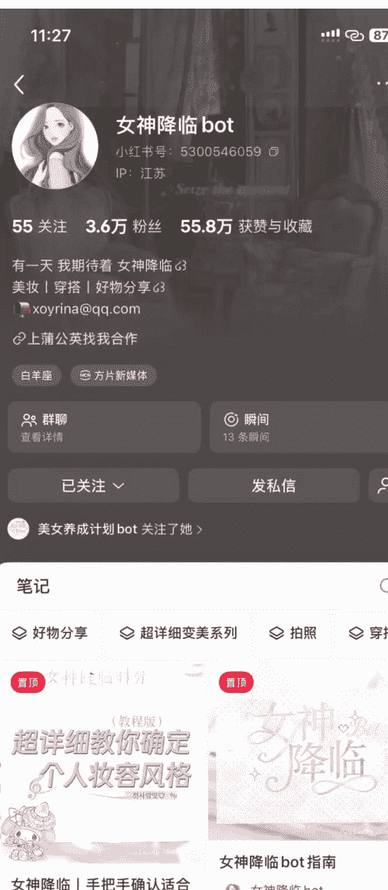

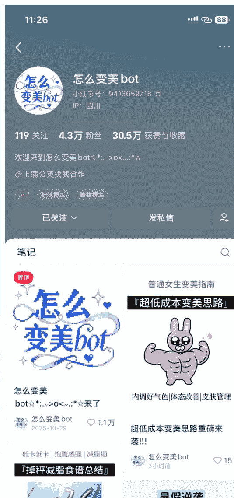

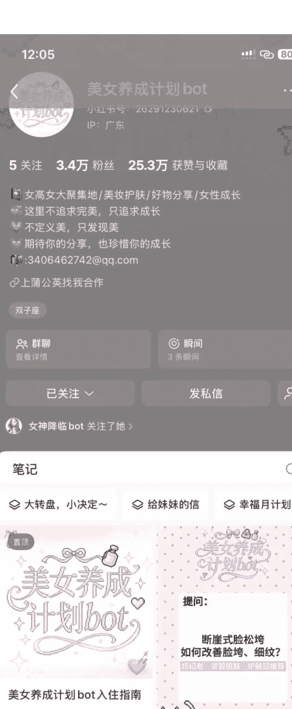

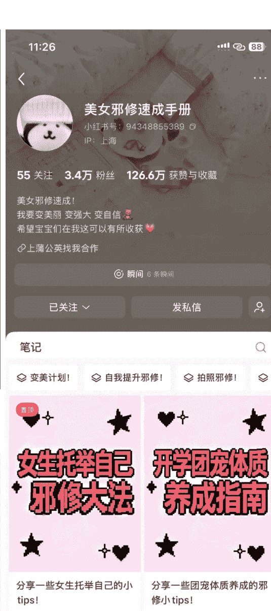

二是搬运高审美图片，比如外网上的优质作品，但对审美能力要求很高，没审美的人搬来也没用。

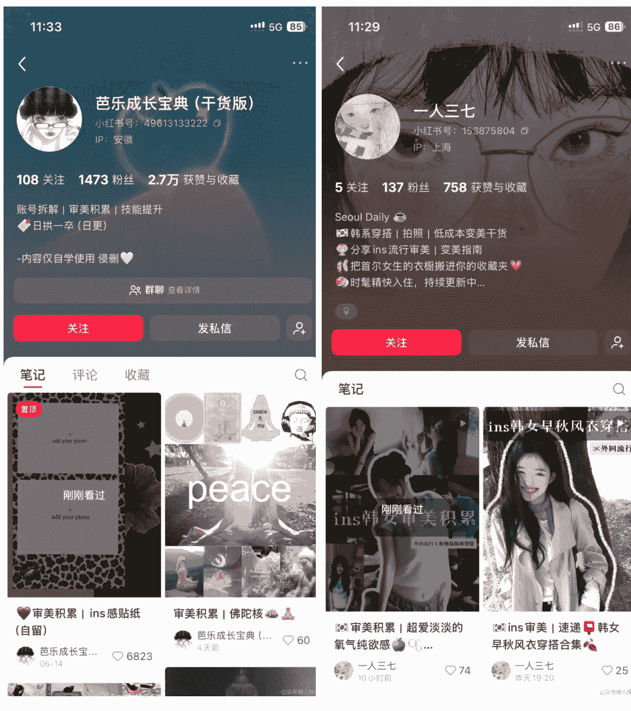

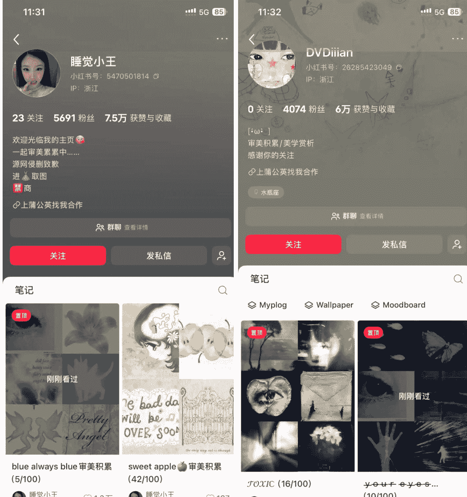

三是变美知识整理，可以用备忘录、长图、拼图、表情包封面等形式来呈现。

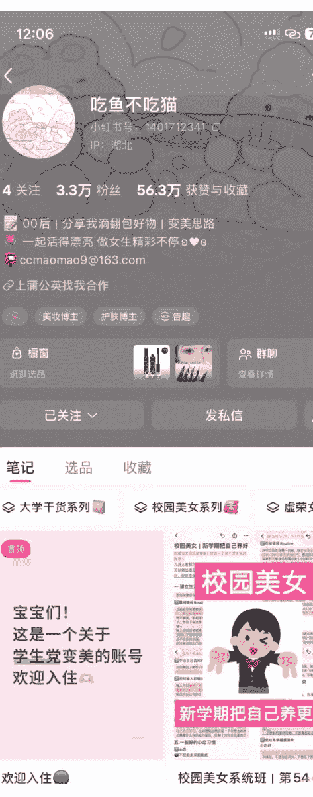

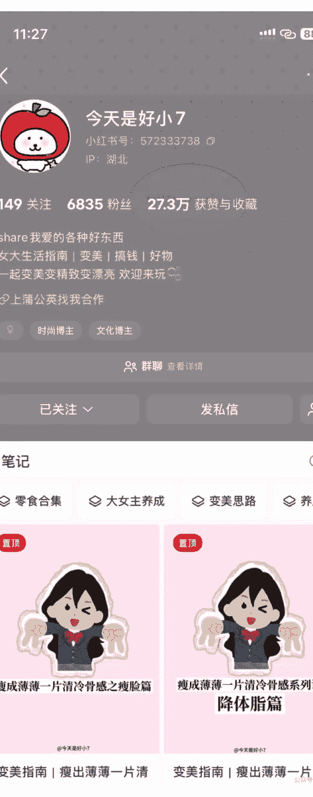

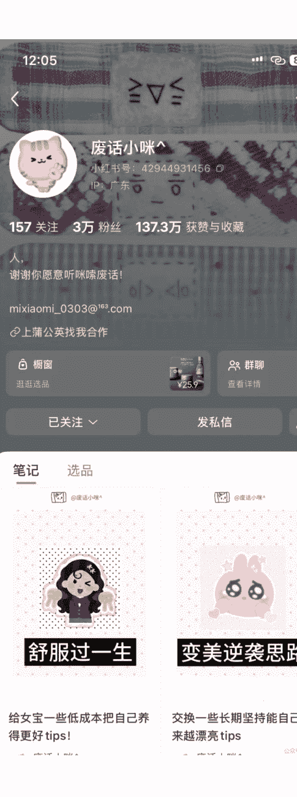

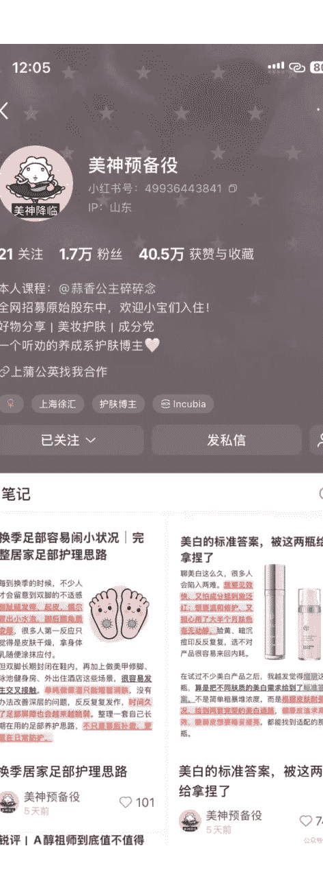

选一种你容易上手的，然后拼命找到这类型下“关注不多但点赞收藏很高”的帖子去照着做。

**第二步：积累“能火”的素材库**

怎么建？直接搜关键词，像“bot”，边点赞边看完，系统会持续给你推同款。重点盯那些关注不到5000、但点赞收藏过1000的帐号和图文。看得多了，你自然知道什么能爆。还有一个取巧法子：把爆款标题丢给AI，让它保留核心卖点换种说法，你再往里面填自己的素材。标题擦边甚至照搬，问题不大。

**第三步：三条铁律**

- 这个阶段不要跟原创较劲，复制已经跑通的选题就够。
- 所有图文围绕同一人群，封面和排版保持一致，主页身份一眼可辨。
- 从平台找来的素材必须二次处理，否则会被判搬运，不给推荐。

## 04 测试和回顾：用数字做决定

起号不是赌运气，是靠一轮轮测出来的。怎么测？准备5到10个方向，发布后看哪个表现好，就顺着提高细分。等到某一类作品能达到百赞，就沿着它一直发，直到它不灵。

以我的指甲类作品为例：为什么选“深肤色适用的指甲设计”？一是因为我本人就是深肤色，二是因为这个标签下曝光本来就大。选方向的依据是：你够不够了解这个人群、他们爱看什么、你能不能稳定输出。定完就模仿同类爆帖，边发边收集反馈，再决定继续还是换。

有个工具很推荐：平台自带的AI助手“点点”。你可以把截图发给它，让它帮你分析封面、标题、具体作品，多数时候挺准。

作品形式上，一定要细分，别做“大锅烩”。指甲设计合集这类的路子太宽，点赞收藏或许不差，但吸引不了关注，因为不足以打动某一个具体群体。

标题要写给机器“看”。把关键词和利益点塞进去，“深肤色、显白、指甲设计”就是例子。怎么做？想想你自己刷到哪类会点，然后反向推断。或者直接借爆款标题。

说一个我踩过的坑：爆帖不等于当天增粉。我的第三条“深肤色指甲设计”累计18万浏览、3785赞藏，但发布当天关注涨得很慢，因为主页还没沉淀。后来持续发同类型，到第六、七篇时，每天稳定增加50到100个关注。所以“增粉”需要主页有一定作品积累，再来一篇突然热门的引爆。如果只有一篇爆的，其他作品很弱，增粉效果也会打折。

如何判断一个作品没起来？发布半小时内“小眼睛”如果过200，算起步不错；两小时还没破200，系统不会再给更大推荐，基本就沉了。这时别干等，拿截图去问“点点”，让它给优化建议。

还要提醒：选好方向后，别发了三五天没反馈就急。至少坚持日更三十天，每天一篇，拿结果说话。但如果你已经发了十几篇都无起色，那就该换。

从指甲清单转向种草清单，我的路径其实很顺：先做家居收纳、美妆用品推荐，再模仿热门种草帖，逐步过渡到实物拍摄。如果你的增粉方向和未来要做的东西偏离很大，可以直接每天撤掉几篇旧帖硬切，但每天撤帖别超过10条，并且预留掉粉的心理空间——掉粉是必然的，只要最后能接单就值得。

另外，作品连续没有曝光时，别为了发而发，停下来总结。自己看不到问题，就把整个作品截图丢给AI，让它从封面、标题、主题三个角度给建议。也可以多丢几个AI对照着看，综合考虑后再改。

还有一条铁律：发布后24小时内千万不要改标题或正文。我曾在24小时内反复改动，结果曝光量断崖式下跌。要改，等一天后，按上面的“AI分析→修改”流程来。

## 05 外部工具和AI，帮你保更新

用灰豚数据或新红能看到一个方向的头部收入。把头部收入乘以十分之一，如果都达不到你的目标，就别碰这个方向，因为头部赚不到钱，新人更没机会。也顺带找找“关注不多但点赞收藏高”的近期爆文来参考。

把收集到的素材喂给AI，让它帮你整理成选题库和素材库，这样每天发什么不用愁。发布节奏上，新号每天1到2篇，跑顺后3到4篇也没问题。

## 06 找参考：阶段不同，对象不同

不是找到一个参照就永远跟着。选参考对象看四点：关注不多但近期增粉快；作品形式你能驾驭；后台受众画像正是你的目标人群；赚钱能力强，不赚钱的别参考。

具体怎么找？先用关键词筛人设、形式、表现和变现模式，再纵向挖：博主经历能不能复制、作品制作成本和时间是否可控、能不能稳定做三个月。还要鉴别：点赞收藏没有破千的没参考价值；每一条都是广告的更没参考价值。报价高，到底是表现好还是作品好，要分清。

## 07 种草推荐的六种玩法

转向种草推荐后，至少有六条路可以选：

1. 随手拍：一两张图加短文字，普通人感觉强，靠高转化文案和真实照片取胜。
2. 精致手持：六到八张，需要打光布景，还要维护点赞收藏。
3. 生活记录：适合爱买、有审美的，本质是传递可模仿的生活方式。
4. 成分党：要懂点成分，按“痛点+产品+介绍+改变+用法”的结构写。
5. 静物：需要摄影功力和审美，适合有资源或有格调的类型，否则成本太高。
6. 口播：难度最高，但信任度最强，考验镜头表现力和脚本说服力。

## 08 什么时候转方向，怎么转不伤号

满1000关注就能在官方接单平台开通，报价大约等于关注数的十分之一。千粉时单价低，很多还是置换单。我认为没必要急着接一堆低价单，所以到4000多才转方向。从实际操作看，我在第六篇方向帖时已经开始有品牌来问。

要注意：如果起号内容和方向帖差异大，转方向时会大量掉粉。这是正常的，为了后期单价，提前预留一点心理空间就好。如果两者接近，转向就安静顺滑，比如我的“指甲清单→种草清单→实物拍摄”就没怎么掉粉。差异大的，每天隐藏2到3篇旧帖，同时保持新作品更新，直到旧帖清完，每天别超10条。

## 09 转向后创作要点

新作品必须有明确的“利他性”。普通人不能只发“我今天用了这个”，要给具体场景或痛点的解决方案。比如“全身美白护理跟练模板”或“无印良品真实购物分享”，都是别人看了觉得有用的作品。

文字别太官方，也别堆卖点。分享厨房湿巾，你说“踩在地上很舒服”就比“擦地无残留”有人情味。多讲亲身体验，少念产品说明书，自然曝光会更好。

搜索流量比推荐流量更准。投放关键词要具体，比如人群词“学生党”“方圆脸”“梨形身材”，痛点词“失眠”“嗓子疼”，场景词“居家”“出差”“约会”，需求词“美白”“成长”“搞钱”。这些都容易被人搜到。

我的经验就这些。如果你也在起步，记住三点：先想受众、坚持更新、不断总结。路会越走越宽的。

（完）

不少刚入行的人经营自媒体号，总以为文笔决定一切，其实他们真正的问题是：根本不理解一条爆款笔记是怎么被设计出来的。最近我读了一份非常接地气的操作手册，从内容制作、广告定价，到新手常犯的错误，基本都聊到了。我挑重点重新讲一遍，保留干货，去掉空话。

先聊爆款是怎么来的。一条笔记能不能火，画面只是外壳，真正决定感染力的，是你放进去的真实情绪。拆开看有五个要点：选品要扎眼、有新意、能解决实际问题，最好颜值也高；拍摄要讲究画面质感，并且把产品放到多个生活场景里，至少三到四种环境穿插出现；所有关键卖点直接做进图片里，别让读者去正文里翻；冷启动阶段，选题必须对别人有用；标题则是「检索词+具体好处」的结构，说白了，那是写来给算法看的。

另外有三件作死的事别碰。第一，平台会存档你发过的每一个帖子，删掉重来等于给自己断流，数据多半会直接崩；第二，笔记发出去不到一天，任何修改都别做，改一下推荐节奏就乱了；第三，别急着把某条评论顶到最上面，系统容易判定你在打商业营销。

什么时候发稿，不需要拍脑袋，后台会告诉你。跑一阵子之后，去看数据后台，你能摸清自己的粉丝通常几点在线。把发稿的时间安排在大家上线最密集的时间段再提早三十分钟，最容易吃到头一波推荐。

发完稿也别直接当甩手掌柜，初始互动要靠手动托一把。请朋友帮忙点「赞」和「收藏」，到十来个就停；自己再发几条容易让人想接话的评论，把评论区气氛带起来。这里有个关键细节：这种互动不是把链接丢给朋友就行，而是让他们在App里搜索某个词，再从搜索结果里点到你的笔记。因为后台能看到访客从哪儿来，直接分享点进来的浏览不会算进搜索推荐权重。

等聊到赚钱的部分，思路得换成从甲方那头倒推。你可以花钱开一个外部监测平台的账号，看看最近哪些品牌投放频率高，他们又在投放哪一类账号。接着专门研究这些账号的整体调性、人设、审美、粉丝画像和笔记表现，照着优化自己。

选题也是这么倒推出来的。先问自己：我以后想接的合作，品牌通常会找什么样的人？这些人身上有什么标签，平时爱聊什么，又是怎么塑造自己的？另外，平台始终偏爱能留住用户的表达——要么解决麻烦，要么提供价值，最好再有几分「真人味」，别像广告机器。

再说怎么让账号更值钱。第一，别被眼前的小单子带偏，先养出账号的整体气质。三类合作不要碰：产品太差、解决不了用户需要、让你毫无表达欲。接得越多，报价越难往上走。第二，真正能抬升身价的，是你持续产出一条条爆款合作内容；这背后有三个变量——选品要小众、冷门、好用，能蹭到产地、潮流或社会热点更好；选题和文案要打中人群的难处并给出解法，还能把热点拉回你所在的领域；拍摄层面，画面结构、用光、首图都不能糊弄。第三，早期怎么吸引优质合作？先把账号多面的商业可能性展示出来。PR有个习惯，喜欢继续投那些已经被竞品投出过爆款的账号，所以你平时多拆别人家的爆款合作，其实是在给未来的自己铺路。第四，选题也别只在同赛道里找，各种不同类型的账号内容都值得扫一遍，某条笔记里只要有一点让你心动，就记下来，把那1%吸收成你自己的100%。

报价也有一个可以套用的底。首单合作，试着按粉丝量的十分之一报。拿我自己举例，当时粉丝约四千，接了个染发产品的推广，最终开价290。按十分之一估算，正常应该报到400上下，但现实是那会儿基本没有品牌来问，只能一直往下降。现在市场更卷，得提前做好预期：刚起步那阵子，可能很久都见不到像样的收入。而且那一单还是「纯代发」——品牌把物料全部备好，我只需要用自己的账号发出去；事后才明白，这种模式很伤号，能不接就不接。

起步时多做一些置换合作也没问题，但每一条都必须走官方报备流程。这么一来，你能积累下合作笔记的原始记录；要特别记住，合作笔记和日常笔记的权重是分开计算的。要是以后想拿到更好的广告，前期也可以主动约一些靠谱的品牌做置换，先把合作笔记的底子垫出来。

我整理了一份避雷备忘录，专给刚入门的人看。合规上面，一台设备只养一个号，同一个WiFi下也别挂好几个号；千粉之前不要反复换设备，更别趁着深夜一口气隐藏太多旧笔记，一天最多清掉十条。账号还没养热就急着连发帖子，大概率会被系统打上营销性质的标签，以后就一直在暗中限流里。内容太杂也是硬伤，什么都往里装，吸引来的人群很散，号自然立不住定位。另一种常见病是自言自语：没想好这些内容到底服务于谁，或者只顾着写自己想写的，根本不管读者愿不愿意读、愿不愿意存。上面提到的三个操作雷区再敲一遍黑板：发完不满一天就改、把旧帖删了再发、急着置顶某条评论，都会伤推荐，甚至被当成营销处理。最后，不要为了更新而硬更。连续几篇都没水花，还不肯复盘，那只是在低效努力。

再给几条进阶玩法。第一，早一点布置能被搜到的字眼，说辞越具体、越小众，越容易通过搜索功能被人翻出来。你预想中的读者是谁、他们会为什么事头疼、通常在什么场景下使用，这些词都要有意识地埋进标题、正文和标签。第二，标签可以玩「大词带小词」。平台允许挂满十枚标签，能装满就别留白。我的习惯是五五开：五个大词条负责冲曝光，类似变美、美白这种几亿人看过的泛流量；另外五个小词条负责接精准流量，比如某种脸型、高颧骨该怎么修容，看的人不算多，但每一个都是潜在的对口粉丝，搜到你之后基本就跑不掉了。第三，想让选题永远不断档，就多去刷别的方向的内容创作者，只要哪条笔记有一个点戳中你，立刻记下来，把那1%扩写成你自己的100%，再交给AI搭一个选题库，之后基本不可能断更。第四，把复盘做进日常。数据不好看，就把截图分发给几个不同的AI，让它们轮流给建议，你再照着改；同时盯住点赞收藏比率、涨粉速度、合集有没有人追着看这些正向小反馈，一点点优化下去。第五，别忘发稿时机和基础互动的基本功：在大家最活跃的时段再往前挪半小时发稿，然后找人点赞、收藏到十来个，补几条能引话的评论——但上述动作都必须从搜索入口进来，不能直接转链接。

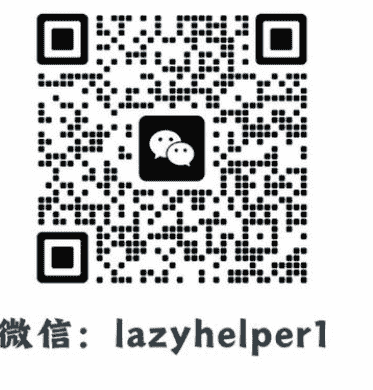