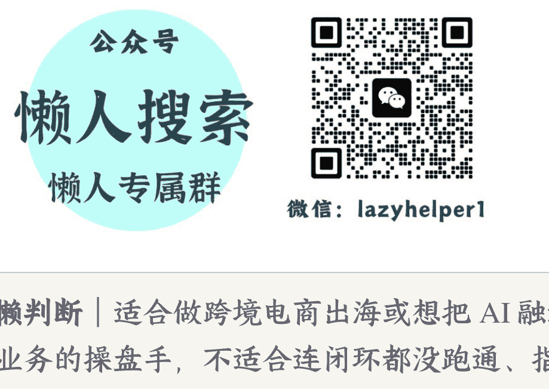
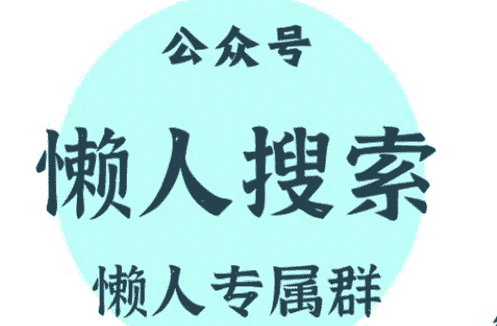

# AI+产品/运营增长的一些顶级理解,

刷到杨涛在深圳听完国民老师课后分享的现场笔记，我反复看了三遍，忍不住按头安利给所有做产品或运营的朋友。先说结论：这套思路适合已经把业务闭环跑通、想把AI真正嵌进生意里的人；如果连需求真假都没验证过，指望AI凭空变钱，那大概率会被工具反噬。笔记里有个特别实在的细节：花一百多块在闲鱼买3ue，就能平替similarweb挖竞品数据，这招值回票价。但最大的坑是——很多人把流程图抄了一遍就以为学会了，没有在真实业务里磨出人机协作的手感，最后反而被AI消耗。

这两年大家都觉得AI是万能解药，但真正跑通过的人会发现，AI只是放大器——它放大秩序，也可能放大混乱。你先要有一个稳定的生产环境去承载它。国民老师点破了一个递进逻辑：场景—需求—产品。想清楚谁愿意为你付钱，你能替对方解决什么问题，而不是一上来就憋大招。第一轮和AI深聊，表面是让AI懂你，其实是你更懂自己。为了一个深思熟虑的业务和AI做两三个小时高强度对话，你会被迫把生意的每个环节重新想一遍，那种感觉就像认知被刷新了。

很多人讲“看不见的手”，其实完整的话是：在充分竞争的环境里，有一双无形的手。所谓的成就事业，大多时候是环境成就了事业。所以别硬拗趋势，先看环境把你推到哪个位置。

评论区有神明，这句话放在国内外所有生意里都成立。安克就是靠着一条条评论起来的。你还没有用户的时候，就去翻竞品评论——那些反复出现的抱怨，就是需求地图。记住：任何领域对你有价值的竞品不会超过五个。你可以放下手机试试，能脱口而出的洗衣机品牌、内衣品牌、饮水机品牌，五个都费劲。

流量成本必然上涨，因为流量基本固定，抢的人越来越多。放大投放的ROI一定下滑，直到你撑不住。对抗内卷唯一的出路是打造品牌，要么就赚一波快钱走人。纯流量打法只有这两种结局。

品牌是什么？是每个人卖货人的终极梦想。铺货逻辑、精品逻辑、微创新逻辑，大多只能叫“做项目”，只有品牌逻辑才称得上“做事业”。那怎么找品牌机会？用七个问题倒推：谁买、搜什么、哪里没做好、会不会复购、在哪用、产品长什么样、什么时候动。这套问题换到任何行业都成立。

做电商，供应链是关键。AI能做到的事，别人迟早也能做到，大模型自身迭代你都追不上。所以要去思考什么是AI做不到的——供应链一定是其中之一。这才是你的护城河。

价格永远是影响成交的最大因素。别听什么4P、5P，多一个0，你每天要卖出的单就少一个0；转化率翻倍，需要的链接就能少一半。把整条路径每个节点列出来，你就会看到着力点。

用户花钱买的从来不是产品，是确定性。AI能出图不算本事，能传递情绪才算。宝妈买瑜伽垫，你要展示的是大体重自重训练的真实场景，是关节炎用户的痛点，是卷腹和拉伸的适配——不是材质参数、不是专利背书。消费者看到的一切要和他有关，从搜索关键词到详情页，要设计一条完整的动线，让他觉得“这就是我的问题”。

评论要带着UGC一起研究。全域内容里找足够多的真实用户生成内容，你会更懂真实需求。流量、产品、运营是创业黄金三角——运营到位，自然涌现大量自来水；UGC可以反向喂给流量端（种草/舆情），也能喂给产品端（需求/迭代）。这是飞轮，不是单点。

从大单品切入，慢慢扩展成一叠货。参考hims到hims&hers的路径。别做“再找一个爆品”的无限循环，那样每次都要重新买流量、重新扛库存和竞争风险。以用户为单元找同一群人的需求空白，积累的是用户理解、长期价值和供应链能力。以商品为单元积累的只是流量能力和单品利润，窗口期一过就被对手跟平。

数据不能拍脑袋。日常取样往往没有价值——取样不足、偏差、谬误到处都是。找干净的信息源是一辈子要做的课题。扒数据的时候注意证据链：阶段、场景、需求、关键词、趋势、评论原话、频次、主要竞品、判断理由、工具、日期、二次验证……少一环都可能掉进AI幻觉。它的工具没有调用痕迹，就说明它在编。

数据源怎么来？淘宝评价、问大家、客服聊天记录、退款原因、差评、社群高频问题、弹幕……工具加人肉，两手都要硬。国内极客工具在闲鱼都有白菜价，但越是难获取的数据壁垒越高，容易拿到的对手也容易拿到。实在不行，伪装成客户和十家竞品走完整交易流程，一手体验比任何报告都值钱。

关于出海，口号喊了十几年，但去全球化才是眼下现实。别心存幻觉，门在关上，窗在收紧。从大山到县城到省城到北上广深杭，第四代创业者要马踏东京纽约，只剩一条路：品牌出海。一百万个白牌出海，成功率万分之一。大国需要一百个全球认可的品牌，最好是消费品。经济下行不影响平台电商增长，因为这是结构性调整，不是周期性波动。

文化才是最底层的操作系统。AI能翻译语言，翻不出那句话在什么场景下被说出来。非洲的集装箱医院、新生儿保温袋、欧美断断续续的聊天文化、送礼习惯、评论里的夸张表达……不理解文化，就看不见真实需求。英语要学好，全球90%的底层运行逻辑用英文书写，99%的AI语料是英文，很多人类文明的光没有翻译成中文。

推荐一个思考框架：一个搜索流量等于五个推广流量等于五十个推荐流量。流量，就是关键词的凝视。前缀+主词+后缀构成场景词和需求词。长尾词更精准、更便宜。三轴的打法能延伸到国内，产品可以变成服务，品牌可以替换成IP和影响力。

未来的推荐会走向agentic化——千人千面的极化版。针对每个人匹配最合适的内容，内容回归内容本身。真正用心解读人群-场景-需求的人，会迎来最好的时代。

数学不讲道理，数据冰冷残酷又真实。所以我的用词永远是：我看见了一个需求。通过观察和AI辅助的数据收集，看见需求，验证需求，兑现需求。这套引擎靠数据源驱动，换成任何领域的数据源就能迁移。你有什么样的数据源，就有什么样的壁垒。

最后，AI真正的能力在于coding，不是chat。每天用AI的时间超过用微信，半个月你就能上手。和AI协作别胆怯，大胆提需求，高估它。Agent的价值在于不知疲倦地处理已知框架内的信息，人处理框架之外的判断。你才是分析师、决策者。给Agent足够的耐心去优化，它最后会成为组织的记忆体，让经验、判断、教训可检索、可迭代——但它永远不会替你做主。

这堂课最戳我的一点是：判断力没法速成。框架告诉你去哪看，行业经验告诉你看到什么。同一条差评，新手看到抱怨，会用AI的人看到需求，老手看到品类机会。那一瞬间，他脑子里跑完的是从需求到供应链到履约的整条链路。那是算法和算力之外的东西——优质数据加大量训练，就像老司机听引擎声就知道哪出了问题。

别自欺欺人。上完课问自己带走了什么成果物——是一份真能看懂、真能辅助决策的需求地图，而不是填完就扔的表格。

成就事业，大部分原因是同行衬托。想办法比同行优秀5%，就够了。而AI给我们的机会，是把文化和需求那一层的翻译补上了——剩下的，交给人的判断力。

你有没有发现，很多产品看似卖得不错，但用户下单的那一刻，心里真正在意的可能并不是参数本身。以父母买儿童用品为例，他们要的是“安全、材质、认证、省心”那一整套确定性，甚至是一种心理安慰。但这还不够——往深处看，还有两支隐形力量在起作用：影响者和决策者。购买者甚至可能是第三种人：送礼的人，所以要体面；买宠物用品的人，其实是宠物主人；买老年产品的人，掏钱的常常是儿女。把这几道题同时解好，你就能比同行多赢5%的胜算。

与其做下一个Sam，不如做自己Agent的第一个版本。别人把AI战略说得很轻巧，你更要冷静地问：AI拿不走的优势到底是什么？答案往往藏在你和物理世界发生摩擦的地方：你的供应链和独家关系里，有没有产业带红利、有没有地理位置优势；你对原材料和工艺的认知，能不能成为微创新的地基；你对市场的真实判断，是不是早已超出某个平台的小规则；你对品类的理解，能不能跨类目发现异常值并快速跟上；你对运营的敏感度，能不能看懂规则和数据的波动；你的资金厚度，能不能扛住试错成本，能不能在压力下不变形；还要看有没有类目的准入门槛，已经悄悄把你淘汰。你的组织规模、搭档伙伴和协作效率，能不能支撑你打赢硬仗；你手里的真实数据和存量用户，能不能沉淀下来、低成本再次触达，客户到底是平台的还是你自己的。看清楚自己手里有什么牌，才算“知人者智，自知者明”。成年人的世界里，真正的死穴，是那种连自己都不知道的倔强。

Sam反复建议让AI对你做一次深度访谈。我做过最长的一次，整整8小时。几个经验值得记住：第一，准备要充分，时间要留足，像准备婚礼一样虔诚，因为这是一轮接一轮的深挖，一开始就要全情投入；第二，把能前置的都前置——履历、资源清单、初步感兴趣的品类或方向、你的边界，统统喂给它；第三，对自己和AI都要诚实，一步错就会步步错；第四，聊天框有上限，开新对话时，一定要告诉它“继续访谈”，让它从memory里读取上下文。另外，压测要残酷一点。

AI还没出现的年代，很少有人能察觉：原来我们的人生token，如此珍贵。

事实上，不同模式下，listing的打法天差地别。有些商品几乎没有决策成本，用户甚至无从选择，这时候评分根本影响不了第一次下单。所以listing从来不只是详情页，它是七个角色的结合体：搜索入口，让人看见；导购，让人掏钱；筛选，只把货卖给对的人，避开退货率的暗伤；表白墙，评论区能沉淀出庞大的信任资产；数据采集，收集消费者真实的心声；品牌载体，传递你的风格和品牌语言；投名状，向平台发出信号——我很想深耕，求带，轻虐。

AI能跑多快，很大程度上取决于你能接住多少。模型再强，也会卡在你这个环节上。模型大概3个月跃迁一次，而你的阅读速度、理解力和判断力，可能还在原地踏步，甚至退步。AI一秒钟丢回来30条结果，你花十分钟才读懂2条，剩下28条怎么办？任它漏掉，看起来省事，但时间久了，你会形成深度的路径依赖，困在自己的舒适区里打转。接不住更多的时候，就要追求更准。所谓“有策略地漏掉”，不是凭主观随意丢掉，而是通过一次次诚实的协作，让AI帮你过滤，把更值得你接住的信息送到眼前。说到底，这还是人生token的取舍——注意力，才是最贵的资源。

适合自己的，才是能落地的。别看到一张好流程图，就兴奋地拿来“吸星大法”。先追问：这套环节在你的业务里真的成立吗？就算成立，团队用得上吗？大家习惯吗？想想当初引入飞书，你花了多久才让团队适应。再看看这张图依赖的数据、组织、工具、预算，你到底有没有？它有没有有效期？经不起追问的流程图，最终只会静静躺在收藏夹里。

AI可以做加分项，甚至能在烂泥上雕花，但别指望它在你要冻死时雪中送炭，更不可能凭空给你变出结果。可惜，大多数人想要的恰恰是“无中生有”。真正聪明的用法是：业务先行，让AI去放大你已经跑通的答案，而不是拿它去改造一个还没成熟的业务。

赚钱路上，最大的敌人不是对手，而是“下一个貌似更好的机会”。你现在能赚钱，离不开一连串巧合刚好凑齐，你甚至说不清自己做对了什么，也不知道哪个变量才是胜负手。这时再冒出一个“机会”，看起来很容易，可一旦扑上去，就等于丢掉一个你即将理解的系统，去追一个完全陌生的系统。该做的，是在这个周期里把能赚的钱尽量赚干净。窗口期有限，而且会越来越短；分心的代价从来不是少赚一点，而是两头一场空。

Sam聊AI发展历程时，说他一眼就能看出别人屏幕上的框架价值，你会不会也有同感？听到“没用了”“归零了”“换代了”，你是不是也会冒出一种想法：既然学得慢，是不是就可以不用学了？停，这是当下最精致的借口。与其焦虑，不如想明白：到底什么才是大模型拿不走、AI永远需要自己长出来的东西？答案是：工具会被重置，只有体感在不断累积。什么是体感？是能分辨哪些结果该信、哪些该覆盖，是交叉验证的能力，是能把指令翻译清楚，是踩过坑之后的痛感，是互动中的直觉、判断、拆解和审美。不用AI，你根本养不出这种人和AI协作的体感和手感。别等着一个稳定版，它永远不会出现；体感有复利，时间会给你开花。你去年精心调教的prompt、上个月搭建的workflow，都会被下一轮模型升级吃掉；你今天引以为豪的AI技巧，半年后就是人人都会的基础操作；你现在精心打磨的短剧，半年后可能就会被人嫌粗糙。所以，别在模型层面跟它较劲，要去业务层面较量。AI在进化，工具在轮换，真正不会贬值的是什么？是你对业务的理解，是你的独家内容——它们不被开源，不被降价，也不怕下一代模型。把时间砸在这些地方。

这篇长文看下来，你可能觉得自己已经懂了。但真相是，90%的人一到实操就会卡在第一关。工具和教程是最低级的壁垒，真正的护城河是“立刻动手”和“圈层信息差”。如果你想看全网最新的变现玩法，和一群执行力极强的极客一起下场拿结果，欢迎加入我的核心私域【懒人专属群】。这里不聊虚的，只拆解商业闭环，压榨AI效率。里面已经沉淀了1000多个跑通的套利实战案例。想查阅圈子的完整数字资产和上车门槛，点这个链接：https://lazyso.com/insider/ 。如果你认同价值、准备好下场干活，可以加我微信：lazyhelper1，备注【实操上车】。非诚勿扰。

