# 二十那年，我双手插兜，站在AI自媒体的 银河上眸望未来——实现指数级增长心得分享

## 20岁这一年：我如何借助 AI 内容创作，让认知、资源与人脉一起加速

06 年出生，加入龙哥盟两年，曾写过 7 篇精华文章。过去 8 个月，我在 X 上积累了 5.4 万关注者，也在中文 AI 创作者圈里站稳了脚跟。

趁着 20 岁这个时间点，我想把过去一年的经历重新梳理一遍：我为什么选择 X？怎样持续获得灵感？又是如何通过内容，让自己接触到更多机会？

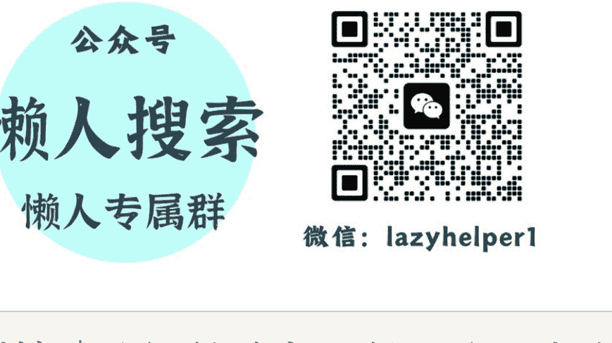

最初接触赚钱，是在大一上学期。当时我从付费社群里听说这个平台，随后开始阅读其中的各种案例。最开始，一篇文章只能看懂一小部分，后来连续补课两个月，基本可以脱离工具读完大多数内容。

之后，我陆续参加了 Web 网站、YouTube AI 视频、AI 短剧等项目，也开始接触国内外不同平台，尝试理解各种商业模式。

### 我的项目记录

- 2025-12

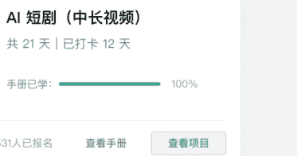

- 2025-05

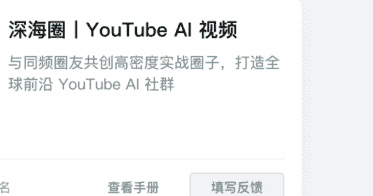

- 2025-09

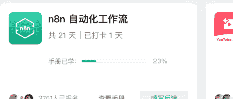

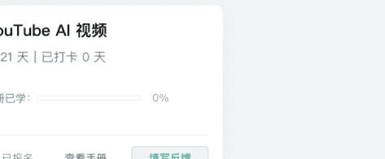

- 2025-06

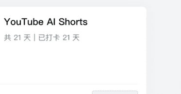

- 2025-03

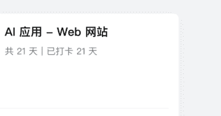

过去一年积累的能力，最终在 X 的 AI 内容方向上集中释放。AI 产品、视频制作、企业解决方案、个人品牌运营，我都或多或少实践过，因此做这个方向时，很多经验能够直接复用。

### 我的 X 页面

3,610 帖子

编辑个人资料

**逸尘**

@gengdaj

🐒 06 年连续创业者｜潜意识发起者｜永远在学习的法学生

⚖️ 正在上海法律科技律所，打工攒素材

●● YouTube—一个月十万粉｜AI 产品营收五位数

💌 付费咨询（yichen10801）：企业 AI 服务&AI 自媒体增长

💌 付费社群：TradeWinds

📇 gengdajin1101@gmail.com

- 社交媒体影响力 https://github.com/mcncarl yichen.ai

- 出生于 2006 年 8 月 1 日 2025 年 3 月 加入

- **269** 正在关注 **5.3 万** 关注者

53,943

概览 观众 内容 视频 直播 空间

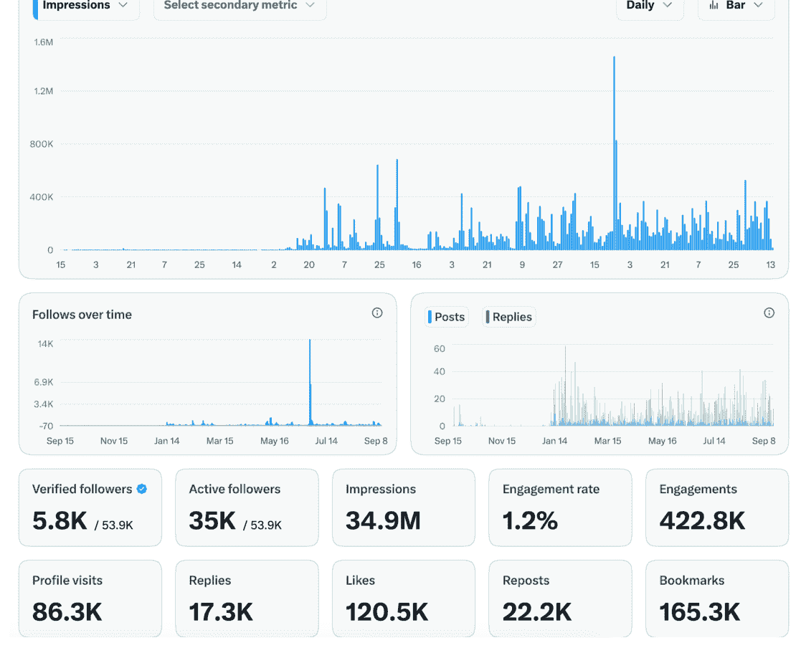

关于商业化，之前的文章已经拆解过基础路径：

https://bcn5ot9wwnew.feishu.cn/wiki/JB92wcXppiWZfdk1euncasBGnKg

但我越来越觉得，更高层次的收入方式，并不是单独完成某个项目，而是持续建立个人影响力，让内容、关系和机会彼此连接。具体方法不宜照着模板机械复制，真正重要的是理解背后的判断方式。

我原本想用《二十不惑》作为标题，但这个年纪的我，仍然面对大量未知：

人与 AI 的相处模式会怎样变化？具身智能普及之后，人类是否还需要大量工作？AGI、RSI 加速推进后，社会结构会不会被重新改写？脑机接口成熟以后，学习的意义是否会发生变化？

面对技术浪潮，我并没有答案，所以最后选择了“眸望未来”。

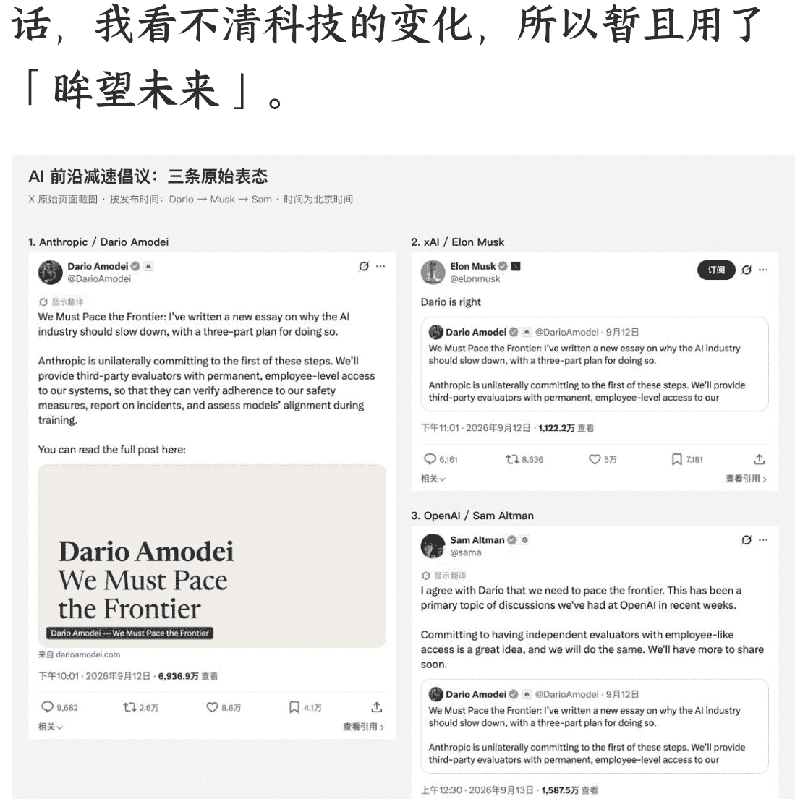

不过，我对未来依旧抱有期待。因为我逐渐找到了一种有趣的方式：把 AI 探索、个人成长和“地球 online”这场长期游戏放在一起，用持续创作换取能力、关系与机会的复利。

## 一、内容创作最重要的资产，是信赖感

很多人把这件事理解成接广告、卖课程或做知识服务，但在我看来，这些都只是表现形式。真正决定一个创作者能走多远的，是别人是否愿意相信你。

接推广，本质上是在借助已有的信赖，让读者关注某个商品；销售课程，则是在用影响力换取用户解决问题的预算。这些动作如果只有交易感，长期来看会消耗个人品牌。

但如果推荐的东西确实出现在自己的使用场景里，并且能够解决你正在经历的问题，内容就会产生另一种效果：读者看到的不是生硬植入，而是一个经过验证的选择。

我曾经写过 GamsGo 的推广内容，起点就是自己的账号被收回。

Google AI 学生认证失效后，我使用的 Antigravity、Gemini Pro、NotebookLM、Vec 0.3.1、Nanobanana Pro 等工具全部受到影响，日常工作效率立刻下降。

我也尝试找过二手平台卖家，但售后基本无法提供稳定保障。直接购买官方服务，每月 20 美元，对需要同时使用多个工具的我而言又有成本压力。

于是我的要求很明确：预算可以比二手渠道高一些，但账号必须有持续支持和售后承诺。

后来我接触到 GamsGo。这个平台运营了 7 年，Gemini 等订阅服务通常比官方价格低不少，同时还提供 ChatGPT、Midjourney、YouTube Premium、Spotify、Manus、Genspark、Perplexity 等产品。

这次推荐之所以能够自然，是因为它来自一个我亲身遇到的问题，也来自我对工具的实际需求。推广没有脱离日常，反而成为经历的一部分。

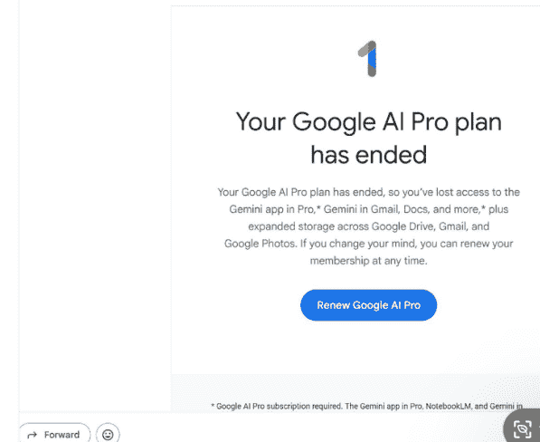

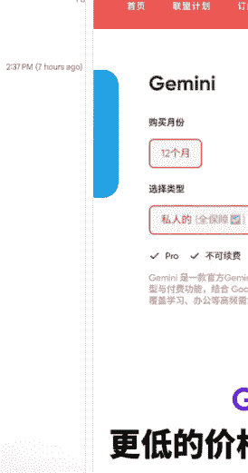

## 二、不要困在单一赛道里，素材来自你真正经历过的生活

当合作机会越来越多，仅靠原本熟悉的领域，难免出现素材不足的问题。我的解决方法不是强行制造选题，而是主动扩大生活半径。

我不会只围绕 AI 相关话题打转，也会去接触法律、硬件、网络、商业、经济、电商和产品。领域越丰富，能够组合出的表达角度就越多。

比如换用 Mac 之后，我写下了从 Windows 转到 Mac 的体验，包括快捷键、触控板、系统生态、续航表现，以及我安装的各种工具。这篇内容获得了 12 万曝光。

后续因为持续使用 Mac，我又发现了许多新的创作场景：本地数据整理、工具调用、开发 App、处理微信收藏等。这些经历本身就能形成新的选题，而不是为了发内容临时拼凑。

**逸尘 @gengdaj · 4月16日**

这个工具太强了！我已经把我微信收藏的143条数据全部成功解析了出来。这个做出来的网站是skill内置的，但是数据反正都在本地，自己想怎么分类整理都可以。

Mac电脑是唯一的限制。

收藏夹不再吃灰，是AI时代给我最强的体感之一。

📕、X、微信，已经全部打通了。。。太强了！

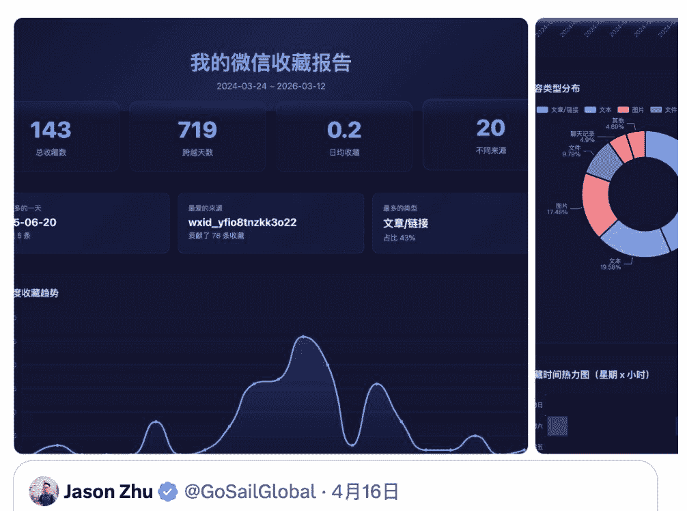

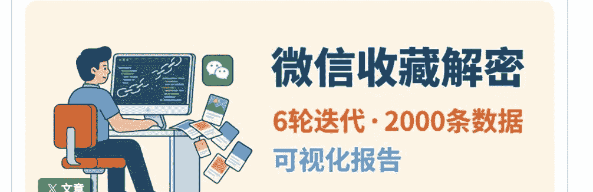

**Jason Zhu @GoSailGlobal · 4月16日**

**微信收藏被加密锁死？我用frida逆向6轮迭代解密2000条数据，生成7种图表可视化报告**

微信收藏是很多人的数字仓库，十年积累下来几千条收藏，但这些数据被锁在加密数据库里，连导出都做不到。用 Claude Code 写了一个 Skill，从加密的微信 Mac 本地数据库端到端解密，最终生成一份包含 7...

👤 29 🔁 94 ❤️ 425 📊 11万 ⭳ 816

**逸尘 @gengdaj · 3月11日**

关于X平台数据解析，我用本地部署的大模型配合API调用...

人生第一款App完成了网站、App备案，终于到最后一步华为审核了。全程都使用Codex完成信息填写、备案，我坐在一边刷短视频的感觉太爽了啊！

这款App已经有上百位付费用户支持，但是作为我第一架上架到应用市场的App，如果成功，就将免费开放给给大家。

这是一款直接把待办记录在手机锁屏上的App，目前仅限安卓。但是是Flutter框架，我自用版本还有Mac App，以后也会拓展到iPhone。

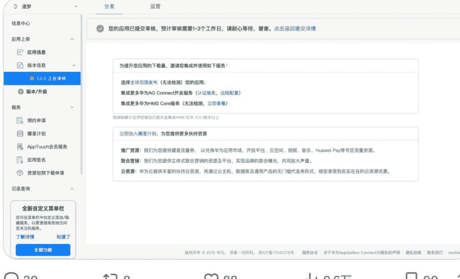

为了获得更具体的行业经验，我还主动进入上海的法律科技律所工作，接触企业场景、协作流程和 AI 解决方案。

为处理网络问题，我去学习 DNS、TLS、ISP 等基础原理；为了理解跨境业务，我补充支付与结算方面的知识；接下来还会继续探索出海、金融、英语、科技、社交、历史和写作。

这套路径带来的变化，不只是选题变多了。我的设备、能力与收入也形成了循环：买 Mac 的支出，后来通过相关内容合作和其他项目逐步赚了回来；投入没有停留在消费层面，而是转化成了新的生产资料。

我越来越认同一个判断：不要为了发内容而活。先把日子过得足够丰富，再把其中有价值的部分记录下来。

## 三、我选择 X，是因为它能同时放大三种增长

### 1. 让自己接触更高密度的信息

X 上聚集了大量创业者、研究者、产品负责人、投资人和技术从业者。持续输出有判断、有实践、有结果的内容，能够让你进入优秀者的视野。

过去一段时间，我在微信里认识了数百位创始人、高管以及优秀的年轻创业者。部分人成为了朋友，部分人带来了项目与资源，也有人成为我继续前进的参照物。

### 2. 提前连接全球市场

国内平台的受众范围相对集中，而 X 连接的是全球用户。海外 AI 实验室、科技公司、研究者和头部创作者都在这里活动。

一个经营良好的主页，不只是展示作品的地方，也可以成为和海外团队沟通时的信用凭证。哪怕目前只是从海外品牌合作开始，长期看，它也可能成为进入国际市场的入口。

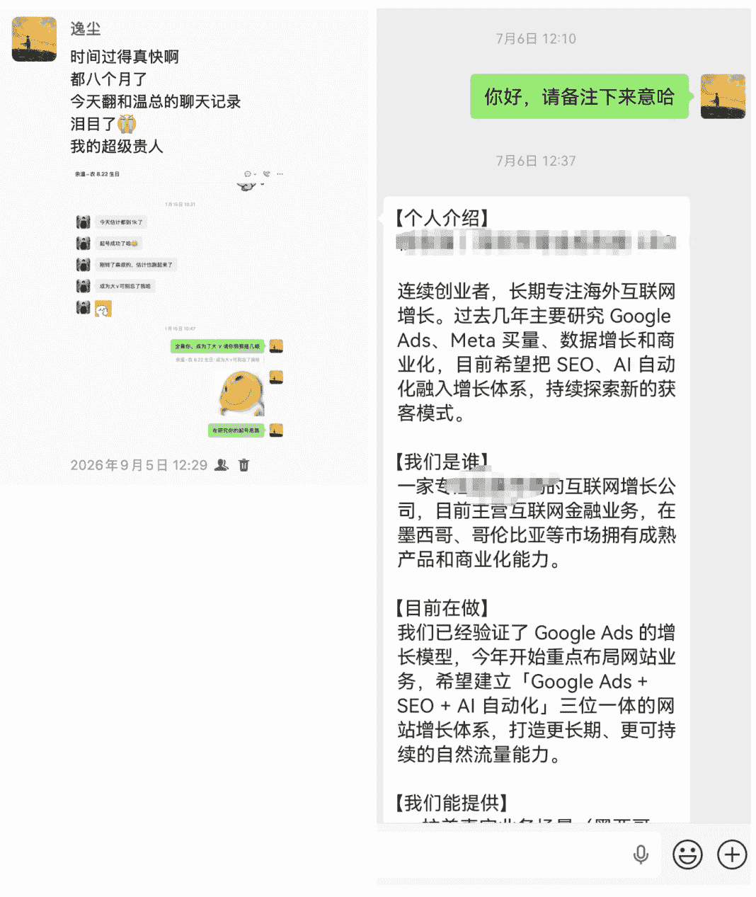

### 3. 表达和连接的阻力更小

只要遵守平台规则、不触碰违法内容，创作者通常能够更自由地发布观点。内容完成后，不必反复担心复杂的发布环节。

X 也方便把公开表达延伸到私人关系：读者可以通过个人资料、邮件或社群继续交流，适合建立长期联系。

当然，任何平台都有风险控制机制。引导交流时要保持自然节奏，不要在短时间内进行密集、重复的操作。

## 四、真正让我受益的，是关系网络的升级

很多人经营主页，第一目标是收入；我更看重的是，借助持续表达，让自己进入更好的关系网络。

我把个人主页当成一块长期展示板：把正在学习的东西公开，把正在搭建的产品公开，把验证过的方法公开。优秀的人因此能够看见我的能力、兴趣和执行力，双方才有机会进一步连接。

过去 7 个月，我发布了 500 条短内容和 13 篇长文，开放了 20 个 Skill，也搭建过 Agent 记忆系统和 AI 创作辅助工具。主题覆盖 AI、产品、商业化、网络技术、法律科技、跨境业务、创作方法和个人成长。

持续公开学习、公开构建之后，我获得了更多合作机会，也在线下见到了卡兹克，认识了金融、医美、软件、教育等领域的朋友，还找到了能够共同做事的同龄伙伴。

这些结果并不是单靠某一条爆款带来的，而是长期输出积累出的复利。

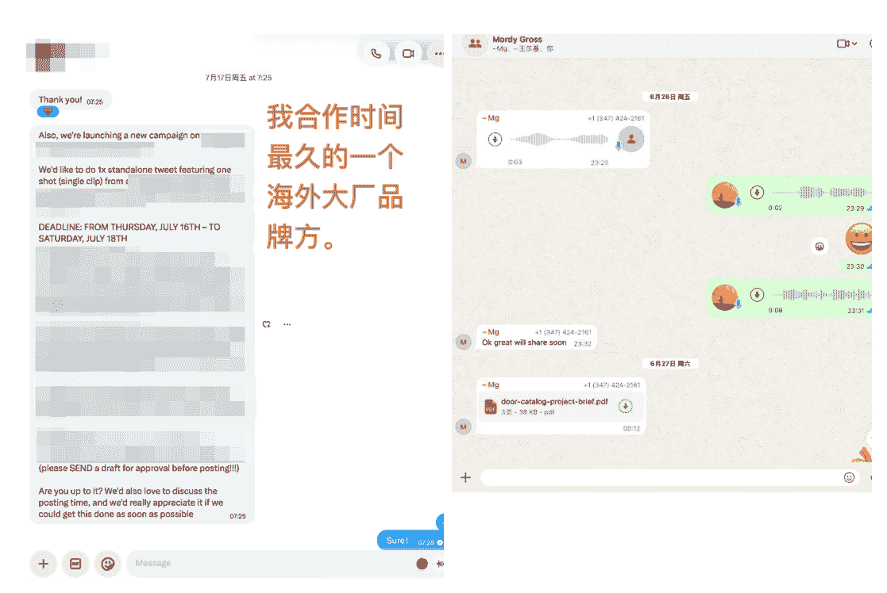

我现在运营一个名为 TradeWinds 的社群，希望和一批愿意长期学习、实践、分享的人同行。

回头看，我当然付出了时间，也受益于过去的积累。但更关键的是，我进入了一个能够不断遇见优秀前辈和同龄人的环境。

环境会改变一个人的参照系，也会影响你能看到的机会边界。接触的人越优秀，越容易获得新的视角、稀缺的信息和继续行动的动力。

我始终记得最早帮助我的那位前辈——余温，温总 @glxkspace。重新翻看当年的聊天记录，依旧会感到触动。

20 岁的我，仍然无法预测 AI 会把世界带向哪里。但我已经知道自己想做什么：

保持好奇，持续跨界；  
把正在经历的事情讲清楚；  
让能力、作品和关系一起增长。

未来也许没有标准答案，但只要这套循环继续运转，我就还有不断向前的可能。

每当我心里出现想要歇口气的念头，身边几位零零后伙伴就会把我拽回来：

* @glxkspace，2005年生人，连续数年年收入过百万元的AI独立实践者
* Vesta，未在X平台，2006年生人，率领团队在全球不良资产领域做到头部，年流水破亿元
* Sidrel，📕创作者，2001年生人，静音口罩赛道创始人，拿到百万级融资并登上🧣热搜首位
* @Astraunat_1216，2001年生人，每月收入约五万元，抖音粉丝数过万的创业内容者
* @Leoba1825，2003年生人，单月营收过百万，X与抖音双平台粉丝过万的创业者
* @harrisonsme，2006年生人，AI生态连接高手，企业客户与政府客户的对接都非常熟练

回顾自己往前冲的阶段，陪伴的人渐渐变少，经常独自闷头推进，兴奋的点找不到人分享。幸运的是途中遇见了现在的这群同行者，合力产生的推动感远超预期。

正因如此，我筹建了TradeWinds，不设年龄限制也不设背景门槛。

它的基调可概括为三点：走向海外、相互借力、随性自在。工作层面，我们都想把主业做大做强，视野放向全球，用个人影响力互相打通，内容账号与产品协同发展。生活层面，闲暇时可面对面聚会、休闲娱乐，去任何想去的地方做任何想尝试的事，成为真正掏心窝的伙伴。

TradeWinds具体要交付什么，我目前还没有清晰答案，需要时间慢慢沉淀。我能承诺的是，TradeWinds会长期作为我的核心小圈子，我所积累以及未来会学到的器、术、道，会对成员完全开放。

模式是永久制的，现阶段定价999元，后续会提升。为控制节奏，首批仅开放五十个席位，通过飞书表单提交信息，我会在接下来几天逐一发出邀请。

需要先说明两点：首次看到这条内容的读者，我不会通过申请；目前尚未建立自身事业与项目基础的朋友，请暂缓加入。我更希望加入的前提是你已通过我的分享学到东西并取得实际成效。

> bcn5ot9ywnew.feishu.cn/share/base/for...

了解更多关于我和社群：yichen.ai/products/trade...

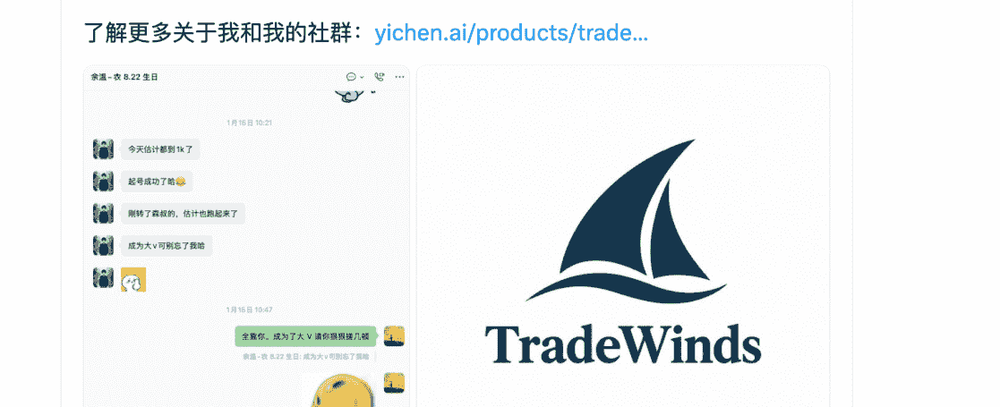

下午2:01 · 2026年9月8日 · 4.6万 查看

第二，学习投资，是实现十倍增长的关键
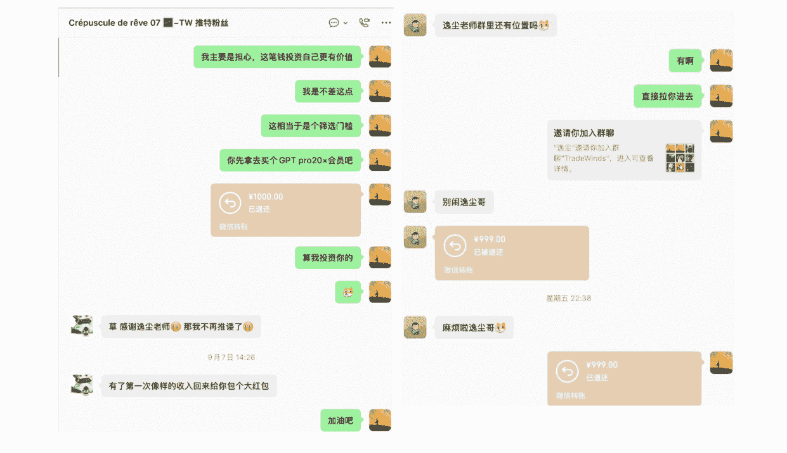
# 第三，AI时代的年轻人需要足够大胆，Fake it till you make it

胆子有多大，空间就有多大。对自己保持绝对笃定，先扮演你要成为的样子，最后便会真的成为。上个月一位朋友拿下律所的大客户，下午两点的对接会，我在中午十二点半才被告知要单独见对方团队谈企业AI服务。朋友直接说我是她的联合创始人，实际上根本没有团队。我只好硬着头皮上，把朋友称作沈总，自己假扮业务负责人，聊了约半小时。最后客户认可度很高，合作有了可能。我当时想的很清楚，即使失败也没有任何损失，经济层面和名声层面都无所谓；成了是最好结果，不成也能锻炼胆量。失败只会磨练勇气，少数几次成功就能起飞，就像那些经常接受采访的主播一样。

大概一点三十分
先讲服务概况
再重点讲培训
别说错话
我们属于同一支队伍
什么？
我去

8 月 11 日 10:41
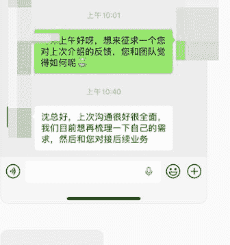
老兄牛逼

合适的时机，如果要聊具体的业务方面，你就把我推给他

可以

再说说身边伙伴的激进打法：用Agent在招聘平台批量联系老板，同时接多份远程工作，用Codex完成任务获取多份收入。混进高端局，以AI话题切入与大佬交流，成功找到带飞的老板。在商场看到一家服饰店，直接上门与老板沟通，达成AI生成图像的合作。“人的高度往往等于身边五位常接触的人均值”。我通过主动调整圈子，让周围变成这类人，自己也被逼着变得更大胆，去做常人难以理解的事。

# 第四，绝对相信自己，做到当下的最好，你是地球 online 游戏唯一的气运之子

从进入赚钱初期，我只能仰望优秀的零零后和前辈。
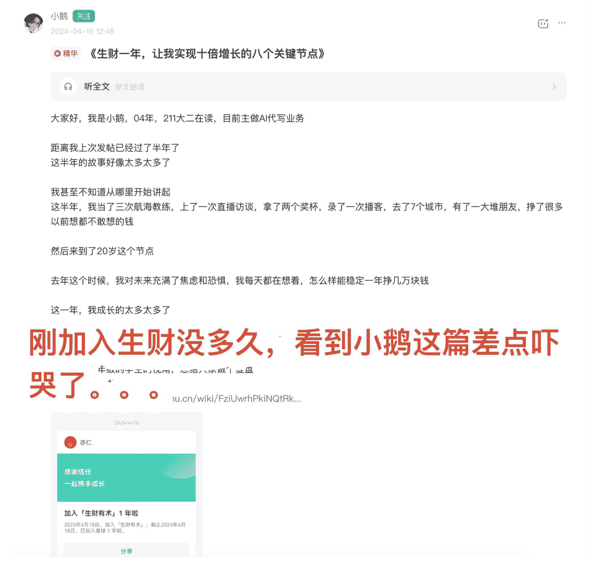
但我没有被光芒刺得睁不开眼，而是把他们为人处事的优秀特质全部拆解吸收。没有商业经验，数百篇精华帖奠定了我的基础。没有写过长文，一篇被评为精华的文章给了我肯定。没有做过有价值的项目，有幸加入了航海。没有参加过陌生人线下聚会，赚钱提供了入口。没有上台分享的经历，赚钱给了舞台。
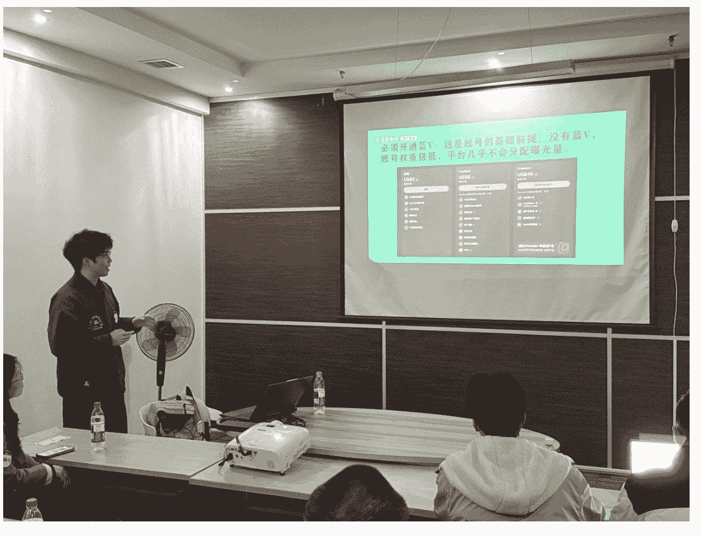

--- 分隔 ---

看完这套SOP你可能觉得明白了，但九成的人落地第一步就卡住。工具和教程只是基础门槛，真正的门槛是立刻开干和圈层的信息差。

如果你想追全网最新的变现打法，和一批执行力极强的极客一起实操出结果，可以来看我的核心私域：【懒人专属群】。

这里不空谈，只拆商业闭环和AI效率榨取，内部已经沉淀1000+跑通的套利实战案例。

- 查看圈子数字资产和上车门槛：
https://lazyso.com/insider/

认可价值、准备立刻干的，扫码加我微信 lazyhelper1
备注：【实操上车】，不闲聊

微信👸号懒人搜索，懒人专属群
微信：lazyhelper1