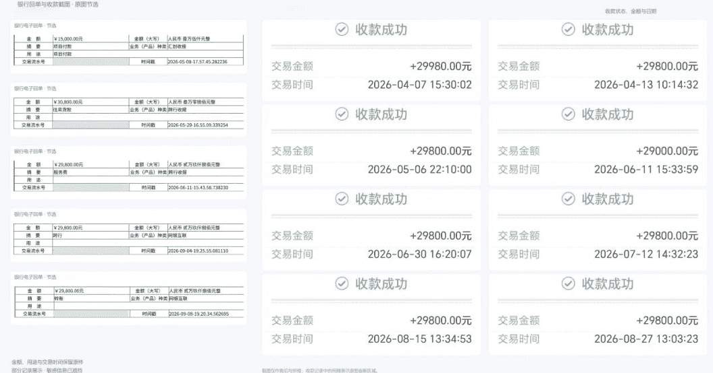
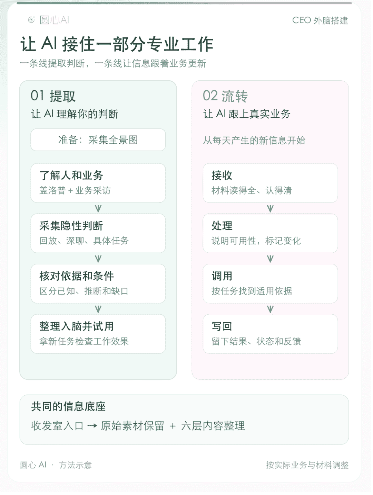
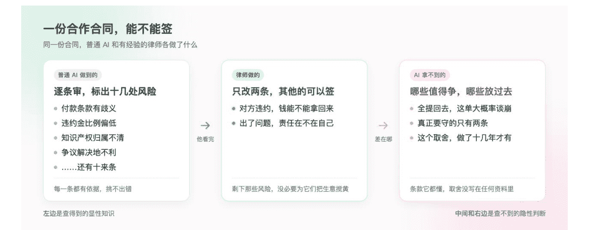
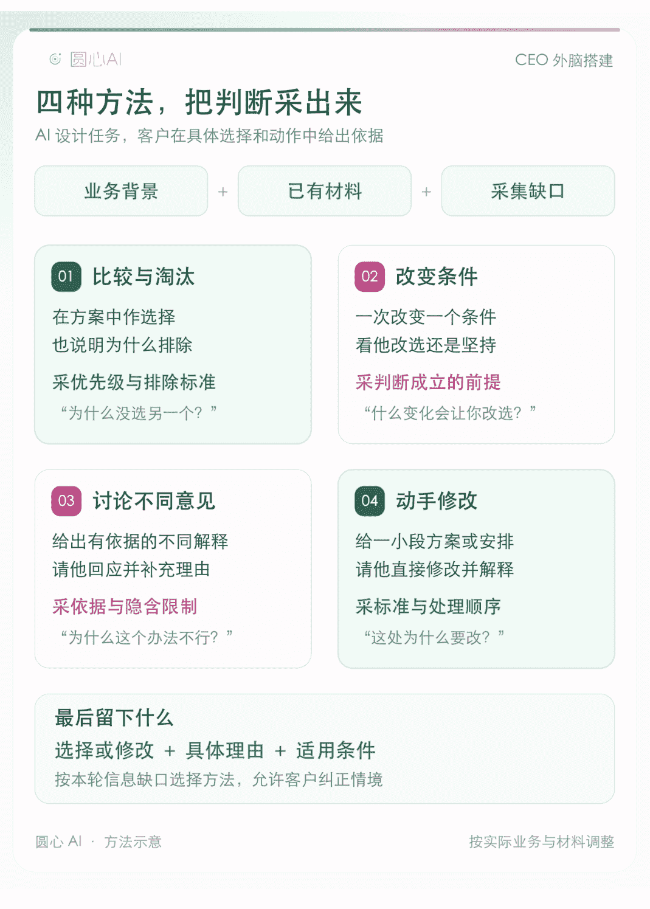
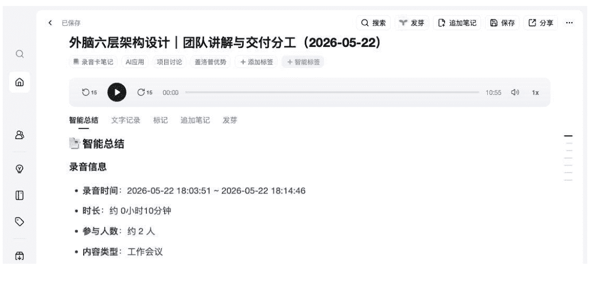

# 上半年做到五十万，我在做的一件事叫 CEO 外脑：把必须由专业判断完成的高精度工作交给 AI

260917 副业 SC 精华

整理：👸号懒人搜索，懒人精选群回顾

懒人微信：lazyhelperl

**小懒判断** | 适合正做或想切入企业侧 AI 定制交付、有耐心做深度访谈的人，也适合律、财税等高度依赖个人裁量的顾问型客户做自我诊断；不适合期待即插即用、不愿与客户反复深聊的团队。最值得借鉴的是那套三层采集图谱，分业务、客群、本人三层，并搭配正版盖洛普测评约三百元把隐性裁量挖出来。风险在于周期长、对客户配合度要求高，前期十几小时的访谈核验若没计入报价，很容易做亏。

大家好，我是袁欣，曾在大学任教新媒体并出版过教材，近十年深耕自媒体相关，也曾经营线下装修公司。

春节以前我只是 AI 的浅层使用者，主要用国内工具和 GPT 处理文案创作、演示文稿等单点需求。

从三月起，我开始系统化使用 AI，并为 16 家公司提供深度定制交付。客群集中在海外金融税务顾问、律师事务所合伙人、知识付费领域的专业 IP 这类对产出精度要求极高的群体。

我的做法是先把靠归档拿不到的经验和裁量提炼出来，再搭建信息流动机制，让模型依据顾问的判断标准，结合业务日常变化，去承接原本只能由本人完成的专业操作。

单笔签约在两到五万元区间，五个多月累计流水超过五十万元。

# 部分成交记录

这类客户通常已拥有成熟产品和稳定客源，瓶颈不在获客，而在个人产能。团队或助理能承接的是标准化杂务，一旦涉及具体问题拆解、方案比对、向客户给出建议，模型直接产出的结论往往不达标，最终仍需本人重做。他们真正想省的是自己的时间，而非助理的时间。

要让模型真正顶上，要打通两个阻碍。

其一，真正值钱的信息模型拿不到。面对某个具体客户、某个具体场景，顾问会先关注什么、依据什么取舍、为何选 A 而非 B，这些很少写进资料里，有时当事人自己也说不清，需要专门的挖掘方法。

其二，信息迭代太快模型跟不上。上一周成立的判断这周可能失效，若模型仍按旧档案工作，结论会越来越偏；可若每次都靠人工重新整理，省下的时间又被耗回去了。

因此提升落地精度，既要把有价值的信息喂进去，也要让信息在工作中被正确检索和调用。接下来先讲提炼部分：把顾问自己都说不清的隐性裁量挖出来。流通部分另文展开。

# 阅读须知

## 1、方法是否需要技术门槛
这套打法没有一行代码，核心是拆解、追问和业务理解，正好是我做教师、做生意练出来的能力。所以技术背景不是门槛。

## 2、适合谁阅读
一方面是正在做、或准备进入 FDE 赛道的人，希望提升模型产出贴合度。二是即使不做 FDE，只是想让 AI 承接目前只能自己做的精细活，思路也可直接复用。

文章细节较多，约一万八千字，会把方法、每一步产出和后续用法讲清楚。

# 一、把隐性裁量提炼出来，让 AI 接住顾问手上的活

顾问型客户常说 AI「差点意思」，看个例子就明白。

我的一位客户是律所合伙人。客户把合作协议发来询问能否签署。我们把文本给到模型，模型逐条审阅并标出十几处风险，每条都有法条依据，看起来很完美。合伙人实际只改了其中两处，其余原样通过。因为把模型指出的所有点全堵死，这份协议大概率谈崩。哪些风险必须守住、哪些可让步、什么时候该硬什么时候该软，这个分寸模型给不出。

这也是很多顾问使用 AI 的感受。模型具备完善知识，但实务中充满判断和取舍，这些是十几年实践形成的，不会写进任何业务资料。于是顾问仍要花费大量时间做核心裁量，AI 只能做基础润色，干的是低价值助理活。

这里就是显性知识和隐性裁量的区别。显性知识是可以写下来、查得到的内容，如规则、流程、条款。隐性裁量是长期实践形成的识别方式、经验、取舍和行动习惯，在顾问业务里更接近价值核心。

要让 AI 承接原本必须由本人完成的活，需要让它理解顾问的隐性裁量，而不只是掌握可查询的知识。换句话说，掌握显性知识只能做辅助，理解判断标准才能参与分析、取舍和推进。

让顾问口述判断往往空泛，师傅带不出徒弟，销冠教不出销冠，就是因为「感觉」难言说。所以不能靠提问，要靠流程设计来挖掘。市面上很多知识库搭建是从已有资料出发，而我的前置动作是先解决信息如何采集。

## 准备：建立采集全景图

要让 AI 承接工作，先要明确喂什么。服务多家公司后发现，不同业务在采集维度上高度重合，于是整理成一张框架，后续可对照检查缺口。

信息分三类：

- 商业运作：这门生意如何运转
- 客群现状：正在服务的客户是什么情况
- 个人底色：这个人是什么底子，做事有何固定做法

### 采集全景图

要让模型接住顾问的工作，需要了解这三类信息，每项后附 AI 用途。

商业层包括产品与服务、报价与收费、成本与利润、获客与转化、交付流程、团队与分工、成员画像、工具与资料、目标与痛点。

客群层包括身份与决策关系、真实诉求、顾虑与异议、决策敏感度与信任强度、购买内容与承诺、沟通历史、执行条件、当前进展与下一步。

个人层是重点，分底盘和打法。

底盘是思维惯性和认知方式：才干结构、思维偏好、决策风格、重复模式、心力消耗、自我认知、优势短板、表达习惯、与 AI 的协作偏好等。这些特征在任何事上都起作用，采集后要落成「是什么、表现在哪、因此模型该如何配合」的三句式。

打法是做事的固定路径。先确定客户想交出的具体工作，再围绕每项工作采集信号、节奏、决策规则、分型、复盘五个维度。回到律师案例，关键不是改了哪两条，而是他为何先看这些风险、为何有的争有的放、何时改变策略。

## 这张图怎么用

框架是共性模板，特殊行业可在对应维度加细项。也可把框架交给 AI，结合客户背景细化清单，再据已有材料整理、列出需确认项。

整体采集分四步：盖洛普测评加业务访谈梳理缺口；围绕缺口做分批深度对话；回收对话回真实业务核对；整理成模型可用依据并做新任务测试。

第一步永远是人加事双线并行：用测评摸清思维底色，用访谈厘清业务现状和信息缺口。有了入场券，后续对话和结构化才能展开。

接到一个需要长期合作的客户，我不会急着把AI拉进工作流，而是先摸两件事：这个人是怎么想事的，他的生意是怎么运转的。

怎么摸人？我习惯用盖洛普才干测评打底。这套测评的行业分量比较重，测完会给你一份34项才干的排序，大致能看出一个人的天赋长在哪、遇到问题时的本能反应是什么。正版价格是59.99美金，实际采购成本三百块人民币上下。我一般会直接买来送给客户。

送测评有两个实在的好处。第一，前期不用瞎摸。项目刚开始，我和AI对这位客户基本是一张白纸，有测评结果撑底，至少知道往哪个方向去了解，少走不少冤枉路。第二，客户自己会来劲。多数人没怎么认真分析过自己，花二十分钟测完，再跟我和AI聊的时候明显更放得开。客户一旦进入状态，后面要原始材料、要时间配合，都会顺很多。

摸事则靠我本人出马，给客户做一次或几次业务访谈，把生意版图拆开：卖什么、客源怎么来、交易怎么谈成、交付怎么做、哪些环节只能他拍板、他最想让AI接手的是哪一块。

访谈提纲我不自己硬憋，而是交给AI去组，分三步：先把我这些年的创业经历和商业心得告诉AI，同时让它去查一查这个行业的底细，把访问框架搭起来；再把我跟客户之前的通话录音、聊天记录丢进去，让AI把以前零散聊过的内容织进框架；最后把盖洛普测评结果也丢进去，让AI推断这个人更容易接受的问话方式。

这样生成的问题有个特点：不会在客户面前暴露外行，不会追问百度就能查到的行业常识；也不会让客户反复讲已经说过的旧事；提问的语气和角度也贴着客户的习惯走，他答起来不费劲。其实准备的过程本身就在告诉客户：我认真研究过你的行当，你说过的每句话我都接着了。信任就是这么一点一点堆起来的。

我之所以特别看重访谈阶段的体验，是因为后面还有大量需要客户配合的环节：真实材料要他找，长时间的对谈要靠他花时间，AI万一理解偏了，还得靠他耐心纠偏。如果前面就让他觉得累、觉得重复、觉得被误会，后面就别指望他会掏出真东西。聊得舒不舒服，直接决定了他愿意给到多深。

这里贴一段我常用的提示词，专门让AI帮忙出访谈提纲：

> 请按下面的方式准备一次业务访问：
> 1. 调出信息收集清单、该行业的基础资料、我和客户的过往沟通记录、盖洛普测评结果。
> 2. 把资料里已经有的信息先填入清单，标注来源；行业通用情况和这位客户的个人情况分开记。
> 3. 围绕他希望AI接手的工作来出题，顺序按他最容易讲的方式排，不要对着清单一项项干问。
> 4. 盖洛普结果只用来调整提问方式，不要用它来推断他的业务或做法。
> 5. 最后给一份电话访谈提纲，主干问题和备选追问分开列。

测评和访谈做完，这个阶段要留下三样收获：对人的初印象——他的才干特质，以及值得继续观察的思维和沟通习惯；对事的初印象——他正在做什么、遇到哪些坎、想把什么交给AI；还有能拿来继续分析的真实素材——聊天记录、历史建议、项目档案。把这些和全局地图摆在一起，一眼就能看出：哪些信息已经装进兜里，哪些还空着，哪些只是说了个开头，没讲透背后的做法和依据。第二阶段就专攻这些空档。

这一步的对照也可以交给AI，我用的提示词是：

> 请读取信息收集清单、盖洛普测评结果、业务访谈记录和已有材料，先把已经拿到的信息整理出来，保留来源。
> 然后逐项对照清单，分成三类：已拿到的、有线索还需验证的、完全没有的。
> 不要把盖洛普的描述或你的推断直接当成已确认的事实；资料里互相矛盾的地方，两种说法都保留。
> 最后按他希望AI接手的工作，列出下一轮需要采集的任务；能靠整理资料解决的，就不用安排对话。

第二阶段的逻辑是：我出题，客户和AI聊，我根据聊出来的东西再出下一题。

出题时要定三件事：聊什么主题，从哪件真实工作切进去，围绕哪个点往下追。交给客户的是一个“任务包”，里面是主题说明、背景材料和对话指令。比如我整理给客户与Codex的三个话题，会让客户分开建三个对话，别都堆在一起；语音录入回复也行，省时间；提示词里我也会让Codex先读它已经掌握的资料，只补没聊透或没聊到的部分。如果客户记得某个录音或文件里有相关内容，可以提醒Codex先去翻。

客户和AI聊的过程中，可以按自己的节奏分段进行，想到新例子随时补，不必一次把天聊完。我要的不是最后那个结论，而是他在对话里留意了什么、拿什么跟什么比较、为什么坚持或改变。这些过程，才是后面能整理成判断依据的东西。

每轮聊完，我要检查两件事。一是信息缺口补上没有：描述是具体到了一件事、一个动作，还是停留在抽象原则？二是对话方式对不对：什么问题能让他多说，什么问题让他哑火，AI有没有理解错。然后把这两点带回下一轮的题目和材料里。

为了不让对话变成一次性审问，我习惯分三个轮次来推进。

第一轮，先回放最近一次真实工作。我会挑最近一两周内发生的事情，比如他刚给出的一条建议，或者在几个方案之间做过的一次取舍。这类素材新鲜，他也记得清楚，最容易还原当时的判断轨迹。但不要只问一句“你当时怎么想的”然后干等。

这一轮有三个动作。第一个动作是还原背景：让客户把当时的聊天记录、相关文件和他给出的最终建议都交给AI，AI先罗列出三件事——当时对方遇到了什么难题、客户本人掌握了哪些情况、最后给出的建议是什么。客户确认或补充后再往下走，否则AI可能带着错误背景乱问，还可能把后来的结果混进当时的判断里。

第二个动作是聚焦一个关键决定。背景清晰以后，不必把整件事从头到尾讲一遍，只挑其中一个决策节点来问。比如一位顾问当时建议客户暂缓推出新产品，AI就围绕这个建议逐个问题问：你最早注意到哪条信息？除了暂缓，你还有没有想过别的招？是这个项目里的什么信息让你最后下了暂缓的决心？

第三个动作是拆开模糊的回答。如果客户说“我感觉时机还不行”，不能就此打住。AI得接一句：是当时有什么具体状况让你觉得推出来不合适？客户可能就会说出类似“现有业务的交付已经吃不消，新产品还要用同一批核心团队”这样的话。到这一步，我们才真正采到了一个判断依据——他评估新机会时，先看队伍能不能接住，而不是只看机会诱不诱人。

这一轮要带走的，就是从真实事件里还原出来的判断依据。记不准确的地方先标成待确认，不逼他临时编一个理由，后面换别的途径再补。

客户的指令示例：

> 陪我复盘一次最近的重要判断。以下是当时的沟通记录、相关资料和我最后的建议。
> 先从材料里还原：客户当时遇到什么问题、我当时掌握了什么、我最终做了什么决定。我确认后再继续。
> 然后围绕一个关键选择，一次只问一个问题，了解我最初注意到什么、考虑过哪些备选、是什么线索或担心影响了决定。
> 如果我只说“凭经验”“不合适”，请让我回到具体的材料或顾虑上，不要替我编理由。
> 把“当时就知道的”和“后来才知道的”分开，记不清的部分标记为待了解。
> 最后按“当时的情况、我认为会产生的影响、我作出的选择”来整理，交给我确认。
> 还没讲清的地方单独列出，并注明对应本轮信息清单里的哪个问题。

第二轮，回到人本身。第一轮看到的只是一次判断过程，还不够看清这个人平时怎么思考、怎么表达、怎么跟人分工。第二轮要补的，就是这些底层的东西。

选话题时，我会把盖洛普结果、业务访谈和第一轮的复盘记录放在桌面上，对着还没拿到的信息去看。线索多的时候不用每条都追，优先两类：一类是会影响AI接手工作但还没弄明白的，比如他希望AI帮分析方案，但我们还不知道他看到什么证据才肯拍板；另一类是在很多事里反复出现却没人解释原因的，比如员工交的活总是不达标，最后还得他亲自收尾。

聊的时候继续落到具体的人与事。他说“重要的活必须自己做”，就请他挑一件最近从员工手里接回来的任务，讲清楚员工交上来的形态、差在哪里、他接手之后改了哪些、为什么改。再对照他当时布置任务时是怎么交代的，就分得清是信息没传到位，还是标准没讲明白，或者这块工作确实只能他判断。原因不同，AI后面介入的方式也不同：信息缺了就帮客户整理交接说明，标准模糊就把标准提炼出来，环节必须他本人做，就让AI负责整理材料、做分析支撑。

这一轮我还会顺便观察一件事：客户和AI聊天时，哪些问法让他愿意讲、哪些问法让他卡壳、什么样的表达容易被AI误解。这些观察会带到下一轮。比如他只能说“交付标准要专业”，那就先给一份初稿让他改，他反而能说出具体哪里不对。

有个客户给我的反馈很说明问题。他说跟AI聊着聊着突然哭了，原因是AI好像把他看得特别清楚，挖出来的东西很深，而且直接点出他正在做的事情和他真正想要的东西其实是反的——他以为自己搭的是A，搭出来的是B。他说这种问题设计必须从自我探索起头，往后AI给方案才真正贴合人，连卡点都会提前想到。那会儿他只聊了第一个问题，后面五个还没开始呢。

第三轮，用具体任务把说不清的判断引出来。前两轮之后，有些东西光靠回忆和解释还是浮不出来。比如他说几个目标都重要，但真撞上冲突先保哪个，他讲不出来；他觉得一个方案不对劲，但哪点不对劲，他也说不清。这种情况就换个待遇：让他亲手做一件具体的任务，在动作里露出判断。

常用的招有四招，按信息缺口来选，并不需要每个来一遍。

第一招是对比与淘汰。他说效果、效率、体验都重要，就给他几个各有取舍的方案，让他挑一个，并解释愿意吞下什么代价。或者反过来，让他先淘汰不能接受的方案，再追问为什么不行、能不能补救。选择暴露优先级，淘汰暴露底线。第二招是改变条件。还拿刚才的案例说，如果客户现在有位经验丰富的负责人能持续推进这件事，他的选择还会一样吗？改了就问这条件为什么关键，没改就问还在顾虑什么。这样一来，我们采的是判断成立的前提，而不是把一次选择错认成固定偏好。第三招是评价不同意见。有些结论他觉得理所当然，直接问“为什么”只会得到复读机式回答。那就让AI根据材料提出另一个合理方向，比如有客户已经表现出购买欲望，AI就问“先搞一个小范围试点，行不行？”他要是还反对，就会接着说出试点要占什么资源、会冲击哪件事。也可以拿别人的方案问他会不会用，可他会告诉你：认同一个方法有效，和让自己采用，是两码事。第四招是动手修改。客户对着现成材料更容易讲话，就让AI先写一小段方案、一封回复或一个任务安排，请他直接改。原稿、具体改动和改的理由都要留住。比如他把“约对方开会”往后挪，先加一步“确认谁拍板”，接下去问原因，才会发现他担心跟没有决策权的人开完会还得再开一轮。

另有一个补充方法：遇到合适的案例，可以先请客户预判结果，把预判和依据记下来，等真实情况出现后再回头对表。这么采到的信息，通常比事后解释更准，不容易被客户自己的“脑补”带偏。

第三轮什么时候可以收尾？回到本轮的目标，只要能把客户面临什么处境、他做了什么选择或修改、依据是什么这三件事讲清楚，并且他确认没有理解偏，就够拿去核对了。

我让AI准备客户对话安排时，会这么写提示词：

> 请结合客户的业务情况、前两轮记录和本轮剩余缺口，选一个会影响AI接手工作的具体问题。
> 从对比淘汰、改变条件、评价不同意见、动手修改这四招里选合适的方法，说明想采什么、为什么这么设计、需要客户准备哪些材料。
> 优先使用真实业务。假设情境必须明确标出，并先让客户确认情境合理、信息够用。
> 生成一份客户可直接交给AI的对话指令：一次只问一个，依据回答继续；改变条件时一次只动一个；允许客户纠正情境或提出别的方案，不替他补理由。
> 最后把选择、修改、依据、适用条件整理成文，交给客户确认，并记下剩余缺口。

三个轮次都走完，就该核对了。核对第一看判断来源。把完整对话、指令和相关材料都留下，不能只留AI最后那句总结。比如AI总结“他特别重视执行能力”，这到底是客户主动聊起人员安排，还是AI先抛了一句“你是不是担心团队执行不了”，客户只回了个“是”？后者还需要继续验证。可以先让AI对着原始记录把依据列出来，然后我们重点看那些解释跳得很快、支撑材料不足、前后说法打架的地方。

核对第二看真实工作补条件。要是有相关聊天记录、项目方案或修改稿，就拿过来对照；没有也不必专门去翻，留在接下来的真实工作里慢慢核对就行。

走完这套流程，我们对人、对事、对材料才算有了一个真正经得起推敲的底座。AI后续给的方案，也就不是贴标签，而是长在客户这个人身上。

当客户在不同场景下给出看似相反的意见时，最容易犯的错误，就是马上给他贴标签。

比如，他曾经说“执行资源有限时，优先选择简单方案”，但在另一个项目里却采用了复杂方案。与其直接判断他前后不一致，不如追问两件事：

这两个项目的执行条件是否不同？当时是不是有专门负责人？目标是否发生了变化？简单方案是不是已经无法满足要求？

经过核对后，原本的结论可能就要改写为：

> 他并不是单纯偏好简单方案，而是会先评估执行条件。资源不足时降低方案复杂度，资源和负责人到位后，也会认真考虑复杂方案。

所以，遇到矛盾信息时，第一反应不应是判断哪一次才是真的，而是先检查：是不是有重要条件没有被记录下来。

### ③ 建立一份会持续更新的判断清单

信息核对完以后，可以把结论分为三组：

- **已有依据**：有明确回答、实际行为或项目记录支撑，而且适用条件比较清楚；
- **需要修正**：原先的判断不准确，或者漏掉了影响结论的重要前提；
- **暂时不能确定**：目前只有零散线索，尚不足以当作稳定结论。

需要客户补充时，也不要把所有聊天记录、录音和文件重新丢给他，让他自己寻找问题。更有效的问法是集中说明：

我们目前是怎样理解的，哪一份材料与这个理解不一致，还需要确认哪一个具体问题。

这份清单并不是一次性完成的档案。新的证据可以补上原来的缺口，后来出现的例外，也可能迫使我们重新调整旧判断。

当然，不必等所有疑问都解决后才能继续工作。但如果某个问题会直接改变当前方案或工作方向，就必须优先确认。

## 第四步：把采集到的内容变成 AI 能调用的外脑

到目前为止，客户的经验、判断和业务背景可能还散落在聊天、录音、文件与会议记录中。下一步，就是把这些信息整理成 AI 后续可以真正使用的工作依据。

我现在提供的这项服务，叫作“CEO 外脑搭建”。

所谓外脑，不是简单地建立一个资料库，而是为客户准备一个 AI 可以调用的外置工作系统。里面会逐步沉淀：

- 客户正在做什么；
- 他过去积累了哪些经验；
- 他通常依据什么作出判断；
- 他怎样分析问题、分配精力和作出取舍；
- 他希望最终结果达到什么标准。

前面花大量时间采集和核对，目的就是把那些真正会影响工作结果的信息留下来。

### ① 先分开“收发室”和“外脑”

实际搭建时，我通常会先建立两个文件夹。

#### 1. 收发室

收发室是日常接收新资料的入口。

新的聊天记录、录音、会议文件、临时想法、项目资料，都可以先扔进这里。它的重点是方便，不要求客户一开始就分类、命名、总结，也不需要他先判断这份资料应该归入哪个模块。

先把内容送进来，再让 AI 去读取、筛选和处理。

#### 2. 外脑

外脑是长期保留和调用信息的地方，分为两类：

- **00 素材层**：保存完整对话、录音转写、原始文件等一手资料；
- **01—06 层**：保存经过提炼、能够直接用于工作的内容。

例如，一段完整的客户沟通记录可以先放在收发室。AI 处理后，一方面把原始记录归入 00 素材层，另一方面把其中的业务背景、判断依据、客户信息和协作要求分别整理到对应层级。

原始材料和整理后的内容都要保留，但用途不一样：

- 日常执行时，优先调用整理后的工作依据；
- 需要核查细节或追溯来源时，再返回原始材料。

### ② 让信息进入不同的功能层

以客户自己的外脑为例，“关于我”指客户本人，“关于客户”则指他正在服务的对象。

可以采用以下六层结构：

- **01｜系统层**：规定 AI 如何使用外脑，哪些操作必须确认，遇到冲突、缺失和不确定信息时应该怎么处理；
- **02｜关于我**：记录个人的思考方式、表达习惯、判断标准、工作打法与协作要求；
- **03｜关于客户**：保存每位客户的背景、需求、阶段、承诺与重要沟通；
- **04｜关于业务**：沉淀产品、报价、流程、专业资料、方法论与案例；
- **05｜武器库**：存放可重复使用的提示词、模板、工具和 Skill；
- **06｜持续生长**：记录新的研究方向、尚未验证的想法，以及实际使用中发现的改进点。

前期采集到的个人、业务和客户信息，主要会进入中间三层。没有必要一开始就把整个六层体系填满，先围绕当前真正要解决的工作建立内容即可。

这套结构是我从今年 5 月开始使用的。和没有分类时相比，AI 在理解、整理和存放资料时明显更有秩序，也更容易判断哪些内容值得长期保存，哪些只适合临时参考。

### ③ 不只保存观点，还要写清楚它怎样影响工作

“他重视落地”“她喜欢有逻辑的表达”这类描述看似有用，但 AI 仍然不知道下一步具体该怎么做。

要让信息真正影响工作，至少要整理出以下内容：

- **适用任务**：这条判断会用于什么工作；
- **需要先看什么**：分析时要优先了解哪些事实；
- **判断标准**：什么情况下采取什么做法；
- **条件变化后的处理**：前提改变后，原结论是否需要重新评估；
- **来源和状态**：信息从哪里来，已经确认还是仍待核实。

例如，把“他重视方案能不能落地”整理成：

- **适用场景**：比较客户的不同实施方案；
- **先了解的情况**：方案需要哪些人持续投入，客户是否有时间、人员和执行能力；
- **分析方式**：不能只比较预期收益，还要同时评估后续执行压力；
- **条件变化**：如果客户已经安排了合适负责人，执行条件改善，可以重新考虑原本较复杂的方案；
- **信息状态**：附上对应的项目记录，并标出哪些内容已经核对、哪些仍需确认。

沟通偏好也要写成可执行的要求。与其说“他喜欢有条理的内容”，不如说明：

AI 应该先给结论，还是先交代背景；需要展开哪些依据；哪些内容必须列出风险；哪些部分可以简略处理。

这些初步整理可以交给 AI 完成，但人必须检查它有没有误读、漏掉条件或扩大结论。确认后，再归入外脑对应位置。

这一环节非常关键。未来面对大量信息时，AI 不仅要找到资料，还要判断这条资料能不能用、能用到什么程度、是否需要重新核对。来源、范围、状态和适用条件，就是让信息具备可使用性的“批注”。

### ④ 用一项全新的任务检验外脑

搭建完成后，不能只看文件夹是否整齐，还要拿一项 AI 没有参与过的新任务进行测试。

准备好必要的业务资料和整理后的工作依据，让客户直接看结果。还可以开两段独立对话，输入相同任务：

- 第一段只提供原始业务资料；
- 第二段加入整理后的判断、标准和协作要求。

然后对比：

- AI 是否注意到了以前容易忽略的前提；
- 分析路径是否更贴近客户的实际工作方式；
- 交付结果是否减少了修改；
- 客户还需要补充哪些背景；
- 哪些地方仍然需要客户亲自重做。

> 结果更像客户，并不代表真的省时间。真正要看的是成品能不能直接使用，以及返工集中在哪些地方。

如果缺事实，就继续补充背景；如果 AI 把经验用到了不适合的地方，就补充边界条件；如果原则已经说清楚，但 AI 还是不会处理，就继续采集具体过程。

同时，也要检查 AI 有没有正确使用已经提供的资料。出现问题，不一定都是因为“采集得不够”，也可能是信息没有更新、调用错了，或者使用条件没有写清楚。

完成这轮测试后，外脑只是具备了初步形态。接下来更重要的问题是：每天都有新信息进入时，外脑如何持续更新，并在具体任务中准确发挥作用。

# 二、让外脑跟着真实业务一起变化

客户的业务不会停在某个固定版本。新客户、新决定、新反馈和新问题每天都可能出现。

如果外脑只记录过去的情况，却不持续更新，即使 AI 已经了解客户的判断方式，也可能因为调用了过时信息而给出错误建议。

因此，信息流转不只是“把新资料存进去”，还要让 AI 清楚：

- 这条信息目前是否仍然有效；
- 它适用于哪些对象和任务；
- 新情况改变了哪些旧判断；
- 哪些方案、档案和待办事项需要重新检查。

整个过程可以拆成四步：

1. **接收**：让新资料方便进入系统；
2. **处理**：区分信息性质，写清楚使用条件，并识别变化；
3. **调用**：针对当前任务找到真正相关、仍然有效的依据；
4. **写回**：记录本次工作的结果，让下一次任务可以继续使用。

## 第一步：先把信息入口接顺

我会先观察客户的资料平时从哪里产生，再按照他的习惯设计入口。不要一开始就把所有平台全部接入，先解决当前工作中最常用的来源。

### ① 识别日常信息来源

通常包括四种：

- **录音**：访谈、电话、会议和临时口述想法；
- **聊天内容**：客户沟通、团队讨论、修改意见；
- **会议材料**：转写、结论、附件和行动安排；
- **业务文件**：方案、报价单、表格、报告等。

每类资料都设置固定入口，统一送入收发室。能自动同步的就配置自动同步，暂时无法自动化的，保留上传、转发或放入指定文件夹等简单动作。

### ② 不要求客户先整理

客户不需要先总结，也不用自己判断资料应该归在哪个层级。只要尽量把同一件事的相关资料一起提交，并保留必要上下文即可。

如果材料中无法判断对应的客户、项目或事项，再补充一个简单标识。

### ③ 明确什么时候触发处理

资料进入收发室，不等于 AI 已经阅读并处理。

必须提前约定处理方式：

- 客户主动发起；
- 或者按固定时间自动处理；
- 或者满足某些条件后自动触发。

AI 接收资料后，先检查：

- 文件能否完整读取；
- 这件事对应哪个客户或项目；
- 是否存在重复内容；
- 是否缺附件或上下文。

能够根据现有材料判断的，就自行整理；会影响后续工作的缺口，再集中询问。

> 先让信息稳定进入系统，再逐步提高自动化程度。原始材料始终保留，不能只用摘要替代原文。

## 第二步：入库时写清楚信息怎么用

如果每次只是让 AI 总结资料再保存，到了真正工作时，它仍然会反复询问：

这是真的吗？适用于谁？现在还有效吗？能不能替代以前的安排？

因此，部分判断要在入库阶段提前完成。

### ① 分清事实、决定、想法和推断

一份材料里可能同时存在：

- 已经发生的事实；
- 明确作出的决定；
- 尚未确认的设想；
- AI 根据上下文得出的推断。

这四类内容不能混为一谈。

例如，“可以先做小范围测试”和“已经决定先做小范围测试”，前者只是建议，不能自动覆盖原计划；后者才可以成为更新项目安排的依据。

对于那些会重复使用、会改变方向或容易过期的重要信息，补充五项说明：

- **依据**：来自哪次沟通、哪份文件，还是 AI 的推断；
- **范围**：适用于哪个客户、项目或任务；
- **状态**：已确认、讨论中，还是仅供参考；
- **时间**：最后一次确认是什么时候；
- **重查条件**：出现哪些变化后，不能继续照用。

与其凭感觉给信息打一个“可信度 90%”，不如明确说明它的证据和使用边界。

比如，客户明确决定：

先选一个小团队试行，再根据结果判断是否全面推进。

可以记录为：

- **当前决定**：先开展小范围试行，全面推广尚未确定；
- **来源**：本次客户沟通，附原始记录和确认日期；
- **适用范围**：当前项目的方案、排期与资源估算；
- **使用方式**：下一版方案围绕试行阶段展开，不把全面推广写成既定安排；
- **重新检查条件**：客户重新确认范围，或者试行结果已经支持进入下一阶段。

这样，AI 下次处理项目时，就不会把一次具体决定扩大成“这个客户永远只接受小规模方案”。

### ② 判断新信息与旧信息的关系

新内容通常有三种关系：

- **补充**：以前没说清楚，现在增加细节；
- **替换**：客户明确改变了原先决定；
- **冲突**：新旧说法暂时无法同时成立。

遇到冲突时，先核对是否因为对象、时间或使用场景不同。只有确认确实冲突，而且会影响当前工作，才把问题交给客户确认。

新信息出现得更晚，不代表它天然更权威。后来随口提到的想法，也不一定能替代此前已经确认的决定。

### ③ 找出被新信息影响的工作

如果客户决定先做小范围试行，AI 不只是新增一条项目记录，还要检查：

- 原方案是否以全面推广为前提；
- 时间安排是否需要调整；
- 资源估算是否仍然成立；
- 待办事项中是否有内容依赖全面推进。

重要方案和任务旁边，可以保留关键前提及其来源，不必为所有句子建立复杂关系。

这一阶段只需要标记“哪些地方要重新看”，不要把“需要调整”直接写成“已经完成”。能够在授权范围内自动修改的，按规则执行；涉及关键冲突、未确认决定或超出权限的动作，则先提交确认。

最后向客户说明：

- 新增了什么；
- 更新了哪里；
- 哪些工作受到影响；
- 还有什么需要确认。

新资料的价值，不只是被保存下来，更在于它能让相关依据和任务发生联动。

# ▼ 可直接交给 AI 的信息处理指令

请将本次新材料与现有档案进行对照，并分别识别：

1. 已发生的事实；
2. 已明确作出的决定；
3. 仍在讨论中的想法；
4. AI 根据材料形成的推断。

请保留每项内容的原始来源。

对于会影响后续工作的关键信息，请补充：

- 信息依据；
- 适用对象与范围；
- 当前确认状态；
- 最后确认时间；
- 需要重新核查的条件。

不要给普通素材逐句添加标签，也不要凭主观感觉打可信度分数。

请进一步区分：

- 新内容只是补充；
- 新内容已经明确替代旧决定；
- 新旧信息仍然存在冲突。

被替代的旧依据要保留历史，但退出默认调用范围。

请找出依赖这些信息的方案、任务和待办，标注哪些内容需要重新评估。属于既定权限内的修改可以执行，未获授权的调整先提出建议。

最后汇报：

- 本次发生了什么变化；
- 哪些档案已更新；
- 哪些工作受到影响；
- 还需要我确认哪些问题。

## 第三步：围绕任务调用信息，而不是把整个外脑都塞给 AI

信息处理解决的是“目前有哪些可用依据”，而调用要解决的是“这次任务究竟需要哪些依据”。

### ① 先确认任务背景

AI 应该先从当前对话和档案中判断：

- 对应哪个客户和项目；
- 项目目前处于什么阶段；
- 这次要完成什么；
- 最终结果给谁使用；
- 对方需要据此作出什么决定。

已经可以确认的内容不要重复询问。

索引的作用是帮助 AI 快速找到资料，可以记录：

- 这份资料讲什么；
- 属于哪个客户或项目；
- 适合哪类任务；
- 当前版本是什么；
- 是否已被新版本替代。

而资料旁边的使用说明，则帮助 AI判断：

- 这条信息是否适合当前任务；
- 适用条件是否仍然成立；
- 是否已经过期；
- 是否已被其他依据取代。

> 索引负责带路，使用说明负责判断这条资料现在能不能用。

### ② 把当前情况、个人判断和业务资料放在一起

例如，继续修改客户的试行方案，AI 至少要同时参考：

- **项目现状**：客户已确定先进行小范围试行；
- **判断标准**：比较方案时要看时间投入和执行资源；
- **业务资料**：不同方案的内容、成本与实施条件；
- **交付目标**：方案给谁看，需要帮助对方作出什么决定。

这样，AI 才会先判断试行团队能承担什么，再比较不同方案，而不是简单把旧文件中的“全面推广”替换成“试行”。

前期采集的个人判断，必须与后续不断更新的业务情况结合起来，才能真正改变输出结果。

整理后的信息足够可靠时，优先使用整理结果；如果出现矛盾、出处不明或需要核对原话，再回到原始记录。

### ③ 只把会改变方向的问题交给人

调用信息时，需要同时满足：

- 对象和任务匹配；
- 使用条件仍然成立；
- 没有被更新依据替代。

如果缺失的信息会导致方案方向改变，就应该先确认。如果不影响已知部分，可以先完成能完成的内容，并标出待确认项。

比如试行规模已经明确，但负责人还没有确定。AI 可以先搭建不依赖具体负责人的方案结构，但不能把分工写成已经落实。

## 第四步：把交付结果写回系统

任务结束后，不要只把成品交出去。还要把这次工作的结果、变化和反馈接入下一轮工作。

### ① 标明产出状态

方案、报告和客户回复要区分：

- AI 初稿；
- 本人修改稿；
- 已交给客户审阅；
- 客户已经确认采用；
- 实际验证有效的版本。

AI 生成了内容，不代表客户已经接受；客户接受了，也不等于实际效果已经被证明。

### ② 更新项目进度

记录：

- 已经确定的事项；
- 尚未解决的问题；
- 下一步由谁负责；
- 何时跟进；
- 哪些条件满足后才能进入下一阶段。

这样，下一次任务就有准确起点，而不是重新解释整个项目。

### ③ 只沉淀会影响未来工作的反馈

优先记录：

- 对原有理解的纠正；
- 新增的重要条件；
- 可以复用的方法；
- 已验证的实际结果。

不要把每一句聊天、每一次文字修改都升级成长期规则。先记录具体发生了什么，再判断它能否扩大适用范围。

一条判断被 AI 多次调用，也不等于它因此变得更可靠。

### ④ 新证据出现后，及时修订旧依据

试行结束后，如果客户确认全面推进，就更新项目当前状态；如果结果不理想，也要补充实际问题与限制条件，不能继续沿用原来的预期。

原始记录继续保留，当前情况及时更新，重要判断留下来源与边界。凡是会扩大影响范围的规则，都应该再次经过人确认。

这样，一次工作的成果和变化就会成为下一次任务的起点，而不是每次从头解释。

## 从一项真实工作开始

不要一开始就试图搭建一个覆盖所有业务的庞大系统。

先挑一个正在推进的项目，接入最常用的信息来源，让一份新资料完整走过：

接收、处理、调用、写回。

然后观察下一次类似工作是否减少了重复解释和返工。

如果没有明显节省时间，就继续排查问题究竟出在哪里：

- 资料没有成功进入系统；
- 新信息没有更新旧档案；
- AI 没有找到正确内容；
- 找到了资料，却使用错了适用条件。

先把一条完整链路跑通，再增加信息来源和任务类型。外脑的目的，是减少客户的维护负担，而不是创造一套新的繁琐工作。

### 结尾

“CEO 外脑搭建”真正要完成的，不是简单整理资料，也不是让 AI 模仿客户的语气。

前半部分，是把那些没有写在现成文件里、甚至客户本人也不容易直接表达的经验、判断和工作方式采集出来，并整理成 AI 能理解的依据。

后半部分，则是让这些依据持续和真实业务连接：

新信息进入后能够更新，旧判断发生变化时能够修正，具体任务开始时能够准确调用，工作结束后能够留下新的结果。

最终，我们希望 AI 接手的，不只是资料归档、摘要和普通文案，而是一部分过去必须由客户本人反复分析、权衡和推进的工作。

如果你正在做企业 AI 服务，这套方法可以作为一条从信息采集到实际使用的实践路径。

即使你不提供相关服务，也可以从自己手上一项反复发生、又高度依赖个人判断的工作开始，把其中的经验整理出来，让 AI 逐步承担更多任务。

不需要一开始就把系统做得面面俱到。先让一个真实项目产生变化，再根据使用结果不断完善。

最后补充一下文中指令的使用方式。

我自己长期使用的 AI，已经在持续协作中熟悉了我的业务背景、工作习惯和常用方法，所以日常工作时，并不需要每次重新输入这样一整套完整指令。

把这些指令单独整理出来，是为了方便还没有建立固定协作方式的人直接开始尝试。

它们只是起点。真实业务中的沟通会更复杂，客户情况也会持续变化，指令需要随着实际反馈不断调整。

大家可以先把自己的背景、资料和真实任务放进去使用，再按照本文的方法逐步修正。不要等系统、资料和指令都完美了，才开始行动。

感谢大家读到这里，也欢迎在评论区交流你的实践经验。

看完这篇 SOP，你可能觉得自己已经掌握了方法，但真正开始执行时，绝大多数人都会卡在第一步。

工具和教程只是入场券，真正拉开差距的，是马上动手，以及你所在圈层里的信息差。

如果你想了解最新的变现路径，和一群执行力很强的极客一起下场验证结果，

## 欢迎围观我的核心私域：【懒人专属群】。

这里不讨论空泛概念，只拆解商业闭环，持续挖掘 AI 效率，还有 1000+ 已经跑通的套利实战局。

- 查阅圈子完整数字资产与上车门槛：

https://lazyso.com/insider/

认可这套价值，并且准备亲自下场执行的朋友，可以扫码添加我的微信（lazyhelper1）

备注：【实操上车】，不闲聊

