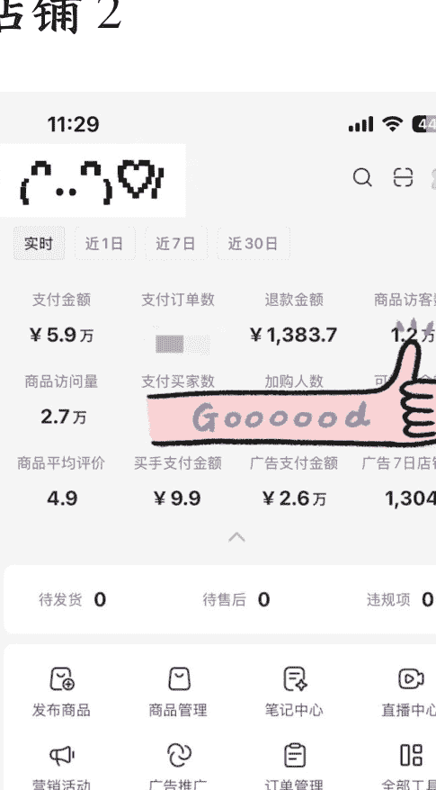
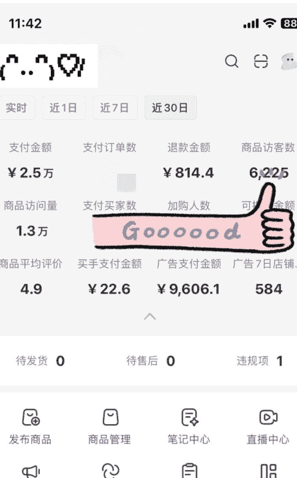
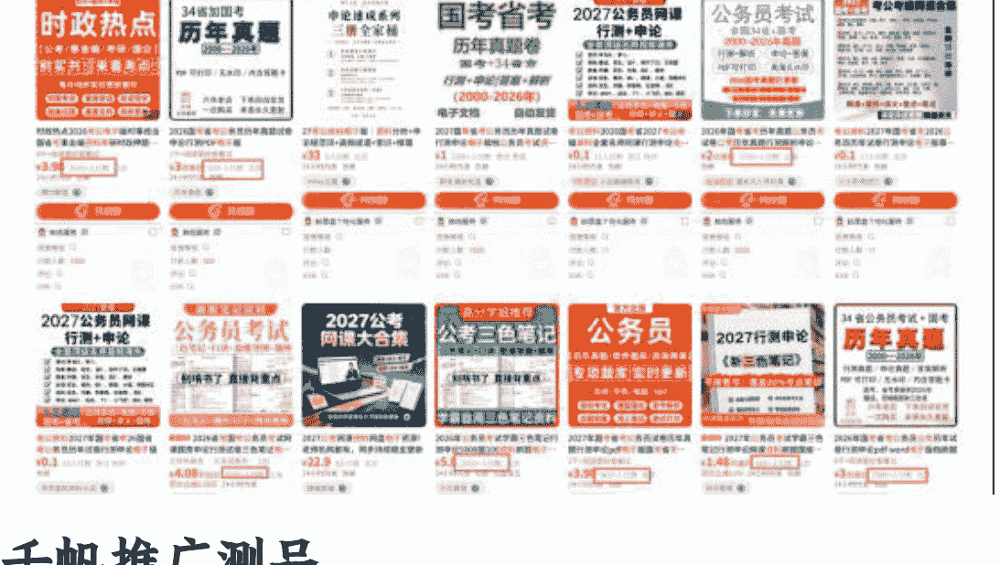
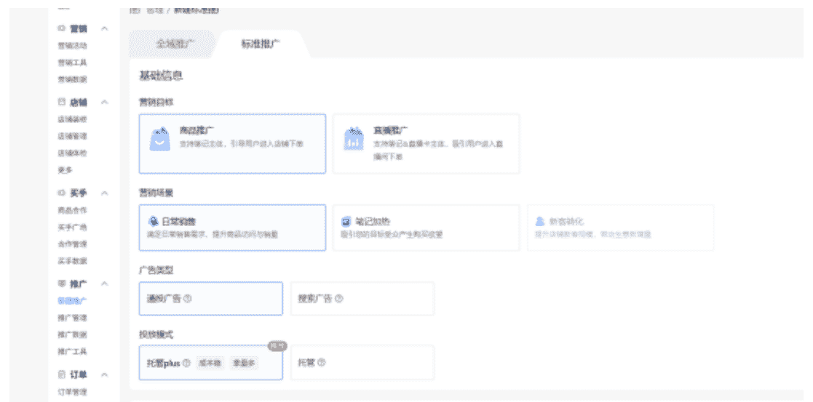
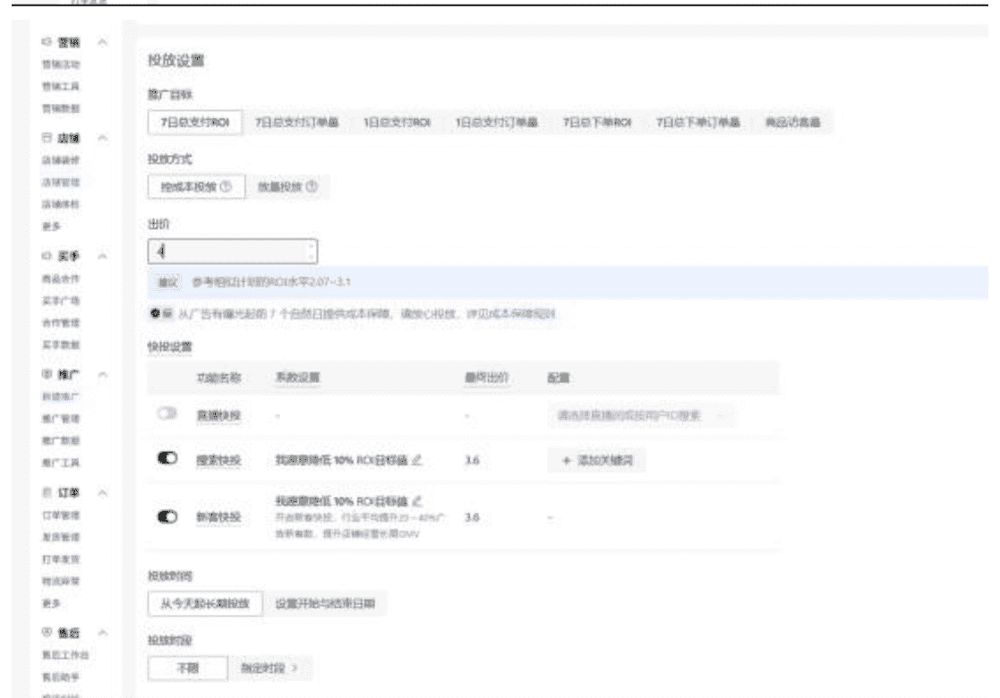
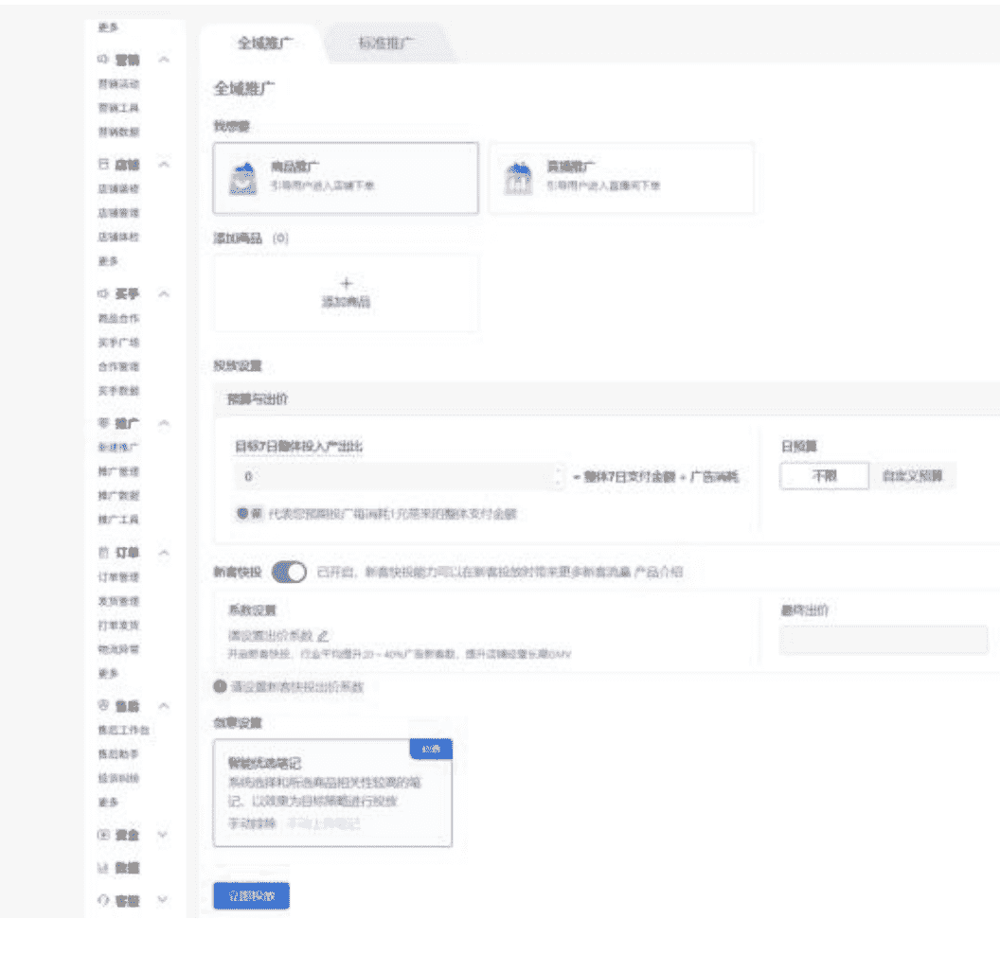
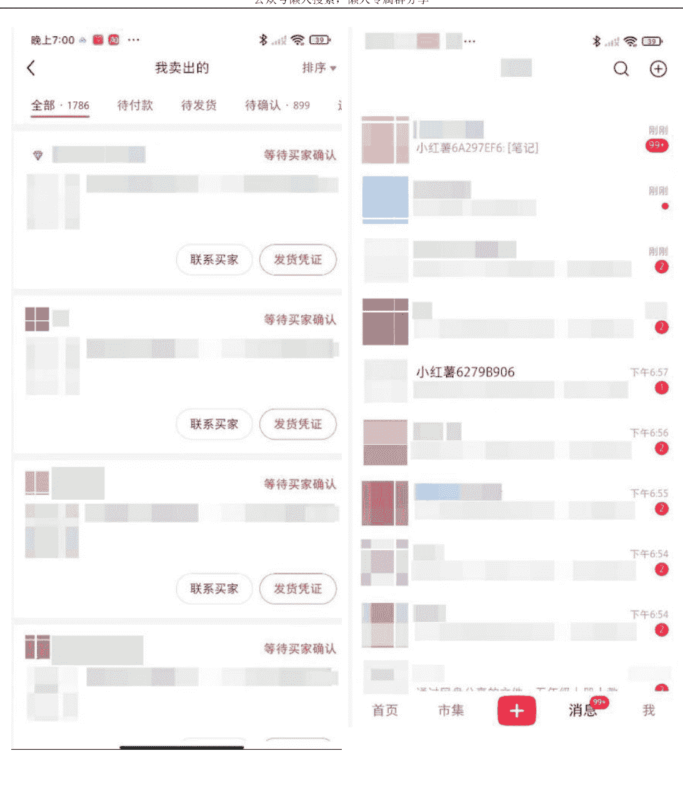

# 我做📕虚拟资料一年，单月逼近十万的实操复盘
作者：龙哥

各位好，我是 龙哥，赚钱圈混了两年。今天把最近一次在📕卖虚拟资料的爆发经过摊开讲清楚。两间店铺从去年跑到现在，日常能稳定做到月度过万的区间。这次单期支付金额合计约 8.4 万，扣除退款后叠加个人售卖渠道，到手利润接近十万。项目累计运行一年，平常投入时间大概每天一两个小时，对自己也算满意。

店铺 A

店铺 B

> **小懒判断** | 这篇笔记更适合已经把资料店搭起来、却在测品选品环节卡着出不了单的从业者，不适合期待短线暴富或想靠机构资料快速套利的人。核心做法是千帆标准推广用系统默认参数，出价按推荐价向上取整，十款货各推五条笔记连续跑十四天；真正拉高收入的是独家货源，我手里那批山东省考真题就是线下跑了两三天从机构拿回的。注意我赶上了类目刚开放和对手被清退的窗口期，现在电子资料类目再开难度变大，复制需要打折。

## 为什么选这个方向

对我而言，选对赛道比单纯加码投入更重要。过去做过拼多多店群、抖音切片、前年做过视频号口播，成绩都不错。回头看，平台与项目匹配对上，再配合方法，爆发只是时间问题。

去年八月左右入场，考虑有三点：

- 📕虚拟资料在社群里讨论度很高，赚钱和其他圈子都在聊。热度代表竞争，但也证明赛道是活的，收益预期不算高，分一杯也能满足。
- 门槛低，身份证就能入驻，无需预缴保证金，下单后再去淘宝采购即可。
- 符合个人偏好。拼多多需要多环节对接，我不喜欢；私域需要长时间聊天，我也吃不消。虚拟资料售后简单，退款就退，最多损失一点网盘分成，比实物省心。

本质是挑了一个热门且自己愿意长期做的项目。

## 选品不如测品

我更看重用小成本验证，而不是靠感觉押宝。没有强选品能力的人，直接 all in 很危险，发几条笔记投点广告就能判断生死，试错成本低得多。

### 淘宝通采找源

先在淘宝搜索品类关键词，比如考公考编资料。只上弱版权素材，我的粗暴标准是不出现人名、品牌、机构、出版社，且为已公开流通、无明确权属的资料。涉及署名的不碰。

赛道里表现好的两类是真题题库和笔记。沿着这两个词不断细化：国考真题、国考笔记、福建省考真题、福建省考笔记……越细竞争越小，只要淘宝仍有销量，需求就是真实的。细分到淘宝销量个位数或十几单的区间，基本算挖到底。

### 千帆测品流程

商品上架后同步发笔记，每款至少五条，数量太少容易漏掉潜在爆款。

新品标题丢给豆包生成封面和正文，提示很简单：要覆盖搜索词，先学习几篇同赛道爆款再优化。多聊几轮效果就不差，不满意可换 GPT。

笔记发出后到📕千帆推广建标准推广，测期全部默认，出价按系统推荐价上浮一元取整，例如推荐 3.7 就填 4，不是按比例加。推荐价在投放设置里可见，品好自然跑出来。直播快投关闭，其他保留。

坚持十款货、每款五篇笔记，每天保持更新，约两周能筛出一到两个日销十几二十单的款。

### 如何放大

第一是内容持续铺。测中的款要不断试模板和风格，覆盖所有长尾词。我曾把一套国省考历年真题的省份和年份全做成笔记，共近五百条，把搜索流量网住，该品至今仍在稳定出单，考前会二次抬升。

第二是投放优化。到我的推广-全域推广新建计划，出价参考标准推广的实际表现。若标准推广在四元左右跑得稳，就按此价建全域并开启新客快投。若觉得跑慢，可适当下调找到平衡点。

## 爆品的两大共性

一年下来总结为独家和有门槛。

### 独家

无货源玩家听到独家会觉得遥远，我的做法是多花点时间去找。做考公资料初期，历年真题卖得还可以。后期不断有人私信问 25 年山东省考真题，我查过全网当时没放出，也没多想。

咨询量持续上涨，等于是客户把钱送上门我却推开。最后花两三天联系两家山东线下考公机构，拿回一套 25 年真题卷。当时全网只有我有，很快卖爆。26 年省考结束后同法再做一波，最近暑期叠加备考窗口又起来。

### 有门槛

早期我给自己设限，觉得门槛高的就不碰。随着经验累积，思路打开：别人能卖，我也可以试。

另一个爆款是淘宝通采的照片代处理服务，含格式转换、尺寸调整、修图。初设 9.9 元，部分复杂需求直接拒单，因对接耗时不划算，后来差点下架。

咨询越来越多后，我参考同行把 SKU 拆开：底价 9.9，最高 99。跟用户磨合后逐步优化定价，最后发现 99 元的单比 9.9 元卖得更好。

这次让我明白差距往往在愿不愿意多做一步。修图能力我只在基础水平，实际处理基本靠豆包，复杂案例用 GPT 也能解决。门槛很多是自己吓自己，需求够大时，门槛反而是护城河。

## 笔记怎么发

早期我研究爆款笔记，花两三小时打磨，结果播放只有个位数。后来转为主抓内容要点，形式随意用模板化生产。播量最高的笔记是随手一条大字报，转化也不差。

## 开店与售卖渠道

我是去年类目刚开放就入驻的，后期平台大面积清退，我的爆发也沾了对手减少的光。

现在电子资源类目难以新增，还可以用个人售卖。路径是📕-设置-新功能体验-个人售卖，开通门槛很低，上架体验接近闲鱼，支持自动发货，只是暂不支持电脑端。

我试了一个月，累计近三千单，流量扶持明显。

## 额外体会

电商里选品和内容都重要。选品可对照上述爆品共性去筛，内容不必追求华丽，抓住用户真实需求即可。

我习惯把自己代入目标用户，考公资料就去感受备考者会看什么、缺什么，这种第一视角能带来不同选题和表达。

AI 工具普及后，曾经的难点被绕开，约九成的重复劳动可被替代，真的建议先去试。回头看一年，最大的感悟是：很多限制是心理设限，愿意在别人不愿花时间处多花一点，就是差距。

————————

看完 SOP 可能觉得会了，实操第一步往往卡住。工具和教程只是基础壁垒，真正壁垒是行动速度与圈层信息差。

我们只做商业闭环拆解和 AI 效率压榨，内部沉淀上千个跑通案例。
