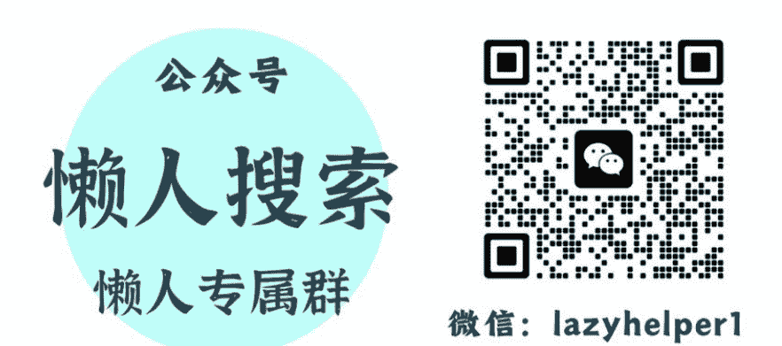
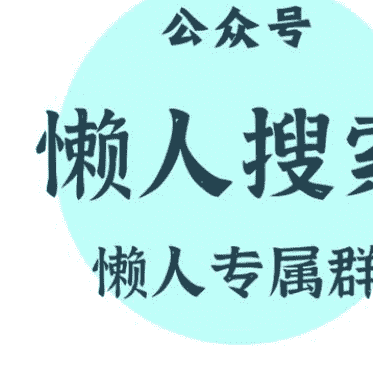
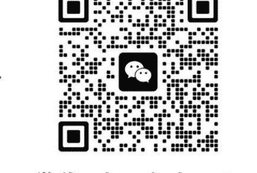

# ## 怎么利用好时间？

你有没有算过这样一笔账：每天睡醒睁眼，到晚上闭眼，这中间的时间到底有多少是真正属于你自己的？很多人都觉得，同样是过一天，别人怎么就能完成那么多事。其实，时间这东西对谁都没偏心过，一天24小时，一秒不多一秒不少。真正的分水岭在于，我们把这些时间倒进了哪个容器里。

别一上来就定什么年度计划，那太遥远了。一年是三百多个平常日子堆出来的，管不好今天，明年的畅想就是空中楼阁。管好一天，先得给时间分分类：有花在身体上的，有耗在别人身上的，有消磨在柴米油盐里的，剩下来的那一小块，才算你能说了算的。

**收回被偷走的时间，就要舍得花钱**

时间管理听起来高级，说白了就是一场“收租”：把那些被人情、被闲事、被家务占用的时间一寸寸夺回来。得先过两关，一是精力，二是注意力。生病时再大的计划也没用，身体不舒服就得休息，这不是浪费，是在给精力账户充值。所以别把自己排得太满，留点是缓冲，疲惫状态下干一小时，可能顶不上状态好时的二十分钟。

社交是最会偷时间的。约个饭看似俩钟头，算上来回路程、收拾打扮，一下午就没了。更麻烦的是不好意思拒绝，随口答应个请求，时间表就变别人的了。不如早立规矩：能不见的面不见，能用🛰️说清楚的别专程跑一趟。真正的朋友不会因为你拒绝几次就走远，能被你推走的，大多本就不该留。

家里的琐事比社交还难缠。照顾家人是责任，但有的事不是非你不可。家务能找人就找人，别硬扛，你觉得省钱，其实是默认自己的时间不值钱。记住这条：能用一点小钱换回来一大块时间的买卖，永远划算。钱花了我还能挣，时间溜走了可就真没了。

**守住了注意力，才算守住了时间**

把外面的世界挡一挡，最大的对手就成了自己。刷短视频，看网文，一划就是俩小时，当时挺舒服，看完啥也没剩下，还把自己弄得静不下心来。有时候我们骗自己说这是在找资料，可转头就忘，记不住也用不上，却把大脑塞得满满的，正事挤都挤不进来。这种内耗的代价是隐形的，专注力下降，反应变慢，同样一小时，能做完的活儿少了一半。

办法其实朴素得很：干活的时候把手机丢到看不见的地方，一次就专心做一件事，实在坐不住就定个25分钟的番茄钟，看闲东西也给它安排一个固定时间，而不是想起来就看一眼。

**方向对了，方法对了，时间才算数**

时间腾出来了，劲往哪儿使？先问自己：这件事要是不做，会损失什么？如果没多大损失，那它八成不重要，不重要的事干得再漂亮也是白忙活。宁可开始慢一点，把方向想透，也别让忙碌的双手掩盖了偷懒的大脑。方向错了，跑得越快，离终点越远。

方法这件事，也得讲究。现在做啥不能让AI先探探路？写文章、查资料、理思路，先让AI出一版，你只负责把把关、改一改，速度翻倍不是梦。再把文件分好类，笔记放一处，别用时翻箱倒柜。能外包的活儿也别舍不得，花点钱请别人替你做，你的时间就是省了下来。

最亏的一笔时间开销，是“重启”。一件事做了一半撂下，过几天再拿起来，光回忆前因后果就要半天。所以要么不做，要做就一口气做完。做完的事，还得留下点东西——一份文档、一个模板、一段代码都行。没沉淀的努力，过阵子再看等于没做。要是做出来的东西能被反复用，那就更赚了，写一次能用一百次的模板，比每次从零开始香多了。

这些能重复用的东西攒起来，就是你的私人资产库。每一份花出去的时间，都在这里继续给你生利息。

**让一份时间的价值，滚出好几个雪球**

做完了东西，得让人看见。现在流行叫“Build in Public”，把你的思考过程、做出来的成果大方晒出来。同样的一份工作，自己干完了是一份收获，发出来还能顺便攒点名声和粉丝。再往上走一步，就要做“一对多”：服务一个人是一份回报，把经验写成文章、录成课，一万人看，同样一小时的价值就翻了一万倍。

做出来的东西要敢卖。只有腰包里进钱了，才能拿钱去买更好的工具、更省事儿的服务，这个圈儿转起来，时间才能滚雪球。说到底，钱是你把现在的时间存下来，留给未来的自己用，只要用得聪明，这笔存款还能自己增值。

不光要存钱，还得把做过的事再榨一榨：踩过的坑写成笔记，独特的数据喂给AI当上下文，这些边角料，保不齐就是你下一次的加速器。那些里程碑、夸奖、好成绩也别忘了存档，以后卖东西，它们就是最硬的背书。

**把眼光拉长，时间还有生命底色**

把镜头拉到一生去看，最大的复利其实是健康。硬朗的身子骨，比啥都值钱。多活二十年，就比别人多出二十年的工作时间，这是最底层的差距。安全也别忽视，再能拼的人，一次意外就能归零，冒险之前先掂量掂量。

最后，给生活做做减法。物件够用就好，少而精，多则乱。节日和仪式感，也不必追着商家的节奏跑。铺天盖地的消费主义在狂欢的时候，你安安静静地待着，那几天假期，反而成了你悄悄多出来的工时。

说到底，时间管理不是把自己逼成一台机器，而是把那些本来就属于你的时间，一点一点拿回到自己手里，让它替你长出东西来。

以下是补充给圈友的部分：

想建立自己的文件体系，抓住四个词：容器、分类、工作流、规则。我的容器是“2+3”：2是电脑和手机，3是三个软件——行动清单用WorkFlowy，知识沉淀用Obsidian，团队协作用飞书。

积累可复用的资产，也是四个关键词：Template（从自己实践里长出来的各种模板）、AI Skills（让AI做完活之后，把过程总结成skill.md）、How（一份份清单，比如这篇文章就是）、101文档（一个主题写成一本书，比如航海手册）。

作者：V先生
标签：轻创业锦囊
发布：20260919
修改：20260919

说实话，看完这篇SOP，你可能觉得懂了。但90%的人实操起来，第一步就会卡住。工具和教程从来不是壁垒，真正的壁垒是你今天是否立刻动手，以及你身边是一群什么样的人。

查阅圈子完整数字资产与上车门槛：https://lazyso.com/insider/

