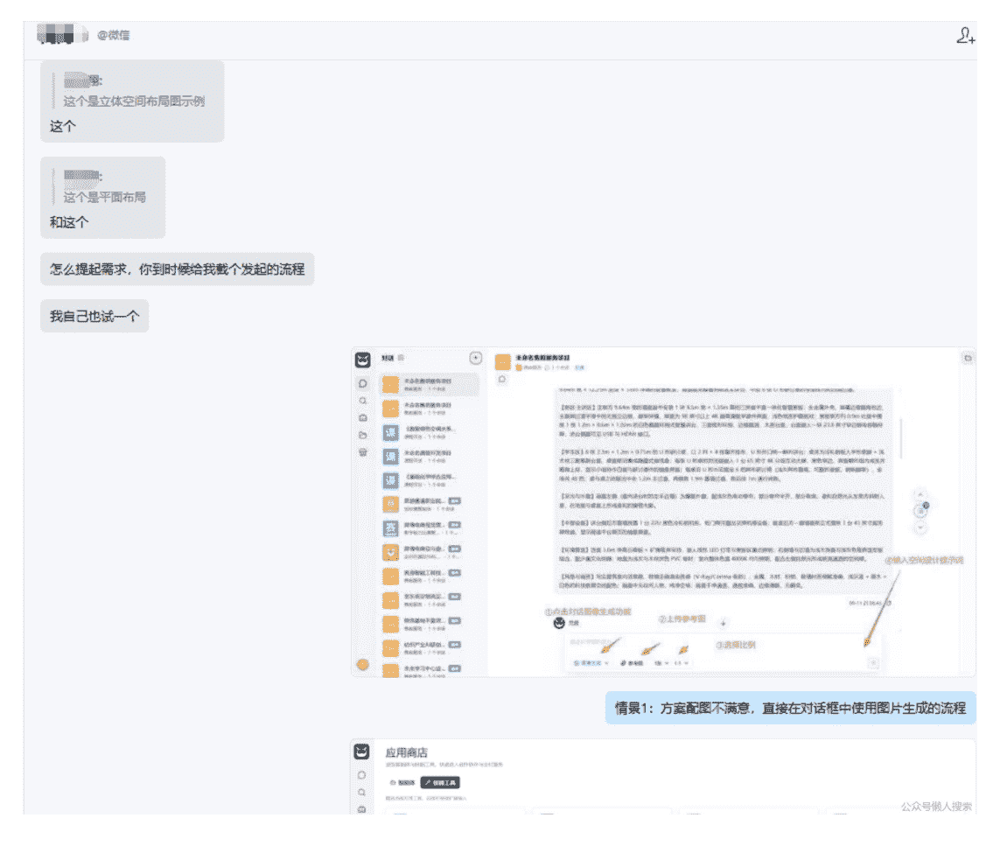
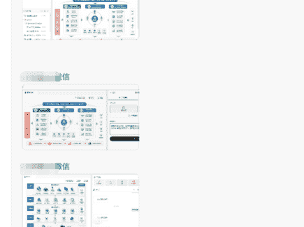
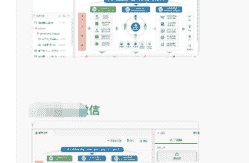
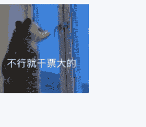
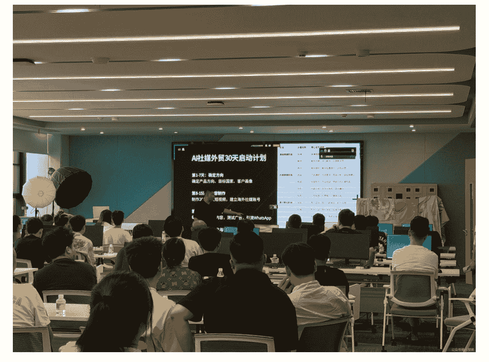
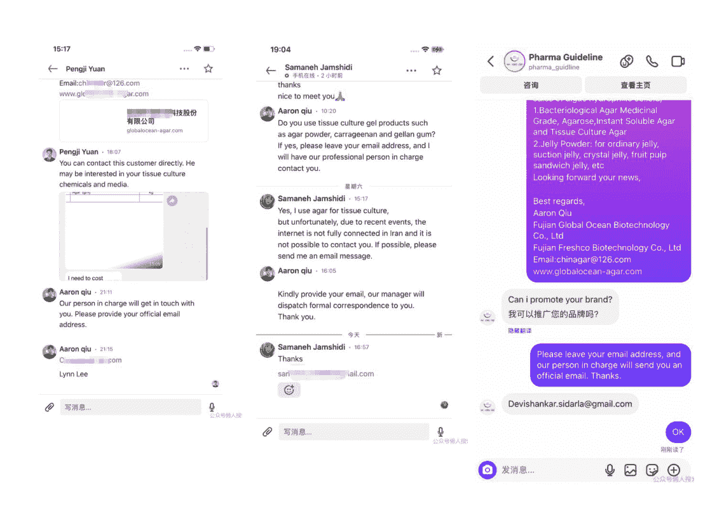
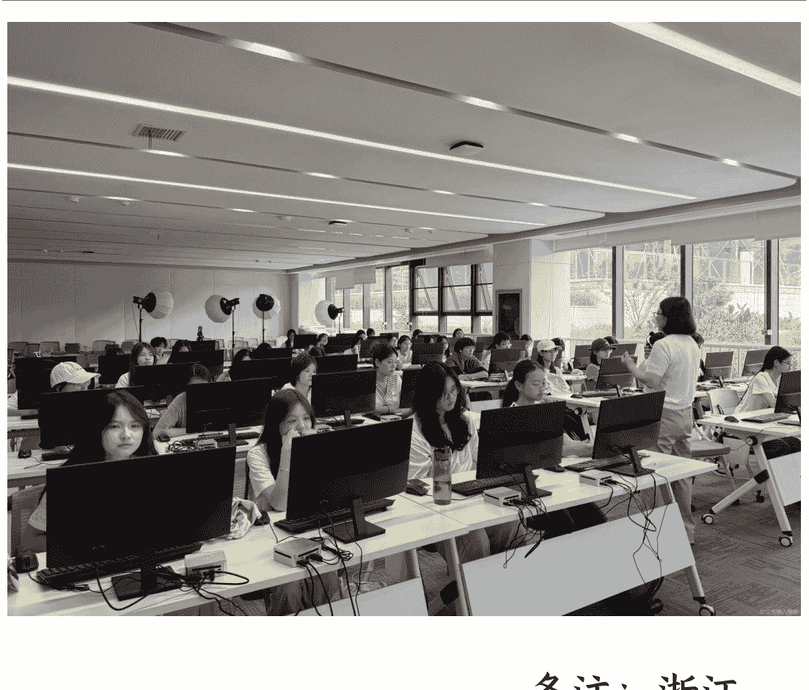

# 在 B 端做了九年，我的第一条 AI 业务线是怎么跑出来的

**来源**：懒人搜索👸号 / 懒人专属群精选
**整理日期**：260923 副业区精华
**微信**：lazyhelperl


> **编者按**
> 这套打法适合手里有 ToB/ToG 资源、想做 B 端智能服务但还没找到切口的负责人；纯技术出身、没有行业积累的人建议先别抄作业。
> 最有参考价值的细节是“5 万元试用三十天”的对赌协议，它把客户的试错成本压到接近零，决策阻力大大降低。
> 需要警惕的风险是：按询盘量结算的代运营模式，有的品类两个月询盘都不到 10 条，所以“按结果付费”并不保证每个赛道都能跑通。

## 一、我的牌都在 B 端

我是安与宁，坐标厦门。这个圈子我待了九年，但这是头一回写复盘。

早年在华为，客户主要是三大运营商；2014 年左右进入互联网，在头部云厂商做过研发、产品和解决方案。后来连续创业，服务对象集中在泛互娱、政务、学校这些领域，做的都是 ToB/ToG 的数字化项目，也因此攒下了一些行业资源。

到了今年，我才零散接触 AI 相关的需求，客户主要是外贸公司、跨境电商、职业院校。本质上这还是 B 端生意，只是交付的东西从“云服务”换成了“智能解决方案”。

公司目前没有正式的交付工程师编制，走的是一套“先签单、后组队”的柔性模式。找客源、聊需求、写方案、报价、定义产品，全都由我单枪匹马来；运营和交付再让同事一起配合。

## 二、首单的“三十天试用协议”

今年四月，一家教育类公司找上门。老板年纪偏大，公司主营中高职课程开发和竞赛服务。他对 AI 本身感知不强，但听说同行已经用 AI 把成本大幅压下来，一下子就紧张了。

我服务传统客户这么多年，太懂这种心理：你跟他谈技术，他没有任何反应；你跟他讲同行靠某个方法赚到钱，他马上就坐直了。这就是同辈压力——森林里遇到熊，你不需要跑赢熊，只需要跑赢身边的朋友。

我们当时没有现成的 AI 产品可以直接卖。我心里也有顾虑：客户认知跟不上怎么办？预期太高最后落不了地怎么办？交付节奏一乱，公司可能要贴进去很多人手，不仅没利润，还会拖累其他项目，股东那边也交代不过去。

最后我们设计了一个“低门槛试单”方案：客户先付 5 万，当作 Token 使用费用；公司免费搭建 Agent 给他用，这 5 万用来抵扣 Token 消耗。双方约定三十天磨合期，到期后任何一方不满意，5 万不退不补，合同终止；如果双方认可，客户再补尾款，后续 Token 另算。

这个方案最大的好处是让客户的决策成本变得极低，所以第一个单子顺利签下。对方大概五十来人，老板一个人拍板。

签约后，两位同事就到客户公司驻场，手把手教课程开发。他们的业务逻辑是这样的：一所高职院校想开跨境电商专业，未来三年要排 40 多门课；每门课都要做教材、教案、工单、工作页、案例、PPT 课件、动态图形动画等。过去一门课人工做下来至少需要三个“人月”；现在三天就能出一门，效率提升了几十倍，成本也降到原来的零头。

当然，这个效果到八月份才真正稳定。中间换过两轮技术栈，也手工帮他们赶过不少任务；Agent 的输出质量前前后后调了一个多月，老板也没少投诉。



### 群里的一些原始片段

一个由企业微信拉起的对外群里，有 13 位外部联系人。一位徐姓老师传了《2026.智能技术学化-王老师.docx》，又发了世校赛相关文件和教育部通知链接，特别提醒这是中职学校，跟高职不一样，需要单独估算成本。

另一个执行群里，IANG:Li 发了截图，说任务开发有一个通用五步法：需求确认—AI 理解—下发指令—细节调整—循环启动。这样做比“一次对话出一份材料”更省成本、质量也更稳。群文件里还有《项目3.空调水系统安装调试.docx》，据说是按这个操作流程生成的结果，可以供大家参考。



```
[code: MODEL_EXECUTION_FAILED, {"message": "模型 [姓名] 调用失败，请检查模型服务配置或稍后重试。"}]
```




在后续沟通记录里，一位朱姓负责人提醒：现场评委是专业教师，大家做素材要按最新版汇报口径来准备。之后又陆续出现了 PPT 补充、演练安排、课件修订等内容。8月11日，团队反馈说两版课件方案都有问题：路径不清晰、落地性不足；AI 生成的图片失真，反复调了几次还是不理想。随后有成员提出，能不能把 PPT 里的参考内容以及教学视频的字幕都提取出来，让 Agent 自动转成脚本，再生成动画。最大的担忧是系统无法理解参考画面和内部结构，最后做出的动画会不准确。于是大家希望技术侧能支持“参考画面/参考视频”输入，同时评估一下时间。



当天晚上 23 点 11 分，同事在群里回复：这周先试一下，看能还原到什么程度，同时问了一句——这个项目什么时候交付。

再回到四月的现场。我们服务了三十天后发现，Agent 还远远没有融进客户的工作流。之后我们重新优化 Agent、沉淀了一批技能块，也带客户用了一些外部平台，但离“嵌入业务”还有不小的距离。当时 Agent 的能力也不如现在。客户觉得没达到预期，开始要求我们继续定制 Agent、定期做 AI 培训，还要每两周做一次进度汇报。

我们只能每个月飞两次客户现场，每次逗留三到五天。公司在厦门，客户在北方，差旅成本和人力成本都很高。驻场同事既要写汇报、对接老板和中层、收集一线流程，又要在现场写技能包、收集产品反馈，晚上还要跟公司内部开会同步。说白了，他们干的就是 FDE 的活。

## 三、会不会沦为“外包驻场”？

我经常问自己：小团队做 B 端智能服务，最后会不会变成高级“现场外包”？

外包的商业模式是卖人天。客户想尝试新业务，或者临时有一个非主营业务，自己组一个五六人团队去试半年，成本要五六十万；找外包可能一二十万就搞定，所以外包成了合理选择。

我们的业务会不会滑向那里？我的判断要看交付深度。

- 如果只做意识培训、工具教学，这属于轻量交付，基本不会变成驻场。
- 如果目标是帮客户完成原生化改造，那就不能靠外包，而是要让客户团队自己会游。具体方法是拉高一把手的认知，帮企业建立自己的 FDE 队伍，让内部力量去推动组织变革。
- 如果只是帮客户部署几个 Agent 覆盖大部分业务流程，那几乎一定会变成驻场外包。因为你必须长期泡在现场理解业务，最后很可能只交付了一个项目，沉淀不出可复制的东西。

我们团队一共二十多人，方案团队不到十个。如果都去做定制化驻场服务，带宽很快就被耗尽，项目数量和营收都没法往上走，人效也高不到哪去。

## 四、提高人效的四条路

第一，把客单价做上去，把深度服务卖给愿意为结果付费的客户。这类客户多在大 B——五百人以上规模，或者年利润过亿。今年我看到不少央国企手里握着每年几百万的数字化预算，比如厦门的建发、国贸，钱是有的，只是不知道该往哪花。但进这类客户需要很深的商务关系，靠单打独斗搞不定，必须用体系去配合。小 B 的优势是决策链短，老板一个人就能定，但客单价通常只有几千到几万。能不能卖出高价，取决于业务问题本身的经济价值、解决的紧迫程度、客户预算，以及他对你的信任水平。

第二，把交付过程中沉淀的行业经验、流程和工具做成培训产品。在项目里反复打磨出来的打法，可以整理成标准化的顾问服务和培训产品。具体分两类：一类直接帮企业解决具体业务问题，另一类帮他们建立 FDE 人才培养体系。目前市面上验证最多的就是这两种。先用培训攒下一批客户，后面再往行业深处切更大型的数字化项目，成功率会高很多。

第三，做标准化产品。也就是一套产品专门服务一个或少数几个行业，用软件订阅的方式收费。这个方向现在还早，但未来一定会出现。路径有两种：自己打磨产品去推，或者并入 workbuddy 这类大厂的生态。

第四，建立外部交付网络。我只负责获客、签约、方案、关键节点和验收，交付和部分方案交给外部伙伴，这样可以突破团队的带宽限制。今年我拒绝过几个交付太重、或者跟主线不搭的单子，拒绝多了确实觉得可惜，所以上个月开始主动找合作方。我甚至把厦门办公室空出来一块，做成免费的 OPC 空间，优先给 OPC 创业者使用。目的就是在线下多接触、多了解，从中筛选出能长期配合的伙伴。

## 五、这门生意和以前的数字化差在哪

现在市场还在早期，各行业之间的认知差和时间差都很大，所以做内训、当顾问、卖工具、卖 Agent、做陪跑，都有存活空间。但项目落地的问题也不少。我猜再过一年，它就会回到数字化生意的老路上：看结果、拼说服力。你拿着 PPT 给客户演示系统，基本不管用了，必须拿同行的真实收益说话，同时还要拿捏人性。老板的账永远算得很清楚：这件事能多赚多少、少花多少、需要投入多少精力，以及我信不信你。

项目运作的周期也完全没变：立项、POC、招标、交付、验收、回款。政务、学校、医院、央国企这些体系里，领导关注的东西和一线痛点常常是两张皮；产品要过数据安全、合规、信创这些关卡；交付时除了产品本身，还要准备大量材料；甲方强势，需求会不断蔓延；采购方和验收方往往不是同一批人；回款周期更是漫长。

中小民企没有这些条条框框，通常是老板直接拍板。但需求怎么聊、方案怎么做、报价怎么定、合同怎么签、交付怎么验，这些环节依然需要一步步扛过去。对人的要求还是那两条：懂业务，扛得住各层级施压。

最大的不同是交付结果的不确定性。以前做软件，需求定义清楚，结果基本是确定的；现在你换一份资料、换一种问法、甚至换一个底层模型，Agent 的输出都可能发生变化。这种不稳定会直接带来验收难题。客户愿不愿意签字，需要你同时突破认知、产品质量和服务能力这三重门槛。

前面那个教育客户就是例子，从四月一路磨到八月才达到理想效果。这也是为什么现在大家都在提“别把 AI 当成工具，要有 AI-Native 思维”。

怎么理解 AI-Native？硅谷的 Cursor 公司可以算一个典型样本：公司里没有复杂的前端、后端、测试、产品等固定岗位；Agent 被当成正式员工，可以被夸奖，也会被批评；组织极度扁平，没有标准 KPI，靠目标结果驱动；所有员工都在管理、约束和调教一堆 Agent。如果你长期在这样的环境里做事，协作方式与思维习惯自然会变成原生 AI 式。但一家成熟企业要整体转型成 AI-Native，难度极高，历史包袱越重越难，而且只能由一把手亲自推动。

我常用集装箱的案例来类比：纽约港当年也引进过集装箱，但真正靠它崛起的是新泽西港，因为新泽西港把港口道路、码头形状和接驳方式全部推翻重来。AI 也是一样，旧瓶装新酒很难见效。我也见过一些人刚学会几个 AI 工具，就开始俯视客户，满口技术名词。这种姿态很容易把自己锁进技术思维里。客户真正关心的是多赚钱、省成本、提效率，并不关心你背后到底是不是 AI。所以和客户沟通，要从业务结果出发，不要炫技，也不要抛出一句“AI 本身有不确定性”这种外行话。技术只是手段，结果才是答案。

## 六、老板买单的真正动机

做 B 端智能服务，除了要懂一线员工每天怎么干活、有哪些痛点，更要读懂老板的决策逻辑。这件事永远是一把手工程。

老板最怕什么？怕同行已经跑远了，自己还停在原地。一旦他听说竞争对手靠 AI 降了本、增了效，而自己没有任何动作，焦虑感立刻就会上来。所以见老板之前，同行的成功案例一定要准备充分；节省了多少成本、提高了多少效率、花了多长时间落地，越具体越好。

这一点也是整套打法里最核心的：永远不要和老板谈概念，要给他看结果。

B 端 AI 生意，最终拼的是信任和可复制性。用低门槛试单降低进入成本，用真实案例激发购买冲动，用标准化交付提高人效，这条路就能一直走下去。

老板在意的，不是团队里有没有人打开过人工智能工具，而是这些投入有没有变成公司的长期能力。

现实中，许多团队的做法仍停留在零散尝试：有人借助工具制作精致视频，有人快速整理出一份市场方案，但个人摸索出来的方法没有形成标准流程，也没有成为团队都能调用的工作模块。关键成员一旦离开，经验、判断和操作路径往往也随之流失。企业支付了软件订阅费和算力成本，最终换来的可能只是某位员工短期提速，并未真正留下可继承的组织资产。

因此，管理者真正要追问的是：

- 人工智能是否嵌入了日常经营流程？
- 优秀员工的经验有没有被记录、复用和更新？
- 能否搭建一套有标准、有指标、可复盘的生产系统？

如果你要帮助企业推进组织层面的变化，就不能只展示工具功能，而要围绕这些经营问题设计解决方案。

除此之外，投入产出比也是绕不开的账。企业会核算：今年投入了多少预算，减少了哪些支出，带来了多少新增收入；再具体到团队成员，还要看谁真正扩大了产出，谁只是增加了资源消耗。清晰的数据，能让管理者知道钱花在了哪里、结果如何，也能减少不确定感。

## 七、从需求现场长出来的跨境项目

前一个项目属于“先有成品，再寻找适配场景”。这次的路径相反：先遇到明确的业务诉求，再反向打磨解决方案。这个过程再次说明，人工智能项目需要足够灵活，不能一开始就把产品形态锁死。

我们在浙江有一支团队，原来负责金华某个政府基地的运营，主要考核两件事：组织全国各地的教师和学生前来参观、培训；以及帮助基地进行招商。

几个月前，我们联合义乌一位跨境领域的内容创作者，举办了一次线下招商活动。起初只是想吸引几家相关公司入驻。现场展示了若干智能化应用后，很多参会企业开始询问：能不能把这套能力用于海外获客？



备注：现场招商，以 AI+外贸为主题，需求精准

这次反馈促成了第二个产品——外贸智能体，重点面向海外社交平台获客。

它可以协助企业研究目标市场、筛选潜在买家、生成多语种素材、撰写产品说明、辅助处理询盘，并把分散的客户资料集中整理起来。过去，业务人员受时间和精力限制，只能维护有限的客户范围；现在结合智能工具与数字化流程，企业能够同时覆盖更多地区、平台和线索来源。

但在合作初期，客户对新模式还缺少信任。如果要求对方先付款、再自行研究怎么操作，试用意愿通常不会太高。

所以，我们采用了更容易被接受的合作方式：

- 先由我们负责实际运营，按照有效询盘数量计费；
- 若阶段内没有产生有效询盘，所消耗的 token 由我们承担，运营服务费也不收取。

也就是说，我们先承担试错成本，让客户先看到与订单相关的成果，再根据成果支付费用。

跨境业务有一个明显特征：建立信任需要时间，成交往往不会立刻发生，但后续价值可能很高。一条线索从首次接触到真正合作，可能经历三个月、半年，甚至更久；一旦进入对方的供应体系，后续补单和长期合作的概率就会上升。

企业主会这样核算：招聘一名外贸业务人员，底薪可能是 6000 元，再加上社保、办公和管理支出，每月实际成本超过 8000 元并不罕见，而且还无法保证立即产生成果。相比之下，如果有人直接负责推广产品，产生询盘后再支付费用，就相当于用更可控的方式购买业务结果，因此不少老板愿意先试一试。

我们曾服务过一家销售琼脂糖的企业。对方在这个细分品类经营了十多年，过去接触的基本都是圈内客户。后来，我们协助他们把产品内容分发到多个海外社交平台，收到的线索中出现了医院、实验室、科研单位等新类型买家，这些群体此前并不在他们的常规客户范围内。



备注：琼脂粉客户的部分询盘

当然，效果并非每次都理想。有一家客户连续接受两个月运营后，合格询盘仍不足 10 条。复盘后我们发现，跨境获客受多个变量影响：商品所属细分领域、目标国家、账号定位、内容策略等，都会改变最终表现。

按成果计费有助于降低首次合作的阻力，但若想长期经营，还必须回答两个问题：产出是否足够稳定？投入是否符合经济账？适合继续测试的项目，就扩大验证；模型不成立的项目，则应及时调整甚至停止。不能因为前期已经投入，就无止境地追加人员和工时。

之后，我们又重新设计了交付方式。如今，浙江的 OPC 基地已经与部分高校学生建立合作，由学生参与跨境账号运营。我们向外贸企业收取每月 4000 元的服务费，平台调用所需 token 由客户自行充值，具体执行工作则交由学生团队完成。

与此同时，我们根据前两个月积累的运营反馈，对产品架构重新调整，推动外贸智能体进入 2.0 版本。



备注：浙江OPC基地带领学生承接外贸代运营、跨境电商代运营

## 八、独立承接企业智能化项目，需要哪些底层能力

讲到这里，很多人会问：没有大团队，能不能承接企业智能化项目？

答案取决于三件事：你准备解决哪类问题、项目复杂程度如何、交付环节有没有协作者。前面的项目属于较重的类型，我主要负责获客、方案设计和产品 IP，运营与交付则由同事共同完成。若处于起步阶段，可以先选择培训、顾问、流程梳理等相对轻量的服务。

现在很多人讨论 OPC，但真正意义上的 OPC 并不是简单复制模板就能获得。反过来说，如果你具备优秀 FDE 的特质，通常也更容易成为一名有战斗力的创业者。

在我看来，未来需要重点补齐四种能力。

### 1. 影响力：让别人愿意相信你

当内容越来越容易由机器批量生成，稀缺的就不再是“能不能产出内容”，而是“别人是否相信你说的话”。

所以要主动经营个人品牌，持续输出项目复盘、行业观察、组织升级和企业智能化实践。我也开始运营短视频账号“AI 落地说”，过去不太愿意面对镜头，现在只能逼自己走出去。除了线上内容，公开课、公益讲座和线下交流同样重要，它们能让潜在客户更早认识你。

### 2. 产品能力：从经营任务出发

真正有价值的产品，不是功能列表越长越好，而是能否完整理解一项工作如何发生。

你需要弄清楚：使用者是谁，最终决策者是谁，对方为何愿意付费，最难受的环节在哪里，什么结果会让他觉得值得，以及他的决策顾虑是什么。

如果这些问题没有答案，做出来的东西很容易只是开发者自我满足。好的方案应从任务完成路径切入，而不是先堆功能。再往前一步，还要从不同客户身上找到共同规律，把重复出现的需求沉淀成标准化方案。

### 3. 工程能力：让产品经得起真实运行

现在，制作演示版本已经比过去容易很多，但能否进入生产环境，是另一回事。

并发访问、租户之间的数据隔离、权限控制、系统响应速度、运行稳定性、上下文记忆等问题，都需要工程化处理。若这些基础环节没有解决，作品可能只能用于展示，无法承担真实业务。

### 4. 交付能力：围绕结果增加价值

我一直有一个体会：产品设计要尽量简洁，交付过程则要尽可能周全。

企业购买的往往不是某个按钮，而是问题得到解决后的结果。及时回应、准确理解需求、保持高质量沟通、在关键环节给予支持、陪客户一起攻克复杂场景，这些都属于交付价值。服务好客户，不等于一味讨好，而是用专业、可靠和效率建立合作关系。

## 九、独立开展业务，可以从哪里切入

不同背景的人，起步路径并不相同。

如果你长期在某个行业工作，也积累了客户或老板资源，最适合从行业问题开始。先整理已有案例，再通过公开交流了解真实需求，最后争取一个范围可控的小项目，用实际交付验证方法。

如果你擅长技术开发，却暂时没有客户，可以找一位熟悉行业的伙伴配合，先拿到真实任务，再围绕任务制作演示版本。第一笔订单即使利润很低，也能帮助你熟悉报价、沟通、交付和复盘的完整链条。若更擅长线下拓展，也可以带着真正解决经营问题的工具去拜访商圈和园区，但前提是产品确实对应老板的痛点。

如果你擅长策划活动、维护社群，就可以从公开交流和行业活动开始，逐渐建立知名度，并把技术人员、行业从业者、渠道伙伴连接起来，形成资源协作。

如果暂时没有客户，也缺少交付经历，那就先加入成熟项目，承担其中一个边界清晰、验收标准明确的模块。先完成一次完整交付，再慢慢扩大项目范围。

## 十、把注意力放回真实经营

人工智能更像放大镜，而不是凭空制造资源的机器。

如果你已经具备专业技能、行业关系或渠道优势，它能帮你更快复制、扩大产能；如果此前没有能力储备和现实积累，仅靠工具本身，很难自动生成商业结果。

因此，值得长期投入的是那些会不断产生回报的资产。比如客户关系：合作对象越稳定，后续续单、推荐和增购就越顺畅；比如个人品牌：被目标人群持续看见，信任建立的速度就会加快。所谓复利，并不只是资金增长，也包括过去的经历让下一次成交、交付和扩张变得更省力。

企业智能化业务通常会经历三个阶段：

- 初期：为了生存，先接触不同类型的需求，搭建小型协作团队，积累合作方；
- 中期：逐渐减少无关项目，集中打造标杆成果；
- 后期：选择少数适合自己的细分领域，持续深入经营。

国内拥有超过 6600 万家企业，其中相当比例都面临智能化升级需求，市场容量足够大。现在仍处于产业早期，更像当年的“思科时刻”：基础设施先获得关注，应用层还没有全面成熟。

早期互联网最先受益的，是铺设网络和提供设备的公司；今天，资金也优先流向 GPU、光模块、PCB 元器件、存储、云平台、模型及数据基础设施，所以英伟达以及相关硬件企业率先获得市场回报。

但这并不意味着应用端没有机会，反而说明行业仍在建设期。等底层能力逐渐标准化，使用成本持续下降，企业流程被重新设计，市场价值就会向上游之外的应用层转移，最终流向那些真正进入生产现场、优化具体流程、解决高频经营难题的公司。

所以，创业者没必要天天追逐最新模型，也不必为了热点频繁更换方向，更不要把短期项目误当成长期事业。应该认真盘点自己的行业理解、可触达的客户、团队配置与合作资源，选择几条真正适合自己的细分路径，持续积累，等待基础设施成熟后的增长释放。

---

读完这份 SOP，很多人会产生“已经掌握了”的错觉，真正开始执行时，却往往在起点处停住。

软件和教程只是最容易获得的部分。更难替代的，是马上去验证，以及接触到高质量圈层信息。

如果你希望了解近期的变现路径，并和一群愿意真正执行的极客一起拆项目、做验证，欢迎关注我的核心私域：【懒人专属群】。

这里不做空谈，重点研究商业链条、效率提升与可复盘的实战案例。系统中已经整理了 1000+ 个完成验证的套利项目。

□ 查阅圈子完整数字资产与上车门槛：

[https://lazyso.com/insider/](https://lazyso.com/insider/)

认可这套方法、准备亲自参与的朋友，可扫码添加微信：lazyhelper1

添加时请备注：【实操上车】，不闲聊


微信：lazyhelper1