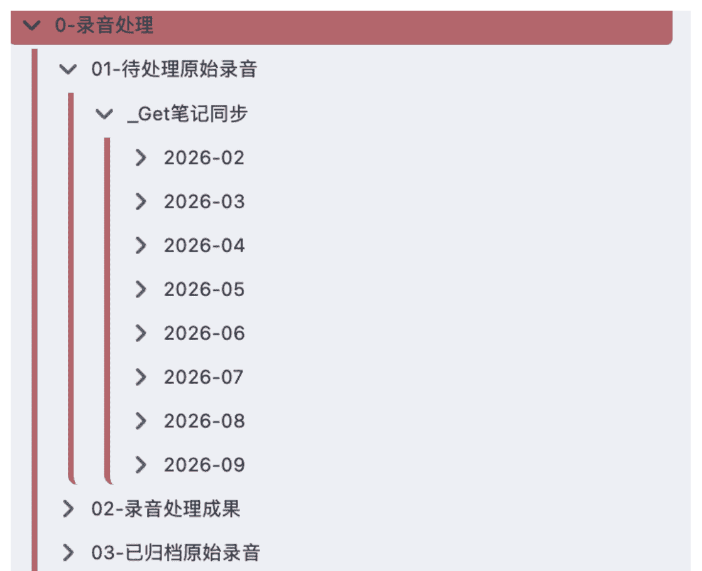
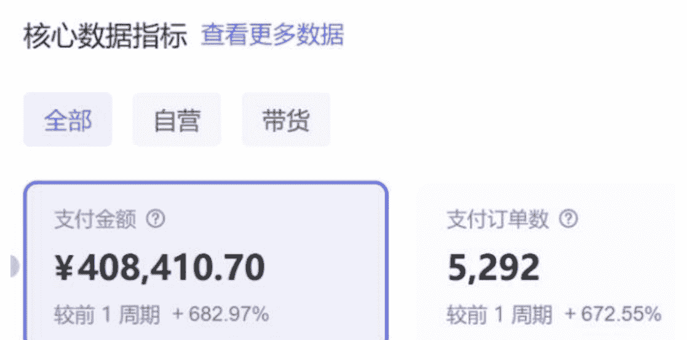

# 创业一年赚到 6 位数，却换了八九个项目，我終於开始面对真正的问题

换了八九个赛道、赚到六位数，她终于逼自己面对真正的症结

七月三十天，小林给自己立了条规矩：不许开新盘。
她并非要表演自律，而是想搞明白一件怪事：为何有人能把许多事从零跑通，却总在即将放大时抽身退场？

这一年里，她前前后后折腾过八九个领域。其中某些领域已经实打实地入账，可她依然没办法让自己留在一桩已被验证能赚钱的买卖上。

> **小懒点评** | 如果你也总觉得“下一个才是对的”，这姑娘的复盘值得一读。一年换了八九个领域，虚拟商品卖出七千多单、入账六位数字，照样果断收手。她最有价值的拆分，是划清“本领不够”和“内心抵触”的界限：技能能补，真心不愿的事没法硬练，别拿自我改造去掩盖选错了路。另一处大坑，是拿优势、原则、复利这类少说也要几个春秋才能验证的尺度，去逼问一个连首批客户反馈都没拿到的新生意——无论怎么选，都会被毙掉。

整个七月，她去听鲁细细的线下培训，研究小某书作品、直播、粉丝池成交与高单价产品；参加单人公司的业务诊断，用A.I.工具搭了自己的智能体助理；还偶然接触到数字命理与《易经》，预约了优势教练和事业咨询师。

表面看她仿佛同时开了七八条支线。可等她把输入倒出来重捋一遍，才发现七月里她反复追问的只剩一道回声：折腾了这么多领域，为什么仍旧找不到一件打心底愿意做到底的事？

她以前觉得，是那些领域不够好。
后面她慢慢信了：病灶，或许根本不在领域本身。

## 01 并非没做成过，而是每次都没留下

辞职前，她干了八年产品岗。2024年3月裸辞，转身进了新媒体，在一家坐拥百万粉丝的博主公司里做知识变现教练。一边运营自己的号，一边带了二百余名学员。2025年初，她离开公司，真正单干。

此后一年多里，她先后试过人工智能博主、智能体付费课、直播带货、小某书实物与虚拟电商、个人品牌知识付费……大大小小八九摊，都不是嘴上说说：她实打实研究过货物，做过作品，投过流量，聊过客户，也独立走完过谈单与履约。

只看冷启动本领，她执行力不差。陌生领域冒出来，她常常能快速看懂底层规则，用过去操盘的思路拆出最小闭环，再一步步推起来。可她的症结也恰恰在此——
她反复证明了自己能“从0起步”，却从没证明过自己能在某一处长久留守。

单干到现在，她的个人IP全网攒了约十五万关注。三个小某书电商尝试都拿过成绩。与朋友合做的虚拟商品项目，持续五个月，卖出近七千单，入账六位数字。个人品牌的知识产品，上线第一个月也有五位数进账。

她的频繁转向，并非因为做不成。相反，有些盘子已经打通了内容到成交的全路径，也递来过清晰的正反馈。按常理，验证过自己、也真实拿到过收益，接着该是加大投入。但这些反馈没能让她安下心来，只让困惑变得更尖利：
为何已经证明能赚到钱的事，她仍不想继续？
为何她看得懂这门生意的逻辑，却说不动自己留下？

若只是某一次溃败，她大可以归因于平台、利润或合作方。但当同样的桥段反复上演，她便无法再心安理得地把责任全推给外界。

回头清点，每一次收手也都有因果，且单拎出来都成立：做人工智能博主时，商务对接的来回拉扯让她心累；做视频带货时，她要为并非真正认可的效果站台，内容发出后只剩空洞；做小某书蓝海电商时，又和另一条线撞在一起，只能临时砍掉一方；最接近“从1到10”的虚拟项目，持续了五个月的订单和收入，可平台规则说变就变，商品一旦违规，项目随之终止。她先前攒下的内容、销量与经验，没有顺利沉淀成属于自己的资产——因为粉丝池始终不在她手上。

后来，她去学商业，重新搭自己的知识产品与成交链路，扎扎实实跑了三个月。方法或许没有大毛病，可真正进入粉丝池的销售、答疑和履约后，她发现自己被消耗得太重，于是又停了。

当停下来的理由越堆越多，她终于看见更扎心的一问：如果平台、商品、合作、利润甚至个人状态都能成为喊停的理由，那再换一条赛道，这些理由就会从此消失吗？
当每条路都能找到放弃的借口，真正该被研究的，或许就不再是路，而是走路的人。

## 02 把七月立为“学习月”，其实是在等外部救世主

所以七月初，她给自己排了个看似稳妥的计划：先不急着开启下一盘，把整月当成补给期。她想先把旧账算清，再决定要不要往前走。

4号、5号两天，她参加了鲁细细的线下培训，密集过了一遍个人知识IP的商业闭环：定位、差异点、小某书爆款选题、直播开场、销售话术、粉丝池顾问式成交，到引流品、社群、训练营、私教，以及A.I.怎么辅助内容生产——从获客到后端履约，几乎全流程都重新洗了一遍。

货物卖不卖得动，对她而言不是未解之题，已经有学员在真实履约。真正让她犹豫的，是她是否愿意用这种方式，去过今后漫长的日子。
“这套模式能赚钱”，已被太多人验证过。她真正想确认的，是它能不能变成一种她愿意长久浸泡其中的活法。

但两天课没有替她关掉任何选项，反倒让她脑中的方案激增。不想碰销售与履约时，她便设想：也许最好的分工，是找个成熟后端来承接，自己只负责流量和内容。

社群轻，训练营已有底层，私教来钱集中，知识库能沉淀，电商离流水近，合作又能绕开短板——每一条似乎都能自洽。正因为都说得通，她反而更难落子。

知识增加的同时，选项也在增加。
她曾以为，知道得越多就越接近真答案。后来才品尝到：每多学一种打法，头脑里就会多出一条新路。旧的困惑并没有消失，只是被更多看似可行的路径围了起来。

到了下半月，她把追问压向更深的地层：去听单人公司业务诊断，参加北极星工作坊，重读Gallup长板报告；还去接触数字命理、星盘、易经、八字，盼望借不同体系交叉看清自己的脾气、所长，以及更适合的生存方式。

她并非真信这些，也不打算把余生交给某份测评。可若诚实面对当时的自己，她确实巴望它们能给一个答案——最好有位够分量的权威，用一套足够周密的框架，把她此前的经历全部解释清楚，再明明白白告诉她：你合适什么，不合适什么，往后照着走就行。

这种心态，和她半月前向成功者取经并无二致。前半月，她想借强者路径找到出口；后半月，她想借性格、命理与玄学找到宿命。表面研究的是不同工具，内核却是同一件事：
把选择的重量转交给外部标准，让外界替她兜底，好保证她下一次不会再停下来。

选择却并未因此变得更简单。外部答案越多，她越能看清每条路的成立前提，也越能看清它附带的代价。
越想求一条不会出错的康庄道，就越不敢真的踏入任何一条。

## 03 她以为缺的是方向，其实缺的是叫停规则

七月里，有位咨询师对她说：“你很爱反思，但反思太多、做事太少。想得太深，人也容易自我攻击。”她重新听见这句话时，恍然发现，它几乎串联起了她过去一年反复切换赛道的全部轨迹。

她太擅长揪问题：新盘子刚要启动，她就去研究它的生意模型；进入执行，她盯住流量、利润、履约和体感；刚碰到卡点，她又会往更深处追问：货品够不够好？受众够不够准？模式是不是太沉？能不能滚雪球？与自己的长板和做人原则一致吗？这些疑问没有一个错。

错的是，她的思考没有尽头。发现一个裂缝，她会继续挖更深的原因；对眼前工具产生疑心，她便去寻更全的工具；新工具到手，她又推翻产品与路径重来，原本推进中的动作随之破碎。

单看每一步，她都在认真思考、主动学习、管控风险。可把它们串起来看，却是一台“发现问题—重做选择—重新开局”的永动装置。她以为这算审慎，实际却是把思考变成了无限运行的程序。

真正困住她的，从来不是缺思考，而是思考缺少终止指令。
等她把选品标准逐条写到纸上，才看懂每个方向为何都会被自己枪毙：它要贴合长板，能稳定做上三五个年头，不必反复更换；履约不能太重，推销不能太猛，收入却要过得去；最好还能攒下个人资产，合乎她的原则，做起来甚至有心流。

单拆开看，这些要求都算合理，甚至该是一名创业者常挂心头的考量。可当她把全部条件同时压到一个还没被真实检验过的盘子时，任何选项都会暗淡无光。离流水近的，怕没有长久价值；能沉淀家底的，怕回款太慢；高单价有肉，她不享受那份销售与服务强度；轻履约让她舒服，她又担心要背更大的流量洪水。

她并非在判断下一步值不值得试，而是在迫使自己提前预判：这条路能不能装下未来三五年的整个人生。可一个盘子连首批客户的反馈都没拿到，她已经在逼它回答长板、原则、收入、理想生活与滚雪球效应。

这并非标准定得太高，而是把不同阶段的考题硬塞进了同一天。0到1阶段，该验证的本来是有没有人买、能不能成交、自己想不想再干下去；可三五个年头后的问题，应当等真实反馈出现再判断。她却想赶在行动之前，一次性全部解完。

她并非在选一个可以立刻测试的方向，而是在要求自己提前选中一段永无后悔的人生。

这份纠缠，在她面对高单价模式时尤其明显。许多成功者都在强调高单价、优质客户、粉丝池成交，她同样明白这套打法已被市场反复检验。可她也会看见，这些论调常常与发言者本人的产品、功力与商业立场焊在一起。一个擅长签单、又有成熟履约团队的人，自然容易在高单价里获益；而把同一套公式套回自己身上，顾问式成交、高频沟通、重度服务都会抽干她的能量。

于是，她长久卡在“想信又不敢全信”的裂缝里。看见别人跑出了成绩，她便怀疑是自己执行不够；回到自己的现场，体感分明不对，她又忍不住后退。

后来她才想通：这并非因为她不听话，也不是成功者的方法不能学，而是任何方法，都必须经过她自己的条件重新过滤。当把决策权交给权威时，她的真实感受并不会蒸发，只会在实践途中重新冒头，化作疲惫、抗拒和坚持不下去。

别人的成功，只能证明那套玩法在别人那里成立，却不能代替她证明：她也愿意用那种姿势，工作多年。

## 04 真正要调校的不是赛道，而是她与工作的关系

她还发现，自己的低效并不只是不会安排时间。作息、吃饭、身体、情绪、工作节奏全被串在一起；当身体与情绪没有回到稳定带，目标拆得再清晰，也落不了地。

过去，她喜欢用任务条数来掂量自己有没有尽力。想做的事一多，她就把内容、货物、签单、人工智能、新尝试统统开列出来。清单看着完整，真正能落地的动作却寥寥无几。做不完，她不会降低负荷，反而把低效解释成意志力不足，接着给自己加码。

那次梳理以后，她给出的解法反而很朴素：每天只做完一两件最关键的事，从目标倒推出当天能做的最小一步，其余时间用来养身体、养情绪。这不是说单干就该放水，而是她认下了一个事实：一个人的运行状态，本来就是业务系统的重要零件。

> 单人公司的生产系统，就是创始人自己。身心一旦失衡，生意也一定会晃。若长期靠透支去换进度，再好的盘子也会被做成一份撑不了太久的活计。

在优势教练的对话里，她重看了Gallup报告。她的头号长板是“谨慎”，可很长一段时间里，她没把它当长板，倒像悬在头顶的鞭子：查项目、查风险、查别人，也反复抽自己。谨慎让她很少闭眼扑向一件事，能提前看见利润、平台、合作、履约与道德风险，也总在旁人最兴奋时先泼一问：这事儿走得远吗？它确实护过她，让她避开了一些她看不上的手段，也让她不愿为了签单而过度承诺。

可谨慎一旦失去边界，就变成对所有行动的无底线否决。方案但凡有瑕疵，她便不敢起步；结局没法看穿，她便要继续研究；途中稍有不舒服，她便开始质疑路线。到最后，谨慎保护她的方式，成了干脆不让她靠近任何不确定性。

教练提了一个画面：把脑子里那根鞭子，换成一条警戒线。要评估风险时，拉起警戒线，认真核对最坏结果与自己的承受区间；基本盘判断完毕、进入小范围测试后，再主动把线放下，不再让同一个疑问反复拦路。

这画面让她松了一口长气。它并未要求她变成莽撞的人，也没有抹掉谨慎的用处，只是把使用谨慎的开关交还到她手里。
谨慎要真正成为长板，前提是她说了算，而不是鞭子说了算。

当她把问题从“哪条路最好”换成“我愿意付哪种代价”后，许多疙瘩才慢慢解开。她不喜欢重推销，不想把大量精力花在反复说服客户上；她不想被无边的答疑和售后拖碎，也绝不愿用虚假承诺换订单。可她同样需要回血，也希望自己的付出换来体面进账。

过去，她想把这些诉求统统塞进同一个产品里：销售轻、履约轻、单价高、转化顺，客户还能拿到成果。现实里并没有这种东西。
选轻履约和强流量，就要咽下低单价和源源不断的获客压力；选高单价和重履约，就要接受更少的服务人数、更高的沟通成本和更长的投入时间；选靠内容慢慢养信任，就要接受它没法立刻喂饱现金流。

真正的决策，不是抹掉全部缺点，而是确认哪一种代价，与自己的底子、状态和做人原则最贴合。
对当时的她来说，这也意味着不能只盯着别人赚了多少，还要去看那笔钱背后，需要怎样的签单、怎样的履约、怎样的日子。

商业模式并非把所有甜头汇进同一个容器，而是决定她甘愿背哪一份重。
若一种活法需要她长年违背内心，或者持续榨干身体与情绪，哪怕账面上再好看，也不该成为她的终点。

## 05 七月没替她挑出赛道，却给了她四条收手准则

**第一条：先信已有的成绩，别信新鲜感。**

过去这一年，她太容易被新领域点亮。新领域还没暴露出磨损，向人展示的全是可能性；做过的旧盘却存着一身疲惫与毛刺，让她误以为下一站必然更香。可新鲜感只能说明她有兴趣，不能说明她做得成，更不能说明她愿意做很多年。

真正值得托底的，是已经出现的实绩。她做过账号，全网攒下约十五万关注者；她跑通过三个小某书电商项目，懂得怎么看平台、挑货品、组织内容；八年的产品岗和后来的知识变现履历，让她具备了产品设计、知识拆解、流程管理与带学员的功底；最近，她又持续把人工智能揉进内容与业务流程。

这些功底不会直接告诉她的下一个盘子是什么，却已经圈出一个更可信的地带：未来的新动作，应当从内容、流量、电商、产品、知识组织、人工智能这些被检验过的能力向外长，而不是每次从零开始，再自证一遍。

**第二条：分清“做不到”和“不想做”。**

从前遇到不舒适的环节，她惯于把它定性为“我没这个能力”。不爱顾问式签单，就怪自己销售功夫不到家；不想做重履约，就怪自己缺乏服务耐心；一想到直播和粉丝池聊天会耗能，便开始怀疑自己不适合做个人品牌。

可“我能不能做到”与“我愿意不愿意长期做”，是两套截然不同的命题。她卖出过货，带过学员，说明签单和服务并非绝对做不来。真正要核对的，是她愿为提升这两项投入多少时间；就算最后练得不错，她是否愿意让它们一直占据工作的中央。

能力不够，可以靠学习、练习、工具和分工补齐；意愿不够，却不能靠自我强迫硬凿。倘若她明明不愿长久浸泡在某种工作方式里，却总把问题翻译成能力不足，就会踏入一场停不下来的自我改造。把两者拆开，她才能真正判断：哪样需要练，哪样能交出去，哪样压根不必养成本。

**第三条：开工前先问一句——做完这单，能留下什么？**

此前的尝试并非没有价值，它们帮她确认了本领，也帮她认清了自己不能接受怎样的活法。可从积累的角度看，有些盘子一旦停掉，收入、流量、合作关系便一并不见。下一次，她又得重新找货、重新起号、重新养信任。

以后再评判某个新尝试，她希望它至少能沉淀出一种长久资产：可以是持续制造价值的作品，可以是更细的客户需求样本，也可以是粉丝池信任、方法论、知识库、可复用产品、稳定货源，或一条被验证过的获客路径。如此一来，哪怕这条路没有走到预期终点，她做过的功夫也不会凭空归零。

这条准则也重塑了她对个人品牌的理解。七月课后，她记过一句话：“做个人IP，就是输出经过自己判断力过滤的内容，去获取信任、存储信任，像往账户里存钱，未来某天再取用。”
内容不该只为了某次发售而临时制造的流量工具，它也可以成为穿过项目周期、持续累积信任的个人资产。
如果一件事停下后什么都剩不下，它带来的便不只是试错成本，而是一笔极难滚动的消耗。

**第四条：别急着解决还没发生的问题。**

以后再遇到新机会，她不准备先在脑子里推算它能不能做上三五个年头，也不强迫自己立刻判定它是不是终极归宿。她会先问几个贴着地皮的问题：它离流水有多远？能不能在小范围内跑完一次实验？有没有真实客户肯掏钱？第一轮做完，我的身体和情绪处在什么状态？

这些问法，没有“人生方向”那样宏大，却更容易长出有用的答案。客户肯不肯付费，要真刀真枪卖过才算数；工作方式合不合身，要真正上手试过才知晓；一条路能不能走长久，也要看第一轮结束之后留下了什么。光靠闭门推演，她最多能筛掉明显不对劲的选项，永远取代不了现实给的那一棒。

---

七月结束时，小林仍旧没有锁定所谓的“最终方向”。
但她终于肯去触碰那个真正的课题：她要找的，不是一条永不后悔的路，而是一套能在行动中自然运转的收手规则。

她写下这样一段话：
“我不是在挑选一个完美无缺的方向，而是在练习一种可以长期持续的活法。收手规则不是为了放弃，而是为了让自己清楚：什么情况下继续，什么情况下转弯，以及哪一种代价，我愿意付。”

如果你也常年困在“下一个会不会更好”的循环里，不妨把问题换成这一句：
你缺的，究竟是更好的方向，还是一道能让行动一直向前的收手规则？

七月走到尽头时，我的选项清单还是空的。面前摆着几条岔路：是把个人知识品牌接着做下去，还是把那个教人做判断的小社群挖得更深；是做一套能批量交付的线上资源，还是退回从前那条在种草社区里卖货的老路。过去三十天，方向冒出来不少，但大多悬在纸面上，没有真正经过市场检验。

我也慢慢想明白，小步试水不等于硬撑到底。动手之前，就要把两条边界一并写清楚：哪些信号出现后可以加码，哪些异常出现时需要调整，碰到哪条底线则立刻收手。这样一来，收手不是身心俱疲之后的逃跑，加码也不是咽不下那口气而勉强支撑，两个方向都能讲得出依据。

我对“稳定”也有了新的理解：它不代表死守某个方向，而是每一次拍板都有一套统一的判断标准。我缺的从来不是一个绝对正确的选项，而是一套能帮我在未知里不断决定后面每一步该怎么走的机制。

七月真正的变化，不是让我更确定，而是让我不再执着于“一次选对”。它不再要求接下来的某个决定，提前把未来几年的答案全部交付。一个方向能不能带来收入，我是否甘心长期深耕，它能留下什么沉淀，我需要支付什么样的成本——这些都不必在出发之前全部列清。我只需要判断，它值不值得我再次下场验证。

同一段时间，另一个感受也越来越强烈：AI的能力越强，人越需要低头看清楚自己。它现在能替我检索资料、梳理信息、搭好框架、切分任务，几分钟就能摆出好几条看上去都成立的经营路线。过去要花很多时间才能换来的方法、知识和建议，现在变得很容易获得。可是，可选的路线并没有因此变得简单，因为AI能告诉我同一个目标可以拆出多少种做法，却无法替我回答哪种日子才是我真正想要的。

当外面的方法越来越多，我如果没有自己的衡量标准，工具越锋利，反而越容易放大混乱。我确实可能更迅速地撞见新机会，更迅速地做出新产品，更迅速地冲进新的一轮动作；但如果说不清自己因为什么而出发、扛得起什么代价、有哪些事绝不能将就，那么效率再高，也只是带着我疾速冲向我并不想去的地方。

所以，我最近在琢磨的，已经不完全是选哪条路了，而是一串围绕我本人的问题：我想把每天过成什么样子？我想活成哪种模样？我长期愿意为谁花力气？有什么东西我绝不放手，又有什么东西我坚决不要？有没有某种来路不正的钱，就算很容易赚，我也不想碰？有没有什么事眼下毫无回报，我仍然愿意做下去？

上述疑问，我到现在也没有全部找到答案。但它们正在慢慢变成我的过滤条件，帮我分辨哪些机会只是三分钟热度，哪些方向更像我内心想走的那条路。等这些坐标逐渐清晰，AI就不再替我拿主意，而是帮我把选定的事情加速落地。

往后的日子，我打算带着这一串问题继续行动，在现实给我的反馈里慢慢作答，也让自己一点一点活成自己期许的样子。

补一句：这份七月总结其实拖到九月初才写。以前很多念头都盘旋在脑海里，没有落地；现在我想试着把它们记录下来。记录一个念头最好的时机，是它刚刚出现的那一刻；次好的时间点，就是你终于肯正视它的现在。

看完上面这套拆解，你可能觉得自己已经懂了。但真正上手时，十个人里至少有九个会在第一道坎上绊住。现成的教程、开箱即用的工具，从来不是最核心的门槛；真正拉开距离的，是“现在就做”的行动力，以及你身处的信息圈层。想了解更多新鲜发生、还没被讲烂的玩法，和很多动手能力很强、说干就干的人一起做出成绩，欢迎到我的私人地盘来。这里不卖概念，只拆真实的生意闭环，也研究怎么把AI的价值榨干。系统里已经沉淀了不少跑通过的真实案例。想查看完整资源库和加入方式，可以在浏览器打开 lazyso.com/insider。如果认同这套理念，也准备好真的动手，就在微信里搜索 lazyhelper1，备注“想上车”，非诚勿扰。

