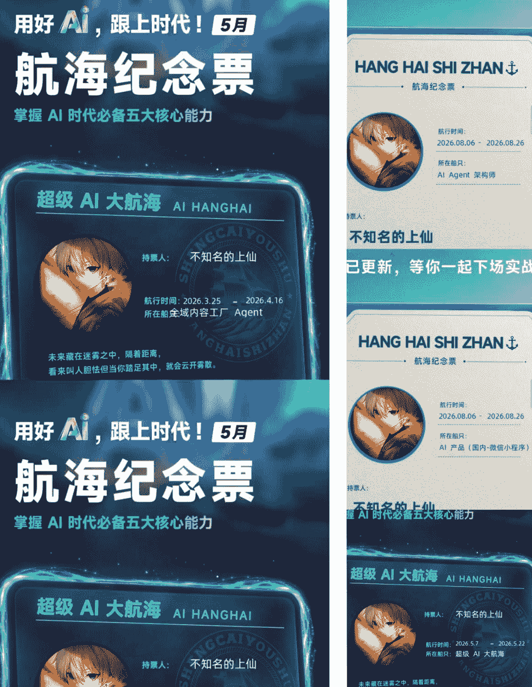
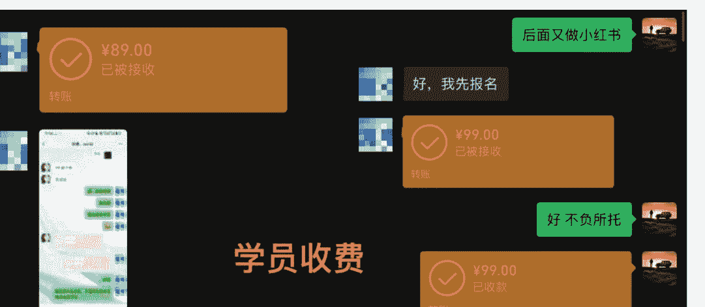
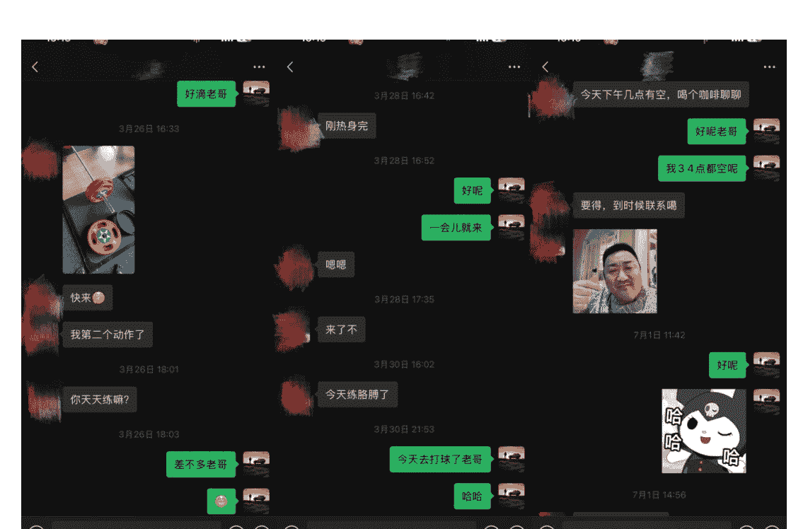
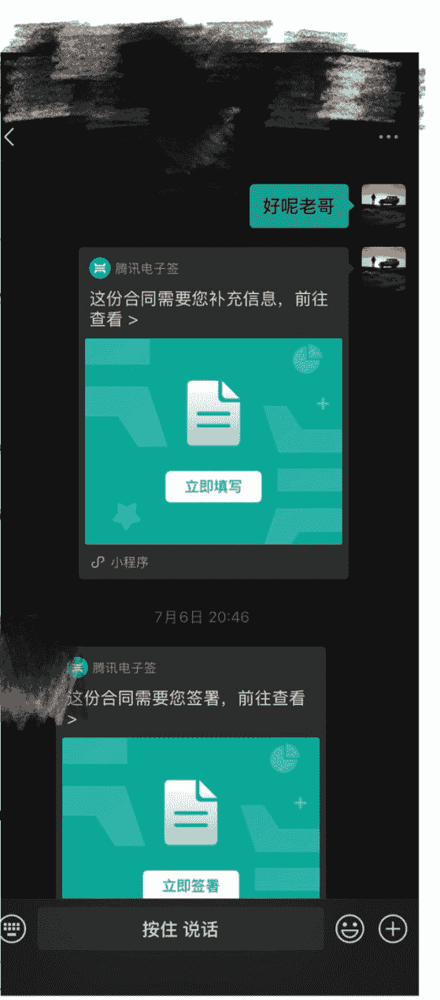
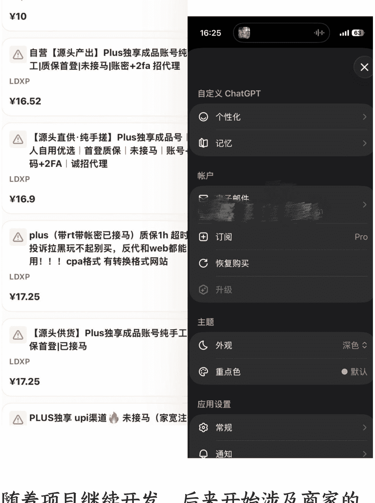
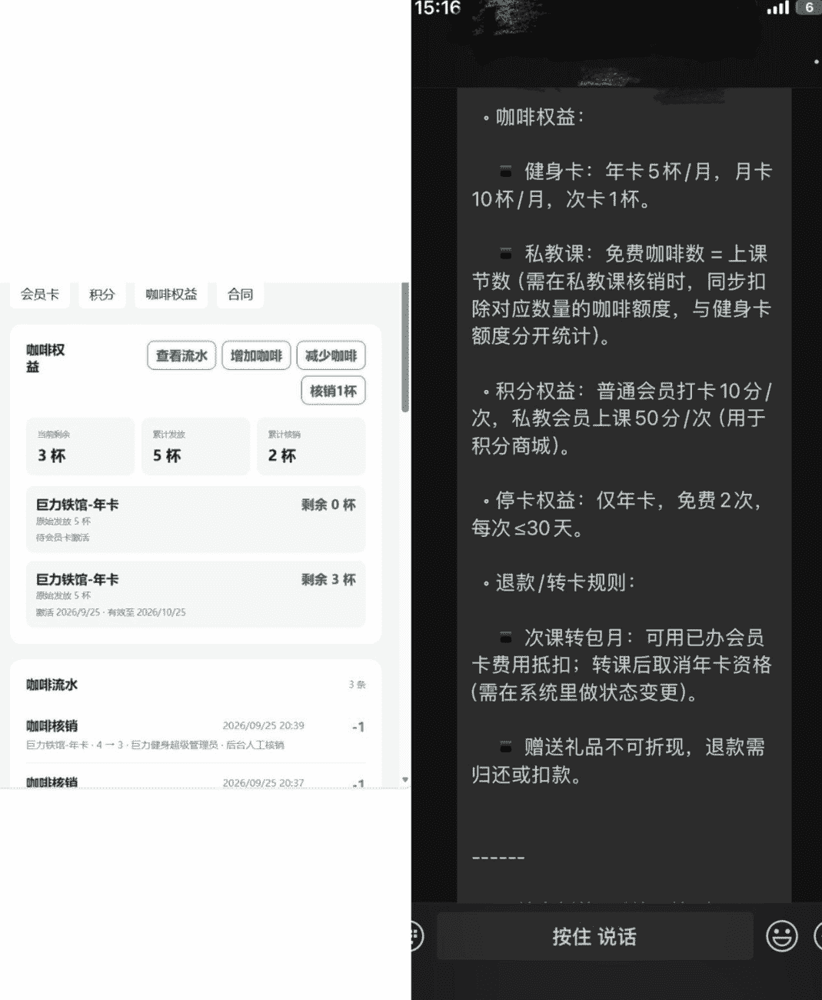

# 7000 元技术第一单：一个不会写代码的 00 后，如何用 ChatGPT 做大脑、Codex 做手，把健身房小程序真的送上线
作者：龙哥

**260926 副业 SC 精华**

**小懒判断** | 卡在「学会了 AI 编程却不敢接单」的同学一定要看。00 后在校大学生把 ChatGPT 当成项目总指挥、Codex 当成码农，从本地健身房的🛰️老熟人手里拿下首单 7000 元。想看 Codex 操作技巧的可以跳过，本文只拆商业闭环。最值得抄的点是模块化验收——每个功能块做完立刻上真机人工验，再给自己留可回滚的存档点，改炸了也能退回去。最大的坑是备案认知错位：ICP 备案和🛰️小程序备案完全是两条线，域名、服务器、主体资质、支付权限这些事必须在写第一行代码前就备齐，不然项目会被拖死。我就是把备案搞混硬生生卡了十四天。

大家好，我是赚钱圈里一个比较低调的上仙，00 后、在读大学生，今年已经跟着赚钱混了两年。这是第一次认真写复盘。之前基本处于潜水状态，也发过校园流量变现的笔记。一直在学 AI，但没赚到大钱。这次想聊一个很现实的问题：一个完全没有编程背景的学生，到底怎样才能从眼光挑剔的 B 端老板那里拿下技术费。接下来就把我第一次把 AI 从学习玩具变成能变现杠杆的全过程摊开说。

从今年 3 月的 AI 编程航海，到后面大量用 Claude、Codex 练手，再到自己做内容、发朋友圈，最后接到第一位线下客户，把一套给健身房用的🛰️小程序真的上线。

过程远没有写出来这么顺滑。中途遇到过功能块崩掉、额度不够用、支付链路要保密、需求说漏、备案被卡住。光是把 ICP 备案和小程序备案搞混这一件事，就让整个交付往后推了整整两周。

但走完这一遍，我第一次把整条生意链路完整跑通了：

> 自学 AI → 展示能做 → 找到客户 → 把需求聊清楚 → 给价格 → 出 PRD → 用 AI 开发 → 人工验收 → 补 Bug → 部署上线 → 正式交付

这篇文章不讲「Codex 十个小技巧」。

我想复盘的是：没有传统开发团队的人，怎么靠 AI 一点点把一个真实商业小程序做出来。

## 一、AI 编程的入口，其实是航海

我真正系统上手 AI 编程，是从今年 3 月参加 AI 编程航海开始的。那段时间才开始逼自己去用 Claude、Codex。起初用 Claude，后面 Codex 变成了主力。

航海结束后，我没止步于 Demo。用同样的工具把航海里提到的几个项目真实落地了一遍。

这个转变挺关键。

以前看到一个小程序，第一反应是「这我写不出来」。做过几次真刀真枪的练习后，思维变了。现在的难题不再是「我会不会手写代码」，而是「我能不能把甲方的需求讲明白」「我能不能判断 AI 产出的东西对不对」「出问题时我能不能定位并继续推进」。这才给了我去碰付费项目的底气。

学完后我并没有立刻出门接开发单。先去试水📕 AI 虚拟知识库，用 YouTube 素材加 NotebookLM、IMA 知识库做整理和内容生产。想法很简单，先从卖 AI 相关知识开始。

结果流量没起来，收入也没明显变化。但也不是白费。做内容的过程中认识了不少同样对 AI、产品、编程感兴趣的人，也带了几位学员。

这段经历让我换了个思路：与其继续想怎么「卖 AI」，不如直接用 AI 去帮别人解决现实里能立刻变现的问题。于是我开始在朋友圈发自己能接的活：🛰️小程序、官网、AI 编程定制开发。

当时也不确定有没有人理，就是先让身边的人知道我现在能做什么。没想到，第一单就这么来了。

## 二、第一单客户，其实就是身边人

找到我的老板，是一个从外地回普洱创业的本地人。他准备在普洱开一家偏铁馆风格的健身房。当地健身房不少，但用🛰️小程序承接会员服务的很少。所以他不想买模板，想要一套量身定制的。

我们其实早认识。之前在同一家健身房练过，加了🛰️。后来他回老家创业，恰好看见我朋友圈发的 AI 编程、小程序相关动态，需求一出来就直接找我。

现在想想很有意思。我不是先注册公司、做品牌再去找客户。我是先把能力做到能交付的程度，然后持续让周围的人知道我在做什么、能解决什么问题。需求冒头时，自然有人想到你。

第一单约了线下聊。那时我心里没底。虽然用 AI 搭过不少练习项目，但从没独立交付过商业软件。

没有案例，怎么让老板信任？我总结了三点：合同写清楚、价格给点优惠、态度诚恳。我直接承认自己没有完整的商业交付案例，但愿意少收费用、用心把东西做成。没有包装自己成资深团队，因为拖不住。

当面把范围和想法对齐后，初步价格定在 7000 元，纯技术开发费。对我而言，这笔单子意义很大。以前用 Codex 时，我关心的是能不能跑通；现在问题变成有人愿意付钱，我必须对结果负责。它不再是练习。

敲定后，我第一件事不是让 Codex 开写，而是把需求理清。老板说「做个服务会员的小程序」，这和真正能开工差很远。页面有哪些、会员能做什么、后台怎么管、预约、积分怎么玩、哪些功能进 V1、哪些放后面，都必须先说死，不然项目会无限膨胀。

项目总指挥怎么选？我有 ChatGPT 和元宝两个备选。元宝贴近🛰️生态，ChatGPT 我觉得对话更顺。测了两天，我选了 ChatGPT。OpenAI 的 Workbench 合并体验对我来说杀伤力很强。

我把和老板沟通的信息丢给 ChatGPT，让它输出 PRD、开发边界、合同里需要明确的交付物。

## 附件二

《项目需求确认书》

Project Requirements Document，PRD

### 一、项目基本信息

- 项目名称：《助力健身🛰️小程序开发项目》
- 甲方：
- 乙方：
- 确认日期：年 月 日

### 二、项目目标

为甲方搭建一套🛰️小程序会员管理系统及管理后台，满足健身房日常运营及会员管理需求。本项目采用分阶段交付，本次为 V1.0。

### 三、项目建设内容

本次项目包括以下内容：

**（一）🛰️小程序（会员端）**

实现会员登录、会员卡展示、课程预约、人脸签到、积分签到、积分商城、🛰️支付入口等。

**（二）管理后台**

实现会员、教练、课程、商品、预约、积分、签到、数据统计及系统配置等功能。

**（三）系统部署**

- 🛰️小程序部署
- 后台部署
- 🛰️支付配置
- 人脸设备接口对接
- 上线协助

### 四、项目角色

本项目第一阶段涉及以下角色：

| 角色 | 使用内容 |
| :--- | :--- |
| 会员 | 🛰️小程序 |
| 管理员 | 管理后台 |

之后每次老板提出新想法，我都把新信息喂给 ChatGPT，让它更新需求与边界。慢慢形成一个闭环：老板提业务需求 → 我理解真实意图 → AI 结构化 → 我复核确认 → 进入开发。

这时我才发现 AI 的价值不只在写代码，它可以在编码前就参与产品梳理。

**ChatGPT 充当项目大脑**：理解业务、判断影响范围、拆解下一步、控制开发边界、整理给 Codex 的执行指令。开发完再帮我评估结果。

**Codex 充当执行工程师**：读改代码、跑测试、查问题、出结果。

最终分工很清晰：老板提需求，我做产品决策和最终验收，ChatGPT 管统筹，Codex 管实现。这套结构让项目能持续向前。

## 三、开发节奏与遇到的坎

我没有让 Codex 一次性把整个小程序堆出来再整体测。而是定了规则：一个功能块做完就人工验收一次。用🛰️开发者工具看，也会拿真机实操。看的不是有没有报错，而是用户能不能点、跳转对不对、数据准不准、异常时表现如何。

一块确认没问题再做下一块。发现问题我不自己乱改，先把现象、截图、报错交给 ChatGPT，让它从整体判断大概是哪一层的问题，再让它给 Codex 写一个针对性的排查任务。修复后再由我验收，不行就再循环一轮。

回头看，这已经不是简单的「让 AI 写代码」，更像是在带一个迷你 AI 开发小组。

真实项目很快暴露出练习时碰不到的问题：AI 使用额度、支付信息安全、模块互相拖垮、版本回滚、平台备案。

### 1. 额度

刚开始用 Codex 很凶猛，早期没小时限制时还能多账号分摊。后面 OpenAI 推出 5 小时限制后，长期推进的商业项目就不可靠了。后来我直接升级到 Pro。现在 Plus 基本只剩聊天能力了，也算时代的眼泪。

### 2. 支付安全

涉及真实支付后，情况不一样。密钥、证书这些敏感信息不能长期留在对话上下文里。我把敏感配置单独放在本地环境，需要时让工具按范围读取。Demo 时图方便可以，但涉及真商家、真用户，就必须考虑信息边界。

### 3. 可回滚

AI 写代码快，但不一定每次都对。改一个功能可能把之前的模块带崩。如果一直往前改，最后连问题从哪轮开始的都找不着。我后来用「可回滚开发」：每做完一个稳定阶段就留一个存档点，验收通过后才继续。像游戏存档，有据可退。

### 4. 沟通质量

项目越来越复杂，会员卡、预约、积分、支付、后台全部连起来后，我发现影响进度最大的是我和 ChatGPT 的沟通质量。老板一句「加个状态」，背后可能是数据库、接口、后台、小程序都要动，历史数据还要兼容。所以后期给 Codex 的指令越来越像：只改 A 模块，B C D 不动，数据库结构不改，必须跑指定测试，出现异常直接停止并上报。

模型相同的情况下，沟通质量就是拉开 AI 编程水平的关键。

### 5. 备案

最大的坑是备案。以为 ICP 备案完了小程序就能上，结果完全不是一回事。小程序备案另起炉灶，还要域名、服务器、主体资质、🛰️公众平台权限、支付权限。这些本该开发前就准备好的东西，缺一个就会卡住。AI 给的解释有时也会误导，必须两头验证。

## 四、被耽误的两周，反而成了补漏期

备案卡住的十四天，小程序已经基本能跑，却上不去。刚开始很焦躁。后来索性把整个产品重新走一遍。

正是这段时间，我发现漏掉了一个核心需求——咖啡权益。老板的健身房有会员咖啡福利，因为前面功能太多，这个点被忽略了。如果没有备案延期，上线后才发现就麻烦了。我重新梳理需求，让 ChatGPT 整理，Codex 实现。同时也把之前没暴露的 Bug 慢慢捡出来修掉。

这两周从「只能等」变成了「把上线前能发现的问题提前解决」。当然这不是说备案晚是好事，只是运气好老板理解，不然就违约了。

## 五、上线的那一刻，像是突然清醒

等备案、功能、Bug 都收口后，小程序终于上线。那种感觉很奇特，像是如梦初醒。

之前做过很多 AI 学习、跑 Demo、做知识库、发笔记，每天都在学。但这次不同，现实里真的出现了一个会被人用的东西。一家真实健身房，有了属于自己的小程序，会员会打开、业务会流经它，我要为它负责。

以前看《纳瓦尔宝典》讲杠杆、独特知识、责任，觉得能懂。这次才真正感受到，AI 从工具变成杠杆的那一刻，就是你开始对结果负责的那一刻。

以前我也只是停留在“道理我都明白”的阶段。

真正让我产生变化的，是这个小程序正式上线的那一刻。那时我第一次清晰地意识到：我不是在跟着教程练习，而是实实在在交付了一件属于自己的产品。

这份产品里，有客户真实的经营需求，也包含了我对功能、流程和落地方式的判断。

## 线上交付记录

| 版本号 | 发布时间 | 审核备注 |
| :--- | :--- | :--- |
| 2026.09.25 | 2026-09-25 16:09:45 | -owner1: Final Owner Acceptance: 4-digit pickup, overlapping schedules, image normalization, Store/About localization; Human Proven PASS |

## 六、完成第一个项目后，我重新认识了“AI 编程变现”

项目从需求沟通一路走到上线之后，我越来越确定：

AI 编程的意义，并不是把所有人都训练成专业程序员，而是让普通人也能更低成本地把一个想法变成真正可用的产品。

过去，一个小程序项目往往需要产品经理、设计师、前端、后端、测试和运维等多个岗位共同配合。

现在的我，当然不可能在每个技术领域都超过专业人士。但 AI 给了我一个机会：把不同领域的能力调动起来、组合起来，并最终形成交付结果。

我需要重点关注的，逐渐变成了这些问题：

- 客户真正要解决的麻烦是什么？
- 这个需求是否值得做？
- 功能应该如何拆分？
- AI 给出的方案是否可靠？
- 哪些环节可能产生风险？
- 什么时候应该继续推进？
- 哪些方向应该及时停止？
- 最后要交付怎样的结果？

完成这一单后，我有了几条特别深的体会。

### 第一，别把“AI”本身当成卖点

客户通常不会关心你使用的是 Claude、Codex，还是 ChatGPT。

他在意的是：小程序能不能按要求完成，会员能不能正常使用，健身房的实际业务能不能被支持。

所以，AI 只是实现手段，不是最终产品。真正有价值的，是你能不能把客户的问题解决掉。

### 第二，第一单带来的收获，不只是一笔收入

真正做过一次完整项目，你才会发现，接单远不只是写代码。

从找到客户、理解需求，到报价、签合同、确认边界，再到开发、测试、部署、上线和售后，这其实是一条完整的商业链路。

如果一直停在看教程、学工具的阶段，对“接项目”的理解始终停留在想象中。

只有从头到尾跑通一遍，很多经验才会真正变成自己的能力。

### 第三，AI 的核心作用是增强我，而不是取代我

我不一定要成为写代码速度最快的人，但我必须清楚：

现在最重要的任务是什么，做到什么标准才算完成，什么样的结果才算验收通过。

AI 能够大幅提高执行效率，但前提是使用它的人具备基本的判断力、决策力和风险意识。

### 第四，未来的竞争点，可能不再只是会不会写代码

更重要的是，你能不能识别真实需求，并利用手里的工具把它落地解决。

也正因为如此，我现在更愿意把自己的工作理解为：不是单独写程序，而是在协调一支由 AI 构成的虚拟团队。

## 写在最后

今年 3 月刚接触 AI 的时候，我甚至还不知道 Claude 是什么。到了现在，我已经完成了定制类项目的交付，而客户不仅提出了第二版、第三版的计划，还愿意帮我介绍其他老板。

项目开始前，因为自己年龄和经验都不算多，我曾经担心过很多问题：如果小程序出现故障怎么办？会不会因为交付问题承担违约责任？

真正开始做之后，我才发现，很多 bug 和新增需求并没有想象中那么可怕。只要能把问题描述清楚、持续和 AI 进行有效沟通，它通常就能理解我的目标，并协助我完成实现。

所以也想把这段经历分享给同样在学习 AI 的朋友：不要永远停留在准备阶段，真正的能力往往是在一次次实战里长出来的。希望我们都能少一点犹豫，多一点行动，一起把想法做成结果。觉得内容有帮助，也欢迎点个赞。

看完这套 SOP，你可能会觉得自己已经掌握了方法。但现实是，很多人一到真正操作，就会在第一步卡住。

教程和工具只是入场条件，真正拉开差距的，往往是马上行动，以及你能接触到什么样的信息和圈层。

这里不讨论空泛概念，主要做商业闭环拆解和 AI 效率提升。目前系统里已经沉淀了 1000+ 个跑通的套利实战案例。

- 查阅圈子完整数字资产与上车门槛：

`https://lazyso.com/insider/`

添加时请备注：【实操上车】，不闲聊。

