# 毕业一年，我是如何通过搭建 AI 一人公司，在 FDE 赛道从 0 变现六位数的（完整踩坑复盘）

毕业一年，我靠“大模型+独立经营”从零做到6位数：一段真实的踩坑历程

副业精选合集
整理：懒人搜索👸号
懒人专属群
🛰️：lazyhelperl

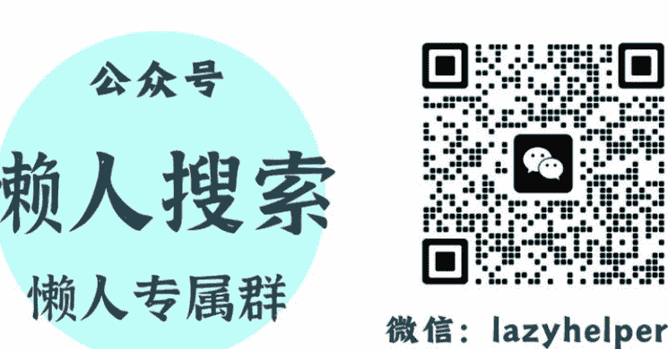

> **小懒点评** | 适合清楚大模型是趋势、但不知道从哪下手的新人；想直接抄现成方案的朋友可以划走。全篇最有价值的不是某个具体项目，而是作者走过的路径：先用流量操盘练出单点能力，再用定制方案练解决真问题的能力，最后靠自营练经营意识，别一上来就关起门做产品。他进企业做数据治理，把链接出错率从三成降到一成，靠的也不是炫技，而是把模型嵌进客户原本的作业链路。最常见的坑是把“学习大模型”本身当成目标；工具学一堆，不如先锁定一个愿意付钱的具体问题。

前言

我是乔川，今年22岁，文科生。毕业这一年，我从一个连一行脚本都跑不起来的纯小白，慢慢做成流量操盘、自动化定制、企业数据治理，最后建立了一副只靠自己和大模型运转的生意盘，累计收入破了6位数。

目前我的重心有两块：一块继续在FDE方向深耕，把模型接进更多真实场景；另一块把跑通的项目和流程整理成可复用的模板。

如果你也想进入这行，应该会有类似体验：媒体上到处都在喊风口，但自己真正动手时，不知道该学什么、做什么，更不知道如何收钱。工具越攒越多，第一笔收入却迟迟没有。这不是能力问题，而是缺一个清晰的落地路径。往下，我会拆解自己从0到1的完整过程，说清楚每一步的关键动作和赚钱逻辑。

01 序曲：数学建模比赛给我的当头一棒

2022年，我还读大二。学校组织数学建模竞赛，获奖能拿几千块奖学金。我一心想挣点生活费，就报了名。比赛要求三个人组队：一个建模型，一个写程序，一个写论文。而我数学经常低分飘过，编程更是从没接触过，说实话当时已经打退堂鼓了。

偏偏那时候 ChatGPT 出现，我和它试了几句，发现它好像什么都能答。我最初的念头是：不用队友了，自己加一个“外挂大脑”就够了。

比赛开始后，我把所有赛题喂给GPT，它负责给模型框架、给代码，连论文正文也由它起草。那几天我效率极高，文档越写越长，队友很快就没了存在感，索性退出。我甚至觉得，能一直这样赢下去。

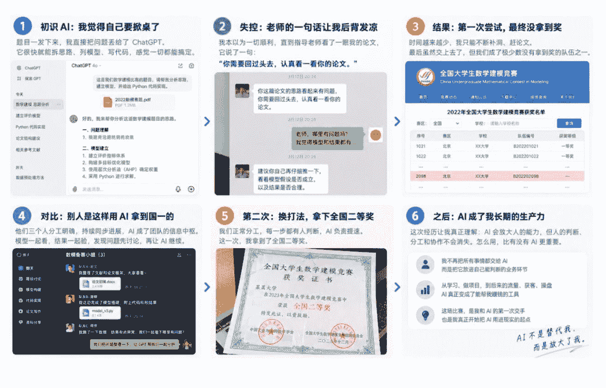

转折出现在指导老师提醒我回头核对自己的论文。我才发现，整篇东西只是“看起来成熟”：模型假设和题目条件对不上，代码跑出来的数字明显不对，而且我根本不知道问题出在哪。最大的问题是，我连“什么是对”都不知道，自然也没法判断模型给的结果对不对。最后我们整组没拿到任何奖。

后来听说了获奖队伍的做法，最让我意外的是，有一支队伍同样大量使用了ChatGPT，最后却拿了国家一等奖。他们的流程是三个人保持分工，模型只当成辅助工具；每个环节完成都互相检查一遍，发现不对马上纠偏。也就是说，人负责判断，模型负责提效。

我列了一个对比：

| 失败组动作 | 成功组动作 |
| :--- | :--- |
| 单兵作战+模型全包 → 无人校验 → 错误滚雪球 | 三人分工+模型辅助 → 信息同步 → 人工复核 → 两天干完 |
| 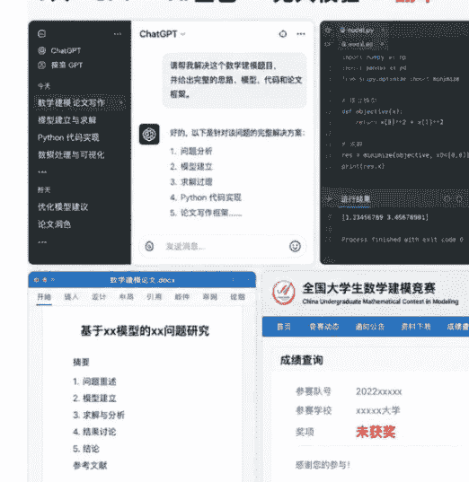 | 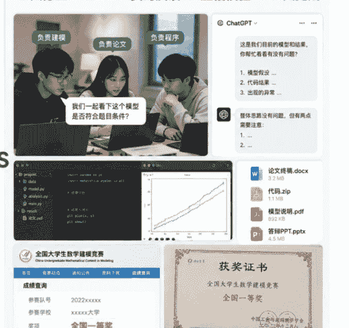 |
| 结果：没有获奖，越做越乱 | 结果：国家一等奖，又快又稳 |

之后的第二次数模竞赛，我调整了策略，恢复三人分工，凡涉及关键逻辑的地方都人工复核，模型只承担执行。同样用了 ChatGPT，我们却拿了国家二等奖。

这件事让我确定了一个原则：大模型可以把人的能力放大，但也会同步放大无知。你心里有正确的标尺，它就能当你的加速器；你没有标尺，它就会带你跑偏，而且跑得飞快。

02 上半场：用“截流”练出一个能换来收入的手艺

毕业后，我加入了一个社群变现项目。项目本身跑得比较成熟，靠代理体系在2024年做到了7万多人。产品、销售、交付都已经由别人验证过，我不需要全部重新造，只需要选一段自己能打透的环节。最后选的是流量端，也就是“截流”：去目标用户扎堆的评论区，通过评论或私信把人引到🛰️。

项目方给了一句现成话术，我第一天上手就照发，结果每天回复只有个位数。我让自己思考：如果我是路人，看到这种私信会怎么想？这些内容本质上和街边小广告没区别。

我也尝试让 GPT 润色，但效果仍然很差。朋友听完我的操作，直接点破：“你只是在用AI，把以前验证过的无效方法重做了一遍。”这句话让我愣了很久。真正的问题是：陌生人凭什么回你？顺着这个问题，我让模型列举一切可能引起回复的诱因，最后分出六类：发资源、拉进群、帮判断、给情绪、制造机会、满足好奇。

这几类“钩子”成了我每天做流量的试验工具。我不再只靠一种话术，而是按不同比例投放，每个版本都记录回话率、加微率和成交率，然后把跑不动的砍掉，继续放大有效打法。模型负责按我的要求生成新变体，我负责做判断，市场负责告诉我答案。

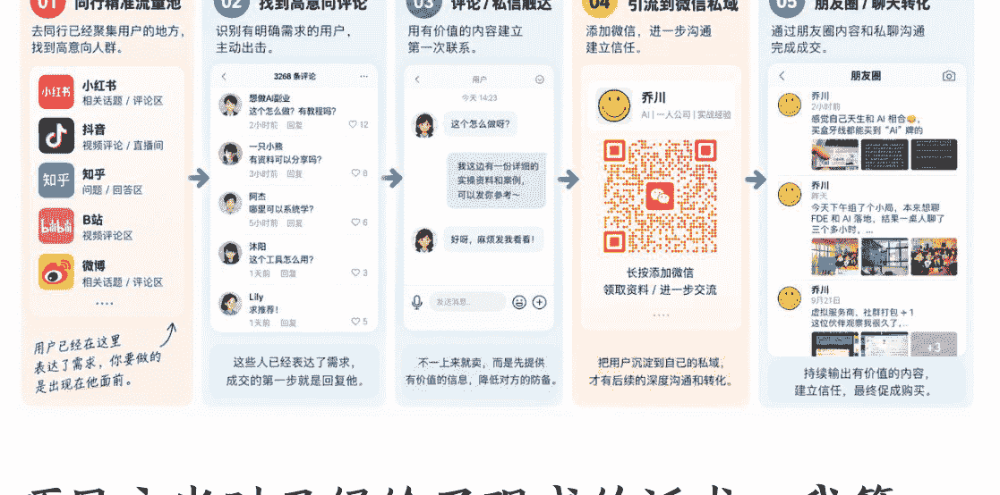

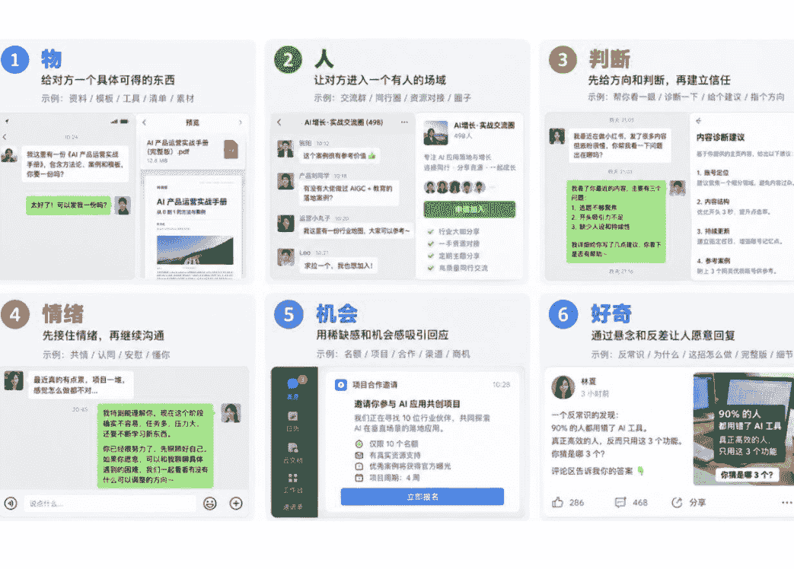

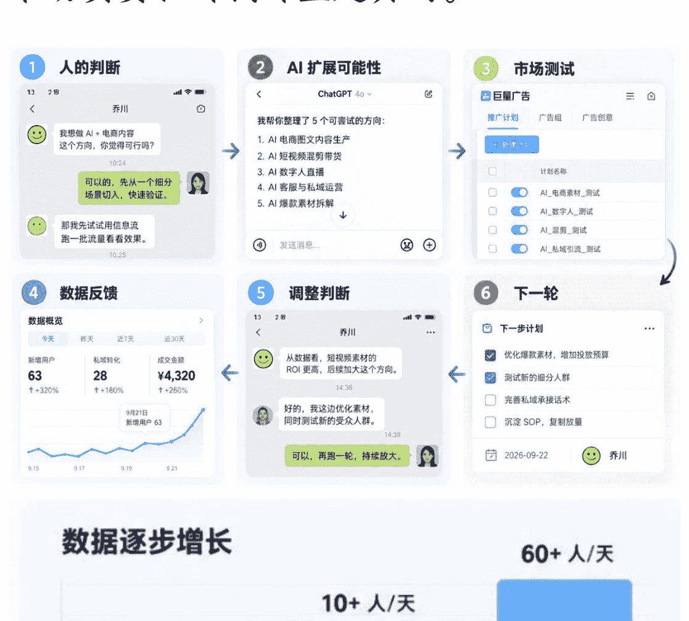

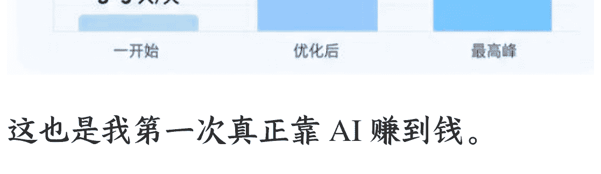

这样跑了不到一个月，我就赚到了头一笔五位数的进账。可能对别人来说不多，但这是我头一回验证：只要把业务拆到足够小，大模型就能帮你快速试错并产生收入。更重要的方法论是：先用业务理解定方向，再让模型扩展选项，最后拿到市场里验证。这个方法，我后来沿用了很久。

03 下半场：从给自己搭流程，到给客户搭流程

流量这个点越做越通之后，我开始不满足于只解决获客。我更想知道：客户进来后为什么买，为什么不买；真正的痛点在哪？恰好原项目进入瓶颈期，我回到赚钱重新找方向，发现闲鱼上有人接代写、数据分析、课程设计这类活儿，大多靠大模型提效。我想，这正好用上我已有的流量经验和模型能力，就开始试水。

第一站是“大学生程序课设”。从建号、找对标、做内容，到私信咨询、下单、交付，所有环节都由我一个人跑通。零散的事情太多，最耗时间的反而不是动脑子，而是复制、粘贴、改格式、切窗口这类琐碎动作。我意识到，问题不在“不够努力”，而在“流程太原始”。

于是我开始把流程自动化：用飞书表格管素材，标记哪些待处理，哪些已生成；再用模型自动生成初稿，按平台规则调整排版。每一次减少人工参与，下一个瓶颈就会自动冒出来：素材为什么不能自动汇总？内容为什么不能批量排期？就这样一步步，我把自己从最繁琐的部分里解放了出来。单篇内容的生产时间从5分钟压到几十秒，每天产出从二十条涨到五十条，同时管的订单也从三个增加到五个。

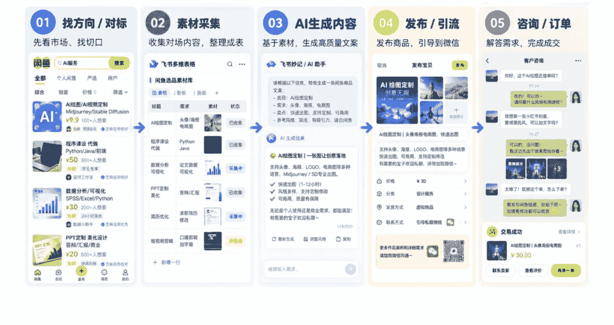

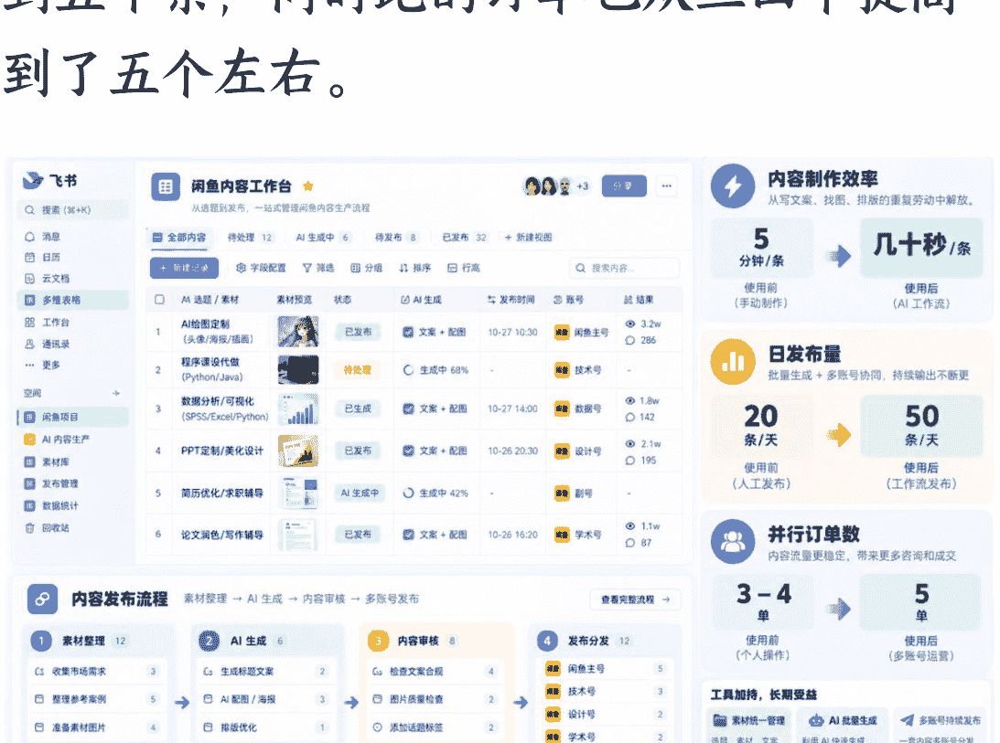

这个阶段最大的收获，是学会了一套看业务的方式：先看流程走到哪一步，需要生成、整理、判断还是执行，再决定哪些交给模型，哪些留给人类。工具往后放，业务本身才该被放上前来。

后来在赚钱的办公区认识了几个单干型创业者，其中一位做课程变现，月利润超过10万，不是没单子，而是内容产能卡住了。聊了两个小时，我把她的流程全部过了一遍：内容从哪来？一篇内容要走几步？账号多起来之后，哪个环节最先崩？她说了句很关键的话：“流量是我们的命根子，绝不能断。”

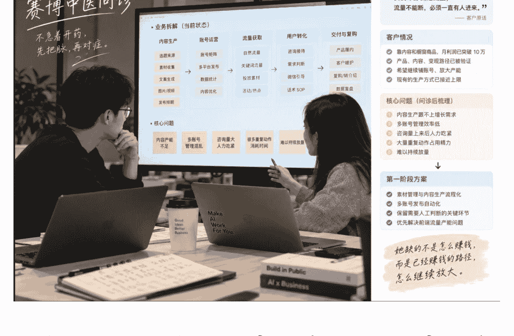

这句话直接帮我锁定了改造范围：先解决内容生产的前端链路，把素材归档、批量生成、多号发布串成一条流水线，选题和调性继续由她本人定。两周后第一轮交付，她原先一天只能做一个号的内容，后来能同时照管一大批账号。这单下来，我拿到了头一笔五位数的服务费，也是我做定制服务的一个关键节点。

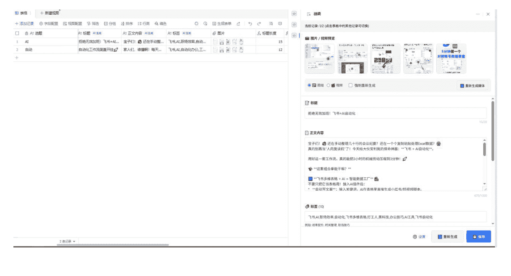

视频说明：20251128-021124.mp4 可在附件中播放。

后来我把这个案例写成帖子发在赚钱，拿了全站精华第七名。帖子带来不少新咨询，有看了文章来的，有线下聊过再深入接触的，也有朋友转介绍的。这之后我靠定制工作流陆续又赚了5万左右。

04 下一场：把方法带去企业，做FDE

如今我在准备下一个阶段：进入企业做FDE，也就是把大模型交付到客户的真实业务流里，看流程、找卡点、做优化，而不只是坐在办公室里写代码。这条路比之前更复杂，但原则是一致的：先建立判断，再用工具提速，最后输出可量化的结果。

从校园比赛到自由职业，再到企业级项目，这一年的路径可以用三个台阶概括：操盘练单点，定制练解决问题，自营练经营判断。希望这份记录也能让你看到，大模型不是魔法，但它可以成为放大你能力的量尺。

做了一段深度服务后，找我的人大多是单人公司、超级个体和极小型团队。这类活儿越做越顺手，我也开始琢磨：如果把复杂度继续往上推，放到一家真正的规模化企业里，数据更庞大、规则更繁杂、协作更重，原来的打法还管不管用？另外，我也很想亲眼看看企业内部智能落地到了什么程度，老板们真正愿意为什么结果买单。

于是我没继续待在小体量场景里，而是主动安排了一次驻场验证。不是为了找一份稳定差事，而是想用接近FDE的思路，把自己放进一个陌生且更复杂的业务现场。虽然形式上是入职，但核心目标不是完成岗位职责，而是看业务怎么跑、数据怎么留、组织怎么分工，也看看离开自己熟悉的小场景后，还能不能照样把事办成。

挑选目标企业时，我没有沿用过去的流量思路。我从招聘平台拉取杭州大约两千家企业的基本信息，再按行业、业务方向、招聘职位和自身经历匹配度做过滤。两千家一路缩到三十家，剩下的每一家我都提前研究他们靠什么赚钱、可能的堵点在哪里、我哪段过去能接得上，再准备不同的沟通策略。

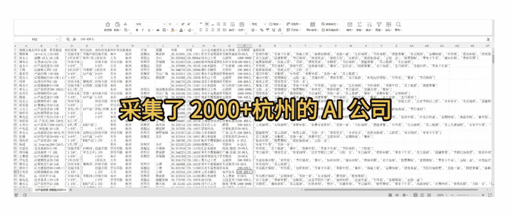

三十家里面，有十家给了我录用通知。我选其中一家，起薪一万五。

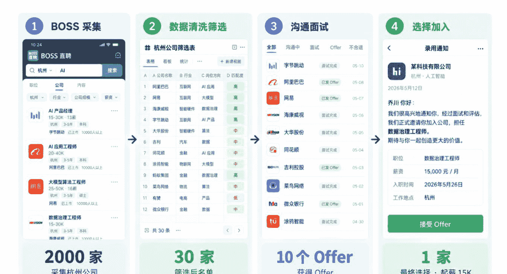

进去以后，我负责的核心课题是商品数据规范。公司手里的商品信息和链接数量很大，链接出错的比例当时接近三成。真正动手才发现这是系统性难题：各个数据来源、字段格式、平台规则都不一样，错误还会沿链路不断放大。源头不准，后续发布和运营自然也偏。

那一刻我想到大学第一次建模比赛：模型做得再完美，前提假设和输入数据有问题，后面越算越离谱。上次影响的是论文名次，这次影响的是公司的真实生意。

我用了一个简单框架处理异常：能靠规则识别的一类，需要结合上下文判断的一类，适合让模型辅助的一类，剩下的交给人工兜底。大约过了四周，链接出错率从接近三成降到不足一成。

#### 挑公司的方法

我最初把样本粗略分成几类：大厂像阿里、百度，中型公司像快手、网易，还有一些初创小公司。行业包括电商、互联网等，阶段覆盖初创、成长期和出海。最后从两千多家中选出三十家深聊，再到十个录用机会，最终挑一家入职。

##### 现场重点做什么

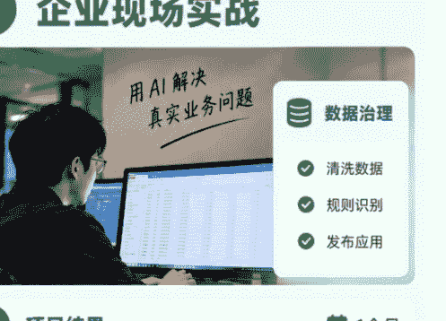

现场主要做了三块：清洗积压数据、建立规则识别机制、推动发布端应用上线。

数据结果出来以后，我心里踏实了。之前悬着的疑问有了答案：换一个完全没接触过的行业，复杂度拉上去，之前的本事依然成立。老板也认可这个判断，我准备离开时他已经愿意给到两万。但驻场想验证的东西已经验证完，长期坐班既不是我的偏好，也和我对时间和方向的掌控要求冲突，所以我最后还是离开，继续做自己的项目。

也是在那段时间，我越来越频繁地听到“FDE”这种说法。第一次认真对照的时候，熟悉感很强：走到真实业务里，搞清楚状况，再把模型、数据、工程能力接进去，对最终结果负责。这和我一直以来的做法几乎一样。

后来再接触到这个词，我更确定它描述的就是我一直想做的事：先定位问题，再把智能技术接到业务里，最后拿出实际成果。

过去几年看起来换了不少方向，其实都在打磨同一种核心功力。做截流时，我练的是吸收市场反馈；做闲鱼时，我第一次把内容、流量、私域和订单放在同一根链条里观察；在赚钱社区给超级个体做深度服务，我开始进入别人的业务现场，判断哪里能改、哪里不能动；到企业做数据规范，我碰到的是数据、规则和系统稳定性这些更底层的东西。

方向来回换，主线没有变：看懂业务，定义问题，再用合适的智能技术、数据和工程手段把结果做出来。我真正积累的不是某一款工具、某套固定的操作流程，甚至不是“会用某种技术”，而是一种把业务和技术桥接起来的能力。

恰好在那时，龙哥提出两个后来让我反复琢磨的预判：一个关于把流程和智能体定制做成标准化服务，另一个关于面向企业的智能技术学习和支持。看完之后，我更确认自己的方向是对的。具体交付形态可以变，但企业真正缺的已经不仅仅是“知道有新技术”，而是有人能帮忙把技术落进自己的生意里。

我印象比较深的是，当时很多老板把学习预算都转到了智能技术方向，有个做SaaS的同行说忙到停不下来，还有圈友给大企业做相关服务，客单价达到几十万。这些信号都在印证同一个趋势。

FDE对我最大的价值，是帮我把过去那些散落的经历放到了同一个坐标里：我最想持续深耕的，正是从技术能力走向业务结果之间的“最后一公里”。

但越往这里走，越发现一个尖锐的问题。深度定制让我赚到了最初的五万，也积累了真实项目经验，但这些本事很大部分长在我个人身上。合作方来了，我要亲自谈；流程卡点，我要亲自判断；方案落地，还是离不开我。以前我经常帮别人解决“老板即瓶颈”的问题，最后不得不承认，自己也正在成为业务的最大瓶颈。

所以下一个问题变成了：能不能把这些已经被反复验证的经验从个人脑子里拿出来，变成方法、模板、工具和产品，而不是每一次都从“我亲自上阵”开始？这个问题直接把我推到了自有项目阶段。

开始做自己的盘之后，我反而不太担心自己解决不了问题。从操盘到闲鱼，再到超级个体深度服务和企业数据规范，我已经验证过：换一个完全不同的领域，只要认真走进去看一遍，大概率能找到那个最制约结果的环节，然后把技术、数据和流程接入。

难受的是另一件事：能力虽然多了，却都绑在我一个人身上。合作方来一个，我就要从头聊一遍诉求，判断他到底要什么，再重新拆流程、搭系统、调试、交付。很多情况我已经遇到过很多次，换个人还是得重来一遍。最夸张的时候，一天有几拨人问类似的问题。第一次我会认真写长答复，到第三、五次，心里就开始发毛：这问题我是不是已经答过无数遍了？

这种重复感像极了做闲鱼的时候。那时重复的是搬素材、复制文案、逐条发布；现在重复的是我的思考过程。一个结论已经推导过，为什么要对十个不同的人再讲十遍？一套打法已经跑通，为什么换一个新的合作方就要从白纸开始？

于是我尝试把脑子里的东西外化出来。先重新整理跑过的流程，分辨哪些是个人化的特例，哪些在不同业务里都会出现；再复盘做过的项目，想清楚当初为什么这么拆、哪一步决定了结果；也会记录合作方反复提出的疑问，因为同一个困惑反复出现，往往意味着一个普遍性诉求。

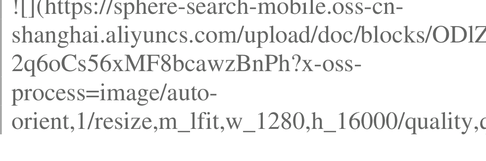

整理后我发现，一年多的积累其实很多。过去只当它们是“我会的”，没意识到它们也可以变成可复用资产。比如怎么判断一个流程值不值得自动化，怎么从模糊诉求中识别真正的效率瓶颈，单人公司应该先优化哪些动作——这些判断听起来简单，背后全是真金白银换来的。

我第一次认真想：既然这些经验已经过了很多次验证，是不是可以让人直接拿走，而不是每个人都要付一笔定制费，再等我亲手执行一遍？一开始我并没有把它定义为卖课，只是希望找个载体，把流程、案例、模板和心得都放进去。新手可以直接看到别人在真实业务中怎么用，已经在做生意的人也能拿来对照。

这个载体，后来长成了社区。

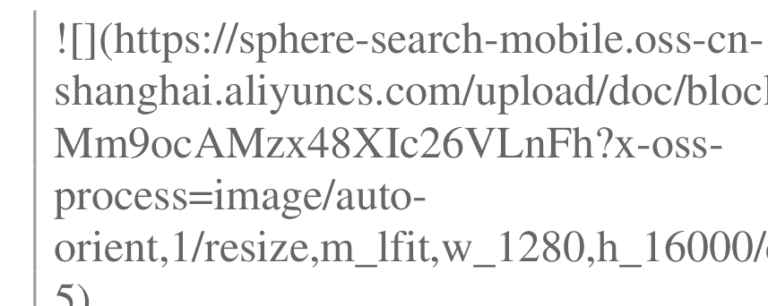

但社区还不够，我还需要更接近交易的动作，让陌生人不必一上来就买深度服务，也能先和我产生一次金钱往来。于是我做了一个贴牌网站，把算力、工具这些标准化程度高的东西放上去。

算力不是终点，更像一个轻量入口：用户因为马上能用而先连接，我也能借机看清他是只缺工具，还是后面还有流程、获客、社区、定制等更深的需要。代理算力也一样，先让对方手里有货、能快速跑出正反馈，再逐步走向高客单价的服务。

到了这一层，产品布局开始清晰：网站负责成交，算力负责初识，社区沉淀方法和案例，更重的实战营和深度服务则处理复杂问题。

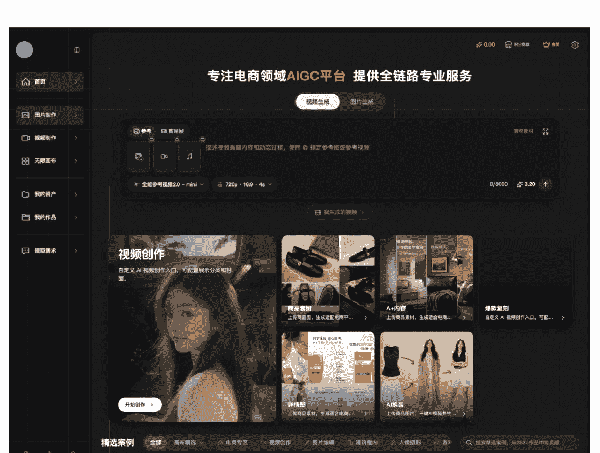

最初我只是把跑过的流程放进去，慢慢累积到两百多套。后来又做了实战营，因为我发现只发模板没多大用。很多人收藏了几百套流程，回到自己的生意还是不知道选哪个、怎么改。与其继续堆资料，我更想带人亲手走一遍：从真实问题出发，先厘清现状，再选工具，做一个流程从无到有。

也是从这时起，我开始想完整跑通一门生意。以前操盘是在别人的项目里负责其中一个环节；深度服务是直接面对客户；现在我想亲自做内容和获客，运营私域，设计交付，并直接面对用户反馈。没有现成产品给我卖，也没有客户提前把需求放到面前，我想看看自己能不能从市场中发现需要、做出产品，并让人主动付费。

卖课只是当时最适合的载体。真正推动我的，是不想让所有价值都依赖“我亲手做一次”才能产生。

自己的盘跑起来以后，最好的是什么事都能自己拍板；最坏的是什么事都得自己负责。过去流量出问题，我只看流量。现在产品卖不出去，我得判断是内容不行、流量不准、信任不够，还是产品本身不对；社区有人抱怨，我要检查是不是交付有问题；用户提供一个新点子，我既觉得是机会，又担心手上的事做不完。

最直观的变化是脑子被塞得很满。🛰️里各种消息没停过，有人问产品，有人提建议，有人想合作，也有人无意间说了一句很值钱的话。当时觉得“记下来”，忙完几个小时后再回头，已经不见踪影。半夜偶尔想起白天有人给过一个好角度，再去翻聊天记录，已经不知道埋在哪个对话框里。明明每天都有很多值得写的内容，真坐到电脑前，却像所有素材都消失了。

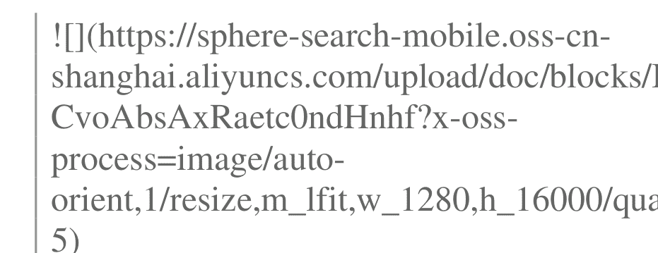

我的第一反应还是发动工具。朋友圈配了智能体，社区配了智能体，产品分析也配了智能体，客户分析同样配了智能体。结果工具越来越多，新麻烦也跟着来了：同一名用户，在客户档案里信息完整，到内容助手那边就像彻底没聊过；产品定位刚在一个窗口讲清，换个窗口又要来解释一遍。

这种感觉特别熟悉。以前做闲鱼，我在不同软件间搬素材；现在做自有项目，我在不同智能体间搬脑子。

慢慢地我意识到，问题已经不是某一个动作效率低，而是内容、用户、产品、交付几条线各自为政又有交叉影响。用户聊天里出现的新诉求，应该反馈到产品设计；产品调整应该转化成内容输出；新内容再带来新用户。如果这些全靠我一个人在脑子里联系，迟早会断。

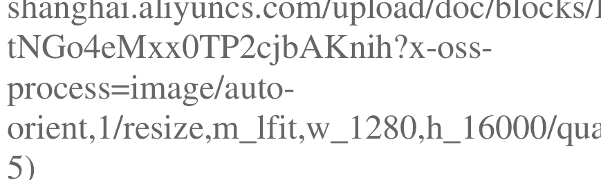

所以单人公司的关键，不是再找更强的工具，而是让公司本身有稳定的运行机制：规则放在哪里、数据如何沉淀、任务如何流转、不同智能体怎么共享信息、遇到需要判断的时刻怎么切回人工。这也是后来我搭个人智能运营体系的出发点。

到了这个阶段，我才真正明白什么叫做自己的生意。前面几种赚钱方式的差别，不在账面数字，而在一件事做完之后，手上留下了什么。

做操盘留下的是现金流；做深度服务，除了钱，还留下案例、认知和对行业的理解；做自己的盘，一件事能同时沉淀多层价值。一次客户沟通，留下对诉求的洞察；一次交付，留下流程和方法；一个被反复问起的问题，可能变成文字、长文甚至新产品模块；一期实战营结束，学员跑出的结果又会反哺下一轮交付。

以前很多事做完就结束。现在它们开始互相喂养。

我因此重新理解了“滚雪球”。投资回报本身不会自动滚起来，真正有复利效应的是：今天做的事情有没有给明天留下东西。一篇长期有人看的文字，一个能反复引用的案例，一套以后还能继续使用的打法，一群愿意持续发生连接的人——这些都不会因为当天结束而归零。

也越来越相信一句话：财富常常在人与人之间的关系里流动。这里说的关系，不是🛰️好友数量，而是对方知不知道你能解决什么问题、愿不愿意信任你、有没有持续看到你成事。一次线下认识、几篇长文、几个月的朋友圈、朋友偶然的一次转介绍，叠在一起，才可能换来一笔真实交易。

回头看，从赚到第一个一万，到五万，再到十万，真正重要的变化是：我开始从“靠一项手艺换钱”，转成“经营一套能持续积累的体系”。这些积累又把我带向下一个问题：当内容、用户、产品和交付都已运转起来，怎么把它们组织成一家能长期运行的单人公司。

现在再比较操盘、深度服务和自有项目，很难说哪个绝对更好。它们更像是不同阶段的答案。

刚起步时，我最需要第一次正反馈，所以操盘特别合适。产品、成交、交付都有人跑通了，我只需把流量这个点练出来，尽快证明自己的价值有市场。

后来做深度服务，我开始直接面对委托方的真实课题。对方不会告诉我怎么选模型、怎么搭智能体，我得自己听懂诉求，判断哪里值得改，再把结果做出来。这个阶段虽然重，但业务判断力涨得最快。

到自有项目，我第一次同时管起内容、流量、私域、产品和交付，也第一次真正感受到积累：一篇文章能持续带人进来，一次交付能变成案例，一期实战营又会催生新的需求和产品素材。

让我总结的话：操盘适合练单点，深度服务适合练解题，自有项目才真正开始练经营。三者不需要互相替代。我现在也可以同时做代理、深度服务和自有产品。最关键的是看清自己当前阶段最缺什么。

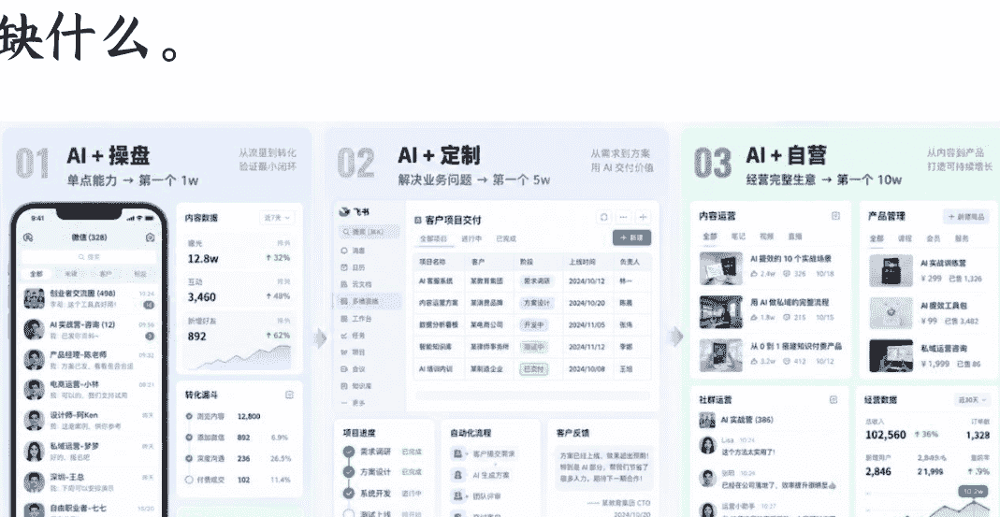

## 避坑一：一人公司，不等于孤军奋战

这个坑，我大学第一次接触智能技术时就踩过了。

大学那场建模赛，我至今记得。拿到 GPT 后，我以为自己可以单独包揽全队三人的分工，结果输得很惨。第二次把分工和协作重新理顺，反而捧回国家级二等奖。

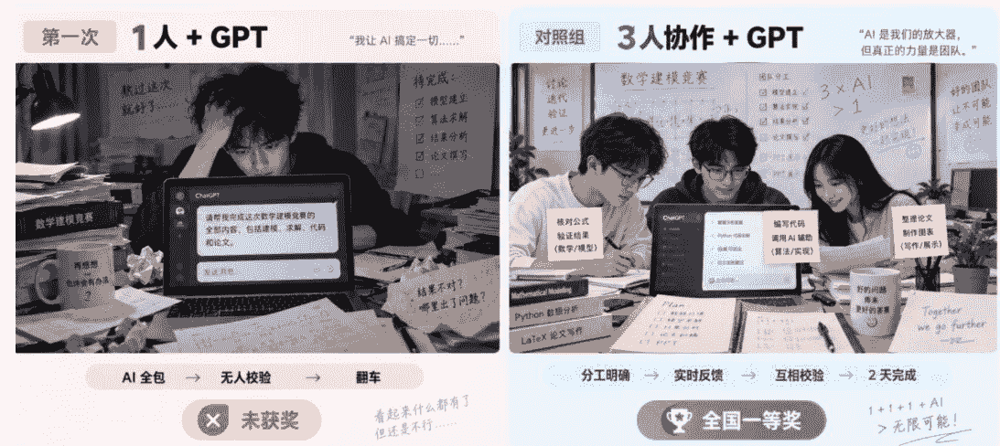

走出校园以后，这种体会越来越深。做截流时卡了一整天，是位做流量的朋友一句话点醒我；后来去赚钱、泡联合办公、跑线下局，我才看到大量发生在我业务以外的案例。自己埋头研究好几天的事，真正做过的人可能十分钟就帮忙校准了。

所以我现在理解的独立经营，是组织能多轻就多轻，但认知不能封闭。

人工智能可以帮你开拓思路，可若你看到的样本本身就少，它只会继续放大你原本的局限。老师、同行、客户、合作者、真实的商业现场，最重要价值就是扩大样本，让你知道外界哪些打法早就被验证过。

你可以一个人经营公司，但不能一个人理解世界。

## 第二个常见误区：把“学人工智能”当成了终点
这个坑很隐蔽，因为表面上你每天都特别努力。

今天刷新模型，明天折腾 Agent，后天又去研究 MCP、AI 编程。收藏翻倍增长，可几个月后回头，真正被解决的麻烦没有几个。

我进步最快的阶段，基本都共用同一特征：先有具体难题，再学对应技术。做截流是因为没人回复，我才去研究钩子；做闲鱼是因为内容生产快把自己逼疯，才开始学工作流和自动化；做定制是因为客户带着真实业务问题，我才去补 AI 编程；进企业也是因为数据治理挡在眼前，才真正开始研究规则。

手里有件不得不解决的事，学东西反而特别快，因为你知道为了什么学，也知道学到什么程度就该停。

所以现在看到一款新工具，我已经不太问“我要不要学”，而是问：

它能解决我眼前哪个实实在在的问题？

暂时没有，就先放着。

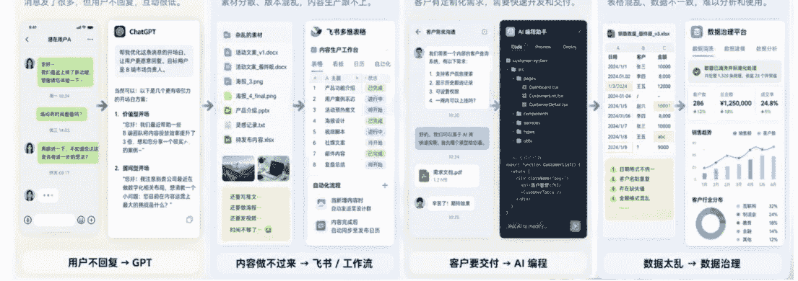

## 第三个常见误区：只盯着今天赚多少，不看做完留下什么
刚起步时，我最关心的也很实际：这个项目月入多少、多久回本。

从零到一这样想没错，因为人需要正向反馈。

但做的业务多了，我开始多看一眼：

今天干完，手里除了钱还多了什么？

有些事赚完一笔就断掉，下个月想继续赚，还得重新搞客源、重新找客户、重新交付。

另一些事当下不一定最赚钱，却会留下案例、SOP、代码、内容、客户和关系。一篇长文可能几个月后还在带来客户，一次交付能变成下一次成交的证明，一个用心服务过的客户，未来也可能带来转介绍。

所以现在判断一个方向，我会盯着三点：

客单价够不够支撑交付，做完能不能留下资产，未来有没有被放大的可能。

前者决定现金流，后两者决定复利。

如果做完一件事只多了一笔已经花掉的钱，它只能算收入；如果还能留下案例、方法、客户和关系，它才更可能长成一门生意。

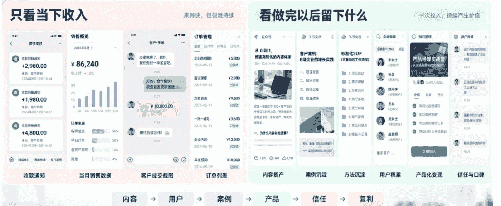

## 06 如果还在从零起步，我会这样走
要是让我重新开始，我不会先花几个月把各种人工智能工具学一遍，也不会急着设计一套完整产品。我会先解决一件最实在的事：怎么尽快进入现实市场，拿到第一个正反馈。

很多刚进入人工智能赛道的人，特别容易把准备期拖得很久。今天背提示词，明天研究 Agent，后天又去看 AI 编程，懂的概念越来越多，却始终没真正面对过客户，也不知道谁会为什么花钱。

最危险的是，学久了会生出一种“我差不多行了”的错觉，可市场一次都没验证过你。

所以如果你还在从零阶段，我反而建议先找一个离钱足够近的场景。做代理、做操盘、接个小定制都可以，甚至先免费帮身边的老板解决一个具体问题也行。这一阶段最重要的，是亲自跑完一次完整交易：有人有需求，你给出价值，问题真的被解决了一点，对方愿意为此付钱。只要这条链路跑通一次，后面的事就有了参照。

### 先让自己被看见，别着急当人工智能百科全书

如果给从零阶段排优先级，我会把曝光放得很靠前。

这里的曝光，不只是📕多少赞、抖音多少播放。我更愿意把它理解成：你有没有能力持续出现在一群潜在客户眼前。

没有真实客户，很多判断只能靠猜。你做了产品，不知道有没有人要；学了技能，不知道市场买不买账；觉得某个方向有前景，身边却连一个客人都没有，最后只能在自己的想象里打转。

我过去很多成长，都是被真实客户逼出来的。做截流时没人回应，我就回去研究钩子；客户抛来一个我不会的问题，我再去补能力；同一个场景反复出现，我才开始琢磨怎么把它标准化。

所以哪怕你的人工智能水平只有六十分，只要能解决某个具体小问题，我都建议你先出去找人。剩下那四十分，真实市场会告诉你该补在哪里。

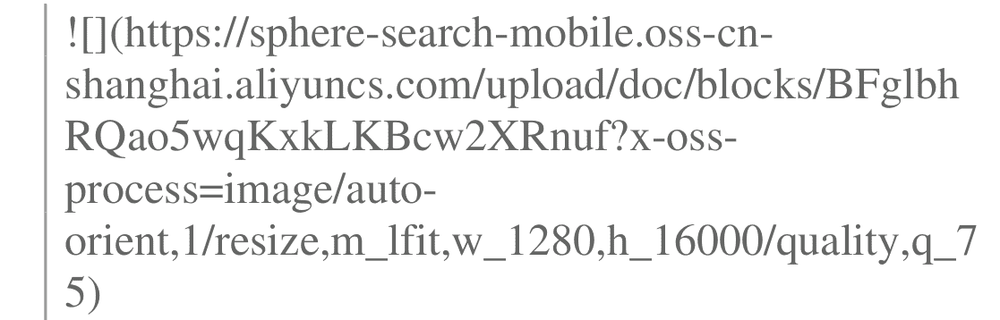

### 可以借船出海，但要学会选项目

从零阶段，我很支持先进入一个已经跑通的项目。

新手缺的往往不是创意，而是对一门生意怎么运转的真实手感。成熟项目已经有了产品、客户、成交记录，你先进去负责其中一环，比自己从零把所有东西都造出来快得多。

但这里有个前提：别看到项目就冲。人工智能领域变化太快，每隔一阵子就会冒出新的工具、新的平台红利、新的“机会”。如果没有自己的判断标准，很容易每个月都觉得上一个方向不行，然后去追下一个。

我现在看一个项目，会重点看三件事：

有没有足够的客单价和利润空间；

做完以后能不能留下资产；

未来有没有继续放大的可能。

从零阶段不要求三项全中，毕竟第一目标还是拿到正反馈。但从第一天开始，你就要训练这种判断。因为早期做项目真正留下来的，不应该只有那笔钱，还有你以后独立做事时挑选机会的能力。

先赚到钱，再想留下和放大。

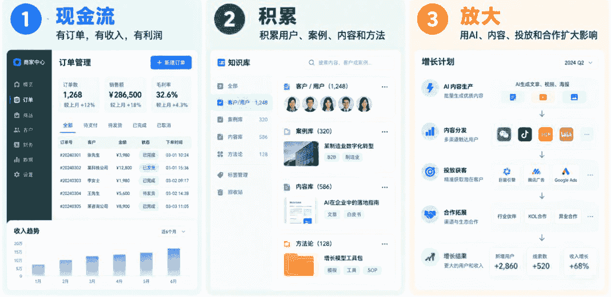

### 找一个真正跑出结果的人，深度跟一段

我自己也踩过一个坑：特别爱到处学。

这个老师听两句，那个社群买一个。每个人讲得好像都有道理，可十套正确答案同时塞进脑子里，真到自己执行时，反而不知道该听谁的。

所以如果重新起步，我会选一个目标与自己接近、也确实跑出过成绩的人，完整跟上一段时间。

这里最值钱的往往不是课程，而是校准。

真正开始实操以后，你会遇到很多没有标准答案的难题：这个方向还要不要继续测，这个客户值不值得接，产品没人买到底卡在哪。这些问题自己绕三天，一个真正做过的人，十分钟就能告诉你眼下最该解决什么。

早期缺的不是更多信息，而是有人在你跑偏时把你拉回来。等自己跑出第一个结果后，再去吸收更多人的方法，你已经有了一把自己的尺子。在此之前，信息越多越像噪音。

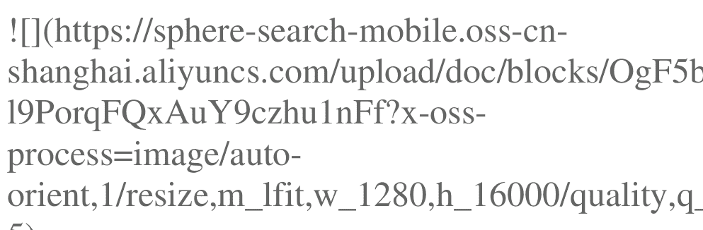

### 把自己放进一个高密度的商业现场

最后一件从零阶段值得做的事，是主动走进一群正在真实做生意的人中间。

以前我把这叫作“抱团取暖”，后来发现这个词太轻。它的真正价值是：扩大你的商业样本。

一个人做业务时，你看到的样本只有自己。这个月赚到了，就觉得这条路天下无敌；这个月没赚到，又怀疑整个行业不行。很多判断其实只是被自己的单一样本带着走。

后来进了赚钱、待在联合办公空间、参加各种线下局，我才同时看到许多完全不同的生意。有人内容强，有人产品强，有人技术很牛但不会卖，也有人做着不起眼的小生意，现金流却稳得离谱。

样本一多，人就不容易随便下结论。

更重要的是，很多机会本来就藏在人与人的连接里。你懂人工智能，对方正好懂行业；一个老板看到你的案例，可能直接把业务丢给你试；一次线下分享，也可能变成下一次合作的起点。

所以如果你还在从零阶段，我会劝自己：少关起门来研究，多去真实市场里泡着。

找一个具体场景，让目标客户持续看见你；

找一个跑通的人，从头到尾跟一遍；

再让自己长期待在一个有大量真实商业样本的环境里。

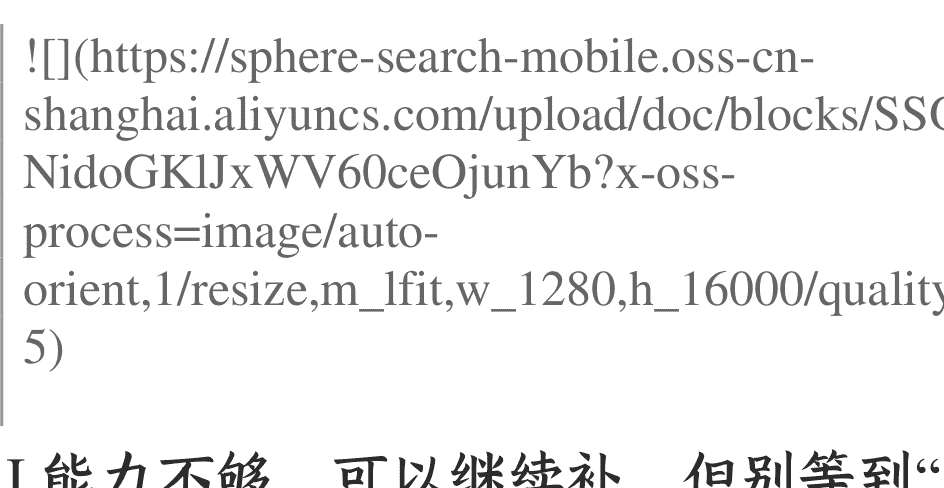

人工智能能力不够可以继续补，但别等到“准备好了”才行动。

对从零阶段来说，最重要的从来不是你会多少人工智能，而是你能不能尽快进入市场，拿到第一个真实结果，再从那个结果开始往上长。

## 07 如果已经进入增长期，我会怎么做

如果你已经靠一个业务、一项技能或一款产品赚到过真金白银，接下来最难的往往不是“还能不能赚”，而是怎么让结果稳定下来，并且越来越不依赖运气和硬撑。

这个阶段很容易出现：上个月客户很多，下个月突然断档；一条内容爆了，后面又不知道发什么；业务明明能赚钱，却每次都要重新找客源、重新成交、重新交付。你已经证明这条路能走，但还没有把它变成一门会积累、会增长的生意。

所以进入增长期后，我会把注意力从“今天还能多赚多少”慢慢移到另一件事上：

今天做的事，能不能让下个月比这个月更容易一点。

### 第一件事：建一个自己的客户池，长期待在客户身边

到了这个阶段，我会非常重视私域。

但私域对我来说，不只是把人加到🛰️里然后天天发广告。它更像一个长期的客户研究现场。一个人为什么加你，为什么一直看着却不买，最近反复在问什么，什么时候突然愿意付钱，这些东西都会直接告诉你市场正在发生什么。

很多产品不是坐在办公室想出来的，而是从聊天记录里长出来的。同一个问题连续三个人在问，就值得重视；客户愿意花半小时讲一个痛点，背后大概率有需求；有人看了你半年朋友圈突然下单，这条成交路径本身也值得复盘。

所以到了增长期，我会把经营客户放在单纯搞更多流量前面。流量负责把人带进来，私域和持续表达则让你理解他们，也让他们慢慢理解你。

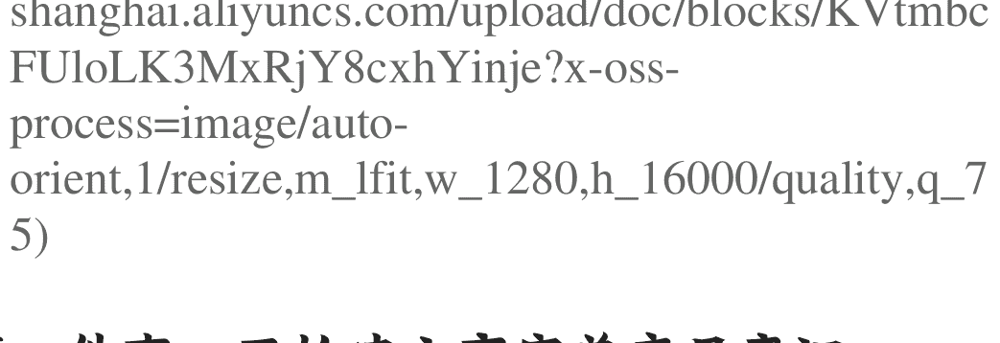

### 第二件事：建立高价位产品意识

低价产品适合扩大样本。你可以快速接触很多人，知道他们在关注什么，也能让更多人低门槛和你建立第一次联系。但想真正理解一个客户的业务，很多时候还是要进入更深度的服务。

愿意花几百块买资料的人，和愿意花几千几万请你解决问题的人，给你的信息完全不一样。后者会把真实生意摊开给你看，你也必须为结果负责，而这个过程会快速提升你的产品能力和判断力。

所以我现在不会简单认为“低价不好、高价才高级”。我更愿意让它们各司其职：低价扩大客户池、筛选需求，高价创造利润、深入业务、留下案例。两边互相反馈，产品才越来越贴近市场。

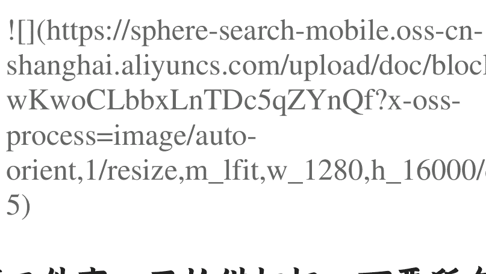

### 第三件事：学着借力，别什么都自己上

从零阶段，很多事亲手做很有价值，因为你得先知道它到底怎么发生的。但到了增长期，如果还什么都自己干，很快就会撞到个人产能上限。

我现在最关注的几种“放大器”：第一是内容，一篇真正写透的长文，可能半年后还在给你带客户；一个案例讲清楚，能替你重复解释很多遍。第二是人工智能，那些已经被验证稳定的内容、数据和流程，可以逐步交给系统接管。第三是投放，产品和转化链路跑通后，用钱放大流量，和一开始什么都没验证就烧钱，是两件完全不同的事。第四是人和关系，你懂 AI，对方懂行业；你擅长交付，对方擅长流量和销售，很多一个人做起来很重的事，通过合作会一下子变轻。

但借力有一个前提：底下那条路得先手动跑通。如果连一单都还没跑明白，就急着上自动化、投广告、招人，很多时候只是把错误更快地放大。

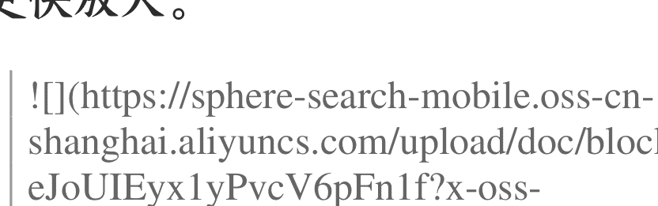

### 最后，真正拉开差距的是商业判断

走到后面，我越来越觉得，单纯的人工智能技术能力会越来越普及。

今天只有少数人会做的工作流，过几个月可能就有现成模板；以前非要会编程才能实现的事情，现在人工智能已经能帮普通人完成大部分。工具会越来越简单，所以“我比别人多会几款人工智能产品”这件事，很难一直成为真正的壁垒。

最后更值钱的，是判断：

哪个需求值得做，什么客户值得服务；

一个业务虽然赚钱，为什么不值得继续投入；

什么时候做定制，什么时候做产品化；

现在该继续加流量，还是先补交付；

一个流程适合自动化，还是该继续让人负责。

这些人工智能可以给建议，但最后还是要有人拍板。

从我大学建模翻车，到后来做流量、做定制、再到现在自己的盘子，其实一直在反复问同一个问题：

我到底知不知道，什么叫做对？

到了增长期，这个问题只会更重要。因为你的杠杆越大，一个正确判断带来的收益越大，一个错误判断的成本也一起被放大。

## 写在最后：人工智能越强，人越要知道自己要什么

写完这篇，我又想起大学第一次参加建模比赛的自己。

那时候拿到 GPT，最兴奋的是：以前不会的东西，好像突然都会了。不会建模，让 AI 做；不会写代码，让 AI 写；不会拼论文，让 AI 拼。我当时理解的人工智能，是一个能不断替我补能力缺口的外挂，甚至觉得只要模型够强，一个人就能把原本一群人的事全干完。

几年后，我真的走上“人工智能 + 独立经营”的路，反而越来越不信这件事了。

人工智能确实把一个人的能力边界推远了很多，但它并没有让人的价值消失。恰恰相反，模型越强、工具越简单，以前那些需要技术门槛才能做到的事越容易被拉平，真正稀缺的东西反而越来越清楚：你能不能看懂一个问题，知不知道什么结果才算对，敢不敢为自己的判断负责。

现在回头看，我赚到的第一个一万、五万、十万，其实也不只是三个数字。

赚到第一笔一万时，我学会的是对一个环节负责。我把流量这个点跑透，第一次知道自己的具体能力能被市场付费认可。

到了五万，我开始对客户的结果负责。客户不会告诉我该用哪个模型、该搭哪个 Agent，我得自己走进他的业务，判断真正的问题在哪里，再把结果交出来。

到了十万，我第一次开始对一整门生意负责。流量从哪里来、客户为什么信任我、产品怎么设计、交付能不能接住、过去做过的事能不能沉淀下来，这些问题再也没有别人替我兜底。

所以表面看，这几年我一直在换业务、换赚钱方式；实际上，我一直在扩大同一件事的边界：

我到底能对多大的结果负责。

而人工智能，一直在放大这个过程。

这也是为什么现在的我不再执着于“哪个工具最强”“下一个风口在哪里”。工具一定会继续换代，今天复杂的工作流，明天可能就是一个按钮；今天稀缺的技术能力，过半年也许人人都会。

但只要真实的商业还存在，就永远需要有人判断：什么需求值得解决，什么产品值得做，什么客户值得服务，什么地方交给人工智能，什么地方必须留下人的判断。

FDE 对我来说也是如此。我后来才发现，过去那些看起来零散的经历，其实一直在训练同一种能力：站在业务和技术中间，把一个真实问题变成一个真实结果。

再往后，我更在意的则是另一件事：一个结果做完以后，到底留下了什么。

如果一次交付结束，只剩一笔钱，那下一次还得从头开始；如果还能留下一个案例、一套方法、一篇内容、一批客户，甚至一段长期信任关系，那今天付出的时间，才有机会在未来继续产生价值。你过去常说的“复利”，最后产生复利的不是知识付费这种形式，而是这些被留下来的东西。

所以如果现在再让我理解“独立经营”，我会觉得“独立”从来不是孤军奋战，也不是靠人工智能把所有人都干掉。

它更像是：你拥有自己的选择权，也承担最终的判断；然后尽可能借人工智能的能力、别人的经验、长期的关系和过去积累下来的资产，把一个人的时间放大。

大学第一次比赛时，我想的是：

有了人工智能，是不是就不需要任何人了？

走到今天，我的答案刚好相反。

真正厉害的独立经营者，不是一个人能做所有事。

而是他越来越清楚：什么事情必须由自己判断，什么事情应该交给人工智能，什么能力可以向别人借，什么东西必须长期留在自己手里。

如果你现在还站在人工智能赛道门口，也许暂时不用急着想清楚未来五年要做什么。

先进入一个真实市场，解决一个真实问题，拿到一次真实反馈。

然后再做第二次、第三次。

慢慢地，你会拥有自己的判断、案例、客户、方法和关系。等这些东西一点点连起来以后，你可能会发现，所谓抓住人工智能红利，从来不是追上每一个新模型。

而是在这个技术快速变化的时代里，逐渐找到那些真正属于你、并且会随着时间越来越值钱的东西。

如果你看到这里，也正在做独立经营、超级个体或小团队，手上已经有了业务，却卡在内容、获客、私域、交付这些效率问题上，想看看人工智能到底能怎么真正接进业务；又或者你正在切入人工智能/FDE，手上已经有一项能力，却还没跑通第一个商业闭环，都欢迎来交流。

另外，如果你本身深耕某个行业，手里有真实的业务场景和客户资源，也在找人工智能落地的可能性，我也很愿意一起碰一碰，看有没有机会共同跑出一个垂直案例。

——分割线——

看完这篇 SOP，你可能觉得自己已经懂了。但现实是，90% 的人一实操就会卡在第一步。

工具和教程只是最表面的一层壁垒，真正的壁垒是“立刻动手”和“圈层信息差”。

如果你想了解当下最新的变现玩法，并和一群执行力极强的极客一起下场拿结果，

# 欢迎围观我的核心私域：【懒人专属群】。

我们不聊虚的，只做商业闭环拆解与人工智能效率压榨。系统内已经沉淀了 1000+ 跑通的套利实战局。

- 查阅圈子完整数字资产与上车门槛：

[https://lazysO.com/insider/](https://lazysO.com/insider/)

认同价值、准备好下场干活的，扫码加我🛰️（lazyhelper1）

备注：【实操上车】，不闲聊

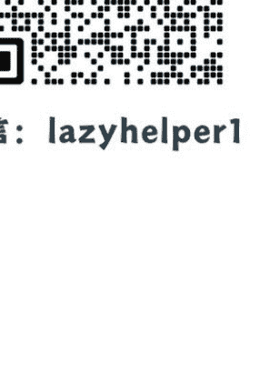