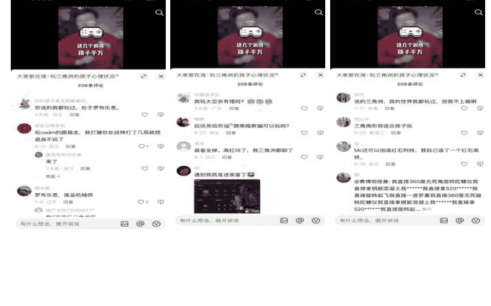
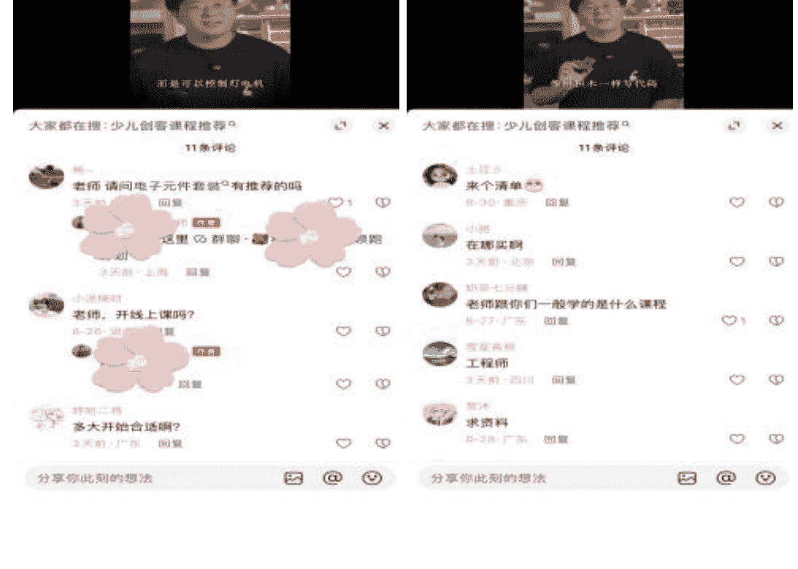
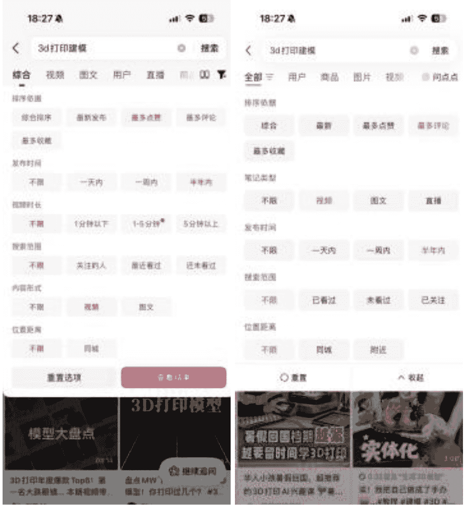
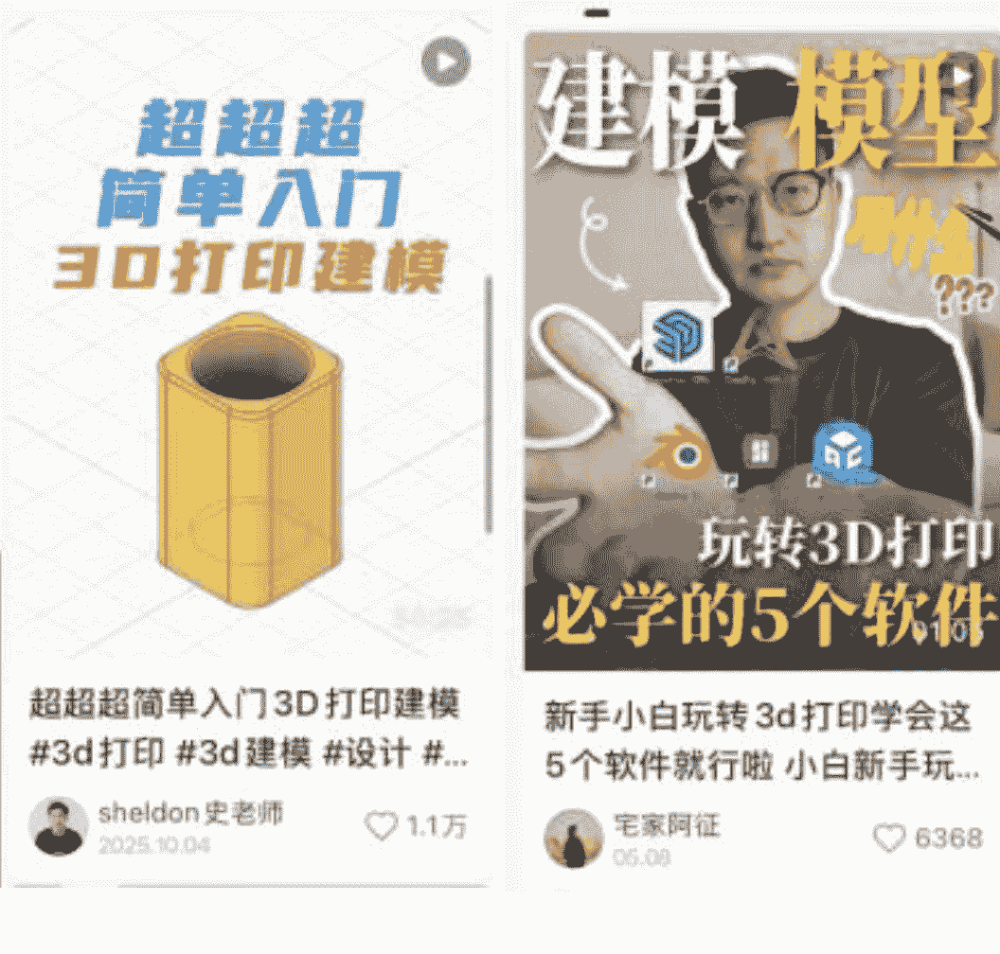
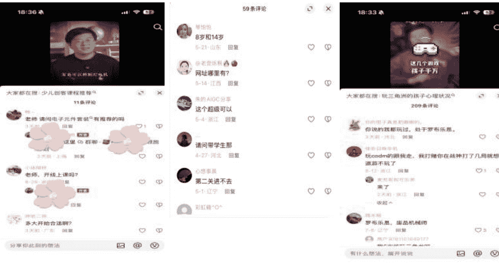

# 裸辞接了个代运营，抖音0粉起号3个月1.1w粉，但我最想说的其实是：粉丝量和获客，真是两套逻辑

去年年底我裸辞了。闲了没两周，接到一个代运营合作——少儿科创赛道，一个偏小众的教培品类，我负责做流量。3个月，抖音从0粉自然流做到1.1万粉，私域加起来1000+。数据说不上炸，但我自己觉得，最值钱的不是涨粉，而是想明白了一件事：播放量和精准获客，根本不是一个维度的东西。

先说一个让我印象极深的反差。我做了三条视频，数据出来是这样的：

第一条，播放7万+，加🛰️0。第二条，播放20万+，加🛰️130。第三条，播放只有1万，加🛰️30多，但视频号挂车的试听课成交了6单，成交率比第二条还高。

有人可能要问：为什么20万播放的加微不如1万播放的成交率高？因为人群和需求，完全是两码事。这篇文章我就围绕这件事，把我跑了一遍之后的心得和方法全部摊开讲。基本上分三个问题：来的人对没对上？需求离成交近不近？用户顺着内容来了，接不接得住？

## 一、来的人对没对上？先看评论区，别只看播放量

我拿三条视频给你演示。第一条视频评论区，一片小朋友在那聊游戏，热闹是真热闹，但我们的目标用户是家长，孩子聊得再开心也换不来咨询。播放量高，只是平台的推荐机制觉得内容完播不错，不等于你得利。

第二条视频评论区翻起来，明显变了——全是家长在问“网址在哪里”“第二关进不去”。说实话我看到这个数据的时候心情是挺好的，毕竟人群对了，但再细品一下，这些需求其实都停留在“要工具、要资源”这一步，和我们的课程没有直接关系。

第三条视频评论区的画风又不一样，全是问“怎么跟着你们上课”“你们开线上课吗”“在哪里报名”，关注点直接落在课程上。

所以判断一条视频是不是精准流量，别只看后台的播放数字，就问自己两个问题：一，评论区里的人是不是我的目标客户？二，他们是真的在找解决方案，还是擦个边凑个热闹？人群对，需求不对，也接不住。精准获客的核心，是人要对，需求还要近。

## 二、怎么找到离成交更近的选题？

这部分是我这次最想分享的，也是我觉得最实用的部分，直接给方法。

### 找对标，别只盯着数据最高的看

我一般不会直接去搜点赞最高的视频，而是按这个方式筛：先看发布时间，优先选最近3—6个月的爆款；再看评论区，判断这条内容吸引来的人到底什么样。

为什么强调时间近？两个原因。第一，平台审核规则一直在变，这行那行经常出现开始松后面严的情况，抄老内容很容易踩线。第二，用户心态是流动的。教培行业，学期刚开始和假期，家长的心态完全不一样，求职行业，年底和“金三银四”也是两种状态。3—6个月内被验证的内容，至少说明它的爆是有当下环境的支撑的。

数据高，只证明这条内容容易火，但评论区才能告诉你，它容易吸引谁。我会重点盯这几类评论：

- 求资料型：怎么加、求资料、我需要、已私信、麻烦联系、私了没回
- 求咨询业务型：在哪买的、多少钱、怎么跟着学、有课吗、地址在哪

如果一条视频的评论区反复出现这类反馈，别犹豫，这就是有流量又有真实需求的信号。没有陌生人会莫名其妙在你的评论区求你卖他东西。

我当时找3D打印选题，就搜了3D打印，不挑赞最高的，先看最近半年的，然后把“点赞最多”和“评论最多”的都翻一遍。有些视频点赞很吓人，但评论区清一色“好酷”“收藏了”，这种偏流量型；另一些播放一般，评论区却已经出现“孩子几岁可以学”“有课吗”“地址在哪”这种问题，而且数量够5条以上，那这种就是离业务近的。

所以我现在选选题，原则是：要流量，就选热度高的；要客资，就选评论区出现真实需求的。用一句话说就是——找爆款，看数据；找客资，看评论区。

### 有需求还不够，得判断需求离成交有多远

评论区有人问，就代表选题好吗？也不一定。有人就是觉得有意思顺手要个资料，有人是真在找解决方案。所以我自己弄了一个C/B/A/S分层，专门用来判断一个选题引来的用户，走到哪一步了：

- C类：有点认知，但需求很弱
- B类：有点兴趣，暂时不着急
- A类：有明确问题，正在找方案
- S类：需求明确，近期准备动手

拿少儿编程来举例，大家感受一下：

- C：3个免费少儿编程网站，先收藏再说
- B：家长不懂编程，怎么带孩子入门，有兴趣了
- A：学完Scratch，下一步选Python还是C++，有问题了
- S：学了3年编程，不走信奥赛，下一步怎么办，需求明确找方案

选题其实就是一道筛选器，你选什么问题来讲，就会把什么阶段的人筛过来。

那是不是只做A类和S类就行？不是的。C/B类是用来扩大流量盘子、建立认知的，A/S类是筛选需求、通向转化的。一个账号，两种内容都得有。比例怎么分配？我建议看销售承接能力：销售人少、精力有限，就多做精准型内容；销售多、资源不够，就多做C/B类引流型内容。

最后给大家一个可以直接抄的“选题三问”：

- 第一问：这条内容吸引的是谁，是不是我的目标用户？
- 第二问：他处于C/B/A/S哪一层，是感兴趣而已，还是已经在找方案？
- 第三问：这条内容的任务是什么，要流量、建认知，还是筛需求、做转化？

别只盯着“这个选题能不能爆”，要问自己一句：它能给我带来什么样的用户？

## 三、内容看完，怎么把人接进私域？

前面解决了来的人对不对、需求近不近，但还有一个隐蔽的坑：用户看完产生了兴趣，结果找了半天不知道怎么加你，或者回复太慢、操作太麻烦，人就走了。同样1万播放，有人只能加几个🛰️，有人能加上百个。差别在哪？我总结了一条公式：选题精准度×钩子匹配度×路径顺畅度=获客效率。

### 先想清楚：用户凭什么加你

说到引流，很多人第一反应就是“视频结尾放个资料”，但钩子的本质不是“我送东西”，而是：用户看完内容之后，你有没有给他一个值得继续找你的理由。

我习惯把钩子分成两类。

一类是明钩子。用户一看就知道“找你能得到什么”：资料、清单、规划表、测评、模板、方案。比如我做的少儿科创账号，视频讲“1—3年级孩子怎么开始AI启蒙”，结尾就给一份《1—6年级AI科创学习规划表》。用户为什么愿意加你？不是因为你喊了一句“快来找我”，而是他看完之后刚好需要这个东西。另外，如果是客单价偏高的项目，明钩子最好带一个“规划类”的赠品，这样一到私域就能聊正事，而不是领个资料就没下文了。

另一类是暗钩子。用户甚至感觉不到这是一个钩子，他只是在观看过程中慢慢产生一个念头：这个人真的懂，而且真的干过。比如开头的资历人设、视频中间穿插的学员案例、以及校区或学员的真实素材。这些东西都在暗暗传递几个信息：这人带过很多学员，这人有过实际成果，这人确实有线下课。但注意，暗钩子千万别放得太刻意，一定是前后逻辑顺、位置自然，不要为了钩而钩。

明钩子是给用户一个“找你的理由”，暗钩子是给用户一个“相信你的理由”。

### 有了理由，还得让用户“找得到你”

钩子做好了，用户心动了，结果找不到入口，前面全白搭。所以路径越短、越顺畅，转化越好。

抖音上的触点无非三块：私信、评论区、主页。我自己把路径跑下来，感受如下：

第一条，评论区→回复群聊→群内导流。这个路径有一定时间差，但相对安全。群内引导加微时，跳转卡片的效果比直接发图片或视频更好。但跳转卡片本质是第三方工具，用不用要自己权衡。另外，抖音前段时间对群内导流查得紧，图片发出去经常被吞，我的解法是：把图片加音乐，做成10秒以内的视频，再换个背景，被吞的概率明显降低。这个是我现在最常用的方法。

第二条，评论区关联群聊，用户点击直接进群。这条路径的优势是用户少一步操作，门槛极低，不需要等回复、不用复制粘贴。但前提是要有蓝V，而且评论区引导群聊的那十几个字要写得足够勾人。

第三条，主页→群聊或小助理，再加一步承接。用户刷到主页，看到群聊或小助理，主动点进去。我一般会把评论区、主页、群聊、小助理这些触点全部铺好，万一某一个出了异常，用户还是能找到备选入口。路径不是越多越好，关键是让用户产生需求以后，尽量少走一步冤枉路。

再说一下私信承接的账号安全，两个我亲测有效的注意点：一是回复内容别复制粘贴一模一样的话术，系统容易判定批量操作；二是私信量大的时候，别一次性回完，改成一批一批来，比如一次回8—10个，发完等30分钟再回。这个是我个人经验，不一定适用于所有行业，但逻辑是通的。

最后再复盘一下那三条视频的数据：第一条播放7万+，加微0；第二条播放20万+，加微130；第三条播放1万，加微30+，视频号挂车成交试听课6单，且第三条的成交率远远高于第二条。

看明白了吗？播放量7万的视频，一个客资都没带来；20万播放的视频，加微看起来很美，但真正掏钱的是那条只有1万播放的。如果只看涨粉，你会觉得第一条做得最成功，但你要是看获客和成交，结论完全反过来。

这就是我最想说的：粉丝量和获客是两套逻辑。别拿涨粉的思路去做获客，也别拿获客的KPI去要求流量型内容。思路理顺了，方法到位了，剩下的就是动手。

工具和教程不难找，真正的壁垒永远是四件事：立刻动手的执行力，同行之间的信息差，把一件事做透的耐心，以及愿意陪你下场的人。

- 完整数字资产和上车门槛可以看这里：[https://lazyso.com/insider/](https://lazyso.com/insider/)

