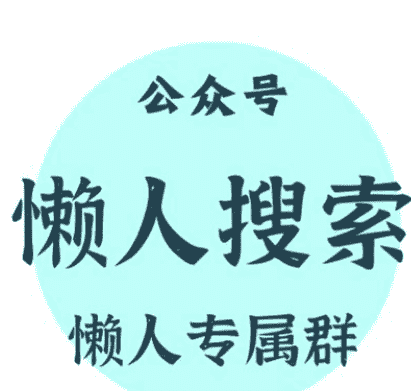
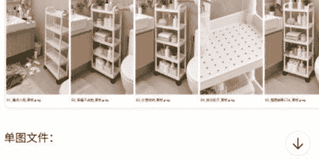
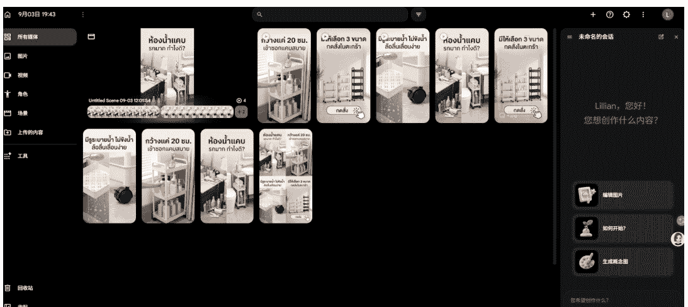
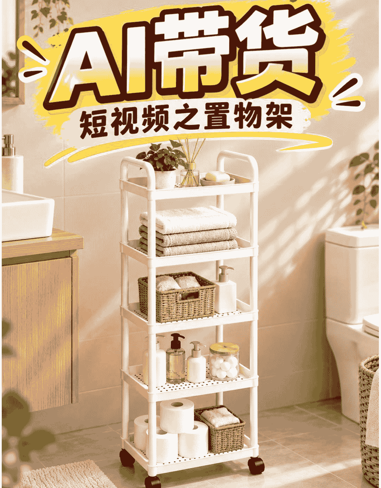

# 单条智能短片卖出 1596 单，我把整套打法打包成了可复用 Skill

> 整理：👸号懒人搜索·懒人专属群精选 | 🛰️：lazyhelperl




先说用人画像。手里有现货、希望用自动化方式把带货短片的制作成本压下去的跨境卖家和短视频运营，这套方法很对口；没有货源、也不想搞工作流的人可以直接跳过。最有价值的部分，是把“图转视频、文案撰写、语音合成”拆解成标准作业流程再做成可调用技能的十步闭环。最容易翻车的地方在于前期的提示词打磨和首帧审图的耐心，如果全交给模型不管，很快就会得到变形废片。

我是在义乌做了八年跨境的雪花，速卖通、Temu、SHEIN、TikTok、Ozon 都操盘过，顶峰时期日出单万。选品、上图、上架、算利润这些脏活累活我都亲自干过。转向 AI 后，我只做一件事：把高频重复的环节交给机器，做降本、做自动化、做复用。之前做过定价 Agent、女装虚拟棚拍工作流、批量商品图流水线、资料调用中台等，这次把目光放在了带货短视频上。

最终结果是一条由 AI 驱动的短片卖出 1596 单。更关键的是，整个过程被沉淀成了可直接拿来用的 Skill。下面把从零到封装的思路完整摊开。

## 我怎么分工

资料梳理、方案撰写、提示词编写交给 Codex，并用它调用工具出图和泰语配音；视频片段用 Google Flow 生成；剪映负责字幕、声音和节奏的最后把控。完成后封装成技能。

## 十步，把带货视频做成可复用技能

### 第一步，给模型喂够信息

我建了一个资料夹，里面放三类东西：
1. 参考对标片；
2. 产品实拍/主图/网络图，能展示结构、细节和多角度；
3. 产品文档，卖点、尺寸、使用场景。

指令很简单：请读取这个文件夹，里面是产品图、对标片和卖点说明。模型很快就吐出了基于对标的分镜建议。

```
用时 3m 54s

我看完了。这个文件夹里有：
* 产品图：21 张
* 对标视频：5 条，都是竖屏 576 x 1024
* 我生成了缩略图拼图和一份盘点报告，放在：
    □ 素材盘点报告.md

我的初步判断：这批产品很适合做 TikTok 泰国站的“浴室/洗手台/牙缝收纳”类带货视频。现有素材支撑的核心卖点是：

* 多层收纳、窄缝不占地、底部滑轮、原版排水孔、白/黑两色、3/4/5 层版本。

5 条对标视频可以借鉴的方向主要是：

1. 黑色浴室架实拍：适合借“摆放物品 + 喷水排水 + 近拍轮子/层板”的证明逻辑。
2. 化妆品抽屉收纳：产品不一样，但可以借“乱 → 分类 → 整齐”的视频结构。
3. 鞋架家居氛围：产品不一样，但可以借暖光、家居角落、生活方式氛围。
4. 白色浴室置物架真人整图：最接近你的产品，适合借“真人整理浴室场景”的演示方式。
5. 另一条白色浴室整理视频：同样适合做 15 秒短视频模板。

我建议第一条样片先做这个方向：
浴室乱糟糟 → 摆入置物架 → 洗护用品分层放好 → 展示窄缝不占地 → 排水孔 → 浴室变整齐

这个方向最稳，因为你的产品图和对标视频都能支撑，不需要硬编卖点。下一步我可以直接帮你把它拆成 15 秒泰国 TikTok 带货视频脚本、分镜和 AI 生成提示词。
```

### 第二步，先验脚本再谈自动化

拿到分镜先审，不满意就直接提修改要求；满意就回复“好的”，它会接着输出带货脚本与生成提示词。

第一版 15 秒泰国 TikTok 商品推广脚本与提示词就出来了。主线是：浴室凌乱 → 推入置物架 → 分层摆放洗护用品 → 特写排水孔与挂钩 → 角落整齐 → 下单引导。

同时给了三层交付物：15 秒镜头清单、剪映拼版方案、AI 视频提示词。我的建议是首条别追求全自动，先用真实产品图做参考，让模型生成 5 个短片段，再进剪映拼成 15 秒，比一次生成整条更稳，能把结构跑偏的风险降下来。

### 第三步，按镜头写提示词，先锁定首帧

我改成 5 段来做，每段先出首帧画面，通过人工审图后再用“首帧+视频提示词”去生成动态。文档更新为 `首帧图加分段视频工作流-v2.md`。

流程变为：脚本分段 → 首帧生成 → 人工审核 → 首帧+提示词生成视频 → 剪映拼接。

规格我固定了：首帧与视频均为 1080×1920、9:16，建议 30fps，每段 2-4 秒，最终约 15 秒。每段都包含首帧提示词、审图要点、视频提示词、后期泰语字幕。这样分段控，比一次性出整条更适合对产品结构要求高的电商素材。

### 第四步，开工前让模型自查

让模型自己检查最小开工条件是否齐全，缺什么就补什么，能省掉很多中途返工。

### 第五步，开始产出首帧

资料齐备后，文档已备好：`产品事实锚定卡.md`、`首帧图加分段视频工作流-v2.md`、`最小开工条件检查报告.md`、`素材盘点报告.md`、`15秒泰国TK带货视频脚本与提示词-v1.md`。

结尾加一句泰语强调发货优势：

```
àwàwtanm dotn
```

泰语意：泰国本地发货，到手很快。

耗时 8 分 21 秒，5 张首帧全部生成。总览如下：



单张文件独立存放，不满意可单张重绘。

### 第六步，批量导出可用素材

让模型输出三类文件：
1. 可直接复制的 5 段视频生成提示词；
2. 配音用的口播稿；
3. 需要后期叠加的字幕文件。

分文件夹输出，方便直接导入剪辑软件。

### 第七步，生成外语配音

根据口播稿，让 Codex 直接生成泰语配音音频。

### 第八步，用 Google Flow 批量出片

选 Google Flow 的原因是便宜、效果在线、批量不心疼。地址：
https://flow.google.com/

把已生成的画面和提示词丢进去即可批量出视频。

### 第九步，剪映里做最终成片

把片段、配音、字幕在剪映里对齐，剪掉废镜头。

在线成片：
https://hk57gvlx7u.feishu.cn/docx/T2ewdn87ooJG4kx10xDc2chn tg


### 第十步，回传复盘，沉淀闭环

把剪好的成片发回给 Codex，让它总结哪些环节可以沉淀为复用工作流。

我最终沉淀了两份文档：
1. `AI电商带货视频普制转视频闭环工作流.md`
2. `新品AI带货视频开工检查清单.md`

核心心法一句话：
> 不要让模型一口气吐成品，而是拆成：实物信息锁定 → 镜头功能规划 → 首帧控结构 → 分段生成 → 口播字幕后期控制 → 成片抽帧复盘 → 下一轮迭代。

这次沉淀的关键经验：
1. 首帧画面比提示词更关键，首帧错了后面很难救。
2. 每个镜头都要有销售意图，不是堆数量。
3. 13-15 秒的 TikTok 带货，6-8 个镜头比 5 个更饱满。
4. 字幕、旁白、BGM 放到剪辑阶段定，别让生成模型自由发挥。
5. 产品事实边界必须锁死，未确认的价格、包邮、COD、承重等一律不写。
6. 成片后必须抽帧复盘，才能发现遮挡、重复、结构变形、卖点不清的问题。

这套方法可以直接迁移到别的品类。

## 把 SOP 封装成 Skill

沉淀材料分为三部分：通用制作流程、遗漏防范清单、案例经验记录。

交付结构：
- 00_项目记录.md
- 01_生视频提示词
- 02_口播稿与音频
- 03_后期字幕与剪辑标注
- 04_定帧图
- 05_视频片段
- 06_成片

前三项是我日常最高频使用的：视频平台提示词、稿件与音频、剪映字幕。项目记录里写明哪些图已通过、采用哪版文案、音频位置、哪段待生成。换窗口时先读记录再核对文件，就不需要靠一句“继续”让模型猜。

调用方式示范：
> 请使用【SKILL的名字】。素材目录：[产品文件夹]。本次做一条同款新片，先核对资料，复用已通过的素材。

把流程跑通后，你就能拥有属于自己的批量带货短视频技能。只要提供原始素材，就能得到分镜与配音，剪映里简单处理即可发布，爆款基因会明显更强。

---

看完 SOP 可能觉得懂了，但实操第一步就会卡住。工具和教程是基础壁垒，真正的壁垒是立刻动手和信息差。

想看最新的变现打法，和一群执行力强的极客一起落地，欢迎关注我的核心私域【懒人专属群】。我们只拆商业闭环和 AI 效率。体系内已沉淀 1000+ 跑通的实战案例。

查阅数字资产与入群门槛：
https://lazyso.com/insider/

认同价值、准备下场干的，扫码加我🛰️ lazyhelper1，备注【实操上车】，不闲聊。


