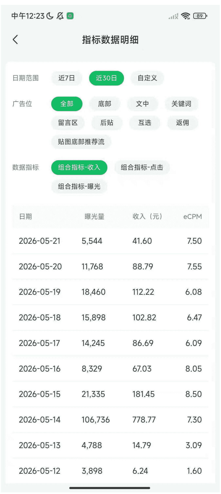
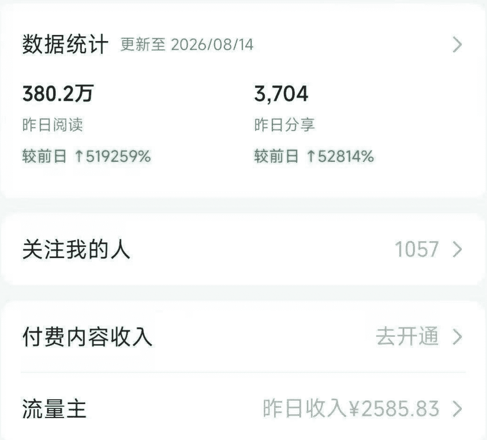
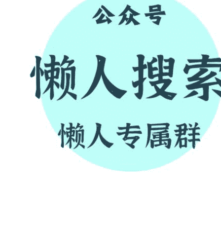

## 碎片时间做图帖半年：单日380万浏览、2585元分成背后的真实路径

编号 260923｜副业精华选录
整理：LazyHelper（VX: lazyhelperl）

阅读提示 | 这篇回顾特别适合日程零碎的宝妈和上班族。作者新天在杭州，孩子不满两周岁，白天上班，晚上和周末带娃，个人时间只能按分钟计算。她靠“短图加短文”的方式，做出单日380.2万浏览、广告分成2585.83元的成绩。但前半年她的流量收益并不高，想找快速赚钱模板的人可以跳过。她认为最值得学的是挑图时的三个关键词——反常、好奇、可讨论；如果一张图被遮住后整条内容仍然成立，它多半是凑数。新手最容易踩的坑是急于归因：账号、方向、题名、配图同时换掉，最后流量涨了也难说清是哪个动作起作用。

我是新天，坐标杭州，刚成为赚钱成员。接触赚钱是在两年前，当时体验营里堆积的干货帖让我印象深刻，社群里乐于分享的氛围也让我认同。这两年AI迭代得太快，怕被落下，于是正式入群学最新玩法。

先把成绩说在前面：上月某一天，同一帐号的两条图帖跑到380.2万浏览，当日广告分成2585.83元。这个数字值得开心，但只报数字对刚起步的人没有意义。380万是结果，不是方法；2585元是一天的收入，不能当成日后的常态。真正值得听的，是这两条内容诞生之前的经历：为什么选公号、为什么弃长文改图帖、没反馈时怎么熬、怎样定主题备图、怎样看指标，以及半年后对副业和爆款的理解如何改变。

我从前做外贸多年，最近辞了职。更早的时候自己折腾过二手电商，累计变现约80万；后来也做过小红书商单、闲鱼无货源，都从零走到有收益，单项目做到五位数。听起来做过不少事情，但重新开始时照样焦虑。因为以前拿到过结果，我反而习惯先算账：项目多久回本？天花板高不高？值不值得投？越想要一个完美答案，越难迈开第一步。公号改变了我这个想法——普通人需要的未必是看起来最厉害的项目，而是能塞进日常生活、能一直做下去、做完还能留下点东西的项目。

### 为什么重新做公号

今年2月底，我把注意力放回公号。

当时的状态非常具体：白天上班，晚上和周末要带不满两岁的孩子。整块时间几乎不存在，只有20分钟、半小时这样的零头。所以选项目不能只看收益高低，更得看能否把任务切碎：能不能用十分钟敲定主题，再找另一段时间准备图片，最后抽空写文案发布？如果一件事情每天必须连续投入四五个小时，再好也不适合当时的我。

一开始我跟辰风学长文写作，确实拿到过不错的分成。3月中旬后台日曝光约2300到5900，日分成40到126元，千次展示收入在14到24上下。3月30日单日冲到1753.55元，随后几天又跌回几毛甚至零。这种剧烈波动反而逼我从项目角度看公号。辰风给我最大的帮助不是“怎么写文章”，而是让我理解：内容为什么会被点开？什么样的主题值得持续做？流量为什么起伏？怎样把偶然的成功变成可重复的动作？后来他建议我试图帖。5月份，我正式切换。

从长文切到图帖，不是因为它高级，而是它的操作路径更短，更适合碎片时间。长文要经历找题材、理材料、写正文、改稿、配图、排版；图帖只需求一个切口，准备图片，写题和短文案，人工检查后发布。这个转换让我的目标从“找最赚钱的项目”变成“找我能稳定执行的项目”。能稳定输出后，数据才逐渐积累成样本，样本才变成判断依据。

### 转图帖不是顿悟，是重新走一遍冷启动

刚做图帖时我并没有什么方法。看到别人做得好就跟，数据只有几十、几百时就怀疑账号、方向，甚至怀疑自己没网感。发多了才意识到，新手最容易犯的错不是不会用工具，而是给结果下结论太快。

一篇数据差，可能因为主题不够具体、封面缺少吸引力、题和图对不上，也可能只是这一次没被继续分发。如果我同时换号、换方向、换题、换图，就算下一条数据变好，也无法判断是哪个环节起了作用。所以后来我不再追问“这篇为什么没爆”，而是改为问三个小问题：路人能不能一眼看出这条讲什么？图里有没有一个值得多看的细节？留言区的人是不是围绕同一个点在分享经历、观点或情绪？这个变化看似小，却把我从“凭感觉发”拽到“按反馈调”。

有一天我照常打开后台，看到一个帐号的数字：浏览380.2万，分成2585.83元。两条图帖在同一天跑出来的。

如果是刚入行，我大概会惊呼“找到流量密码了”。但做了六个月后，我更冷静。那两条内容一定包含运气，包含平台分发的偶然，也包含主题、图片、文案和用户情绪恰好叠加的巧合。爆文不能证明我掌握了规律，但它给了我可回看的样本：哪些动作保留，哪些只是碰巧。

### 在赚钱学到的方法：把答案变成动作

加入赚钱后，我常看航海手册、精华帖，也关注风向标上的新信息。以前看帖子容易被收益数字吸引，现在我会追问：分享者在做这个项目之前是什么状态？第一步做了什么？中间卡在哪里？哪一次调整真正改变了数据？哪些方法只属于他的资源，哪些动作普通人可以照着做？

这也是我从精华帖里学到的阅读方式：不要只抄结论，要拆过程。航海手册帮我把模糊的事情变成清单。图帖不再是“找张图写几句话”，而是：定领域→找参考→拆图片和情绪→理素材→写题写文→人工检查→发布→记数据→下一条只动一个因素。

风向标让我保持敏感：新的内容入口、平台最近反复出现的题材、用户开始讨论的新问题，都能当成观察信号。但它不是答案卡，看到信号后仍要回到自己的号用真实内容验证。

精华帖像是别人走过的路。比如澄心从线下培训转线上图帖的总结，我记住的不是她二十天赚了多少，而是她把注册、选领域、选图、写题、发布、踩坑一项项拆到动作层；清歌先用图帖起号再用长文放大收益，我明白这两种载体不是二选一，可以各自承担任务；辰风把多号、多维表和内容工作流连起来，我慢慢理解矩阵不是多开几个号多刷几遍，而是把收集、判断、制作、检查、发布、复盘拆开，让每一个号仍有自己的方向感。

下面这套流程，不是保证爆的公式，但能让我不用每次都从零开始。

#### 环节一：先定领域，别在推荐页乱跑
以前我也追热点，今天怀旧、明天婚姻、后天养生，号里的数据根本没法横向比较。现在我会先留下两三个候选领域，每个领域看近期三到五条仍有真实互动的帖子。要看的不只是单条爆没爆，而是这个领域有没有持续信号：不同号都在更新，不是只留一条旧爆款；留言区真在聊主题，不是几个表情包；素材能持续找到，不是靠偶然一张神图；我能说清它服务哪类人、触发哪种情绪。一轮测试只定一个领域做主打，再留一个备选，让样本可比。

#### 环节二：找参考，但别照搬
我看参考主要拆五件事：人群、场景、情绪、封面、留言区。同样一张旧物照片，我会看它打中的是哪一代人、勾起的是怀旧还是遗憾还是生活变化、题目有没有把答案说尽、封面为什么让人停下来、留言区的人是在讲自己的故事还是在争论。找到有价值的参考后，我会存下原题、原文、来源链接和一两张参考图，再写三句话：主题适合讲什么；图片的吸引力在哪里；读者最容易产生哪些感受。写完就停，别把找素材做成刷内容。

#### 环节三：选图看信息量，不是看好看
图帖表面是图片游戏，但好看不等于有内容。我的选图标准是三个词：反常、好奇、讨论。反常指画面与日常有差异；好奇指第一眼没完全看懂，愿意多停几秒；讨论指看完以后用户有一句话想说。如果是组图，我还会看后面是否补充了新场景、新细节、新证据或新对比。遮住其中一张，整条内容完全不受影响，那张图多半是来凑数的。同时我会提醒自己：可以学题材、构图、表达结构，不能直接搬别人的图、原文、人物经历和独家事实。关掉参考后，成品仍能独立成立，才算真正的完成。

#### 环节四：题名只负责让人想点开
以前我总想在标题里把事说清楚。后来发现，标题说太满，读者就没有继续看的理由。现在的做法很简单：先抛出明确的反常点或具体细节，让人大概知道发生了什么，但别把答案一次讲完。标题负责让人停下来，图负责让人看明白，正文负责接住情绪，留言区负责让人继续表达。不需要刻意夸张，也不需要堆情绪词；一个真实、具体、能被图片证明的细节，比“太震惊了”有用得多。

#### 环节五：正文像真人聊天，但要比聊天多一个信息点
图帖的正文不需要长篇大论。我的目标是讲清“我看到了什么、哪里不对、为什么值得说”。比如：“今天刷到这张图，第一眼没发现哪里有问题。”“放大后才注意到下面这个细节。”“以前这种场景很常见，现在越来越少了。”这些话没什么技巧，但有观察、有画面，像一个真人在分享。不清楚的事不要硬编，图片证明不了年龄、收入、家庭和真实经历，就别把推测写成事实。结尾的问题不要太大，与其问“大家怎么看”，不如问一个能立刻回答的问题：“你们小时候见过这个吗？”“换作你，会保留还是拆掉？”问题越具体，越容易有人回应。

#### 环节六：发布前做一次人工检查
不管内容是手写的还是用工具生成的初稿，发布前都要回到人手里。我会检查：标题、封面、正文是不是在讲同样的事；有没有把推测写成事实；图片来源和版权风险是否可控；有没有医疗功效、夸大收益、擦边、引战等风险表达；删掉套话后，是否还剩一个清楚的观察点。AI和技能包对我来说是提效工具，不是最终判断者。它帮我整理样本、出多个题名、生成初稿，但选题值不值得做、事实是否可靠、成品像不像真人，最终由我拍板。

#### 环节七：发布后留记录，下一条只动一个因素
以前我做回溯基本只看浏览数，现在我会记下：领域、素材来源、题名结构、浏览和推荐来源、互动变化、留言区真正在聊的点、从初稿到成稿我改了哪里、下一条准备延展还是换题换封面或是暂停。每次回溯只回答三句话：今天最好的反馈是什么？目前最明显的问题是什么？下一条我只打算改哪个因素？回溯不是写感受，而是给下一条一个明确动作。

### 图帖最难的不是制作，是建立自己的主题判断力

做图帖几个月，我越来越确定：形式越简单，越考验选题。工具可以把图修得更精致，也可以快速出十个备选题目。但如果我不知道用户为什么会停下、这张图提供了什么新信息，生成越快，只会越快制造平庸内容。

现在我看主题，不只看浏览量高低，而看它值不值得被讨论：有没有具体的人群，而不是所有人；有没有具体的场景，而不是空泛的观点；有没有一处可见的矛盾、反差或变化；留言区能不能告诉我，用户被哪一点打动。所谓网感不是天赋，而是看过足够样本、发过足够内容、拆过足够评论之后形成的条件反射。以前我看到一张图只觉“挺好看”，现在会继续问：它能讲什么人？发生在什么场景？哪个细节最值得放大？留言区会围绕什么说话？这是半年里我逐渐养成的新习惯。

### 为什么不再因为一条流量就换号或换方向

图帖数据本身就有波动。同一个号，上一条可能没水花，下一条可能突然爆发。所以我现在不会因为一条内容差就换方向，也不会因为一条爆了就认定自己找到了正确路径。我的做法是：同一领域连续发三到五条，每次尽量只改一个因素，然后观察类似反馈有没有反复出现。

曝光偏低，先看主题是否太泛、方向是否跳得太快；有人看到但不点开，先查题名和封面；点开但互动少，再看正文是不是缺少具体场景、结尾问题是不是太空；同类内容连续有人评论和分享，就把其中反复出现的人群、场景、情绪提取出来，做成系列。这个过程让我从“猜平台想要什么”变成“用自己的号积累证据”。

### 相信“量”，但不盲目发量

我说的量，不是一天机械发很多条，也不是工具批量生成后不检查就发。量的价值在于给判断提供足够的样本。发10条时很多判断还是猜；发到50条，慢慢知道哪些图片更容易让人停；发到100条，才可能看出这个号的人群、题材和表达偏好。看得多、发得多、拆得多，条件反射才会形成。

我认可的节奏是：先发，再看数据，再调整；保留有效部分，只改一个因素，再进入下一轮。多号不是把同一条内容复制十遍，而是把已经跑通的流程放大：不同号有清晰的人群和方向，素材、题名、图片、表达都保持差异，最后统一记录和回顾。如果单号的内容判断还没形成，多开只会放大混乱；如果单号已经能稳定完成选题、制作、发布和回溯，多号才有放大的可能。

### 公号这半年教会了我什么

半年走来，收获远不止某一天的2585.83元。

第一，重新理解“从0到1”。冷启动不是先学完所有方法，而是先完成一条内容、拿到首次真实反馈，再带着问题继续学。很多答案不是准备好了才出现，而是做着做着才出现。

第二，接受不确定性。我可以提升主题、图片、题名和表达的质量，但无法控制每一条内容的分发结果。我能做的，是持续测试，让自己越来越少靠运气。

第三，训练自己看用户，而不是只看自己。我喜欢的用户未必关心，留言区反复出现的问题和经历，比我脑补的用户画像更真实。

第四，明确工具的位置。没有判断时，工具只会让我更快地产出；有了判断以后，工具才能帮我扩大。真正值得做成工作流或技能包的，不是一次偶然的爆文，而是已经被验证过的找题、整理、写作、检查和回溯步骤。

第五，更愿意长期积累。公号积累的是内容、帐号、用户反馈和流量经验；我同步在做的虚拟资料，积累的是产品、需求和转化能力。这些东西不会因为某条数据不好就全部归零。

### 接下来继续做的事

后面的主要精力，仍放在公号和虚拟资料上。公号这边有三件事：

1. 继续找素材，但不止于收藏。每条样本都要写清人群、场景、情绪和图片信息点。
2. 继续发布，但不追无效数量。同一领域连续测试，把有效题材做成系列。
3. 继续回溯，再逐步铺多号。先把单号流程跑稳，再用工具提高整理和制作效率，让不同号保持明确的定位和内容差异。

我依然会持续翻阅赚钱的航海手册、风向标以及各类精华文章。

在我看来，赚钱真正珍贵的地方，并不是不断催促大家去追逐新的信息，而是让人看到许多真实案例：有人从完全不懂开始，先发出第一条内容，拿到第一笔收入，再围绕一个小切口持续打磨，最终做出实际成果。

这里也要特别感谢辰风老师。是他带我走进公众号，也是在关键时刻建议我尝试贴图内容。现在回头看，他提供给我的并不只是一个可以执行的方向，更是一套值得长期复用的内容方法：

- 不要把希望寄托在某一篇爆款上，而要关注从选题到转化的完整过程；
- 不要一上来只研究工具，真正应该优先理解用户和需求；
- 不必等所有事情都想透，先行动，再用真实反馈不断校准方向。

### 最后的一点总结

经过这段时间的实践，我逐渐形成了一套面对新项目时可以反复使用的步骤：

> 先判断什么方向更适合自己，完成第一步；  
> 再根据真实反馈定位问题，把有效的方法沉淀下来；  
> 最后才……

过去的我，总想等找到绝对正确的**答案**以后再开始。现在**我越来越相信，很多答案并不是想出来的，而是在持续行动的过程中逐渐浮现的。哪怕起步不够完美，也要先做起来。**

接下来，我会继续搜集素材、持续发布内容、认真复盘，并一点点积累经验。

也期待未来能在赚钱结识更多同行伙伴。大家彼此交流、互相启发，一起把那些看似普通的小事，坚持做出真正的结果。

**感谢大家！愿我们一起赚钱有术！**

---

##### 实操建议与社群邀请

很多人看完一套SOP，会产生“自己已经掌握了”的错觉；但真正开始执行时，往往第一步就停住了。

教程和工具只能算入门条件，真正拉开差距的，通常是马上行动的能力，以及来自圈层的信息优势。

如果你希望了解全网较新的变现思路，同时和一群执行力强、愿意亲自下场验证的极客一起拿结果，欢迎关注我的核心私域：【懒人专属群】。

这里不做空泛讨论，主要围绕商业闭环拆解，以及如何进一步提升 AI 工作效率展开。目前系统中已经沉淀了 1000+ 个经过验证的套利实战案例。

- 查看圈子内完整的数字资产内容及上车门槛：

  https://lazys o.com/insider/

- 如果你认可这套价值，并且已经准备好亲自执行，可以扫码添加我的微信（lazyhelper1）

  添加时请备注：【实操上车】，不闲聊

微信：lazyhelper1