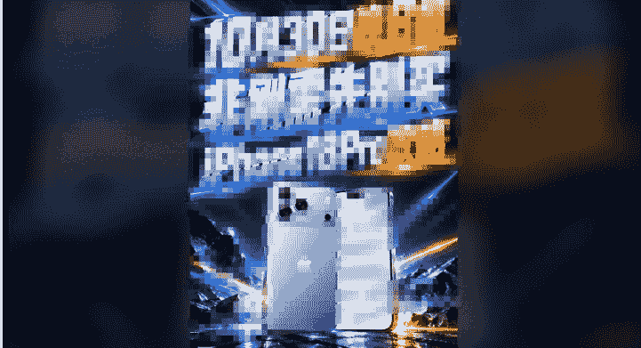

# 8 天冲到 32 万 GMV：用 Codex 与 Remotion 把 CPS 剪辑从手工作坊升级成可复制的生产线

261027 副业 SC 精华

整理：👸号懒人搜索，懒人专属群精选

懒人微信：lazyhelper1

> 小懒判断 | 这套打法更适合已经完整做过一轮 CPS 成片、想提升周期的老手，作者把日产能从 1-2 支拉到 8 支，8 天累计 GMV 32 万。新手别照抄，他自己也强调，没有识别问题的能力就没法给 AI 下指令。最值得借鉴的是文案侧的铁律：只替换暗号和日期，话术骨架保持不动，用来做控制变量。最容易翻车的是素材里的暗号，配音和字幕都换了，优惠图里还藏着别人的入口，整支就废了。

大家好，我是宋知远，加入赚钱不到一年，这次是第三次参加 CPS 的迷你航行。

从 618 开始我就在做带货剪辑，本身有两年剪辑经历，起初 CPS 全部手工：找对标、提脚本、改指令、配音、抠气口、放素材、调动效、做封面。流程都能走，但每多一支就要重新投入一次时间。

航行第一周基本零佣金，产量也上不来。主业经常需要加班，能分给项目的时长很有限，我意识到产能瓶颈在于制作过度依赖我。于是给自己定调：

“这套机制不需要我全程盯着也能自己运转。” 基于这个方向，我用 Codex 与 Remotion 重构了制作方式。日产能从 1-2 支提升到 8 支，投放号从 1 个扩到 5 个。最近 8 天累计 GMV 32 万，佣金约 2300 元。

下面聊聊我怎么判断哪些环节能交给模型，以及如何把剪辑经验转成它可执行的标准。

先说人群。已经完整做过 CPS 成片、清楚合格线的同学上手更快。完全零基础建议先亲手做几支，形成基准判断再交给机器。因为看不出问题，就写不出能让 AI 改对的指令。

## 一、为何锁定 Codex 与 Remotion 这对组合

我现在做两类内容：一类是文字、图、贴纸为主的 AE 感动效漫播，一类是真人出镜口播。两者文案和素材会变，但制作逻辑高度重复。比如金额何时高亮、优惠图何时上、暗号出现时如何强调、字幕怎样跟随音频，这些判断一旦固定就能规则化。

我也试过让 Codex 去操控剪映，在 Windows 环境下体验不顺：Codex 总抢鼠标去点剪映，我还得处理其他工作；基于界面识别、点击、等待渲染的节奏很慢。AI+剪映更像截图-定位-点击的笨办法。Remotion 走代码渲染，先把文字、图片、动画和音频的关系写成脚本再批量出片，更贴合我当前的片型。

另外 Codex 操控剪映只能逐支来，Computer Use 很慢；Remotion 理论上可同时排十几支一起渲染，实际数量受电脑配置和复杂度限制。

筛选标准很简单：这段链路能否被清晰描述、稳定跑通、减少我重复介入。文字动效类，Codex+Remotion 更合适。

## 二、搭建路径：先打通一支，再把规则固化

整体思路可以概括为：参考内容 → 提取并校验文案 → 按账号换指令和时间 → 生成配音 → 处理气口建立字幕轴 → 配图加动效 → 做封面 → 渲染自检 → 人工复核。

口语化说就是：找对标 → 让 AI 换成你的内容 → 自动出片 → 你发布 → 看数据。

具体拆法：

1. 找一支对标参考
把同类带货攻略链接丢给 AI，说明是用“我的暗号”还是“??暗号”。

2. AI 整理文案
结合原片声音和画面字幕提炼内容，替换成你的暗号、更新日期，先给你确认通过后再制作。

3. 准备画面和配音
整理商品图、券图和文字动效素材，生成配音并剪掉多余停顿，让字幕随声音推进。

4. 自动成片
加入图片、动态文字、背景音乐和重点提示音，从内容提炼封面文案并置于视频首帧。

5. 交付与发布
核对暗号、日期和字幕后成品自动保存到指定目录，每支配一条标题，直接发。

6. 看反馈
发到对应号，配置好自己的推广暗号，观察播放、下单和佣金，跑得好的方向继续放大。

日常指令可简化为：> 参考这个内容，用我的暗号，比例跟原片一样。日期改成 X 月 X 号，完成后把成品和标题一起给我。你主要负责选参考、确认内容、发布和看数据。

### 环节与工具对照

| 环节 | 工具 | 它在做什么 | 需要提前准备 |
|---|---|---|---|
| 接收任务 | Codex 桌面端 | 接收链接或文案，调度后续步骤 | 登录并放开指定工作文件夹权限 |
| 获取参考 | 浏览器+视频抓取工具 | 打开链接获取可分析视频 | 工具登录；有 MP4 可跳过；受版权限制 |
| 文案提取 | faster-whisper + OCR | 语音转文字+画面识字幕，双向核对 | 本地语音模型与文字识别工具 |
| 文案修改 | 文案规则 | 按规则替换暗号、更新日期，保留骨架 | 暗号表、日期规则、表达规范 |
| 配音生成 | MiniMax API | 把确认文案读出来 | 账号、充值、API Key、音色池 |
| 气口与字幕 | FFmpeg + 时间戳脚本 | 剪停顿、算出字幕出现时间 | 本地脚本，保证字幕不跑偏 |
| 视频制作 | Remotion + 视频规则 | 文字动效、图片进出、暗号展示、配音音乐 | Node.js、Remotion 模板、图片、BGM、提示音 |
| 封面生成 | ImageGen | 提炼三行要点生成封面并置零帧 | 生图能力、封面安全区规则 |
| 导出交付 | Remotion + FFmpeg，可选浏览器插件 | 输出 MP4、传文件 | 输出路径，微信交付时提前登录传输助手 |

跑起来最费时间的是把每一步的交付标准写清楚。早期我也出现过：成品出来了但不对劲，提了修改意见下一支又犯。后来把反馈沉淀进规则：哪些文案不允许动、暗号要核对哪些位、什么停顿要剪、图片不能遮挡哪里、封面怎么处理。把反复问题变成可执行规则。

其中三个点值得展开。

第一个，文案先核对，再往下走。
我把参考链接交给 Codex，让它抓内容、提口播，同时对照画面字幕。双重核对是因为口播不清时，纯转写容易漏字、错字。CPS 里金额、时间、条件、暗号错一处就可能影响转化。我的文案规则原则是：默认保留原话术骨架和优惠信息，仅修改指定账号的暗号与本次明确要求改动的时间。初期做控制变量，方便定位问题。

第二个，音频先顺，画面再对齐。
用 MiniMax API 生成配音，流程衔接更顺。文案确认后直接出音频，再处理气口和时间轴，减少来回导出。音色我会先试听，挑有精神、中气足、表达流畅的给 Codex 调用，不合适就从库里剔除。

容易踩坑的是标点。想让 AI 说得连贯，不要把标点全删。我现在保留逗号句号，按语义断句，减少碎断。生成后处理过长的空白和可去的气口，数字和暗号必须完整。剪完气口，字幕、图片、动画的时间轴也要跟着调，否则音频已前移，优惠图还在旧时间点。

第三个，每支都在为下一支积累素材。
618 时我攒过一批优惠图，这次让 Codex 优先从自有库里取。库里没有再从参考中提取，检查内容、时间和入口后再归档。特别要注意图内暗号：语音字幕换了，图里还留着别的账号入口，等于白做。检查范围要覆盖文案、图片、封面和标题。

我的做法是先查库、缺啥补啥、核对后归档，下次优先复用。保留素材来源和适用活动，后续更好判断能否继续用，逐步用官方或自有素材替换参考截图。素材库越厚，下一支越快。

## 三、两类片型分开沉淀

动效漫播重在按文案和音频组织文字、优惠图、贴纸、动画和音效；真人出镜先用同一套文案规则整理好话术，我去拍，拍完交 Codex 处理气口、字幕和优惠信息图。参考内容的作用是让它学会哪句话配什么信息、图片解释什么。

封面也分开：动效可单独设计；真人出镜尽量保留人脸，首帧叠关键文字和图。为了省发布时的操作，我把封面嵌进视频首帧，重要信息放在居中 3:4 区域。发布前再确认是否被裁切。

## 四、从模仿到沉淀再到改编

我把它分成三个阶段。

第一阶段，借助参考把完整链路跑通。弄明白输入到输出需要哪些步骤，每步交付什么。少改变量，先解决文案错、暗号错、音画不同步、信息不清等基础问题。进入下一阶段的信号是：指令发给 Codex，能一次做对八成以上。

第二阶段，把重复项沉淀。常用的优惠图进素材库，反复的修改意见进规则，反复的画面结构整理成模块。判断是否进步就看一支比一支少找素材、少解释、少返工。做完一批回头看哪个环节改得最多，那个环节就是下一步要固化成规则的。

第三阶段，逐步增加自主改编。流程稳定、素材积累后，开始调整表达、信息顺序和画面结构。不能等到审核提示才想办法改同质化。前面沉淀的规则是给后面内容尝试腾时间。

## 五、数据的一次验证

调整后，日产能从 1-2 支到 8 支，账号从 1 个到 5 个。各号平均千播水平，每天有万播内容，隔天出现 5 万+ 播放。最近 8 天 32 万 GMV、2300 元佣金。

最明显的变化是制作对我的占用下降，才有余力多做测试、多开账号。以前一天做一两支，想测也测不动。现在产量上来，可以观察话术、画面、声音的差异，再把有效经验补回流程。后续产量还要看选题、素材、审核和运营的承接能力。

## 六、先上线再优化，要落到发布动作

我以前做剪辑容易钻牛角尖。但 CPS 需要持续发布才能拿反馈。每支等到完美，产量会垮。我现在给自己划线：暗号、时间、优惠信息准确，声音清晰，关键信息可读，音画无明显错误，就先发。动画是否更漂亮、转场是否更顺，可以下一支再优化。

好不容易做出来的内容，哪怕只有十个播放，也可能带来订单。永远优化就永远不下场。发布后把问题带回来，哪些错误反复出现就继续改流程。这样先上线才会慢慢变成做得更好。

## 七、已跑通的部分与下一步

目前这套方法在 AE 风格动效漫播和真人出镜剪辑上跑通了。其他类型尚未充分验证，有潜力的是结构固定、图文占比高、需持续换内容的视频。

下一步我想验证的是：当素材库更完整、规则更稳定后，能否进一步减少返工，把更多时间放到选题、内容差异化和账号运营上。

——分割线——

看完 SOP，你可能觉得懂了，但实操第一步就会卡住。工具和教程只是基础壁垒，真正的壁垒是立刻动手和信息差。

如果你想看全网最新的变现玩法，和一群执行力强的极客一起下场拿结果，欢迎围观【懒人专属群】。我们只做商业闭环拆解与 AI 效率压榨，系统内已沉淀 1000+ 跑通的套利实战局。

- 查阅圈子数字资产与上车门槛：https://lazyso.com/insider/
认同价值、准备好下场干活的，扫码加我微信 lazyhelper1，备注【实操上车】，不闲聊。

