# 从自己用到对外卖：我把 AI 工作台做成一条能收钱的流水线，单月利润站上六位数（提示词全给）

> 261028 副业 SC 课程笔记

> **小懒判断** | 手里已经有 AI 产出的内容、可一旦有人上门咨询就只会埋头翻文档的 IP 玩家，这篇对你胃口。还没跑通首单的朋友先别急——它讲的是交付环节怎么提速，不负责教你起号。最值钱的一处思路：拿同一个客户疑问当线索，一条线牵出选题、服务介绍、交付方案。最容易踩的雷：以为这玩意儿就是多挂几个 Agent，实际上得先把自家业务拆解成流程。

各位好，我叫亦恒。先谢谢主办方搭台，前几天那场分享我聊的正是 AI 台子怎么落地。

先把前情交代清楚。七月那篇《如何用 Codex 搭建个人 IP 内容创作系统！》，讲的是拿 Codex 给自己的内容生产提速：把个人经历与知识沉淀下来、筛选题、持续输出带着自己判断的内容。那篇处理的问题是"稿子怎么憋出来"。

顺着这条线，我还写过几篇东西，感兴趣可以翻翻：拿 Codex 搭个人 IP 内容系统、用 AI 视频带货叠 IP 做被动现金流、图书类垂直小店、虚拟资料如何变现。

这么跑了一阵，另一个更棘手的窟窿冒了出来：稿子发出去了，有人私信问服务怎么买、头一步能拿到什么，我这边却要翻回旧文档、把同样的话再说一遍。等真正进入交付，先前聊出来的客户疑问和判断又衔接不上。

尴尬就尴尬在：每个环节都挂着 AI，可环节之间各干各的，每次都得从白纸重来。

所以我这次嘴里的"AI 工作台"，重点压根不在凑几个 Agent 摆一块儿，而是钉在一门真实生意上——把疑问、资料、动作、人的裁决、用完之后收到的反馈串成一条链。同一个痛点，能长出内容选题；稿子底下冒出的评论和私信，又能反过来校准服务介绍。

走到咨询与交付这一步，AI 负责把资料备齐、把备选方案摆出来；核实真伪、拍板取舍、对外许诺，这些归人。

一轮收尾，新冒出的问题和改动缘由回流到下一轮，不再卡在某一次跟某个 Agent 的聊天窗口里。

当然，照你自己的生意和场景往下推，还能把这套东西做成面向客户收钱的交付服务，路数有点像 FDE。

下面我按四块展开：

- IP 增长到底堵在哪一环；
- 如何挑一个具体场景，把能用的台子立起来；
- 哪些活儿放给 AI，哪些决定必须人来做；
- 自己用顺之后，怎么经过真实试用与验收，走到客户那边去。

所谓"IP 10 倍效率"，该拿整条链路来验证——耗时有没有缩短、返工有没有减少、真实需求有没有被稳稳接住。单看 AI 出初稿从一小时缩到 5 分钟，那不算数。这套系统真正值钱的地方，是让真实问题一路贯穿选题、表达、咨询、复盘。

每走一步，都留下人能复核、下回还能接着用的判断。

## 前端这条线：获客机器如何跑起来

先掀开 IP 的前端看看，哪几项活儿能被串起来，流程和运转逻辑大致如下。

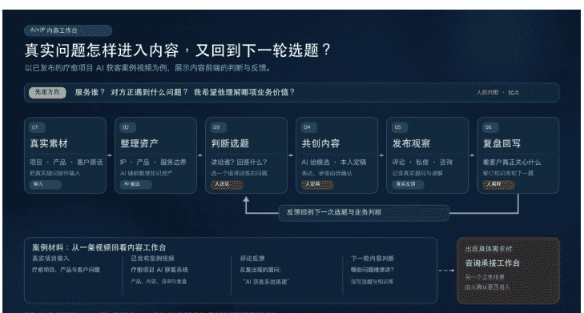

我们动手时，盯的不是"今天该拍什么"，而是一门真实生意怎样借助这套系统转起来。

下面几个案例都做过客户信息脱敏，碰上核心交付和商业机密的部分就隐去了，不影响阅读，还请谅解。

### 第一环：把散落材料整理成能拍板的问题

台子先做归拢：服务文档、项目记录、客户提问，全部收进一处，然后把有凭据支撑的业务事实列出来，再把客户还没想通的地方单独标出来。

举个例子，有人问"什么价、怎么个服务法"，它能把价格区间、服务说明连同原始出处一并翻出来。可这位客户打哪儿来、是刚听说我们，还是已经摸清底细、就差临门一脚，这类判断还得靠人结合聊天记录拿主意。

这一环立住以后，后面无论是定选题还是拟回复，就算我不在场，同事也清楚该答什么、去哪儿找依据，还分得清哪些信息得先请示负责人——拿不准的内容，不会被当成对外承诺说出去。

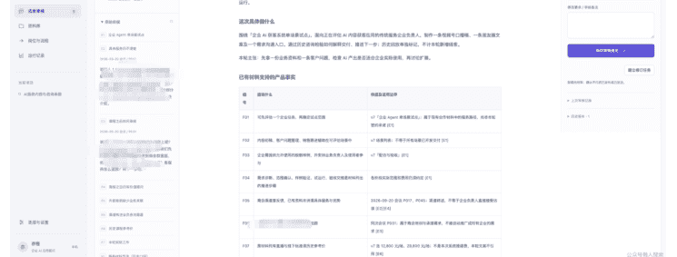

### 第二环：选题、文案、剪片子，一竿子到底

系统握着我们的资料，能把选题、内容、视频制作整条线串起来。

它先依据项目材料和客户问题，列出选题与文案备选；我在审核那一步定夺：这条片子讲什么、哪些事实可以亮出来。搁以前，脑子里蹦出一个点子或者一个选题，得挨个给 Agent 下发指令；如今复制粘贴的工夫省了，直接推进到下一道工序，最后出片、发布。

稿子定下来，就流转进视频制作，配上录音、画面、字幕，剪辑完成。右边那条时间线，就是这条片子的完整诞生记录。省下来的时间来自哪里？前面已经敲定的资料和判断，能直接流进后期，不必再翻箱倒柜找素材、把需求重讲一遍。

当然，选题、对外口径、成片质量，我依旧逐道过手。

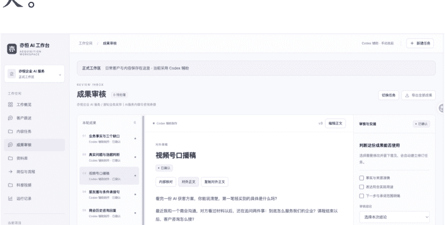

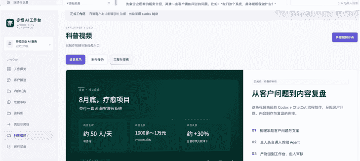

### 当时直接能用的回复草稿

### 对方做了选择之后，怎么往下接

| 对方分层 | 下一次工作内容 | 后续确认 |
|---|---|---|
| 先为...课程 | 用课程交付卡...再次出...排期 | 确认...参考...时长...历史...自行作为...交付 |
| 先做一...企业 | 约业务负责人参加一次需求沟通 | 一个负责人...现...优先...实际使用者...先判断...不要直接全额报价 |
| 先发...成果 | 发给...后...反馈...讲...这是...的证据 | 问...是否...在...工单...无...不需要已...完毕 |

### 跟进记录范本

这么一来，下回我就不必对着空文档，硬逼 AI 凑十个标题了。

顺着这条片子、手里的产品材料、新冒出的用户提问，我能往下挖一个更聚焦的选题，譬如"你稿子已经在发了，也陆续有人来问，头件事该查哪一段？"

要是有人带着自家生意来打听，同一批材料也能先帮我摸清状况，再决定要不要谈咨询。留过一条评论的人，不能就此算作客户或成交。

所以这套系统省下的，从来不是"点一下多出十篇稿"。它真正砍掉的是每一轮重新翻资料、重新介绍产品、重新回想上回为啥这么定的重复劳动。一条稿子做完，事实、选题缘由、定稿红线、用户追问统统留档；下一条顺着这些积累继续长。这 3 张图，是我自己拿它跑出来的成绩：9 月那个服务周期，利润大致达到六位数字。其余的就不多晒了，跟圈子里真正的高手比，我还差得远。放出来只想说一句：当下做这类服务，特别是扎进细分赛道的，机会依然明摆着。

### 同步块

- **[模糊] 外部**
  9月4日 13:27 | 组织者：[模糊] an F...
  录制：[模糊] 202...

- **[模糊]**
  9月3日 15:10 | ID [模糊]

- **/[模糊] 操答疑 外部**
  8月12日 14:55 | 组织者：亦恒 | IC [模糊]

- **[模糊]统交付确认会议 外部**
  8月6日 13:59 | 组织者：亦恒 | [模糊]

- **交付确认会议 外部**
  8月2日 15:42 | 组织者：亦恒 [模糊]

- **交付确认会议 外部**
  8月2日 14:57 | 组织者：亦恒 | ID [模糊]

- **[模糊]AI+IP系统沟通会议 外部**
  7月24日 14:55 | 组织者：亦恒 | [模糊]

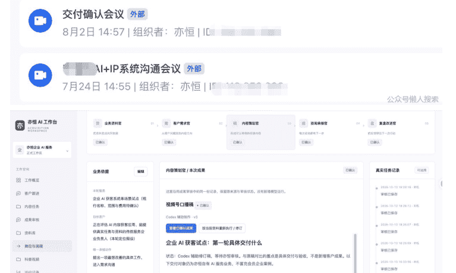

### 交易明细详情

+¥10,000.00

| 项目 | 内容 |
|---|---|
| 交易账号 | 6215 80** **** **** 8 964 |
| 交易时间 | 2026-09-10 11:05:22 |
| 对方账号 | 6212 26** **** **** 4 089 |
| 对方户名 | （遮挡） |

| 左截图 | 右截图 |
|---|---|
| 交易明细详情：+¥46,204.00 | 交易明细详情：+¥76,636.23；余额 ¥8…4 |
| 交易账号：6215 80** **** **** 8 964 | 交易账号：6215 80** **** **** 8 964 |
| 交易时间：2026-09-16 12:06:36 | 交易时间：2026-09-10 10:40:03 |

圈里龙哥十月抛出的 AI 工作台超级标就摆在那儿，各位不妨对着自己的行当动手试试。

龙哥 ｜ 已关注 2026-10-05 10:19

# 【超级案例20】行业 AI 工作台

#超级标# 020

国庆假期还剩几天，我打算每天更一条超级标😍

昨天写的是 X 中文 AI 自媒体那篇【超级标19】，更贴流量；今天换个更贴产品的：AI 学会了，做什么、卖给谁？那些对 AI 一知半解的人，凭什么从我们兜里掏钱？

9 月 20 号那场开放活动，12 位社群成员登台做项目展示。

听到半场，我发觉好几位端出来的东西，都是自己捣鼓的工作台：

- a. 替电商卖家做详情页的
- b. 帮📕店主和达人做运营的
- c. 为视频号卖货配图文视频的
- d. 给律所资深合伙人和财税咨询师当"CEO 编外军师"的

台下我当时就说，接下来得写一篇专门聊工作台的超级标，也就是这一篇。几个月跑下来，我的判断是：往后几年，细分领域的 AI 工作台，大概率是个值得盯紧的生意窗口。不管留着自己使，还是包成服务对外卖，大家真正缺的不是又一个会聊天的机器人，也不是新出的生成工具，而是一条能把内容、咨询、交付、反馈环环扣住、自行转动的链条。

我做这套东西，图的就是把这几个环节重新咬合：真实问题流进内容，每回沟通沉淀下判断，反馈又去改写下一轮表达。

要是你脑子还糊着，不妨从大多数人的惯性认知起步——AI 嘛，无非写写东西。

## 一、增长的起点：揪出客户真肯掏钱解决的事

先琢磨两个问题：让 AI 出一条稿，你花多久？一篇你心甘情愿发出去、还清楚该给谁看的稿，又要花多久？这俩时间，差得是不是有点离谱？

上次 AI 方向的那场沙龙《如何用 Codex 搭建个人 IP 内容创作系统！》里我讲过：最早拿 AI 出稿，最扎心的不是"它憋不出来"，而是"它憋得太像一篇范文"。标题、结构、收尾一应俱全，什么模板都能照猫画虎。

我读着顺，可又觉得换谁的名字贴上去都成立。

后来我给自己设了道极简自检：把署名抠掉，同赛道的人能不能一个字不改直接发？能，那这篇传递了信息，却还没长出我的 IP 味道。

症结在哪？最要紧的那几样，我留了白。

我踩过哪些坑、这事儿怎么就扭转了我的看法、到底想让哪类人听见、读者看完该怎么掂量自己要不要接着了解——这些，靠一句"帮我写个爆款"是问不出来的。

后来真刀真枪做 AI 项目落地、咨询、培训和企业服务，这个毛病暴露得更彻底。你让 AI 写"企业如何借 AI 拉客户"，它扭头就甩出选题矩阵、客户画像、自动应答、私域流程自动化、线索分级。词儿个个正确，塞进一场真实对话里却未必顶用。

现在我们养成个习惯，先掰扯清楚：客户嘴上说的"我想要"，和他每天真金白银在为哪件事买单，往往不是一码事。

有人讲想学 AI，我们就聊工具；有人讲想做 Agent，我们就搬系统。

可要是不追问他到底卡在哪、眼下靠什么土办法顶着、顶不住会耽误谁，那咱讲的很可能只是个他觉得新鲜的词。

这些技术黑话、工具选型，甲方根本不吃。他盯的只有一条：你能不能把问题解决掉、能给出什么效果。

说个真事。之前跟一位做大健康私域的朋友聊，她每天被海量群消息淹没，全靠人一条条捞出有用的客户问题，归档到飞书，慢慢攒成问答手册。过去这活儿极度吃人力，慢得让人抓狂。

我没急着给它扣一顶"搭个全能智能体"的帽子，而是先摸清：这些问答怎么存下来、哪些答案员工能直接照搬、哪些非得她本人点头。头一段跑通了，后面的自动化才谈得上意义。

我掂量一件事值不值得往下做，看三层凭据：

- 有没有真实发生过的场景；
- 对方眼下怎么应付、为此搭进去多少；
- 他肯不肯交出资料、试一份样品，或者为一个能验收的结果掏钱。

三层捋顺了，稿子该答什么、这套系统头一刀切在哪儿，自然水落石出。

增长的起点，不在逼 AI 多吐内容，而在锁定那件客户早就想办、却始终没办利索的事。

更要紧的是，让正被这件事折磨的人瞧见你、明白你凭啥这么判断、并且信得过你能把开头那一步走稳。问题找准了，稿子才晓得说给谁听；至于怎么从被瞧见一路走到被信赖、被挑中，那是 IP 自己的功课。

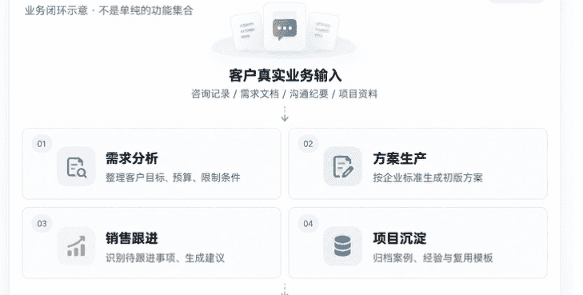

## 二、IP 的商业链路：被瞧见、被信赖、被挑中

我理解的 IP 底层逻辑很朴素：IP 是生意的放大器。用户、问题、产品、交付先捋清楚，内容才有东西可放大。

这几样要是糊成一团，内容越快越多，放大的可能只是那团模糊本身。

说回大家想靠 AI 挣钱这档事：头一步不是去抢最火的工具，而是先盘明白，自己能用 AI 帮谁啃下哪一段实打实的活儿。AI 写东西，只负责让你被瞧见；稿子里透出的判断，负责让人信你；真到了交付那一步，人家才肯把银子搭进去。

### a. 流量的意义：让对路的人认出自己的处境

从前做内容，头一个念头总是"这题有没有流量"。如今我会多问两嘴：这条东西，要让哪一类人认出自己的处境？辨出之后，他下一步往哪儿走？

好比"AI 工作台能帮企业提效"，听着谁都能套。

可换成"客户反复追问首阶段交付啥，写内容那头和跟进那头，两边口径对不上"——这种从真实客户嘴里长出来的困惑，才会让踩过同一个坑、正着急找答案的人刹住脚。

这种"窄"，并非受众缩水，更多是你开始冲着一个具体场景开口。

再比如，以往想找爆款话题，得一条条拆解热门视频、归纳对标账号的共性问题，再从中扒出适合自己的切口和选题，费时又费劲。

现在我们把 AI 自媒体热点分析工具接了进来，按需检索目标平台、自动排序，一键就能从对标爆款里提炼出共性议题，直接推入下一步选题创作。

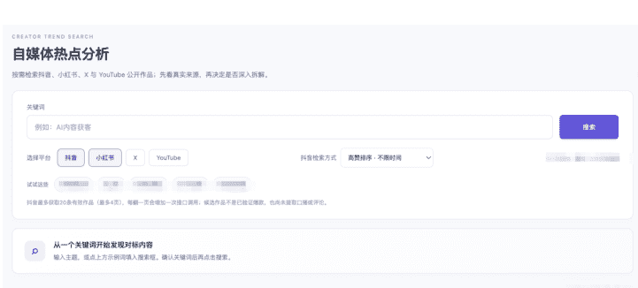

往深里讲，这套台子凭什么把 IP 内容生产拉到 10 倍效率？诀窍是：把 IP 稿子切成三种职能，再照每条视频的具体目标来挑。

有一类负责让人认识你，聊趋势、亮新机会；有一类负责攒信赖，讲你为啥这么判断、栽过哪些跟头；还有一类，负责让需求已经明摆着的人知道下一步怎么联系。

三类之间可以互相引路，但别指望一条东西同时扛下流量、信任、成交三副担子。否则播放量一冲高，你嫌它没带来单子；内容一挖深，你又嫌它不够爆。

要是你已经在做账号，不论图文、视频还是播客，回想最近那条播放还行、咨询却没跟上的作品：它招来的是哪路人？评论区在问什么？

有人纯粹图个知识点新鲜，看完就走；有人会说"我也正被这事儿卡着"。这两种反馈，含金量天差地别。

### b. 信赖靠判断和证据，不靠工具秀

多聊两句我怎么看反馈。

头一眼看这条东西落到了哪些人眼里，这是传播面。

第二眼看他们有没有提到自己手头正在忙的事，这是需求线索。

最后看这个问题我愿不愿意长期答、能不能跟现有产品或服务接上，这是我的取舍。

三步，一步都省不得。

一个人光说"太牛了"，我自然高兴，但不会因为他点了个赞就把他当客户。可要是另一个人说"我压着几百篇旧笔记，团队每次做课都翻不出从前讲过的案例"，那这就值得往下问：眼下谁在找？找不着会亏什么？找着了准备用在哪一环？

你会发现，机器能干的和人该干的，完全是两码事。AI 能把评论按主题归类、能把反复出现的用户原话扒出来，可它猜不到我今年打算卖哪种服务，也替我拿不了要不要开新课的主意。

从前一有热词我就想扑上去，如今我更愿意让热点先晾一晾，看看它背后站的是不是一个反复出现的业务动作。

资料库本身不是产品。用户要解决的，可能是"每次写稿别从零起笔"，也可能是"团队交接别把判断弄丢"——这是两笔截然不同的交付。

### c. 客户肯选你，是因为下一步看得清

这儿还藏着一笔常被忽略的成本。

做内容烧掉的可不止发布前那十来分钟。找资料、核事实、改措辞、配图、发完还得答问题，统统得算进去。

要是 AI 把初稿从一小时压到 5 分钟，你却为了查它有没有瞎编又搭进去俩钟头——这叫生成提速，不叫工作提效。

要是内容质量还过得去，却把一堆不对路的人引进私聊窗口，你的销售精力被白白放血，这也算不上获客成功。

所以我会记下的，不光是"这次吐了几条"，还有这条东西最终完成了哪项任务、下一轮能不能复用。

我甚至会给自己出个反直觉的题：有没有哪条作品，我宁愿它播放少一点，也要让真想找我干活的人把关键信息听进去？比如把企业试点的边界讲透。

它十有八九拼不过"最新 Agent 震撼发布"那种标题，可要是它能让一位负责人弄明白起步阶段该备什么，省掉一场两边鸡同鸭讲的会，商业价值反而更大。

个人 IP 从来不是靠单个爆款撑起来的；大量信赖，恰恰攒在那些不热闹、却能答具体问题的内容里。

被瞧见，不是让所有人都刷到我，而是某人撞上某类麻烦时，脑子里能蹦出"这事儿他讲过"。

被信赖，也不是我反复吆喝自己懂 AI，而是他能从案例里看见我怎么拆问题、凭啥这么定、哪些事眼下不能许。

到了被挑中，他还会掂量：不找你，我眼下怎么熬？找你试头一步，我能落着什么，又得担什么风险？

所以这套玩法真正该沉淀的，不只是一句观点，还得是一份客户能自己掂量、也能转述给同事的依据。

## 三、让内容、咨询、反馈互相咬合

收个尾：这套台子对 IP 增长最大的贡献，不是多写几篇稿，而是把四样东西接上——真实素材进得来，稿子清楚自己在替谁答什么，发布和沟通留下反馈，下一轮能在上一轮的地基上继续盖。

过去是"想到选题—生成—发布—结束"；往后要变成"真实问题—判断—表达—使用—反馈—再判断"。

# 别把复盘变成“下篇重写”

若一轮回音只换来“下篇再改”，那仍然停在内容流水线上。真正值得追问的是：这轮复盘有没有改变我们对产品、服务能做到哪里、接下来怎么交的判断。

闭环若不成立，旧路径不过是多装了一台跑得更快的 AI 灌装机。

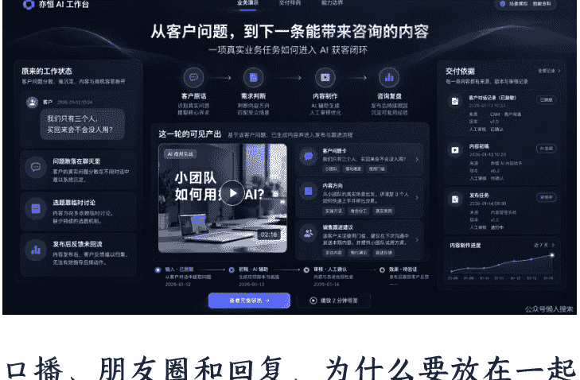

## 口播、朋友圈、私信回复，为何要放进同一张审阅单

这三类文字面对的困惑相同，只是站位不同。

口播负责让初次听见的人明白“这事跟我有什么关系”；朋友圈向已经认识我的人交代“最近到底在忙什么”；回复草稿则服务已经发问的人，帮我确认对方是想上一场课，还是想找家企业把某项具体事务落地。

并到同一件事里看，我审的就不再是三段互不相干的文字，而是一条从被看见、被理解，到继续对话的链路。

这并不是说每份稿都会发，也不保证发了就能成交。它的意义在于检查点终于清楚了：以前容易问“像不像爆款”，现在先问“这段话在回答谁在什么处境下的哪个问题”，再看背后有没有真需求，以及接下来该安排什么跟进。

衡量提效，我盯三层。

头一层，单项事务的投入时间、修改次数、可用质量有没有变化。

第二层，这份东西有没有被真正用起来，下回能不能复用同一套拿主意的办法。

第三层，有没有出现更匹配的咨询、合作和持续使用。

内容怎样接上生意？做 IP 的人常卡在两处：一是似乎什么都能讲，二是讲了半天不知道该卖什么。我前几年做过图书内容电商和知识付费，若只求流量，选题并不缺。难的是：这条内容最终让别人记住了我哪一种本事。

讲热门工具，流量来得快；讲自己如何判断一项业务值不值得投入，流量未必最大，但别人遇到相似难题时会想起你。

用户心里留下的“你能替我解决什么”，比单条播放更接近商业资产。

两个人都在讲“用 AI 做知识库”。头一位连演示十种插件和自动化，观众觉得技术熟；另一位拿一段实际客户咨询，展示原始材料散在哪里、头回回答为何出错、后来怎样整理成下回能直接用的判断。

后者未必炫，却更容易让正卡在麻烦里的人觉得“你能接住”。能被接住的事，才可能变成可反复交付的服务。

关键一句：AI 管出稿速度，操作台管一件事能不能一路做完。下面不讲抽象架构，回到业务情境看最小操作台怎么搭。

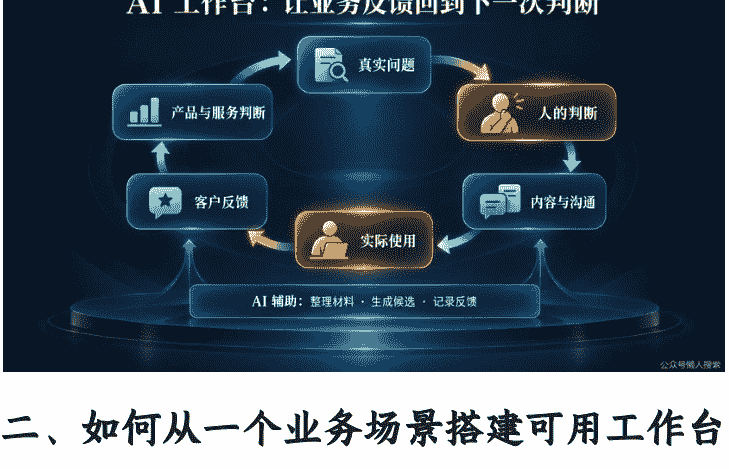

# 二、从业务情境搭出能用的操作台

## 1、挑第一件要试的事：常发生、耗神、结果能查

第一版操作台，先从最近两周实际干过的三件具体活里挑。

别写“做内容”“做销售”这种宽泛词，要写到具体动作：什么事件触发，原先谁处理，完成后交给谁用。

挑头一件，看三点。

它是否反复出现；代价到底在哪，不只是写稿耗时，还包括找材料、来回确认、返工、漏掉跟进；结果能不能查，实际接手的人能否指出哪里可用、哪里不对。

再追问：把这事做好，能不能推动接下来的生意？若只是让 AI 更快造没人用的东西，就不必先做。反过来，低频但错一次代价很大的事，也可优先。

首轮只挑一件：手头有现成材料，有人肯查，能先出样。材料没有、谁用不清，先把条件补齐。

情境定了，写一张工作说明单：服务谁、交出什么、怎么查合格。

### 【现场练习｜用指令模板锁定首件试跑事项】

请 AI 担任场景诊断助手。先不推荐工具、执行体或系统架构，只从实际事务里挑第一件值得试跑的事。每轮仅抛一个问题，依次弄清：

- 最近两周实际做过哪三件具体活？每件由什么事件触发、谁处理、完成后交给谁？
- 每件多久出现一回？时间花在处理、找材料、沟通还是返工？做不好会影响什么后续举动？
- 手头有没有实际输入材料和合格样例？谁能判断结果可用？

信息不够就继续追问，不要替我编造频率、耗时或商业结果。最后把三件活放进一张表，分别看：是否实际发生、值得反复解决；眼下代价或业务影响多大；有没有材料可试跑；能否交出由实际接手者检查的结果。

推荐最适合先做的一件并说明理由，另外两件写暂缓原因。别把“高频”当唯一尺子，低频高代价也可入选。把推荐项写成一句话：“当____发生时，用____材料，先完成____结果，交给____检查，用于____后续举动。”再告诉我：头回拿哪份实际材料试跑，人重点查哪两三处。

## 2、定价值：说清服务谁、交出什么、怎么查合格

挑出值得做的事，还差一步：把价值讲清。“值得做”不等于“做出来有人用”。

别急着搭执行体。很多人事项选对了，价值却定歪。比如每天写稿，搭系统后一天十篇，效率看似有用；但这十篇有没有让对方更懂你解决什么？有没有更愿意谈？不知道。

价值分三层看：我的活有没有变轻，找材料、沟通、修改的时间有没有减少；对方下决定有没有变容易，看完这份东西能否决定接下来怎么做；生意结果有没有出现，这份东西是否进入实际使用并带来后续沟通。

前两层可先做样找人查，第三层只能在真实投入后观察。

最容易犯的错，是拿头一层顶后两层。“AI 十分钟写完”说的是我的效率；“对方看完愿意继续聊”才是对方价值。两者有关，却不能画等号。

先找一个具体的决定时刻。定价值不是把 AI 能做的功能列满，而是约定：替谁解决哪一步，交出什么，谁拿实际情境查。

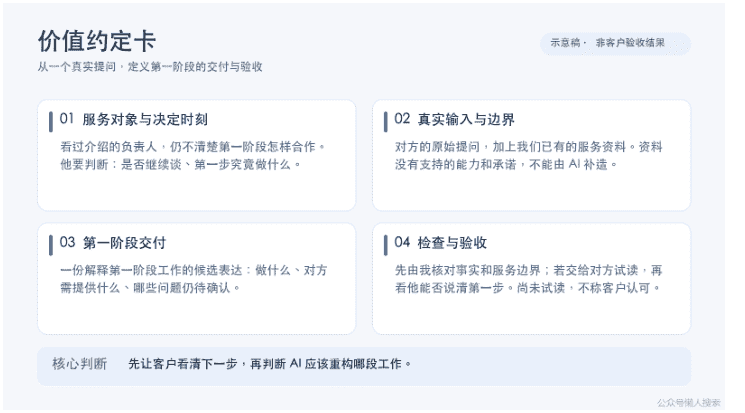

把这件事写成一张短单：

- 谁在问？
- 原话怎么讲？
- 手头有哪些事实？
- 想交出什么？
- 谁拍板能不能用？

这五项看着像表格，实际是替后面少返工。

## 3、重排走法：让 AI 参与整段，不只加速某步

情境选好、价值讲清，才轮到操作台。先别给每步配执行体。

先弄明白：这件事从哪触发，到什么状态才算真正收尾？中间哪些定夺、等待、交接，过去靠人反复解释、反复补救？

把实际走法画出来，再让 AI 帮诊断：哪些信息总缺，哪些活其实不必干，哪些输入该走不同岔路，哪些问题必须人拍板。

然后重排顺序。

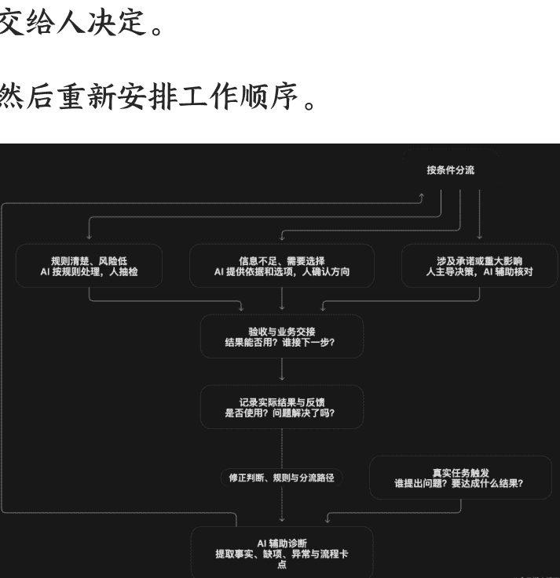

AI 不只在某步产出，它要帮我们更早暴露问题、把事项送到正确岔路，并让下轮建立在这轮结果上。

怎么判断走法被重排了？看新信息进来后，接下来是否仍从零开始。

所谓重排，不是让 AI 单独写一篇稿，而是让一个实际问题贯穿材料、表达、把关、回音；每走一遍，下遍有据。

### 【实操指令模板｜诊断并重排一段实际走法】

请 AI 担任业务流程诊断助手。从一件实际发生的事里，找出第一版操作台最该重排的路径。先还原事实，再提改动；别把原步骤逐个加上 AI 就叫重排。

先让我提供最近完成该事的一例：什么事件触发、收到哪些实际材料、经过哪些步骤和交接、哪里等待或返工、最终交给谁用、对方是否真用。耗时若是估计请标明，可用脱敏材料。

信息不够时每轮只问一个关键问题。若我拿不出实际发生的事，先给材料准备清单，不要画假路径。

拿到实例后完成：

1. 还原现行走法：从触发到结果被用，逐步写明谁处理、输入什么、产出什么、交给谁；已核实与待核实分开。
2. 找出真正损耗：重复劳动、材料缺失、错误分流、等待、返工、无人负责的交接，指出哪处会波及后续生意。
3. 只选一个最值得先试的改动：哪些步骤保留、取消、合并、提前或分流；哪些交固定准则，哪些让 AI 整理信息或提备选，哪些必须人拍板。不要直接设计完整系统。
4. 画出这一小段试跑路径：开始条件、所需材料、每步负责人、产出结果、停止或转人确认的条件、完成标准。
5. 设计一次实际试跑：用哪份材料、由谁实际使用和查合格；记录旧走法与新走法的总耗时、返工次数、结果是否可用，以及后续举动有没有人接住。

最后输出“现行走法—损耗证据—建议改动—试跑方法”对照表。尚未试跑的效果一律标“待验证”，不要宣称已提效、增长或成交。

## 4、从一件活开始搭自己的操作台

情境、交出结果、路径边界定了，动手时别一次把内容、咨询、成交、复盘全接起来。

先挑一件反复发生、最耗神的环节，让它从输入到回音完整跑一轮，跑通后再接下一件。

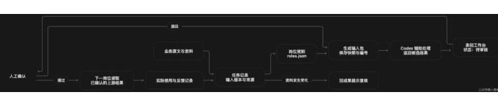

不想自己操作，可跳到本步末尾的指令模板，把它发给 AI 工具。

第一步，写工作说明单，确定操作台要完成什么。

从最近一周挑一件重复出现、耗神、结果易查的事。例如：收到用户提问后，依据现有材料形成回复备选。说明单只写四件事：

- 何时启动：收到一条具体提问。
- 需要什么输入：提问原话、产品或服务材料、不能越过的服务边界。
- 应该交出什么：回复备选，以及还需向对方确认的问题。
- 怎样算合格：答了原问题，关键说法有材料依据，没有替拍板人做出未确认的承诺。

这张单把“让 AI 帮我做业务”缩成能开始、能收尾、能查合格的事。

第二步，先写分流准则，决定事项往哪走。

操作台接到输入，不立刻调用写作本事；先看材料够不够、问题属哪类、谁有权定下一步。第一版可用简单分流表。起初人对照表判断；处理一批且分类稳定后，再让 AI 先分、人检查。

注意：分流口径写不清，多配执行体只会让更多事项更快走错。

第三步，给每条岔路接上对应处理本事。最小链路：收到原始事项→判断类别与材料是否齐全→调用对应本事产出备选→检查结果→人确认。

这里“调用本事”未必是复杂智能体，可以是一段固定指令模板、一个技能，或一次针对材料的检索。关键是不同事项不同处理：材料缺先追问，齐全才产出；涉及承诺时，AI 只备判断材料，最终决定留给拍板人。

第一次搭，用一张表记录事项、手动调用 AI、手动查结果，已经能跑通。等知道哪些环节稳、哪些总出错，再考虑自动触发和工具连接。

第四步，保存人的修改和实际回音，让下轮有据。

每完成一轮，至少留五项：原始问题、分到哪条岔路、用了哪些材料、AI 备选、拍板人改了什么。真正投入后，再补一项：对方接着问什么，或在哪步没继续。

回传记录不是让 AI 自动“学一切”，而是知道下轮该改哪里：事实不全就补材料；事项分错就改分流口径；备选常说过头就改边界和把关标准；对方始终看不懂，就重查交出的东西有没有答他的问题。

这样，一件活才走完从实际输入、准则判断、分流调用、人过目到回音回传的闭路。跑通首件后，再用同法接入内容创作、用户咨询或数据复盘。

操作台的价值也在这里慢慢长出来：把原先靠个人记忆和临场拍板的事，变成可查、可交接、可继续改的走法。

### 附指令模板：

我想从自己的一项重复活开始，搭一个最小 AI 操作台。请你担任流程设计助手，先把事项定义清楚，再设计分流准则、调用本事、人过目和回音回传。先问我以下信息；我没提供的内容不要自行编造：

- 1. 最近反复发生、比较耗神的一件活是什么？请我提供一条实际原话或脱敏样例。
- 2. 做这件事时，我目前会参考哪些材料、历史记录或业务口径？
- 3. 我希望最后得到什么具体产物？由谁使用、谁查合格？
- 4. 哪些决定或承诺必须由人确认？哪些信息目前还不清楚？

收到回答后，请只围绕这一件活设计第一版操作台，不要扩展成完整业务系统。按下面格式输出：

一、工作说明单：写清触发条件、输入材料、期望产物、使用者、合格线。指出目前缺少的关键输入。

二、分类与分流口径：用表格写出“遇到什么情况 → 如何判断 → 下一步交给谁”。至少区分：

- 信息充分，可以调用 AI 产出备选；
- 缺少关键信息，先向人追问；
- 涉及价格、效果、交付范围等承诺，交拍板人决定；
- 超出当前事项范围，暂不处理。

口径要具体到我能照着判断。拿不准的情况，默认交人确认，不要强行分类。

三、最小运行路径：用“输入 → 判断 → 调用 → 检查 → 人确认 → 使用后回传”写出每一步：

- 这一步读取什么；
- AI 或人具体做什么；
- 留下什么结果；
- 满足什么条件才进入下一步。

第一版优先允许手动操作，不要求开发平台或同时创建多个执行体。请明确哪些步骤现在就能用普通表格和 AI 对话完成，哪些是路径跑稳后才值得自动化的。

四、一次试运行：用我提供的实际原话，沿着这条路径走一遍。展示它被分到哪条岔路、依据是什么、AI 应产出什么、哪里必须停下来等人确认。缺少材料时只列待补问题，不要虚构试运行结果。

五、回音回传表：设计一张不超过六列的记录表，让我记录原问题、分到哪条岔路、人的修改、实际使用后的回音，以及下轮该改“材料、口径还是指令模板”。最后只告诉我：今天为了跑通首轮，我需要准备哪三样东西，以及怎样判断这轮是否真的跑通。不要用生成速度、产出数量或未经验证的增长数字代替业务验收。

# 三、哪些环节交给执行体，哪些必须人拍板

把一件事从触发到查合格重画一遍，只解决了“怎么走”。真要跑起来，还得回答：每步谁负责，什么情况必须停。

方法不是先数要配几个执行体，而是逐节点问四句：口径清吗？结果能查吗？错了能撤回吗？会不会替我们向对方许诺？这四问比“这里能不能加执行体”更要紧。

## 1、可交给 AI 的，是重复整理、分析、起草备选

按事项性质分工：哪些交准则，哪些交执行体？

条件和动作都明的，比如按固定字段归档、提醒拍板人、把查通过的结果送到指定位置，普通准则或技能就能干，让执行体做未必更稳。

执行体更适合要理解上下文的地方：

- 材料缺时指出缺项；
- 几条信息打架时标出依据；
- 接到不同事项时建议走哪条岔路；
- 执行中遇到预设口径盖不住的情况，整理问题交给拍板人。

它可以备判断，也可在明确授权内继续干，但不能把自己的推测直接当成已确认事实。

所以分工不按“重复不重复”划线，而看它究竟需照准则执行、结合材料拿主意，还是承担商业责任。同一段走法里，这三类事往往同时存在。

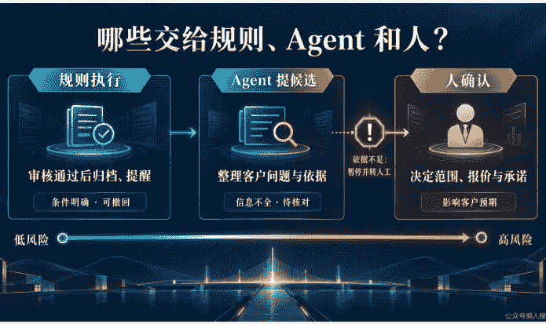

## 2、按错误代价设关口：人在哪些节点必须定夺

操作台能把业务往前推，不代表每步都该自动放行。

真正要看错误代价：内部材料归错类，改回来就行；对方需求判错，后面方案可能全跑偏；报价、交付范围或效果承诺说错，直接影响信任和成本。

所以人的时间该放在后两类节点。我按风险设三道关口。

低风险、可撤回的事，比如材料归档、线索去重、按既定口径提醒拍板人，交系统执行，抽查异常即可。

信息不完整、需解释的事，比如判断对方属哪类需求，让执行体先整理依据、标缺项、提备选路径，再由人确认。

涉及资源投入和对外承诺的事，必须停，由有权负责的人定夺。

这三道关口对应三种人的拿主意：

- 方向：眼前要帮谁解决哪一步，值不值得做。
- 取舍：现有证据支持哪条岔路，哪些需求暂时不接，哪些结果还要试。
- 承诺：第一阶段交什么、谁来完成、对方凭什么查合格。

执行体可摆材料和选项，却不能因为方案写得完整，就替业务拍板人回答这些。

尤其在获客链路里，信任在细节上建立，也在细节上流失。对方问“第一步能拿到什么”，系统却推来一套全能方案；原本还在讨论可行性，回复里已写成“保证增长”。这类错不是文风问题，而是把对方正在做的判断，换成了我们想表达的答案。

操作台越能批量生产和分发文案，这种偏差越要在流出前拦住。分享三步追问：

- 有没有回答当下的实际问题？
- 关键事实能不能找到来源？
- 这一步有没有替我们做出尚未确认的承诺？

这样设关卡，走法不会因为每步都要人看而变慢。可逆、可查的步骤先跑；会改变对方预期、资源投入和合作关系的决定，留给能担责的人。

## 3、把每次把关和回音，沉淀为下轮能用的判断

不少用过技能和类似执行体的人都会遇到：第一次产物人过目发现问题，改过一遍，但系统只把眼前这份改对了。下回类似事项，拍板人还得把同样的话再说一遍。

如果把关经验留不下来，系统就原地打转：这轮改的是眼前稿，下轮仍从零解释。

真正该沉淀的，是下回能直接调用的判断——哪些材料必须补，哪条分流口径要改，哪类承诺不能越过人，哪种交出的东西根本没答对方的问题。

这样，每次回音才不只是修一份稿，而是在更新下回干活的起点。

关于智能作业体系，我们的实操感受是：不能只把最终稿留下，还得留下推理痕迹——因何暂停、凭据在哪、调整之后如何判断可用。通常先把反馈归成几类：第一类是信息有误，比如引用了过期或未经核实的内容；第二类是理解对象偏了，比如把新来客户的疑问按老用户的情境答复；第三类是流程和授权不规范，比如该送审的没送审就直接外发；第四类是表述与立场不匹配，内容虽然符合事实，却不能代表我们的态度。四类问题的处置方式各不相同，不能一把抓成“只要把模型调得更强就行”。

凡是出现值得再次借鉴的偏差点，就留一条简短的判定备忘：任务内容、触发的问题、一手凭据在何处、人做了何种决定、未来在何种前提下应如何处理、由谁做最终确认。只有触发条件而无处理办法的意见，只是感觉；没有凭据和责任人支撑的规则，也不应自动变成系统的默认设置。

不过，我们倾向于不急着把任何一次改动固化为长期规定。委托方的一句话可能只对当下情境成立，产品信息也在持续变更。正确的做法是先拿类似任务做回溯推演：该判定能否拦截原有的偏差，又会不会妨碍原本能顺利推进的工作；然后再设一个边缘场景，观察它在哪些条件下失效。只有通过验证，它才能进入提示词、技能包或审阅清单，并标注资料版次和责任人。

复盘的目的不是比较“这次产出了多少内容”，而是观察三个变化：同类偏差有没有再出现；审核者能不能更快找到依据；客户和接手的人是否更清楚后续行动。这三个变化也许不会立刻表现为增长，却能说明系统是否减少了重复判断和业务歧义。

这也说明，知识库并不等于资料仓库。资料库回答的是“我们已经掌握哪些信息”，判定备忘回答的是“哪些情况下可以调用、何时必须停下来请人拍板”。两者连起来，后续任务才能从上一次反馈的终点继续，而不是每次都重新问同样的问题。到这里，整套机制的分工就清楚了：规则负责确定动作，智能代理负责整理信息和提供候选，人来决定方向和承诺；经过审阅验证的判定再回流到系统。

### 【实操指令｜人工审阅沉淀为候选判定】

你是系统的复盘助手。请你拆解一次真实的人工审阅或调整，评估其中是否存在可沿用到后续工作的决策。每一轮改动只能产生“候选判定”；未经回溯推演和责任人确认，不得升级为正式提示词、技能包或系统默认项。我会提供：起始工作与材料、AI 的初始输出、人工调整前后对比、调整缘由、最终确认人，以及结果是否已被实际使用。若缺少一手凭据或调整缘由，请先指出空缺，不要猜测我调整的意图。工作内容包括：1. 找到偏离正确答案的具体环节，并将主要原因归类为：事实与信息版本出错、对象与题意理解出错、流程与权限处置不当、措辞与立场不匹配，说明它可能影响工作的哪个环节。2. 评估该调整是当次偏好，还是可能适用于某类工作；只在有依据时提出候选判定，并写清：由哪些前提触发、需要核对哪些凭据、应如何处理、何种情况必须停下交给人、谁有权限确认。3. 设计两组回溯：一项相似工作用于验证候选判定能否拦截原有问题；一项边缘工作用于验证它是否会妨碍正常流程。优先由我提供过去的实际案例；如果无法提供，就只写测试设计，不要标注为“已验证”。4. 依据实际回溯结论，将状态标为“待补凭据”“候选判定”“回溯通过”或“责任人确认”。信息可能变化之处，请记录适用版次与复查时间。5. 建议该内容暂时存放于修改记录、审阅清单、提示词或技能包中，并说明理由；只有回溯通过且责任人确认，才可建议进入正式规则。最后请生成判定记录卡：起始工作、凭据来源、错误类型、人的决定、适用条件、例外情形、回溯状态、信息版次与责任人。请区分“这只是我的建议”和“系统已经具备稳定执行能力”。

# 四、从个人提效走向对外交付

## 1、从“自己用得顺”到“别人能稳定使用”

很多人关心，玩转这套系统能不能赚钱。以我们的实操经验看，机会是有的，但它不取决于你会部署多少工具、搭建多少智能体。别人愿意付费，通常是因为他手里有一段反复发生、耗时耗力且容易出错的工作，而你能把这段工作变得清楚、好用、有人兜底。

自己用得好，距离交付给客户还有一段路：换个人来操作，流程还能不能跑通？你熟悉每份材料放在哪里，看到一句话不对可以顺手改，但客户的团队没有这些背景。所以交付之前必须把边界说明白：从哪种信号开始、需要对方提供哪些输入、系统会产出哪些结果、遇到材料不足或超出服务范围时找谁、达到哪种结果才算完结。

我判断能不能靠交付智能体赚钱，不看智能体数量，而看实际使用者能否用自己手头的材料完成一轮实际工作；出错时能否查到原因和责任点；你不在场时，他是否清楚接下来该怎么做。自己能用，说明找到了方法；别人能接手，才开始证明这是可交付的服务。至于对方是否会持续付费，只能在后续实际合作中继续验证。

比如，一位企业负责人前来询问“AI 作业系统如何接入、如何合作”。表面上是同一类企业智能化需求，实际上可能是三种截然不同的交易：协会想办一场科普课，让会员们听懂并尝试；企业老板想选一段业务做验证；负责人只想先看演示样品，再决定是否向老板或团队推介。三种情况下，付费者、使用者和验收者各不相同。如果你听到“有人感兴趣”就立刻报出一整套系统搭建方案，后续沟通很容易错位。

## 2、从一项可验收的结果设计教学或企业试点服务

想把这件事做成服务，要先讲清楚“第一步能得到什么”，而不是上来就展示整套体系。因为同样一项 AI 能力，在不同客户眼里可能被看成完全不同的商品。

第一条路是教学陪跑。适合已有业务、希望自己掌握方法的人。第一阶段，我们一起挑一件他经常做的工作，用他的实际材料跑出样例，留下判定标准和改动记录，最后让他独立再做一遍。验收的关键是：离开你之后，他能不能判断产出是否可用，下次能不能自己继续。这条路径卖的是能力和方法，不是长期代运营。

第二条路是在企业内部做局部试点。企业需要指定业务主管和实际使用者，拿一类反复出现的问题试跑。

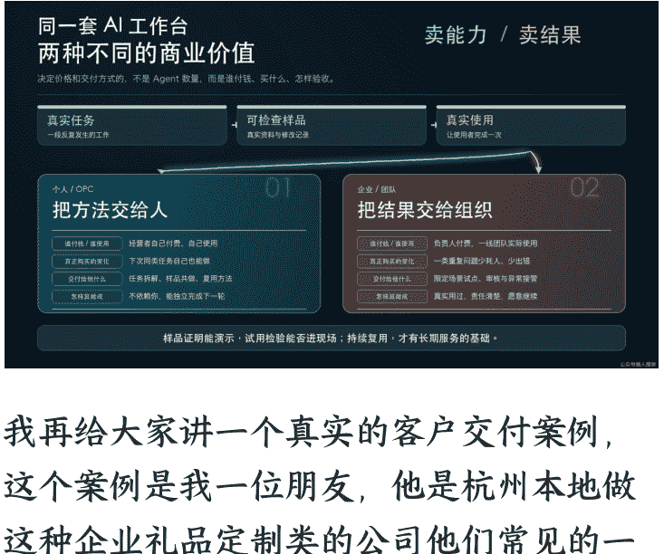

聊聊我朋友的实例。他在杭州做商务礼品的定制生意，客户主要是企业。他们的高频场景是：客户来询价时，销售要先确认预算、用途和品牌限制，然后从海量商品中选搭，最后排成展示方案。因为商品繁多，每家企业的要求又不同，几乎每套方案都要从头查、从头排版，前期琐事占掉销售大量时间。

我们交付的 AI 产品并非单纯替销售编写介绍文字的智能体，而是把整段工作重新接起来：先确认需求要点，再查询现有商品和过往客户记录，生成选品与展示方案，最终交给客户经理复核，由他决定是否发出。AI 负责整理和准备，客户经理保留商业判断以及最终对外发送的决定权。这样才算真正嵌入了实际销售流程。

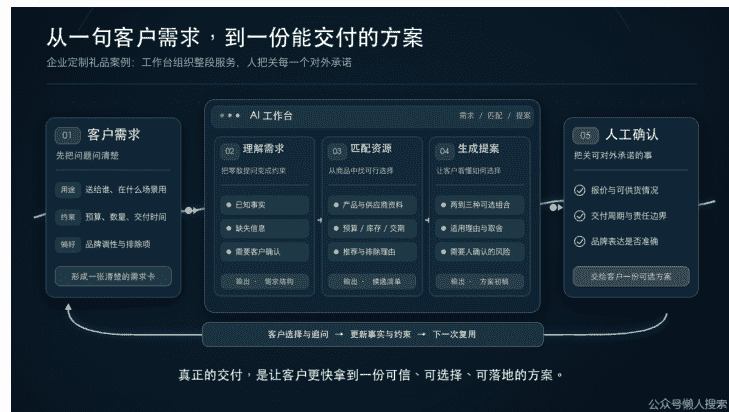

真正的交付效果，是让客户更快拿到一份可信、有得选、能落地的方案。过去，销售从确认预算、用途、品牌要求，到查商品、做组合、排版面，一份方案通常要花 3 到 5 小时。接入系统后，基于已确认的需求和现有商品资料生成候选方案，技术运行时间约 2 分钟。

我必须提醒，这 2 分钟不是一次完整交付的耗时，它只是方案生成时间；把需求确认、人工复核和修改都算进去，才能估算整体节省了多少。这个案例真正的价值在于：它选中了销售本来就反复在做的环节，让 AI 先做资料检索和方案组合，再把商业判断留给客户经理。

想靠 AI 系统做服务的人，不必复制它的上千种商品库和参数配置，而要学它切服务的切口：找到客户已经在做、也知道做得慢的一段工作；说清起点在何处、终点在哪里；让真正执行的人跑起来，并留出人工把关的位置。新手完全可以从更小规模的方案、咨询或项目交接做起。

## 3、让付费者、使用者和验收者都看见价值

有个商业判断越来越重要：提出问题的人、掏钱的人、实际干活的人、最终判定成果能否用的人，未必是同一个。渠道把你介绍给企业，不等于渠道能替企业验收；老板想尝试，不代表员工愿意改变习惯；员工觉得顺手，也不代表他能拍板预算。如果不先分清这四类人，你很可能把方案讲得很完整，却不知道最终该向谁证明价值。

所以接到需求时，我不会第一句就问“要搭几个智能体”。我会先了解：这个问题是谁提出来的？现在谁在做？做砸了给谁带来损失？谁能决定投入？这一轮做成与否由谁评定？这同样适用于刚入场的朋友——不用急着找企业，可以先从自己熟悉的工作入手：用实际材料做一份样品，请可能的使用者试一次，问他：“下次再遇到同样的事，你还愿意接着用吗？哪里不放心？”这个答案，远比你自己再加五个功能更有参考价值。

这里有一张七个问题的任务卡，建议抄下来：
1. 谁提出问题、谁付费、谁执行？若不是同一人，分别写明。
2. 这件事现在是如何完成的？
3. 哪一步最费时、最容易出错或返工？
4. 手上有哪些实际材料可以拿来试跑？
5. 第一轮要拿出哪些可以被验收的成果？
6. 由谁来验收？用哪些标准判断可用？
7. 下一次由谁、在哪个时间点真正使用？

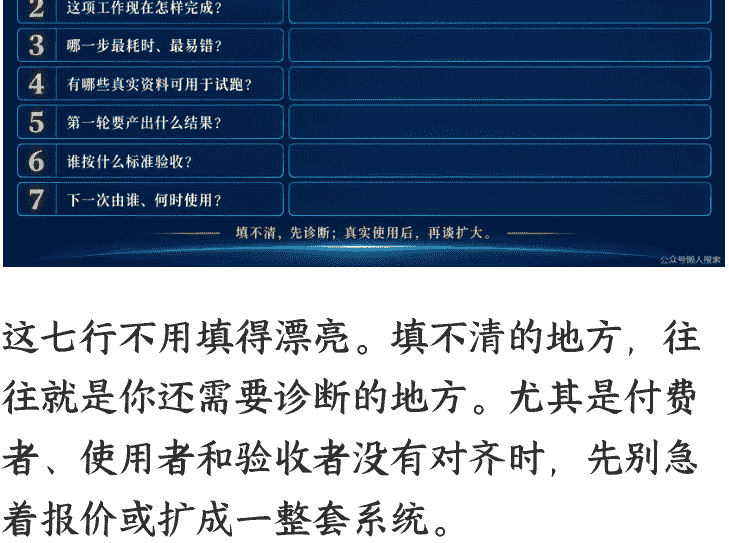

这些填空不需要写得漂亮。填不上的地方，恰恰是需要继续诊断的地方。尤其是付费者、使用者和验收者没有对齐时，先不要急着报价或扩成完整系统。写完这份清单，你可能会发现，自己缺的不是 AI，而是一份材料、一种判定标准，或是愿意陪你一起试验的人。

回到“IP 十倍提效”这个话题。我希望大家带走的不是一个漂亮倍数，而是一套能自证的方法：找同一类工作，分别记录旧流程和新流程；从拿到材料到结果真正被采用，一共花了多久、改了几轮、最终能否投入使用。如果只是 AI 生成变快了，审核和返工反而更多，那就不叫整段工作提效。内容产出变快，也不自动等于 IP 增长。还要看是否带来更多有效咨询，需求方的疑问有没有被接住，这些反馈能否进入下一轮内容与服务。如果你是初学者，回去先挑一项自己做过的重复性工作，用实际材料把七个问题填完，做一份样品，请一位实际使用者试一次。先听到“这里有用、那里还不能用”，再决定接下来改哪里。如果你已经有业务和团队，就找上周最耗时、又经常需要推倒重来的环节，让业务主管和实际操作者坐下来，把起点、材料、成果、复核、意外时的承接方式都讲清楚。下周让实际操作者完整走一轮，再看成果有没有被采用、总耗时和返工有没有下降、后续问题有没有人接住。验证有效再扩大范围；无效就先调整这一小段，不必急着为全公司变更流程。

如果准备把它变成收费服务，我再补一句：自己省下的时间，是你使用系统的结果；委托方愿意付费，是因为他看到了自己损失的减少。最后，希望大家今天带走的不是某个按钮的操作顺序，而是一个马上能启动的顺序：找到真实的问题、产出实际的样例、让实际使用者跑一次、根据反馈决定后续动作。谢谢大家。

如果觉得有收获，欢迎动动手指，多投几个锚支持一下！

———————————

