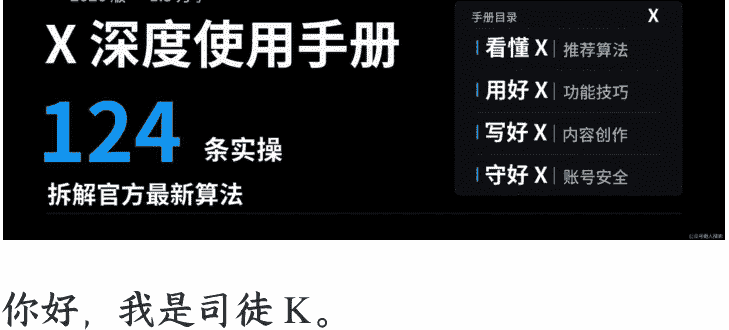
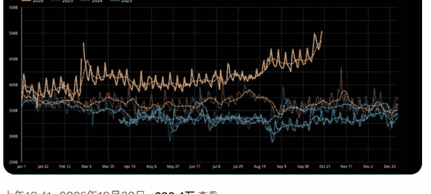
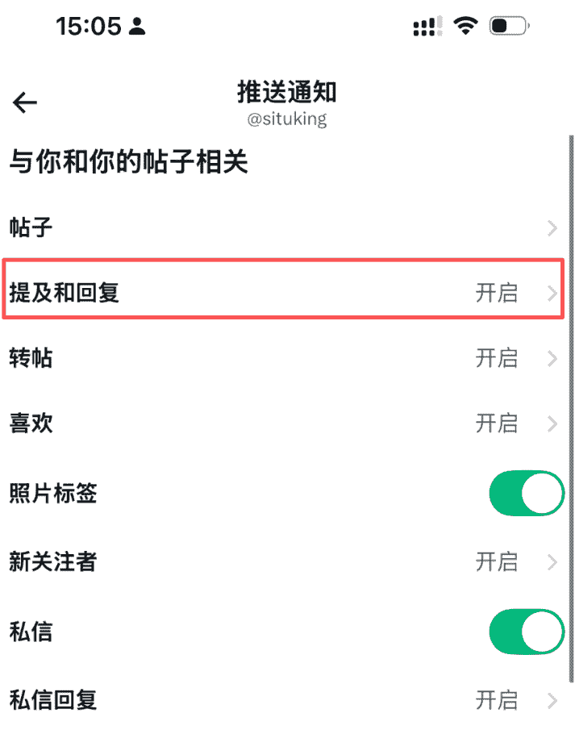
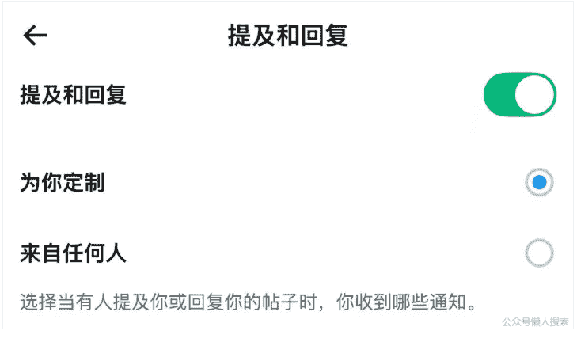
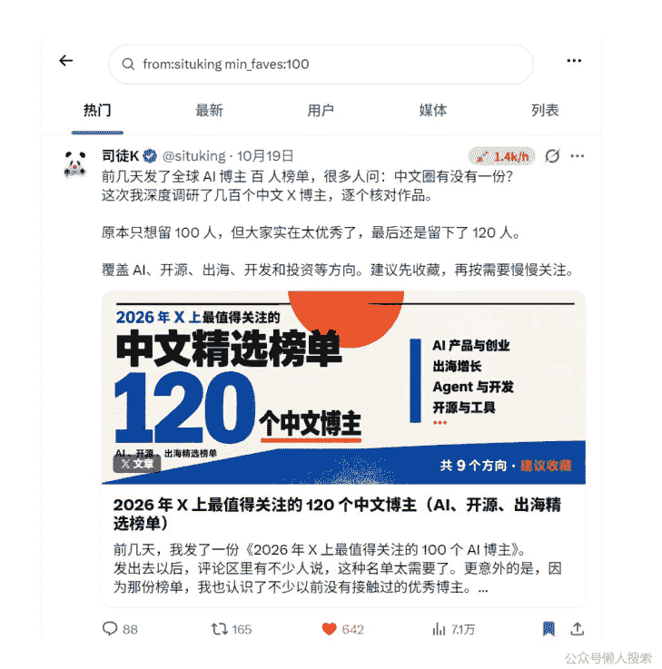
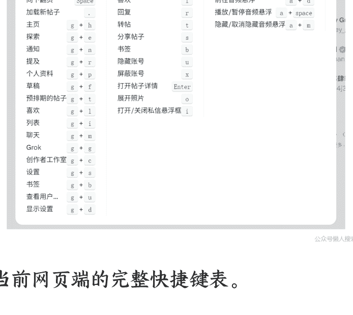
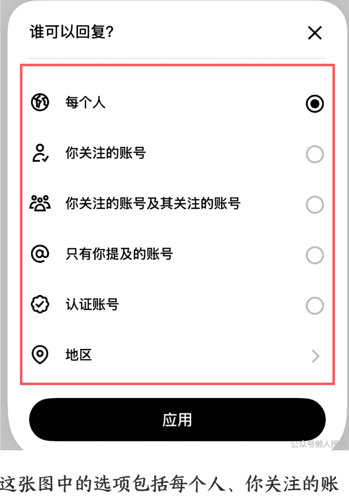
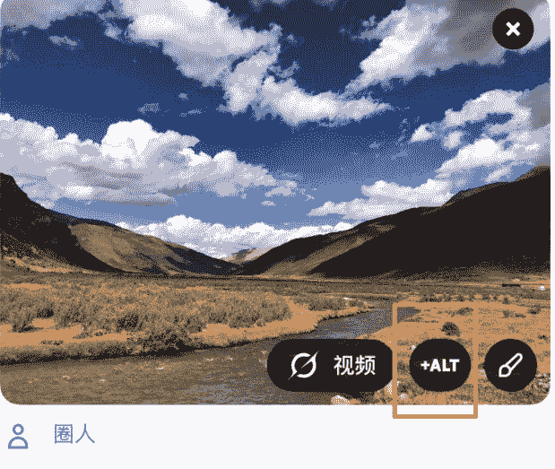

# X 平台深度指南 2026 年更新：124 条可落地的操作拆解官方推荐机制

261028 副业 SC 精华

整理：公众号懒人搜索，懒人专属群精选

懒人微信：lazyhelper1

> 小懒判断 | 适合刚上 X 或发了几十条没起色的人，124 条实操按“看懂/写好/用好/守好”四块查看用。不适合指望看完就爆款的，作者明说算法只决定下限。最值得关注的是官方公开的推荐算法逻辑：互动已过半衰期的旧帖会被召回，好内容有第二春。坑在于长文里的@和普通提及不是一回事，写进去对方收不到提醒。

撰稿人是司徒 K。最近一周持续在平台输出，关注数净增两千余。有人索要复盘，坦言从未做过正式复盘，却养成了接触新工具时边实践边记录的习惯。也是在相同节奏下接触推特，一边与同行交流，一边研读官方开源说明以及公开的推荐代码。这份手册既为自己归档，也希望对初来乍到的使用者提供参考。

整体篇幅较长，涉及不少近期才掌握的细节。

例如 iPhone 上长按转发按钮即可查看谁进行了转发、谁做了引用，这是近期从朋友处得知的小技巧。

再如长文正文中的 @ 与常规帖子的提及规则不同，写进文章里并不等于对方会收到提醒。这类规则若不主动查阅官方文档，很容易忽略。

作者从事互联网创业十余年，近年聚焦 AI 落地与 GEO 相关业务。这几年模型发布、研究者讨论、创业者的首手总结，大多通过该平台获取。过去主要用于信息浏览，未曾发布内容，因而对交互细节研究较少。

本次开始尝试在平台分享后，在撰写与发布的同时，从帮助中心、官方账号、马斯克的动态、开源推荐代码以及中英文社区经验中汇总约 258 条资料，按实际使用场景逐一核对、合并，最终形成这份保姆级操作手册。

手册聚焦基础操作与规则。涉及 iOS、Android 或网页端的差异之处均有标注；平台硬性限制与个人内容建议也做了区分。

阅读建议：

- 寻找入口、调整通知、过滤信息，先看「用好 X」。
- 准备发布、撰写长文或上传媒体，直接看「写好 X」。
- 希望理解分发机制，看「看懂 X」；涉及会员、收益及账号安全，看「守好 X」。

信息核对至 2026 年 10 月 21 日。平台迭代迅速且功能分批上线，手册配图仅作定位参考，以实际页面为准。

全文共 124 条，按场景分为四部分。

## 看懂 X

先理解运行规则再操作，可避免弯路。该平台已公开部分推荐逻辑，以下为要点提炼。

### 推荐生成路径

For You 的选帖流程已开源。系统先从关注源及其他渠道拉取候选池，随后过滤、预测用户行为、打分排序，最后决定是否展示。
该流程代码中对超过 48 小时的内容设有过滤，请注意这是单一流程的限定，并非全站只推两日内的内容。

### 排序在预测下一步动作

模型为每条内容计算用户点赞、回复、转发或停留的概率，再综合为排序分。同一内容在不同读者处的排名会不同。

### 负向信号

举报、静音、标记不感兴趣、屏蔽都会产生负向反馈。持续出现此类行为，系统会降低同类内容的推送频率。

### 权重解读误区

模型先得到各动作的概率，再按预设权重合成总分。权重并非直接作用于实际互动次数，不能通过两组系数相除换算“一次举报抵几个赞”。公开代码的默认值也不等于线上每个账号实际生效的实验参数。

### 外链是否被降权

据产品负责人 Nikita Bier 2026 年 4 月 9 日说明，外链从未被刻意压制。过去打开外链会遮挡互动按钮，影响参与度，该界面问题已修复。7 月 29 日他再次表示，无需刻意把链接放到回复里。
建议做法：主帖先交代结论与要点，再附来源或完整材料，读者不点开也能抓住核心。

### 书签的量化问题

在已核对版本的公开排序代码中，书签相关的预测项并未
马斯克在 2026 年 10 月 20 日的动态中谈及停留时长预测的升级，以及在初筛阶段更倾向于会被用户读完的内容。公开表态与代码更新需分开看。

Two important changes to timeline recommendations:

- New AI/SI ranking model that predicts probable time spent much better

- Retrieval model trained to surface posts people read all the way through

User active seconds is growing exponentially and hitting all-time highs almost every day:

上午10:41 · 2026年10月20日 · 280.4万 查看

马斯克关于停留时长预测与推荐变化的公开帖文。

## 用好 X

偏操作，可边看边点。

### 互动追踪

iOS 端查看转发明细：进入单条动态详情，长按底部转发图标会打开「发帖活动」列表，而非轻点的普通转发菜单。切换「引用」和「转帖」标签即可看到名单。

网页端查看活动：打开帖子后点右上角「…」→「查看发帖活动」。长文对应的入口名为「查看文章动态」，名称不同，查询对象也有区别。

菜单常用项包括：删除、推广、置顶到个人资料、加入/移除亮点、列表增减、内容披露开关、修改回复权限、查看活动、嵌入、编辑图片、查看数据、请求社群附注。

回复、引用、转发的差异：回复在原帖评论区进行；引用是带链接在自己主页发新帖；转发是原样扩散。即使原帖限制了谁可回复，仍可被引用。

回复引用帖，原作者不会自动进入对话。A 引用 B 的内容，你在 A 的引用下回复，B 不会自动被拉进。需要提醒 B 时，需在回复里显式 @。

撤回转发：在已转发的帖子上点击高亮的转发键，选择「撤销转发」，仅撤回自己的转发动作，不影响源帖。

### 提及与通知

以 @用户名 开头的新帖，在关注者时间线中的触达会受共同关注关系限制。想做公开主帖，可先写正文再 @，或改用引用。

长帖的 @ 提醒范围：官方规则为长帖仅前 280 字符内的 @ 会触发通知，后面部分目前不提醒。重要对象尽量前置，字符计数看发帖框右下角圆圈。

长文 Articles 的提醒机制与普通帖/长帖不同。长帖前 280 字符规则不能套用到 Articles 正文。需要提醒某人，可在文章发布后的相关回复里单独 @ 一次。

漏看陌生人回复，检查推送偏好。非互关用户的回复常收不到弹窗。iOS 路径：设置和隐私 → 通知 → 偏好 → 推送通知 → 提及和回复。

推送通知里的「提及和回复」入口。

进入后查看当前是「为你定制」还是「来自任何人」。想收到更广泛提醒，可改为「来自任何人」，确认切换成功。

图里选中的是「为你定制」。

此处的修改仅影响手机推送范围，不改变帖子本身可见度。

无弹窗时可直接打开底部「通知」标签查看。垃圾过滤、系统权限或勿扰模式都可能吞掉推送，不要仅凭是否震动判断。

给单个账号开启消息通知：进入对方主页，点击关注按钮旁的小铃铛，选择全部帖子或仅直播等类型，同时确保系统允许 X 推送。

通知页的「优先」与「全部」：2026 年 1 月官方说明，粉丝达 500 后 iOS 与网页端通知页会出现「优先」标签，突出互关或大号互动。具体是否出现以实际界面为准，未看到时切回「全部」。

隐藏回复是折叠，不是删除。点「隐藏回复」后评论会被收进帖子右下角的入口，对方不会收到通知，但任何人点开仍可看见，适合整理评论区。

### 搜索用法

按账号检索：from:账号名 仅看该账号原创；to:用户名 看他人回复给该账号；@用户名 查找所有提及。from: 与 to: 后不加 @，搜提及时保留 @。搜不到先确认对方是否改名或设为私密。

限定时间：since: 起始日 until: 截止边界。如 from:situking since:2026-10-01 until:2026-10-21。若想包含 10 月 21 日，需把 until 写成 22 日。within_time: 这类按小时的指令偶发失效，查重要资料建议用明确日期。

按互动筛选：min_faves:100 可限定至少 100 赞，也可组合 min_retweets: 与 min_replies:。结果过少可降低门槛，找一手信息源时不必把互动门槛设太高。

按形态筛选：filter:images、filter:videos、filter:links，-filter:replies 去掉回复。手机端偶尔失效，可用网页高级搜索。

精确匹配与语言：英文双引号 "" 做精确短语；减号 - 排除词；大写 OR 表或；lang:zh 限定中文。如 "AI 落地" -招聘 lang:zh。

列表内搜索：list:列表ID 可限定在该列表成员内容中检索。ID 在列表网址可见，非名称。

查谁分享你的网站：url:你的域名 -from:你的用户名，可找到除自己外的外部分享线索，无法覆盖所有短链变体，不能替代专业统计工具。

组合条件示例：from:situking AI since:2026-10-01 until:2026-10-22 -filter:replies，同时限定账号、主题、日期并排除回复。需再筛互动时加 min_faves:50，结果太少先撤互动条件。

搜索式与「热门」「最新」结果标签。

回车后把「热门（Top）」和「最新（Latest）」都切着看。「热门」适合找高互动内容，「最新」适合按时间追动态。追刚发生的消息只看热门，容易漏掉第一手信息。

把搜索页存书签：网页搜索参数写在地址栏，f=live 为最新，f=top 为热门。确认标签后保存网址，下次一键直达。

### 收藏、列表与静音

书签文件夹为付费权益，是否可用看订阅档位。帖子放入文件夹后仍保留在「所有书签」，属于归档而非剪切。

部分界面提供「历史」入口，可按书签、喜欢、长视频、文章等分类回看，适合找回刚看过内容，重要资料建议同步到笔记软件。

列表可收录未关注账号。加入列表不需要先关注，方便按主题归类信息源。关注用于互动，列表用于观察，分开使用更清晰。

新建列表注意隐私开关。创建时填写名称后留意下方「设为私密」。公开列表成员会收到通知，私密列表仅自己可见。保存后看标题旁是否有锁头图标确认。

常用列表可钉住：点列表右上角图钉，可置顶到首页标签栏，按时间流追踪。

用小而精的列表跟进信息源：先收录模型公司、研究员、目标创业者。日常先看列表，再刷 For You 发现新内容。

时间线管理面板可添加平台整理的话题，添加后若进入「已置顶」区，会在首页顶部出现对应标签。

阅读外文技术内容时核对原文。注意模型名、作者原话及参数，可点机翻旁的「查看原文」对照。设置里的「内容语言」决定推送语种，与单条帖子翻译开关无关。

### 网页快捷键与链接清理

电脑端光标不在输入框时，按 ? 可打开当前界面的完整快捷键表。

当前网页端的完整快捷键表。

常用操作：j、k 分别选中下一条、上条帖子。选中后 l 点赞、r 回复、t 转发、s 分享。n 打开新帖编辑框，发帖框内 Ctrl+Enter / Cmd+Enter 发送。/ 跳到搜索，. 刷新加载。编辑时字母会被当成文字输入。

g 组合跳转：先按 g 松开，再按字母。g+h 回首页，g+n 看通知，g+p 个人资料，g+b 书签，g+i 列表，g+m 消息，g+s 设置。

主页各标签页有独立网址。进入常用标签如某账号的「长文」栏后保存浏览器书签即可。

清理分享链接时，只删除 ? 及之后的参数，不要动用户名和 status/ 后的数字 ID。删除后先自测能否打开再分享。

## 写好内容

先区分发布形态，再按形态选编辑器。

### 普通帖、线程、长帖、长文

普通帖为 280 个加权字符，中文约 140 汉字。具体剩余看发帖框右下角圆圈。

线程 Thread：一句话说不完可点发帖框右下角「+」续写，或发主帖后在评论区自回形成串。每段尽量独立可读，再按顺序串联。

长帖 Long posts：开通对应会员等级后，普通发帖框可写最长 25,000 字符的长帖。它是普通帖的加长版，与有标题、封面、富文本的「长文 Articles」不同，订阅前确认档位是否包含长帖权限。

长文 Articles 入口：网页端左侧栏点「文章」→「撰写」，进入独立编辑器，可设标题、封面、正文排版。发布前核对套餐是否包含 Articles 权限，仅看侧栏是否有入口不够。

### Articles 编辑与发布

粘贴 Markdown 注意：含 ###、**、表格竖线 | 的源码直接粘进长文编辑器，常不会渲染，而是原样显示。建议用编辑器顶部工具栏排版，或先在外部渲染成富文本再粘贴，粘完滚一遍检查。

编辑器原生支持大小标题、有序/无序列表、粗体、斜体、删除线，以及插入图片、视频、GIF 和嵌入站内帖子。

# X 平台实用操作手册（重写版）

## 长文排版与发布

先说长篇内容。编辑器原生地处理复杂表格时效果不佳，若要呈现数据对比，建议拆成若干带小标题的分项清单；确实需要表格，则把它做成图片放进去，然后先用手机预览判断字号会不会太小、边缘有没有被切。一篇文章能放多少张配图，以编辑器界面的提醒为准。

封面上传区域和正文第一张图是彼此独立的位置。长文编辑器顶部有专门的封面位，千万别沿用其他平台的惯性思维，以为正文的第一张图会自动变成封面。尤其当你是从外部文档整篇粘贴富文本内容时，更要在发送前打开预览模式，检查封面区是否有图、裁剪是否正确。

已发布长文的修改流程也和普通动态不同。在已发布文章的菜单里选“编辑”，系统会先要求你确认将文章退回未发布状态，等你改完再重新发布。哪怕只是修正一个错别字，都需要经历这一步。

点击右上角的发布按钮时，会弹出“选择你的受众”窗口。若你的创作者粉丝订阅已开通，可以勾选仅对付费订阅者可见；如果想对所有访客公开，要确认选中的是“每个人（Everyone）”。

复杂且需要深度的议题，例如行业复盘、发展历程或人物履历，适合通过长文来展开，而不是塞进普通短动态里。

## 回复范围与标签

发帖框上方会显示当前允许谁回复，这是个可以点击设置的区域。按场景选好范围后，点“应用”，再看一眼发帖框是否已同步更新。

上面截图中的可选项目包括：每个人、你关注的账号、你关注的账号及其关注的账号、只有你提及的账号、认证账号，以及地区入口。

需要特别记清楚：那里写的是“你关注的账号”，不是“关注你的人”。把回复范围收窄，并不妨碍其他人查看、点赞、转帖或引用公开内容。

话题标签方面，官方建议大家每条动态不要超过两个，但这是建议，不是强制上限。参加活动、集中讨论或固定栏目时再带上相应标签就够了，不需要给每一个词都硬加 #。

地点标签则看内容需不需要。线下参会、探店等场景加上位置，读者更容易理解；日常的行业讨论可以按内容决定，不要盲目把挂了一个城市当作固定的分发手段。

## 修改、定时与草稿

如果你的账户符合会员条件，发布后的帖子可在 1 小时内修改，最多 5 次。要注意计时从第一次点发送就开始，之后的每次修改都不会让倒计时重新计算。

手机 App 发出的帖子，要回到同一台设备的 X App 里找到“编辑帖子”入口；网页端发出的，则回到 x.com 修改。

按现行规则，以下内容发出后无法编辑：给别人的回复、带投票的帖子、付费推广帖、串推、置顶帖、通过第三方工具或 X Pro 发出的内容，以及粉丝订阅专属帖。

编辑帖子是会留下痕迹的。凡是改过的帖子，底部都会出现小铅笔图标和更新时间，读者点开就能看到历史版本，原本的转评赞数据也不会消失。如果发现信息有误，就大方地在正文里写明更正内容，不要指望靠编辑功能来抹掉自己说过的话。

定时发送要到网页端操作。写好内容后，点底部工具栏的日历图标，选好日期、时间并核对时区，在弹窗里点确认后，再回到发帖框点击“排期（Schedule）”提交。完成后，点开右上角的“未发送的帖子（Unsent posts）”，切到“已排期（Scheduled）”标签，核对文字、图片和时刻。保存到草稿和进入排期队列并不一样，只有在排期列表里看到，才算真正设定成功。

要改期或撤回，也去“未发送的帖子”里处理。那里分成“草稿（Drafts）”和“已排期（Scheduled）”，点开目标项就能修改内容、调整时间或取消排期。改完返回列表检查新信息；取消后也要确认那条帖子已经不在队列里了。

手机 App 不一定有定时按钮，这取决于版本和灰度范围。找不到日历图标时，就用电脑网页版，或者用手机浏览器访问 x.com 并切换为“请求桌面版网站”，能存进排期列表就行。

重要的长帖和长文，建议另行保存一份。手机与网页的草稿同步情况不明确时，先用几句测试文字验证一下，再决定在哪个端继续写。官方 iOS 文档提醒过，退出账号或卸载应用可能会丢掉本地草稿，所以换手机、退号或重装前，先把需要的内容复制出来。

## 图片、视频与投票

现在一条普通帖子最多可以混合 4 个媒体文件，例如 2 张图 + 1 个视频 + 1 个 GIF。具体能不能传，取决于单个文件的大小、格式和时长，界面上会有相应提示。

多图发布时，信息流里的网格裁切会随图片数量改变。作图时不妨参考 1200×675（16:9）、1080×1080（1:1）、1080×1350（4:5）这样的画布尺寸，但这些只是经验值，不是官方规定。核心文字和人物主体尽量放在画面中间，传上后还要在手机预览里看看是否被切到。

需要裁切时，点进图片缩略图编辑，完成后回到发帖预览。如果你的账号有 Grok 改图入口，先看一下生成结果再决定要不要用。

给图片加替代文本也很重要。手机端点图片角落的“+ALT”，网页端在图片编辑里找到“添加描述”，每张图最多可写 1000 个字符。

上面截图展示的是上传图片后，图片底部出现“+ALT”入口的样子。替代文本是为无障碍设计服务的，方便视障用户或图片加载失败的人理解内容。把主体、截图中的关键文字或图表结论写清楚，保存后缩略图上出现 ALT 标识，就算加好了。别把几百个无关热门关键词堆进 ALT 里，那没有意义。

长视频的限制与端和套餐有关。免费账号常见的视频上限是 140 秒；付费会员的上限在不同官方页面说法不一：视频帮助中心写的是最长 4 小时、最大 16GB，而会员套餐对比页里又会按照档位和端（网页 vs 手机）给不同数值，超长视频常常要在网页端或 iOS 上才能传。所以，凡是几分钟以上的视频，以你当前套餐在网页端显示的限制为准。转码完成后最好从头到尾拉一遍，也可以切到小窗，边播放边做其他的事。

投票组件一般可以设 2 到 4 个选项，每个选项最多 25 个字符，有效期最短 5 分钟、最长 7 天。选项要放在同一个维度上，不要一个写原因、一个写结果，那样别人没法选。

投票采用匿名方式：一人一票，投完不能更改。发起人能看到各选项的比例和总票数，但看不到具体是谁投了哪一项。若想了解大家选择的理由，可以另外请读者在评论区留言。

带投票的帖子不在会员可编辑的范围内。发送前务必确认选项是否齐全、措辞是否有歧义、截止日期是 1 天还是 7 天。另外，官方目前不支持在投票里添加照片。

## 订阅、认证与付费

平台会员、原创内容奖励和粉丝订阅是三件不同的事。先想清楚自己需要哪项功能，再对照条件逐一解决。

2026 年 10 月，官方发布了新的统一订阅体系 The X Subscription，把 X 会员权益和 Grok、代码编辑器 Cursor 的额度打包在一起，分为 Plus、Premium、Super、Ultra 四个档位。基准月费依次是 8、30、100、200 美元，实际价格会受地区、税费、网页还是苹果内购、按月还是按年等因素影响。

订阅价格并不是统一的。账号所在地区、应用商店的区服和付款渠道，都会让最终费用变化。购买前先核对当前套餐与渠道，选自己能控制的账号和支付方式。第三方代开可能需要交出密码，还可能碰到未知付款来源和退款问题，不能只看报价。官方定价页说了，The X Subscription 只在官网直销，没有授权任何第三方转卖，从别处买来的账号可能被暂停或终止。

已经订阅的旧套餐可以继续保留。新套餐里的合格第一方用量按周共享，覆盖对应的 Grok 和 Cursor 使用额度。Cursor 中的第三方模型不计入这个共享池，要单独计费。Grok Bot 包含在 Premium、Super、Ultra 中，Plus 不含。切换前先对照自己打算用的能力，再看旧套餐剩余时长如何处理。

如果你有蓝标，更换头像、显示名（Display Name）或用户名（@Handle）会触发重新审核，蓝标会暂时隐藏。复核期内，这三项资料都不能继续修改，审核时长以系统提示为准。近期有活动需要蓝标露面的话，要么开通会员前就把资料改好，要么改完后留出足够的缓冲时间。

上面截图来自个人资料编辑页，系统提示：修改显示全名或个人资料照片后，蓝色复选标记会暂时隐藏，直到审查通过。原因写着“了解更多”可以点开查看。下方还有账号简介、位置、网站等字段。

这里要强调的是，蓝标暂时隐藏是重新审核流程，并不是取消订阅。审核通过后会自动恢复。

取消续费时要回到原来的购买渠道。网页端购买的在网页端管理，App Store 或 Google Play 内购的就到对应商店退订。旧 X Premium 的常规取消一般不退还已付费用，除非法律另有要求；为了避免下次扣款，最好至少提前 24 小时取消，并核对到期日。卸载 App 不会停止扣费。

切换至 The X Subscription 时，参与切换且符合条件的旧订阅会按未使用时间比例退款，新套餐扣费和旧套餐退费是分开处理的。应用商店订阅要分几种情况：

- 在 App Store 购买的 Cursor，需要自己取消，再找 Apple 申请退款。
- 在 App Store 购买的 Grok、Grok Bot 或 X Premium，切换时会自动取消。未使用时间的退款要向 Apple 申请，是否批准由 Apple 决定。
- 在 Google Play 购买的 Grok、Grok Bot 或 X Premium，切换后去商店查看；如果仍显示为续订，就自行取消。

没有参与切换的账号订阅不会自动取消，需要你另行管理。

徽章标识方面：金色通常代表企业机构认证，灰色代表政府或国际组织，蓝色则是付费订阅加基础审核。判断蓝标账号的内容可不可信，应该看他有没有给出原始材料、这些材料能不能交叉核实，而不是看他有没有蓝勾。

新订阅的 Premium 及以上档位，官方明确写有更高的“回复优先级加成（Reply boost）”。但评论区的实际顺序还会受作者互动、读者关系、内容相关性和折叠过滤等因素影响，所以开最高档会员也不能保证自己在所有评论区都排第一。

身份证件核验和买会员拿到蓝标，完全是两件事。符合条件的地区账号，可以申请“ID 验证（身份证件核验）”，通常需要拍证件加人脸自拍。操作时只能从 X 官方设置里的入口进入，同时看清第三方核验服务商的条款、数据用途，以及是否支持你的证件签发地。不要把普通蓝标当成对方已经做过证件核验。

## 原创内容奖励 OCR

原创内容奖励（Original Content Rewards，OCR）目前只接受特定地区账号申请。官方支持名单中有香港和台湾，没有中国大陆。申请前先核对本人所在地区和身份是否符合要求；持有一张当地银行卡，并不能自动替代地区资格。

OCR 只面向个人或商业账号，政治组织和政府组织账号不能申请。申请条件包括：年满 18 岁；账号状态良好，没有反复违反变现规则或服务条款的记录；至少有 500 个认证粉丝，并且过去 90 天内在首页信息流中累积获得至少 50 万次来自认证用户的曝光（回复曝光不计入）；同时持有符合条件的付费订阅，并持续发布原创内容。

可以作为申请门槛的订阅套餐有旧 X Premium、Premium+、Premium Business，以及新订阅体系里的 Plus、Premium、Super、Ultra。旧 Basic 不在名单里。申请入口位于“创作者工作室（Creator Studio）”，进入后可以查看资格状态。即使达到数字门坎，也仍然要等审核，平台并不保证一定通过。

所谓 50 万曝光，并不是后台的总浏览量。申请时看的是过去 90 天内来自认证用户首页信息流的曝光，回复曝光不计入。开通后计算收益，看的是“合格曝光”：官方将这里的认证用户定义为旧 X Premium Basic、Premium、Premium+ 和 Premium Business 用户；帖子必须出现在这些用户的首页信息流中并至少显示一半。同一账号对同一帖只计一次曝光，付费、推广、人为制造或欺诈曝光都不算。旧 Basic 套餐不能作为 OCR 的申请资格，但其用户的阅读行为符合条件时可以计入创作者收益。

如果第一次申请没有通过，页面会给一次申诉机会。申诉也被驳回的话，只要账号持续达标，等待 42 天冷却期后可以再次申请。收益方面，目前每两周结算一次，满 30 美元起付。申请审核多久出结果，官方没有承诺固定时限，多留意系统通知。

非美国地区的合格创作者，需要连接 Stripe 收款账户，并通过 Stripe 完成身份验证。核验所需的证件、姓名和收款资料必须真实一致，具体填写要求以收款服务的实际规定为准。拿到 OCR 资格后，还要完成收款设置，才能正常接收款项。

有些内容你可以正常发，但不一定能拿 OCR 收益。官方规则排除：搬运或实质复制、轻改洗稿、误导内容，以及专门聚焦变现教学、变现讨论或最大化收益的内容。通过自动化方式创建或发布的内容，以及被附上“有帮助”社区笔记的内容，也不符合收益要求。即使你使用平台允许的工具，仍然要针对收益计划的具体条款再核对一遍。

反复要求点赞、回复、书签、关注或转帖，以及其他人为操纵互动的行为，都可能影响 OCR 资格。普通互相关注和正常讨论不应被直接视为操纵。触犯规则后，按严重程度可能被暂时或永久移出计划。

把别人的视频下载后加片头、水印、镜像或做轻度修改，依旧属于搬运。OCR 是否认定为原创，以及你是否拥有材料的使用权，这是两件需要分别确认的事；有授权也不代表轻改后的内容就能计收益。

## 粉丝订阅、打赏与商单

粉丝订阅是读者按月付费，获取你的专属内容。它与买 X 会员、参与 OCR 属于不同的收入渠道，开通后可以发布仅订阅者可见的内容。订阅收入的到账时间并不遵循 OCR 的双周节奏，具体以创作者后台为准。

Tips 是另一种打赏入口，可能会连接第三方支付服务。它是否显示，取决于账号、地区等条件。作者自己的账号（2026 年 10 月，iOS 中文界面）编辑个人资料时，就没有看到 Tips 入口。

如果收到推广费、免费寄测产品，或其他商业利益，请按平台政策使用“付费合作（Paid partnership）”标识，让读者知道内容存在商业关系。

单帖加推（Boost）本质上是买广告曝光，不是自然增长。投放前先想清楚：你是想让读者点进主页关注，还是跳转到某个落地页做转化？

## 自动化限制与账号可见度

官方帮助页写明，每个账号每天最多关注 400 个账户；关注数达到 5000 后，还会受到关注与粉丝比例等额外限制。

私信方面，系统保留每天最多 500 条的总体技术上限，但向未关注你的人发送消息请求，另有按账号和订阅等级区分的额度。500 条总量并不意味着你可以每天给 500 个陌生人发消息。发帖或私信遇到速率限制时，按页面提示等待即可。

没人看、回复被折叠、账号受限，是三种不同的状况，要分开判断。浏览少可检查推荐排序，回复被折叠多半和垃圾过滤有关，账号受限则要对照地区规则并走申诉流程。

## 账号安全

如果怀疑自己点开了钓鱼链接，千万不要在可疑页面填写密码或验证码。直接关闭那个网页，自己打开 X 官方 App，或在地址栏手动输入 x.com，进入设置后修改密码。

改完密码后，到“设置和隐私 → 安全性和账号访问权限 → 应用和会话 → 会话”，这里能看到所有登录过你账号的设备。遇到陌生型号或异地登录记录，点进去退出，或者直接选“注销所有其他会话”，再确认只剩你自己的设备。注意，踢掉会话不会解绑第三方应用，授权需要在同一菜单的“已连接的应用（Connected apps）”里单独撤销。

定期检查“已连接的应用”，逐个查看它拿到的是“只读”权限，还是“读写+发私信”的高风险权限。对于现在不用、或记不清何时授权的应用，直接点击“撤销应用权限”。修改密码和撤销授权是两道独立防线，不能互相替代。

最后，在安全设置里打开“密码重设保护（Password reset protection）”。开启后，重设密码需要额外账号信息，相当于多一重核对。但它并不能替代两步验证；绑定邮箱本身的安全也需要单独保护好。账号提供了哪种登记入口，就按对应向导设置；如果收到旧登记的更新提示，再按要求处理即可。

## 账号一出问题就喊限流？先把弹窗、地区和语言设置看明白

碰上 Locked 状态，或发现账号功能被限制，别急着在群里问“是不是被限流了”。第一步不是猜，而是把首屏弹窗截图留存，逐字读懂它写的原因。若是安全风险类，通常会让你改密码、验证邮箱或手机号；若是规则类，则可能涉及处理某项内容、等待一段时间，或提交申诉。照提示对症下药，别把所有异常都往“限流”上套，也别默认做一次验证就一定能恢复。

账号详情页的「关于此账号（About this account）」会给出所在地区或连接来源，但别把它当实时定位。按官方解释，它来自一段时期内登录 IP 的推断结果；走网络工具或漫游，偏差并不稀奇。它既不是此刻的位置，也不能拿来证明国籍或身份。

界面显示用什么语言、内容推荐认哪些语言，是两套设置，别混为一谈。网页端要改界面语言，入口在「设置和隐私 → 无障碍、显示与语言 → 语言」，那里动的是「显示语言」；手机上，很多版本会直接跟系统语言走，也能在系统设置里单独给某个 App 换语言。界面切成简体中文，信息流并不会因此自动全变成中文。推荐内容的语种，主要看你和哪些语言圈子的账号互动频繁，以及「内容语言」里勾选了什么。深色模式也挨着这些设置：手机通常跟系统，网页端则能在「显示」中把深色背景固定下来。

发送前，扫一遍这些地方：重要提及的位置对不对、回复可见范围是否合适、投票选项有没有漏、视频下载权限设成什么；图片 ALT、视频字幕、长文头图，以及手机端排版读起来顺不顺；定时发布的日期、具体时间、时区，还有长文面向的受众。

拦住不少人的，并非算法有多绕，而是发送键一直没人按下去。如果还没起步，不妨从今天搞定的一件小事、或今天踩过的一个坑写起：把卡点、处理动作、最终结果、心里没底的部分都记下来，先发布，再在实际操作中边做边补。这本手册，本身就是我一边使用一边学习的产物。你眼里寻常的经验，可能正是新手缺的那把钥匙。已经下场做内容的人，不妨把前文的算法与规则当检查清单，逐条补洞。它不追求看完即弃的爽感，更像一本搁在手边、随时翻查的字典。

我是司徒 K，做企业服务，长期关注 GEO 和企业 AI 落地。你在 X 上实操遇到卡点，随时来找我聊，能一起少绕些路就好。

—— 分割线 ——

一篇 SOP 读下来，很容易生出“已经会了”的错觉；可真到动手，十个人里约九个会先被第一步拦住。教程和工具，不过是最表层的门槛；真正的壁，要在实操中才撞得见。