# 保姆级教程！07 大学生 aippt 月入破万全公开

> > 261028 副业 SC 精华
> > 整理：👸号懒人搜索，懒人专属群精选
> > 懒人微信：lazyhelper1

小懒点评 | 这套玩法更适合已经开通 ChatGPT 付费订阅、想把 AI 变现跑通的第一笔收入的学生和副业入门者。作者 2007 年出生，目前大一，四个月从零起步做到月入过万，单日过千也出现过。但不适合奔着规模化去做，客单偏低本质仍是人效置换。最值参考的是他把制作到交付整条线做成可编辑的工作流，流程被固化成 SOP，能在看视频的同时完成订单。需注意各平台抽成与低价内卷，文中的报价表要看清实际净收。

## 前言

大家好，我是小鱼 Fred，07 年出生，大一期间靠 AI 做演示文稿变现到上万，第一次单日收入过千也是从这里来。

这篇我把自己实操的制作、接单、交付全流程摊开。

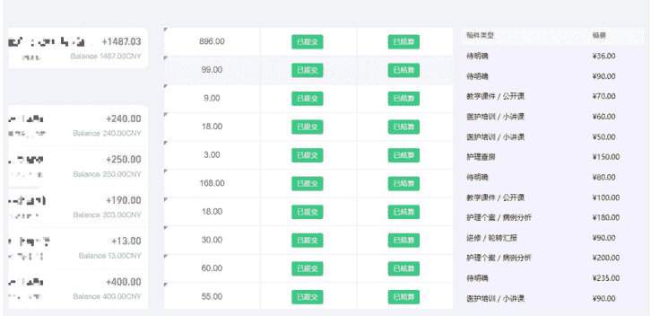
先放部分收款与订单截图。

从 4 月至今，这套打法一直在跑。随着模型绘图能力提升，我自用的可编辑工作流也越调越稳，做单已接近标准化。顺畅到什么程度？开着剧集手头活也能推进，偶尔会想，这效率是不是有点夸张。过去这套我一直没公开，最近受开源思路影响，想把真正赚到钱的方法拿出来。自媒体终究是“他媒体”，得给读者可落地的价值。所以这次一次性交底：

- 怎么做：AI 制作演示稿的步骤、还在迭代的可编辑工作流。
- 怎么沟通：对接客户、确认需求、交付的话术模板。
- 怎么接单：哪里找活、如何定交付标准、最终能落袋多少。

从工具到收款讲到底。

如果你手里已有 ChatGPT 会员，那门槛基本没有，喝下午茶刷视频的同时就能把活干完。尤其适合三类人。

- 想把 AI 用成第一笔收入的人，一直在尝试却没闭环。
- 想多一条变现路径的人，已有其它收入想再加一根线。
- 用过模型但没意识到能接演示稿订单的人。

这一篇先把目前最稳定的线路完整交出来，工具、步骤、话术、交付标准都齐全，足够你把制作、接单、交付、收款跑通一遍。后面再拆不同类型的单如何应对、更省力的办法，以及这些环节为什么要这样设计。

先把单做起来，再一起研究如何更顺更稳。目标很具体：让一个没接触过演示稿代做的读者，对着截图知道下一步点哪里，跟做出来，再知道去哪找活、怎么交差。

下面开始！整套流程公开

## 目录

| 章节 | 内容要点 |
| --- | --- |
| 一、项目认知 | 客户需求、订单类型、分成逻辑与盈利点 |
| 二、准备工作与交付标准 | 会员准备、三级交付方式、客户验收要求 |
| 三、制作流程总览 | 从需求确认到样稿、终稿与交付的完整路线 |
| 四、样稿阶段 | 模型理解需求与材料、整理每页文案、辅助沟通对齐、生成样稿 |
| 五、终稿阶段 | 逐页生成、配合工作流转成可编辑演示稿、微调检查与售后 |
| 六、如何接到单子 | 作品集、联系店铺、考核入群与新手选单建议 |
| 七、行动清单 | 从练习作品到完成第一单的执行顺序 |

## 一、项目认知

### 1.1 谁会买演示文稿，为什么愿意付费

先厘清一个问题：到底什么人会掏钱请人做演示文稿？

医护要做护理查房，创业者要投标，企业要产品展示，学生要参赛……按身份去分数不完。

我更在意动机：他为啥要付这笔钱？

| ① 不会做，或做出来不满意 | ② 会一点，但赶时间 |
|---|---|
| 自己做总有“模板感”。付费买更像样的呈现。 | 临期要用，没空慢慢打磨。付费找人配合完成。 |
| ③ 不会做，而且很急 | ④ 有预算，追求省心 |
| 能力与时间双缺。付费解决当下交付。 | 觉得时间该用在更关键的事上。付费把操心外包。 |

归根到底，有人缺手艺，有人缺时间，有人两样都缺，也有人单纯愿意为省心买单。

你觉得做演示文稿是赚钱路径，他觉得找人做是省时间的办法。

所以别只盯职业标签，看懂他急什么、要什么效果，你才知道这单该怎么落。

### 1.2 订单类型与入门选择

搞清楚谁付费，再看自己先接哪类单。

先分两个维度：

- 按播放形态：静态单、动态单。是否需要动画，接单前要问清。
- 按制作档位：简单、标准、精美、高端

| 主体 | 到手参考 | 负责内容 |
| --- | --- | --- |
| 店铺 | 通常占大头，部分订单超 50% | 流量获取、客户获取 |
| 客服 | 约 5%~15% | 对接客户、找写手、拉群、协调需求 |
| 写手 | 约 30%~50% | 完成制作，交付可编辑文件 |

这些是不同订单的大致区间，不能直接加总。指代的是接单店铺，而非电商平台直接抽走一半。

粗略关系：10 页偏精美的演示稿，客户付 200~300 元，写手可能拿到百元出头。具体到手多少、何时结算，接单前必须问清。

为什么我认为这条路值得尝试？第一，很多人仍把 AI 做演示稿理解成“一键出成”。第二，强模型绘图能力已趋饱和，但信息差依然存在。第三，AI 不只是画图，它能参与整条链路。

- 理解需求：读材料，梳理要求与待确认点。
- 梳理内容：辅助理解复杂知识点，整理页面文案；原文资料仍需核对。
- 辅助沟通：整理反馈，拟定对齐话术。
- 生成页面：先用缩略预览定方向，再逐页生成。
- 可编辑还原：配合工作流，把页面做成可修改的演示稿。

以前需要一格格硬抠的工作，现在大量可交给模型。你把需求对齐、把结果复核好，就能把工具接进生意里。客户付费买的是你替他把演示稿做到达标，省下反复折腾的时间与精力。价值就在这里。

## 二、准备工作与交付标准

### 2.1 会员账号

先准备一个 ChatGPT 付费订阅账号。理由两点：

- 本地 Codex 额根本用不上，本文主流程在网页对话里跑，不需要把任务丢给本地 Codex，额度留着自用。
- 免费版出图容易卡顿，付费版更适合这套打法。按我实测的做单量，付费版已够用；真遇到限制就按提示等待，不是无限出图。

我知道很多新人对付费还没概念。你就把它当开工要买的文具。别只盯账号花了多少，要看能产出什么。我已经用它跑通收入，接下来把做法摊开。

电脑上另外备好能打开、修改 PPTX 的 WPS 或 PowerPoint~

### 2.2 交付标准，分三级

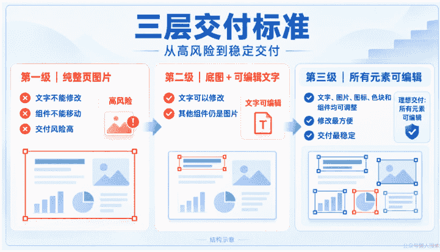
第一级：PNG 图片。
只有图，文字与组件不可单独修改。适合客户很急、只要展示效果，且已接受图片交付的情况。
P.S. 后面也会讲可画设计这条“邪修”路线：先在可画里改，再导出图片。

第二级：半可编辑。
固定底图，上叠可编辑文字。客户让你改文字能接，让你动底图里的图表或组件就容易卡住。这也是我认为现阶段风险偏大的原因。

第三级：全部可编辑。
文字、图表及需交付的组件都能独立修改。
如今这一级别的链路已打通，这也是我愿意把它当变现工具的重要原因：交付有底气，客户改起来省心，售后也方便。本篇就朝第三级交付来做。后面会亲手检查可编辑效果，不是后缀是 PPTX 就算过关。

## 三、制作流程总览

整条路线就四步：接单 → 样稿 → 终稿 → 售后。真正发力的是中间的样稿与终稿。我们先聚焦美化单，不把全案写作、复杂动画混进来。

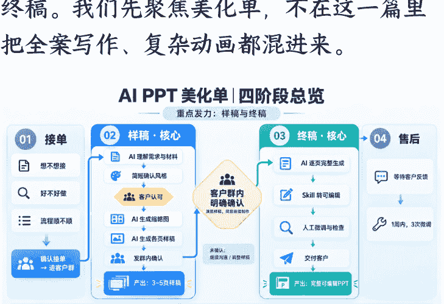
- 接单：判断要求、页数与交期，确认能做再进客户群。
- 样稿：先做 3~5 页，让客户确认风格与排版。
- 终稿：按确认方向补齐全套，转成可编辑演示稿，再检查交付。
- 售后：按约定提供局部微调，不是无限重做。

要焊死在脑子里：样稿没明确通过，别闷头把整套终稿做完！每一步的话术都会紧挨操作放好。看清是“发给模型”还是“发给客户”，换成本单实际信息就能直接引用。

下面开工。先把方向定对，再让模型放开干。

## 四、样稿阶段：照着做，先把方向定下来

本阶段产出：3~5 页样稿。

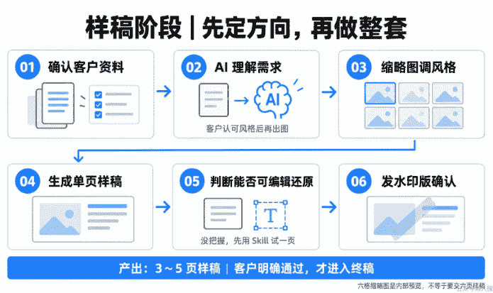
如果是全流程制作单，还需额外确认每页演示稿的具体文案，不是只确认大纲。本篇先讲美化单；全案怎么做、为何要逐页确认，后面再拆。

### 4.1 进客户群，先把资料确认齐

进群第一件事：话术与资料一起发，让客户看见你手里有什么。

发给客户｜资料确认话术： Hello，亲爱的～我是负责您本次演示稿制作的设计师老师，这边是我拿到的所有资料，请问您还有补充吗？

同时，把接单前收到的文件、需求记录与参考图，再发给客户确认一遍。

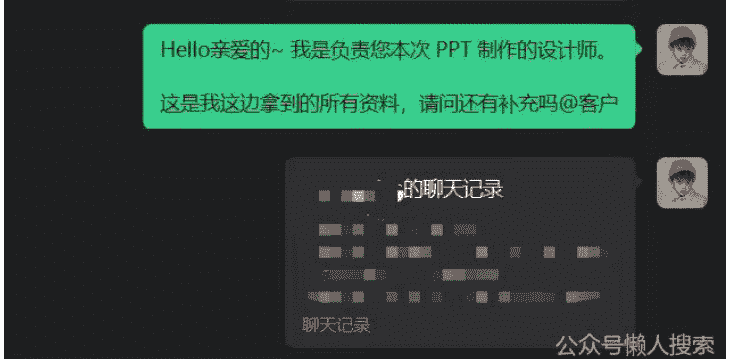
照着图做两件事就行：
- 上方发话术：说明身份，请客户确认、补充。
- 下方附资料：把你已收到的材料一起发过去。

客户确认资料齐全再往下走。别做到一半才发现双方用的根本不是同一份文件。

P.S. 一个工作号的小经验：从我个人经历来说，换成女生形象的工作号，客户给的压力会少一些。这是我的个人感受，不是做单必需项；你按自己习惯来就好。

### 4.2 整理三类材料，一起喂给模型

先把客户现有演示稿导出成 PDF，再整理截图。我这条路线先用 PDF 理解逐页内容，关键页面与版式另外绘图，不只赌一次 PPTX 读取。上传材料分三组，别混着让它猜：

- 客户要什么：客服与客户的需求截图，页数、交期、特殊要求。
- 现在有什么：原稿导出的 PDF；关键页面、复杂图表另外附清晰截图，并注明页码。
- 想变成什么样：客户认可的参考风格图。

先认清一件事：上传成功，不等于模型已看懂。PDF 里的文字、图片与版式都要核对；看不清的页面就补对应截图。

材料齐了，一并发送下面这段。把方括号替换成本单信息，不要连占位字一起扔过去。

发给模型｜需求理解提示词（整理版）：我们是专门给客户做演示稿的设计团队。
[ 文件名 / 第 X 张图 ] 是前端客服和客户沟通的完整需求；[ PDF 文件名 ] 是客户现有的演示稿；另外上传的页面截图分别对应 [ 页码 ]；[ 文件名 / 第 X 张图 ] 是客户认可的参考风格。
这单需要帮客户美化，标准是 [ 标准 / 精美，按本单填写 ]。严格保留每一页演示稿的原有文字、名称和数据，不能擅自改动。
请先按四项回复：客户要求、原稿页数与各页主题、参考风格、待确认问题。看不到或看不清的内容直接标出来，不要猜，也不要自行补写。先理解，不要出图，等我确认后再开始。

示例回复里，模型会先复述需求：这是一份用于刘启哲升职汇报的演示稿，共 7 页 PDF，整体要正式、专业、精致的商务汇报质感。制作原则包括：客户确认过的文字、数字、日期、标题、标点原样保留，不随意删减、扩写或改写；排版可大胆重构，重新设计信息层级、卡片、时间轴、数据模块、图形结构；视觉要升级，不是简单换背景、字体与颜色，而是达到专业设计团队交付的精美程度；整套 7 页视觉统一，同时根据内容采用不同版式，避免千篇一律；严格参考客户指定风格，不自行换成无关风格。已理解页面结构：01 晋升述职封面，高端简约、突出主题；02 个人基本信息，信息模块化、清晰分区。

收到回复，重点看三点：需求有没有漏，页码有没有错，风格有没有理解反。有问题先纠正，别顶着错方向继续。你花半分钟看清，比后面整套重做轻松多了。

### 4.3 确认方向，再出六格缩略图

先看前端记录。已明确确认过风格，就按记录走，不用把同一个问题问客户三遍。

还没确认，就发一段短话，别把设计理论写成论文。

发给客户｜风格确认话术： 我这边按您提供的参考风格，保留原有文字，主要调整排版、配色和视觉呈现。请您确认是否按这个方向先做几页样稿？如果有特别不想要的效果，也可以一起告诉我哈～

客户认可方向后，让模型先出缩略图。

发给模型｜缩略图提示词： 帮我依据现有客户需求和客户做好的演示稿，按已确认的参考风格进行美化。补充要求：[填写本单特殊要求；没有就删掉这一行]。
开始制作缩略图，一张图里放 6 页演示稿，先画前 6 页。保留对应页面的文字、名称和数据，保持整套配色、字体风格与组件一致。

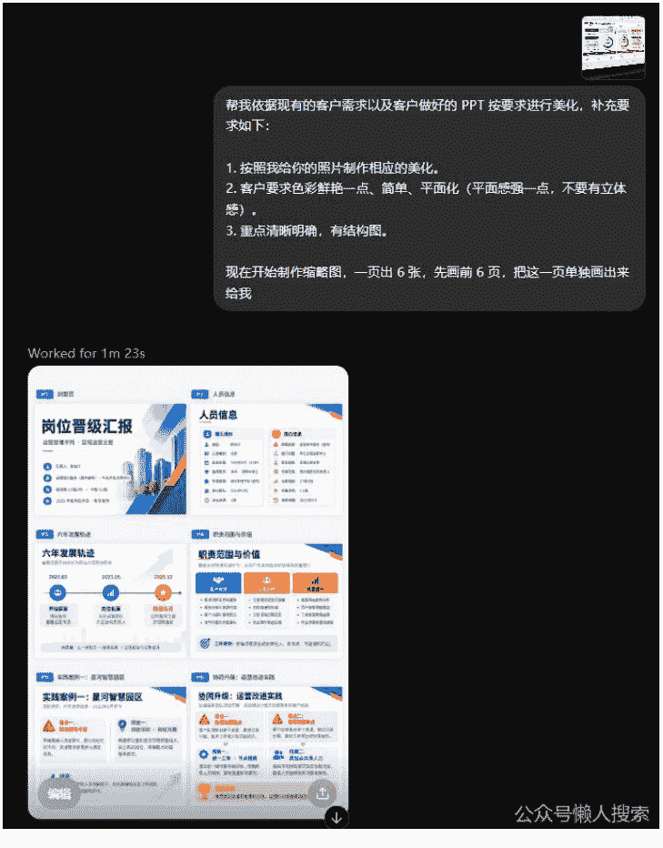
这里两个数字别看混了：
- 自己看：六格缩略图，用来预览风格和布局。不是一页演示稿画六个版本。
- 给客户：从中挑 3~5 页，做成高清样稿后确认。不用把六页全部做完才敢发。

原稿不足六页，就按实际页数生成。我曾经一张放到十页，但平时建议先放六页，看组件更清楚；这不是产品写死的上限。

为什么先出缩略图？因为方向不喜欢，可以现在就调。别一页页全画完，才发现客户想要的根本不是这种风格。

### 4.4 先调缩略图，再生成单页高清图

缩略图出来，先看：风格是否按参考方向，组件是否多余，目录导航是否漏了，内容页码、文字或关键数据有没有明显缺失。缩略图太小、看不清文字的地方，后面用单页图继续核对，不凭模糊预览就认定全对了。

不满意，指出哪页、哪里、改什么。别只说一句“再高级点”。

发给模型｜局部修改提示词（建议模板）：
请修改第 [ X ] 页：删除 [ 具体位置 ] 的角标，在右上角补上 [ 目录导航内容 ]。保留当前配色、其他版式和客户原文，不要连带重做其他页。先更新缩略图给我确认。

缩略图满意了，选能代表不同版式的 3~5 页，分别生成完整单页。

发给模型｜单页生成提示词：
请依据已经确认的缩略图，把第 [ 填写样稿页码 ] 页逐页单独画出来给我，保持整套元素、配色和风格一致。每页都生成独立的完整页面图，不要从缩略图里裁切放大。

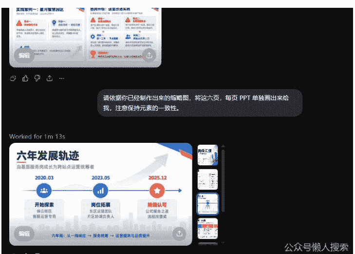
出图后，把它和原稿对应页放一起看。文字、数字、配色、组件，过一眼。不对就定位那一页调整。
没有一次给齐，就按页码继续出下一页。提示词里写了“保持一致”，不代表从此永远不会跑偏，最后这一下还是自己看。

### 4.5 判断能不能还原，再发水印样稿

先别急着把图片丢给客户。问自己一句：后面能不能把这几页还原成可编辑演示稿？这里分两条路：

- 有把握：图片先放进演示稿，每张图占一页，页面比例和原图一致，别拉变形。
- 没把握：先跳到 5.2，拿一页用工作流试跑。打开结果，确认文字和需要编辑的组件能改，再回来发样稿。

新手现在判断不了，就走第二条。先试一页，总比答应客户之后才发现做不出来强。

两条路最后都一样：先发水印图片，不发可编辑源文件。把页面放进 WPS 后，按这个顺序导出：

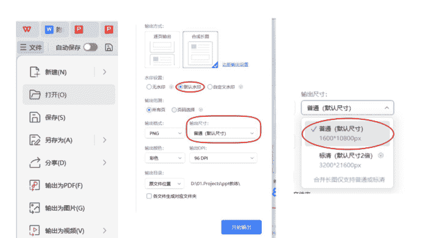
操作时看清四处：
1. 格式选图片。这里不选“输出为 PDF”。
2. 保留水印。没有会员，就用当前版本可用的默认水印。
3. 尺寸选“普通”。这一步先给客户确认风格、排版。
4. 只导出样稿页。通常 3~5 页；按我演示的版本，一次最多输出 25 页，超出就分批。

导出的文件夹可以直接命名为“样稿_水印确认版”，自己也不容易拿错。

发给客户｜样稿确认话术：
亲爱的~这是本次演示稿的样稿，您看看整体风格、排版是否符合预期。有需要调整的地方，可以按页码一起告诉我；请确认是否按这个方向继续完成剩余页面。

客户明确确认样稿通过，再进入终稿。“收到”“我看看”，都不算通过。

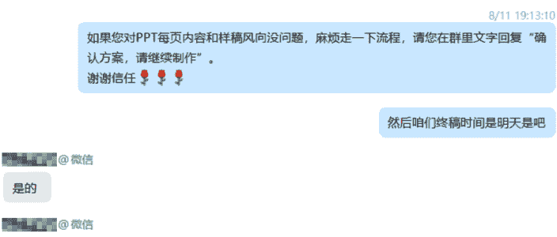
到这里，你手里应该有：确认过的样稿、客户的明确回复，以及接下来要补的页码。方向定了，下一步才是让模型把整套做出来。

在此之前，让我们再来复习下样稿阶段的流程吧！（不用往上翻了，我直接贴过来

### 样稿阶段｜先定方向，再做整套

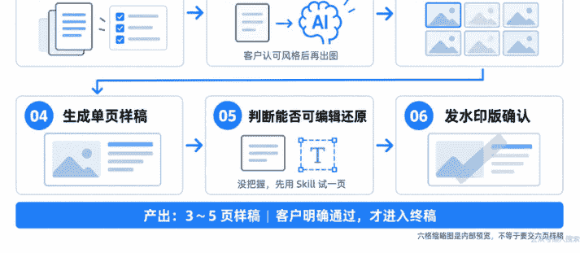

## 五、终稿阶段

本阶段产出：一份检查过、能实际编辑的完整 PPTX。

### 终稿阶段｜把确认过的方向，做成可编辑成品

# 设计图变成可编辑演示文稿：一份能落地的 AI 交付全流程

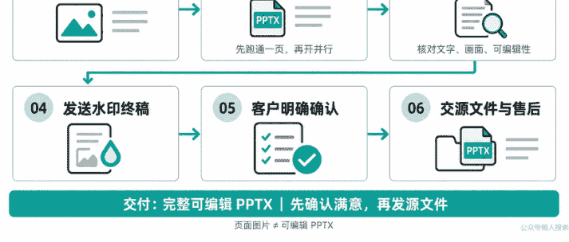

### 5.1 先确认方向，再补齐未完成的页面

样稿定稿之后，其余页面不需要再从头试错。沿用同一套已经跑通的流程继续补全即可。

说句实话：客户买不买是后话，这套方案目前还在持续调试和维护，后续会继续优化；复杂页面中的部分处理组件可能有缺失，具体怎么补，我会在后面单独说明。

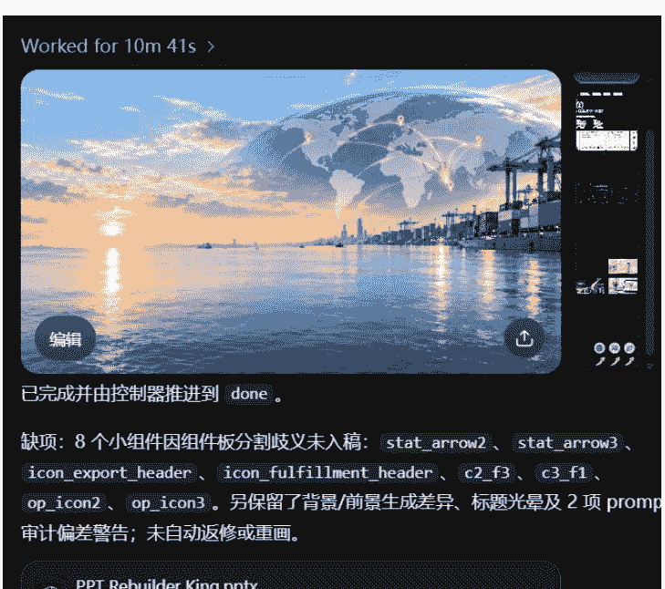

现在你拿到的还是单页图片。真正让这些图片拥有可编辑属性，是接下来要做的转换工作。

先分清楚三类材料：

- 还原包：支撑整条还原路径的 ZIP 压缩文件。
- 项目指令：用来约束项目如何调用还原包的约定说明。
- 待处理图片：当前要转换的那一页。

聊天里的一句“做好了”并不能代表文件真的可编辑。先把单页流程跑通，再处理剩余页面。

#### ① 下载配套压缩包

打开下面的仓库地址，下载 `PPT-Rebuilder-King-ChatGPT-20261025.zip`，存到一个容易找到的位置。

https://github.com/frederick-kk/ppt-rebuilder-king

方便的话点个 Star，我会很开心。文件先放好，下一步是传到 ChatGPT 的项目里，不是装到本地 Codex 里。

#### ② 在 ChatGPT 网页版创建项目

登录网页版，进入「项目」，新建一个项目，并选择只在本项目内使用的权限。

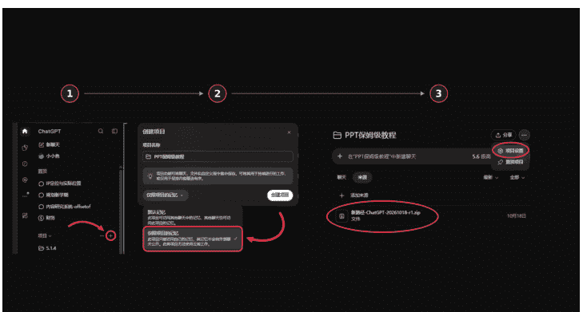

建好之后，先确认当前所在位置就是这个新项目。之后所有文件和对话都放在同一个项目里，不要分散。

#### ③ 上传 ZIP 与项目指令

- 在项目「来源」中上传刚才下载的压缩包。
- 打开右上角「项目设置」，粘贴配套项目指令并保存；`SKILL.md` 也能直接从仓库里获取。

执行规则包括：按控制器返回的动作连续操作；只看当前图片，不调用历史参考图或旧任务；普通正文用原生文本呈现，艺术字保留为独立图片；生成 PPTX 后立刻给下载链接，如有缺失用简短文字说明；不需要额外制作预览、证据包或自动返修。

等待系统返回 PPTX 文件，下载后就能用 WPS 或 PowerPoint 打开。

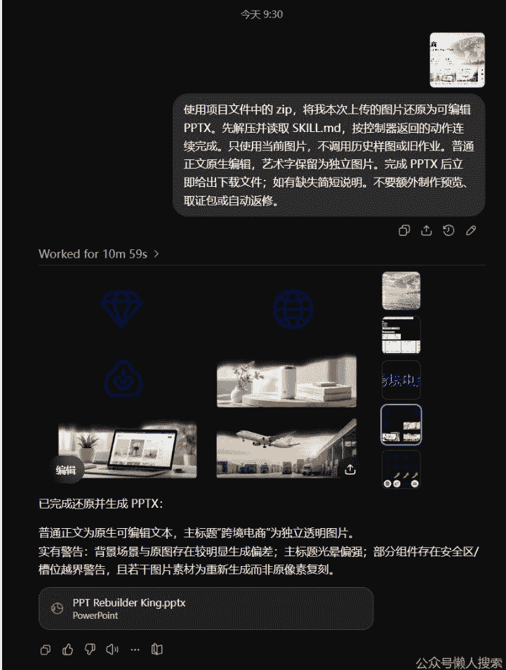

#### 单页验证方法：

- 确实拿到 PPTX 文件，且下载后可正常开启。
- 文字支持单独点选并修改，不是整页被锁成一张图片。
- 按第三级交付标准，核对图表和需要还原的组件能否分别编辑；如果整页都拆不开，就不合格。

实际进度取决于页面复杂度、排队情况和账号限制；卡住时先减少并行任务，别硬顶。

确认任务组都在运行后，你可以安心去吃饭或追剧。是的，这次由 AI 代劳，最后把可编辑的演示文稿交给你。

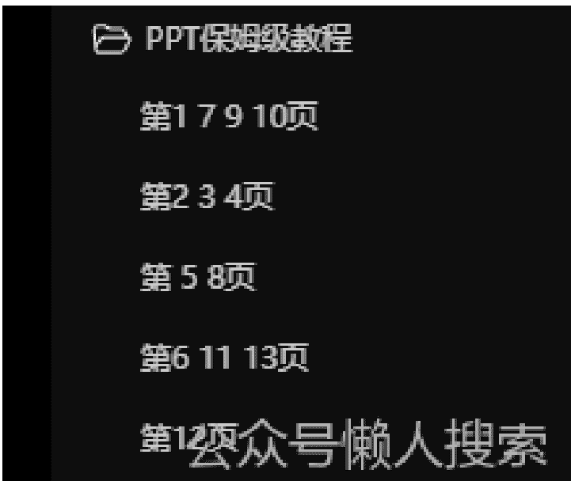

### 5.4 合并与最终检查

各页 PPTX 都完成后，合并成一份总文件。以下按最常见的幻灯片复制方法说明，具体按钮以 WPS / PowerPoint 实际版本为准。

步骤：打开总文件 → 打开下一页文件 → 在左侧缩略图栏选中整张幻灯片并复制 → 回到总文件按页序粘贴 → 选择保留源格式 → 检查。

- 先打开目标总文件，再打开下一页 PPT 文件。
- 在下一页文件的缩略图栏里选中整张幻灯片再复制，不是选中画布中的某个对象。
- 切回总文件，在缩略图栏对应位置执行粘贴；有格式选项时选“保留源格式”。
- 后续页面依次重复，合并完成后检查页序、页面比例、字体是否正常。不要等合并完才发现页面比例混乱。

单页验证只是开始，最终要验证整套。用下面三项做最后把关：

- 文字信息：名称、数字、单位、关键描述有没有被 AI 改动或漏掉。
- 视觉效果：页序、配色、字体是否一致，有没有溢出、遮挡、缺图。
- 可编辑能力：需要修改的文字、图表和组件，是否都能独立操作。

发现问题后回到对应页面修复，改完再查一次，不需要整套重来。

AI 完成主要工作，你负责最后审核。能打开、能放映、该改的都能改，这个文件才能真正交付。

### 5.5 交付成品与后续服务

顺序：水印版终稿 → 客户明确确认 → 源文件 → 售后说明。

① 先发水印版终稿：按 4.5 节的方式导出图片并保留水印，这次导整套终稿；超过单次导出限制就分批处理。

文件命名别混淆：

- “终稿_水印确认版”：客户现在查看的图片。
- “终稿_源文件.pptx”：客户确认后才会发送的可编辑文件。

**客户确认模板：** 亲，终稿已完成。如果您满意，请回复“终稿满意，请发送源文件”，我这边就发送源文件给您。

② 客户明确满意后才发源文件。如果有修改意见，先处理反馈并复查，再请客户确认。确认后按店铺流程发送 `.pptx` 源文件；不要再次打包水印图片。

③ 同步售后政策：PPT 完成后一周内提供三次免费微调。每次请客户一次性列出全部修改点，多个小改动可合并处理。微调限于文字、颜色等局部内容；大纲方向变更、大面积设计重做或版式结构大改，需另行协商。具体以合作店铺的约定为准。客户反馈尽量按“页码 + 具体位置 + 想怎么改”的格式提交，集中一轮收齐，避免反复沟通。

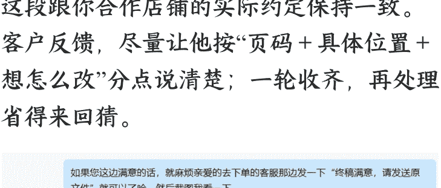

最后按店铺规则完成结算。从需求、样稿到源文件，这单才真正完整。恭喜，你不只是了解 AI，而是让 AI 进入了真实交付流程。老规矩，常看常练。

### 收尾目标：把确认好的方向做成可编辑成品

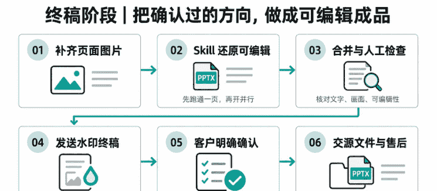

## 六、怎么开始接单

### 6.1 接单前先准备两样

| 准备什么 | 具体要求 |
|---|---|
| 3～5 页作品图 | 展示你实际做过的页面效果，最好准备好可编辑源文件 |
| 行动执行力 | 找到卖 PPT 的店铺，直接问缺不缺写手 |

实际就两件事：能展示的作品 + 敢于开口的行动力。先准备 3～5 页作品图，最好还有对应的可编辑源文件。

如果没有真实订单作品，就自己设定一个模拟需求，按前面流程做一份练习作品。练习作品可以放入作品集，但需注明是练习；未经授权，客户资料不能拿来当作品集。

别在第一步给自己设障碍。把几页能代表实力的作品整理好，接下来就去问。

### 6.2 用三步走进派单群

找店铺 → 发作品/参加考核 → 进派单群

第一步：找到 PPT 服务店铺，问客服。在电商平台搜索做 PPT 的店铺，逐一询问。

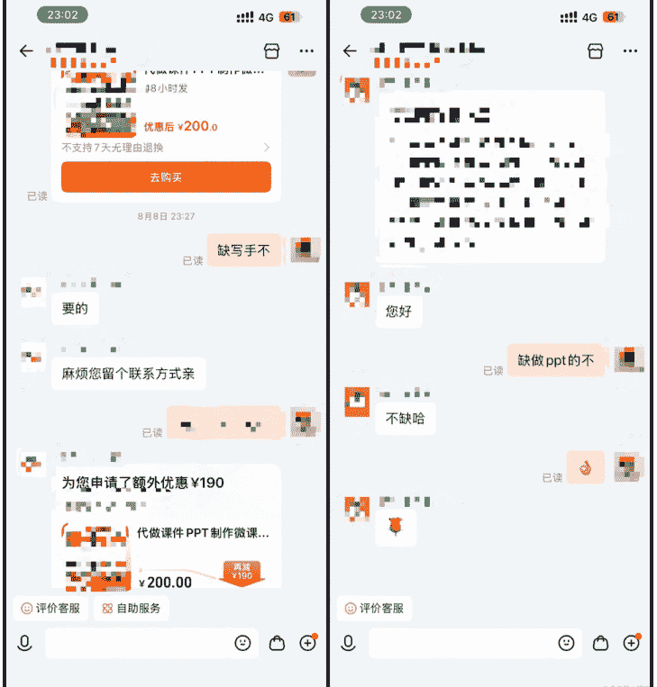

**客服交流模板：** 你好，请问店里目前缺 PPT 写手吗？

按我了解到的信息，很多店铺都在招写手。一家说不需要，就换下一家；更不要因为一次拒绝，就觉得自己不行。

第二步：联系对接人，提交作品或接受考核。如果对方有意向，一般会让对接人继续联系你，查看过往作品，也可能安排一个小测试。之前准备好的 3～5 页作品图直接提交；对方要看可编辑能力，再按需提供源文件。

第三步：通过后进派单群，从能接的订单开始。作品合格、考核通过后，按店铺安排入群，选择自己有时间、有能力完成的单子。

合作前先确认 3 项：

- 合作规则：接单方式、客户对接方式、交付流程。
- 违规扣款：哪些行为算违规，扣款条件和金额标准。
- 结算方式：什么时候结款、通过什么渠道付款。

接具体单子时再确认 4 项：

- 页数：总共有多少页。
- 交期：样稿和终稿分别在什么时间点交。
- 制作要求：档位、风格、动画需求、可编辑程度。
- 到手报酬：这单完成后的实际收入。

这两组信息全部搞清楚再接单。要求、时间、报酬都别靠猜。流程其实很短。

作品准备好就主动问。饭都送到嘴边了，自己得张嘴；别在开口前就替对方把自己拒了。

给新手的建议：

- 起步选一单要求明确、自己有把握完成的标准单。
- 稳定做完一两笔后，再尝试精美单，把制作、交付、售后走完。
- 高端、首席、复杂定制和明显超负荷的长单，暂时别碰。

简单单别卷低价。25 页以上的大单，我也建议先避开，不要一开始就接累自己；熟练后再按自己的效率来判断。

### 6.3 站稳几单后再问进阶群

能做到稳定接单后，记得问：店里有进阶派单群吗？完成几单且交付顺利的前提下，可以咨询入群条件。进阶群里的订单质量可能更高，具体看店铺安排。

**发给对接人的模板：** 你好，我已经顺利完成几单，想咨询一下店里有没有进阶派单群？如果有，申请需要什么条件？

先把现有订单做扎实，再去争取更好的单子。别只顾埋头接单，也要留意自己的上升空间。

## 七、执行清单

- 开通 ChatGPT Plus，备好账号。
- 从仓库下载 Skill ZIP，方便时给项目点个 Star。
- 设定一个模拟需求，制作一套练习作品：从样稿到可编辑终稿完整走一遍。
- 整理作品集：选 3～5 页有代表性的作品图，最好配上可编辑源文件。
- 联系店铺：找 PPT 商家问是否缺写手，发作品并按对方要求考核。
- 先接一单标准单：优先选要求清楚、自己能按时交付的。简单单别卷低价。
- 完成一两单后挑战精美单：把制作、交付、售后全流程都走一遍。

这篇文章先把我的完整路线交底。后面将继续拆解不同订单的应对方法、避坑经验和步骤背后的原因。

## 写在最后

写到这里，我已经把正在用、也确实赚到过钱的路径全盘托出。

我依然相信：Stay hungry, stay foolish。有人觉得，我在 07 年用 AI 做到今天这一步，已经算不错了。听到这种夸奖我当然高兴。但登上更大的舞台、看到更厉害的前辈甚至同龄人后，我也会紧张：原来还有人能做到这种程度，我需要追赶的距离还很长。

但焦虑归焦虑，我仍然想继续试。这套方法我会持续完善，你有更好的思路也欢迎告诉我。

如果你和我一样不甘心，又不知道从哪开始，不妨拿这份开源经验，先做一份作品，再去大胆问一家店铺，给自己一次真正下场的机会。

后续我会继续更新补充内容。你可以保持关注，我们边做边交流，一起做出点成绩。

等你回来说一句：“兄弟，我终于接到第一单了。”我可能比自己开单还开心。

—— 分割线 ——

看完这套 SOP，你可能觉得已经懂了；但 90% 的人会卡在实操第一步。

工具和教程只是最薄的一层壁垒，真正的差距在于“立刻动手”和“圈层信息差”。如果你想看全网最新的变现玩法，和一群执行力极强的人一起下场拿结果，欢迎加入我的核心私域：【懒人专属群】。

这里不聊空话，只做商业闭环拆解和 AI 效率挖掘。系统里已有 1000+ 跑通的套利实战案例。

- □ 查看完整数字资产和入群门槛：

https://lazyso.com/insider/

认同价值、准备实际动手的，可以添加微信号 lazyhelper1，备注【实操上车】，不闲聊。