# 从贴图号起步到单兵作战体：靠 Codex 跑通项目、把经验产品化，月度营收破5万的复盘

261021 副业 SC 精华

整理：👸号懒人搜索，懒人专属群精选

懒人微信：lazyhelper1

> > 小懒判断 | 适合已在做贴图号、想从赚广告费往"一人公司"走的人；纯小白看方法论会有点重。最值得看的是第八章：Codex 和 WorkBuddy 接进贴图的完整流程，从采集到发布每步都有具体话术模板。坑在于：作者的三层放大逻辑成立的前提是他先手工跑通了几十个号，直接抄"封装 Skill 做工作台"而跳过手工阶段，大概率做出一堆自己都跑不顺的工具。

大家好，我是辰风。

赚钱航海那期刚收官，我们负责的贴图账号反馈比预期更稳，星球里不少圈友陆续晒出战绩，挺振奋人心的。

这篇梳理拖了很久，一直在找合适的表达方式。特别感谢小武老师的推动，雅月老师和七天导师团队在沙龙里给出的系统建议，让项目讨论能够落地，也才有了下面的内容。

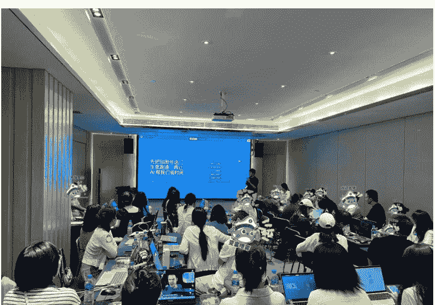
我觉得不能只是单纯的围绕贴图的内容逻辑和流量逻辑，以及怎么去放大做矩阵的这个思路来聊，还是要展开更多的一些信息点。

光是 Agent 工具这一块，我们也做出了约 5万元的利润，也有 1000 多位用户付费使用。（三个月左右时间）

120笔小票单，共 ¥20080.00

361笔小票单，共 ¥35937.00

这些用户，主要从抖音、👸号,视频号,📕等公域内容过来。

起初想用的是 AI工具，但我们给到的不是一个空聊天框，而是把项目方法、知识库和 AI 工具放在一起：知道做什么，有对标可以看，也有一套能接着做的流程。

它是我们承接变现的一个入口。

本期想聊的主线，是如何借助贴图这类轻量级流量主生意，逐步成长为可自营的个人主理人形态。

首先借助贴图把流量主这条线跑通，让收益可被验证；随后把内容生产与获客的能力迁移到个人品牌与主业上，沉淀私域；同时借助人工智能把产能与业务体量一起拉升。

之后，将做号过程中沉淀的方法论与内容认知，提炼为 Skill，封装成可复用工作台对外售卖，形成价格。把这套打法复制、裂变，滚出一块相对稳态的流量生意。

再往后思考，这套选题与流量判断能力如何嫁接到个人 IP 与其他业务。Codex、WorkBuddy、Skill 与工作台在我这边的定位是业务放大的杠杆，而非单纯工具。

所以本篇不只谈贴图怎么做内容、如何提效，而是在贴图之上还能尝试什么，顺着贴图路径把业务规模与收益体量放大，并把人工智能能力与个人 IP 能力真正打通。

这一轮航海刚结束，趁热聊聊我对贴图这件事的看法，跟多数人的第一印象不太一样。

## 指标总览

- **统计区间**：近7日、近30日、自定义
- **广告位**：全部、底部、文中、关键词、留言区、后贴、互选、返佣、贴图底部推荐流、常看列表
- **统计口径**：组合指标-收入、组合指标-点击、组合指标-曝光

| 日期 | 曝光量 | 收入（元） | eCPM |
| --- | ---: | ---: | ---: |
| 2026-09-27 | 19,811 | 494.21 | 24.95 |
| 2026-09-26 | 21,325 | 400.38 | 18.78 |
| 2026-09-25 | 20,547 | 369.40 | 17.98 |
| 2026-09-24 | 22,159 | 232.17 | 10.48 |
| 2026-09-23 | 17,744 | 166.37 | 9.38 |
| 2026-09-22 | 18,766 | 150.94 | 8.04 |
| 2026-09-21 | 18,746 | 140.44 | 7.49 |

发表时间：2026-09-12

实时数据呈现

- 阅读：954,278
- 留言：138
- 赞：2,689
- 分享：760
- 推荐：892
- 划线：84
- 赞赏：¥0

发表时间：2026-09-22

实时数据呈现

阅读 222,779

留言 143

赞 2,107

分享 1,876

推荐 985

划线 53

赞赏 ¥30

9 月份测试的老年赛道账号，单价表现较高。

| 日期 | 收入 (元) |
|---|---|
| 2026-10-11 | 923.72 |
| 2026-10-10 | 1,160.13 |
| 2026-10-09 | 76.17 |
| 2026-10-08 | 25.52 |
| 2026-10-07 | 61.82 |
| 2026-10-06 | 17.53 |
| 2026-10-05 | 22.02 |
| 2026-10-04 | 33.17 |
| 2026-10-03 | 16.68 |
| 2026-10-02 | 15.71 |
| 2026-10-01 | 14.23 |

1,681

关注的人 >

1,048,012

昨日阅读 >

↑1789%

6,007

昨日分享 >

↑392%

收益变现

广告收入

昨日收入 ¥1,160.13

付费提现

去开通

创作者服务

2,206

关注的人 >

365,080

昨日阅读 >

2,677

昨日分享 >

收益变现

广告收入

昨日收入 ¥923.72

付费提现

去开通

创作者服务

内容助推

6个新曝光... 

我的足迹

账号检测

（10.11.10.12 新跑起来的数据收益图，老号新做，不到 2 周时间）

以下是团队部分账号的月度收入截图，展示的是所述账号的阶段结果。

### 流量主

广告管理

昨日收入（元） ?

明细 >

107.97

+1.78% 日环比

+7.14% 周同比

2,624.82 本月收入（元）

如何提现收入？

昨日收入（元） ?

明细 >

70.48

-4.95% 日环比

-74.86% 周同比

3,912.97 本月收入（元）

如何提现收入？

昨日收入（元） ?

明细 >

12.38

-32.30% 日环比

-83.31% 周同比

1,956.45 本月收入（元）

昨日收入（元） ?

明细 >

145.68

+369.45% 日环比

+22.67% 周同比

3,621.52 本月收入（元）

昨日收入（元） ?

明细 >

79.26

-18.83% 日环比

-45.74% 周同比

3,552.50 本月收入（元）

如何提现收入？

这些数字触动我的并非贴图还能产生多少现金，而是看见了一条更长的路径：一个很小的流量变现生意如何沉淀为可复用的生产方法；这套方法又如何转化为工具、培训与新的业务入口。

- 首要是通过自营业务把流量变现走通
- 随后把业务封装成项目，并捆绑智能代理方案，让用户拿到成稿与交付结果
- 借助人工智能知识库提供额外价值，驱动裂变与回购
- 依赖人工智能方案做升单培训、私教陪跑、项目合作或代运营

## 一、贴图项目被低估了

起初提到贴图，很多人会想到：不过是发图挂流量主赚点广告费，天花板有限，红利期过就没了。我非常理解，因为我最初也是这样看的。真正带着团队逐条做下来，我越来越觉得被小看了。

首要任务是把贴图号当成一份真实的收入生意来做：把作品发出去，跑通流量主，看见后台数字，弄明白钱从哪来。这一步站稳，后面放大才有落点。

真正值钱的，是做这件事时被逼长出来的流量嗅觉。

什么选题容易被推、什么封面值得点开、用户刷到内容的前两秒在想什么、为何愿意停留、为何愿意转发——这些是任何内容型生意绕不开的基础功。贴图只是门槛极低、反馈极快的练手场，用最短周期把这份手感磨出来。

## 二、贴图跑通后还能往哪走

第一层：继续做泛流量，把账号做大，稳住流量主收益。

第二层：借助低门槛的贴图内容做筛选与吸粉，慢慢收敛账号调性，做成有标签的垂直号，进而带货、接商单，这时单粉价值完全不同。

第三层：把贴图验证过的爆款逻辑反哺个人 IP，做垂类内容、课程培训、私域运营。

贴图是入口，但向上延展的空间很大。贴图核心人群偏中老年，正处付费认知培养期，有意愿也有实力，是正在崛起的消费群体。靠流量主加带货就能实现不错变现。

再往下，围绕微信生态里的这批人，每个行业都能长出新的业务形态。

所以我会先让航海成员把贴图认真做成一个小生意，同时练习选题、审图、判断内容的能力。先看见真实收益，再思考这套能力能迁移到哪条主业。选题感、爆款直觉、对用户心理的敏感、平台规则的理解，迁移到📕图文、抖音短视频、朋友圈课程等场景都能复用。

贴图带来的收入是起步信号；带走的应该是选题、网感、流量判断力与内容生产力。把这些接到个人 IP、其他项目与客户服务上，才有更长的放大半径。

## 三、AI 该学技术，还是学变现

从武汉沙龙到实操带号，我对教 AI、用 AI 的认识一直在进化。

交流中能明显感受到大家对人工智能的热情，聊工具、聊小程序、聊模型接入，头头是道。我也会被吸引。但越聊越发现，研究技术和用技术赚钱是两件事。

每次聊到最后，我喜欢追问：这套东西接入了你正在做的哪个项目？替你省掉了哪段工序？

大家工具不少，却不一定清楚下一步怎么用。那就不如直接拿贴图当样本，从选题到首条作品，再到发布与复盘，全流程带着走。先摸到一条靠近变现的路径，再谈提效才有意义。

## 四、按单兵作战体梳理业务

- 👸号贴图持续运营，把走通的步骤整理成教程
- 文案、图文、直播稿、海报、PPT 等重复性生产，逐步交给 Codex 与自有 Skill 运行

亲手跑完一轮，视野会更立体：内容如何批量化、时间如何被挤出来、经验如何移交、用户为何买单。

贴图对我而言早已不是单纯的流量变现。它更像一个原点，把流量思维、内容能力、智能工具链与个人品牌串起来。

风口会过去，风口里练出的能力不会过去。这是本轮航海结束我想留给大伙的核心句。

## 五、回到真需求

一个普通人手里已有项目与业务，人工智能具体能解决什么真问题？能否让选题更快、返工更少、产能更高，最终多出一份成品、多通一条业务链路？

带着这个问题，我们用 WorkBuddy、Codex 与 Skill 在十多个贴图赛道做内容实验。标题、正文、排版、配图，以及直播稿、海报、PPT 等物料都跑过一轮，并把高频要求沉淀成技能包。

内容缺口被填补，赛道逐渐饱和，数据趋于平稳，单价也会回归常态，推流也会回温。

那时留给我们的空间会变小，这本身也是启发：贴图还能不能继续？不行的话，下一步路径如何变化？

## 七、武汉沙龙复盘：先把第一条贴图发出

七天导师团队邀请我去武汉做从 0 到 1 的主题。我们讲得很细：为何选它、如何找方向、素材去哪找、一张图加一个想法如何变成内容、发在哪、后台怎么看。

分享设计时我们把赛道选择前置。

先不讲道理，先看三个案例：中年实拍、水果、奇葩动物。先让大家看见作品长什么样，再回头拆解爆款理由、情绪痛点、选题逻辑。

中年实拍看的是生活里一个小动作能否唤起相似记忆；水果需要地域、季节、生活味，否则只是普通图片；奇葩动物更直接，第一眼就要有让人多看两秒的真实特征。

但我不想让这些带偏新手。

一个新手今天首图还没挑出来，给他看再花哨的量产流程也没用。

先把第一条发出。回头看工具时，他才明白每个功能到底省掉哪段麻烦。

当初选贴图很现实：长文要磨，视频要拍剪配音，贴图只需要一个具体题、一到几张可读的图配一段人话，就能先上线。

做下来才明白，简单不等于随便。

一张猫愣住的照片、一种本地人才认的食材、一位中年人重新戴上工牌的瞬间，看似平常，却要判断：有没有让人停顿的点？能否抛出具体问题？素材是否足够讲清问题？

我常让新手记四个要点：题、图、话、真。

题要小，别上来写“中年人如何重启”，太大；“中年失业、降薪、离职、被裁员”才有画面。

图要一眼可懂，有没有反常？能否瞬间引发好奇与重点？

话要吃进素材，换图后正文还能通用，说明还是空话。

真 是底线。图片与文案必须基于真实情感，有细节、有故事、有感受。

人写还是机写，一眼基本能分辨。

贴图最短变现链路很清晰：被推荐或分享→标题与首图留人→阅读、翻图或留言→广告有效展示→流量主分成。但阅读不等同于收入，有点击不代表必展示，展示也不代表单价稳定。同样的 1 万阅读，两篇收益可能相差很多。我们看后台会把曝光、阅读、互动、广告曝光、收入与 eCPM 分开看，不会直接用阅读数套收益。

我愿意带新手做贴图，不是因为能一步登天，恰恰因为它足够小。

小到能逼一个人把“选题→找图→写出来→发布→看数据”完整走一遍。

以前有人问定位，我解释半天仍焦虑：宠物赛道卷不卷？婚姻能不能做？中年内容离钱更近吗？

只要他真发出三五条，问题马上具体化。

有曝光没点击，先看标题与首图；有点击没读完，再看正文是否接住图；读完评论区没声浪，就得想想题是否戳中值得回应的点。

第一笔钱解不了焦虑，却能把“我行不行”这句模糊怀疑，换成一个具体问题——下一条该改哪里。

这正是贴图最值钱的地方。

它练的不是做图或搬运能力，而是做项目的整体思路。

先看清赛道长什么样、同行在做什么、如何拆解，再辨别好图与值得研究的文案，最后把自己的作品发出去。

在此过程中培养对内容的理解，再接入人工智能提效与调优，培养网感，最后用数据复盘。

航海结束，我更关心大家的问题是否发生变化。

Mini 航海里，群友带着卡住的页面、找不到的图、几分钱的后台截图来问，我们逐条拆。

你分享里说“找到好素材”听着轻松，真正把几张图摆出来，会发现怎么选图、不同赛道如何判断、如何改图处处是卡点。

这也提醒我：自己熟的动作极易在教程里一笔带过。

选题、首图、改文案、发布、回填数据，听起来只有几个词，新手在任何一步都可能卡住。

只要还在靠猜，工具再多难度也不会真降。

这一轮收尾，我最在意的不是产出多少条，而是是否开始带着作品与后台提问。

这个转变我在沙龙和带号时见过多次。

没发前大家纠结适不适合、赛道选错怎么办，越想越虚。

一旦发出，讨论立刻有了抓手：标题首图是否对齐，正文是否空洞，下条先换题还是换图。

我很喜欢这类问题，因为终于不用隔空聊。

把图和稿摆出来就能指具体位置，把相邻内容排一起就能看出前序判断哪步站不住。

走到这一步，工具能帮多少、哪些仍需自己决策，会更清晰。

一位线下课的圈友曾发后台，她说“我是从线下课开始的”。近 7 日明细里有一天 294.16 元，也有一天 25.36 元。

我反复看这类反馈。

触动我的不是数字，而是她从“听分享”走到“自己做内容、拿到真实反馈”。最终能到多少，还要看后续内容与持续表现，无人能打包票。

因此这段经历带来的改变，不只是多带一轮航海。

我更认真地审视教程与产品：演示结束用户接得住吗？换成他自己的素材还能跑通吗？卡住时知道去哪查吗？

这些没交代清，用户看演示会觉得厉害，自己上手就动不了。

说白了，教程再漂亮，用户用不起来就是白做。

一条贴图最大的好处，是把“学 AI”这件事从虚到实，落到几个具体操作面上——比如整理对标素材的时

内容收尾时，读者能不能带走可落地的判断？

落笔前，手里那批原始材料是否被真正消化？

配图能否托住标题给出的承诺？

发出后，后台反馈能否指出下一轮优先修哪里？

每个节点都有可核验、可追问的细节。

第一笔收入只是反馈之一，不能包办后续经营难题。

但对刚接触工具、不知从何下手的人，这一步很关键。

从此他知道自己的 AI 能力能嵌入哪些工序，下一步补哪块。

胜过收藏一堆课程。

## 八、Codex 与 WorkBuddy 的协作链路：从取样到成品

早期误区：以为生成快，产量就高。

资料一塞，几分钟出结构完整稿。标题正文结尾齐全。粗看像样，发布就暴露：人物混淆，图说甲，标题跑乙；句子顺但出处说不清。

我曾写过《只用 AI 做爆文，谁做谁死》。话冲，判断未变：**若连题目为何被点开都没想透，工具越快，只会批量生产无感内容。** 后来不再催一次十篇。

改为把单条内容从头拆到尾。

Codex 负责把材料、判断、修改标准整理成可复用流程；WorkBuddy 调用已装赛道 Skill 执行制作。能力有交叉，不必每条都切换。关键在前后交接能接住。

### 取样：收藏链接不等于拿到材料

打开贴图对标库，只锁定单一赛道。点开某条记录，取标题、原文、原链接，再回原页看首图、正文图、评论。旧样本认写法；判断近期方向，另找近期同类，别把旧库日期当实时数据。

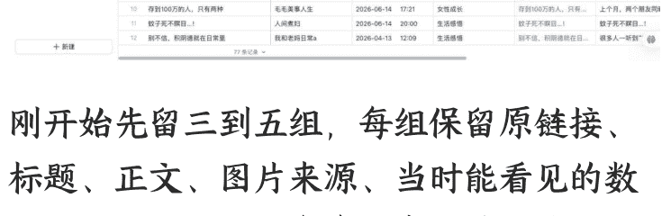

先留三到五组，每组保留原链接、标题、正文、图片来源、可见数据与统计时间、代表性评论，再写一句留存理由。

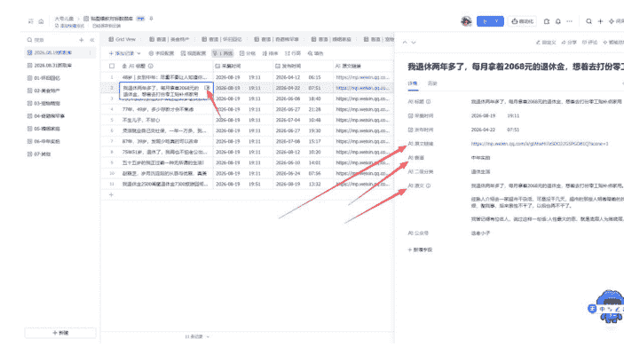

已有采集表、正文文件或图片合集，就交给 Codex；没有先手工整理。用连接器或采集工具，先确认登录、权限、范围。链接打不开，补正文和图片，别让工具按标题猜全文。先整理出可用样本，比先搭全自动采集器重要。

> > **给 Codex 的整理指令：**
> >
> > 读取我提交的链接、导出文件和图片，只处理【赛道】样本。逐条保留原链接、标题、完整正文、图片文件或图源、可见数据与时间、评论摘录。数据缺失留空，打不开的单列，不补全文或阅读量。相同链接合并，相似内容分组。
> >
> > 再分别说明：首图第一眼看到什么；标题提出什么问题；正文新增什么；评论最关心什么。每条判断标位置。输出可打开的素材表、候选选题、材料缺口，暂不写成品、不发布。等我确认再继续。

### Codex 的职责：先把题目和要求说透，而非催产量

在 Codex 新建任务，指定材料目录或上传文件，交代赛道规则。先让它复述读到了什么，再比较对标。

这轮确认三件事：写给谁；图里最值得讲什么；事实能撑到哪。Codex 可拆解对标标题、图序、正文作用，也能指出缺口。选题、核事实、定观点由我负责，它把确认材料组织成可执行说明。比如稿子只剩“中年人很难”，我不会要求“再共情一点”，而会要求：指出图中的具体行为，找出可确认的工作或照料场景，删掉无材料支撑的身世。它交回的不是更惨故事，而是一版知道补什么、删什么的制作说明。

### 有 Skill 为何仍要改稿

航海期一位圈友分享过过程。

做贴图前，他先让 GPT/Codex 打磨👸号长文 Skill，准备交给 OpenClaw 写。折腾三天，发现自己缺写作经验，凭空造规则不现实，先放下。

转向贴图后，他拿教练材料，让 WorkBuddy 用现成 Skill 出文案。稿子有了，读着差口气。又交 GPT 和 Claude 改，几轮仍平。后来想到 Grok 的表达和梗，继续改，才接近想要的感觉。

几张图几句话，前后磨了两三个小时。他说第一篇最后 82 万阅读。

我想让人看到中间那两三个小时。

不能只留数字，把好材料、多轮修改、人的判断省掉。也不是照他把四个工具轮一遍就算学会。更该留下：哪句平，哪种梗不贴，哪段跟图脱节，最后为何选这版。

下次就有依据：问题在材料，回去找材料；正文没吃进图片，改正文；只是结尾套话，先别推倒重写。反复出现的差异，才沉淀进自己的 Skill。

我以前也容易被“几分钟出稿”吸引，现在把制作、人工修改、图片检查、后续反馈放一起看。工具交第一版只是起点；让我知道这版为何可用、下版如何少返工，才是工作流价值。

### WorkBuddy 调用：先装对包，再放自己的材料

- 1. 航海手册提供过一些赛道 Skill 内容包，可直接交给 WorkBuddy 或 Codex 安装激活。
- 2. 打开 WorkBuddy 左侧“专家·技能·连接器”，进技能页，点“添加技能”→“上传技能”，选 ZIP 或文件夹。导入后确认名称和启用状态。界面改版时对照官方说明，不要只把 ZIP 拖进聊天框就当安装完成。

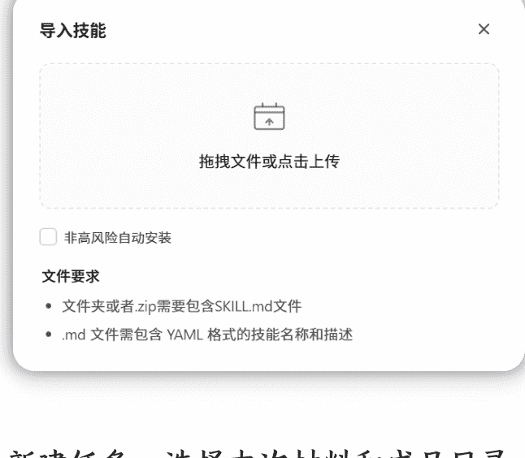

- 1. 新建任务，选本次材料与成品目录。输入框键入 /，从列表选已安装技能；也可写明技能名称。加入参考图、对标正文、自己的事实、Codex 整理好的制作要求。
- 2. 先让工具确认包名、适用赛道、读到的材料、交付文件、费用。手册里中年客户端叫 tietu-midlife-client，婚姻客户端叫 tietu-marriage-client；别和本地完整规则包名称混用。
- 3. 这两个客户端参考图必填。首次按包内说明完成本赛道授权，成功再执行；生成使用本人 WorkBuddy/CodeBuddy 能力与积分。授权码、登录二维码、密钥不要放进公开截图。

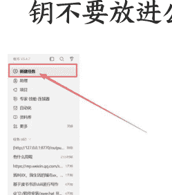

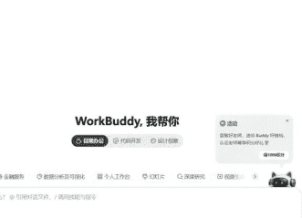

> > 首次调用可以这样说：
> > 请调用我已安装的【本次贴图 Skill 名称】。先读 SKILL.md，确认赛道、必要输入、授权状态、交付文件；缺材料先指出，暂不生成。
本次读者：【 】；只讲的问题：【 】；参考图片文件：【 】；对标正文：【只借鉴写法】；我能确认的事实和观察：【 】；不能编的内容：【 】；成品目录：【 】。
条件齐了，再按包内流程交付标题、贴图短文、图序、完成图。给实际文件位置；打不开、没图或授权失败就说明，不用“已完成”替代文件。

### 二创：换自己的材料与判断，不是换几个词

看对标先拆吸引点：题目问了什么，首图靠什么留人，正文如何接图，评论在说什么。然后换成本次材料、观察、表达。原作者的家庭、经历、对白、收益不能一起搬。

顺序：拆吸引点 → 选本篇切口 → 换自己事实 → 写短文 → 检查图文是否同一件事。痛点放这里，不另塞“你是不是很焦虑”。原稿“重新戴上工牌”是切口：材料确实支持重新上班，可写有依据的顾虑、期待或安排；只有一张工牌图，不能补出失业多年、夫妻争吵、经济困境。

我要的是：先让读者看到熟悉行为，再说它为何有感受，最后落到自己的观察或某项可执行的小事。宠物和食材未必卖惨，看点可能是某个行为、某个切面、某个意外发现。痛点必须适合这组材料，不是所有赛道都硬套变现焦虑。

#### 局部修改要求：

先别重写全文。对照参考吸引点和我的事实材料，检查标题、首图、正文是否说同一问题。引用最空或最跑题的一段，说明缺什么，只改这段。保留我的事实和表达，不移用对标经历，不编对话、反馈、数字；缺过程材料就问我补，不靠语气词装真人。

看实际改稿截图，别只说“再口语化一点”。看工具列出的改动：哪句换说法，补了哪个场景，删了多少废话。再打开结果文件读一遍；工具写“改好了”，还得看成稿是否真的顺。

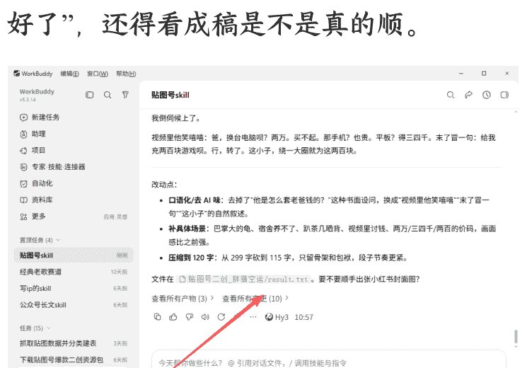

### 配图设计：先定第一眼，再倒推提示词

先看三到五组同赛道、同用途参考。不是抽一句“高清、生活感、电影感”就出图。逐张看主体、行为、关键物件、场景、占比、光线、是否加字；从反复特征里选本次真正要保留的。

先定纯图还是叠字。图里行为已说明问题，就别压大标题。观点离开文字说不清，才另排短字；后续图补细节，不每张重复标题。需要准确中文时，底图不生成字，文字单独排并核对，不遮脸、手、关键物件。

> > **给 Codex 的生图提示词调整要求：**
> >
> > 看这三到五组参考及本篇标题、正文。逐图指出第一眼重点、主体行为、关键物件、构图、是否叠字，再总结同赛道可借鉴写法。只写看得见的，不推断人物身份和经历。
> >
> > 为我的【本篇场景】写一版无字底图提示词，按“主体与行为、场景、关键物件、画幅与主体位置、光线、保留项、避免项”展开；列出可替换变量。需要文字就另给准确文案和留白位置。不要复制参考人物、标识、文案或私人空间。

先试一张，再指出具体问题。主体太小，改位置和占比；行为太摆拍，换成材料支持的行为；字挡画面，先挪字或取消叠字；手、物件或事实不对，重做那张。一次先处理首要问题，不因不满意就重写整段提示词。

**出图后点开大图看。** 下面是我们之前操作时留下的截图。右侧直接打开图片，检查主体、物件、文字和细节。左侧解释只帮助理解处理方式，图片好不好还得看右侧实际成品。

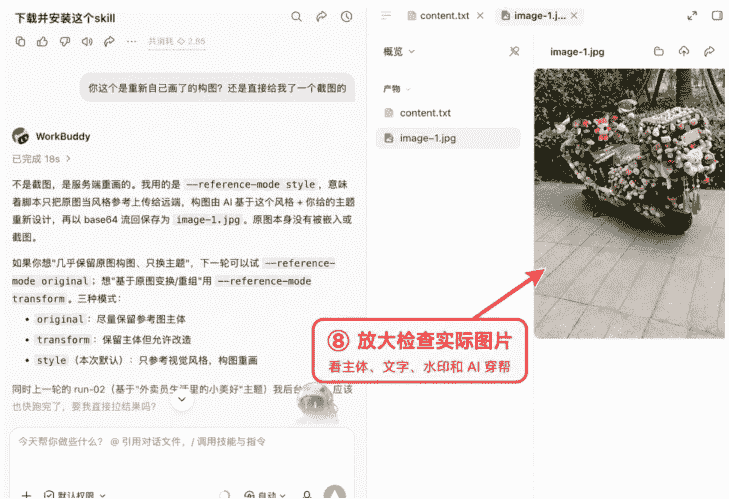

有权使用的真实证据图，只做不改变含义的裁切和清晰度处理，不改表情、不增删人物制造冲突。生成图或图生图示意不能冒充新闻、住院现场或本人经历。

客户端加密核心不解密修改；可调整主题、补充事实、叠字、保留/替换/禁止项按包内范围处理，自己的明文规则改副本。

### 最终交付：文件、人工检查、发布后反馈

中年和婚姻客户端按包内要求交付参考图解析.md、成品稿.md、候选标题.txt、完成图、result.json、manifest.json。

（WorkBuddy 端）

标题不少于五个、图片一到两张，是这两个包交付要求。

文件入口：点文案文件读内容，再点图片文件看画面。下图旧任务用 content.txt 和 image-1.jpg，当前包文件名以交付清单为准，检查方法一样。

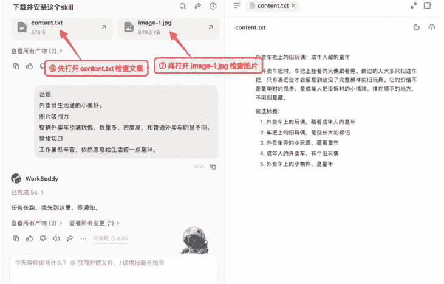

#### 我最后把关：

标题是否兑现，首图是否看得懂，文案是否新增信息，事实与图源是否清楚。确认后由自己、员工或助手上传，核对账号、图序、裁切和声明，手机预览再发布。工具交付不等于发布完成。

**手机发布照这张图走：** 左边在“新的创作”选“贴图”，右边编辑页上传图片并排序，填标题正文。先预览，确认后点“发表”，再回已发表列表检查。

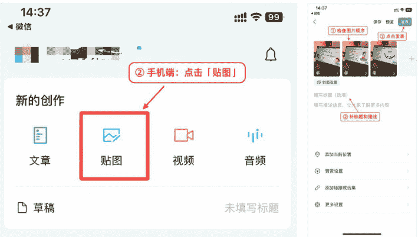

发布后把成品和本轮材料对应，记录发布时间、观察时间、可见阅读来源、互动、流量主收益。阅读低先看实际材料和数据缺口，别凭单条认定限流。下篇先调整首要问题，便于比较，但不能断言这是唯一原因。

数据回来先分开看两张图。第一张看内容有没有被阅读、互动从哪来；第二张看同一时段广告曝光和收入。先选对日期，再把记录对应到作品，别把账号全天收益算给某一篇。

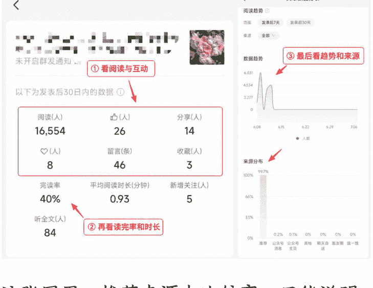

这张图推荐来源占比高，只能说明该样例在所选时段主要靠推荐获得阅读。不能因此认定标题、首图或某句文案是唯一原因。把表现不同的几篇放一起，回到各自材料和修改记录比较。

### 指标数据明细

- ① 先选日期范围：日期范围 [近7日] [近30日] [自定义（选中）]
- ② 再选广告位：广告位 [全部（选中）] [底部] [文中] [关键词] [留言区] [后贴] [互选] [返佣] [贴图底部推荐流]
- 数据指标：[组合指标-收入（选中）] [组合指标-点击] [组合指标-曝光]
- ③ 重点看：曝光量、收入、eCPM

| 日期 | 曝光量 | 收入（元） | eCPM |
|---|---|---|---|
| 2026-06-10 | 19 | 0.14 | 7.37 |
| 2026-06-09 | 14,628 | 57.83 | 3.95 |
| 2026-06-08 | 22,339 | 72.64 | 3.25 |
| 2026-06-07 | 11,225 | 39.68 | 3.53 |
| 2026-06-06 | 7,810 | 22.12 | 2.83 |
| 2026-06-05 | 4,970 | 15.16 | 3.05 |
| 2026-06-04 | 8,931 | 26.62 | 2.98 |
| 2026-06-03 | 8,385 | 15.28 | 1.82 |
| 2026-06-02 | 7,728 | 17.96 | 2.32 |
| 2026-06-01 | 13,148 | 26.89 | 2.05 |

只复盘贴图，就在后台可用选项选对应广告位；看账号整体，保留“全部”。同一轮对比尽量保持日期、广告位、观察时长一致。截图用于认识字段，不是这次 Agent 工具利润凭证。

我现在判断内容是否跑通，不看“AI 已生成”，也不看“已经发布”。

#### 更看四件小事：

只看首屏，别人能否复述这条讲了什么？正文关键细节能否回到图片、原文或真实观察找到源头？图片顺序有没有说得出的理由？数据回来后能否倒查回这组材料、这版文案？少一项，第二天复盘就断线。

断线就是知道数据不好，却不知道为什么不好，也不知道下一条怎么调。

这也是我衡量提效的方法。

从拿到材料开始算，一直看到成品能发、数据能回查。

只盯“AI 几分钟出稿”，容易高兴太早。

前面省几分钟，后面查资料、重排图片、删空话花半天，这笔账未必划算。

真正提效，是整条链路顺，不是中间某段快。

AI 最实在的意义就在这里。

每天都有非做不可、反复发生的活。交出去，人才腾得出手继续往前看。

过去忙着赶稿，今天这条刚交，明天又顶上来，没空想用户真正在意什么。

现在省出时间，我更愿翻评论、找做号的人核细节、回头调产品。让下一轮少卡一处，就是多一处。

我要的不是 AI 一天产一百条稿。

而是同样时间多做几件有价值的事，不把人困在每天从头赶稿、从头找图的循环里。

有余力做判断，有余力跟用户聊两句，还有余力试小项目——对个人或小团队，帮助最实在。

第一条作品的任务不是证明多厉害。

是给第二条留下可用依据。

这句话，是我做大量无效返工后才认下的。

## 九、把稳定流程封装成 Skill，再挂到工作台

现在聊 AI 容易被名词带走。我的理解很简单：提示词把本次工作交代清楚，Skill 把同类工作反复用到的步骤和判断留下，工作台把这些步骤摆成看得懂的入口。

### 为何不每次重写提示词，而要封装 Skill

单次任务，提示词够用。比如这次三条对标、五张图，交什么、不能编什么，说清就能做。可同赛道天天写，每次再解释图怎么选、文案多短、结尾别升华，时间耗在重复沟通。

所以我把不同赛道要求分别做成 Skill。它不是更长“咒语”，而是把入口、材料、执行步骤、成品、检查放在一起。中年实拍看行为与生活物件，婚姻家庭看关系与分工，宠物看灵动瞬间，食材看切面与来源。共同流程可共用，内容判断不能硬套。

#### 我对 Skill 的要求：

何时用，先给什么，按什么顺序做，最后交什么，哪里必须人确认，失败回哪一步。少一项，使用者还得猜。需要脚本、参考规则、模板时，一起放进包，不只给找不到配套文件的 SKILL.md。

### Skill 怎么改：把返工点说具体，再用新料验证

我不再加“更真实、更高级、去 AI 味”这类空话。保留初稿、人工修改、定稿，找反复出现的问题。开头太空，就写“先出现本篇具体事情”；人物身份乱，就写“作者、读者、故事人物分开”；图文没接上，就写“标题提到的行为必须在图或正文中有材料支持”。

先改自己可编辑的规则副本，再拿另一组同赛道材料试。材料完整能否交成品，缺图会不会指出，换题会不会还写上一家故事？比起多塞要求，我更在意这些地方有没有减少返工。只有本篇姓名、经历、数字留在本次材料，不变成每篇固定人设。

如果只看我现在做的十个号，容易觉得矩阵就是“单个账号跑通，再复制九份”。我早期也这么想，曾经连续开过十多个号。每天切账号、追热点、改方向，行为很多，哪个都没做透。

账号重新归我管之后，第一步不是急着铺量，而是先给内容定一条主线。连续做几篇同方向的作品，每篇都要能交代清楚四件事：原料从哪采、题目凭什么选、哪处经过了人工、数据回传后下一轮改哪里。这四件事说不明白，号开得越多，乱子只会越大。

等单个号从采集、生产、发布到回看整条链路跑顺，我才扩到三个，再逐步增加到十个。真走到那一步，我最担心的不再是某天流量难看，而是十个号同时更新，却没人能说清某篇用了哪批材料；产量上去了，十个号却越长越像；一处错误顺着工序滑下去，隔天全号中招。

所以多号体系真正要共享的是采集表、生产管线、验收尺度和回看方法，成稿必须各归各。每个号至少要把四块分开：服务哪类人、长期写什么、用哪池原料、视觉和语气怎么定。

同样写中年生活，“重新就业”“家庭账本”“照料长辈”就是三套不同的问题。找对标、拆封面、核事实这些动作可以共用，但不能同一组图、同一个人物故事换个标题就发到三个号上。

这也是我对AI放大的理解：它会把好管线放大，也会把坏取舍放大。前面没有验收尺，后面自动化越彻底，返工就越吓人。

贴图让我第一次摸到内容收入的门槛，也让我看见一份作品怎样从选题走到反馈。再往后，我更想把这份能力接到自己的业务里，而不是只盯某个号的广告分成。

个人品牌在这里的作用很具体：让人持续看见我在做什么项目、碰到什么卡点、为什么这样处理、最后能交出什么结果。图文、口播、直播、教程各自承担不同的表达任务，重复生产交给自动化管线，我继续判断业务和服务该往哪走。

有人从内容认识我，再带着自己的卡点来咨询；有人已经有业务，缺的是内容产能或交付链路。我要做的是用真实材料帮他推进一个具体问题，确认他拿到的东西真能用，再把过程留成案例。不是先喊“AI很神”，也不是塞个工具就许诺收入。

我的业务可以有自营项目、内容获客、培训陪跑和企业合作。工具、技能模块或操作台，是这条路上的可选承接，不是唯一出口。每条线都先看客户是谁、怎么回款、交付要求是什么，再决定AI该在哪儿提效，效率不能替掉商业判断。

下面这些承接，最后都回到两件事：自己的项目继续拿真实反馈，客户的问题有人负责往前推。

- **公域展示**：在公开平台呈现我们怎样用AI做真实项目。不是天天讲功能，而是把一道选题怎样变成作品、一个卡点怎样被解决讲出来。
- **轻量工具包**：提示语、技能模块、操作台工具，让已经有需求的人先用很低成本解决一个具体问题。
- **教练式陪跑**：工具之上再教项目，帮用户看懂赛道、原料、发布和回看，避免拿了工具还是不会拍板。
- **自营盘**：贴图、长文、短片、同城内容继续自己跑。自己的项目才是基本盘，也是所有工具规则真正的来源。
- **企业合作与商单**：通过单人企业、强个体的内容号，让外部看到实操能力，再承接企业培训、内容工序梳理或工具定制。这条线仍需真实客户验证，不能把想象当成绩。

这几层不该被看成文章尾部硬接的五条赚钱路，它们应从同一件事里长出来：我先在自己的业务里解决难题，再把过程公开；有人被同一个坎挡住，就先给他一个轻工具；工具不够，再提供项目陪跑；企业面对多人协作和交付，就做更完整的流程。

**自营盘先跑，个人品牌把真实能力亮出来，自动化管线接住生产与交付，客户结果再带回下一轮改进。** 工具和产品可以是承接，但不能代替真实的业务和服务。

我想把自己的位置放在“单人企业、强个体”上，是因为这些变化已经在手里发生。贴图只是一种内容形式，👸号只是其中一个平台。围绕自己真懂的项目和正在解决的难题，我还能把经验写成文章、图文、短片和直播，分发到不同地方。

以前每多一种内容形式，我先想到的是又多一份活：稿要写，片要做，直播要备，海报和演示稿也跑不掉。现在我先看，前面做项目留下的材料能不能继续用，哪些环节已有现成技能模块能接。

拿贴图来说，后台成绩可以做一篇回看的证据，制作时踩过的坑可以录成教程，怎么找样本、怎么定封面，可以在短片里讲一个具体问题。把这些经验铺开，就是一场分享的内容。Codex按对应技能模块写直播稿、做演示稿和海报，接着处理视频与剪辑，每种成稿都有具体规格和检查步骤。以前留下的材料不浪费，下一次准备也不用从白纸开始。

两条成片按接口规则的最新A版交付：字幕醒目、身份标识短促、人声更干净、背景乐轻、关键处有提示音。一条讲“迈出门，机会才会变大”，56秒；另一条讲“单兵强者怎样用好四类支点”，2分46秒。两张高清封面可打包下载。

这部分我们已经走起来了。直播稿有对应技能模块，做图和演示稿也有各自规则，文章、图文、短片、剪辑分别按不同任务标准处理。Codex接到具体工作，就按相应方法往下做。我现在更愿意把它看成几个岗位：写稿按文案的尺子，做图看视觉要求，准备分享看讲稿和演示稿，剪辑处理镜头、声音、节奏。

我还得把业务目的讲清，也得验收最终成稿。但重复生产有人接了，同一个人就能把更多内容真正做完。对我来说，单人企业的想象，就是从这些实际完成的工作里一点点长出来的。

一个人主导，不等于所有事都自己干；关键是拍板权留在自己手里。

### 拍板权留在自己手里

我更愿把精力放在研究项目、琢磨变现、理解客户和设计核心方案上。对应自动化管线接住原料整理和内容生产；需要人动手的环节，再交给同事或帮手按尺子做。每个项目都有自己的规格和结果，不能拿贴图那套规则硬套所有生意。

| 谁来做 | 主要负责什么 |
|---|---|
| 我 | 挑项目、想清怎么收钱、定人群与主张、设计服务、处理特殊状况、给对外结果盖章。 |
| 机器与自动化管线 | 整理原料，按既定尺子产出图文、口播稿、直播稿、演示稿或剪辑草案，标出缺口，留下能继续改的成稿。 |
| 同事或帮手 | 备料核对、补拍补录、上传发布、检查页面、记录数据，拿不准的交回给我。 |

一份核过的项目原料，能拆成👸号图文、短片讲稿、直播内容和客户方案。但这不是一篇到处贴：图文讲场景，口播只抓一个切口，直播要解释做法，客户方案还得回答他的具体问题。每种成稿都有各自的技能模块或操作台来接。

腾出来的精力要回到业务：自营盘有没有持续转，个人品牌有没有让更多人记住我能解什么，客户拿到的东西是否能用，难题有没有真往前。案例要留起点、动作、实际结果和仍未解决的地方，不能只晒一张报喜图。

从贴图号的内容收入起步，练出流量判断，再用AI放大个人品牌、多项目运营和客户交付——这才是我说的单人企业、强个体。不是不需要人，而是不让核心业务被重复生产拖住。

全域内容也要守住一条主线。今天发贴图，明天写长文，后天做直播，讲的仍是我们正在跑的项目、碰到的坎和实际解法。用户从哪种内容认识我，都能知道我在做什么、能帮他解什么。形式多了，业务主题反而要更清楚。

接着，才把这套做法带到前面提到的其他内容项目里。每个项目的原料、内容形式和回款方式都不同，要分别验证。能带走的是已经练过的做事顺序：

先找反复冒头的难题 → 找到可参考的真实样本和原料 → 人工打通第一条 → 抽出必须由人拿主意的取舍 → 把重复工序交给机器 → 固化成工具或技能模块 → 用反馈继续校准 → 再决定是否扩量。做长图文，AI能帮忙整理原料、拆标题、出初稿、排版配图，但主张和案例得有人扛；做卖货短片，AI可以拆脚本、理卖点、做原料包，选品、镜头表现和转化仍要看平台反馈；做同城内容，AI能提炼商家信息和内容结构，但店铺现场、用户体验、平台规则和结款口径都要单独验证。

也就是说，能复制的是做项目的方法，不是把贴图技能模块改个名就宣称通吃所有赛道。

这段时间我最明显的变化，是不再把“懂AI”本身包装成商品。会用工具只是一项本事。真正能卖出去的，是我能不能找到某类人反复出现的难题，把解法削得足够简单，再用真实成稿证明它推得动。

有人每次写文案都从零起步，那就先解决“怎样稳定拿到一版可改的草稿”；有人缺原料，就先做收集和筛选；有人团队交接乱，就把输入、验收、交付的尺子串起来。别急着造一个什么都能干的万能代理。切口越具体，机器越容易帮上力。

所以这个账号的主线，不是展示我手上有多少AI工具，而是让人看见：贴图怎样先跑出流量主收入，这套流量与生产本事怎样滋养个人品牌，我又怎样用不同自动化管线接住自己的盘子和客户交付。图文、口播、剪辑、直播各有尺子，放大的是生意，不是同一篇稿子复制更多遍。

## 这趟航行走到这里，我最想留下什么

现在回看，贴图给我的最大收获，不是多做了几个号，也不是后台多了几笔进账。

它让我对“做项目”有了更具体的体感。

以前我会觉得，找到一个好项目就赢了一半。现在我更相信，项目是由许多细小取舍堆出来的：这类人会不会长期需要，这组原料能不能持续拿到，这个题为什么值得发，这版成稿哪里必须人改，反馈掉了先查哪一环，哪个动作可以交出去。

贴图今天跑起来，当然高兴；明天数据掉了，心也会跟着晃。若把全部筹码押在单平台、单账号、单收入，我就一直会被后台曲线牵着走。

所以👸号贴图继续做，长文章、短片、同城项目也各自从小闭环开始跑；工具、课程和企业服务建立在真实项目之上。哪个项目跑顺了，再慢慢加账号、加人、加产品。没跑顺的，先别让机器代跑遮住漏洞。

如果你现在也想借AI做点事，我反而建议先别问“该学哪套工具”。

先拿你正在做、或者真心愿意做的小项目，回答五道题：

- 1. 谁会在意这个结果，甚至愿意掏钱？
- 2. 他眼下最常卡、最烦的是哪一步？
- 3. 不借机器，我能不能先手工交出一份成稿？
- 4. 这份成稿里哪些动作反复出现，哪些取舍只能由人拿主意？
- 5. 机器接手重复之后，对方能不能更快拿到结果，而不是多背一套术语？

五题答明白，再去写提示语、做技能模块、搭操作台，你会轻松很多。因为那时你不是凭空造工具，而是在放大一个已经存在的需求。

从武汉那场线下交流到这趟远航，我越来越想把分享往这个方向做：先帮一个人找到能动手的小项目，陪他看见首份作品、首批反馈，再一点点把重复工作做轻。大家带来的真问题，也会继续逼我改教程、改工具，提醒我别把某些环节想得太容易。

对我来说，单人企业的未来，不是所有事都亲手做，也不是所有事都丢给机器。我负责研究项目、琢磨怎么收钱、设计方案；工具接住重复生产，同事和帮手完成需要人动手的部分，最后一起把成稿和客户结果盖好章。

先靠贴图看见一笔内容收入，再用这套本事托起个人品牌和自己的业务；用AI、技能模块和操作台放大内容盘子与交付，让更多项目转起来。图文、口播、直播、剪辑，各跑各的流程。哪项能用就先用，哪步还常返工就继续改。省下的精力，我要拿去看项目、懂客户、找下一条现金流从哪来，而不是一直绕着工具转。

最后，愿你发帖有喜，赚钱有劲！

看完这份手册，你可能觉得懂了。可九成人第一次动手，仍会停在起点。

教程和工具只是很浅的门槛，真正难跨的是马上开干，以及进入高执行圈层后的信息差。

想看全网最新的变现打法，和一群行动力很强的极客一起下场拿结果，欢迎来我的核心私域：【懒人专属群】。

这里不聊空话，只拆商业闭环、做AI提效压缩。圈内已沉淀1000多个跑通的小局。

- □ 查看完整数字资产与入场条件：

https://lazyso.com/insider/

认同价值、准备好动手的，扫码加我微信（lazyhelper1）

备注：【实操上车】，不闲聊

微信：lazyhelper1