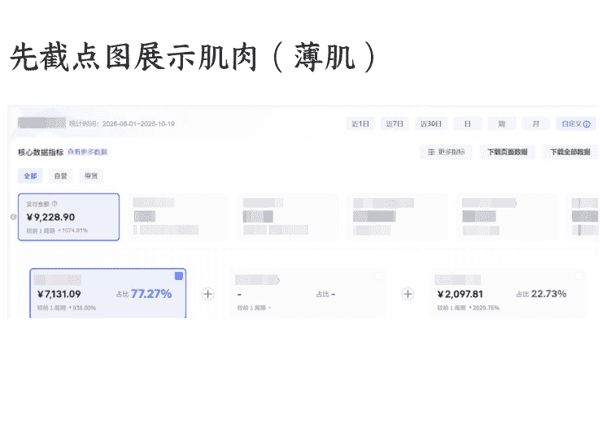

# 虚拟资料第二年复盘：第一年靠风口月入五位数，第二年才摸到经营的门道
作者：龙哥

各位好，我是龙哥。无论你此刻是清晨通勤、午间摸鱼还是深夜失眠刷到这篇，都先道一声问候。

今年是我深耕虚拟资料赛道的第二个年头。回想头一年，恰好踩中了需求井喷的窗口期，单月营收一度突破五位数。也恰恰因为入场够早，许多隐患被那一波热度暂时掩盖了。等到行情回归常态，短板才逐一浮出水面——直到那时，我才真正站到“经营者”的视角，把这门买卖看明白。眼下九月推免季刚收官，我把这一轮的得失梳理成文，权当二年级的答卷。

先说清楚定位：本篇更对路的是那些已经靠虚拟资料有了进账、却困在“能跑通但上不了量”瓶颈里的同行；如果你还没下水、只盘算着照抄爆款，建议先不急着套用。毕竟这是二年级的复盘心得，并非零基础教程。整篇最值得咀嚼的，是三个“本可绕开”的遗憾——尤其是涨价那一段。成交规模由流量、转化与单价三者相乘决定，在访客不足时抬价，通常只会把局面弄得更僵。另有一个隐性前提：笔者的选品直觉源自多年用户运营的积累，若只复制她的赛道、却缺少同等调研功夫，结果很难重现。

照例先放几张截图当门面（其实不够看）。

## 一、三个“本可绕开”的遗憾

### 1. 节点型生意，动手太迟

推免季临近尾声，我才火急火燎地赶制面试题、上链接、发图文。动作一件没落下，可时间窗口已经收得很窄，最终只零星成交了几笔。

这桩事教给我一个道理：节点驱动的品类，一旦等用户开始密集搜索才动手备货，留给内容铺设与搜索卡位的余地就所剩无几了。此后我会赶在旺季之前就把图文铺出去、把产品提前备好。看中某条赛道或某个品，最好提早一两个月便持续输出干货，先让潜在买家注意到你、记住你，而不是等需求炸开后再手忙脚乱地补内容。

节点来临之前，起码完成三步：需求提前吃透、货品提前备齐、能接住搜索的内容提前布好局。

### 2. 先造产品、后验需求，顺序颠倒了

切入求职方向时，我原本有两个诉求：一是把客单价往上抬，二是让受众从“四大面试”延伸到更广的求职场景。听了圈里朋友的建议，我打算从各岗位面试精讲入手，做一套求职知识库。

这个方向不能断言没市场——求职面试自然有人要备考。但我漏想了一层：用户在怎样的具体情境下，会心甘情愿当场掏钱？是接到面邀后紧急突击？是某类高频题答不上来？是瞄准某个岗位做专项打磨？还是仅仅觉得“囤一套完整知识库挺踏实”？

这些没想透，我就一头扎进去开干。前后耗了半个月，产品越补越全，工期也越拖越久。等终于收尾，人已被掏空，再没余力去写图文、探市场。

事后回看，真正致命的不是“没发图文”，而是在需求确定性尚低时就预付了完整产品的制作代价。如今我会对自己说：投入多少制作成本，得看需求确定性有多高。

若是节点型产品，尽量借工具 Skills 拉高产出速度，把“察觉需求”到“商品上架”的间隔压短；若某个产品制作成本偏高、需求又未充分验证，那就先 build in public——把产品思路提前晾出去，从图文数据和评论区里捞真实需求，再决定这个产品值不值得砸多少资源。

### 3. 贸然提价，不如先拆开增长因子

头一年我的算盘很直白：五块钱卖一千份是五千块，那提到十块钱、还卖一千份，不就成了万元？

揣着这个念头，我把价格改了上去，等于默认销量纹丝不动。但定价本身就是经营的一环——它改变用户扫到商品后的掏钱意愿，也改变产品在整条赛道价格带中的生态位。何况竞品定价、买家心理价位都在浮动，哪能把五块改成十块、营收就自动翻番。

所以 GMV 应当拆开看：GMV = 商品访客 × 支付转化率 × 客单价，三者是联动关系。

- 若短板在流量，单靠提价无济于事；
- 若短板在转化，提价反而可能把转化压得更低；
- 唯有需求够硬、转化已趋稳时，抬客单价才真正具备杠杆效应。

## 二、今年做对的事：不抢一时流水，要的是细水长流

今年店铺运营中，我跑通了一套“低投入试新品—看效果—再加大”的上架节奏。一面借新品触达更宽的人群，一面也指望跑出新的爆款，把 GMV 往上带。

选品环节，我没走一味跟风、见到爆款就复刻的路子，而是基于对目标受众的理解，推演他们究竟会撞上什么难题，再对照现有商品矩阵做补位。大致有三条思路：

**节点驱动**：存在明确时点，需求会在某段时期集中爆发。以面试题为例，可先用覆盖面较宽的需求探路，再依据成交、搜索和反馈往具体公司/专业收窄。这招适合店内已有一两个品成交尚可的情况。归纳起来：锁定需求高峰→用低成本 SKU 切入→从真实成交里挖细分。

**用户驱动**：锁定你已相当熟悉的人群，扒出他们的痛点，再给对应解法。我此前做过留学生私域运营，尤其懂初到海外那批同学对学业和生活的焦灼，便会针对他们的困扰出方案。这条线没有对标可抄，相当于自己蹚出一个方向。可见有些品未必非要跟着竞品跑，而是从长期与用户打交道中长出来的。做用户运营、新媒体运营的朋友尤其适合——日常私域或内容运营中，你必然做过调研、长期泡在用户堆里，对某类人摸得透，也更容易揪出尚未被满足的缺口。

**市场驱动**：先跟风，边试边调。九月我也追了开学季 PPT 的热度，想切教育课件这块蛋糕时，先拿一个账号做小规模试水。选品逻辑很朴素：什么品火了就跟着做，直到某个品略见成交为止。个人卖货吃的是自然流量，某篇图文阅读量高，说明平台把内容推给了一批人，主题也收到了一定回响，可当作深耕的候选方向去试；但阅读高只代表内容方向有反馈，并不等于商品方向立得住。后续还得盯商品点击、成交，或至少连着几篇同类内容都有回响，再判断要不要往这儿押注。

对不熟的赛道，我不会一上来就搞复杂调研和重产品，而是先拿市场上已被验证的需求做几轮小测试，再从数据里收窄。拿教育课件来说，我试了不同年级开学季班会、心理开学第一课两个方向，结果初一心理开学第一课的销量和图文阅读双双冒头。于是后续不再撒胡椒面，而是围着“初中心理课”横向铺到初二，或纵向切到具体心理主题。

还有一条选品边界：尽量挑自己能判断质量的领域。我拓品时偏爱文科、社科、求职表达、面试沟通这类方向。一来当下 AI 在整理、结构化与内容生产上已相当成熟；二来更关键的是，我自个儿有能力评判最终交付到底行不行。理工科专业面试、专业课、技术岗求职、PPT 课件，我反倒会多留个心眼。并非 AI 搞不定，而是缺乏对应专业背景时，很难分辨 AI 给出的内容是货真价实，还是“看着挺唬人”。这种情况下，产出再快，也可能只是更快地制造低质注水内容。

新品不是做完就完事，得送进测试环节。对刚想入局虚拟资料的新手，我的建议是给一个方向攒够测试样本，依数据反馈持续微调。我的测试链条是：最小商品→内容试水→盯点击/成交→见信号就加码→没信号就收手。

我所理解的“坚持”，不是机械地日更图文或做无效动作，而是反复测试、持续囤内容库存、不断淘汰与放大。提前铺产品 × 用户节点降临 × 搜索承接 = 集中变现，如此才有长久经营的可能。

## 三、我的工作流：赛道、选品、图文、AI 与数据复盘

### 赛道

去年聊过如何挑赛道，今年补上几道判断题：

- 我对这批人究竟摸得多透？——能否读懂他们的困扰、评判 AI 产出质量、预判他们何时会下单。
- 这条赛道能不能长跑？——除节点型小商品外，有无持续需求、扩品余地与抬客单的空间。
- 眼下市场是什么光景？——主流产品长啥样、谁在卖、谁在买、价格带与切入难度如何。

### 节点驱动：低成本 SKU 赛马

我采用的是低成本 SKU 赛马法：先批量备好候选专业资料，再靠真实成交筛出值得继续加注的方向。

基于去年推免面试题的不错成绩，今年我试了两条线：通用面试题深挖，与专业面试题横向铺开，分别对应压力面精讲和某专业面试题解析。压力面精讲靠复制粘贴硬搓，只需跟 AI 交代清楚往哪个维度拆；专业面试题解析制作难度不小，但 AI 能扛下大半难点。

我当下的资料制作链路：

1. 调研：去📕“点点”上问，哪些专业推免、考研人数多，以文科为主？“点点”会甩出一串名单，再结合真实成交等要素筛验。
2. 与 ChatGPT 敲定资料框架：比如确认教育学专业推免/考研人多后，接着问该专业推免专业面要啃哪些教材，“点点”会列出书目与作者；再把专业课信息喂给 ChatGPT，让它搭出资料骨架与结构，然后抠细节，比如通用面试题不重复讲、回答框架要展开写。怕自己想漏了，就从目标用户使用场景与最终目标（GMV）两个维度让 AI 帮忙找优化点。
3. 建文件夹、填信息：搭 Obsidian/飞书/Notion 可落地的文件夹，补核心知识点、定义、出题方式、面试追问。
4. 补内容、拼资料。
5. 把上述流程固化成一个 Skill。往后只需填专业与教材，codex 就会吐出一份扎实资料，不必再当“搬运工”。

验证环节，新品至少备十篇内容。这十篇发完，若节点未至、但图文与商品已有一定搜索量，可等旺季再观察，别急着下结论；若节点已到、图文也有流量，却仍无人点击或下单，那就得审视是不是选题、商品与需求本身对不上。

归纳一下：AI 出候选专业清单→按低制作成本批量上架 SKU→每个 SKU 配约十篇图文→依真实成交筛出赢家→有单就续铺，没单就减注。

### 用户驱动：先做调研，再动商品

无论你对某个人群多熟悉，哪怕自己就是目标用户，选品和做货之前都得花时间调研、出一份调研报告。这事并不玄乎，如今 AI 能代劳产出环节，但信息收集、资料归拢必须亲自动手。

我用 Obsidian 的 Web Clipper 插件来收资料。市面上检测需求、一键抓取的工具不少，我也偶尔付费使用，但用 Obsidian 攒资料这事始终没丢——因为手动过程本身就是在养自己的手感。接着把收集到的信息，用 marketingskills 里 customer-research 这项技能输出调研报告。

报告按 customer-research → content-strategy 的路径拆解：提取 Trigger Event（何时突然需要资料）、提取 JTBD（用户真正要搞定什么）、聚类 Pain Point（卡在哪一环）、保留用户原话判断情绪强度、按用户状态划分 Persona 而非按学校/专业硬凑画像、把高频问题映射到现有商品可解决的具体节点、生成“一个场景 + 一个问题 + 一个明确结果”的商品图文方向。主题之间允许交叉，频次用来判断趋势，不用于严格统计排名。

报告的一句话结论是：当下最该抓的，不是“想进四大的人”，而是“已经收到测评/面邀、猛然发现自己不会 Case、不会 Pre、不会讲实习的人”。需求重心已后移到：明后天就面该先备什么、Case 一堆材料先看哪份、群面别人都在抢话怎么插嘴、英文 Pre 如何一分钟讲明白、M 面深挖实习怎样避免被问两层就露馅、Par 面为何死磕动机规划与其他 Offer、跨专业普通 BG 英语一般大 i 人短时间还有没有救。因此商品图文别再写成“大而全的四大面试攻略”。

比如 Persona A“突然收到面邀的临时突击型”：校招/寒假实习候选人，已完成网申或测评，此前备考不成体系，甚至头一回参加正式事务所面试，接到面邀后才密集搜面经、Case、Pre。JTBD 是用最短时间弄清这场到底考什么、先补哪几块，至少别因流程生疏和顺序错乱直接翻车。Trigger 是突然收到 EY/KPMG/Deloitte 面邀、HR 临时来电通知次日面试、看到同批同学已开面。Top Pains 是不知短时间内先补专业、Case、英语还是自我介绍；面经刷了一堆却不知自己真正该练什么；初次面试容易把“知道流程”误当成“能当场做出来”。情绪关键词是“快速突击”。

测试环节，与节点驱动不同，用户驱动类的图文以商品图文 + 普通图文为主。普通图文赚阅读、拉互动数据，主要攒关注与信任，为后续成交铺路。发一周左右看数据反馈：普通图文盯创作者中心的曝光阅读，商品图文看点击率与成交额。

### 市场驱动：跟市场小步快跑

市场驱动多用于尚未跑通的情形，跟着市场反馈快速做货，压缩“制作—测试—反馈”的周期。典型例子是做课件。我把课件制作中重复的规划步骤做成了网页工具：喂入素材后，自动生成课程规划、逐页文案与生图提示词；生图、最终制作与质量检查仍由我亲手完成。这工具还时不时报错。

我做 PPT 分四个阶段：

- 找素材：爆款参考、教材、知识点、用户场景；
- AI 规划：课程目标、页面结构、逐页文案、视觉规范；
- 人工交付：依提示词生图、完成 PPT、检查内容质量。

### 图文选题与写作

选题来源有几处：一是从爆款标题里抽要素，比如“银行面试虽然恶心但是 3 小时背完”，把“银行”换成自己的赛道，记下爆款句式长期复用；二是用户调研，一个面试场景能延伸出不少细分需求，把调研报告交给 AI，结合用户场景问题生成选题，并定期更新报告，确保选题是用户当下急需的；三是长期需求与个人观点，比如考研面试最好何时启动、明年推免会不会提前现在能做什么；四是从其他对标里淘需求。

写作上，要快速稳定地产出内容，最关键的是有一份营销母文档负责“写什么”，再用文案结构决定“怎么表达”。结构可以是：标题反差 + 身份冲突 → 场景真实代入 → 体验主观感受 → 内容价值覆盖面 + 实操性 + 持续更新 → 收尾暗示稀缺、留白引发索资；也可以是痛点开场抛问题造焦虑 → 方法建议给清晰避坑法或判断标准 → 对比强化用对照凸显价值差 → 权威背书晒专业经验建信任；还可以用真实经历建信任 → 具体数据证实力 → 告诉读者方法可复制 → 展示产品含金量 → 制造性价比感 → 引导立即下单。把这三类信息一并交给 AI，就能产出一篇图文，再结合个人需求用 Skill 或 Agent 快速复刻，进一步提升效率。

### 发布

发布阶段我目前仍是“农耕”式手搓，一则因为多用大字报形式，图片素材也大差不差。建议在流量高峰时按每天每号四到五篇的频率发。

若被📕提示同质化内容或素材雷同，这类情况通常出现在新号身上。我攒了些应对经验，此处先按下不表。

说到底，虚拟资料第一年靠风口拿下五位数，第二年才真正学会看经营：提前卡节点、先验证再投入、拆开增长因子、小成本测试再放大。流水不争先，争的是源源不断。

## 把 AI 融进虚拟资料生意后，我沉淀下来的是一套可搬运的打法

上个夏天开始，我就一直跟 Codex 较劲，还搭了一个个人作战台。早先写过一篇《半个月时间，0 技术背景的我，把变现 5 位数的虚拟电商流程用 codex+Obsidian 做成了 AI 工作台》，里面拆得比较细。折腾一轮回头看，AI 对我的帮助大致分两类：把高频重复动作固化成工具；直接下场参与日常经营，帮我做资料、写图文、看数据。后者对当下现金流的推动更直接。

把已经跑通的资料制作链路提炼成 Skill，之后换专业、换赛道迁移也更省力。

### 图文这条线，我是怎么把路走通的

把发图文这件事拆开，我的运转大致是这样：

1. 先把任务拧清楚：这篇内容是想导向成交、做需求验证、积累搜索权重，还是做涨粉信任。
2. 再找参照：拆爆款的句式、看用户调研、梳理长期刚需。
3. 备料：核心标题或母题、营销母档、内容结构。
4. 生产：让模型批量抛子主题和初稿，再由人过一遍、改一遍，最后定稿。
5. 发布承接：围绕用户真实问题持续输出，保持搜索承接的更新节奏，同时把场景和商品挂上。
6. 反馈复用：看阅读、搜索是否带来点击和成交，把效果好的母题留下来继续用。

素材来源别太单一。拍摄可以对准电脑、平板、纸质资料做多角度实拍，不必非得是结构化的海报。普通的图文照常发，生活化的记录也可以上。内容发出后要隔段时间回看，它有没有完成当初的任务。

### AI 在四个环节的真实分工

选品大概三成可借助。模型能帮忙判断可复刻性，能压低试错成本，但市场反馈替代不了。长期跑项目的体感很重要，模型筛出的信息也得人工再判断。值不值得继续，最后由市场说了算。

做商品大概九成可借助。我习惯先让模型搭框架、补齐内容，剩下需要人工复核；专业度高的资料，最好请专业人士把关。人工主要盯两点：文字是否校对干净，交付物是不是我要的那样。

图文大概九成可配合，但我后来把自动化停了，改回手工打磨。为的是避开明显的模型腔，也避免未经审核直接上线。人要守住的是表达的温度。

数据大概八成可交给模型。我会让它基于数据给优化建议，部分需求得自己提。复盘更像和一个小助手对话，而不是收一份报告了事。人工先明确北极星目标，再审核结论是否靠谱。

### 折腾后剩下的三点体会

第一，优先用现成工具。这几个月我也试过自己造轮子，比如想做笔记抓取的自动化，最后半天就放弃了。自我认知有提升，但项目上是浪费。现成工具花小钱出结果，别耗在重复开发。

第二，写东西坚持用 ChatGPT 网页版的对话窗口。Work 和客户端我都试过，人机味偏重。批量自动写作的时间成本，往往比网页版复制粘贴反复打磨更高。我的场景里，网页对话来回改，更能控风格，也减少返工。

第三，流程先跑通，再谈自动化。自动化很香，但别为了用 AI 而用。等链路顺了，再决定哪几步值得交给模型。一次性任务或十分钟能搞定的事，没必要专门开发。

### 复盘要变成下周的行动清单

对我来说，复盘的意义不在于结论好看，而在于能不能变成可执行的动作：下周要做什么、怎么调。常规是七天一次，赛道处于高峰期就压缩到四天一次，快速迭代。

数据从千帆系统导出，最好把本周期全部相关指标导一遍。交给模型前，先统一口径，尤其是成交总额、商品访客和支付转化这几个核心指标，避免模型因理解偏差给出错误建议。

我习惯关注四件事：本周期目标是否达成；全链路里哪个环节转化最吃紧，怎么补；图文整体的转化效能；各商品的营收占比。

模型会指出最关键的提升点，结合当下经营重心，我挑一到两个动作放进下周执行。不焦虑、不内耗，有方向就干。

### 最后一点掏心窝子的话

年初我经历过职业变动。说不焦虑是假的，当未来没有确定答案时，总想赶紧证明自己还能行。

我也试过不少项目，比如视频号带货、小程序，有些没起色，有些中途停掉，还有些投入时间却没产出。现在能稳定产生收入的，仍是虚拟资料这门小生意。

回头看，那些没跑通的尝试也不是全无意义。很多事的推进逻辑类似：发现问题→小额试探→拿到真实反馈→调整方向→继续做。

做生意是这样，学新技能、找职业方向、面对生活里的不确定，也适用。我们未必每次都选对，也不一定立刻见到回报，但每一次行动，都比上一次更清楚。

看完这份 SOP，你可能觉得明白了，但实操第一步仍会卡住。工具和教程是最低层的壁垒，真正决定成败的是立刻动手和信息差。

- [ ] 查阅圈子完整数字资产与上车门槛：https://lazyso.com/insider/

备注：【实操上车】，不闲聊

