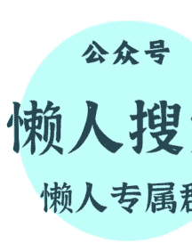
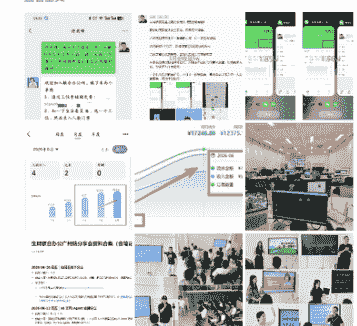
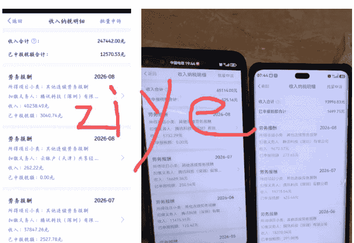
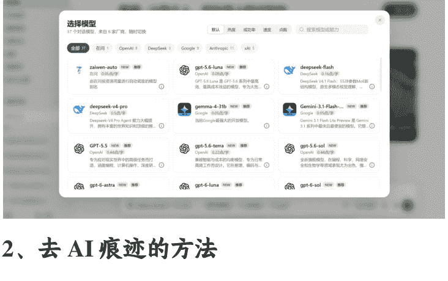

# 公号流量主一年复盘：从日入几十到月入五万，真正卡住你的不是方法，而是这些暗坑

汇编：懒人搜索公号，懒人专属群精选  
联系 lazyhelper1

先讲几个最重要的结论：这篇长复盘适合正在做或想入局公号流量主的朋友。最值钱的是最后一章——展示量连续多篇低于 50，基本就是被压了；触发原因有 12 类；以前停更等待自动恢复的“休克疗法”已经没用，必须靠持续发文把分数挣回来。一个数字要记住：一篇雷同扣 20 分，7 天自然回血才 10 分，一次失手两周白干。还有个大坑：系统弹的违规提示常常是幌子，九成暗压的根子在选题踩线，不是文笔，别对着提示改稿。

先说说我的成绩，不是为了炫耀，而是想说明下面每一条都是用真金白银换来的。去年八九月份我开始做公号流量主，起步时每天只有几十块，说实话也犹豫过。十月破万，十一月两万，十二月三万，一月五万；二三月赶上春节，广告单价低，月均也有三四万；四月回到五万之后，再也没有跌破过。八月站方大改规则，狠打批量号和雷同稿，但八九月我依然稳在五万以上。接近一年，累计收益六十多万，月均五万。前后做过几十个号，试过几十个赛道，每个赛道都跑出了方法。

顺便提一句，我还经历过月入七万冲到十万的阶段，当时入驻广州联合办公 30 天，白嫖了三个隐形福利，很值。作为刚起步的超级个体，我长期居家办公：一张桌子、一台电脑、一杯咖啡，看着自由，其实效率低、状态散、社交断。床和沙发几步远，冰箱有零食，手机随时能刷，一天坐八九个小时，真正高产的时间可能一半都不到。

所以今天把这一年踩过的坑、交过的学费、付费社群里学到的干货，以及那些很少被公开讲的细节，一次性说透。我见过太多人方法没问题，却倒在不起眼的细节上：有人弃号三四次还不知道问题在哪，有人稿子不差却零推荐，有人一个月就把号做废了还以为是运气。这些坑我基本都踩过，或者看身边人踩过。希望你能少走弯路。

## 一、号的基础设置：别还没起跑就把号弄死

名称的官方规则是一年改一次。但实操中，没进推荐池的新号，一周内改两次名字头像，基本没影响；已经稳定入池的号就别动，改了会短暂影响标签。

头像千万别用美女照片，也别用纯 AI 生成图。这类头像是营销号、引流号的典型特征，图像识别模型会直接给你贴“营销号”标签，初始风控等级被拉高，起号难度翻倍。名称和简介也可能踩隐性违规，比如敏感词、夸大宣传、引流暗示。拿不准就用中性稳妥的表述，别在这种地方冒险。

我见过最多的错误操作是：号没量了就立刻弃号重来。别这么干。先按标准测试，确实救不回来再弃，实名资源是有限的。

建议果断弃号的情况：一是历史爆文掉池型，之前出过几千几万阅读，现在持续个位数，数据来源几乎没有推荐，二次入池时间成本太高；二是用过流量激励型，新号阶段就用了流量券、助推，之后流量彻底崩，基本救不回，已被深度审核标记；三是主体失效型，营业执照注销了，或服务号企业号不适合做流量；四是严重违规型，被官方正式处罚、流量归零；五是连续掉池型，连续多天所有文章零推荐，各种恢复方法都试过，确认掉出池子。

别急着弃号的情况：从没出过爆文的老号，刚恢复更新暂时没量，先稳定更新 5 到 7 天观察，很多老号重启需要时间唤醒权重；只发过小绿书、没发过正式赛道文，小绿书本来就是养号用的，不能用小绿书数据判断号的好坏，直接转型发赛道文测试；单纯想换赛道，直接发新稿就行，不用删旧文，更不用弃号；有过少量违规删文，但整体还有推荐量，单篇违规不影响整号，继续合规更新；新号第一篇两千多，后面几篇掉到个位数，这是正常波动，不是被压，再更五六天观察。还有一种：新号垂直赛道连续发 14 天几乎零推荐，也别立刻弃号，先换个赛道再发 14 天测试，还是没量再考虑弃。

频繁弃号的后果比想象中严重。站方会记录设备 ID 和 IP 指纹。同一设备、同一 IP 下，短时间（比如 3 到 5 天）内弃号两次以上，大概率被反作弊系统标为“工作室批量废号”，直接进隐性黑名单。进黑名单后，在这个设备和 IP 上注册的新号，发什么合规稿都拿不到量，怎么优化都起不来，设备和 IP 相当于被“污染”了。为什么这么严？因为频繁弃号注册就是工作室的典型行为——注册一批号，发垃圾内容，废了就弃。对应办法：每个号配单独手机、电话卡、独立流量网络，彻底切断设备关联。5 个以内的轻量批量号，可以统一用电脑排版、做素材、存草稿，发布时再分别用对应手机和手机流量发。很多人以为“登录要分开”，其实单纯登录排版不会触发关联，核心是发布要分开，尤其发文网络要独立。同一台电脑登录多个号排版，完全没问题。

## 二、IP 污染：你的网络可能已经“带毒”

站方不会直接封 IP，但会给每个 IP 打风险标签。如果同一个公网 IP 下，有号做过违规操作、批量发文、频繁弃号注册，这个 IP 就会被标为“高风险 IP”。在高风险 IP 下发稿，哪怕号本身完全合规，也会被牵连——系统提高审核等级，降低初始推荐权重，表现就是零展示、不起量。

为什么绝对不能用公司 WiFi？公司网络是多人共用的，你完全不知道其他同事用它做过什么：可能有人注册过批量号、发过违规内容，甚至其他部门的营销团队一直拿它做批量号。公司 IP 一旦被污染，所有在这个网络下发文的个人号都受牵连，你既控制不了别人的行为，也没法排查问题出在哪。结论很直接：发文务必用自己的手机流量，不要连公司、商场、咖啡厅、共享 WiFi 等任何公共网络。

怎么判断 IP 被污染？前提是你的稿子合规、操作正确。如果连续 7 天所有内容都是零展示，且公网 IP 一直固定不变，九成概率就是 IP 被污染了。验证方法很简单：换一个设备、换一个网络发一篇测试稿，如果有展示了，就可以确认。可以用 ip138.com 或 iping.cc 查看自己的公网 IP。

解决方式：手机开关一下飞行模式，或重新插拔电话卡，运营商大概率会重新分配一个新公网 IP。长期方案是买个独立随身 WiFi，每个号对应专属网络。淘宝上随身 WiFi 设备大概 29 块，月费 9.9 元左右，成本很低。补充一下：河南、广州、江西部分地区存在区域性限流现象，这些地区的 IP 整体风控等级更高，起号难度更大。IP 数量也有限制：个人主体身份，一个公网 IP 下最多做 2 个同平台号，超过容易被判批量；企业主体，不同企业主体的公号，一个 IP 最多对应 1 个。

## 三、批量号怎么做才不翻车

前期建议先跑通 1 到 2 个号，验证赛道可行性、跑通完整起号流程、稳定产出收益之后，再扩大规模。别一上来就铺十几个号，方法不对全是废号，白白浪费身份证资源和时间。

轻量批量（5 到 15 个以内）：用比特浏览器做指纹隔离，每个号对应独立浏览器环境。各自用手机和手机流量发布，电脑只做排版。赛道必须错开，别所有号都挤同一个赛道。

中量批量（几十个、上百个）：电脑安装 VMware 虚拟机，装 3 套不同操作系统，每个系统对应独立号环境。每个虚拟机对接不同随身 WiFi，保证每个环境的 IP 独立。依然坚持手机端发布。

2025 年 9 月后，站方开始检测稿子的写法和文风了。所有号都用同一套提示词、同一种模板、同一种文风批量发稿，很容易被识别为工作室号，批量压量。平台的文本相似度模型不仅能识别内容重复，还能识别写作风格、句式结构、用词习惯的高度统一。应对方法就是每个号用不同的 AI 模型、不同的提示词风格、不同的选题角度，刻意做出差异化。

## 四、算法有误判：没量不一定是你的错

这个点很少人知道，但它可能决定你能不能坚持。所有内容平台，包括公号、头条、谷歌 SEO 等，算法都普遍存在 15% 到 20% 的误判概率。这是算法固有缺陷，没有平台能做到 100% 准确。误判分两种：漏判，把垃圾内容放出去获得流量；错杀，把优质内容误判为违规，进行压量。

对你意味着什么？如果你只做一个平台一个号，就有约 20% 的概率“踩坑”——被系统误判压量，哪怕稿子再好再合规也没用。想让系统纠正误判，个人创作者通常需要 4 到 6 个月持续合规更新，很多人熬不到那一天。这就是“为什么别人这么做可以，我这么做就不行”的核心原因——不一定是你内容差、方法错，可能只是刚好赶上误判的概率。解决方案：至少做 2 个以上号，用数量对冲单号误判；至少做 2 个以上平台，对冲单平台政策变动，东边不亮西边亮。单号做不起来，不一定是你能力有问题，可能只是概率问题，多号多平台才能把成功概率拉到合理水平。

## 五、发文规范：细节决定你是赚钱还是废号

同一个号一天发多篇，每篇之间最好间隔 1 小时以上。短时间连续发大量内容，是机器批量发文的典型特征，系统会提高风控等级。一次性群发 7 到 8 篇，压量概率很高。每日发文建议：单号每天不要超过 6 篇；养号起号期一天 1 篇就够；稳定期一天 1 到 2 篇比较健康。

群发和发表的区别，很多人搞不清：群发每天只有 1 次机会，一次最多 8 篇，粉丝会收到推送通知；发表没有次数限制，粉丝不会主动收通知，流量主要靠系统推荐。做流量主收益主要靠发表加系统推荐，群发不是必须的。记住一句话：不是发得越多赚得越多。号的状态和稿子质量远比发文数量重要，盲目堆量只会把号搞废。

文章发出去不是马上有流量，一般需要 4 到 5 小时才开始正式推流。系统要先做初步审核，再进入冷启动测试，推给一小部分用户，数据达标才逐步放量。比如早上 9 点发的稿，可能下午一两点才起量，别刚发一两个小时就焦虑。发文时间对最终流量影响不大，不用迷信“黄金时间”。几个参考时段：早 6:30 错开竞争高峰，午 12:00 到 13:00 午休阅读高峰，晚 20:00 到 22:00 全天最大流量高峰但竞争也最激烈。

手机端优化很关键：现在九成以上推荐流量来自手机端的“看一看”入口，电脑端“看一看”入口已经取消。所以内容要针对手机阅读优化：字体 16 到 17 号，短段落笔记式排版，2 到 3 句话分一段，标题控制在 20 到 35 字。

定时发布，新号、起号期绝对不要用。大多数人以为定时发布就是“到点系统自动发出去”，和即时发布没区别，实际机制完全不同。对你来说，定时发布是到时间才上线；对平台系统来说，你设置定时那一刻，内容就已经进入系统后台了。定时发的稿会提前推给内容品鉴官和一小部分灰度测试用户，做冷启动质量标注和测试——等于比即时发布多一轮前置质量审核。结果就是审核标准更严格，前置测试数据直接影响正式发布后的推荐量。内容质量一般的话，前置测试数据不好，正式发布后基本就不给量了。新号本身竞争力不强，再经过前置筛选，基本死在冷启动。还有一个点：在哪里设置定时发布，就算在哪里发布。比如在电脑上设置定时发布，就算电脑发布，不享受手机发布的权重加成。起号阶段优先用手机端发布，电脑发布更容易卡量，这是大量实测的结论。标准操作：电脑端排版做素材存草稿，用手机端公号助手连手机流量发布。

四大高危功能：合集、定时、定位、助推。只要使用这四个功能，内容就会触发深度检测，审核标准比普通发布严格得多。查出问题一次扣 10 分号分。为什么？普通个人创作者很少用这些功能，高频使用的大多是专业运营、营销号、工作室。系统默认使用这些功能的号运营属性更强，所以提高审核等级。内容本身合规度很高，使用后出问题概率较低；内容本身就擦边，基本一用一个死。新号起号期建议全部禁用，号稳定后再按需使用。

## 六、限流判断与恢复：全文最值钱的部分

怎么判断自己被压了？核心指标：文章曝光量持续低于 50，且连续多篇都是这个水平，基本可以判定被压。曝光是系统主动推送给用户的数量，阅读量低可能是标题封面差，但曝光量低一定是系统不给推了。辅助验证：在文章详情页看“数据来源”，如果完全没有“推荐”这个来源，就是被压了。IP/设备污染判断：连续 7 天所有内容都是零曝光，且公网 IP 固定不变。换设备换网络发一篇测试稿，如果能拿到曝光，就 100% 确认是 IP/设备被污染。号分参考：公号有一套内部计分系统，完全不对外公开。最近 3 天只要有内容能拿到曝光，说明号分还没低于 60，还有救；连续零曝光，大概率分数已经低于 60。

12 种常见原因，我都见过，有些自己踩过，有些看别人踩过：
1. 新号日更：被系统判定为工作室批量号，直接压。这是新人最容易踩的坑，没有之一。
2. IP/设备污染：公共网络、被标记过的设备，连带号一起提高风控等级。
3. 内容违规/疑似违规：明显违规会发通知，疑似违规只会默默压不告诉你。大部分暗压是疑似违规导致的。
4. 频繁弃号注册：设备/IP 被标记为恶意注册，新号直接进高风险池。
5. 内容雷同严重：抄别人或自我重复，一篇扣 20 分，分扣多了自然被压。不止文字，9 月开始严查图片雷同，配图风格单一、大量重复 AI 图、直接搬运网图都会判图片雷同。
6. AI 内容占比过高：不是单篇 AI 内容会压，是整个号 AI 生成内容占比超过一定比例才触发。行业普遍共识是超 35% 会被打标，打标后推荐权重受影响。
7. 72 小时内大量转发：文章发布 72 小时冷启动期内大量转发到🛰️群朋友圈，系统判定为人工干预数据，影响推荐算法判断。
8. 历史文章秋后算账：半个月到一个月前的文章被后续深度检测查出问题，连带整号降权。很多人限流了总在最新文章里找原因，其实根本不是最近内容导致的。
9. 使用高危功能：定时、定位、合集、助推触发深度检测后查出问题。
10. 自我雷同：连续好几篇话题、标题、结构高度相似，哪怕全是自己写的，也会被系统认为是重复内容骗流量。
11. 低质创作过多：号整体完读率、完读时长不达标，被打上低质标签，推荐量直接砍半以上。
12. 大量截图/整合内容：大量评论截图、文章截图拼接，被判为整合类垃圾内容。

怎么恢复？
核心方法一（老方法）：图文+文章交叉发布。一天发文章，一天发小绿书图文，交替进行。压得严重时先停发文章，只发小绿书，用低风险低雷同的内容把号分一点点拉回来。小绿书要求：AI 漫画+600 字左右文案，内容类型不要和原来的文章赛道一样，避免继续触发雷同判定。等小绿书曝光稳定突破 100，说明号分回来了，再逐步恢复发文章。

核心方法二（新规推荐）：先用号检测，然后把违规文章、低创文章全删完。接下来日更 6 篇不违规不被压的文章，去账号反馈里整体申诉。根据违规要点，用豆包生成申诉文案。话术里一定要加“请求人工审核”，这样才会触发人工审核，不然就是机器审。示例思路：您好！本账号一直恪守平台运营规范，用心创作垂直优质内容，但账号流量大幅下滑，现已删除全部违规文章，恳请团队帮忙人工复核账号。若无违规，希望解除限流，恢复流量与曝光。如存在遗漏问题，烦请指明，我们马上整改。后续一定更严谨自查，持续输出合规好内容。辛苦各位审核老师，万分感谢！

核心方法三（持续更新）：连续 20 天合规更新，每天大约加 2 分，累计可以恢复 40 分左右。

特别提醒一个误区：很多人被压了就停更，搞“休克疗法”等自动恢复。现在这个方法已经完全没用了，停更不会自动恢复分数，反而让号权重越来越低。必须坚持更新，用合规高质量的内容一点点把分挣回来，没有捷径。

# 推荐突然停了？先清旧账，再谈回血

做图文号最怕的不是没灵感，而是稿子照发，推荐却悄悄熄火。其实被压推荐、被打低分、被判重复，这些事背后都有清晰的门道。下面把我交过学费的经验整理成一份操作手册，该改的改，该躲的躲。

## 一、被压之后，先走这三步

**先清旧账。** 历史上那些踩线稿、注水稿，留着只会持续拖分，果断下架。

**再看要不要挪方向。** 分数还在80以上，换个题材甚至换个领域，回血速度常常比重开一个号快得多。

**第三条算猛药：** 连发七天、每天三条小绿书，试试推荐能不能回来。平台对这套玩法已有收紧，效果看场景，只能算下策，别当救命符。

恢复时间心里要有数：轻度大约一两周；中度一到三个月；至于重度或进了黑名单，基本判死刑，重开更省事。

## 二、新号有两种命，别拿别人的运气罚自己

平台给新号的待遇并不一样。大约两成属于"开局带buff"：注册就有曝光，起量飞快。本质是随机发放的新人福利。缺点是后劲未必足，不少号火一轮就沉了。

剩下八成得走"试用期"：一到三个月内老实更新、不越线，系统才逐步把推荐放开。起步慢、难熬，但过了这一关，分发更稳，号也活得更久。

所以刷到别人新号第一条就爆，别急着否定自己——人家只是抽中了那两成。绝大多数人是熬出来的。头三个月只盯一件事：别出显性违规，也别沾疑似违规的边。三个月内规矩更新，八成都能顺利过关。

## 三、三层审核：当时没事、半月后突然凉，是怎么回事

发文那一刻过的是机器快审：敏感词、色情暴力这类硬伤，基本当场拦下。

真正麻烦的是延迟抽检。它算力贵，不会篇篇查，通常稿子挂出去两周上下，来一轮批量扫描，盯重复、盯机器味、盯隐性红线、盯软广。这就是"当时没事、半月后突然凉"的真相——出事的是旧稿，连坐的是整个号。

还有人工抽查。五万阅读是道坎，越过这条线的爆款几乎必进人眼。能不能冲到十万加，很大程度看这一关。

另外，平台给的违规理由基本不能信。九成是幌子：说你行文生硬、啰嗦、注水。真因多半是题材踩线。它不肯讲透，是怕有人反向拆解规则、批量做擦边。还有更隐蔽的："疑似"不会通知你，只有把握足够大才发正式处罚。多数压推荐都是无声的。对策只有一个：别改文笔，去查选题和敏感点。

## 四、写稿工具和发布阵地，必须错开

这条坑很偏，知道的人不多。

每个模型训练时都会大量吃自家生态的文本。腾讯系那个助手，喂进去的🛰️图文特别多；你拿它写🛰️稿，很容易和站内已有文章撞车，被判重复。字节家的豆包同理，写头条系内容容易自我重合。

所以搭配要反着来：
- 🛰️图文：Kimi 与豆包这类非腾讯系；
- 头条：Kimi 与元宝这类非字节系；
一句话，写稿工具和发布阵地别出自同一家公司。

Kimi 打开深度思考后适合长文。同一篇要分发到多个平台，必须换不同模型分别重写。有条件上 Claude、Gemini、GPT 当然更好，通用性强。

不方便出海的，可以用聚合站：在问 https://chat.zaiwenai.com?channel-code=69a2ecd6c5e1837f340e4882 ，各家模型都接进来了，新注册送一个月点数，我自己平时也在用。

## 五、去机器味：工具是辅助，改嘴最彻底

**工具流：** 专门的降痕工具能省事，花小钱办大事。我自用这个：https://zy.ai-or.com/zhuque-workbench

**断句流：** 机器写东西有个通病——爱堆长复合句，一句一两百字，逻辑套逻辑。真人很少这么说话。做法是把长句切成两三截，句号断开，顺手删掉"综上所述""由此可见""值得一提的是"这类套话连接。

**口述流：** 通读一遍，把不像自己说话的句子改成平时聊天的说法。别追求文采，越自然越好。开头和结尾要重点动刀，这两处机器味最重，也是检测最爱盯的地方。这一招最笨，也最彻底。

**关于占比：** 单篇机器稿不会直接触发限流，是整个号里机器产出的比例过高才会被打标，业内普遍把线划在35%。打标不等于断流，是推荐权重打折。也别被检测分数绑架，没被平台标记就不用死磕数值，选题和质量才是命门。纯机器稿照样有出爆款的，机器味只是风险项，不是判决书。

## 六、重复扣分：一篇扣20，两周才填平

这条处罚被严重低估：一篇重复稿扣20分，七天只自然回10分，等于一次失误要两周老实更新才填平。罚得这么重，道理很简单——同质东西最伤用户，刷来刷去一个样，人就走光了。

抄别人不行，抄自己也不行。连着三篇选题、标题、骨架高度雷同，哪怕都是原创，也算"自我重复"，一样降权。系统会认定你在用重复稿套推荐。

破解办法：领域要窄，选题要散。比如做印度，别天天写印度小吃，可以轮着写街景、服饰、节日、教育、卫生。大方向不变，小切口常换。

**截图类要当心：** 系统认得出截图，整篇都是评论截图、文章截图拼起来的，会被当成盗版整合，直接压推荐。裁剪、美化、二次加工过的图风险小得多。

**图里的字也算正文：** OCR 会把图上文字扒出来，和正文合并算原创度、算重复。做漫画号的，文案同样得自己写。

## 七、生成图直发，容易被判低质

生成图有专门的识别模型，风格特征太统一，算法一眼看穿。大批量直发会被判低质素材，推荐打折。

一套通用处理流程：
- 出图时用纯白底，主体干净；
- 醒图智能抠图，把主体抠出来；
- 贴到新的白底画布上；
- 下方补文案、对话框、装饰；
- 统一调色、压质感、加锐度，再导出。

走完这一圈，机器特征会淡很多。

另外：自带水印必须修掉；整套配图风格要统一，别写实卡通3D混着来；穿搭类带脸的图可以贴表情遮挡，降低肖像风险；影视剧照少碰，版权问题实打实，企业主体更容易吃官司。

## 八、选赛道：方向错了，力气全打水漂

**几个绝对禁区：**
- 医疗、专业养生、经方药疗：要执业资质，个人号没有就是违规。家常养生、生活方式可以写，一旦落到具体方子疗法，系统就要你交资质，交不出直接停推。
- 财经、股票、经济：金融监管范围，同样要证。
- 政策、国内负面、民生、养老、三农：时政民生，管得极紧，个人号做久了基本没推荐。
- 俄乌、中日这类敏感国际话题：平台宁可错杀，别碰。
- 体育赛事新闻：版权保护，赛事直播新闻不能随便发。装备、技巧、球星周边可以写。
- 星座、生肖：按封建迷信管控，只有老手能玩，新人进去大概率限。
- 国内名人、近代名人：肖像权名誉权风险高，投诉找上门。

**红海区慎入：** 情感、心理、职场、历史、小说，人挤人，重复严重。不是不能做，是门槛极高，纯机器稿根本打不出来，新人容易当垫脚石。没经验和资源就绕开。

**选赛道的心法：** 竞争越激烈，号活得越短；小切口虽然天花板低，但稳，能细水长流。有后端变现（私域、带货、课程）的，优先选能和后端咬合的赛道，广告分成只是添头。搜关键词连个像样对标都找不到、出来的全是几百阅读，说明这池子太小，先想清楚怎么变现再进场。

**换赛道几条规矩：**
- 旧稿不用删，直接发新东西，老文章不碍新标签，删了反倒可能触发异常；
- 一年大约三次机会，别来回跳，标签频繁切换也伤权重；
- 后台类目改不改都行，算法只看你实际发什么；
- 想稳一点，转向前先发七天小绿书过渡；
- 分数还健康时换方向，回血很快，比重开省事。

底层就两条原则：方向对了再谈执行。

## 九、避坑大全：九成人栽在不起眼的小处

**1. 违规提示别当真。** 九成是幌子——行文生硬、啰嗦、口水话、注水、文言文、质量低。真因九成在题材和隐性红线，跟文笔没关系。平台不讲真话是防逆向：说清了规则，就有人照着漏洞批量做擦边。正确动作是查选题、查敏感点，别去润色句子。

**2. 低质标签。** 触发线：全号六成以上的稿子同时不达标——阅读时长不足一分钟，长文完读不到四成、短文不到六成。注意是全号统计，不是单篇。后果是推荐直接砍九成。恢复路径：先申诉，把这个标记摘掉，否则后面写再好也容易被扣帽子；申诉不成只能注销。同时把每篇的完读拉起来，删掉历史注水短稿，抬高整体数据。

**3. 优质三指标：**
- 点击率过8%：靠标题封面；
- 阅读时长过一分钟：靠篇幅和吸引力；
- 长文完读超40%、短文超60%：靠质量和节奏。

这三项不只决定单篇能推多远，也决定整号评级。全号七成以上稿子都够不着，就会被归为低价值号。

**4. 助推券，新号别碰。** 十个用九个废。用了之后稿子进最严审核通道，小毛病会被放大。不少人领了券，号直接崩，救不回来。正确用法：号已稳定、稿子百分百干净、本来就是爆款想再添把火，才谨慎上。限制也硬：发布三天内、站内首发、开了推荐、非转载的原创。

**5. 标题红线。** 情绪词严查：炸裂、天塌了、出事了、紧急、重磅、震惊这类，九月后抓得紧，起号期一个字都别带。机器敏感词也查：像 AI写作、ChatGPT、Claude、GPU、算力、大模型这类提法，标题带上容易触发专项审核。标题党容忍度上，🛰️比百家号头条宽些，别太离谱就行；起号期用平实标题最保险，稳住再想点击率。

**6. 零碎但致命的坑：**
- 头像：别用美女图，别用纯生成图，容易被贴营销号标签；
- 名字和简介：引流词、夸大词、敏感词都可能埋雷；
- 删稿频率：一天最多一两篇，一口气删几十篇会触发异常，推荐停摆；
- 标点：满屏英文标点会被当成机器垃圾，统一用中文；
- 水印：图里别带📕、抖音的印记，查到降权；
- 群发：真粉不到一百别开，打开率低会拖累权重；
- 冷启动七十二小时：别把稿子往群里朋友圈猛甩，会干扰算法；
- 私广：外部广告主直投别接，查到封号，号就没了；
- 专业门类：养生、医疗、金融写太深会被要资质，写浅一点、生活化一点就过去了；
- 黄金、投资类：一般不强制认证，正常写没问题；
- 洗稿投诉：收到通知就删，别硬扛，删了通常到此为止，不牵连整号；
- 大段截图：整篇评论、文章截图会被判整合垃圾，直接降权；
- 删了重发：高阅读稿删掉再发，系统认得出，反而不给量；
- 跨平台引流：图带别家水印、正文留联系方式都有风险，等号稳了再小心操作。

**最后说句实在话：** 这条路方法不复杂，难的是执行和心态。九成人不是输在方法，是栽在某个不起眼的细节，或者在快熬出头时松了手。希望这份复盘能帮你少交点学费。觉得有用，点个赞、投个币都行。

—— 分割线 ——

看完这份SOP，你可能觉得懂了。但真到动手，九成人卡在起跑线。

工具和教程只是最浅的护城河，真正的门槛是"现在就干"和"圈子里的信息差"。

想看全网最新的变现打法，和一群执行力吓人的极客一起下场拿结果，欢迎来我的核心私域：【懒人专属群】。

这里不聊虚的，只拆商业闭环、只榨模型效率。里面已经沉淀了一千多个跑通的实战局。

- 查阅完整数字资产和上车门槛：
https://lazyso.com/insider/

认可价值、准备下场的，加🛰️（lazyhelper1）
备注：【实操上车】，不闲聊

