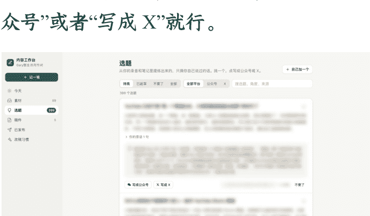
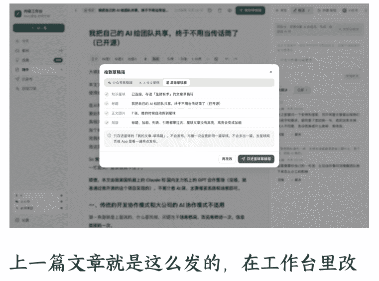
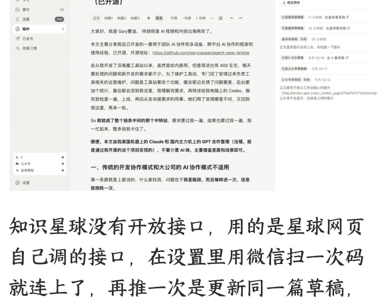
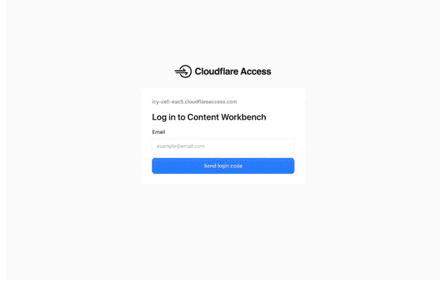
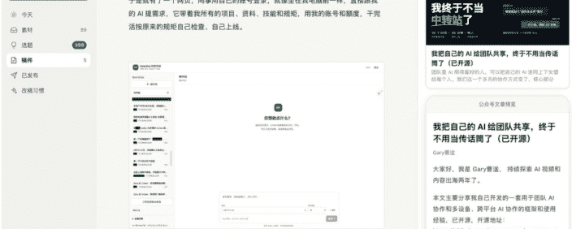

# （261016 副业 SC 精华）整理自👸号懒人搜索、懒人专属群精选；懒人🛰️：lazyhelper1。

每天会议、直播、答疑连轴转，嘴上输出不少，可一到写👸号，还得回头翻妙记、翻文档，找齐素材常常要花掉半天——这是我做自媒体最烦的环节。后来我干脆用 Claude 搭了个内容工作台：收素材、找选题、起底稿、改稿排版，到推进👸号、X、知识星球草稿箱，再到飞书留档，都在一个页面里完成。项目已经开源，地址：https://github.com/garycaogan/content-workbench。

小懒的判断很直接：会议多、分享多、懒得整理记录、又想做自媒体的人，适合看这套东西——零代码，三天，让 Claude 搭出一个把素材一路管到👸号和 X 草稿箱的工作台，而且已开源。最该看的是“学习我的写作习惯”那部分：每次改稿都被记下来，反过来完善规则，AI 会越用越像你。坑也提前说：别以为把仓库一抄就能得到同款文风，作者的文风资料并不在仓库里，你得喂自己的旧文章。

先自我介绍一下：我是 Gary 曹滟，赚钱 AI 视频深海圈总教练，探索 AI 视频和内容出海两年，算自媒体新人。我日常说得多、写得少：开会、直播、跟教练对齐、给圈友答疑，飞书妙记一天能录好几个小时。很多判断在会上讲得挺透，真要落成👸号文章，还是得自己回去翻妙记、翻文档，找齐素材常常要花掉半天。下面这个工作台，就是为解决这件事。

## 素材自动进来，选题自动冒出来

飞书妙记每两小时自动同步一次，录音直接在本机转写，音频不会离开这台电脑。它扫完了我两年间在飞书创建的 866 篇文档，筛出 62 篇我原创且尚未发布的，一并作为素材导入，如今素材池有 89 条。每条素材进来，AI 会拆出若干可写成👸号或 X 的选题，每个选题下方都带着我在素材中说过的话。会上分不清谁说的，只作背景，不算我的观点；别人的话没经我确认，不会进稿。现在有 399 个选题躺在池子里待选，选中后点“写成👸号”或“写成 X”即可。

## 像改文档一样改稿

编辑器做到所见即所得，配图就摆在正文中，图文是否协调一眼就能判断；截图粘进去就是一张配图。顶部工具栏里，三级标题、加粗、高亮、引用和列表都有，AI 初稿会先自动排好版，我看着不顺再手动调。

我上篇稿子就是这么走完流程的：在工作台里改完，同时送进了👸号草稿箱、X 长文草稿和星球文章草稿箱，每推一次都有记录可查。

知识星球不提供开放接口，我走的是它网页端自己的接口，设置里用🛰️扫一次码即可连接；后续再推，只会更新同一篇草稿，不会重复新建。📕个人号同样没有发布接口，于是我把能自动化的环节都交给它：点一下就能把长文转成📕版式——标题压到 20 字内，正文不超过 1000 字，再配好话题标签，并自动生成一张封面卡和若干要点卡，长文中的截图也能选几张放进去。在手机上点“分享到📕”，图片会按顺序进入📕 App，文案也已复制好，粘贴后是存草稿还是发布，由你在📕里决定。

手机上也能用，出门在外想到什么，随手记一笔，或者打开稿子改两句。

这套东西不是一次成型：一开始只有排版，后来陆续加上配图、排版和飞书文档自动同步；备注放在正文里容易漏看，操作也别扭，于是挪到侧边做批注，并加入“按批注修改”；AI 稿总在同样地方反复改，就让它记下我的改稿动作；多设备一起用不顺，便换成独立服务部署，用邮箱验证码登录；👸号和 X 的对接也交给 Claude Computer Use 自行处理，我只负责扫码；为了能发到星球和📕，又补了星球草稿箱和📕版式。

心得只有一句：始终相信 AI 更聪明，但需求只有自己最清楚。把需求讲明白，AI 就能给出你要的东西。

## 仓库已开源，装法也简单

核心代码已在 GitHub 开源，地址：https://github.com/garycaogan/content-workbench

**内容工作台（content-workbench）**

它的任务一句话说清：把你日常说过的话、开过的会、写过的文档，变成可以直接发布的稿子；AI 只从你的原话里提炼选题，用你的行文方式写出初稿；你可以在同一个界面里看图、写批注、改到满意，一次操作就能送进👸号草稿箱、X 长文草稿和知识星球草稿箱，还能顺手转成📕图文。每篇稿子在飞书都有对应文档，直接原地更新、留档。它也会把你每次修改 AI 初稿的动作记下来，慢慢归纳出你的改稿偏好，下一回起稿就按这个偏好来。整套系统都运行在你自己的电脑里，数据只落在本地私密文件夹。它只把稿子送进各平台草稿箱，最终按下发布键的，始终是你本人。

作者：Gary（曹淼）。这是我自己每天在用的工具，前因后果写在这篇文章里。

装起来不复杂：把仓库地址发给 Claude Code 或 Codex，让它照着说明替你安装、配置；卡住了就截图问它。想让它写得像你，还得把你的文风指南和旧文一并交给它——作者本人的文风资料与素材并没有放进仓库。

如果你也开会多、分享多，懒得记录又想做自媒体，可以试试；也欢迎在评论区聊聊你和 AI 协作写东西的经验。我是 Gary，千人社群赚钱 YouTube AI 视频深海圈总教练，分享 AI 出海与 AI 视频的粗浅看法，欢迎留言贡献选题、交流链接。

---

看完这套 SOP，你可能觉得懂了，但九成人一动真格就卡在第一步。工具和教程只是最低门槛，真正的门槛是“马上动手”和“圈层信息差”。想看全网最新变现玩法、和一群执行力极强的极客一起拿结果，可以来我的核心私域【懒人专属群】看看。这里不聊虚的，只拆商业闭环、压榨 AI 效率，系统里已经沉淀了 1000+ 跑通的套利实战局。完整数字资产与上车门槛：https://lazyso.com/insider/ 。认同价值、准备好下场干活的，扫码加我🛰️ lazyhelper1，备注【实操上车】，不闲聊。

🛰️：lazyhelper1