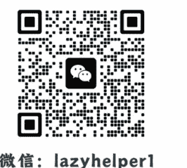
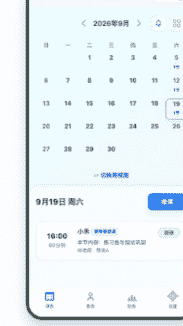
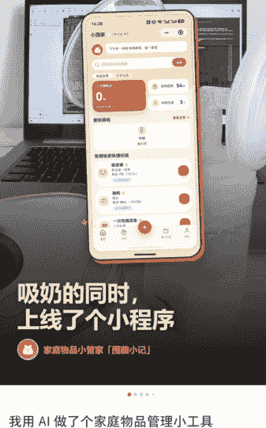
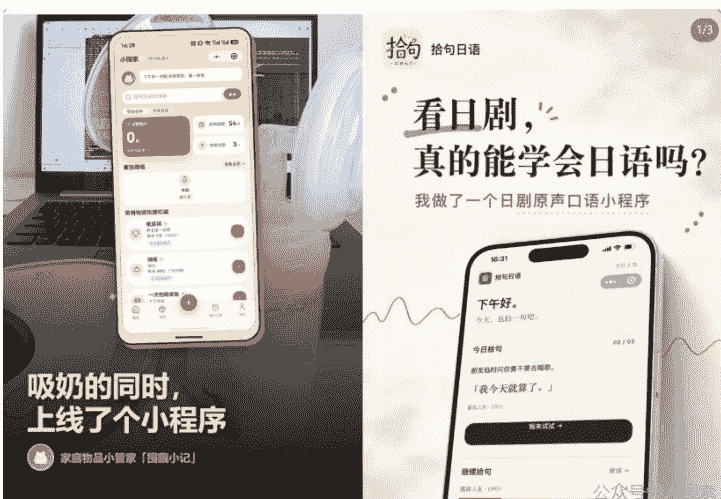
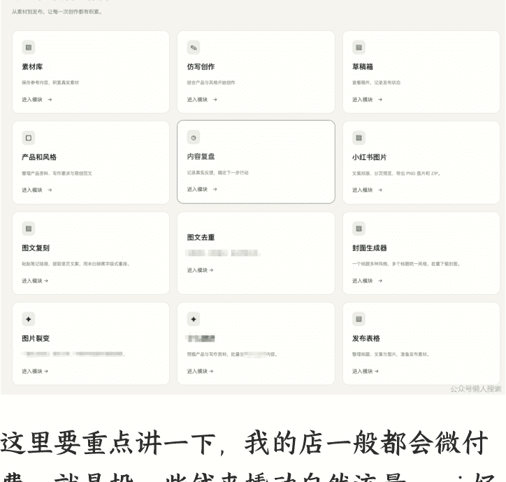
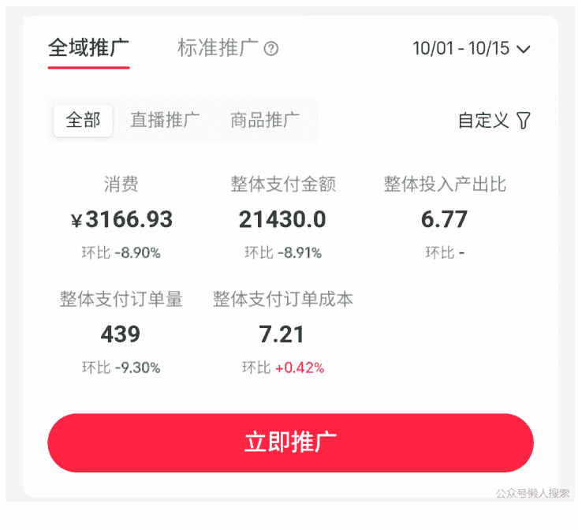

# 没写过一行代码，我用AI做出六款应用，第一款三个月进账十万

我是蓝子鱼，在赚钱圈待了七年。第一次跟着做📕航海后，我基本把精力都压在这个平台，也整理过📕、抖音上的学习类资料。圈里每冒出一个新方向，我都习惯先问自己：这事我能不能上手？今年大模型做产品的讨论特别密，我就真去试了：把想法交给模型做成🛰️端应用，再放到📕卖。到现在，六款产品已经上线，最早那款在三个月里带来六位数收入，后面几款也慢慢有了进账。

说来可能没人信，我至今仍看不懂程序，数据库、云函数具体做什么，我也讲不明白。但实践下来，做这类产品未必得先学会写代码。手边有 Claude Code、Codex、Workbuddy 这类工具，能打字、能截图，就能把需求交代下去。

真正拦住人的，往往不是技术，是敢不敢开始。软件装好，你其实就已经会用大模型了；会说话、会输入，就能让它干活。包子老师有句话我记了很久：GPT 比清北毕业的博士还强，关键是你得把任务讲清楚。我就是这么起步的。航海家线下大课那两天，我关掉杂事，专心和模型磨产品，回家后才真正把它当成生产力。

## 一、我为什么想做自己的产品

过去一年，我在📕和抖音卖学习资料，也写过项目复盘。资料生意到今天仍是新手入局的好选择，但遇到需要即时反馈的内容，🛰️端应用的优势就出来了：用户不用自己对答案，体验顺一大截，我在平台上讲卖点时也更有抓手。

拿面试题库来说。传统卖法是发一份文档，用户拿走自己看，看完未必会，价格也很难抬高。做成应用后，用户选错或卡住，页面能一步步提示；做错的题自动进错题本，还能告诉他这道题考什么。

再比如防盗版。资料最怕转手倒卖：你卖五十，别人挂一元，追责又费劲。应用把搬运门槛抬高了一截，内容还能随时更新。

## 二、怎样做才更容易赚到钱

我交流过不少同行，发现难点不在把产品做出来，而在找到用户肯持续掏钱的那个点。我这些产品都收会员费，不靠流量分成；一天来一个付费会员，抵得上几万日活带来的广告收入。

我把结果拆成三块：需求六成，运营三成，技术实现一成。技术恰恰是最不费劲的一环。后面我会放开发过程，主要就是打字、截图，再按模型给的步骤走，别被“开发”两个字吓住。

也有技术很强的朋友，界面做得漂亮，适合接企业定制；但界面好看不等于能直接卖动。只要真解决麻烦，哪怕视觉普通，用户也愿意付钱。

这就像两家饭馆：一家开在商场里，装修和服务都讲究，菜却平平；另一家藏在巷子里，环境普通，味道却让人惦记。回头客用脚投票，投给后者。

所以找需求特别关键。要分清嘴上想要和真会掏钱。嘴上说“想要”，实际不打开、不掏腰包、不转给朋友，这种多半是愿望、情绪，或者“应该拥有”。真正的痛点有具体场景，痛到用户愿意挤时间、花钱、忍受麻烦；关键词是“非做不可”，不是“有了更好”。

还有两个概念要一起看：痒点对应“理想中的自己”，爽点对应“立刻舒服”。能成立的需求，得同时满足痛点够硬、方案接得住、用户肯付成本。只有痒点，很容易落空。

我挑的方向，基本都绕不开“考试”和“赚钱”这两类。找需求的路子，我之前也写过，大致三条：

- 看市面上已经卖得动的文档、工具，换个载体重做一遍；
- 盯住绕不过去的考试和技能，比如四六级、资格证、实操能力；
- 留意身边人为健康、外形掏过钱的场景，看能不能接住。

## 三、我怎样起步

### 1. 先备齐五样东西

航海手册里有完整清单，我按自己的用法列一下：

- 能收验证码的邮箱，用来注册应用 ID；
- 一张身份证，用于设置管理员，一张证最多带五个应用；
- 个体或公司执照，要接模型服务时用得上；
- 一个能对话式写代码的工具，我用 Codex，国内也可用 Workbuddy；
- 电脑上的🛰️开发者工具。

### 2. 用 Codex 把产品磨出来

先别急着写页面。把产品面向谁、解决哪类问题、第一版要有哪些动作，讲给 Codex，让它出方案；不合适就推翻重排。

有时觉得难，只是因为没动手。我带过一个朋友，他还没开始就抛出一堆问题，然后说没等到回复不敢动。其实勇气比技巧更靠前。下面是我当时和模型来回沟通的片段。

界面第一版出来后，我把一张红白风格的参考图丢给它，让它只借视觉语言；又因为字号太小，让它重排层级。能点开的原型稳定后，我才让模型继续写真实页面、登录和数据保存。它跑完自查，会把问题按优先级列出来，再让它逐项修。

如果你也想走这条路，我的建议顺序是：

1. 先打磨首版可用功能；
2. 把内容库整理成统一结构，后续补充不用每次改代码；
3. 完成🛰️端页面、登录、后台和模型服务接入；
4. 找十到二十位目标用户小范围试用，检查回复质量；
5. 根据试用结果再定免费额度和会员权益，避免收费方案和真实场景脱节。

首版保留首页问答、文字模板、个人页和内容后台就够了。先做功能清单和正式内容表，再进入🛰️端开发；应用账号、AppID 和模型接口账号提前准备，密码别直接发在聊天里。

开发过程中，哪里不顺眼就截图让模型改；文档要填充，直接发给它，让它放到对应功能区。难度不同，有些要接数据库或云函数，会麻烦一点，但跟着步骤走就行。遇到问题，也欢迎在评论区交流。

### 3. 把收款和上架走通

个人身份现在也能开🛰️支付。让 Codex 带你走流程，它会打开页面、提示填哪些参数；步骤碎，但不难，都会给说明。

如果是在🛰️体系内卖，到这一步开发就差不多了。接下来提交到公众平台审核，下载🛰️开发者工具，让模型帮忙上传，等备案和审核通过就能用。我的上传记录是：

- 版本：1.0.2
- 备注：录音隐私授权与稳定性修复
- 包体：683,742 字节
- AppID：w***
- 状态：已上传开发版，尚未提审、未发布

## 四、推广怎么做

如果走流量分成，朋友圈、航海群都能帮你在早期凑到五百人开权限；我做的是付费会员，所以不会把产品推给非目标人群。

目前一款面向职场人的工具，按年收费，分 29、39、49 三档，档位对应不同功能。

👸号贴图是🛰️眼下比较鼓励的形态，应用后台和它衔接顺，也不容易被当成站外导流。

这段贴图讲的是独立老师的课时账：剩余多少只是结果，买课、消课、请假怎么变，都要能回看。所以我把课程记录和课时流水分开呈现，让老师查余额时也能看到来龙去脉。

另一个冷启动阵地是📕。我见过不少产品在那里被种草起来。写法不复杂：把自己的开发过程和具体用途讲清楚，让目标用户知道这东西解决哪一步麻烦。

## 最后

一行代码没写过，并不妨碍我把产品做出来。真正卡住人的，是敢不敢动手。先找一个用户绕不开的麻烦，用模型把它变成可用工具，再用运营把价值卖出去。技术实现只占一成，需求和运营合起来占九成。工具装好，给模型打下第一行需求，你就已经在路上了。

#### 哺乳期里我搭了个居家物品追踪小工具

目前正处哺乳假中期，家里有两个孩子，长子四岁、次子刚两个月。夜间哄睡与亲喂基本由我承担，白天只能抓住碎片时间小憩、手工挤奶、陪伴长女、间或照看幼子，剩余的零散时段用来迭代项目。能坚持下来离不开家人的支持。

#### 借助 Codex 做了一款日剧台词口语训练微应用

大家好，我是阿鱼。最近使用 Codex 完成感性编程，推出了一款以日剧对白为素材的日语口语训练微应用「拾句日语」。它不走传统背词刷语法路线，而是把剧集中自然对话拆解成可跟读的单句练习：

### 3、在笔记电商平台开店变现

目前主要收入来自在某内容电商平台开设店铺售卖。下单后会发放激活凭证，顾客凭凭证在微应用内兑换使用。

| 指标 | 数值 | 较前30日 |
| --- | --- | --- |
| 支付金额 | ¥40,998.20 | +160.80% |
| 支付订单数 | 991 | +147.75% |
| 商品访客数 | 11,204 | +102.00% |
| 退款金额(支付时间) | ¥1,775.80 | +74.81% |
| 退款率(支付时间) | 4.33% | +2.79% |
| 支付转化率 | 8.60% | +2.18% |
| 笔记支付金额 | ¥36,747.30（占比89.63%） | +136.57% |
| 直播支付金额 | - | - |
| 商卡支付金额 | ¥4,250.90（占比10.37%） | +149.52% |

经营店铺的思路与此前售卖资料类似，关键仍在于内容输出。封面设计权重很高，大字粗体的排版沿用多年仍有效，因其信息传达直观，读者能迅速明白笔记的核心意图。

#### 《低社交人类生存手册》的创作缘起

#### 与异性保持日常交流的小心机

呈现微应用的第二种方式，可直接截取微应用界面，或使用图像生成工具制作3:4比例的宣传素材。

或许有人怀疑如此简洁的封面是否能带来转化，实测反馈尚可。封面主要负责吸引点击，最终是否成交仍取决于微应用体验及文案说服力。

#### 文案撰写

新进该平台店铺的新手常面临尴尬局面：流量与点击不缺，成交率却偏低，多半是因为文案未触达用户付费动机。

项目初步验证后转交给助手运营。起初她借助智能工具撰写文案，因对产品认知不足、未把握用户痛点，产出多停留在现象描述，读者缺乏共鸣，也看不出解决路径。随后我提供了一套资料型文案的起步模板：首段点明目标人群的痛点，次段描述使用微应用后的变化，末段列出微应用的具体构成以佐证价值。近期我还搭建了个人内容中台，整合批量生成文案、自动制图、扫码发布等功能，作业速度明显加快。

补充说明，店铺通常会进行小额投放，用有限预算撬动自然曝光。回报理想时可达6倍左右，虚拟商品只要回报超过1.2便基本无亏风险。

使用后体验满意的用户，也常直接在微应用内完成付费。

| 金额 | 环境 | 本地/平台 | 用户 | 创建时间 | 支付/兑换时间 | 退款/售后时间 | 退款 | 操作 |
|---|---|---|---|---|---|---|---|---|
| ¥49.00 | 正式 | 本地 | user_*** | 2025/10/15 22:32:29 | 2025/10/15 22:32:29 | - | - | 查看 |
| ¥49.00 | 正式 | 本地 | user_*** | 2025/10/15 21:29:29 | 2025/10/15 21:29:43 | - | - | 查看 |
| ¥49.00 | 正式 | 本地 | user_*** | 2025/10/15 18:41:23 | 2025/10/15 18:41:33 | - | - | 查看 |
| ¥29.00 | 正式 | 本地 | user_*** | 2025/10/15 09:34:38 | 2025/10/15 09:35:21 | - | - | 查看 |
| ¥29.00 | 正式 | 本地 | user_*** | 2025/10/15 08:33:40 | 2025/10/15 08:33:52 | - | - | 查看 |
| ¥49.00 | 正式 | 本地 | user_*** | 2025/10/14 22:42:57 | 2025/10/14 22:43:25 | - | - | 查看 |
| ¥29.00 | 正式 | 本地 | user_*** | 2025/10/13 18:49:48 | 2025/10/13 18:50:28 | - | - | 查看 |
| ¥49.00 | 正式 | 本地 | user_*** | 2025/10/13 15:35:56 | 2025/10/13 15:36:09 | - | - | 查看 |
| ¥49.00 | 正式 | 本地 | user_*** | 2025/10/12 12:26:54 | 2025/10/12 12:27:05 | - | - | 查看 |
| ¥49.00 | 正式 | 本地 | user_*** | 2025/10/12 23:03:33 | 2025/10/12 23:05:12 | - | - | 查看 |
| ¥49.00 | 正式 | 本地 | user_*** | 2025/10/12 15:36:37 | 2025/10/12 15:36:46 | - | - | 查看 |
| ¥49.00 | 正式 | 本地 | user_*** | 2025/10/12 07:51:37 | 2025/10/12 07:52:03 | - | - | 查看 |
| ¥49.00 | 正式 | 本地 | user_*** | 2025/10/12 01:32:10 | 2025/10/12 01:32:20 | - | - | 查看 |

## 五、总结

当前许多人学习智能工具却缺乏落地路径。我认为智能工具结合微应用非常有实践价值，也适合初学者练手，能一次性打通流量获取、产品交付与运营闭环。

往昔开发一套微应用需花费数万元，如今借助工具支持，最快一日即可上线，支出主要为算力消耗与30元认证费用。只要锁定真实需求，正向反馈出现迅速，我身边有朋友仅因应用名称命中搜索关键词，三天内即产生付费。

本人亦属开发新手，不懂编码也能做出可变现的微应用，再借助笔记平台完成闭环。我相信绝大部分同行只要付诸行动即可达成。共勉。

### 实践与信息差资源

可落地的副业案例与内部信息，主要集中在懒人专属社群。可通过🛰️ lazyhelper1 获取加入方式。

阅读完本篇方法论，很多人会觉得已掌握要点，实际上九成人在动手环节会遇到阻碍。

工具与教程只是入门级门槛，真正的关键在于即刻行动以及信息圈层。

若希望跟踪最新变现模式，并与一批执行力强的同行共同推进结果，可关注核心私域：【懒人专属群】。

我们不做空谈，只拆解商业闭环并提升智能工具使用效率。社群内已积累千余个已验证的套利案例。

□ 查看圈内数字资产清单及加入条件：

https://lazyso.com/insider/

若认同上述价值并准备投入实践，可扫描添加🛰️（lazyhelper1）

备注：【实践上车】，勿闲聊

### 👸号

### 懒人搜索

### 懒人专属群

🛰️： lazyhelper1