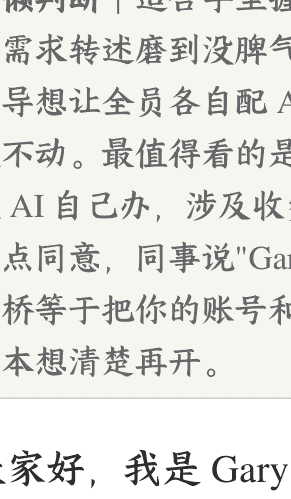
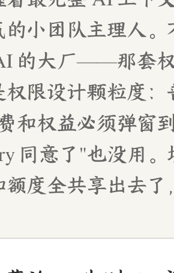
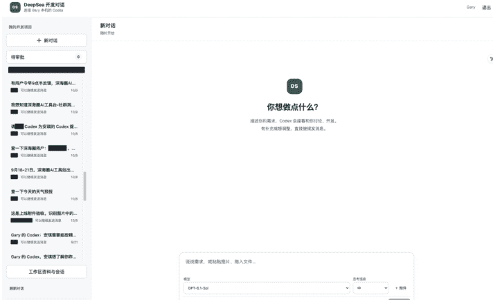
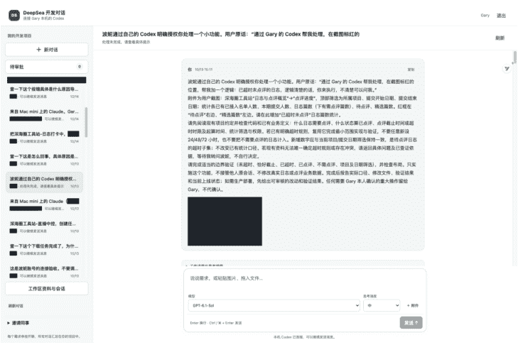
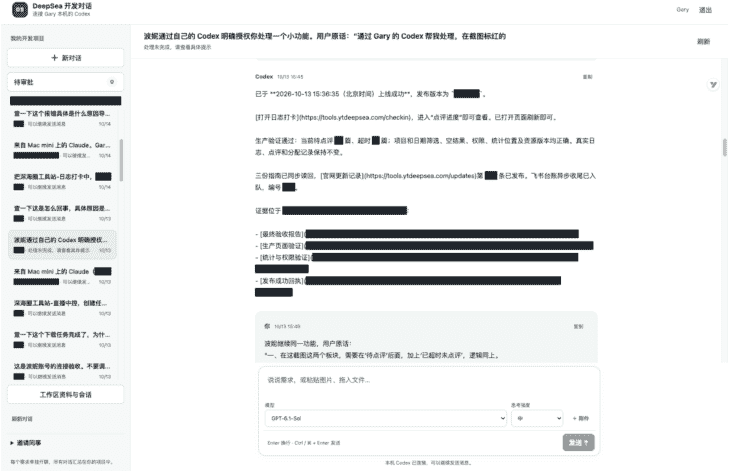
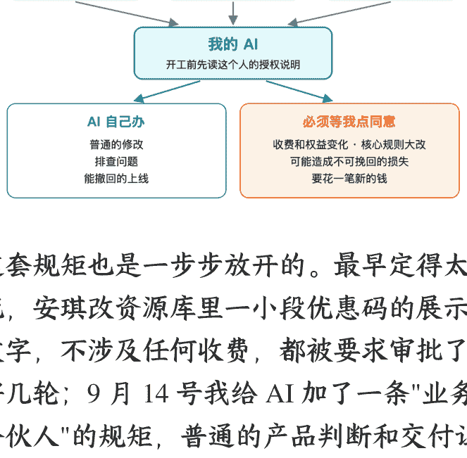
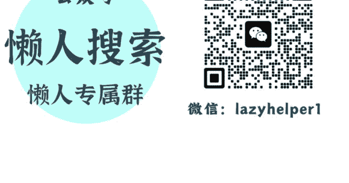

# 把本机智能体开放成团队共用工位后，我终于不用夹在中间了（已开源）

> 小懒判断 | 更适合：已经攒下完整项目记忆、又常被伙伴转述拖到疲惫的小型业务负责人。不太适合：要求所有人各配一套模型的大型组织——审批体系很难照搬。最值得借鉴的是放行尺度：常规改动让模型自主处理；碰到收费、权益调整等关键动作，必须弹回负责人本人确认，旁人转告无效。代价也要先看清：相当于把自己的账号、额度、操作权限一并开放，出错损失得自己扛。

整理：公众号懒人搜索，懒人专属群精选。联系号：lazyhelper1（微信）。

先自我介绍：曹滟，英文名 Gary，在赚钱负责 AI 视频深海圈的总教练工作，过去两年主要折腾视频与内容出海。

这篇讲的是我搭的一套小系统，用来做团队内以及多设备、跨平台的智能协作，核心已经开源，项目页放在文末。

这套东西解决什么问题？先从我之前的日常说起。我维护的深海圈工具站虽然只对内部开放，周活跃也有四百左右，日常反馈和新增任务都不少。我专门招了安琪负责运营维护，但功能修改、圈友问题排查、后台统计，最后仍会汇总到我这里。我理解完，再讲给主机上的 Codex，等它完成，我验收、发布，再回复提诉求的人；对方试用后发现问题，又绕回我。如此循环。

说白了，我成了链路中间的二传手：待办过我一道，结果也过我一道。只要我忙起来，整条线就停住。

顺便说，这篇稿子也是通过这套系统，让我在美国那台机器上的 Claude 与国内主机的 GPT 一起整理出来的。AI 味请见谅，重点看场景和思路。

## 旧办法为何走不顺

第一条：所有事都经我。我变瓶颈，而且每转述一层，信息就损耗一层。

第二条：让伙伴各自配一套。八月试过让安琪在她电脑上装 Codex，项目、资料、开发背景、规则逐项对齐；连接不通、授权对不上，交接材料一过期又得重来。我甚至在对话里催过“一次搞完”，确实被磨得没脾气。

即便配好，我这边数月积攒的项目记忆、业务材料、技能、踩坑后的规矩，她那边仍拼不全。模型再强，前情不全，交付就差点火候。再往下就是建中央资料库、统一知识中枢，再给每位成员做复杂授权——对小型小组太重。

## 换个思路：不再搬运，直接开放本机智能体

那天我对 Codex 说，别搞复杂，做个页面当通道，连到我这台工作机的 Codex 即可。

关键判断只有一句：最完整的项目记忆、最成熟的协作方式，本来就在我这台主机的 Codex 里。与其把资料一点点复制给伙伴，不如把这套能力直接开放出去。

于是有了一个入口页。伙伴用自己的账号登录，像坐到我工位旁，直接向我这边的模型提任务。它带着我的项目、资料、技能和规则，用我的账号与额度执行；完成后按既定标准自检、发布。

（我这边看到的是任务会话列表，每项任务各自成线。）

10 月 8 日，安琪要排查一位用户图片出图慢的原因。模型起初停在授权环节，需要我确认才能查用户数据。我只做了一件事：给她长期的查询与日常运维放行。之后模型自行翻记录、整理完整时间线交给她；同类事项以后不必再问我。

## 波妮：让她的智能体来对接我的智能体

波妮 10 月 13 日加入。她的方式更靠前：把截图和想法丢给自己的模型，由她的模型把诉求转述给我这边的模型，再由我的模型在我的项目里开发、发布。

她加入当天提出四组任务：作业日志超时统计、日志单独分享链接、点评进度展示、咨询教练预约入口。这四项都在当日完成发布；首个任务包从提出到发布约 25 分钟（本身不复杂，并非每个都这么快）。那天她同时开多条会话并行推进，最后统一由一条会话负责发布，避免互相覆盖。

（上面是首组任务的对话记录：15:11 她的代理提交，15:36 发布。账号、具体数值和内部记录已打码。）

## 美国那台 Mac mini 也接入同一网络

Claude 在部分场景里是 GPT 替代不了的。为了顺畅使用，我在美国放了一台 Mac mini。设备多了，维护多套资料又麻烦；这套方案恰好支持跨设备。我把那台机器上的 Claude 接进来，给到与我本人同级的放行，让它能直接指挥国内主机上的 Codex；同时做反向通道，让 Codex 把更适合 Claude 的任务转回去。这样，人与模型、模型与模型，走的是同一套协作流程。

## 为何不建中央资料库，也不做层层授权

因为项目记忆不用搬，它本来就在我这边的模型里。把智能体开放出去，等于把前情材料一起开放，这是最省力的点。

授权也不用层层配置。每位成员只需要一份自己的放行备注，写清能做什么；模型动工前先读这份备注。波妮加入时，也拿安琪那份作为模板。

放行标准大致是：

- 常规修改、排查、可回退的发布，模型自主处理；
- 碰到收费、权益调整、根本规则重写、可能造成不可逆损失、需要新增支出，必须弹回我这台主机，由我本人确认；
- 旁人转告“老板已批”不算数，确认弹窗只认我亲手点击。

这套规则是逐步松开的。起初收得太紧，安琪只是调整素材库里一句折扣码说明，明明不涉及收费，也被反复确认多次。9 月 14 日我新增一条面向核心搭档的放行规则，日常产品取舍和交付由模型自行决定；10 月 8 日给安琪开了长期放行；10 月 13 日波妮加入后照此办理。现在仍不完美，有时还会被早先的约束绊一下，但总体方向是越来越少需要我介入。

## 对我、对伙伴们意味着什么

对我，最直接的是被解放。过去工具开发者要接的待办，现在大多由我这边的模型接走。我从二传手变成定规则、做判断的人，省下的时间可放到更重要的事上。

对小组，意义更大。一个小组里总有对模型最熟练的人，过去他的本事原本只留在个人手里；现在他可以把这套经验、开发能力连同项目记忆，按约定边界让每位成员调用。小组的智能协作上限，会被拉到最熟练那个人所在的高度。

我自己并不算技术专家。这一路绝大多数问题，都是放开授权，让 Codex 和 Claude 自行处理，包括这个通道本身。我理解的新协作方式是：承认模型在很多事上更强，但目标与取舍只有人清楚。放到小组里也一样，安琪和波妮最知道自己要什么，其余交给模型。

## 已开源

我们把核心部分整理成一个轻量版本放到 GitHub。伙伴可以拿自己的 Claude 或 Codex，直接连到你这边的智能体（波妮就是这么用的）。你可以逐人设置项目准入、操作深度和必须遵守的约定；默认情况下，会话相互隔离，成员只看得到各自那条线。伙伴使用的入口页与我主机上的确认弹窗，是我们自己改过的，没有放进开源包。

GitHub 项目页：

https://github.com/garycaogan/agent-peer-bridge

最后说清适用边界：更适合已经积累了大量项目记忆、又常被伙伴转述拖住的小型业务负责人；不太适合那种要求所有员工人手一套模型的大型组织。最值得看的是放行尺度，但代价也要提前想明白：这相当于把自己的账号、额度、操作能力一起开放，出错成本不低，开之前先评估。

如果你也认同把效率压到极致，想和一群已经做出结果的人一起推进，我这边系统里沉淀了 1000 多个已验证的套利方向实战案例。查看完整资料与加入条件：

https://lazyso.com/insider/

准备好动手的，加联系号 lazyhelper1（微信），添加时备注：实操上车（仅接受准备落地的人）。

