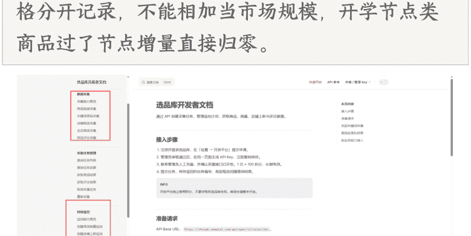

# 把“一天内百人加入购物车”当温度计，不当收银机：我的虚拟品筛选复盘

> 261015 副业分享会精选  
> 整理：🛰️订阅号“懒人搜索”与内部交流群  

【适用性提醒】  
这篇适合在📕做数字资料、又常担心“这个需求还成不成立”的创作者；不适合把现成商品搬来直接转卖的人。三条硬提醒：第一，加入购物车只是购买意向，尚未成为结算订单；第二，前台展示数不是真实成交额，更推不出毛利；第三，同一链接下不同SKU要各占一行，别合并成行业规模。还有一个容易忽略的点：开学季商品过了时点，增量可能直接掉到零。

当前接口开放给读者试用，但资源额度有限，每天设调用上限，望理解。

大家好，我是龙哥。

我找虚拟品时，先处理一个犹豫：页面数字漂亮，并不说明我做完也能接住。把搜索词缩到明确动作，再让样本之间能横向比较。

我的选品库字段包括：品名、售价、SKU/版本、店铺、移动端意向提示、逐日前台销量读数。每个数字都要能回链到具体商品和用户拿到的东西，别靠单张页面图去猜。还有一步很实际：先拆形态。数字讲义、印刷习题册、软件会员权益，都可能被叫作“学习资料”，分类也相近；先把它们分开，再拿相近的东西作比较。

## 一、我保留“一天内百人加入购物车”提示的理由

累计销量说明这个商品过去有过销售积累；手机端“一天内100+人加入购物车”这类提示，提供的是采集那一刻较短时间里的购买意向线索。

它对我的用处，是把一批商品里出现过这种信号的样本先挑进观察名单，少做一轮没有方向的翻找。但我不会看到提示就拍板。加入购物车还没有走到成交，提示本身也会变化。库里存的是当时采到的内容，得和采集时点、后续前台销量一起读。

有个反例很能说明问题：曾有一条“小学中段语文·开学首课”演示文件，采集时出现过“一天内100+加入购物车”，跟踪期的前台销量差却是0。开学时点过去后，这类需求要重新判断。我的做法是：先放进观察名单，隔一个七天再看前台销量有没有变化，再决定哪些值得深拆、哪些先放一放。

看一个意向提示，要接三件事：提示出现在什么时点；逐日前台销量是否连续为正、前后两个七天怎么变、有没有断档异常；真实需求是否还在、用户拿到的东西是否可靠、自己能在哪个环节做得更细。

## 二、42条样本是怎么筛出来的

先看一个例子：研考英文短文写作框架，前一个七天前台销量+643，后一个七天+1,870，七段相邻差值全部大于零。它值得继续拆，因为需求对应的动作很明确。

在117条经人工核过属于数字形态的记录里，有42条满足“七段相邻差值全为正”。其中，七天增量≥100的32条，≥500的15条，≥1000的8条。三层范围是包含关系，别累加。阈值只用来排研究顺序，不负责回答利润、版权和后续服务。

这些数字都是商品页面展示销量的观察差，不是结算订单、退款后的净成交，也不是利润。“持续上升”在这里只表示每天都有正差；想判断是否提速，得把前后两个七天摆在一起看。还有一点要说明：有些提示是在跟踪期才冒出来的，所以这次结果不是事前预言，它只帮我缩小下一步研究范围。

下面按使用场景放样本。每条“七天差”都指前台展示销量的观察增量；曾出现意向提示，说明不了当前热度；加入购物车尚未成为订单；每天正差也不说明增速在加快。看懂需求，并不附带内容转售资格。同一链接下不同SKU各占一行，别当成42个独立赛道，也别简单累加去估市场。

### 研究生考试方向：把大任务缩成眼前一步

01｜硕士入学英文（二）历年真题词表辑录｜一天内100+意向提示｜七天差+1,985｜研究点：把词表做成每天一页的复习动作。  
08｜研考英文高频词速记视频配数字讲义｜100+｜+677｜研究点：用“听一个专题—做一页讲义—遮住提示复述”串成完整体验。  
09｜研考英文短文填词式写作骨架｜100+｜+642｜研究点：样张展示同一骨架的三种替换，并标注适用条件。  
10｜漫画记忆研考英文词汇的数字讲义｜300+｜+480｜研究点：一幅画、一句场景、一轮回忆，先做原创试作。  
11｜第三方背词App研考半年会员｜100+｜+398｜研究点：沿备考周期拆套餐；转售前必须核实品牌授权与后续服务。  
12｜研考英文八千词电子读本｜100+｜+130｜研究点：研究版式与遮挡回忆结构；第三方内容先看授权，别直接搬。

### K12家庭场景：把“全套资料”收窄到学段与问题

13｜全学科数字课本包·小学第四学年｜100+｜+1,809｜研究点：用“学年—教材版本—学期—单元”做一张查找导航样张。  
14｜同链接跨学年全学科数字课本包｜100+｜+1,793｜研究点：拆资料组织方式，用具体单元演示三级目录怎样找。  
15｜小学第六学年上学期读文答题框架与训练｜100+｜+1,020｜研究点：用一道题走完“学生常见答法—找信息—组织答案—同类练习”。  
16｜初中学段英文核心知识清单（七至九学年）｜100+｜+678｜研究点：按一次月考前复习组织：定位不会处—回知识卡—同类练习。  
17｜高中学段语文学科资源云盘合集｜300+｜+597｜研究点：不沿用提分承诺，改为展示一篇读文分析、一段素材使用。  
18｜小学第四学年上学期语文短写练习｜100+｜+405｜研究点：十分钟写作入口：观察提示—三个角度—空白练习页—讲解示例。  
19｜小学第三学年上学期读文练习电子册·67页｜100+｜+388｜研究点：先圈题干，再标回原文，最后解释答案怎样组织。  
20｜小学第四学年上学期读文练习电子册·79页｜100+｜+388｜研究点：同一链接两个SKU读数相同，别拆成两份需求；可对照难度变化。  
21｜初中学段英文词汇与语法在线练习页｜100+｜+326｜研究点：用最短路径演示“点专题—看例子—做一题—回看解释”。  
22｜初一阶段史地生政四科手绘概念图｜100+｜+213｜研究点：一课一图，先画概念关系，再留空白图供复述。  
23｜小学第五学年上学期语文知识脉络图｜100+｜+34｜研究点：增量小但持续为正，可观察单篇到单元整理的演示。  
24｜人工智能英文学习包·五年期｜100+｜+176｜研究点：沿长期安排拆阶段内容、进入下一阶段方式、换设备后的使用。  
25｜同款一年期学习包｜100+｜+171｜研究点：两个期限都增长，只能提示继续研究，别急着断言用户偏好。

### 课堂准备：让老师拿到后知道这一节怎么用

26｜词汇教学互动游戏演示稿·二十套带更新｜500+｜+201｜研究点：演示老师怎样开场、学生怎样参与、换词后怎样再用一次。  
27｜小学第五学年上学期数学授课方案+配套演示文件｜100+｜+134｜研究点：标出方案写到哪个活动、演示对应哪一页、课后训练承接什么。  
28｜小学第六学年上学期数学自制授课方案｜100+｜+80｜研究点：明确禁转卖；研究原创教研怎样写成可执行步骤。  
29｜小学第六学年上学期数学演示文件+授课方案·人民教育出版社教材版｜100+｜+72｜研究点：同一节课做对照展示，标明版本与单元。  
30｜同链接另一教材版本（北京师范大学出版社）｜100+｜+72｜研究点：两个版本读数相同，别合并估总量；对照目录、例题和课堂顺序。  
31｜小学第一学年语文单元练习一演示文件｜100+｜+41｜研究点：单课试作范围小，可准备活动流程、教师提示、一页学生参与示例。  
32｜初中学段英文七至九学年演示文件+训练全集｜100+｜+37｜研究点：研究“找得到、配得上、更新看得懂”，把已完成与待更新列清楚。

### 视觉素材：先看效果，再看数量

36｜绘图App手写字效素材·五十余款｜100+｜+349｜研究点：用一张封面、一页手账或一幅字卡说明风格，再展示组合过程。  
37｜绘图App双色调水印与点缀素材·456款｜100+｜+276｜研究点：同一作品换两组颜色，观察主体、文字和边角怎样协调。  
38｜绘图App圆点纹样底版·八十款｜100+｜+235｜研究点：标题写“可商用”，仍要逐项确认授权边界；先做背景、边框、局部装饰三张示范。  
39｜绘图App清淡风底图·一百款｜100+｜+207｜研究点：同一套文字与主体换几张底图，展示对比度、留白和画幅变化。

后三款素材的七天增量比前一个七天低，适合边跟踪边做小样。原始可见编号不连续，没出现的编号不臆造；空缺处不补造样本。以上读数只提示继续跟踪，结算单、退款后的净额、毛利、版权许可和后续服务，仍然要另行核实。

**先别追爆款，把手上的小事跑成一份能展示的样品**

除了翻教育类资料，这批样本还提供了另外几种观察角度：手机锁屏上的待办、一次职场汇报、一套用着顺手的版式。看起来都是小事，却共同指向一种方法——把研究范围收窄，先想清楚用户打开产品后的第一个动作，以及他最终想完成什么。

**三个样本，三种具体用法**

- **把待办钉在锁屏上**：平台历史记录显示，这款产品上架一天内就有两百多人加入购物车，七天页面销量累计增加 707。它演示的是极小的日常流程：列出当天要做的三件事，扫一眼，再划掉其中一项。研究者该盯的是入口是否好找、文案是否够短、操作是否顺手。如果自己想做同类工具，别一上来铺大而全，先锁定一类人的安排习惯，再把系统兼容性和安装步骤交代清楚。
- **汇报用演示文稿（自选一套）**：历史数据是上架一天内四百多人加入购物车，七天页面销量增加 164。这里真正值得研究的不是模板数量，而是帮用户挑到合适的那一套。可以按听众身份、使用场合、内容类型做一张挑选指引，再放对应样张。有设计底子的人，先吃透一种自己熟悉的汇报场景，把需求询问、推荐理由、交付说明做扎实，再慢慢扩品类。
- **255 页、零动画的职场汇报版式**：一天内一百多人加入购物车，七天页面销量增加 87。零动画版式适合拿一场真实汇报来试填：一页写进展，一页列差距，一页给下一步。把同一组信息放进版式里，读者一眼就能判断这东西有没有用。自己交付时，最好连能替换的图表、结论句该放哪、填页样例一起给出去。

选方向的时候，先找自己待过的场景，做一份能把用法完整走一遍的样品，再拿着它去和人聊。增长记录只是入手处，样张才是讨论落到实处的对象。

**从“有人买”到“我能做”，中间横着三道坎**

头一关，需求到底懂不懂。看到考研词汇在涨，若不清楚备考节奏、真题怎么用、考生容易堵在哪个环节，做出来的版本很难让人掏钱。做过老师的人，更能体会“课件为什么还要另配讲稿”。

第二道坎，交付能改哪。同样做词汇资料，整理成清单、画成场景漫画、设计成课堂小游戏，受众和用法完全是两码事。改进线索可以从已购用户的评价、页面演示、实际用起来的过程里挖，再判断自己从哪块下手。

最后一道坎，这事能不能长期维护。自己画版式和维护一个不断更新的题库，投入差得很远。如果牵涉教材、题库、平台会员，先把素材来源和转售许可弄明白。看懂需求，不等于把现成货搬来就能卖。

三道坎落到纸面：选自己熟的方向，用四个问题答清楚——服务谁、在什么情况下用、能帮用户少做哪一步、自己打算交出什么。答不上来就接着做功课；答得清楚，再动手做个小样试试。

**用一张表把观察管起来**

不妨先锁定一个方向，挑十到二十件商品作为最初的观察样本。这个量级方便人手动核对，也要根据账号权限和任务量上限来增减。

起步阶段，记清来源、规格和需求；然后在差不多的时间段记录销量，失败、缺数都要留痕。要算七个相邻日的变化，至少要攒够八天有效记录；想比前后各七天，就得有十五天数据。

每个栏目都在回答一个问题：

- 商品、店铺、规格：确认前后比的是不是同一件东西；
- 受众与使用时机：谁在什么情况下需要它；
- 标签及其抓取时间：看到的是旧信号还是新观察；
- 页面数字与抓取时间：有没有持续变化，是否缺数或异常；
- 交付内容与反馈中的疑问：还有哪些改进空间待核实；
- 自身差异与小样安排：值不值得亲手试一次。

碰到异常就留空，并注明缘由，不要拿零顶上；每日取样规则固定下来，抓取时间按实际记录；历史不足，就只讲已经看到的内容。表内再添两列个人判断：“值得接着盯的原因”和“下一轮要验证的点”。比如教学小游戏数据在涨，下一轮看页面演示能不能让老师一看就会用；设计类素材仍在涨，但速度慢下来了，接着看风格变化和内容迭代频率。

七天过完，把名单重新排一遍：理解更透的留下，数据还缺的接着盯，眼下交不出的先往后放。这样每回打开后台，都带着一个明确问题去翻。

**把抓取和跟踪接进自己的流程**

前面跑通的选品流程，其中的抓取和跟踪能力已经被整理进一个开放平台，现在打算拿出一段时间，免费让圈友试用。它的用途是把反复取数这件事接进你自己的表格、脚本或自动化流程；已经有选品方法的人，保留自己的判断逻辑，只把取数这一段接起来。

顺着线索走，有五种抓取方式：拿到商品链接，补齐目标信息；用搜索词寻找候选；看店铺商品或整店货盘，研究对方的产品结构；翻评论区，找还没被满足的诉求。需要持续盯，就再加三项跟踪：用销量跟踪看页面数字怎么走；盯店铺上架，看后面出了什么新品；看评论区，收集后续买家反馈。

走法是：开账号、提权限申请、等审核、拿到密钥。试用期内，开放给你的抓取和跟踪接口，不用充钱，也不扣积分，不过调用次数和任务量上限照旧，后面怎么安排，看平台通知。平台权限可以单独申请，不必先买会员。文档地址：https://xhsxpk.womai.../docs/ ，入口在后台设置里的开放平台页面。

打算让 AI 协助对接，可以用那种能读文档、能写代码也能执行代码的环境，真正跑之前，先把任务边界说清楚。给它立七条硬规矩：

1. 先把文档读一遍，确认账号权限、可用接口、字段、任务量上限和轮询规则，接口不能靠猜；密钥从本机的环境变量中取，不要丢进聊天窗口，同样别落到代码、日志、截图或者导出的文件里，请求只打向文档里明确列出的服务地址。
2. 先交一份小体量方案，把搜索词、目标条数和跟踪对象定下来；提交时按接口规定的目标数量来，记下任务号，查进度时遵照文档说明和服务端限流提醒，分页结果要全部读完。出错先记录缘由，免得一遍遍重复提交。
3. 原始结果按商品编号为键存好，店铺、规格、原始地址、商品类别、页面数字原文、接口实际给出的标签，以及各自抓取时间，都要留着；同一个链接只存一条，同店的不同规格不能当两个方向看。接口没给的字段，就写“未获取”，不要自己猜成没人加入购物车。
4. 等人工看过虚拟商品和要观察的目标之后，再用已开放的销量跟踪接口建计划；原始结果和有效快照都得落盘，程序重启后还能找回任务和记录，别拿上次的结果充作这次的新数据。
5. 用东八区时间整理每天真正有效的样本，抓取时间按真实情况记下。要算七个相邻日的变化，至少得有八天有效记录；要比较前后各七天，就得有十五天数据。缺数据就留白，不要拿零补位；数字往下走、出现约数、规格发生变化，都要单独做标记；条件不足，不要给出“一路向上”的结论。
6. 输出一张能一行行核对的表：每段相邻日期都列清楚——数字差多少、最近七天多了多少、之前七天多了多少、七个区间是不是都在往上、标签新不新、异常怎么解释、原地址在哪。不要急着靠一个看不透的分数判断货好不好，得把“每天都有上升”和“这一周比上一周升得更快”拆开看。
7. 筛出还需要人再核一遍的候选，每条都附上依据和没想通的地方：服务哪类人、用在什么场合、交出什么东西、评论区有什么需求、素材能否商用、售后如何兜底。属于推测的内容，要注明这是推测；页面上的数字既不是真实成交单数，也不等于赚到的钱；不要下“稳赚”的判断。

最终挑哪个小样去试，由你决定。先把接入这件事小范围跑通，成功多少、失败多少、缺了哪些数据，都给出真实情况；历史不足，就只汇报已经做完的观察，不要虚构走势。

————分割线————

这份 SOP 读完，多数人会觉得已经会了，可真开始操作，十个人里有九个会停在起点。

工具、教程从来算不上门槛。真正拦住人的，是“马上开干”和圈子里的消息差。

- [ ] 查看圈子资料和加入方式：https://lazyo.com/insider/

