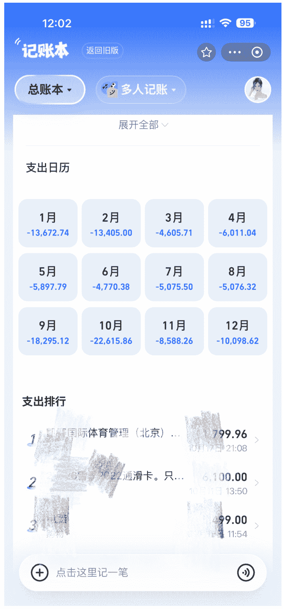

# 「保命钱」留给我的头一回肌肉记忆。
作者：龙哥

大一那年把《小狗钱钱》和《富爸爸穷爸爸》翻得起了毛边，真正被我带进生活的判断只有一句：**车和房未必算资产，有时候恰恰是压在身上的欠条；钱是拿来用的工具，不是拿来供着的消费品。** 就凭这点朴素的认知，我靠四年兼职硬是攒出十万块。

有这十万垫在底下，辞职信才敢递出去。单干真正的地基，跟“我多想自由”没关系，关键是“那份烂活我能不接”。

还在打卡、心里痒着想走的人，先自问一句：手边有没有一笔够你活过六个月的现钱？答案是否，就接着攒；攒到了，聊自由才有分量。

# 02 先把账算明白

做单干的人里，账面进项漂亮的不少，年底一盘却两手空空的也多。毛病多半不在收入端，而在从没搞懂钱往哪儿漏。我以前也不记账，只瞄月末那行总数，业务花销和日子开销搅成一锅，窟窿藏得严严实实。钱是真进来了，余额却越来越薄。

拿滑雪教练来说，表面是“带一天课收一天的钱”，实际每一单背后都压着雪票、车费、住宿、板子磨损这些雷打不动的支出。这些不先刨掉，你看到的是流水，不是挣到的。如今每单成交前，我先把刚性成本扣干净再看剩余。做📕高客单引流时，我没去买公域投放——我砸进去的是雪票、车费、住宿，这属于经营性本钱，跟日常吃喝完全是两码事。

分开核算以后，钱的走向头一回变得清楚：哪块能回本、哪块纯属打水漂，一眼见底。

我只用一张极简的表当仪表盘：每单登记死成本和到手净利。它不是流水账，是拿来定位漏点的工具。

| 序号 | 客户名 | 地点 | 天数 | 日期起-结束 | VIP | 收入 | 成本 | 净利润 | 每天收费 | 备注 |
| --- | --- | --- | --- | --- | --- | --- | --- | --- | --- | --- |
| 1 | 河北 | 北京 | 10.0 | 2025.11.17-2025.12.3-6 | 1V51 | 750.0 | 22750 | 2372 | 150/8/28 | ... |
| ... | ... | ... | ... | ... | ... | ... | ... | ... | ... | ... |

当月到底落袋多少都说不准的人，别急着铺摊子，先把这张表立起来，把生意的钱和过日子的钱劈成两半。

## 我的计量单位：拿“一单”当“一期”来盘

口径很土：每一单单独占一行。这单收进来多少、雪票吃掉多少、车马住宿吃掉多少，末尾落到净利。月底一拉，做了几单、进账几何、成本几许、落袋多少，全摆在眼前。

为什么非细到单不可？汇总是果，单笔才是因。只有拆到单，你才分得清哪笔在挣、哪笔纯属拿时间去填坑。

## 定金：一笔钱，堵两处漏

我习惯先收定金，它顺手办了两件事。其一，定金就是这单的启动本钱。雪票、车费、住宿都得先垫，订金一到，干活的本钱有了着落，不必掏老本。其二，它给客户上了一道违约成本——钱付出去，临时反悔就得掂量。这不算算计，是自雇者必须给自己配的那层护栏：时间一旦被订走就等于卖出去，卖错了收不回。

尾款我卡在开课前一天结清。既不至于拖着拖着讨不回来，客户到那时也已付清，双方预期都落了地。

倘若你也干着“干一天结一天”的活，把订金写成白纸黑字的规矩试试。它护住的不止是钱的流转，还有你被随口取消的那道时间边界。

## 记了账，我照样栽进另一个坑

账本立起来后，钱的去向确实清楚了，可有段时间我拐到了另一头——为抠成本，把力气全砸在比价上。寻便宜住处、反复刷机票、连个小物件都要货比三家耗半天。省下的也许就几十上百块，人却被磨得没了脾气。真到要拍板的大事临头——接不接那个大客户、要不要掏钱学新本事——我反倒没了精神，判断也跟着飘。

后来才咂摸出这坑的底细：省钱这件事，

# 03 别被旺季的糖衣骗了

季节性行当最容易栽的跟头，我和多数同行一样没躲过——旺季的甜头。

雪季连轴转，钱天天到账，人会飘：我这会儿来钱也太顺了，多花些不打紧。上班时“今天累惨了，买点好的犒劳一下”的念头并没消失，只换了身皮：新款雪服看着顺眼，旧的明明没破，手指还是点了下单；为好看换双新雪鞋，结果磨脚，忍着疼穿不了，还得再买一双，一笔支出裂成两笔；每天二十块的奶茶，加上隔三差五的饭局，几百块一眨眼就没了。当时我总能给自己圆回来：雪季这么熬，善待一下自己天经地义。

真正的耳光总在淡季抽过来。雪季一收，订单归零，连着几个月进项枯竭。眼看卡里的数字一点点缩水，我甚至瞧不上一天几百块的零碎活儿——胃口被旺季撑大了，轮到淡季那些小业务，人反而提不起精神，动作全走形。

那个雪季算总账，我愣住：进项明明比往年厚得多，最后剩下的结余却远不如预期。也是一次次淡季，把我这个念头钉死了：“善待自己”这话没错，但得分得清——那是真给成长添柴，还是欲望挖的坑。旺季挣的那沓钱，有一大块其实是提前借给淡季那个零进项的你。

## 拿不准的时候，我请 AI 当外审

说实话，光靠脑子想，人很难判定一件事到底算成长投入还是欲望陷阱。尤其面对想买的东西，理由总能现编。后来我干了件事：把真实的资产状况摊给 AI，借它的外部框架来挑我的刺。先交代清楚存款占比、投资占比、每月进项、每月花销、最低生活底线，再换几副不同的眼镜让它分别看。

我常用的几副眼镜：

- 《花钱的艺术》——校准消费观；
- 巴菲特、查理·芒格的框架——一笔钱该不该出手、往哪儿放；
- 经济周期——定投的节奏。

> 请以《逃不开的周期》作者兼经济学者的身份，帮我判断眼下处在什么位置，标普500和全球ETF该怎么分配比例，全球经济与美国经济各自走到周期的哪一段。

（AI 跑了大约一分钟）

下面按欧美周期框架（康波长波、朱格拉中周期、基钦库存周期、库兹涅茨房地产周期）来定位，再结合最新的宏观与估值数据。

眼下是2026年4月下旬。先给结论：全球和美国都站在扩张后半程、偏过热的位置，谈不上衰退，但也不是便宜货遍地的时候。标普500估值已经很高，全球ETF相对更有性价比。定投配比建议六成到六成五给标普500，三成五到四成给全球ETF。

### 美国的位置

美国正处在扩张尾声（late expansion），底子还硬，束缚却越来越多。

- 增长：2026年实际GDP预计2.0%—2.4%（一季度约2.1%，二季度约1.5%，全年中枢2.2%—2.3%）。AI资本开支是主要推力，对增长的贡献很明显。
- 就业：失业率稳在4.1%—4.3%，新增岗位高于盈亏平衡线，劳动力市场偏紧但没到烫手。
- 通胀与政策：核心PCE约3.2%—3.4%，整体PCE约3.6%—3.7%。美联储2026年9月加息25个基点至3.75%—4.00%（三年来头一回），并暗示还可能继续，目标是把通胀更快摁回2%。政策姿态已从宽松转向偏紧。
- 风险：中东局势托着能源价格、关税余波、AI数据中心带来的局部涨价压力，衰退概率仍低（二十五上下），但增长的天花板被利率和通胀压着。

## 一个真改了我决定的例子

我有个毛病：爱买鞋。运动鞋，相似的款式，家里堆成山。每次都觉得“这双不一样”，买回来穿几回就吃灰。这是教科书级别的惯性购买——鞋并不缺，爽的是按下付款键那一下。

后来拿《花钱的艺术》照自己，我才发现症结不在“该不该买鞋”，而在于我把消费当成了即时奖励。于是我改了规矩：鞋子不再随手下单，而是挂上目标——完成某件事之后，才允许奖励自己一双。

改动很小，落地却是实的：那部分重复支出真的一点点降了下来。而且因为变成奖励，买的时候反而更痛快——它不再是被冲动牵着走的一笔花销，是我亲手把许诺变成了实物。

投资上同理。我不拿钱去赌，配置以低风险基金理财为主，比如标普500做定投。比例也不是钉死的，随经济周期调——某些阶段多投些，某些阶段收一收。这套东西的价值，不在于让我多挣多少，而在于花钱和投钱这两件事，从此不靠一时情绪。旺季我能收住手，跟意志力硬不硬关系不大，靠的是手里那套判断工具。意志力会用完，工具不会。

# 04 用结构兜住淡季，用内核扛住波动

先说让人心里没底的那一面。

单干最磨人的地方，不在于累，在于事事说不准。

约好的客户可能说延就延。有回客户付了小额定金订下元旦三天，我为此推掉了另一家的课。结果他临时有事往后挪，我的档期空在那儿，另一家也接不上，两头落空。

就连说好连上七天的课，中途也可能被切成两回三回，时间变得碎、变得流动、变得不由你。

更根本的是：寒假、节假日排到手软，学生一开学又几乎没课。这种起落我控制不了，还特别耗心力——没单的时候怀疑自己，有单的时候怕漏掉下一单，只能不停调整，琢磨别的路子挣钱。所以自雇者的第一课，是认下这份不确定，再用结构把它兜住。

## 三招，把架子搭起来

- ① **把铁律写死：旺季挣，按淡季过。** 哪怕一个月进账五位数，我的日常开销照样按淡季最低线来排。雪季收入猛涨时，冲动消费坚决摁住：装备不盲目换、不跟风攀比，烟酒、奶茶、无效饭局一律砍掉。雪服和器具统统归入干活的家伙什，没坏、非刚需就不换。

- ② **每进一笔，先切四刀。** 这套比例是从《小狗钱钱》里长出来的，再按淡旺季的实情一点点调。任何一笔钱到账，绝不直接进个人账户，先强制分掉：

  - **30% 冷冻**：当即划走锁死，保证未来六到十二个月哪怕颗粒无收也能体面活着。这笔钱让我不必为糊口去接低价烂单，不必在淡季靠借钱撑。
  - **20% 预留未来硬开销**：接下来的房租、吃住这些躲不掉的成本，从这一格走。
  - **25% 事业再投入**：雪票、车费、住宿、装备更新，外加买课、升级认知的花费，全归这里。
  - **25% 稳健理财**：进风险偏低的账户，让钱自己去滚。

  四刀切完，这个月能动用多少立刻见分晓。剩下的才是生活费，那七成我绝不去碰。

  记账必须跟分账并着走。我把生活开支单独列一本——不为审判自己，只为看清钱的流向。账本空白的代价我尝过：总以为“没花几个钱，都是小钱”，攒起来吓一跳。有了这本账，下个月怎么调才有依据，而不是凭感觉。

- ③ **把固定成本做活。** 不管自己单干还是拉个小团队，起步阶段我绝不背死成本——不租贵场地、不开高底薪。合作尽量按场次、按项目结：有活才付钱，没活就零成本趴着。上班是公司替你扛固定开销，单干得自己吞下所有盈亏。所以长期合约我不签、闲置人力我不养。让成本跟着需求走，别让固定负债掐住资金的喉咙。

## 最容易被忽略的一项：五险一金

自雇的人有个惯常的坑——五险一金默认就放弃了。刚辞职那阵我没当回事，反正年轻、身体扛得住、也没打算买房。可一想到看病和房贷，底气就开始漏。自由身看着洒脱，其实是把公司原本替你扛的那部分风险，整包揽到了自己肩上。

于是我开始一项项补：医保先缴上，这是最底层的兜底；百万医疗险作补充，别让一场病把几年积蓄清零；公积金是最意外的收获——我原以为自雇者没这条路，查了才知道灵活就业人员也能自己缴存，还能拿它申请公积金贷款。我最后真办成了。

各地规矩不同，务必去查本地细则，有的城市支持灵活就业缴存，有的对缴存比例和贷款另有要求。这件事值得花半天弄明白，它牵扯的是几十年的复利。

自雇不等于没有保障，是你得替自己把这份保障办起来。没人代缴，就得自己上心。

> 请站在阿米巴经营的角度，按书里的公式，把我个人的时间收入、人工成本和总劳动时间拆开算一遍。

（AI 跑了约一分半）

阿米巴的核心，是把单元拆到最小，让每个单元像独立公司那样核算。最关键的指标叫单位时间附加值。

书中公式：单位时间附加值 =（销售额 − 除劳务费外的所有经费）÷ 总劳动时间

落到个人身上：

| 概念 | 阿米巴原意 | 个人对应 |
| --- | --- | --- |
| 销售额 / 收入 | 对外销售 + 内部交易 | 本人实际创造的收入 |
| 经费 | 材料、设备折旧、水电等 | 换回收入所耗的可控费用，车马、工具、培训等 |
| 附加价值 | 销售额 − 经费 | 收入 − 可控费用 |
| 总劳动时间 | 工作 + 加班 + 准备 + 公共时间 | 你投进去的全部工时 |
| 单位时间附加值 | 附加价值 ÷ 总劳动时间 | 每个钟头的净产出 |

翻成人话：我干一个钟头，到底落下多少净价值。这一条对自雇者格外要紧，因为按单、按天计价的收入，你很容易盯着“这单多少钱”，却忘了“这单吃掉我多少钟头”。同样收两千块，四小时干完和四十小时磨完，是两门完全不同的生意。

现在我把耗掉的时间也折进去算时薪，它帮我下三个判断：这活接不接，时薪明显低于我那条线的，总价再好看也得掂量；钱往哪儿花——花钱买别人的时间处理重复事项，本质上是在抬高我的单位时间附加值；往哪儿走——短期时薪低、却能明显抬高将来时薪的事（学门新手艺、做内容攒资产），值得投进去。时间账算的不是眼前这一小时，是这一小时的复利。

阿米巴里有句话我一直揣着：不懂会计，就当不了真正的经营者。配套的还有一句：经营像开飞机，会计数字就是仪表盘，不看盘你不知道自己往哪儿飞。这两句讲的是同一件事——你不必成为会计，但必须看得懂自家的数字。看懂数字，你才清楚真实的经营状况，才做得出对的判断。哪怕只是一个人、一个很小的单元，也得知道：这一小时耗下去，到底换回了多少价值。

# 05 想过和做过，差着一整个结果

道理谁都懂，真正把人分出层级的，是有没有把“想过”变成“做过”。

我见过太多教练、太多想转单干的人，卡在同一个地方：想接客户，开不了报价的口；想做账号，第一条迟迟不发；想找项目，总说“再准备准备”——一准备就是一年。我也一样。刚单干那会儿，总怕报价高没人接、内容没人看，还没下场先把自己吓退，结果旺季没客户，是我自己等出来的。

后来我逼着自己做两件事：其一，把“想”拆成当场能做的动作——想接客户就先联系一个，想涨价就先把新价格报出去一次，想发内容就先写完第一段。不用想通整条路，先迈第一步。其二，让探索变成日常——看 AI 现在能干些什么，看别人凭什么把生意做起来，顺着自己的痛点去找有没有同类需求、别人是怎么靠它挣钱的。不是等灵感找上门，是我主动去问、去看、去试。淡季课少，正好拿来充电：学新东西、打磨手艺；旺季就抓紧节奏，多接多挣。

日积月累的坚持，终究胜过三分热度的假装努力。

# 06 把方法内化成潜意识：先给自己换一颗脑袋

前面五条全是方法和结构。但我想说一句更要紧的：再好的方法，你心里不信它，它就落不了地。真正的改变从内化开始——先换掉你对钱和欲望的那套认知。

我以前对钱是焦虑的、被动的。现在给自己设了个默认项：我揣的是一颗有钱人的脑袋。落到动作上，就是把反应自动化：钱一到手，习惯性先算账，不算清不动用；算完了，给自己一个小奖励——这是正反馈，得告诉大脑“这么做有甜头”。人性别逼太狠，逼到墙角系统会崩。

这套东西为什么管用？因为它动的是你和钱的关系，不是意志力。我攒下的那层安全垫，给的不是数字上的踏实，是底气：不愿意的时候，我能选不做；看到好机会、又兜得住代价的时候，我买得起那张入场券；我能更安心地去折腾事业、去打破常规的“稳定”；淡季来了，我有余地拿那段时间学真正感兴趣的东西，而不是慌着找钱。

说到这儿，我得老实交代：没有那笔存款，我不会有今天的认知。赚钱的会费三千上下，是我用存款交的。正因为有这笔底钱，我才进得去，才一下子看见“原来挣钱的路子这么多”，才那么早摸到 AI。换个剧本：假如我当时月薪两千八、兜里分文没有，那张三千的门票，要么进不去，要么得刷花呗借出来。那我今天多半还困在原来的循环里——拿未来的钱买今天的机会，再被利息拖着走。所以存钱存的从来不只是一沓钞票，是你挑路走的权利。它决定你是被生活推着走，还是能主动去挑一个方向。

## 最后几句

（完）

**真正拉开差距的，不是存款，而是你与钱的关系**

聊到这儿，我想把前面的线索收一收：不管你现在是坐在工位上盘算着哪天开始自由职业，还是已经单干、却被现金流卡得喘不过气，底下真正托住你的，无非六根支柱。

第一根，是“守得住钱”的底盘。它让你面对不想接的活时，有底气说“不”。

第二根，是把账算明白的本事。收入不等于利润，只有把流水拆开、把成本看清，剩下的才是你真正赚到的。

第三根，是看穿旺季假象的清醒。旺季多进账，不代表可以随手花；别让今天的开销，提前花掉明天的安全感。

第四根，是能扛过淡季的架构。收入有起伏很正常，关键是用结构把波动接住，别让忽高忽低的日子把心力磨穿。

第五根，是马上动手的执行力。再好的想法，不落地就只是想法；先做起来，结果才会长出来。

第六根，是长在心里的认知。你得从心底相信：自己配得上掌控金钱，而不是永远被钱推着走。

看到这里你会发现，这六根支柱其实都指向同一个问题：你和钱，到底谁说了算？是被它牵着跑，还是由你掌舵？

《花钱的艺术》里有个很妙的公式：幸福≈你拥有的−你渴望的。少一点不必要的想要，常常比多挣一点更能让人松快；知足这件事本身，就是一笔看不见的心理财富。

所以，真正的分水岭从来不是账户上的数字：

有钱（Rich），是银行里有余额，能换来各种看得见摸得着的东西。

富有（Wealthy），是你能驾驭金钱，而不是被金钱驾驭；是你拿回了时间和人生的主导权。

也许此刻的你，还没有完全准备好。没关系。继续攒钱，继续试，继续摸索。

你不必一开始就搭出一套完美的现金流结构，先把这个月的那笔钱做对，就已经很好。能不能多开一条收入来源，影响的是你当下冲刺的速度；而现金流怎么排布，才决定淡季风雪压下来时，你能否踏实睡到天亮。

愿你终能靠喜欢的方式赚钱，随时出发旅行，也安心享受生活。

# 懒人搜索

