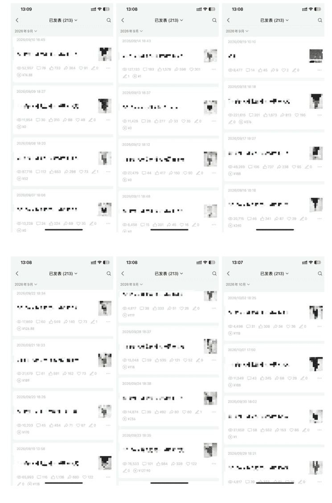
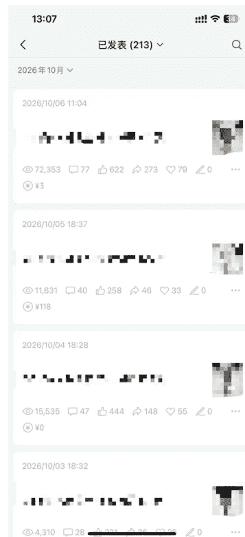
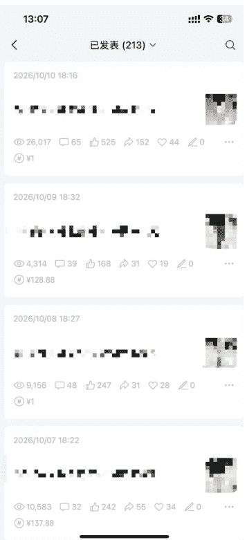
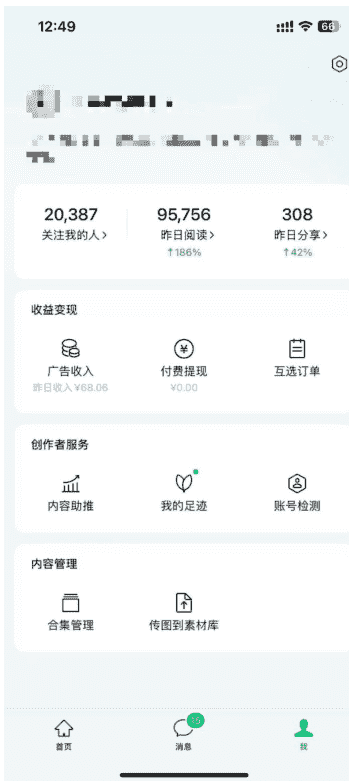
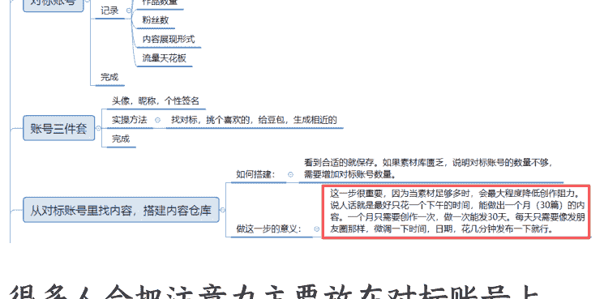
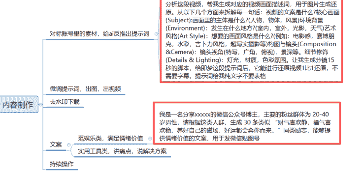

# 10万+图文号的实操心法：给方法，不给现成答案
作者：龙哥

> 261014 副业 SC 精编
> 整理：Lazy Search 团队，内容取自读者群

> 值班编辑按 | 这篇写给准备做图片型账号、又不愿被现成模板牵着走的人。作者把具体案例遮住，只拆思路：赛道从自身开销里找；在留言区导流要切换成账号主体；赛道标签定下五个后别轻易改。若你只想找棵大树照着抄，这篇未必合适——作者明确说，照搬会钝化判断。全文最值得琢磨的是流量骤停的排查逻辑：问题未必出在内容，也可能是平台分发的人群与定位错位，此时别慌着掉头。需要警惕的是：冷启动没有回音属于必经阶段，内容储备没做好就匆匆入场，大多会折在这里。

各位好，壹休在这里。87年生人，在线上行业摸爬近二十年。2007年读大学时折腾过一款老游戏的私服，后来转到传统货架电商，如今自己做内容。赶上过红利，也经历过行业洗牌时的失速。

来赚钱刚满三个月，还是新人。借这篇帖子向群里的前辈、同行致意。

本文重在交流，权当引子，不敢说教。若有表达不周，欢迎指出，共同长进。

> 平台给的曝光终归是暂借，真正沉淀下来的是你的手艺和愿意持续读你的人。

如果眼下缺项目，不妨用图片号练练手，先拿一点真实回馈。它未必让你立刻赚大钱，却很适合作为起点。

若响应的人多，十一月我们会再组织一期图片号实战营，带大家上手。

文/龙哥
来源：赚钱社区

这篇侧重操作思路，读起来会有些卡顿，需要边看边想、触类旁通。只想复制粘贴、等着别人把步骤嚼碎喂到嘴边的人，可能会觉得不过瘾。

## 目录

- 一、成果一览
- 二、落地流程
- 三、从个人小结到生意大局

### 一、成果一览

#### a、图片号1在九至十月的曝光曲线

#### b、图片号1的订阅人数与打赏收入

#### c、第二个账号的图文数据

全部 贴图 文章

一看完这段话，再也不内耗了
阅读9.0万 赞152
8月19日

富养自己，是最有价值的投资
阅读2.8万 赞157
8月18日

当你开始关注自身，就会极具人格魅力
阅读1.1万 赞102

### 二、落地流程

选水域不用向外求，从自己的账单里就能挖出需求，做出只属于你的细分赛道。但凡你掏过钱，审美和判断标准就已具备；这是一种能力，应该被看见、被挖掘、被重视，并且反复使用。这样你立刻就有上饵的本事。

没有人不消费，每一次支出背后都对应一门生意，一个已经被验证的商业循环。它见效未必快，但这些都是成长的拼图；该蹚的路绕不过去，不会上饵的人当不了垂钓老手。

#### a、整理参考账号，建立素材库

多数人把精力集中在参考账号上，我反而觉得搜索词的份量一点不轻。它是免费曝光的入口；在细分赛道里耐心埋伏，一次布局长期受益，迟早会等来对的人。

关于内容储备的延伸想法：

无论做什么，都会先经过一段没有回音的时期，这是绕不过的规律。

饭要一口口咽，前几口下肚仍不觉饱，这就是没有回音；锻炼初期看不到变化，同样如此；再厉害的老手，也没法保证每回抛饵就立刻有鱼讯。

内容储备就像垂钓途中带的折叠椅、遮阳帽和饮品，让你以更从容的姿态熬过这段静默期。

一旦有了储备，就不会每天为写什么、发什么发愁；手头有几十个参考样本做印证，也不容易被一阵阵的灵感倦怠与对自己的否定带偏。

#### b、内容生产

