# 从0到1做AI企业内训，飞掌柜的变现复盘：借案例、考证书、攒交付、滚转介绍

261016 副业 SC 精华

整理：公众号懒人搜索，懒人专属群精选

懒人微信：lazyhelper1

**开头先交底：这篇写给谁看**

如果你指望在这里学到课程大纲怎么排、PPT怎么设计，那要失望了——作者本人就说了，这一块他不展开。整篇复盘的重心，全落在B端内训这件事怎么拿到第一批客户、怎么让对方信你、怎么把一堂课交付出彩、以及后续单子从哪里滚出来。适合的人群很明确：手里有点AI底子、想切企业生意的人。完全零基础、只想听听课程架构的可以关掉页面了。这十条经验里，最值得新手直接上手的三板斧是：借别人的案例给自己挂名、去考一张工信口子的证书、找机构搭伙分摊流量压力。北京地区的行情价也给了参考——半天三千到四千，两天一晚八千到一万。但有个坑得提前说明：作者接第一单时用过“身份前置包装”的手法，千万别光学嘴上功夫不练真把式，客户一通电话打过来就可能穿帮。

我是飞掌柜，赚钱龙珠圈友、AI赛道航海教练，同时也是上市公司大模型方向的专家，长期做企业内训和对外授课，服务过五十多家B端机构、五千多名C端学员；另外还挂着科大讯飞官方讲师、训练营主讲的身份，累计学员超过两百万。

当时读完龙哥老大那篇超级标016（原文链接：https://t.zsxq.com/IZvOW），我眼前一亮——这事跟自己的能力圈太对得上了，没多想就跳进去实操，折腾几个月跑出一点小成绩，今天就厚着脸皮把变现路径拆开给大家看。

## 一、先算大盘：这笔钱不是新长出来的，是搬过来的

看企业AI学习这个盘子，别用“凭空冒出的新蛋糕”去理解，更准确的视角是：原本就在企业培训里流转的预算，正在往AI这个方向挪。艾瑞咨询给过一组数：2020年国内企业培训市场约一千六百四十四亿，2021年预计逼近两千亿。换句话说，企业在能力建设、管理训练、岗位学习这些事上，本来就年年掏钱。

拿这个基数做个粗口径推演：AI学习与能力建设如果吃掉培训预算的两成，对应约三百亿；吃到三成，约五百亿；假如长期演变成企业核心能力建设的一块、占到六成，那就是一千亿上下。所以狭义上看，企业AI学习这个方向的潜在盘子，大致落在每年三百亿到一千亿之间。

想切这块的人，先把那篇超级标翻出来认真啃一遍，再借赚钱的AI问答和MCP工具，把自己的业务线、产品、手头项目重新过一遍筛子，多半能筛出不少新思路。

接下来我不聊市面上满天飞的方法论——那些内容一抓一大把。我要说的是：一个非技术背景的人怎么挤进这个赛道、怎么跟项目结合把钱收回来。因为从0到1、从1到N，这些坑我是一脚一脚踩过来的。

另外要说明，企业内训这活儿高度非标，每家客户的要求都不一样，技术岗出身和非技术岗出身的打法也完全不同。我不写代码，所以下面这些总结，全是业务侧的视角：靠AI工具和应用，帮客户在某些具体环节上出成果。

内容分六块：课程储备、标杆项目、实操心得、信任凭证、持续供货、线索来源。不啰嗦了，直接上干货。

## 二、课程储备：自己肚子里得有货，贵人才肯替你开口

### 1. 讲师手上必须攥着几门课

盯住当下热度高的方向去打磨内容，比如FDE、OPC、WorkBuddy、Codex、豆包工作、千问办公、百度搭子、ChatGPT这些。我的做法是从应用层切入，围着自己玩得转的工具，做线上、线下两套版本，针对不同客户类型分别交付——像《Codex+ChatGPT职场提效实操线下大课》《WorkBuddy企业数字化效能升级线下大课》《豆包工作职场办公提效营》《FDE能力提升特训营》都属于这一类。

会写代码的，建议从AI编程、智能体、提示词工程、大模型部署、参数调优这些口子切；不写代码的，就从工具应用、智能体搭建、提示词、场景与案例教学入手。

### 2. 垂直方向要扎深，但别起手就往窄巷子里钻

我最拿手的是AI+职场提效。不管客户选哪个工具，我最后交出去的结果都一样：让坐办公室的人干活更快。这个方向覆盖面广，流量和接单的选择余地也大。刚起步别把自己圈死在特别细的缝里——客户量还没起来的时候，过度细分就是给自己上枷锁。

站在决策层角度，这类培训的好处是比较容易量化：团队能接的项目多了、领导或甲方交代的活儿完成得更快了。但有一条红线——不能光加活不给甜头，否则一线会反弹。得把培训和激励机制捆在一起，比如效率上去了奖金跟着涨、往上走的机会更多。

### 3. 得有一套企业落地的通盘思路

课往往只讲一次，效果好不好，全看学员回去用不用。说白了，讲完就扔，等于白讲，很多决策层最担心的就是这一点。所以讲师要能站到对方一把手的位置上，帮他把后续放大的路径想清楚：

第一，整个团队的AI素养提上来了，认知和工作习惯慢慢养成；
第二，面对甲方时，能拿出更多“老本行+AI”的组合服务；
第三，面对同行时，企业能占住AI先行者的身位，甚至反过来吸引同行来谈合作。

从我这些年做内训的体感看，企业推AI这件事，从上往下压远比从下往上拱有效。一把手不点头，下面的人多半消极应付；同时必须配好激励，让一线明白效率提升不等于单纯加担子，项目跑多了奖金也跟着多，这样才有奔头。

## 三、标杆项目：客户最怕自己成为试验品

我接触的决策层，翻来覆去就爱问三句话：你能替我解决什么、值多少钱？你服务过哪些客户、有没有跟我同行的？你说你讲得好，拿得出官方认证吗？这三关过不去，单子基本落不到你头上。

### 1. 先答第一问：你到底能交出什么

客户最在意的就是你能替他干什么，这也是硬碰硬的交付能力。所以要持续往自己兜里囤东西——跟大佬学的同时长出属于自己的内容，既保证版权在自己手上，将来也方便做成产品矩阵去放大。

一方面，把交付清单说清楚：我擅长给B端机构做职场办公提效、写作、绘图、知识库搭建、考证辅导这些，形式涵盖咨询、内训、陪跑。另一方面，AI的摊子铺得太大，谁也不可能样样精通。碰上短视频、数字人、AI+垂直行业这些我不熟的板块，就转给别的老师。所以平时要多结交各个细分方向的好手——客户的需求你吃不下，流量端的抽佣照样能落袋。

### 2. 标杆项目从哪来：先借船，再修饰

起手没有代表作怎么办？客户怕当试验品，不愿意做你第一个内训客户，那就先想办法让自己“看起来有”。两条路：

第一条，先蹭再谈：比如你进了某位老师的合伙人班子、跟某位大佬交情不错、在某个团队里挂着要职，就可以开口问对方——能不能在你的案例里把我的名字捎上？能不能让我给你当助理，同时允许我拿你的作品当自己的案例讲？我的合伙人外出授课需要某类素材时，也会互相通气，在案例里加个名字，这对成单确实有推助。

第二条，学会修饰：在麦当劳干过，可以说自己服务过世界五百强；没正经做过内训，也可以说此前攒了不少相关积累。哪怕是自己跑测试跑出来的东西，经过一套系统的方法论捋一遍，也能变成拿得出手的案例。话说回来，出门在外身份是自己贴的，你讲出来的案例客户未必分辨得出真假——但底线是不能胡编，得有相对靠谱的出处，否则日子久了连自己都骗过去了。案例只是帮你把单子拿下来，尾款能不能顺利收回，最终还得看现场真刀真枪的交付。

### 3. 官方认证：考证、挤进大厂生态、借知名IP

要主动去够一些官方层面的信任凭证。比如我挂着科大讯飞官方讲师、训练营主讲的身份，是上市公司的大模型专家，也拿过工信部、科大讯飞AI大学堂「AI³公开课」《AIGC赋能创意写作》之类的认证。

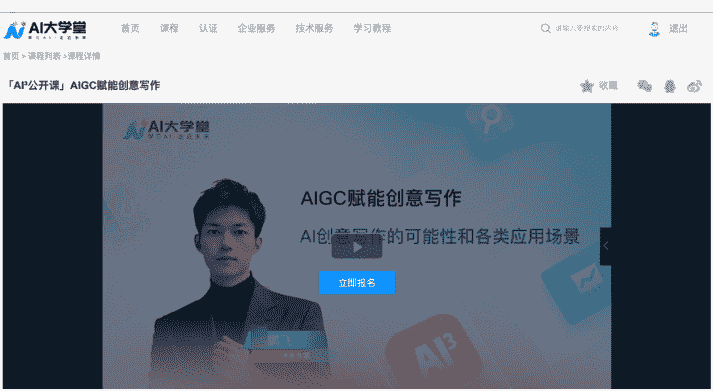

所以，跟工信口子的官方机构、互联网大厂、知名企业、头部IP搭上线这件事，要当成正经事来办——这些都是硬邦邦的信任资产。

## 四、现场就是弹药库：线下课要顺手攒宣传素材

我服务过某金服赛道的头部企业，那场现场拍了大量的照片和视频。进企业讲课有个天然好处：别的客户能看到你确实在一线真刀真枪干过。所以每一次站上讲台都要留个心眼，视频、照片这些素材，都是下一场仗的储备粮。

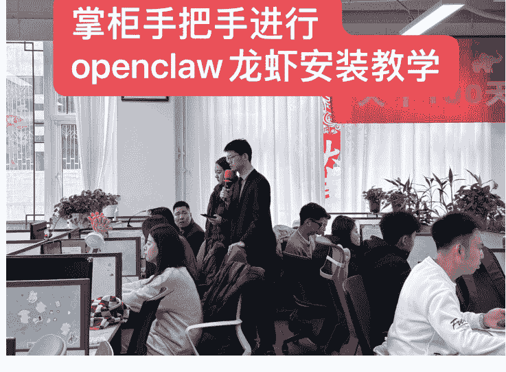
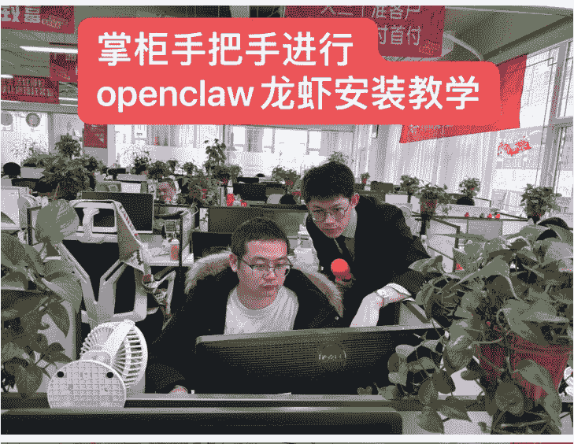
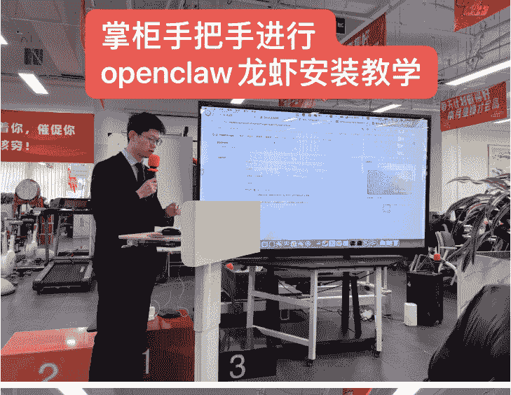
掌柜手把手进行 OpenClaw 龙虾安装教学
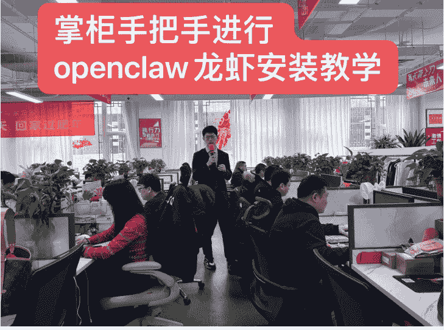
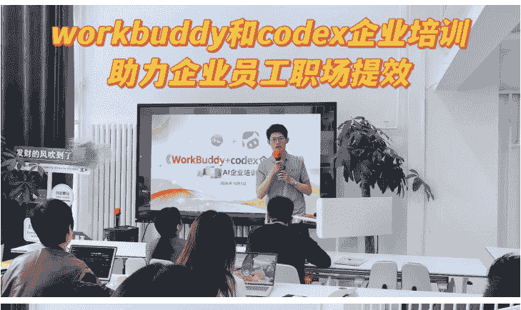
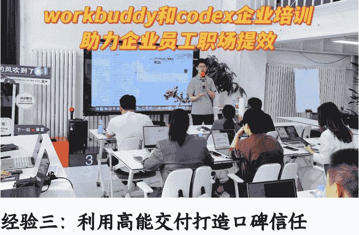

## 五、高能交付：学员的口碑比自吹管用一万倍

我给北京某工会党委组织做过一场线下授课。当时客户只签了一单，我给自己定的目标是：靠这一次交付让对方认我的专业底子，把后面的合作撬出来。这类单位如果觉得你讲得对味，后续很可能按月排期。后来客户反馈说第一期效果相当好，长期合作已经谈下来了。

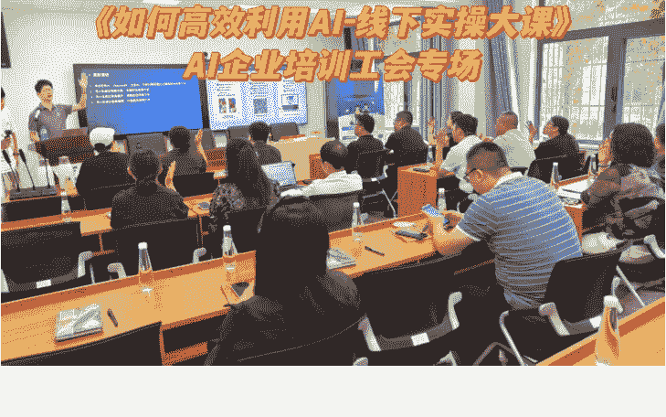
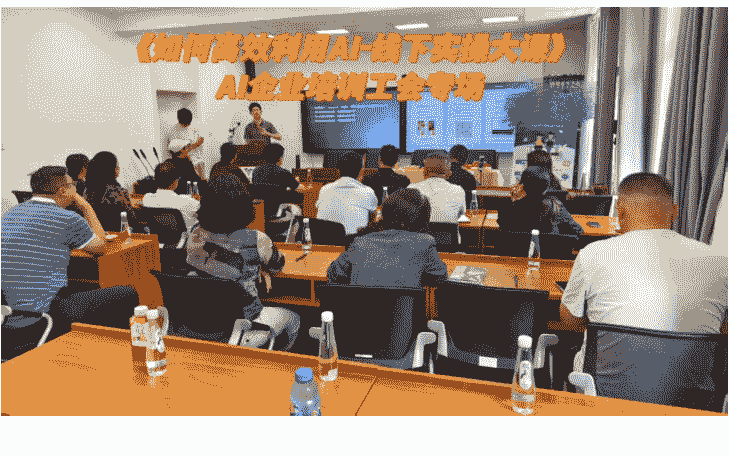

所以起步阶段别挑肥拣瘦，每一场都当最后一场来打，起码提前一周反复磨。自己夸自己是“王婆卖瓜”，只有台下的人说好，那才是真的好。

## 六、跨行业打法：靠AI快速把自己泡成半个内行

我还给某保险公司头部企业做过线下授课。保险这行我确实没碰过，但可以借AI快速把一个陌生领域摸个大概，先让自己看起来像个半个行家。

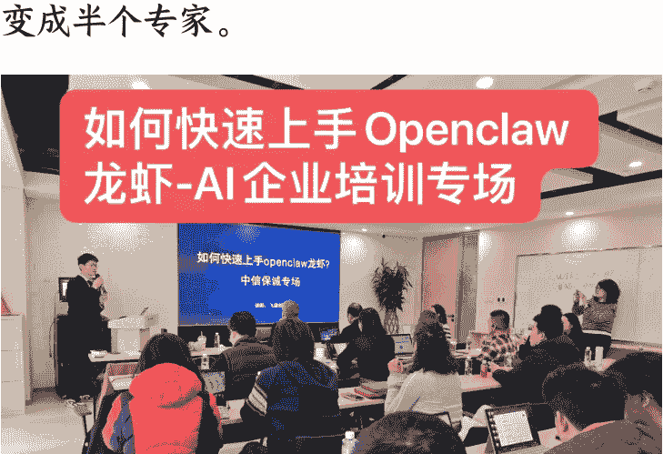

那场做的是“如何快速上手 OpenClaw 龙虾”的内训专场，另外还有中信保诚专场，内容从初步认识OpenClaw龙虾，到动手部署，再到手把手带着操作。

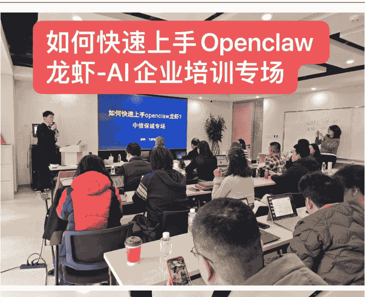
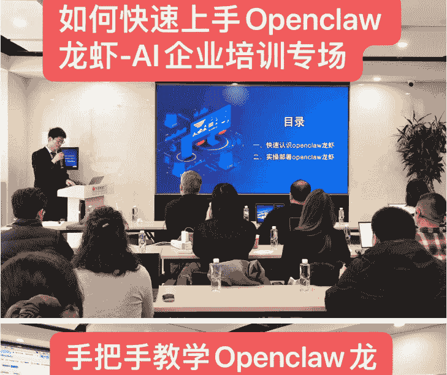
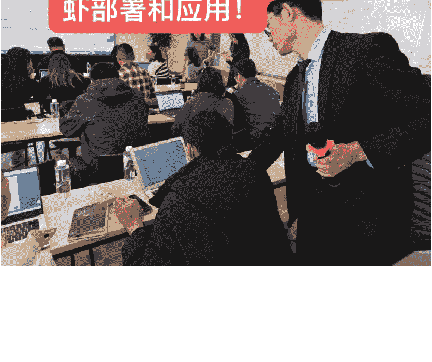

在杭州我还跑过一场线下大课，玩法是跟机构搭伙：对方管引流，我管讲课。两天一晚的大课，台下坐的是企业一把手、高管和一线。讲师得把场子讲热，还得能同时切换三个视角——一把手关心什么、高管在意什么、一线想学什么，都得照顾到。

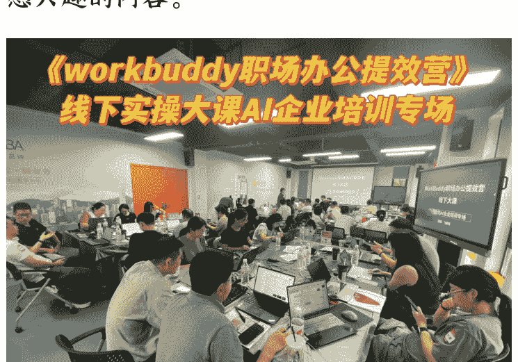
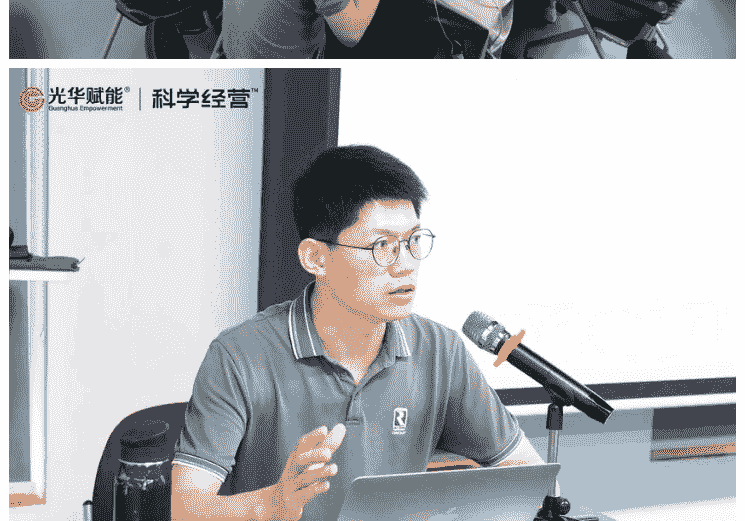
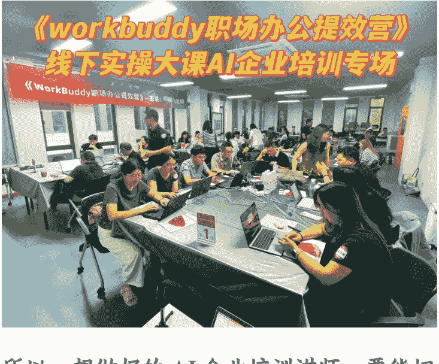

所以说，想在这行站稳，切换视角的本事是基本功。一把手的算盘、高管的痛点、一线的诉求都能拿捏住，才算真正上道了。

## 七、高质量圈子：拿分享换资源

我在赚钱线下讲过一场AI Agent企业服务变现的主题课。赚钱是知识星球赚钱赛道里排第一的圈子。我愿意一场接一场地线下分享，很重要的一个原因就是：让更多人记住我在做企业内训、能讲哪些题目。赚钱是这个逻辑，换别的圈子也一样成立。

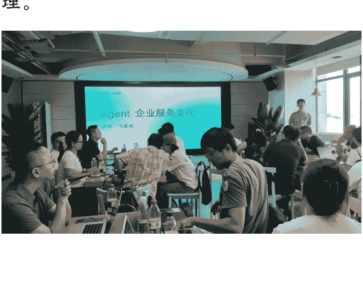
【主题线下聚会】透过 Codex 场景案例+实操教学+技能变现
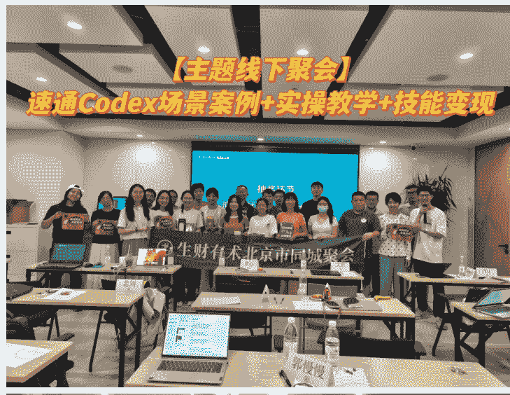
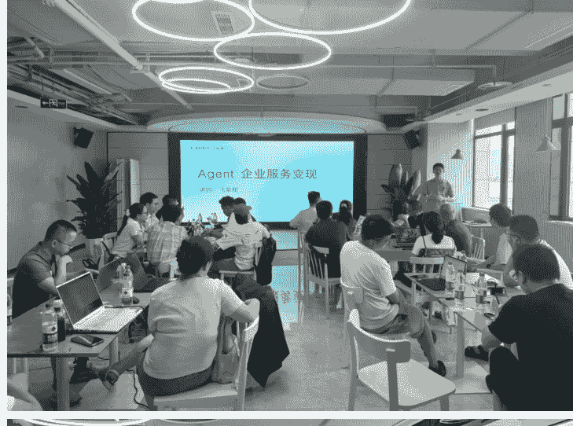
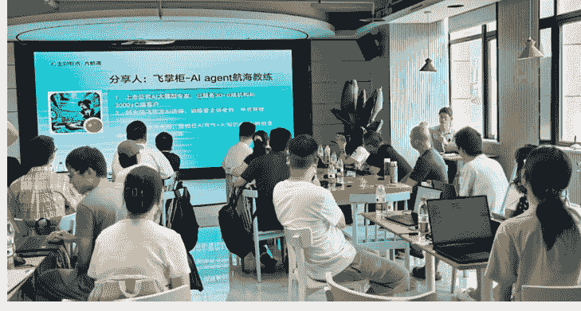

分享的时候不能端着给小白上课的架子，得从创业者、从项目落地、从成果产出的角度去拆，这样听众才会觉得你有分量。

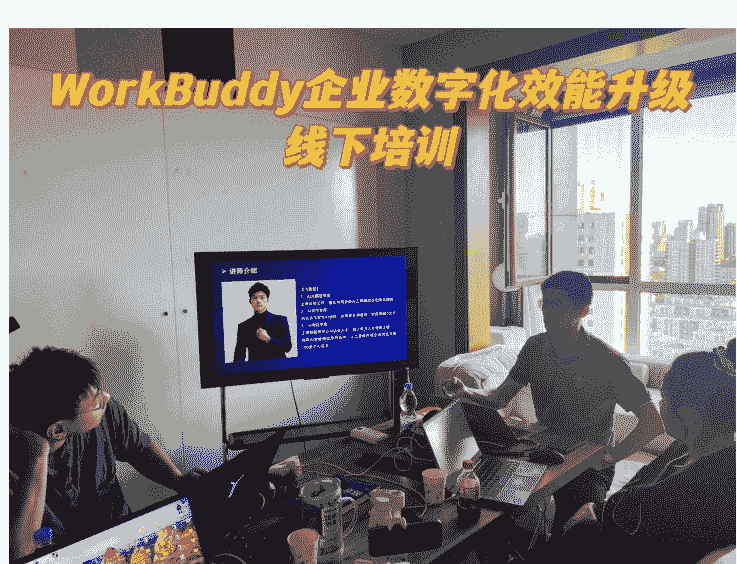
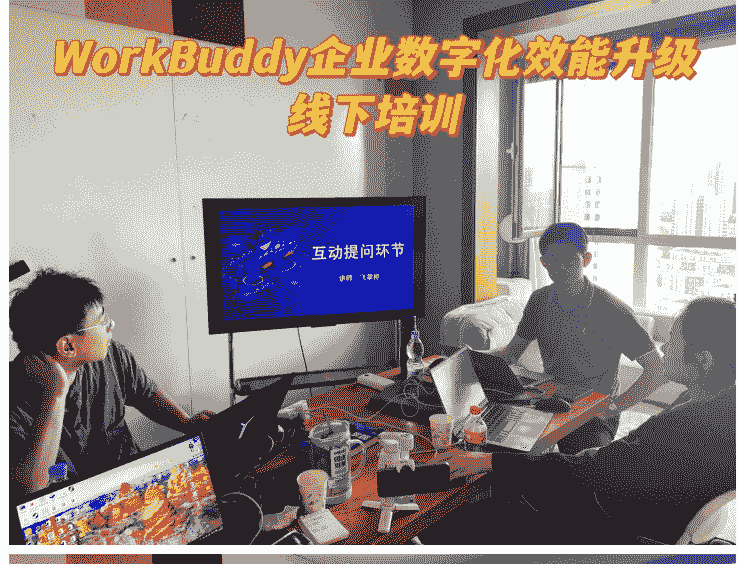
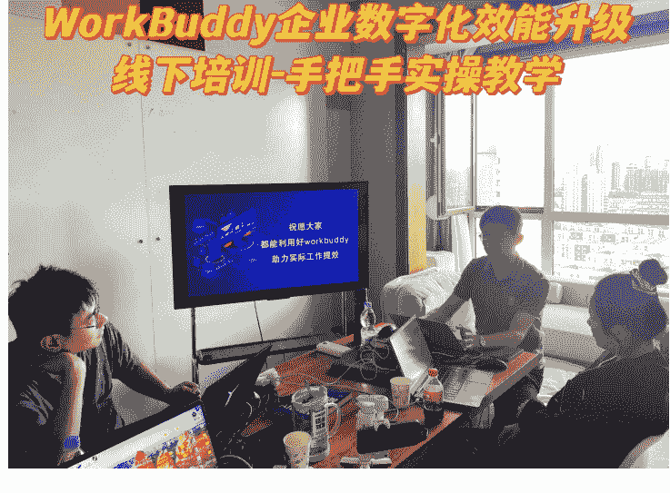
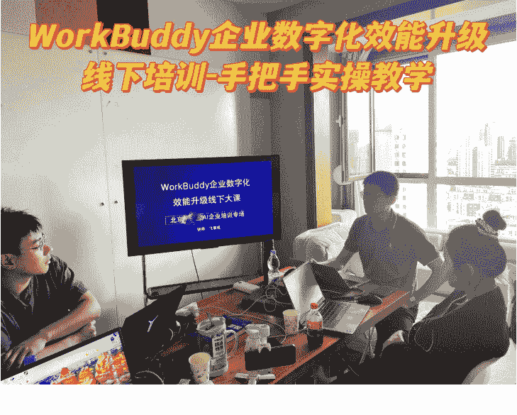

你不光要熟悉自己手里那摊工具应用，还得摸清客户所在的行当。现在有AI帮忙，快速摸透一个行业或细分赛道不算难事，关键是你手里得攥着信息差，能给决策层带去点新鲜东西。比如有老板会问：WorkBuddy、豆包工作的B端代理怎么申请？有哪些权益？跟C端有什么差别？未来哪个时间窗口会重点推？不同打法怎么排？

所以身边的信源要时刻留意，比如赚钱的航海家群、AI传术师群，还有你自己混的那些高阶圈子，多跟人碰多跟人聊。你手里一个信息差，我手里一个信息差，一交换，至少能翻出两个以上。

## 八、讲师经纪：不会的领域照样能合作放大

我服务过北京某头部青年社群公司，还带合伙人一起去现场交付过。这类企业不是给自己的团队做培训——他们的客户是C端用户，所以培训对象其实是“客户的客户”。

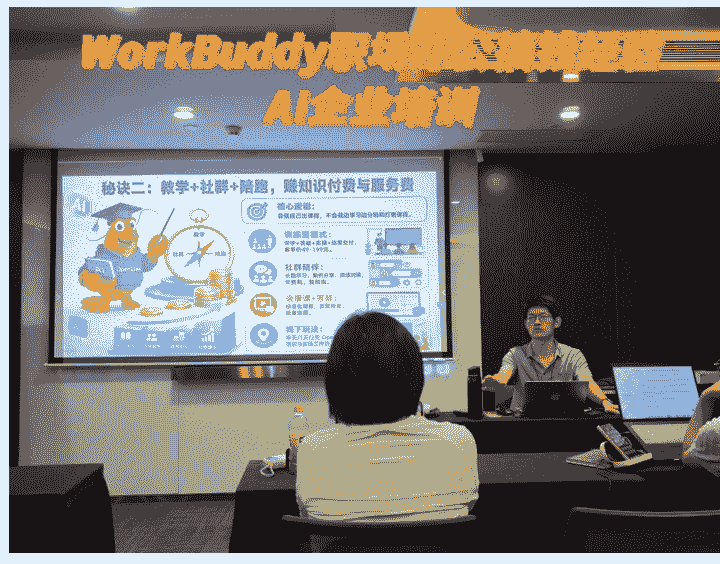

这里得正面回答一个问题：我是不是什么都会？当然不是。我主攻职场提效，拿手的是ChatGPT、豆包AI、DeepSeek这些大模型，WorkBuddy、豆包工作、千问办公、百度搭子这些智能体，绘图方向的image2.5、nanobananaPro，还有知识库搭建。但短视频、数字人这些我不灵，AI+电商、AI+医疗我也没沾过。

客户问到这些领域，别急着摆手拒绝，先谈下来，再回圈子里找能接得住的高手——这就是讲师经纪的路子。谈的过程本身就在练销售手感，流量端的抽佣还能落袋。所以每一条销售线索都别轻易放掉，多认识各个方向的高手，合作的机会往往比竞争多。

## 九、老板转介绍：贵人一句话顶你营销一整年

我服务过河北某头部出版集团。原本只安排给一把手和高管讲，十来个人；后来老板琢磨着真正天天用AI的是基层，于是扩到了三十多号人，那场效果也相当不错。

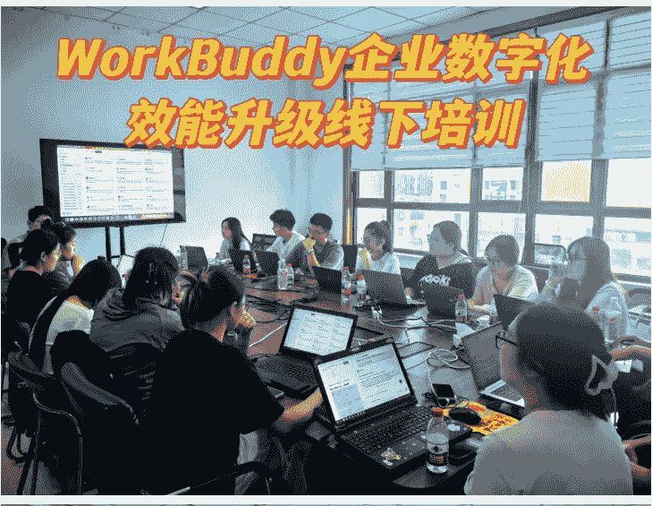
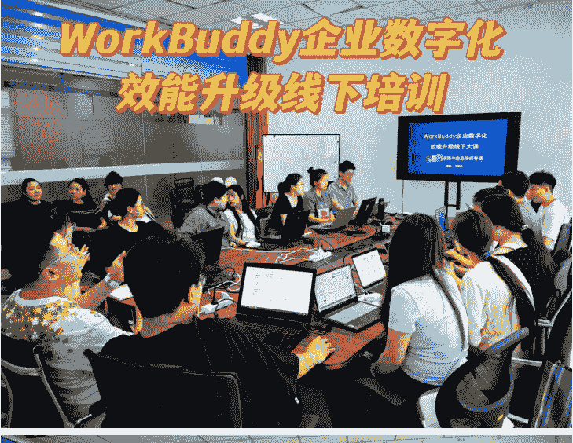
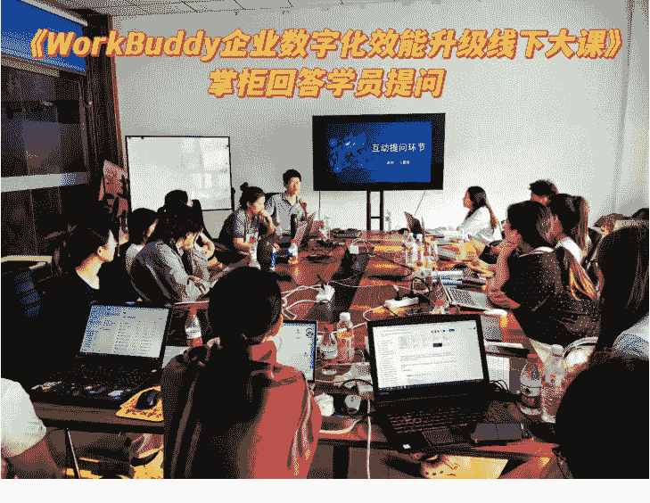
WorkBuddy 企业数字化效能升级 效能升级线下培训
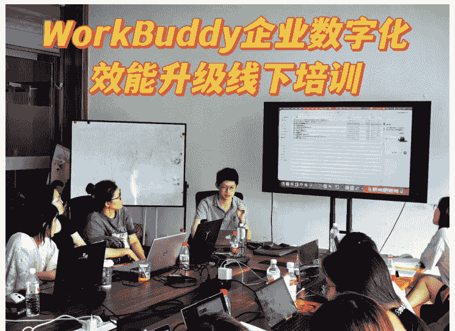
《WorkBuddy 企业数字化效能升级线下大课》掌柜手把手指导
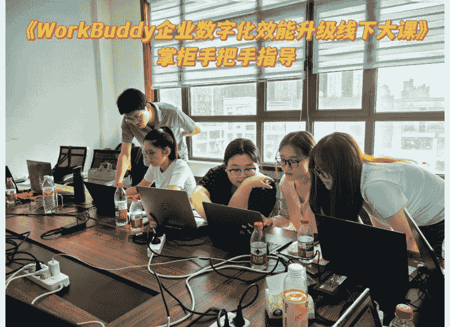
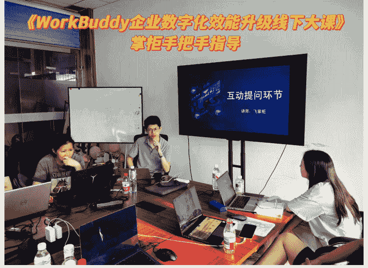

线索怎么来的？转介绍。平时就要有意识地攒老板资源，让一把手认你的本事、愿意把你推出去。转介绍成了之后，该包的红包、该结的佣金一分不能少，人情也得做到位。一个老板背后站着一群老板，贵人的一句话，顶你自己吆喝一整年。

## 十、创业中心孵化合作：把一锤子买卖做成长期供应

我还在山东德州跑过一场线下内训，合作方是我同学，他们在山东某创业中心有实体公司，后续也会长期做AI线下授课。面对客户，我们还会打包提供OPC、IP打造、短视频陪跑之类的孵化服务。

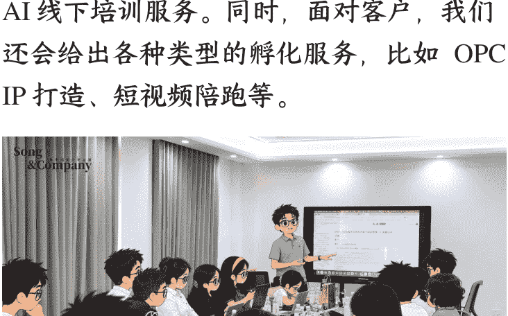

他们接的客户横跨各行各业，需求五花八门。讲的时候得从AI写文案写文章、AI做图做海报、AI做短视频好几个口子铺开，既要保证通用性，又得让台下的人真拿到结果，难度确实不小。好处是客户一旦认了你，后面会滚出一串培训合作。

所以，你所在城市的各类孵化器要重点盯，北京这种资源就特别多。想办法摸到负责人、把线连上，抱着诚心去谈，新机会总会撞上来。

## 做AI企业培训，客户迟迟不签？先把“可信度”摆到桌面上

真正做过AI企业培训的人都知道，最耗人的环节往往不是备课，而是成交前的信任拉扯：聊了很久，对方仍不下单。想把这件事跑通，先得把“凭什么信你”这个问题解决掉。

### 1. 被质疑太年轻，我用一张证书扭转局面

有位老板一见面就质疑：看着这么年轻，能做AI企业培训？经验有多少？我没急着解释，直接把工信部AI证书摆出来（四张图如下）。对方看完态度明显变化，接着深聊一个多小时，订单拿下。

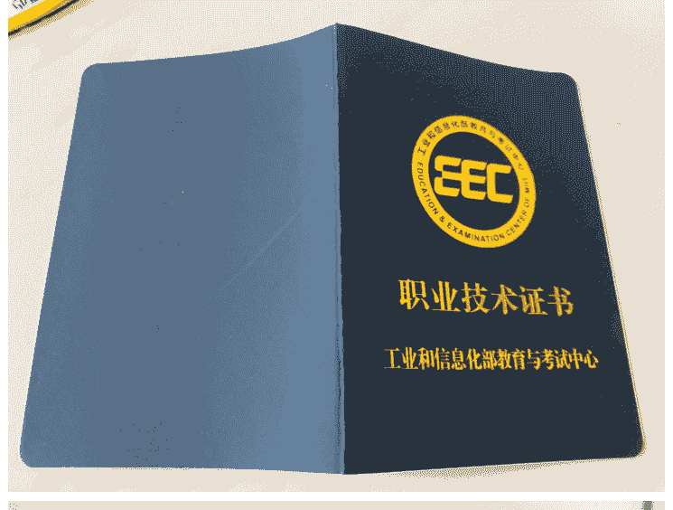

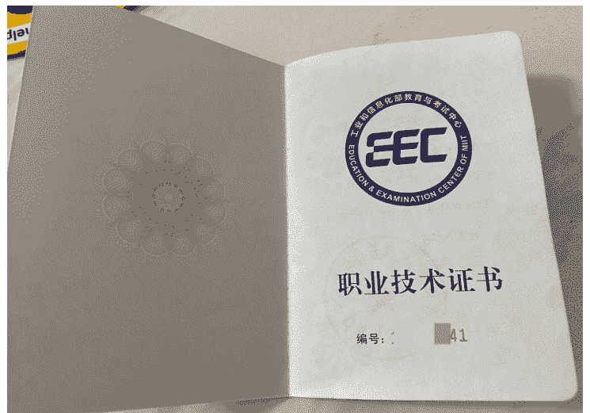

证书说明写着，这是参加人才培养工程及相关职业技术培训、考试合格后颁发的有效凭证；职业技术证书编号41；持证者须自己保管，不能私自填改、涂改，也不能转借；证书无照片、无主管部门印章无效；查询网址www.miiteec.org.cn，咨询电话010-68607720。建议想走这条路的人，提前把工信部或人社部的AI证书考下来，别等客户问起才后悔“证到用时方恨少”。

### 2. 客户想“先验货”，就给他看公开课

另一位老板则说，他对我的水平没概念，能不能先看一场公开课。说白了，就是想先验验货。我把在科大讯飞讲AI课程的视频发过去，订单顺利成交。所以，想办法联系知名企业——尤其是互联网公司，因为大家一听就知道——录一套课程，你的可信度会厚很多。

### 3. 没有电商经验，也能用擅长的方式超预期交付

有个客户问我：AI加电商，效率到底怎么提？说实话，我没做过电商，但我做过AI绘画。电商大量图片本来就可以用AI生成，我从这个细分口切进去，用GPT的image2.5模型批量做电商产品图，最后交付效果超出客户预期。案例要常备，更要会迁移；从自己擅长的角度把结果做出来，就是最好的背书。

## 持续交付：别做一锤子买卖，要让自己越来越值钱

只讲一次、收一次钱，不讲课就没收入，本质上还是在卖体力，不太划算。更值钱的做法，是围绕客户需求持续提供价值：除了AI企业培训，还可以做AI企业咨询、AI工作流搭建、AI智能体交付。持续交付的好处不只是多收几次费，还会帮你打磨更多案例、沉淀更多课程，并积累资源——认识更多老板，提升自己的段位，逐步接触投融资等原本不容易触达的资源。

以AI企业陪跑为例，我通常给客户三类选择：
- 纯线下陪跑：这次培训结束后，每两个月做一次线下AI培训，持续3—5次。
- 纯线上陪跑：培训后建企业群，我在群里答疑，覆盖老板、高管和员工的问题，让客户满意。
- 线下+线上陪跑：培训后建群，每月1—2次线下集中培训，平时线上答疑，解决细节问题。

## 流量来源：公域借力，私域发声
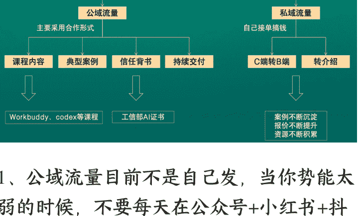

公域阶段，我并没有急着亲自铺量。自身影响力还小的时候，在公众号、小红书、抖音快手视频号反复强调自己多擅长AI企业培训，意义不大；等影响力起来，再加大输出也不迟。我的做法是找机构联手：对方做推广，我负责把课交付好。坦白说，能帮讲师放大的机构，手里握着不少个人很难拿到的资源，借力合作比自己硬扛更有效。其中，课程与可信度能靠努力较快补齐；典型项目和持续交付，则要在一次次讲课中慢慢攒。

私域则要主动发声。每讲完一场，我都会在群里复盘分享：一是给自己提气，因为质疑和负面评价可能都会来，得全接住；二是持续曝光，做个人IP就得主动站到台前，让客户清楚你能干哪些事、能替他解决哪些问题。

我的私域流量里，占比最大的有两类：
第一类，是C端客户变成B端客户。我线上社群里有几位老板，长期看我输出AI实操内容，也见证过训练营的完整交付，后来主动来电，问能否去他们公司做内训，就这样成交。
第二类，是熟人转介绍。对方未必和我有过付费往来，但同处一个圈子，彼此有基本信任，也了解我能带来什么价值，所以乐意牵线。

订单金额并不固定，小到几百，大到几万。想让客单价往上走，唯一的办法还是持续变强。

## 报价参考：定制化收费，先跑起来再升级

这类培训通常按需求单独报价，机构不同、讲师水平不同，价格跨度相当大。给想做AI企业培训师的朋友一个参考；如果你能力更强，在下面基础上往上加即可。
- 可选时长包括1小时、2小时、半天、一天、两天一晚、三天两晚等。
- 地点默认北京，外地另计差旅。
- 内容按企业需求定，理论讲解、实操案例、工作坊实战等模块可自由组合。
- 北京线下可参考：半天3000—4000，一天5000—7000，两天一晚8000—10000；半天按4小时、一天按8小时计，时长和价格都能谈。
- 外地在此基础上另加差旅。

我起步时也做过免费分享，拿过500半天、1000一天的费用。后来案例多了、AI水平和经验上来了、能链接的资源更好了，价格自然往上走。很多项目就是这么一轮轮迭代放大的。

以上就是我从课程内容、典型案例、实战经验、信任背书、持续交付、流量来源六个方面拆解的AI企业培训做法，希望对你有启发。看到这里，点个赞；也祝你能把AI企业培训结合自己的实际项目，真正拿到结果。

——————

这套SOP读完后，很容易产生“我已经会了”的错觉；可真正动手时，90%的人会停在第一关。

工具和教程只是最浅的壁垒，真正拉开差距的，是马上开干，以及圈层里的信息差。如果你想知道全网最新的变现打法，还想和一群执行力爆表的极客一起下场拿结果，欢迎来我的核心私域【懒人专属群】看看。这里不聊空话，只拆商业闭环、压榨AI效率；圈子里已经沉淀了1000+跑通的套利实战局。

查阅圈子完整数字资产与上车门槛：
https://lazyso.com/insider/

认可价值、准备好动手的，扫码加微信（lazyhelper1），备注【实操上车】，不闲聊。

公众号
懒人搜索
懒人专属群

微信：lazyhelper1