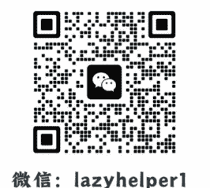

# 微信这波流量，放给了新号

261010 副业 SC 精华

整理：懒人搜索公号，懒人会员群精选

懒人微信：lazyhelper1

> 小懒点评 | 适合作息零散、想小成本开练的新手（文中的六十岁宝妈就是按照现成流程跑的）；指望靠它养家糊口则不必——一万次阅读只能换来 8 到 15 元。真正值得琢磨的是微信的姿势：一面把更多普通人请来发帖（贴图已有 1.16 亿篇，比去年同期多了 377%），一面严禁机器代发。最大的坑，是把站内晒收入帖的做法当成宝——买假粉、盗图、用 AI 编人设，全在平台的重点打击名单里。

国庆假期刚过，先把这篇深度长文发出来当彩蛋，后面还有几篇备货会陆续安排。

三月底给那份九年回顾收尾时，我在末尾留了一串下半年可能写的题目，贴图就排在中间。

十月八号夜里，一位圈友在提问区留言：老母亲年近花甲，在深圳帮着带孙辈，平时空余时间一大把，爱看小说，也会用豆包，想找个不难又不用定时打卡的副业，有推荐吗？

我给他的答复是：图片号、垂直账号这一类吧。你先自己把路跑顺，再整理成简单的操作流程，让老人按图索骥。

同一段回复里我还补了一句：这种账号不存在那种公开讲一次就能马上复制的路径，但凡被摆上台面的方向，时间差都会迅速磨平；但最根基的规则始终没变。

把这段话展开，就是今天要聊的：贴图的机会在哪里、微信押注它的原因、以及怎么做才不至于三个月就凉掉。

去年七月聊垂直账号那期，我提过公号的分发正在去订阅化，对新账号来说是个不错的窗口。一年过去，微信又把门槛压低了一截：不再要求你写长篇大论，发两三幅图、配一小段字就能算一次更新。

九月份，赚钱内部也拉了一场代号 Mini 的航海，主题就是贴图，先带一批圈友去蹚路。

这篇想讲清楚三件事：微信做贴图的用意、眼下最省力的起步路径、怎么避免把它做成一次性买卖。

我的结论是：贴图就是微信这一轮专门给新账号、小账号打开的放水口。手快的人能捞到第一波，但这股水迟早要关闸；真正能留下的，是你趁这段窗口练出来的功夫和攒下来的读者。我长期看好它，理由有三：门槛低到一台手机足够，流程写清楚之后，上年纪的人也能操作；微信还一直在给它加位置，推荐、搜索、广告、小店全都为它留了口；创作这件事最内核的规律没有变，在这里练出来的手感，换个形式照样用得上。

一面请真人，一面禁机器

三月二十七日，微信更新的平台规则里多了一条硬规定：订阅号与各类公号，不得用自动化脚本、接口等手段，把真人从创作和发布的过程中完全排除掉，连传播这类教程也算违规。澎湃新闻、第一财经四月都做了报道。

微信官方对第一财经的解释是：平台非常欢迎创作者用工具提效，但坚决反对整套流程都由程序包办。

七月，微信的公开课谈到推荐机制时也点了一句：更认可真人原创、真实分享、乐意与读者良性互动的内容。

出口一个接一个

新榜和见实盘过一遍：推荐信息流、服务号、公号的主页，都为贴图留了展示位；微信搜索把贴图与视频号、小程序、公号放在同一排；贴图还可以挂上小店里的商品。在微信官方给出的广告文档里，出现了一种专门设在贴图下方的推荐广告位。正在内测的智能助手小微，按刘炽平的说法，要帮用户在微信的庞杂信息中找东西、挑商品、直接下单。

一边请真人、一边禁机器，这两件事放在一起看，我的理解是：微信想要的是真人闭环——人挑题、人落笔、人回复，工具只做辅助。它最惦记的对象，大概是十几亿用户里那批天天发朋友圈、却从没写过一篇公号长文的人，希望他们把生活、经验和好物都搬出来。

过去这 18 个月，财报出了六份，电话会开了好几轮，高管层从没提过“贴图”两个字。他们反复强调的是：让更多普通人拿台手机便可以开始创作、短视频供给要补上来且作者能分到钱、让 AI 能看明白微信生态里的信息。

推荐要料，搜索要料，小店要料，AI 同样在等料。贴图，恰恰是普通人最拿手的那种原料。

微信从广告收入里拿出一块分给作者，本质上是在用钱换货，这和我去年三月讲的逻辑是一回事，文章后面专门有一段再展开。这条规则，赚钱自己也该对照。去年十一月我在那期专题里写过，公号日常工作的流程几乎可以做到九成自动化；今年九月我们又发过一条讲自动化的航线。微信三月已经挑明态度：AI 能当帮手，但落笔和发出，必须是你自己来。

> 想清楚微信图的是什么，你就知道哪些流量是分给你的、哪些早晚要被抽走：它在给真人制作的东西让路，同时在收紧机器代劳的口子。

这个入口，开开合合好几次

这个入口早年的诨名，叫小绿书。翻一翻我之前的记录：

- 2024 年九月下旬：我说过小绿书的窗口正在打开，微信把图文爆款和电商串在了一起。
- 十一月：我在一位圈友的帖子下转述微信朋友的话：九月确实给过量，但被薅得太狠，十月就停掉了。那位圈友写的是十一月流量又活了，我当时的反应是：看这架势，又放开了？
- 2025 年三月：有圈友发现图集底部的广告位没了，猜测靠图片赚流量费的路子要走到头。
- 2025 年八月：留言区下方出现了固定广告，圈友又改口：有这个位置在，收益还有戏。
- 2026 年二月：功能入口的名字从“图文”换成了“贴图”，新一轮放量重新开始。

每波都是跑得快的人先拿钱；规则一变，只会单一玩法的人就停手。

而这一轮，收紧其实已经开始：

- 七月底，有人还在 X 上发教程说，现在不会查 AI 的痕迹。
- 五月起，站内陆续有人说自己手上几个账号的内容质量分都被压得很低；六月有人收到身份核验要求、被限制发布；八月，有人公号连同贴图一道，被永久封杀。
- 三月二十七日的规则更新，直接点名了一种行为：脱离真实作者、由机器冒名顶替真人去做内容。杨爽也在航海启动说明里提醒：平台在持续清理盗搬和机器流水线式的发帖。

杨爽四月讲过一句我特别赞成的话：门槛一旦降下来，做的人会瞬间翻倍，而最好的时机恰恰挤在那个爆发前的临界点上。九月初我也表达过类似看法：几乎没有只靠消息灵通就能一直赚钱的营生，就算有，那点优势也会很快蒸发，代号 Mini 的航海涉及的某些项目，同理。

最省力的起步路径

该做的准备，一开始就全部就位，别等起量之后再临时抱佛脚。

航海里那些案例是怎么跑出来的？九月二十日的公开交流中我说过：那么多人同时开跑，总有人能做出点名堂。但他们帖子里写的步骤，不要直接拿来套用。

对收入要有数：

- 广告单价：杨爽的团队调研结果是每千次曝光能拿到 5 到 8 元；若宇则估计一万次阅读有 8 到 15 元。
- 站内晒出来的：绝大多数是几块、几十块的零碎进账。
- 碰上阅读量冲到十万的日子：单日可以进账一百多到两百。
- 单日上一千：有，但是极少数。

大多数人却做成了“一阵风”

九月一日，一位圈友在帖子下留言，说报名那场航海，是因为自己还缺一个能长期赚钱的项目。我回他：说实话，就算上了船，也很难一直赚到钱，如今所有领域都在被 AI 冲击，几乎找不到能一直干下去的领域。先把 AI 学精，再去找有真实业务的人，跟他们绑在一起。

这个判断放到贴图上同样成立。原因拆开看：

- 方向太挤。但凡有方向被拿到台面上公开讲，马上就是成百上千人扑向同样的素材。航海把九百人分进六个小组，就是不想让大家挤进一只篮子里把收益摊薄。
- 同质化严重。平台规则里专门点名了一种坏毛病：作品高度相似、缺乏增量价值的套路式输出。几百人共用一份模板做同一件事，正好踩在雷上。
- 规则一直在变。三月新增的条款，头一条就指向：脱离真实表达，用 AI 拼贴、改写、搬运内容。踩中之后，轻则压流量、删文章，重则限权、封禁。
- 一爆就被盯上。Jade 说过：盼着它爆，又怕它爆，每次爆完都会被审核团队盯上，紧接着就是违规提醒、限流处置。
- 先晒后没。广州的博阳六月二十二日还在晒自己头一回靠贴图赚到 3 块钱，八月二十日已经在问公号、贴图被封了该怎么办。
- 出口太窄。若宇的复盘是：变现通道过于单一，读者沉淀不下来。
- 十不存一。阿宝长期泡在公号这行，他那篇的标题是：十个账号里能有一个稳定产出，就算赢。

还有一层容易被忽略：站内那些晒收入的人，不少玩法正好装进了平台的打击面——买假粉开广告、盗图、用 AI 编人设，规则里都能找到对应条目。窗口期它们能浑水摸鱼，规则一收紧，头一个被清掉的就是它们。

这种贴图内容出现到现在才七个来月，站内能看到的最长记录也就半年出头，至今没人写过稳定运营半年之后的情况。

怎么攒下长期的东西

说回开头那句：最根基的规则，从来没变过。

去年三月，一位手里运营着一大批爆文号的圈友问我：这玩意能撑十年吗？我回答：

> 这类平台永远缺能为读者提供价值的好作品；平台的收入大头来自广告；平台会把广告收入分一块给作者——这套机制往前数十年如此，往后数十年也难有大变。

你不需要纠结爆文能不能活十年（大概率活不到），关键是在这个过程中看懂了什么：平台处在哪个阶段、正在奖励哪种行为；读者究竟吃哪一套；哪些行业的金主愿意掏钱；内容怎么才能更抓人；怎么把效率提起来；怎么做成矩阵、把收益做大。今天补一句：前提是先把单个账号做顺。

贴图同样如此，做不满十年也不要紧，趁这段时间，把那些不会过期的东西攒下来：

攒本事，不攒名目。去年四月，一个做了整整一年爆文、流量突然被切断的圈友来找我。我说：做爆文沉淀下来的能力，无非是选题的眼光、借 AI 提升写作效率、矩阵铺量这类功夫，把它挪到头条、抖音、YouTube、TikTok、X 等平台一样好用，多去试。同一段回复里我还写过：没人挡得住 AI 制造内容。现在我也还是这个看法。微信真正想限制的从来不是 AI，而是从动笔到发送全由机器代劳。

跟着平台往深水区走。九月二十日的分享会上，一位既做贴图工具又开培训课程的圈友问：接下来是继续教小白，还是去服务企业老板？我的建议是：往企业服务那边走，往交付结果走，那才是更大的钱。新手学员现在还能赚到钱，只是因为赶上了平台放水的窗口期，这是唯一的理由。平台进入成熟期后一定会往下扎，你必须跟着一起扎：砸钱、打通货源、搭团队、做深度内容、参与投流，这些事单靠个人很难扛动。跟企业、跟资源方一起下潜，才是陪着平台把这件事做深。起步阶段做 toC，先把势能和口碑立起来，完全没问题，toC 作为过渡完全可行；等能力攒够了，再切 toB。

往后还有多大空间

- 人在那里：微信和 WeChat 加在一起的月活已有 14.39 亿。
- 赚到钱的人变多了：公号十四周年官方报告显示，最近一年里实现过变现的作者比上一年多出七成以上，带货作者增加了 133%。
- 搜索也在消化这类作品：今年一月，微信的智能搜索已经可以基于某个公号的往期文章，综合评价这个号；头三个月，微信里的搜索次数比去年同期多了四分之一。

我更进一步的判断是：贴图的流量倾斜迟早退潮，但“人人能发、发完能被推荐、能被搜到、能带货”这些事不会回头。手快的人吃到了窗口红利；把功夫和读者都攥在手里的人，吃到的是这场改变的红利。还有几点要特别提醒：

- 别盗图、别洗图。2024 年我就讲过：一字不改地搬，等来的只有投诉甚至封号。可以学的是选题、角度和结构，图要自己拍、自己做。
- 不要买假粉、不要刷数字。一百个关注也能一点点攒起来。平台规则 3.12.4 写得清楚：阅读数、关注数都不许造假；评论区要的是真人真话。
- 合成内容要标识。国家关于生成合成内容标识的新规在 2025 年九月一日起生效，微信也在当天发了公告，平台规则里有对应条款。
- 单价不高。一万次阅读的广告收益就十元上下，别拿它当全职收入的预期来规划。

从哪里开始：

- 先自己跑通，再整理成一套流程，交给家里人照做。
- 挑一个自己真正懂、也确实能拍到实景实物的方向：职业、爱好、日复一日的生活都可以。
- 先把单号跑顺，之后再去想铺矩阵的事。新天在帖子里提醒过：单号还没找到手感之前，多开账号只会把混乱变得更大。
- 先发满三十条，再下判断。
- 从开始更新那一天起，就要想清楚读者读完会往哪走：关注你、加你、下单，还是什么也不做。
- 每一条都记数据，每次只微调一个环节。

图片号是个不错的起点。平台放出来的流量终究不是你的，你练就的本事、一点一滴积累起来的读者，才是别人拿不走的。手头还没有项目的人，可以把它当练习场，收获一些反馈，不一定能赚大钱，但作为第一步非常合适。

如果报名的人够多，我们十一月会再启动一期。