# 30天净增4千关注：我的X内容增长复盘

来源：懒人搜索👸号·专属群精选｜联系方式见文末

> 小懒判断｜适配对象：已经在X持续输出，或准备认真入局的内容创作者；不建议：只图围观、没有长期更新计划的人。最值得保存的是那张跑量内容表：标签模板做成可一键粘贴的版本，拿到962个赞、1405次收藏；Jev入门教程拿到772个赞、1338次收藏。共性很明显：开篇先抛结果，配图充当实锤，收尾给出承接动作。需要警惕的是，他依附的是自带流量的AI热点，冷门赛道照搬通常不灵。

30天，净增4000关注。没有靠互粉换量（也免得有人拿早期蓝V说事）。互粉能把数字撑大，却换不来会收藏、会转发、会主动私信的人。
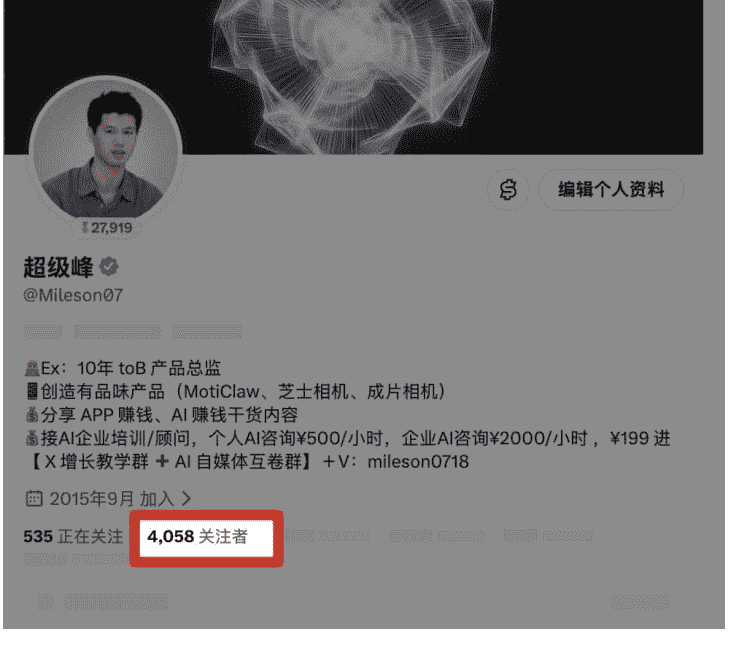
这篇复盘分两块：先按时间顺序还原我做了哪些操作、哪几条起量、结果如何、当时如何判断；再把16个招式逐一拆开。

内容包括：
- 9条跑量内容复盘：OpenAI支付卡、飞书CLI、标签模板、Jev教程……逐条看赞数、收藏量、浏览量以及背后操作
- 从零起盘的11个招式：反常识开篇、把不安改写成行动、先交付价值再谈赚钱……
- 借力成熟账号的4个招式：转发附自己的判断、热帖留言区补增量、客套回复升级成独立观点
- 与头部账号联合造势：把主帖养成热度场，留言区有时比正文更耐读

合计16招，配原素材20张图；
另答5个疑问：没粉丝能否启动、干货没人看怎么办、转发算不算原创、长文与短帖如何搭配、方法会不会过期。

如果你也在运营X或做内容账号，想知道某条内容为何起量、下一条怎么发，先做三件事：发一条自己刚验证结果的内容、去热门内容下补一条有增量的留言、把一条主帖的留言区养起来。

## 关键节点
| 时间 | 操作 | 结果 | 复盘 |
| --- | --- | --- | --- |
| 9月1日 | OpenAI推出支付卡，国内可开通ChatGPT与Codex；我先亲自走通，开篇报结果，后文补步骤 | 464赞·709收藏·20万浏览 | 受众缺的不是道理，而是一句“现在就能开通” |
| 9月1日 | 小圆角推出永久会员（3小时做出的离线圆角）；把收款场景晒出来 | 98赞·116收藏·4万浏览 | 产品类内容要回答“我是否也能做”，而非“你又赚了” |
| 9月2日 | 冰河提到个人主体小程序可开虚拟支付；我没写感谢分享，转发时补“自己的200万用户小程序仍在收款” | 360赞·374收藏·21万浏览 | 原内容谈政策，我补的是“我还在场” |
| 9月5日 | GPT-6 Astra聊天模式可无限用；社区争论额度，我只加一句“尽快用起来” | 160赞·143收藏·17万浏览 | 痛点当下就在，答案要短 |
| 9月19日 | Jev刷屏，我按步骤走通并写成小白教程；短帖引流、长文留存 | 772赞·1338收藏·10万浏览（文章同样10万） | 短帖拉人进门，长文让人留下 |
| 9月20日 | 飞书CLI发现公开云文档能被拉出（惊叹式开场+发现截图+末尾提醒）；同日用Jev猜女孩心思 | 915赞·1120收藏·12万浏览；574赞·13万浏览 | 模型是热点，场景人人懂，门槛自然低 |
| 9月21日 | Codex额度又不够，不渲染焦虑，直接丢一个能看重置倒计时的入口 | 320赞·415收藏·18万浏览 | 焦虑能留人，后续动作促使人行动 |
| 9月22日 | 标签模板做成一键复制 | 962赞·1405收藏 | 大家不是来听工具介绍，是来拿成品 |

回看这些内容，共同习惯是：首句写我刚遇到的结果，不铺背景；图是我自己的凭证；留言区我会接住，不让内容沉掉；收尾给出明确去处。

### 一、自己搭台
自己搭台，是在别人尚未进场时先把场子立起来。有粉丝基础更好；没有，也能靠一条硬货把人拉进来。OpenAI支付卡、飞书CLI、标签模板，都是这样起势的。

#### 招式1：反常识开篇，再补一个增量观点。
支付卡那条如此：大家以为还要境外卡，我开篇说国内能开通。反常识负责让人停住，增量负责让人转发。只喊“卧槽”却没有新信息，传播力有限。
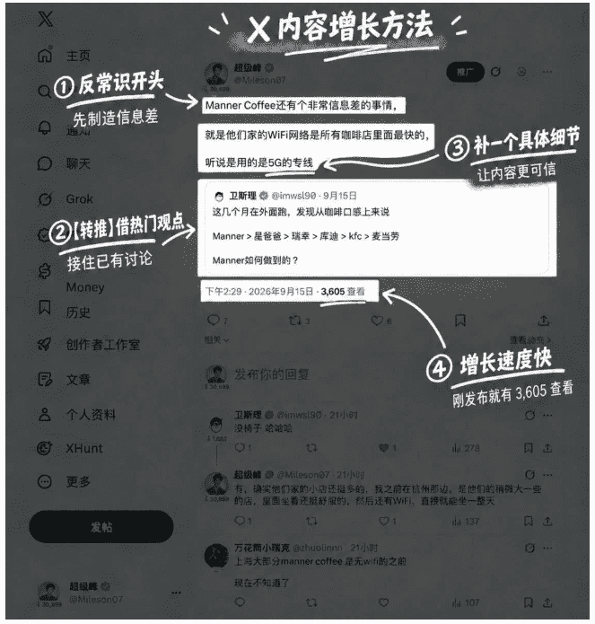
#### 招式2：把不安改写成交流，并给出后续动作。
Codex被封、额度不够、起号慢，都是不安。我写成“这个站能看重置倒计时，地址在这”。只贩卖不安，留言区会骂，不会转。
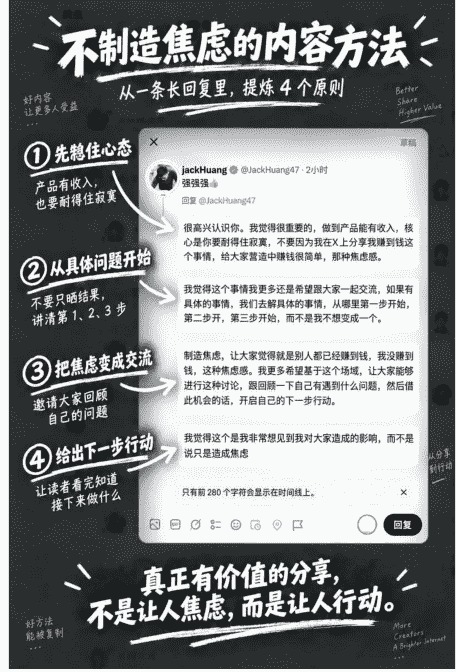
#### 招式3：先交付价值，认可与赚钱是后发生的事。小圆角、GIF表情包、200万用户小程序，都是先给结果。一上来卖群、卖咨询，场子散得快。
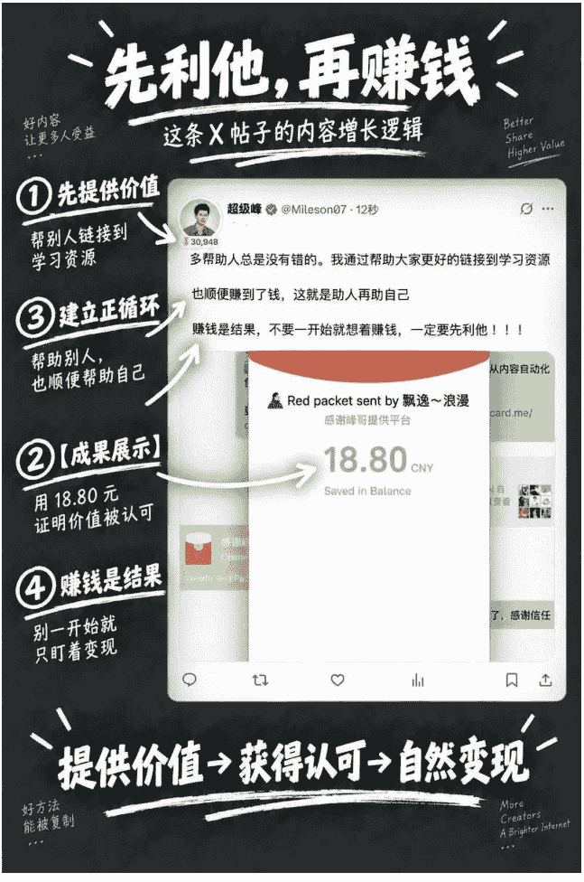
#### 招式4：观点做钩子，付款凭证做支撑，再接产品入口。GIF那条国庆前还在收款，图就是凭证。钩子负责点开，凭证负责相信，入口负责转化。三样缺一，内容只剩热闹。
#### 招式6：写清产品全称、搜索方式、连续收款。GIF表情包制作大师就是这样。别人才搜得到你，才能跟。
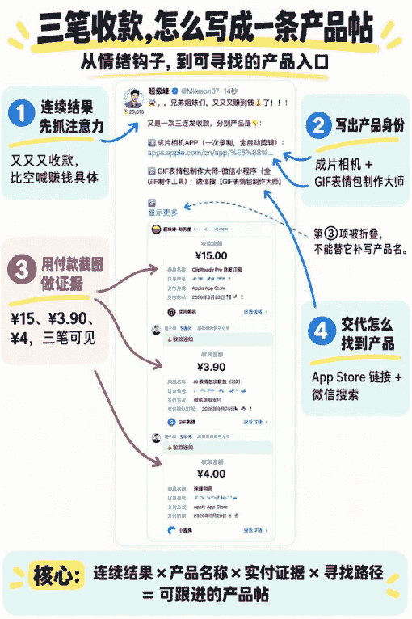
#### 招式7：夸张开篇，配有料截图，留言区接着聊。飞书CLI那条，开头是“好家伙”，图是发现，结尾是提醒。留言区自己会续上。
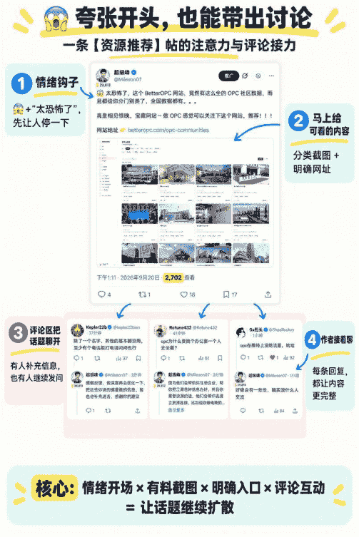
#### 招式8：首句抓眼，接一个熟悉场景，再叠热点模型。Jev猜女友，模型是热点，场景每个人都懂。门槛一低，浏览就起来。

### 10万浏览：大家为何愿意点开？
低门槛共情 + 熟悉场景 + 技术好奇 + 热点模型
1 首句先抓人：emoji + “猜猜你女友在想什么”，用强情绪符号和提问，立刻吸引注意力。
2 参与门槛很低：情侣对话，很多人有共情；恋爱中的真实对话，很多人经历过，容易代入，产生“这不就是我吗”的共鸣。
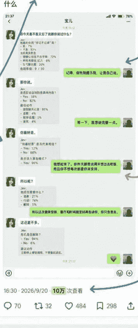
3 熟悉的微信场景：不用解释，国内用户一眼看懂；微信聊天界面、情侣对话形式，是大家非常熟悉的使用场景，降低理解成本。
4 留下技术好奇心：微信怎么接入AI？它怎么判断？对话里嵌着Jev的分析内容（概率、意图判断、建议动作等），让人好奇怎么实现，从而激发点击和进一步了解。
16:30 · 2026/9/20 · 10万次浏览
70 32 484 298
5 借上热点话题：Jev新模型自带讨论热度；第一行写“Jev最佳应用场景”，蹭上当下热点，容易引发讨论和转发。
这条内容获得10万次浏览，还有70条评论、32次转发、484个赞、298个收藏。
核心：首句爆点 × 普遍共情 × 熟悉场景 × 技术好奇 × 热点话题 = 更强点击与讨论机会

#### 招式9：强情绪开篇，但必须跟上具体新发现和截图。标签模板那条，情绪是门，发现是货，截图是凭证。没有发现的情绪，看完就走。

### 13.4万浏览：把不确定变成倒计时
高频痛点 + 产品洞察 + 可见截图 + 留言验证
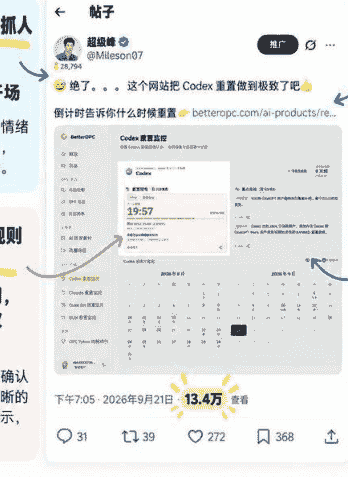
1 开局先抓人：“绝了”，口语化情绪开篇，用轻松真实的情绪迅速抓住注意力，让人愿意点进来。
2 命中强效痛点：大家真正想知道的是什么时候恢复？Codex使用次数何时重置，是高频、时间敏感的不确定问题，直接击中核心需求。
3 把复杂规则变简单：不用研究规则，直接看下一次重置时间；把用户关心却难以确认的规则，变成清晰的倒计时和日历展示，降低理解成本。
4 图片证明产品已做出来：倒计时+历史记录+日历，一眼可见；用真实产品截图展示功能和界面，让人直观感受到：这不是想法，而是已经可用的产品。
5 留言区验证真实需求：准不准？套餐差异？能否提醒？从真实用户讨论中，可以看到大家在关心点是否必要、重置时间是否准确、不同账号规则差异，以及希望提醒等功能。
- 是否需要自己做监控？
- 有没有其他方式？
- 对倒计时功能的认可
- 重置时间是否准确？
产品洞察：用户不一定想研究规则，只想知道什么时候能继续工作。
13.4万浏览 | 368收藏 | 272赞
核心：口语化开篇 × 高频时效痛点 × 确定答案 × 可见产品 × 留言区验证 = 工具型爆款

#### 招式11：热点来了，写成新手路径，图文实操，让人能收藏。Jev教程就是这条。选题先看社区在吵什么，再写成小白能跟着做的步骤。

自己搭台的最低配置，就三样：首句有结果；图是凭证；收尾有承接点。

### 二、借成熟账号的场
借场不是复制粘贴，是进别人已经热起来的场，补一个原内容没有的角度。我判断一条回复值不值得发，只看一点：原作者愿不愿意再回我。不愿意，说明我没补上新东西。

#### 招式12：转发加自己的判断，再借作者互动带二次曝光。9月2日虚拟支付那条，原内容在讲政策，我补的是小程序还在收款。只写感谢分享，没有二次曝光。
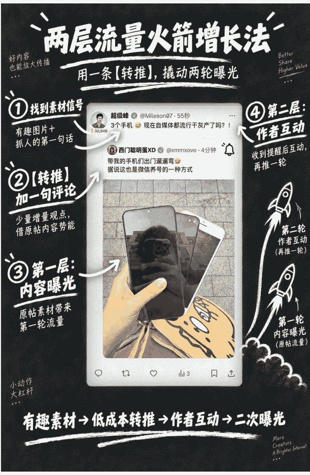
#### 双层曝光法
用一次【转发】，拿两轮曝光
① 找素材信号：有趣图片+抓人的首句
② 【转发】附一句评论：少量增量观点，借原内容势能
③ 第一层：内容曝光——原素材带来第一轮流量
④ 第二层：作者互动——作者收到提醒后互动，再推一轮
有趣素材→低成本转发→作者互动→二次曝光
#### 招式13：在高流量原内容下，用清晰身份加一条增量。身份要一眼能认：做产品的，有收款，有小程序。增量要是原内容没有的：我怎么用、我踩过什么、我看到的反例。
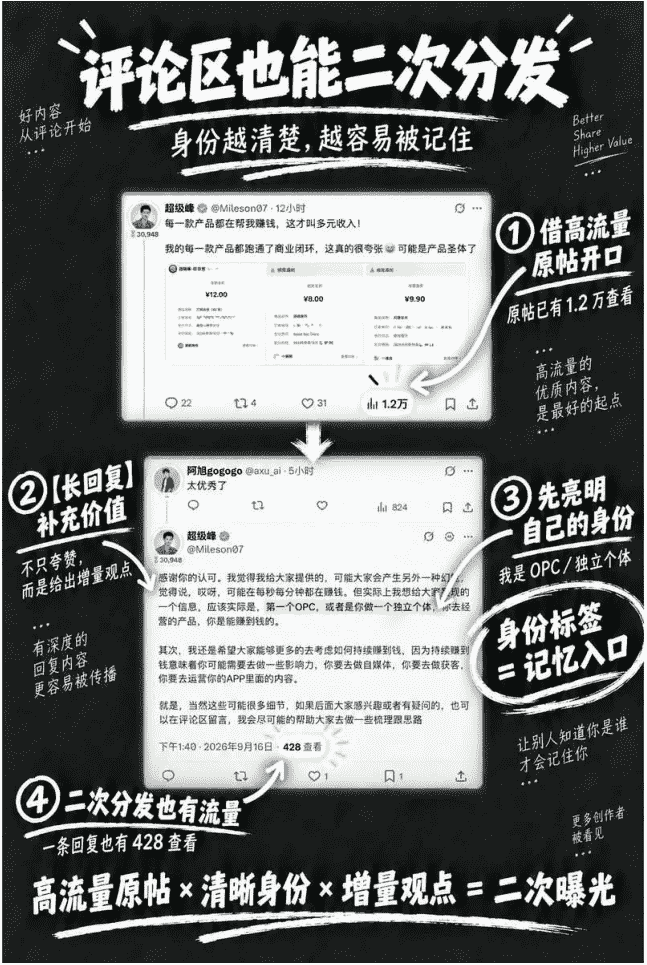
#### 招式14：客套评论升级成一句新判断。
Claude Code借Grok Bot美国云主机删帖，我没写“学到了”。我写成“这与其说是Agent出海，不如说是人肉身出海”。一句新判断，回复自己就能传。
### 把一句“厉害”变成二次流量
客套评论，也能升级成独立内容
只回谢谢 → 输出一个新观点
- ① 接住简单评论：别停在“谢谢”
- ② 升级为自己的理解：从赚钱，提炼到产品价值
- ③ 让第三方也能看懂：自媒体是好产品的放大器
- ④ 用问题引导互动：邀请有类似经历的人留言
### 回复本身=一条新内容
客套评论 × 观点升级 × 第三方价值 × 互动邀请 = 二次分发
#### 招式15：转发时用共同痛点，加上自己的对照。200美元Codex写了一堆没人付钱的产品，这是共同痛。我回的是另一极：3个月20款，赚了几万，但也怕自嗨。有立场，场就大了。
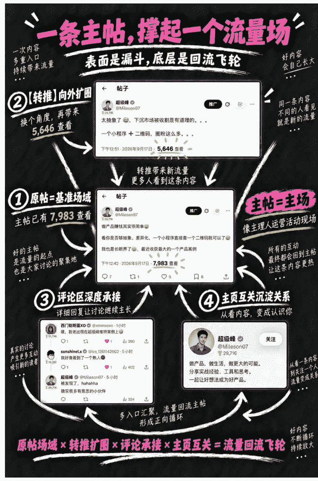
具体就三件：互相转有增量的内容，不转空海报；约好同一个热点一起发，各自写自己的证据；把外部的人引进来，场比个人账号大。

## 三类场子的底层逻辑
这很像派对。有影响力的人是组局的人。大家带着朋友进来，场才会变大。
X上的互动，就是线上的这场派对。自己搭台，是你先办一场；借场，是你进别人的场，还带了一瓶酒；联合造势，是你们一起办下一场。
好的内容会找到同类。同类不是互粉来的，是同一条干货内容下面留下来的。

## 今天就能做
第一，自己搭台。找一个你刚验证过的结果，首句写结果，配一张真图，收尾给路径。
第二，借一个场。找一条浏览已经起来、和你有关的内容。回复里写身份，加一条原内容没有的信息。
第三，把一条主帖养着。发出后两小时内回评论，把新问题补成新内容。
别先做互粉。互粉解决不了“别人为什么要看你下一条”。

## 常见疑问
1. 没有粉丝基础能否开局？可以。我OpenAI支付卡、飞书CLI、标签模板那几条，靠的是首句和证据，不是老粉。
2. 只发干货会不会没人看？干货要有钩子。首句负责停住，后面的步骤负责收藏。
3. 转发算不算原创？加了新判断，就是你的内容；只写感谢，就是路过。
4. 文章和短帖怎么配？短帖拿时效，文章拿收藏。Jev那篇就是我先自己走进去，再写成能跟着做的教程。
5. 这套方法会不会过时？入口会变，派对不会变。谁能持续办一场别人愿意进来的局，谁就还在涨。

看完这份流程，你觉得你懂了。但90%的人一到实操就会卡在第一步。
工具和教程只是最低级的壁垒，真正的壁垒是“立刻动手”和“圈层信息差”。
如果你想看全网最新的变现玩法，并且和一群执行力极强的极客一起下场拿结果，欢迎围观我的核心私域：【懒人专属群】。
我们不聊虚的，只做商业闭环的拆解与AI效率的压榨。系统内已沉淀1000+跑通的套利实战局。
□ 查阅圈子完整数字资产与上车门槛：
https://lazyso.com/insider/
认同价值、准备好下场干活的，扫码加我微信（lazyhelper1）
备注：【实操上车】，不闲聊
