# 从0到百万客单，服务上百家企业：一位AI导师的“说人话”实操笔记

最近总有人问：没有技术背景能做企业服务吗？没有大厂履历怎么拿到首单？报价拉高客户会买账吗？

下面这份复盘来自厦门的一登。产品经理出身，创业十余年，四年前All in人工智能。曾做过面向C端的绘画小程序，累计用户5万+，付费用户超2000。随后转向B端交付，累计接触企业上百家，深度合作十余家，行业覆盖跨境、医疗、法律、外贸、制造、新媒体等。

整篇不讲虚的，全是踩坑换来的经验。有行业积累、会用人工智能、想承接企业订单的人建议细看。尤其是没碰过真实业务就想报高价的新手，更应该先冷静一下。

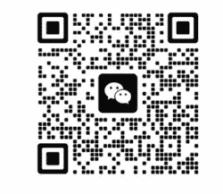
小懒判断｜更适合已有行业经验、能用人工智能工具、想接企业单的人；对连客户业务都没摸过就想高价接单的新手不友好。第三章关于首单来源最值得看：律师圈友用合同小工具分享给同行，熟人以5万元试水，起点都是最烦的小事。报价章节的坑要留意，尾款与成本项没算清，再漂亮的演示也白费。

下面直接进入正文。

## 一、企业人工智能服务，钱到底是怎么赚的

### 1. 从产品经理到B端交付的转身与坑

先说背景。我做过人才网CPO，后续创业十来年。近三年深耕人工智能，从个人软件一路做到企业定制。中间的绘画小程序虽有5万用户、2000多付费，但转化始终受价格拖累：用户因便宜而来，提价就走。技术再强，卖不出去等于零。

转到B端后感受更直观：客户付了启动款和项目最终结项、拿到尾款之间差距极大。演示时鼓掌连连，等真正落地到日常使用，各种意料之外的问题会冒出来。

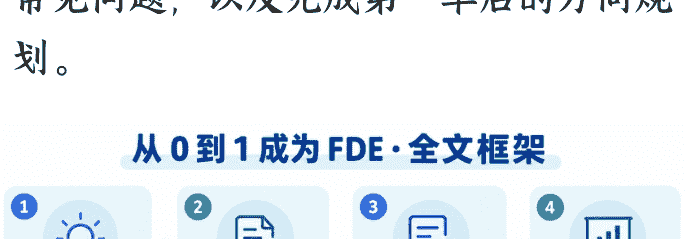
### 2. 想聊的其实是接触到收款之间的人事

业内爱聊模型、算力，我更想聊从接触客户到收款之间AI替代不了的部分。

比如老板嘴上要转型，怎么判断他真愿意投入？提出需求后怎么评估是否值得做？首版可用性不足，客户不耐烦、内部配合度下降怎么办？验收时双方对“做好”的标准不一致怎么调？这些坑我基本都踩过。

先做预期管理：读完未必能立刻独立承接项目。这件事需要实操，需要浸泡在真实业务里，需要和真实的人周旋。但你能更清楚手上有哪些资源，种子客户在哪，第一步该往哪走，哪些话不能轻易承诺。

对已有行业经验、平时会用人工智能、想尝试B端的人来说，起点很好。你过往经历中的流程、重复性麻烦、客户抱怨，都值得重新挖掘。不必一上来就解决一家公司的全部问题，找到一个具体场景，帮一个愿意协作的人把事做成且真实使用，就很有意义。

## 二、FDE到底承担什么

### 1. 一个人承担三类角色

FDE，即前沿部署工程师。通俗讲就是深入现场、做出方案、推动客户真正用起来的人。

不是只写代码，也不是只做咨询，是三重职责合一。

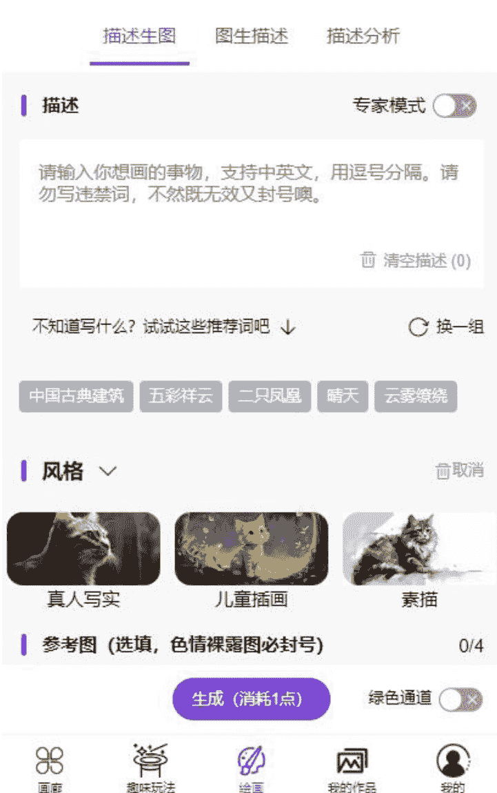
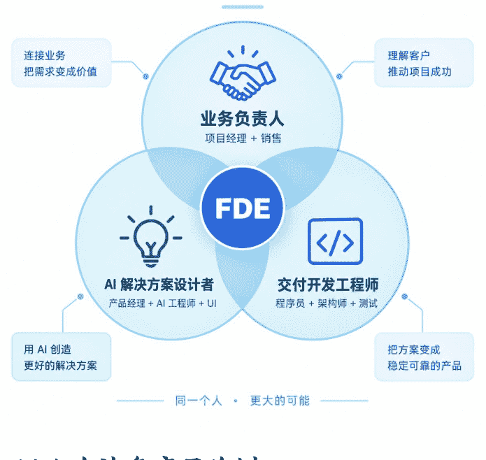

### 2. 以人力法务产品为例

我们做过人力法务相关产品。合同续签、试用期管理、员工确认，企业每天都在处理。你不必像律师那样精通法律，但要明白通知为何要在这个时间点发出，哪些材料必须留存，哪些问题该交给HR。

只让人工智能生成合同，后续一堆事没人接：信息存哪、什么时候提醒负责人、谁决定续不续、员工是否确认、没回复怎么办？把这些散点串成能自我运转的流程，客户才真省时间。

这也是为何反复强调业务细节。系统买回去要在日常工作中感受到变化：少漏节点、少去多个网站重复查、员工不用反复抄录同一份数据，否则投入就浪费了。

## 三、首单从哪来，从已懂的领域开始

### 1. 先在熟悉的行业做个小工具

大家最关心的往往是客户在哪。我的建议是先从自己熟悉的行业切入。听起来像废话，却能省大量时间。你在某个行业待过，知道岗位每天忙什么、什么事最拖人、哪些材料难找、哪些数据要反复整理。外行要摸清这些要问很多轮，你已有一部分答案。

不必把“跨境电商”这样的大盘全包。你可能只熟一个平台、一个品类、一个岗位，就在这个范围内挑一个有用的小工具即可。

律师朋友的例子很有代表性。他给自己做了个特定合同场景的小工具，能生成并修改常用的内容。从产品角度看很糙，但分享给同行后立刻被理解——因为这正是他们每天烦的事。

陌生人看演示只觉得新鲜，被同样问题困扰的人会瞬间被击中。你自己先用，觉得好用再给同事、同行试，有持续使用才有迭代空间。最后是做成软件、定制服务还是培训，接触真实需求后再定。

我们给跨境电商设计部门做的初版也很简单。设计师已会用现成生图工具，但他们还有参考图、改图、批量任务、排队的需求。希望下班前提交一批，第二天看结果，或围绕固定视角批量出图。

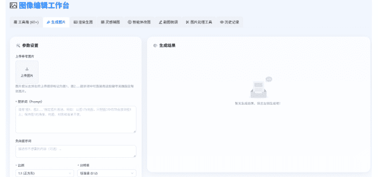
模型本身会画图，问题在原有使用方式别扭。把操作编排起来，任务可排队、参考材料可一起提交，使用体验就上来了。

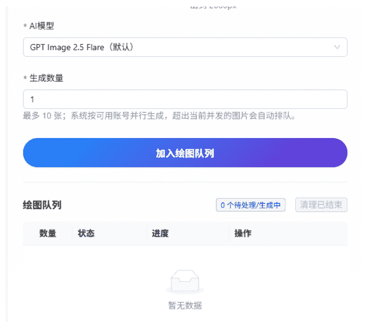
用户需求通常极具体，要走进工作流才能看见。他未必会说“我要一套高级系统”，他可能只想少点几次鼠标。

### 2. 从信任的人开始，但规则要说清

第二条路径是已有信任的关系。我早期一个跨境客户是熟人，对方愿意先拿5万元让我们改造一个部门。他未必完全懂做法，但愿意给一次机会，这是对人的信任。

这不代表随便找个老板就能收到5万。陌生客户没信任基础，需要更多证明：你懂业务、知道人工智能如何融入、愿意落地。

想想身边人脉：认识的经营者、创业的前同事、老客户是否有明确痛点。与熟人沟通成本更低。

但熟人更要把规则讲清。信任能加速启动，不能替代需求梳理和费用约定。关系越熟越易模糊，开着开着想法分歧，反而伤感情。

### 3. 用小范围演示验证意愿

接大客户时，若行业案例不足，我们会先做演示，让对方判断可行性。演示可免费，也可约定签约后计入费用，看具体情况。

演示是敲门砖。对方给一个真实问题，我们用小范围结果让他判断是否继续。这个阶段别承诺交付整套系统。

若你已免费修改多轮，客户仍不提供资料、不确认下一步、一谈钱就含糊，就要停下来思考：你在验证合作，还是在帮一个没想清楚的人做免费试验？

首单目标应尽量简单：确认真实问题、找到愿意配合的人、做出能判断价值的小结果、把正式合同谈清楚。精力有限，别一开始耗在无底洞。说白了，首单往往就是你最熟悉的那件麻烦事。

## 四、公开分享是有效的获客手段

### 1. 分享真实过程，让客户看懂做法

组局分享对我帮助很大，常带来咨询甚至合作。前提是讲的必须是实际做过的案例。

客户最初怎么描述需求、首版为何没成、后来怎么改、费用为何这样定、哪些单子没接，都可以讲。你愿意摊开判断过程，别人才能知道你怎么做事，也相信你是真做过。

不必担心被复制。企业服务需要投入真实时间，处理现场突发状况。别人听个方案，离真正做好还有很长的路，市场也足够大。

分享时我更关心听众是否会想：我们公司好像也有类似问题，要不要聊聊。这种咨询更容易进入业务细节，因为理解和信任已有基础。

### 2. 经营者愿为外部经验买单

有些老板很清楚自己买什么。团队里可能有技术人员，也有人研究人工智能，但他想看外部的人如何解决同类问题，省去摸索成本。你案例越具体，他越能判断你的能力是否对他有用。

我们服务过圈友企业，很多沟通在线完成，未见面也推进了。信任背书起作用，赚钱标签就是很好背书。

这说明远程合作可行，但对信任要求更高。建立信任、了解业务、持续沟通，这些一步都省不了。

### 3. 把投入与损耗也讲明白

我愿意讲利润、投入和损耗。只讲营业额会误导。项目收5万和最终落袋5万是两回事。交付延期、多跑现场、团队分工，钱很快耗完。

把这些讲出来，虽然不够吸睛，却能让真正想做的人少走弯路。也利于客户理解交付成本构成，为何需要投入。

若暂时没大案例，就分享一个处理过的小问题：原来怎样、你改了什么、现在哪里仍不顺。真实过程自带信息量，不必编夸张成绩。

公开分享还能收集反馈。同行补充方法，客户提供新场景，你就逐渐知道哪些可复用，哪些必须定制。项目体感就这么积累起来。

## 五、见老板后先别急着放大招

第一次见老板，容易进入高潮：他说要转型，你想证明专业，于是从培训聊到智能体再到全面升级。聊完都觉得大有可为，下一步干什么、谁配合、用何种资料，全没定。

我们通常先锁定具体场景。首个场景选好，后续顺很多；选太大、涉及部门太多，可能还没见效耐心就耗尽。

### 1. 盯住高重复、高犯错成本、高流失成本

我常问：哪件事每天都在做且占用大量人力？这类事员工天天做，有怨言也有想法。没有完整文档也能拿出近期例子。可继续追问：一天几次、每次多久、要查几个地方、结果给谁。

第二类是易出错且代价大的事。重复耗时老板未必痛，但错误影响客户、付款、关键日期、企业风险时老板立刻警觉。

第三类是人员流失带来的损失。有人离开新人接不上，经验没沉淀。要看哪些经验能整理成流程，让新人快上手，企业不依赖关键人。

这三类最终都要落到具体动作上。空泛的“效率低”“需要更智能”没帮助。问题连发生在哪都说不清，后续如何评估改善？

### 2. 数据与规则要眼见为实

我坚持看真实数据。有历史记录吗？能否拿出实际文件？原耗时有依据吗？客户说数字化做得好，我仍要看材料。系统多不等于数据可用。

有的企业买了一堆软件，同一字段在不同表里名称不同。有的记录只在个人电脑。有的流程线上化了，关键决策仍靠口头。

不看真实情况无法估工作量。

规则也一样。客户说流程成熟，可请他拿最近一份记录带你走一遍。走到某节点他突然说“这次特殊，要问另一个人”，恭喜你发现了未写明的逻辑。

### 3. 找到真正配合的人

老板点头只是开始。具体负责板块的人愿不愿试、能否讲清业务、有无时间反馈，决定成败。技术难度低的项目，若没人答疑，一周也推不动。

选首个场景时，我通常看五件事：高频、资料可得、规则相对清晰、业务配合度高、改动范围可控。

后来我们改用RPA。网页响应慢，逐条在线搜索优化有限。先把表格下载本地比对，找出需改内容，再回线上更新。重复查询减少，但仍受线上速度限制，整个流程仍需十来分钟，不是完全不用等。但做到这程度，客户已有体感，后续合作意向可聊。

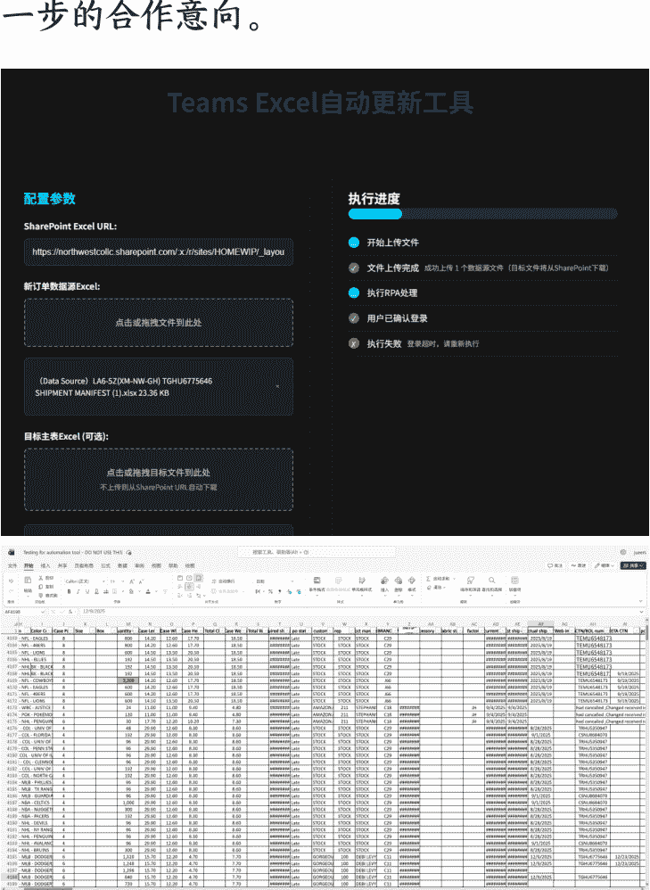

## 六、外贸表格更新的两种取舍

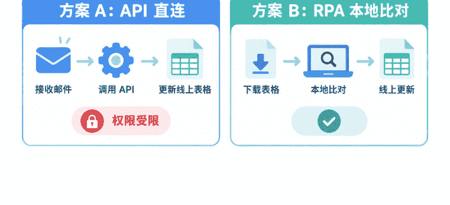
先说量化。有些判断能定标准，有些暂时不能。能量化的尽量给明确指标；需经验的部分持续收集案例沉淀为SOP。一个可用案例加一个不可用案例，比让对方空谈“优质产品是什么”更高效。

### 1. 讲不清与不愿讲要分别处理

调研中常遇两种情况。一是员工愿讲但讲不清，天天做成肌肉记忆，不觉得每个小动作值得解释。对策是让他演示，用最近真实任务走一遍。看他在哪停顿、去哪个系统找资料、何时要问同事。经同意可录屏录音辅助整理，回头再确认。

二是暂时不愿讲，怕被替代或觉得你在审计他。对这类情况别把人当障碍，先帮他解决一个烦很久的小问题，让他感受到合作对自己的好处。信任建立后沟通更顺。

### 2. 决策层定方向，执行层补细节

我习惯先听基层痛点。老板关心整体效率与风险，员工更在意今天能否少干点重复活。两边都要照顾。

只聊老板会漏掉大量细节，只聊员工可能做出老板不愿买单的东西。决策层告诉你投入产出风险，执行层告诉你操作细节与真实限制。

现场调研才花时间。有现成SOP也需核对是否与现在做法一致，细节早改文档没更，新流程写得很完整现场却用更省事的做法。把文档原样变成程序，大概率得到没人用的系统。

做医疗相关项目时，专业人员很难把自己的判断过程完整讲清。他能看资料给结果，让他逐步解释反而卡壳。只能通过实际案例反复碰，慢慢理解哪些信息重要、结果如何表达更合适。

### 3. 用真实验证修正流程，用工具辅助深挖

首次梳理的SOP一定会改。客户看到软件后才想起还有动作没说、某类资料需分开判断、某异常需额外处理。反馈会不断修正流程。

前期多问可减少返工，但不可能穷尽一切。我的做法是把当前最重要的部分讲清，做出可试用的初版，用真实使用补缺口。

工具方面，我会用提问式辅助工具追问需求，用需求记录与开发约定工具沉淀上下文。工具能发现思考盲区，避免上下文丢失，最终拍板仍需企业里真正落地的人确认。

这门生意卖的不是技术，是信任；拼的不是模型多强，是你对业务的理解多深。首单往往不漂亮，但它能让你真正迈进门里。希望这份实战笔记能帮你少走弯路。如果你有行业积累，也有心做企业服务，你的种子客户可能就在通讯录里躺着。

# 演示好看不等于能交付：几个 AI 项目从 0 到 1 的复盘

## 一、第一版先给谁用

三类路径摆在这里：

A. 封闭在自家代账小组里用。找三到五家有真实账务的公司，把收资料、对流水、拟凭证、查申报、做归档这套动作完整走一遍，客户侧暂不开放登录。
B. 一上来就做成客户能自助登录的 SaaS。
C. 先只做财税问答，不碰实际记账交付。

我的判断是 A。眼下真正拿不准的是两件事——业务上的分寸怎么把握、资料能不能凑齐；技术反而排在后面。把自己人的交付链路先捋顺，再从中抽出对外产品，风险小得多。将来总要接外部客户，那些明显不好返工的设计，可以提前留口子；但当下重点仍是自家人先把流程跑通。

## 二、谁真正承担记账与报税的法律责任

A. 手里已有代理记账许可证，也配了符合条件的负责人或会计。
B. 暂时没有证，工具只做内部辅助，落到实处的记账、申报、签字核批交给持证机构或具备资格的会计。（建议）
C. 没证，却打算用自己的名义直接承接记账报税。

我倾向 B。按照财政部《代理记账管理办法》，在中国大陆，会计师事务所之外的机构要做代理记账，一般得先拿到财政部门核发的代理记账许可证书；具体经办人员还要依照统一会计制度和委托合同来作业。

你属于哪一种？

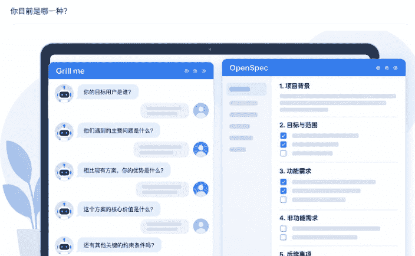

一份由 AI 生成、看着挑不出毛病的 SOP，如果没让业务人员过一遍，所谓“完整”只是纸面上的整齐。真到执行时，某个必需的数据也许压根不存在；文档默认每个环节都有人接应，可现实中那位负责人一周才看一次消息。

这些落差，靠聊天、蹲点观察、小范围试跑来暴露。前期抠得越细，后面写代码就越省心。

## 三、代码、RPA、大模型、人，各归各位

**有明确规则的，交给代码。** SOP 理清之后，凡是判断标准固定、能写成条件的部分，直接落成程序：编号对得上就匹配、两个字段比一比是否相同、到日子自动弹提醒、满足既定条件就流转到下一环。这类活儿规则干净，程序跑起来稳，花费也好估算。

**接口走不通，再考虑界面自动化。** RPA 可以理解成“替人在电脑上点鼠标”。某套系统不开放接口，但人工本来就能在页面上把事情办完，那就可以研究让自动化去代劳。不过要清楚：页面上点得动，和长期稳定地点得动，是两码事。界面会改版、登录会掉线、权限与验证方式也会卡住自动化。作业必须在授权范围内；能调接口就调接口，实在没有，再去琢磨怎么砍掉多余的点击和等待。前面那个外贸表格的例子，就是接口条件不成熟之后，换了一种自动化打法。

**需要理解、识别、生成的环节，才请模型出场。**

## 四、招标信息项目：从“把信息收回来”到“替人做判断”

客户开口时的痛点很朴素：同事得跑好几个渠道盯新标，看到消息还要判断跟自家业务搭不搭，活儿多、时间紧。听到这儿，很容易想到做个信息聚合工具。可再往下聊，问题就冒出来了——信息收回来以后，哪条值得细看？哪条该排在前面？凭什么说这条潜力大、那条可以搁一搁？这些判断离不开客户自己的业务，光采集是回答不了的。

于是我们请对方梳理业务分类。客户拿得出比较清晰的 SKU 体系，也就是他们内部对产品和服务怎么归类：每一类指什么、哪些更吃重、边界怎么划。有这张表，交付的有效性会高出一截。但不少公司一时拿不出这种细化材料，就需要 FDE 陪着一起理，进度自然慢下来。

有了分类，还得认重点客户：某些标跟业务确实相关，可客户类型不匹配，优先级要不要往下压？接着是投标门槛——金额诱人，但资质、既往业绩这些硬杠杠够不着，投入再多研究也是白费。硬性条件和偏好得拆开看，再把对应字段提取出来。

客户给的权重同样要复核。我们碰过评分失准的情形：对方起初给了一版权重，跑出来的分数却两头扎堆，中间没有过渡，表格上数字挺热闹，员工看了却不知道怎么用。按传统外包思路，客户怎么给就怎么做，但这行不通。得拉着对方一起复盘：哪些档位分不清、哪项权重该调、某个硬条件是不是应该前置筛掉，而不是在总分里轻轻扣一点。这种调整必须由业务方拍板，FDE 不能凭手感替人定哪类逻辑更重要；我们的价值是把规则跑出来的毛病摆到桌面上，让讨论有依据。

这个项目前后磨了两三个月。听着不过是“收集招标信息”，真用起来之后，评分、字段、查看方式、消息通知全都要动，沟通排期也耗掉不少时间。

**先能用，再扩张。** 结果呈现上也有变化：起初是把信息同步进飞书表格，后来又加上了飞书群推送。道理很实在——数据躺在表里，员工未必会按时点开；把消息送到眼前，触达更近。

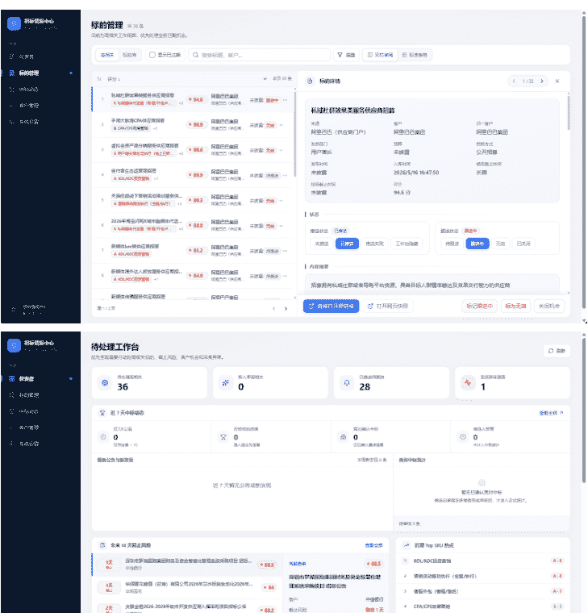

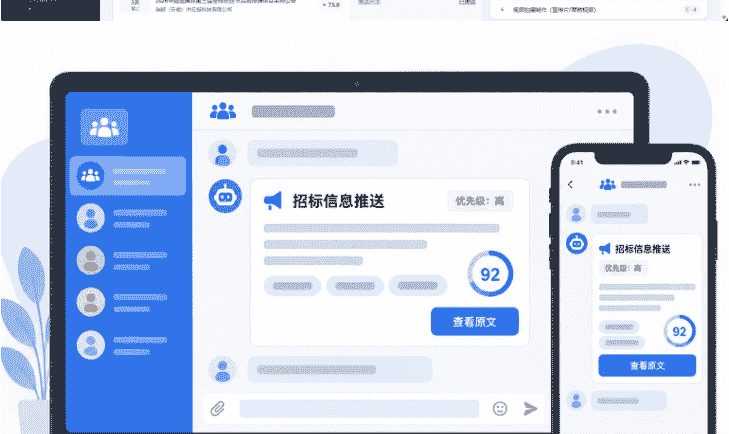

你会发现，从“功能做好”到“人真的用起来”，中间塞满了这类琐碎：通知到没到？人看见了能不能一眼判断要不要处理？想深究时找不找得到原始出处？这些细节决定了工具顺不顺手、能不能长进工作习惯里。

再往后当然还有空间，比如基于已有客户资料去分析招标节奏、历史项目、对手情况，给业务同学更多参照。但这些只是可以聊的方向，并非眼下的成果——功能是有了，客户的验证还没走完，毕竟这是一套很新的业务尝试，本身也还在打磨 SOP。

对刚入行的 FDE，我更想强调这个案例的前半程：客户最初说得很少，你得靠追问，把决策背后的业务信息一点一点挖出来；等系统转起来，双方再拿结果回头修规则。软件才会越用越顺。

## 五、人力法务产品“职法狮”：制度立好了，日常谁来盯

公司碰到用工问题，会找律师咨询，也会请律师把合同、制度、流程改一遍。改完之后，日常动作能不能跟上，是另一回事：该找负责人确认的节点错过了，材料没凑齐，员工的回复沉在聊天记录里翻不出来。HR 手上的杂事本来就多，指望人盯住每一个节点，风险太高。我们想补的，正是执行层面这些漏洞。

产品思路是：把标准动作交给系统自动往前推，把例外留给人。劳动合同临近续签决策，系统调出合同信息，向直属主管征询意见；审批走完，再按定下来的结论给员工发确认内容，通知记录和材料一并留档。哪个环节超时，或者信息打架，才请 HR 进来处理。

试用期管理同理：时间点到了，主管要交评价与辅导的过程材料，该让员工确认的内容及时送达；资料缺失、内容矛盾、眼看要逾期，系统就提醒 HR 介入。

考勤确认也类似：记录与已提交的申请对不上，先收集说明和依据，最后仍由负责的 HR 裁定。系统管的是流程怎么走、资料怎么存；某条记录在法律上究竟意味着什么，遇到复杂情形还得靠专业人士判断，不能拿一条规则硬套。

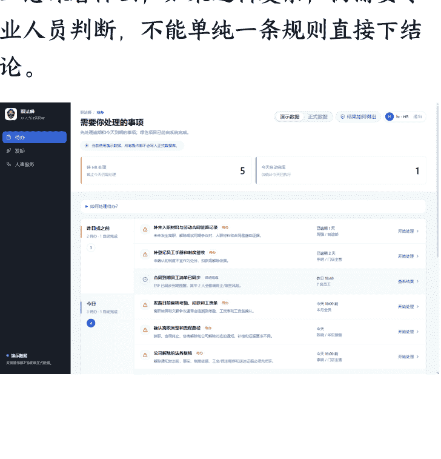

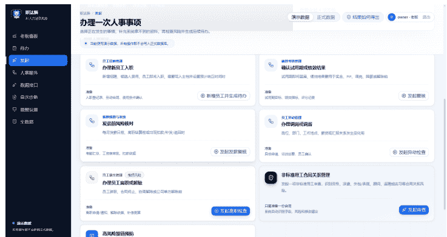

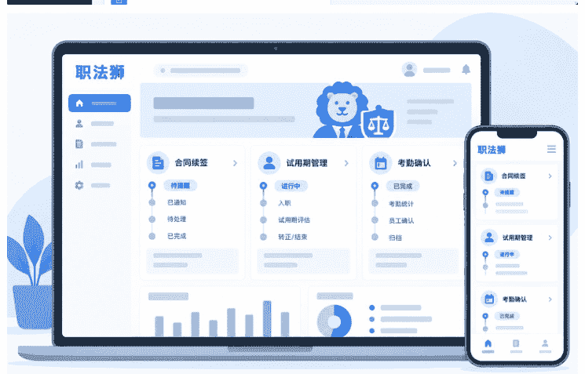

**律师的实务经验，和企业里的数据，得接在一起。** 做这类 AI 产品有个前提：垂直领域的伙伴必须真的服务过企业，哪些节点容易漏、哪些材料老缺、哪些事非人不可，他们心里有数。AI 可以帮忙整理，但没法凭空长出不存在的经验。

接下来是接进企业现有的工具：用飞书、钉钉、企业🛰️，还是自建的人事系统？哪些数据能按授权取、任务从哪个渠道发、处理结果怎么回写，都要先定清楚。数字化底子好的公司，尽量对接现有数据；资料散落的小公司，可能得花时间补课——连合同日期都没有可靠记录，自动提醒也就没了依据。

这个案例的价值在于两头都照顾到了：企业希望日常动作更好执行，律师希望专业意见真能落到实务上。双方各自出一块能力，产品才站得住。对小微企业来说，原本需要不少人工的活儿（很多公司 HR 和行政、财务就一个人兼着，实在分身乏术），可以借软件减负；但能覆盖什么场景、需要多少法律专业支撑，还得一处一议。

**先拿一个种子客户打样，再从中找可复用的部分。** 第一家客户，我们也是按定制项目做的。即便手里握着一套成熟的法律流程，进到企业里照样要面对数据、工具、人员习惯这三关。好在真实跑过一遍就有体感，容易剥出可复用的模块，第二家就轻一些。

为什么选这个方向做 AI 产品？因为某些用工管理事项背后的法律要求相当共通。法律本身变动比业务慢，对各家公司又是一致的约束，通用性天然就强；比起跨境电商那种各家玩法差异极大的行业，流程上的变量更可控。当然，每家公司在人力资源管理和具体事实上仍有出入，不可能一套规则卖遍天下。产品化就是要在这些出入里划边界：哪些是标准功能，哪些做成可配置的选项，哪一小块必须由专业法律人士介入。分类划清楚了，报价和交付才有底。

改造的量级也因事而异：材料多少、个案复杂程度、文书要求、审核深度，都会影响工期。

## 六、医疗文书：第一版被骂惨，后来却离不开

这个案例有意思的地方，是开头并不顺。第一版送到客户手上，对方觉得难用，反馈也很直白——差评。我们花了不少心思，听到这种评价当然有压力。可继续跟踪实际使用，才承认确实有很多地方跟他们的工作对不上。专业人士未必能在开发之前把每项要求讲清楚；等看见生成的结果，才会说这段应该放前面、那种说法不合适、这两份材料不能这么拼。需求就这样一点点长出来，初版之后的大调整有的是。

一个月收到一两百条反馈，不算稀奇。这些里面并非全是新功能：有的是原先没说透的规则，有的是操作别扭，也有的是用起来才暴露的异常。

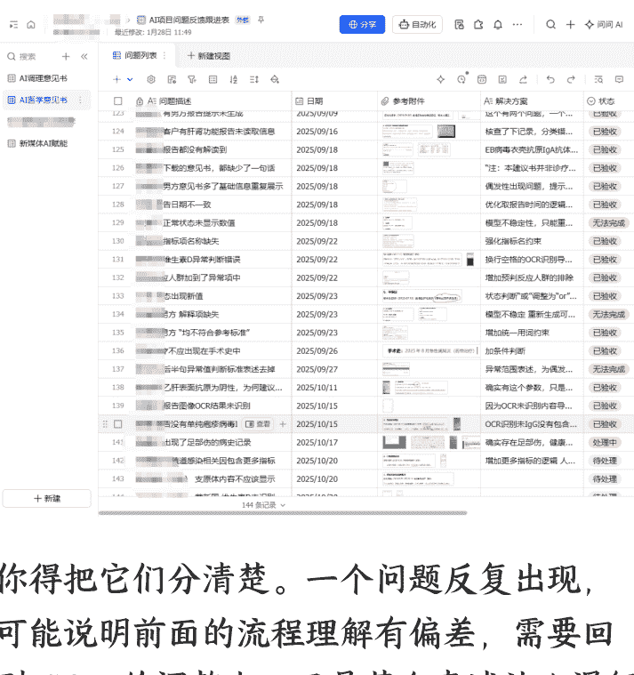

得把它们分类。某个问题反复冒头，也许说明前面对流程的理解就偏了，该回到 SOP 上改；只是某句话让人误会，调一下交互可能就解决。不能把所有反馈都粗暴地翻译成“再加一个按钮”。

**用户越离不开系统，维护的要求就越高。** 后来客户用顺了，依赖也跟着涨。起初还要劝他们试试，等真觉得省事，系统一出故障，他们比谁都急——这是真的离不开了。

到这一步，你才能直观感受到软件有没有长进日常工作里。客户嘴上说好，只是一种反馈；愿意在真实业务里用它，并且希望它一直稳，才是更硬的认可。

但依赖也意味着责任变大。服务一旦中断，对方的工作直接受影响，稳定性、异常处置和后续维护的响应都得跟上。

前面提过，这家客户极重客情关系，部分服务客单价很高；一句不合适的话放出去，造成的损失可能远超一次模型调用的费用。所以把 AI 放在资料整理和初稿环节，再由医生二次把关，比零人工审核更贴合当时的需求。同一个模型，摆在不同的位置，担的风险完全不同。FDE 要理解这层差别，并跟客户一起划定它能干什么、干到什么程度。

## 七、🛰️知识库：需求和风险并排走

**先把“知识”和“待办”分开，再谈怎么整理。** 🛰️里沉淀着很多有用的东西：跟客户聊的需求细节、群里讨论出的方案、有人顺口交代的一件事。它们散落在不同对话里，每天靠手动往回翻，既容易漏又费时间。

我想做的是：把值得留意的对话挑出来，分清哪些该沉淀成知识、哪些其实是一个待办，由人确认要点之后，再送进对应的知识库或任务清单。

这跟“把聊天记录一股脑存下来”差别不小。某个客户群里的内容，可能要归到这家客户的资料集；同行在群里聊的技术方案，适合放进方案库；有人临时说“下周给我一份材料”，那明显是待办。它们后续的用法不一样，前面就该分开处理。

还有边界要守：哪些群不必处理、哪些私聊不该进工作资料，都得有控制。整理信息绕不开隐私和授权——你拥有某台电脑或某个账号，不代表里面的对话就能随便扩散，或者交给外部服务。

**演示能跑，不等于能卖。** 我当时做的是 Windows 环境下的🛰️知识库探索，没有打包成面向大众出售的成熟安装包。除了自己用，也给几家老客户小范围试过，安全性、兼容性和账号风险仍在评估。

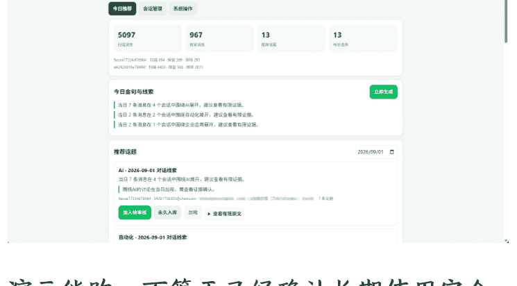

Demo 跑得起来，不代表长期使用安全、不会封号。我还没把它当成可以放心交付的成熟工具，后面的观察和验证还得继续。

**围绕真实用途去搭知识结构。** 将来若能用可靠、合规、获得授权的方式拿到资料，知识库怎么分类、怎么维护，仍有大量活要干。每个人关心的东西不一样，行业也不一样，很难把自己那套结构直接复制给别人。医生在意病例、产品、客户；法律从业者的资料组织方式又是另一套；有的公司按品牌和产品线管，有的更看重客户特征或某个关键指标——哪怕同行，侧重点也常常不同。得先弄清对方打算怎么用，再决定怎么整理。

所以我看好的是那种“按实际用途搭信息结构、配使用流程”的服务。它可以先从个人工作起步，再延伸到企业，也可以专攻某个行业；至于能不能做成标准品，得看共性能抽出多少。

对我自己来说，它也有直接的好处：以前讲过的课、讨论过的方案，整理好之后，下次要分享时翻找容易得多，还能按听众关心的问题让 AI 重新组织一遍。省下的时间未必立刻变成收入，但重复劳动确实少了。

这个案例跟前两个成熟度不同，我把它摆出来，是想让人看到探索期长什么样：发现需求、做出原型、确认安全性、验证使用、考虑售卖——这几个状态要分开看，不能看见一个 demo 就把后面的活儿全跳过去。

## 八、我怎样筛合作客户

做过一些项目之后，我越来越看重前期的筛选。接触过的企业里，值得改善的地方确实不少；但“有需求”和“适合我们做”是两道题，得分开答。

**挑企业客户，别只盯行业风口。** 我优先看这家公司和它的业务是不是在往上走、利润撑不撑得起投入。处在扩张期、又愿意改善流程的企业，通常更好谈长期合作。广告类业务则要留神：聊下来能感觉到内部几位关键人物之间别着劲，外部项目人员特别容易被裹进去——你明明是去谈工作的，最后话题却变成了他们内部权力博弈的延长线。这种局面要谨慎：你跟其中一位处得好，不代表事情推得动，因为对立的那位可能正握着实际配合的资源；项目对双方各自的意义，也未必一样。耗在上面不值当。

我不建议新人把“协调复杂内部矛盾”当成第一单的功课，难度直接翻倍。先找配合关系顺一些的客户，把从需求到交付这条链路走通；真有余力，再去啃硬骨头。

当然，任何公司都会有阻力。外面的人带着新系统进来、要改工作方式，本来就需要时间渗透。要判断的是：这股阻力有没有被看见？有没有人愿意一起解决？而不是要求每个员工第一天就热情拥抱。

**掂量自己扛不扛得起软硬件的投入。** 制造业我有一些体会。接触过电厂节能的需求，里面牵扯现有控制逻辑、监测指标，还有传感器、执行设备。想改善能耗，可能软件、硬件、工艺三样得同时上。

有一段对话很典型：企业觉得自己现有水平已经不错，可一聊到更细的控制方式，又承认有些活还没做——自相矛盾。这种时候，除了拿出有效的技术方案，还得看有没有人愿意推动、有没有人肯承认“还能再改改”。

在直接决定你收多少钱的场合，更要看有没有能对着核的记录。扯皮太累，你其实是有选择的。

**指标要经得起核对，承诺别超出能力。** 同样是“省人力”，口径花样很多：你说做完能少用一个人，老板转头把人调去别的岗位，并没有裁员，这怎么算？还是那批人，只是多接了一摊活，又怎么算？

如果只约定“按裁掉人数分成”，最后人没裁，你的改善就结不了账。你不能替企业安排用工，也不能让自己的回款完全押在对方后续的组织决定上。

所以我更愿意先找容易观察的指标：某段流程的耗时、单位时间的处理量、符合约定标准的结果占比。具体选哪个，双方坐下来一起定。

这里还会撞上另一堵墙。有些企业希望你从零开始帮它解决获客，可手里并没有跑通过的路径。如果我们擅长的其实是对现有业务的优化，那就得把能力边界讲明白。客户本来有一套引流打法，想把其中的收集、整理、处理做得更高效——这能做。对方完全没有方法，却指望你一接手就源源不断带来新客，那是另一种不确定性。不能因为想签单就一起揽下来，那已经不是 FDE 的范畴，而是在卖流量、卖运营，结算方式也得另算。

客户有期待很正常，但你得说清楚哪些期待目前接得住。前提仍是上一章那句话：基准和验收方式要能确认。如果结果很难归因、数据又拿不到手，就别被“按效果付费”这四个字晃花了眼，仓促点头。

我也试过围绕省钱和增长谈分成。

省钱的空间通常有天花板，企业成本上限就在那儿，想象余地有限。增长的天花板高得多，难度也更大，影响因素更杂，更得说清楚哪些变化能算到这次合作头上，还得有点信任打底。

增长抽成如果按总收入算，老板多半觉得不合理——他自己的业务成本也在涨；如果全按净利润算，服务方又摸不清各项费用，毕竟有些支出不容易摊开。我们讨论过拿毛利之类口径作参照，但每一条都得逐项写清，不能扔一个词过去就默认双方理解一致。

我们聊过的一些分成比例，都只属于特定谈判情境，单拎出来意义有限。10% 到 50% 都有可能。先看你投入了什么、承担了什么、手里有哪些数据维度可核算，再谈比例合不合适。谈判没有完美解，不如先往前走、尽快落定，客户数量上去了，赚得自然更多。

## 收尾

至于 AI 战略合作的报价，我不主张先甩一个孤零零的数字。把分工、责任边界、可核对指标、验收方式、风险由谁承担这几件事谈透，价格才有讨论的土壤。否则技术再漂亮，交付也容易沦为互相扯皮。

# AI 项目外部协作：费用怎么拆、账怎么算、活怎么落地

很多企业一开始把 AI 想成“招个人”或“买套工具”，真正做起来才发现，它更像一段多方配合的长期协作。谁负责规划，谁负责现场推进，素材和权限怎么开，钱按什么节点付，效果又由谁核验——这些如果不在前面讲透，后面就容易反复拉扯。下面按分工、费用组合、全成本、上线后的磨合以及人的因素，重新梳理一遍。

## 一、先把双方边界摆到桌面上

外部伙伴主要承担四类事：AI 路线怎么走、FDE 现场推进、效果核验、材料归档。

企业侧则要配合三件事：把业务素材拿出来、开放必要的数据使用许可、指定内部接口人。

字面上看并不复杂，但真正执行时，只要有一方的职责含混，后面就会多出很多解释成本。

## 二、费用拆成几层，谈起来更清楚

**第一层，固定服务费合计 60 万元。** 其中启动金 5 万元，其余 55 万元按月度目标或里程碑支付。

**第二层，降本类奖励 40%。** 首个合作年度内，能够复核、且能明确归因于 AI 的现金支出下降，按四成计算。

**第三层，增收提效类奖励 30%。** 同一合作年度内，能够复核、且能明确归因于 AI 的新增毛利，按三成计算。

**股权另行评估。** 合作满六个月后，再单独判断是否适合更深绑定；第一次签约时，不建议把远期收益谈得太满。

固定服务通常覆盖这些内容：

1. 跟管理层定期对阶段目标、协作节奏和奖励核算依据；
2. 对重点部门的作业流程与 SOP 做梳理、访谈，并挖出真正卡住的地方；
3. 挑选适合人工智能切入的业务环节，做方案，开发中台与配套工具；
4. 在企业内部寻找可培养的 FDE 苗子，做图像识别实操辅导，筛性价比更高的算力渠道；
5. 帮企业把数据整理得更规范、让流程沉淀为数据、设计权限、对接系统接口；
6. 做必要的功能辅导，收集意见，限时改进，并把功能说明整理成文档。

奖励口径要提前说清：

**降本类**，指已经发生、可以复核、能明确归因于 AI 的现金支出减少，涉及人力、财务、系统、第三方、硬件等支出项。

**增收提效类**，指已经实现、可以复核、能明确归因于 AI 的新增毛利或实际回款贡献，不按营业额或 GMV 直接计算。

**核算约定**：合作启动后三个月内，把基线逻辑、数据来源、计算方式、归因逻辑和审核人确认下来。同一结果只算一次，复核通过后按合同结算。

**另计费用**要单列：第三方算力与模型费用，云资源、服务器、存储和流量，软件订阅或采购，接口、API 及其他第三方服务。

## 三、价格组合可以更活

也可以把启动金、阶段款和效果分成放在一个盘子里。前段费用用来保障必要投入，同时控制推进节奏；后段则跟事先约定的结果挂钩。金额更大的长期合作，可以按业务板块或阶段拆出付款节点。

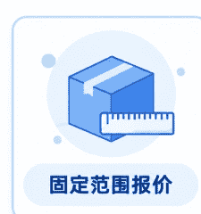

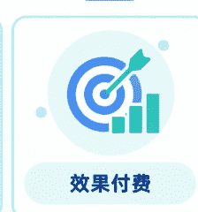

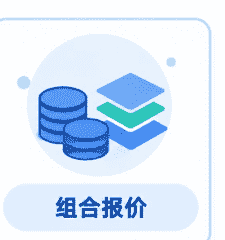

几万元的小单和持续一年的合作，付款安排通常不会一样。有的先收一部分，验收后再结尾款；有的拆成多个阶段。原则只有一条：不确定的工作不要让你先垫，阶段确认和付款条件必须清楚。

沟通时，尽量用“项目包、阶段、服务边界”这样的词。如果对话只剩下“每月给多少钱”，对方很容易把你当成雇员来比较，却没有同步明确外部服务的时间、职责和边界。思维定式一旦形成，后面的期待差异就会冒出来。

## 四、长期合作，先跑一段再谈股权

股权或技术层面的深度合作，适合放在更长的时间轴上看。先一起做一段时间，观察彼此做事的方式，再判断要不要更深入。

刚接触就把未来收益描绘得很大，双方对业务和配合都还没验证，意义有限，有时只是白费时间。我们有些合作会先跑几个月，再讨论后续。

对刚入局的人来说，能把首笔固定费用、首阶段范围和验收标准讲明白，已经是很重要的一步。别人谈分红，不代表你的合作也必须从分红开始。

## 五、成本不能只算开发费

一个项目到底赚不赚钱，得把账看全。报价前可以按六类投入逐项对照：

- 客户开拓与项目运营：从介绍、沟通、推动签约，到资源调度、回款催收；
- 需求与流程：调研业务、梳理作业规范、设计交互、锁定范围；
- 工程落地：系统架构、首轮搭建、AI 技术方案、数据结构化；
- 验证与修正：首轮功能验证，以及上线后的修改和测试；
- 辅导与运维：试用安排、用户辅导、意见回收、日常维护；
- 外部采购：差旅、工具、模型算力、服务器及第三方服务。

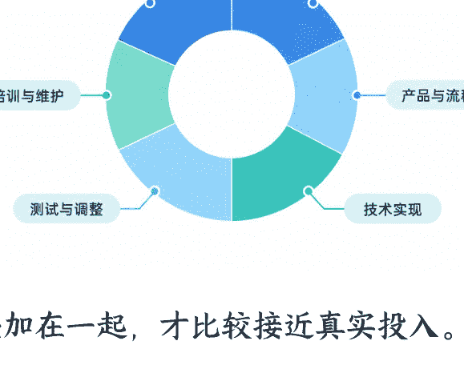

这些加在一起，才比较接近真实投入。

销售把客户带进来，如果还要负责推进、协调、催款和项目管理，承担的事情就更多。不能只看最后是谁写了代码，就决定收益怎么分。

产品沟通也很花时间。到现场把大家说法不一致的地方归并起来，找例子确认，把业务规则讲透，这些往往直接决定后面能不能顺利推进。有些事项难在数据：材料杂、格式乱，整理本身就要耗掉不少时间。即使眼下费用很小，也得说清楚。

省费用，也要算自己的时间和精力。为了省几百元，花一整天折腾，结果该给对方的方案没做完，或者一个重要反馈没精力处理，省下的钱可能远小于损失。我们早期也自己硬扛过，后来才感觉到，精力和机会同样有成本。

以我们服务过的一些客户为例，模型支出每月大概几百元。但这是特定用量和方案下的情况，不能拿去承诺所有合作。图片、视频、大量文档、复杂智能体的用法，成本都可能不同。

上线需要的资质和手续，也要尽早定责任人。域名、备案、小程序认证、支付开通、主体资料等，具体要哪些看产品形态；一旦涉及，就提前问清谁准备、还缺什么条件。

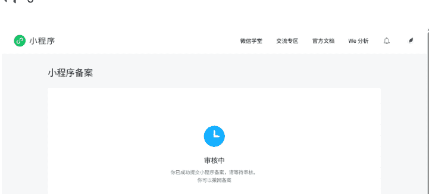

这些流程未必由你决定进度。代码做好了，对应资质还没准备好，对方一样不能按计划使用。遇到自己不熟的环节，可以请有经验的人帮忙，必要时付费咨询，通常比凭印象反复试错更省事。

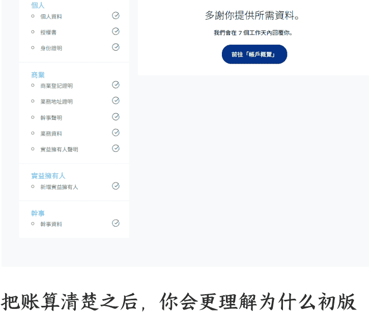

把账算清楚之后，你会更理解：首个版本出来得很快，但总费用方案不可能只按写代码的几天来算。后面有人持续迭代，有人协调需求，真实使用还要继续打磨，这些都必须有人承担。费用方案里漏掉的项，最后只会从你的利润里扣。

## 六、首个版本交出去，事情才刚开始

范围合适、条件明确的需求，我们可以在 1 到 7 天内做出首个版本。但这个时间只指首轮开发，并不等于所有事项都能在一周内正式完成。

对方真正用起来，很多之前看不到的问题才会暴露。

预期管理要先做：使用前就告诉对方，首个版本覆盖的是当前确认过的场景，会有需要调整的地方，希望通过实际使用尽早发现；哪些部分可以尝试用于生产，哪些暂时不要放进正式业务，也要说明。

但也不能交出一个完全没检查的版本。已确认的基本功能、必要的安全条件和操作范围，还是要过关。

首轮之后的修改，几乎必然比首轮本身更花时间，除非 SOP 极其完美、真实且高可用。安排工作和对客户说明时，都要提前预留。

测试要看边角情况，模拟不能代替验收。我们通常会让 Agent 帮忙跑测试，除了正常流程，也会让它尝试不同使用情况，找边角问题；还可以按不同用户画像，模拟使用中可能遇到的困难。

这种方式对发现问题有帮助，但模拟结果要和真实结果分开。Agent 模拟了一批用户，不等于真有这些用户使用过；它生成的分析报告，也不能直接当作对方验收通过的证据。

真正验收，得看对方能否顺畅使用，并在大部分情况下成功完成工作。

测试时，我比较在意正常演示一般不会碰到的场景。比如系统默认接飞书，对方恰好没用飞书，怎么处理？资料不齐时，会不会直接报错？某一步需要其他人确认，对方一直没回复，后面该停住还是继续？

你不一定亲手把所有测试都做一遍，但需要想到这些问题，并安排验证。单例子跑通，离稳定交付还差不少。

没反馈≠没问题。软件已经交付，对方却一直没用，这种情况我们遇到过。更新后对方没什么反馈，以为没事，继续问才知道还没用上。没用上，也就没有真实反馈，事情其实是停滞的。

这时候可以请负责人拿当天要处理的工作，让相关员工试一遍。看他在哪里停下来，需要问什么，最后结果能不能直接采纳。比起再辅导一遍，这样更容易发现问题。

等用户真的尝到甜头，他自然会想用。医疗项目后来服务偶发故障，客户主动催修，就是一个真实例子。但初期通常仍需要负责人推一下，不能把安装完成当成推广完成。

如果每次都要你大力推才用得上，还是得复盘交付物。是不是操作太复杂，还是结果用不了，或者选的场景对员工本来就不重要？推广方式是一个原因，产品也是一个原因。

## 七、不需要辅导的产品才是好产品

我挺在意交互体验。尤其企业软件，每多一点学习成本，都可能变成推广使用上的阻力。让软件顺着工作走，减少记忆和操作，是交互上最该较真的地方。

辅导也需要，但要有实际案例辅助。以前给企业做通识培训，有些人当下听进去了，过一两个月不用，又忘得差不多；也遇到讲了几遍，有人仍然没有用过。

这未必是对方故意不配合。他手头有工作，原来的办法虽然麻烦，但已经熟悉。新工具还没给他带来足够明显的好处，或者培训没有跟实际场景关联，没有体感，他就容易先放一边。

所以辅导最好跟一个实际场景连在一起。今天刚好有这份资料，就用新办法处理一次；做完之后，看原来要做的哪些动作省掉了。这种理解，往往比听一小时功能介绍更具体。讲故事确实比讲方法更容易被接受。

也可以在企业里寻找有探索精神的人。我们给客户装好 AI 编程工具后，有的人会主动研究，很快做出自己的小尝试；有的人需要先看场景演示，再跟着做；还有人暂时没有行动。

这些差异可以帮助筛选出主动探索的人，多给一些支持，让他逐渐承担部门里的小开发任务。判断一个人适不适合培养，不能只看工具消耗量或登录次数。用得多是一个信号，但也要看他做出了什么、有没有认真吸收。

同行之间分享不同赛道的实际体验，也能帮彼此少走弯路。做图片和文字交付比较多的，可以在这部分多探索；做视频的朋友，应该对新视频工具更熟。

老板视角与销售能力，也要能让方案和投入更合理。你需要理解这笔钱从哪里出，事项影响什么工作，老板为什么现在愿意投入。他愿意花钱，通常有自己的经营考虑；把方案跟这些考虑联系起来，沟通才不会一直停在功能上。

销售能力自然不用说，FDE 也是头号销售。这里包括取得信任、了解决策过程、谈判、澄清费用方案，以及推进款项。我原来销售能力并不好，产品经理出身，有时拉不下脸，不太好意思谈钱。后来做得多了，才慢慢过这一关。你愿意做事，还需要让别人知道你能做什么，清楚提出合作条件。

讲解和辅导也是重要的沟通能力。你能不能把产品用对方听得懂的大白话说明白，出了问题怎样沟通，怎样让对方愿意继续配合，都会影响落地效果。

项目管理、技术和测试，是把交付做稳的底子。项目管理解决执行安排与资源问题。如果手里同时有几个事项，哪一个要先交，谁还欠一份材料，哪个环节有风险，合作伙伴什么时候入场，你得有数。只想着自己今天写什么代码，事情很容易在各种地方停住。

技术基础则帮助你理解系统怎样运行，也便于跟企业内的技术部门沟通。前后端大概做什么，数据放在哪里，怎样部署让别人使用，服务器权限、安全、性能和持续费用怎么考虑，至少要有基本概念。

尤其从自己电脑上的本地软件，到部署给企业多人同时使用，会有很多问题。自己能打开的东西，别人未必能正常访问；在本机跑一次没问题，持续运行时可能出故障。你可以请 AI 或专业伙伴帮忙，但要知道自己正在面临什么类型的问题，懂一点才不慌。

测试意识，前面提过，就是对边角情况保持敏感。看到一个顺利的流程，会想想资料缺失、权限不足、某一步失败、多人使用的场景会怎样。你不必一开始就成为高级测试工程师，但不能对这些问题毫无概念。

先了解自己。这些能力也可以通过合作来补齐。你业务经验很强，技术基础暂时弱，可以找到可靠的技术伙伴；你开发很强，需求和销售比较弱，可以跟擅长销售的人配合。重要的是知道缺什么，以及找谁补上。

不要因为这个能力清单长，就觉得必须全部学完才能开始。选一个自己熟悉的小场景，做的过程中会更清楚哪些能力真的用到了。干中学，也更容易记住。

## 八、情绪价值，是每天都会遇到的具体工作

技术之外，人的状态和做事方式，也非常重要。

比如你把首个版本交过去，对方说难用。你会不会马上觉得自己被否定，开始解释自己的工作？还是能先听出他到底在哪一步觉得不好用，把对方的情绪和具体问题分开处理？

你当然可以说明客观限制，也可以讨论哪些要求超出约定。但如果对方一着急，你也跟着急，后面很难继续谈清楚。

老板需要的情绪价值，有时就是知道这个事情有人在认真跟进。他提出的问题被看见了，目前卡在哪里，有什么办法，下一步会怎样。你不必每次都立刻给他一个完美答案，但不能让他一直猜、不去沟通。

员工需要的又不太一样。他担心你不了解实际情况，担心新系统增加他们的工作负担，也担心自己的经验被复制之后，自己就没有价值了。你要理解这些担心，才能知道怎样邀请他参与进来。

如果你一开始就告诉员工，来这里是为了减少多少人，对方未必愿意把工作里最有用的经验告诉你。先解决一个他自己的痛点，让他感受到与你合作的好处，更容易继续。

不过，情绪价值也不能靠乱许诺来提供。暂时做不到的效果，不能为了让人高兴先口头答应；专业上需要二次确认的问题，也不能马上给一个让人舒服但没有依据的结论。

我更看重的品质是诚实、负责和愿意沟通。出了问题，能不能承认自己漏了什么，及时补上；答应了一个时间，做不到时会不会提前说；需要对方提供资料，能不能讲清楚为什么需要。

这些动作很小，但持续做下来，对你是很大的加分项。

倾听和引导都需要。有人会觉得，前期适当减少自己的发言，多让对方讲，先把材料收集和整理好，再输出判断。这样能降低沟通的消耗，也更容易让对方接受。

我自己更倾向于在客户现场主动提问和引导，因为如果对方只按原来的思路描述，可能一直停在不够准确的需求上。有时需要你提出问题，他才会换个角度。

这两种方式要结合客户和场景选择。对方还没讲清楚，你急着输出，容易听漏；对方一直绕着一个误解说，你完全不问，也可能花了很长时间，仍然没有弄明白问题。

所以，并没有一个统一的“少说多听比例”。更值得记住的是：观察对方有没有表达够，也看这次沟通的方案是否只停在表面。

责任心、承诺、信任、愿意付出、对新东西的好奇心，这些词大家都知道，真正做起来并不容易。下面这些价值关键词，也可以当作自检：

| 价值维度 | 关键词 |
|---|---|
| 真我 | 激情、自由选择、活出自己 |
| 自律 | 承诺、聚焦、诚信 |
| 无分别心 | 负责任、愿意、主动 |
| 气度 | 共赢、尊重、体谅 |
| 理想 | 感召、启发、印证 |
| 爱 | 欣赏、接纳、珍惜 |
| 创造 | 信任、放弃控制、无惧 |
| 付出 | 无我、喜悦 |
| 空 | 可能性、探寻、谦虚 |

一个 bug 卡住很久，你还愿不愿意研究？客户反馈很多很杂，你能不能认真挖？看到别人用了一个更好的工具，你会不会愿意试，而不只是觉得自己原来的办法已经够好？

我早期做 RPA，处理过一个看起来很小的问题，花了一个晚上。那时候我也不是专业程序员，很清楚地感受到技术短板。后来工具进步了，也会跟技术强的人合作，但愿意继续把问题处理完的习惯，还是要自己有。

同样，工具更新很快，大家难免焦虑，觉得自己刚学会的东西又换了方式。我也会有这种感受。不过，愿意去了解新东西能解决哪些之前做不了的问题，会更有益。

你过去的业务经验、对用户的理解、审美，以及跟人相处的能力，都还会参与判断。工具越能替你执行，你越需要知道该让它执行什么。

## 九、几个常见问题

**普通人要先辞职，专门做 FDE 吗？**

我的建议是，刚开始先不要急着全职转。第一单从哪里来，后面是否还有客户，交付要花多久，这些都没有验证的时候，收入会很稳定吗？不会。

你可以先利用已有的行业经验，从熟悉的场景尝试，注意本职工作的时间安排。拿到一笔钱之后，也先别急着扩大投入。看看这笔钱背后花了多少时间，后续还有多少事情没有做完。

我自己有过一边工作、一边探索创业的阶段，做过各种尝试，有赚到钱的，也有亏钱的。起步方式可以根据自己的经济条件选择，不要为了一个身份把生活压力拉得很高。

**可以远程做 FDE，同时边旅行边工作吗？**

有些合作可以，但沟通条件要跟上。前面讲过，我们有在线上推进的客户，也有需要深入现场的客户。

尤其前期，你得了解员工怎么工作，判断关系和配合情况。有些东西在线上能看清，有些需要去现场感受。高金额、深度陪伴的事项，对你投入现场时间的期待也更高。

后期有了信任，系统运行相对稳定，远程沟通会容易一些。自由安排地点也要保持及时响应，不是所有企业都适合完全远程交付。

**给企业做服务，一定要做一个 Agent 吗？**

应该先搞清楚，这里 Agent 承担的是什么工作。

如果任务有清楚的规则，普通软件能够稳定处理，就先考虑清楚流程。需要更开放的理解、探索和综合处理时，再评估智能体是否合适。

我们选择方案时，比较在意速度、稳定性和成本维度。有些发散性任务可以接受多尝试几步，用户也愿意等；日常高频流程可能没有这个条件。

因此，你需要拿具体任务测试，看看结果、等待时间和错误处理能不能被客户接受。外部技术进步了，方案也可以跟着调整。

**本地部署，是不是企业 AI 的必选项？**

我接触过一些事项，企业花钱买了设备，但因为自己部署的模型速度和使用效果不理想，实际很少用。所以我不会在还没了解需求时，就先推荐企业买部署设备。

要看的是客户需要什么能力，用量多大，现有硬件和维护能力怎样，能接受怎样的效果和费用。模型放到本地之后，更新和维护的工作是不小的。

企业是否需要本地部署，不能只按成本或资料是否看起来重要来判断，数据敏感程度、合同约定、权限安排和性能要求都需要确认。没有经过评估，不建议把医疗、法律或其他敏感资料直接交给外部服务商。

本地和云端方案各有优劣。我的经验是先问清楚需求，再比较。

**知识库读得不准，能从哪里改？**

有朋友问：资料放了很多，检索和提取还是会错，怎么办？

我会先看资料怎样组织。产品库、案例库、客户库，后续分别要回答什么问题？哪些字段对输出或者决策很重要？如果用途都没想清楚，直接把所有文件放进去，后面很难知道问题出在资料还是查询方式。

一个办法是分层目录加索引。可以先用一份简洁的索引确定相关范围，再去取需要的材料，让上下文更集中。资料更新时，索引也要跟着更新，否则它会把系统带错方向。

---

AI 落地从来不是“买个工具”那么简单。钱要拆清，活要分明，支出要算全，上线要沉稳，人也要照顾到。这几件事都做到，合作才谈得上稳。

根据实际场景去选工具也很重要，比如上结构化字段、做语义检索这些方案都是可以考虑的。不同手段能解决的问题不一样，最后到底管不管用，必须拿真实问题和真实资料去检验。

另外一种思路是做交叉校验。让第一个 Agent 在产出结论时把参考来源一起带出来，再让第二个 Agent 回去对照原文核对，结论有没有依据。这样能筛掉一部分错误，但多加一个 Agent 并不等于万无一失，还是得实测。更关键的是两个模型有时候会犯同类错，最终还是要用真实样本去看效果，对重要内容一定要保留人工复核这一步。

### 6. 怎么不让 FDE 变成传统外包

我的看法是你要持续介入业务判断，搞清楚这个功能为什么要做、什么样的结果算值得投、后面怎么验证。

如果合作模式就是客户说什么你写什么，自己对业务和结果目标都不参与，很快就会掉进反复改稿的循环里。前面提到的需求梳理、优先级排定、验收标准，本质上就是用来减少这种摩擦的。

公司发展起来后，软件也在变。新业务上线、新规则生效、新系统接口接入，都可能带来增量工作。这里要分清哪些属于约定范围内的修复，哪些是后来新产生的调整，再谈对应的服务费用。

做一个小流程也会有维护成本，做一个 Agent 也不能只看名字就判定售后有多大。更实际的是弄明白业务和依赖条件会怎么演变，以及双方到底对服务边界约定了什么。

## 二十二、拿下第一单后，接下来怎么走

### 1. 往相近行业找客户，让经验可复用

我早期跑过太多行业，涉猎很广，见识是多了但也累。每个新赛道都要从零重新熟悉业务。

现在我会刻意聚焦某些方向，比如跨境电商，也会优先考虑和合适的大客户做深度绑定。行业相近的案例做得多，对流程、常见坑、客户真正关心点都会更熟。

下次沟通时能直接拿出同类案例，对方理解成本会低很多，你自己评估风险的难度也会下降。这种经验的复用价值，远大于简单复制一段代码。

### 2. 从一次定制走向产品、陪跑和培训

长期服务的形态其实有几种。

一种是围绕一个垂直场景做成产品。之前的人力法务尝试就是这个路径。先从具体客户出发，提炼共性部分，慢慢把下一个客户的定制量降下来，最后实现大部分标准化。

另一种是持续陪跑某家公司。随着你对业务的理解加深，除了已交付的部分，还能看到新的优化点。收费也可以按顾问工作量、具体项目、约定效果来谈，而不只是单次交付。

培训也可以嵌进真实项目里。基础工具怎么上手，某个岗位具体怎么做，内部哪些人值得重点培养，不同需求配不同的内容。培训值不值，看最后有没有帮助团队真正用起来。

### 3. 去试探 AI 原生组织的新做法

我也在尝试更原生的 AI 组织方式。聊新流程时，可以先从 AI 现有的能力出发，反过来推导哪些环节仍需人、数据该怎么组织、审核怎么留存。这比在老流程上加一个生成按钮要进行得更深。

不过对已经在合作的企业，人员、系统、方案都在运转，改动不能一蹴而就。必须分阶段验证。这是一个长期演进的方向，不是现在就能承诺完全无人化。

伙伴间的真实信息交流也很关键。做视频的、做知识库的、懂行业的人，各自经验不同，可以分享真实使用反馈，按需组队合作。

我更希望合作里大家敢说真话，哪里成了、哪里翻车、缺了什么条件。资源介绍、收益分配讲清楚，客户资料的使用边界也要明确。经验共享不等于把客户原始信息随意传播，那会直接丢掉信任。

这些事都是拿下第二个客户之后再考虑的。还没起步就别给自己画一个庞大的商业蓝图。

### 4. 从一个场景切入，把对话变成一次试用

最后留一个小练习，写下下面四点：

- 一个你足够熟悉的行业
- 一项在该行业反复出现的具体工作
- 一个可衡量、可观察的改善目标
- 一个愿意提供资料并配合试用的联系人

约他聊一次最近完成的真实任务。资料来源、处理步骤、耗时点、易错点都问清楚，并拿到一份经授权的真实样本。

聊完后，挑一个你有把握验证的子环节先做出来让他试用。下一次见面，你们就有件具体的成果可以继续推进了。

祝顺利！

———— 分割线 ————

读完这份 SOP，很多人觉得自己明白了，但真正动手时 90% 会卡在第一步。

工具和教程只是入门级的门槛，真正的门槛是立刻开干和圈层的信息差。

如果你想看到全网最新的变现打法，并和一批执行力很强的极客一起落地出结果，欢迎来围观我的核心私域：【懒人专属群】。

我们只拆解商业闭环和 AI 效率的榨取。内部已经沉淀了 1000+ 跑通的实战套利案例。

- [ ] 查看圈子完整数字资产与上车条件：

[https://lazyso.com/insider/](https://lazyso.com/insider/)

认同价值、准备好立即行动的，扫码加我🛰️（lazyhelper1）

备注：【实操上车】，不闲聊

🛰️：lazyhelper1