# 500+ 个 YPP 账号复盘：竖屏开播的蓝海路径公开，帮圈友少预算拓展海外

> 261014 副业 SC 精华
> 由懒人检索与内部群整理

> 小懒点评 | 这套打法适合已经在运营频道、或希望以较低投入冲击 YPP 的人；想不劳而获的不合适。90 天内 80 个号达标属于去年的窗口红利，如今更考验多号矩阵的耐心。三项硬约束务必记牢：开播状态要对外可见、单场控制在 12 个钟头内、出现配乐侵权违规则该场不算。真正的隐患是平台条款并未明文承认开播钟点，一旦口径变化，整套玩法可能归零。

# 前言

我是龙哥，圈内习惯叫我 Gary，与波妮共同负责 AI 影像深海圈的总教练工作。

熟悉我们的朋友知道，24 年底，我们因为龙哥老师发布的超级项目标，开始用 AI 影像切入 YouTube。过去这段时间，团队持续扎根生成式视频与海外内容分发，带圈友在 YouTube 跑出的观看量早已难以细数。

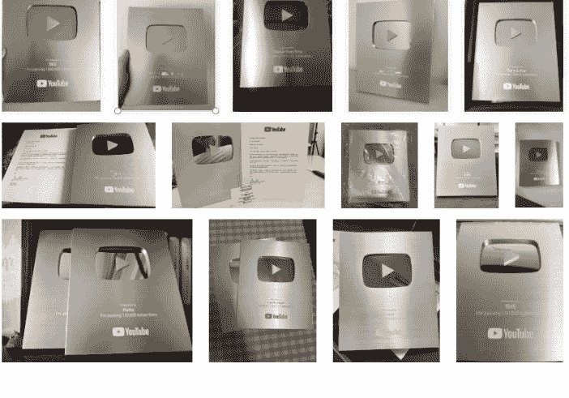

这一路，我们见过无数方向从爆发走向沉寂。但有一个方向，从第一次注意到它、并带着圈友批量跑出数百个 YPP 之后，过了一年多，依旧没被填满，甚至还有很大的增量空间。

答案就是竖屏开播。

去年，我们用 100 个号做压力测试，90 天内约 80 个号把可计入的观看钟点累计到 4000，顺利拿到 YPP。做过频道的人明白，这个比例非常夸张；那阵子深海圈里 YPP 下号速度像喝水。

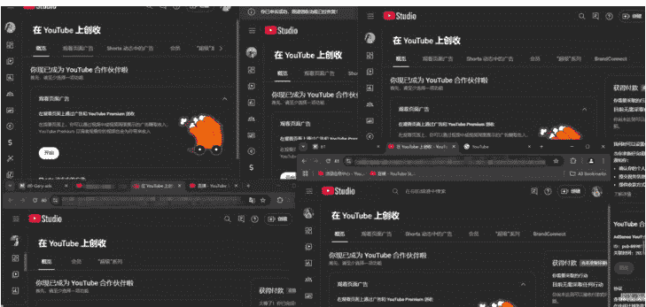

这批样本中，30 个号的累计钟点多数越过 4000，最低也超过 3200，最高到 5417.6；记录时间集中在 3 月 9 日。

当然，这种近乎捡钱的数据不会长期存在。最舒服的窗口是去年二到四月。经过十余个月实测与迭代，现在的竖屏开播已经没有早期“随便发都有数十万推荐”的体感，但仍是未挖透的富矿，因为后面会看到大量普通人也复刻得出的样本。

龙哥老师近期发布了 x 境外内容方向的超级项目标，号召大家进军海外。以我的观察，竖屏开播非常适合海外账号运营，且竞争尚未饱和，值得做境外内容的圈友重点看。

不绕弯子，这篇会把开播的底层逻辑和入门玩法拆清楚，也是圈友最关心的部分：

# 用开播拿 YPP

## 一、竖屏开播为何能计入 YPP

先给不熟 YouTube 的朋友补个课：想靠观看量分广告费，有门槛。平台认定的可计入观看钟点，只承认对外可见的长片；仅自己可见、隐藏、被删、广告投放、Shorts、未转点播的开播记录，都不在统计内。

去年春节前后，我们实测发现：竖屏开播产生的钟点，在符合条件时会被纳入 4000 小时门槛。规则可归纳为三条：

1. 开播状态要对外可见；有的账号默认仅自己可见，记得手动改。
2. 一场别超过 12 个钟头；超时则整场不纳入统计。
3. 使用有版权的配乐等原因收到社区警示，这场也不计。

搞懂规则，接着看下一个问题：靠开播攒到 4000 小时，听起来不轻松，实际怎么做？先看几个百万观看的样本。

4 分钟自拍，纯新频道，180 万观看。
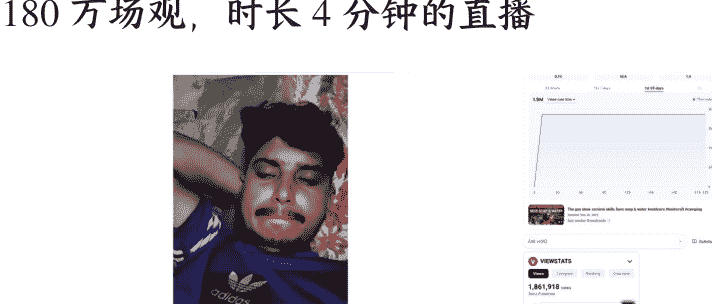

同一创作者换成户外自拍，仍是全新频道，200 万观看，时长同样 4 分钟。
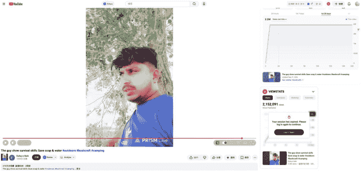

国内街边摊做鸡蛋汉堡，新频道，1200 万观看。
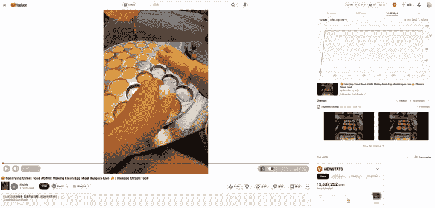

街边摊煎饼，小号，320 万观看。
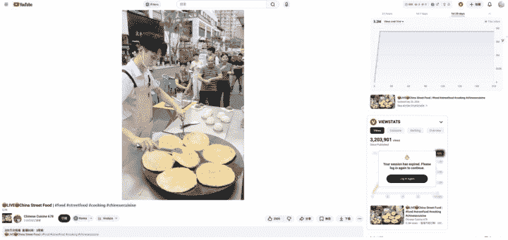

街边摊炒饭，小号，900 万观看。
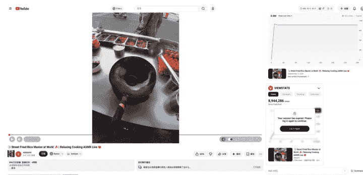

先别看内容，只看画面和订阅数：百万观看与 1–2 千、1–2 万订阅完全不匹配。在国内开播的人清楚，百万观看是什么量级；在抖音，1–2 万粉的账号很难做到上万人同屏、百万观看。YouTube 却常见订阅量与观看量倒挂的房间。

再看内容：这些画面换你拍，是否拍得出？能。自拍、街边摊摆拍，普通创作者即可完成。同样的东西发到 Shorts 或长片，大概率不到 1000 次播放；放在开播板块却成了爆款级别的量。原因在哪？

看一场 30 万观看的开播后台：旧式横向画面依靠封面小图点击带来的流量只有 71 次；41% 来自 Shorts 信息流，也就是平台把短视频的一部分推荐池分给了竖屏开播。Shorts 每日超过 2000 亿次播放，基数极大。
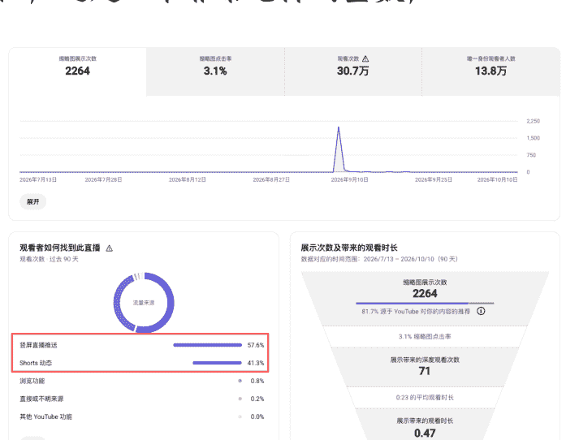

另一个占比 57% 的“竖屏开播推荐”入口，从此前一张后台图看，是近一年新增的独立分发入口，明显是平台为扶持开播开的通道。
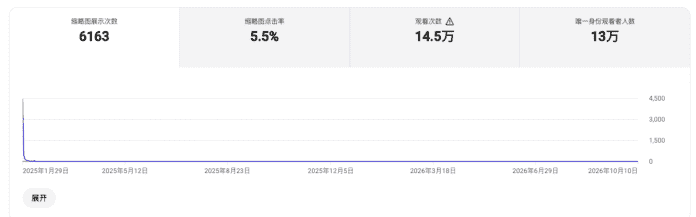

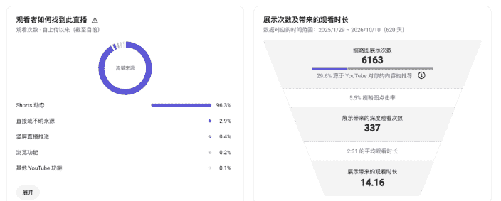

所以，竖屏开播拿 YPP 的关键只有两条：其一，符合条件的竖屏开播累计钟点可算进 4000 小时；其二，平台上的优质竖屏开播供给不足，官方又在加推，于是极普通的内容也能吃到大量曝光。

下面这些后台图，是圈友真实跑出的单场 3000 或 4000 小时记录。
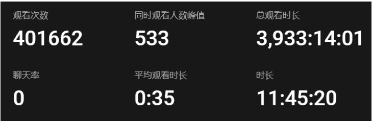

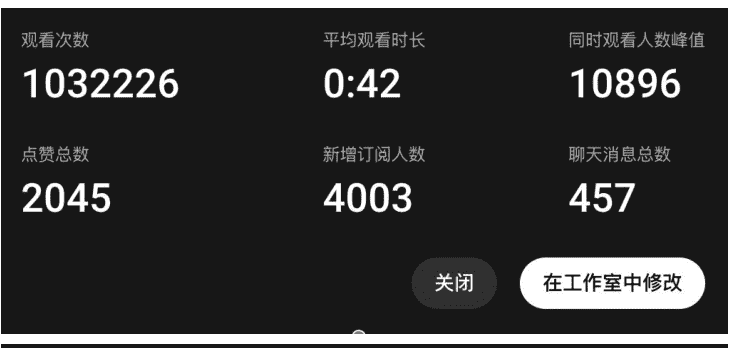

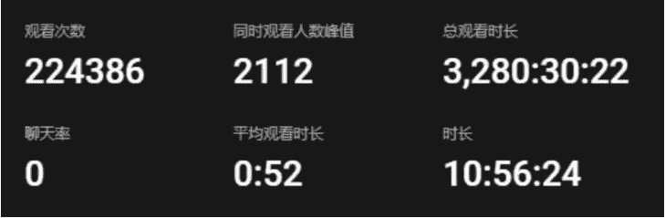

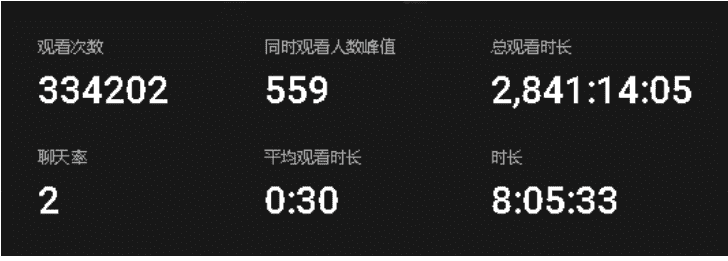

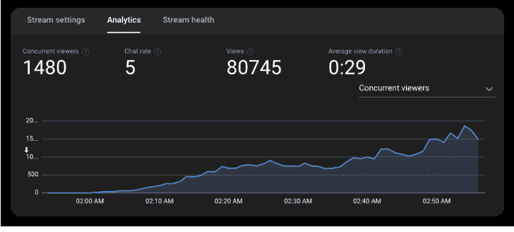

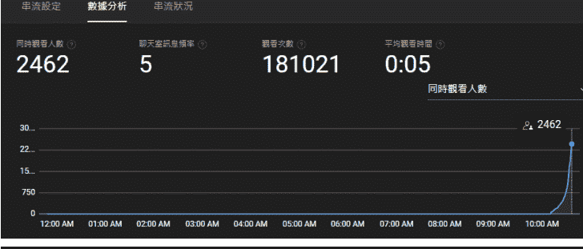

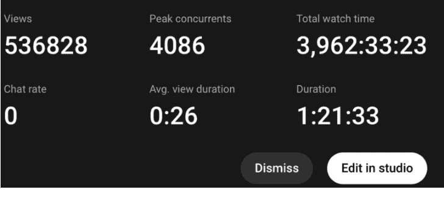

接下来进入操作。文中提到的数据站点、开播工具，都放在深海圈自建的工具集合页。为降低门槛，给赚钱圈友七天试用，Web 端与 MCP 都含，赚钱通行证授权即可开通；嫌文档步骤麻烦，可让 agent 通过 MCP 代跑。

入口：auth·ytdeepsea·com
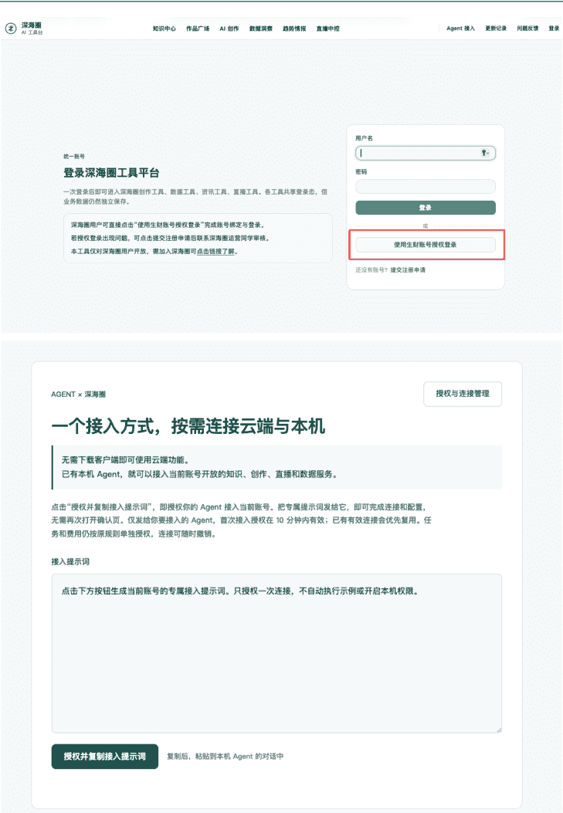

先说明：支付体系未搭好，单独售卖价值也未验证，因此工具和 MCP 现阶段只给深海圈内部使用。即便不用它，所有步骤也能手工完成，只是更费劲；看完你会明白，这份内容的价值并不在工具本身。

## 二、怎样找到有爆发空间的竖屏方向

开播前，先找有爆发空间的垂直方向，逻辑与做 Shorts、长片一致。

### 渠道一：看风向标式的历史开播

百人同屏就值得研究。按 100 人同时看、人均停留 20 秒估算，一小时能产出：100×3600÷20=18000 次观看；折成观看钟点约 18000×20 秒=36 万秒=100 小时。要凑 4000 小时，理论上维持约 40 小时的百人同屏即可。注意现在同屏数有水分，最好打对折估算。提高停留与同屏数都能加速。

举例：搜 Squid Game，这个词本身不垂直，但下面这种围绕具体小游戏的竖屏开播很垂直。看同屏约 200 人，再数同类房间。
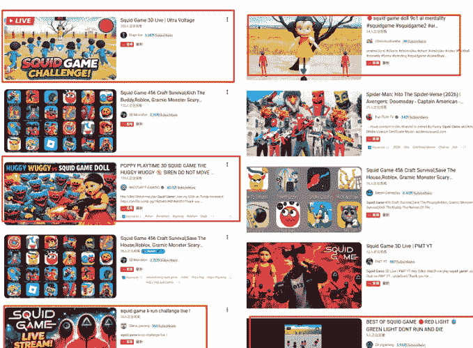

整个关键词下房间不到 20 个，真正开这个小游戏的只有 5 个，且都有量：最少 9 人同屏，两个约 30 人；订阅数仅 360 和 90。这样的方向可对标进场：你开 5 个号，相当于直接分走一半流量。

### 渠道三：数据工具

scout·ytdeepsea·com 是我做的站点，专门抓取开播房间与回放，每天更新，库内已有逾 17 万条。你也可以通过 MCP 拉最新数据。
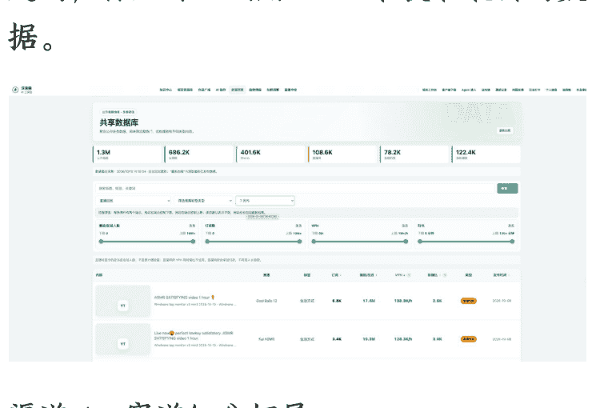

### 渠道四：细分扩展

以 Chinese food 为例，它已是热门方向，但房间多为 street food 街边摊。可不可以做手工美食、餐厅后厨、传统小吃如糖画、吹糖人？没人能保证，需要小成本测试。我们试过手工麻薯开播，也能起量。
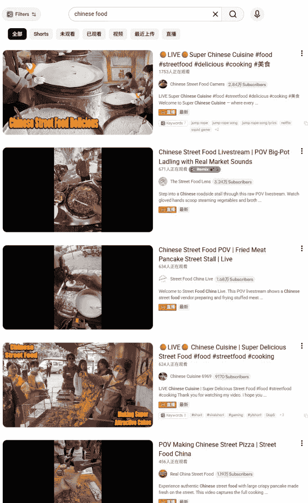

### 渠道五：给一批对标样本

整理了 100 个订阅少、播放高的近期样本，均为最近 30 天的竖屏开播回放。

## 三、开播素材从哪里来

现在已知：常见画面、国内普通房间都可能在 YouTube 竖屏开播获得大曝光；也知道如何找对标。接下来解决：素材怎么生产？

YouTube 大爆的竖屏素材大致分这几类：

1. 小游戏方向：
最好处理。自己玩并录屏、找别人的游玩录像、或直接在 YouTube 实时开播，都行。比如类似合成玩法的 Merge Fellas，曾经常年在线破万，现在仍有流量。竖屏小游戏在 YouTube 是常青品类；此前有圈友把某款消除小游戏的游玩录像拿来开播，也跑到百万观看。
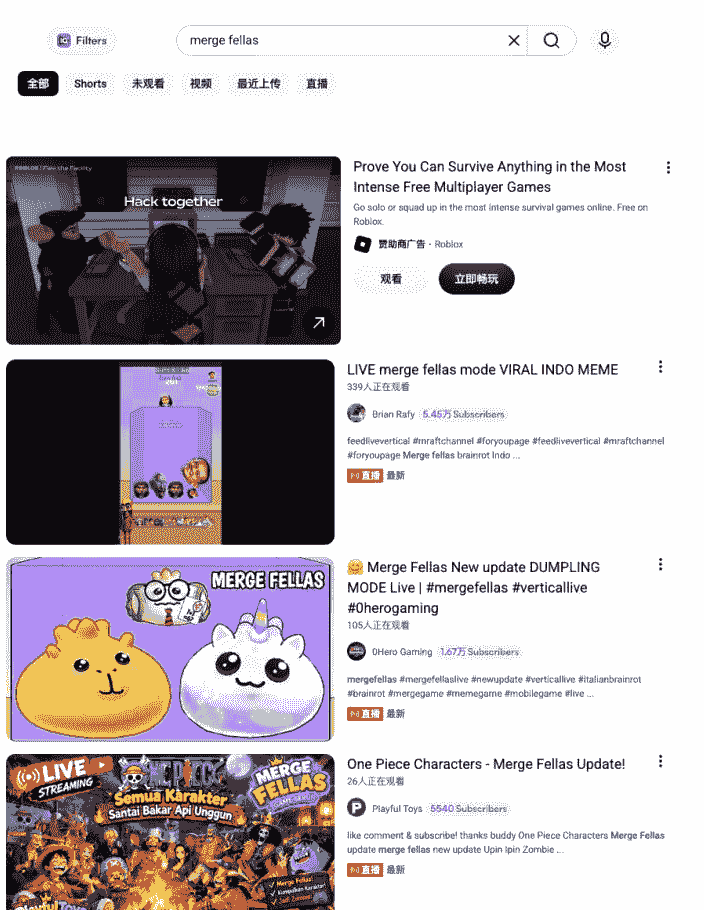

2. 摆摊、生活、剧情方向：
去抖音、哔哩哔哩、快手、📕找稳定开播的中小创作者，取得许可后在 YouTube 搬运转播。可先试水看流量，有数据再谈分成；很小的房间直接转播通常没人管，起量后再补许可。中餐这条线，从去年起基本由深海圈友包场。
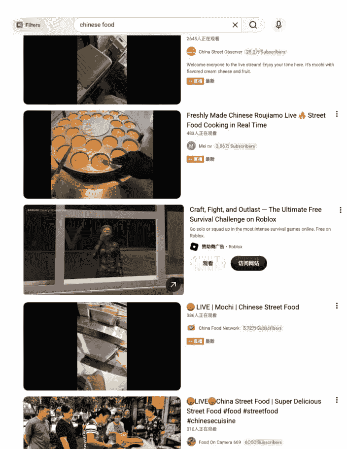

3. 生成式素材、图片轮播方向：
这一类可模仿后重做，不必原创。开播与 Shorts、长片不同：选题对、账号权重起来后，推荐更容易，精致度不是第一位。

生成式素材方向，新频道做到 1000 万观看。
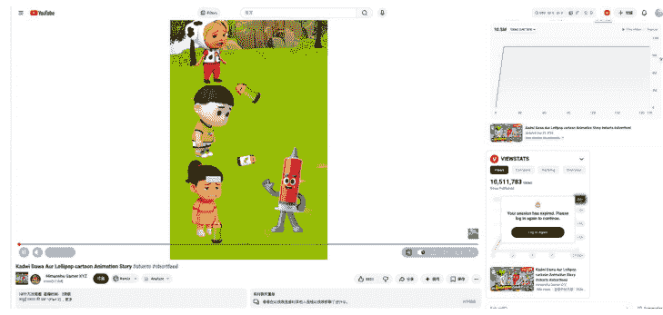

图片轮播方向，新频道 1000 万观看；背景其实是一段循环播放的预录画面。
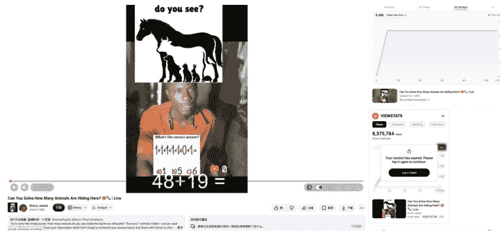

由此，开播素材可有三条路：

- A. 录屏、实拍或手工制作成片，开播时循环播放，几乎所有场景都适用。
- B. 实时搬播，把原房间信号转到 YouTube，适合已获许可或不在意原作者追责的情况。
- C. 真人实时开播，适合想经营个人品牌的人。

后面实操会讲 A、B 两条路的具体做法。

## 四、实操：在 YouTube 发起一场竖屏开播

下面用深海圈的工具演示。建议先别纠结底层原理，按流程跑一次，跑通自然明白；MCP 已开放，想深究可让 agent 解释。

用工具跑顺后，想自己搭也不难。

### 关键注意

- 1. 任何有版权的配乐都不要放，否则可能收到社区警示。判断不了就统一标准：除自己用 AI 生成的配乐，其他第三方配乐一律不用。
- 2. 素材最好自制，或取得创作者许可后转播，方便申诉时证明来源；录制需裁成 9:16，转播也要选竖屏来源，否则不是竖屏开播。
- 3. 冲 YPP 时，单场不要超过 12 个钟头，超过不纳入统计；老 Shorts 和长片若与开播无关，建议清掉。
- 4. 有活跃度的成熟频道更容易起量；新注册频道可能连续 30 天以上零播放，提前做好心理预期。

### 准备清单

#### 深海圈开播工具：
restream·ytdeepsea·com，用赚钱通行证授权，七天试用从激活起计时。

一台 VPS：年付 21 美元档即可。这个档位大约能同时搬播 2 个房间，或循环播 3 条片。频道如何开通后面讲，先准备 Google 邮箱。

前置资源先捋顺，后面操作才不卡壳。

账号这块，几条路可选：
- 想用手机号自己注册，教程在这里：https://www.youtube.com/watch?v=FPFsnytOSI
- 打算直接入手成品号，可以联系小圈，他的铺子：https://shop.jdkai.cc/products/gmail
- 海外长期手机卡，建议在电脑网页端直接登录注册；卡成品在咸鱼能搜到，具体卖家这里不点名
- 带年份的频道可以看 https://agedprofiles.com/ ，付款走数字货币，没发过作品的老频道约 3 美元

额外提醒一句：眼下 Google 风控挺凶，买来的号翻车概率不低。手头有稳定 Google 账号或 YouTube 频道资源的供应商，欢迎来谈合作。自己实操时，我更建议优先用自有账号，或者干脆自己新注册。

### 1. 准备一台直播专用 VPS

#### 1.1 挑 Linux 主机
新手可以直接上 racknerd，老手按自己喜好来。硬指标：能连 YouTube、能打开国内直播间、带宽足、网速快。流量换算参考：21 美元套餐大约撑 2 路全天候直播一个月，35 美元套餐大约撑 4 路全天候直播一个月。

#### 1.2 按名称或内容方向分组
点“添加”，等系统连上 VPS 并把推流环境装好，这期间别反复提交。
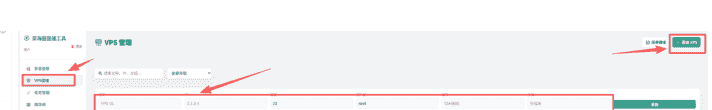
成功的标志：列表中出现这台 VPS，状态为“在线”。若状态不对，先点“测试”查连通性；只有页面明确提示要重装环境时，再点“初始化”。
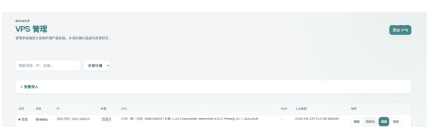

### 2. 配置 YouTube 直播

#### 2.1 解锁中级权限
打开 YouTube Studio：https://studio.youtube.com/，点右上角头像，进“设置”。
在“我的频道”里找到“频道状态和功能”，确认“中级功能”处于启用状态。若未启用，按页面指引完成手机号验证——整篇流程里，只有这一处可以用单次接码平台，接码站：https://5sim.net/ 。
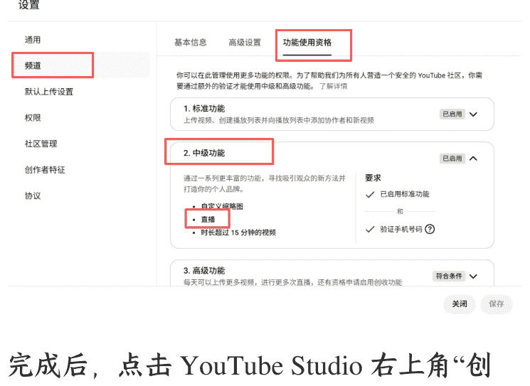
搞定后，点 Studio 右上角“创建”，选“开始直播”。首次使用按提示选编码器方式，并设置观众。
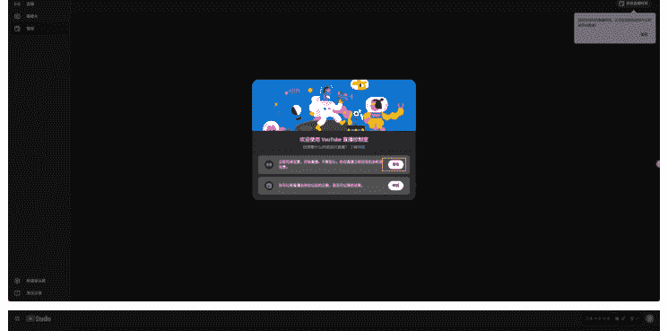
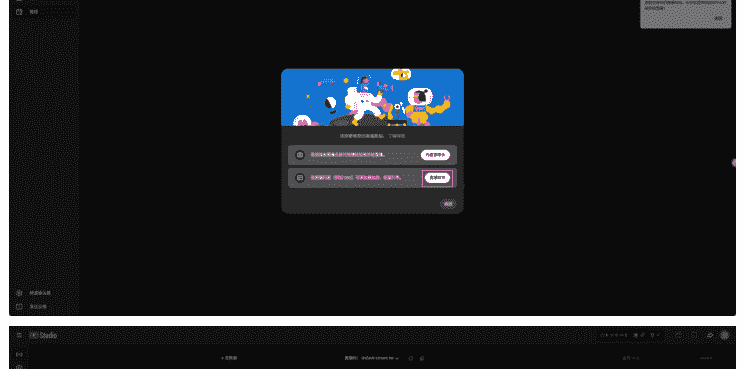
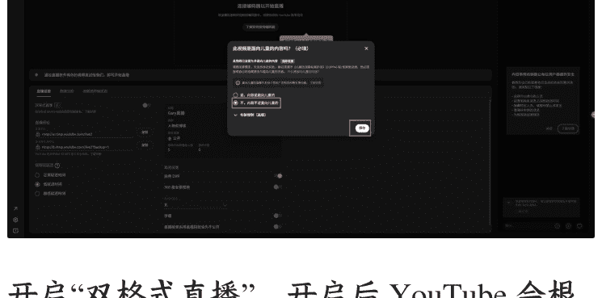
记得把“双格式直播”打开。开启后 YouTube 会拿横向流自动生成纵向版本推进 Shorts，横竖两路流量都能吃。
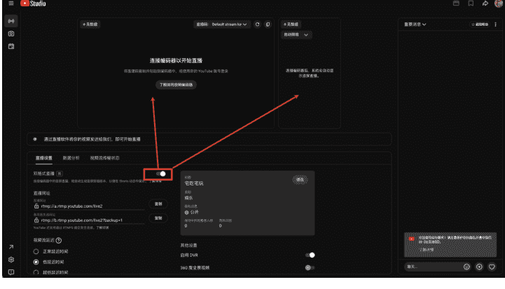

#### 2.2 复制串流密钥与观看地址
在当前直播界面，直接复制推流密钥和直播间链接。推流密钥相当于房间密码，负责把控制台画面送进 YouTube；直播间链接用来打开房间，并让控制台读到实时人数和播完后的累计观看数。这两项千万别填反。若同一频道要同时开多路，按第 6 章给新增直播排期并生成独立直播码。

| 信息 | 控制台字段 | 用途 |
|---|---|---|
| 直播码 / 推流密钥 | YouTube 推流密钥 | 把视频流送到对应房间 |
| 观众链接 | YouTube 直播间链接 | 打开房间并记录数据 |

点“了解如何使用编码器”，就能看到直播码（推流密钥）。
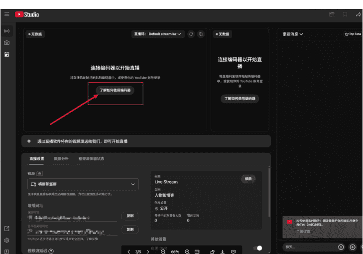
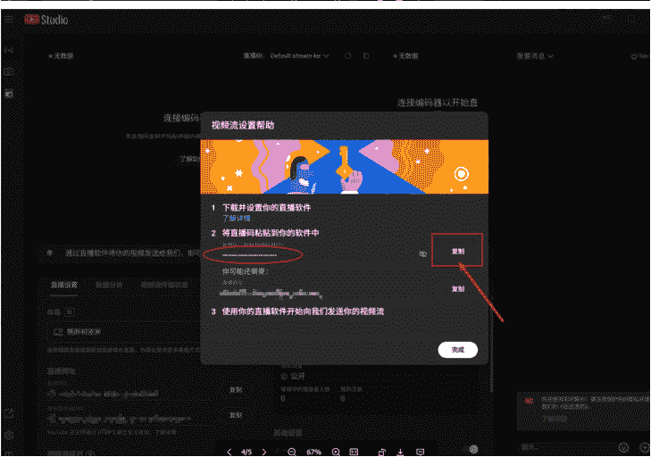
点右上角分享图标，直播间链接就出来了。
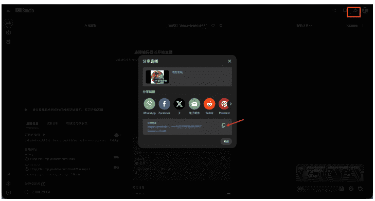

### 3. 在直播中控新建作业

#### 3.1 录入作业信息
进“任务管理”，展开“创建新任务”。不管哪种播出方式，都要选 VPS 并填入 YouTube 推流密钥。直播间链接虽是非必填，但建议填上，方便工具显示在线人数和播完后的累计观看；备注可以用来标账号、项目或主题。

直播源 URL 和媒体文件填不填，取决于播出方式。目前支持三种：

| 方式 | 适用场景 | 直播源 | 媒体文件 |
|---|---|---|---|
| live_only | 实时转推正在播的内容 | 必填 | 不用 |
| file_loop | 轮播 VPS 上已有的视频 | 不用 | 必填 |
| live_with_fallback_file | 源断流后自动切文件 | 必填 | 想切文件就必须备 |

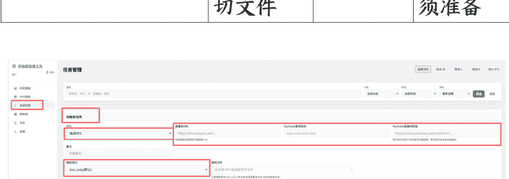

#### 3.2 新建、开启与关闭
填完点“创建任务”，作业一般先显示“已停止”。
核对 VPS、推流密钥、直播间链接、播出方式和素材是否一一对应。
点“启动”。“启动中”表示指令正在下发；“正在获取直播流”表示暂时没抓到可用源；“推流中”表示画面已经发往 YouTube。
控制台显示“推流中”后，回 YouTube 等预监画面出来，确认图像和声音都正常，再点“开始直播”。
要收工时，先在 YouTube 点“结束直播”，再回控制台点“停止”。

### 4. 三种播出方式

#### 4.1 实时转播方式
适合把正在正常播的内容实时搬到 YouTube，不需要提前备视频。
播出方式保持 live_only。
“直播源 URL”填标准直播间地址。
媒体文件上传会自动禁用，不用传。
有候选源时，在“备用源 URL”里每行填一个，系统会依次尝试。
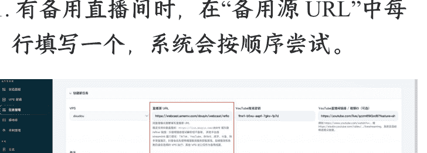

#### 4.2 本地轮播方式
适合持续轮播本地已有的视频。创建前先到素材库看看目标 VPS 的存储负载。
播出方式选 file_loop。
直播源输入会自动禁用，不用填。
页面显示“文件循环”。
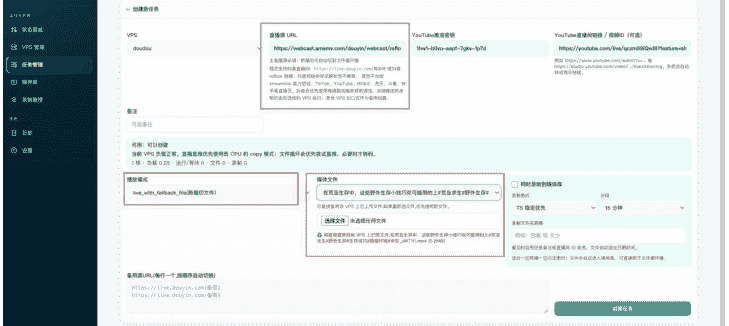

## 常见问题

### 1. 启动后一直卡在“等待直播”
可能原因：
- 来源直播间根本没开播。
- 开了播，但 VPS 直连被验证码或风控挡住。
- 抖音 Cookie 过期。
- 老脚本没更新到 VPS。
- 源链接填错，或者填的不是直播间地址。

处理办法：
- 打开来源直播间，确认它真的在播。
- 查看作业记录，看有没有“未找到可用的流”的提示。
- 点“修复”，更新脚本并检查 VPS 环境。
- 还不行就刷新 VPS 上的抖音 Cookie。
- 必要时填候选源，或切到断流补文件方式。

### 2. YouTube 黑屏或没有数据
处理：
- 去素材库查看 VPS 存储占用。
- 体积大的文件改用 SFTP 传到 /root/douyin2youtube/uploads/。
- 传完点“扫描导入 VPS 文件”。
- 建作业时直接选已有文件。

### 3. VPS SSH 连不上
处理思路同上：先查存储，再走文件导入流程。

### 4. 作业报错但实际信号还在发
处理：
- 点“校正”，让系统重新检测 VPS 上的运行进程。
- 打开 YouTube 房间确认有没有画面。
- 看作业记录里有没有脚本报错。
- 校正后仍异常，点“修复”。

检查顺序：先看作业记录，再看 VPS 状态，最后考虑是否更新脚本、刷新 Cookie 或换播出方式。

## 焚决：无人化播出
手工点来点去确实费劲，所以我做了 MCP。
在这个页面接入 MCP：https://auth.ytdeepsea.com/mcp，就能用 GPT6/6.1、Claude5.5 这一档的模型配合 MCP 跑全自动直播（VPS 购买和 YouTube 直播权限申请仍要预先搞定）。

我在 egolite 登录了一个试验频道，想验证：能否直接通过 B 站（哔哩哔哩）找到一个观众不足十人、没有配乐的直播间，再唤起直播 MCP，把从找源到转播的完整链路跑通。
测试结果：使用“ego lite 浏览器 + 直播 MCP”完成完整链路。
- B 站直播源：无声自习室，实际测试 1 位观众，音频抽样为无声。
- MCP 成功开启转播：YouTube 信号质量显示“极好”，观众页验证 1080p 连续播放。
- MCP 成功终止作业，YouTube 已结束直播，保留为不公开的测试存档。
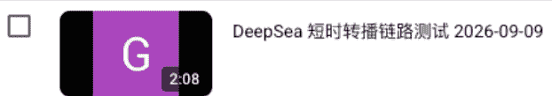

## 关于纵向直播的经验与技巧

### 1. 直播的大规律
账号活跃程度：最近有动作的老账号 ＞ 以前活跃过的老账号 ＞ 一直没活跃的老账号 ＞ 全新账号  
赛道竞争度：流量越大、同行越少，起量可能性越高  
内容专注度：大量案例表明，在垂直赛道长期直播，会慢慢起量直到坐稳头部  
素材复用程度：直接实时转 ＞ 素材轮播和重复使用；不过并非绝对

这是我们近 20 天测直播的数据。想靠直播批量拿下 YPP，矩阵是必选项，否则拿个位数账号去赌概率基本没戏，绝大多数账号的推流可能长期停在个位、十位级别。

| 记录账号 / 有数据账号 | 有效场次 / 素材记录天数 | 记录观看总量 | 单场中位值 / 平均值 |
| :--- | :--- | :--- | :--- |
| 77 / 76 个 | 597 场 / 482 个账号×日 | 225.17 万次 | 17 / 3,772 次 |

- **爆量场次**：5.86% · 35 / 597 场
- **出爆量账号**：18.42% · 14 / 76 个有数据账号
- **爆量观看贡献**：84.74% · 190.81 万 / 225.17 万次

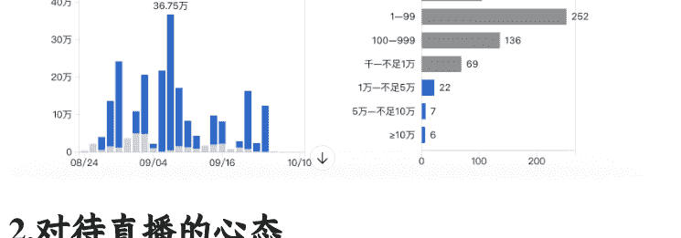

### 2. 对直播的看法
也有人问我：现在 YouTube 直播没以前好做了，要这么多账号才出点结果，普通玩家还有必要了解吗？
我的看法是：你能在海外、国内找到任何一个成规模的视频平台，允许大家用 VPS 群组做规模化、自动化、无人看管的直播间运营吗？你相信有人不懂做视频也能拿下 YPP 吗？即便 YouTube 直播门槛确实变高了，也改变不了它可以依托 AI 实现规模化自动运营、并且能产出 YPP 这个板上钉钉的事实。
等大家对 YouTube 直播的开发更深，一定会出现投入产出更高、潜力更大的打法，也许是卖货、也许是打赏、也许是海外私域。这也是我写这篇内容的原因——通过纵向直播拿下 YPP，只是我们了解 YouTube、了解海外变现的入场券；现在攒的经验，未来某个时间点大概率能让我们头一批吃到蛋糕。

### 3. 新手上路建议
适合谁：看好 YouTube 生态，或本身有 YouTube 运营经历；能扛住一到三个月看不到明显成效；有矩阵运营经历或自动化本事。  
建议怎么做：入手一两台 VPS（一年花费两三百元）、备好五到十个 YouTube 频道（至少），尽量用自动化的手段运营直播，每日投入一两小时把全部账号的直播运营做完，以十五天为一轮试赛道，流程跑通、YPP 打通之后再研究怎么扩大规模。

### 4. 零播放、百播放怎么办
直播很吃账号权重。可能 95% 的新账号开局就是零播放，这是客观规律，不用纠结。有老账号肯定优先用老账号播，零播放概率能降到约 50%。
维持活跃与内容专注，权重会逐步上升。下面三张图是相同一批账号、相同一批内容在不同时间的播放表现：一开始绝大多数账号就是零播放、个位数播放，但持续一段时间后会慢慢起量，快则两周，慢则两三个月。所以要多准备些账号，花最少时间、用自动化手段运营——靠人眼盯数据基本没用，账号活跃度没攒够，数据也没法分析。

## 2. 横向直播挣收益
最近 YouTube 冒出大量新账号做横向直播，播 ASMR、音乐类内容，流量很猛，我们也在试，确实有量。
更关键的是，相同播放量下，横向直播的 RPM 比长视频还略高一些。同样的内容，很多账号发长视频没流量，直播却有流量。
比如这个号：https://www.youtube.com/watch?v=H7XWQurp7hs ，人多的时段在线观众数超过一万，跟它长视频的流量完全不成比例。
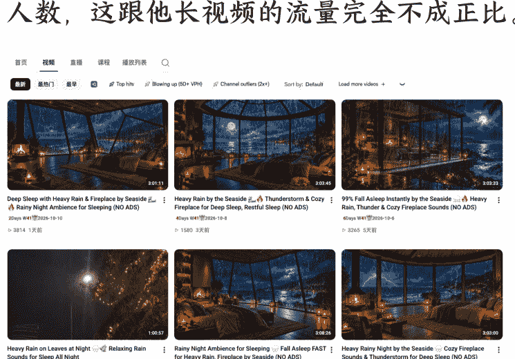
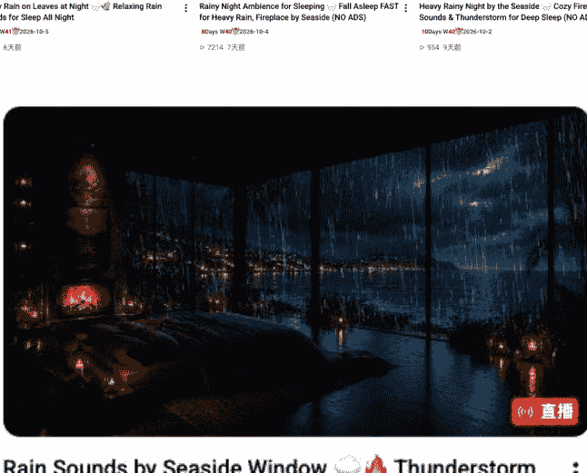

## 3. 打造个人 IP 与品牌
在 YouTube 直播生态还不完善的阶段，有没有可能借势把个人 IP 和品牌做起来？
我扒到一批百万千万场观看的账号，都出自同一家工作室：换不同人拍同款内容，一个月用几十个账号薅走 YouTube 几亿直播流量。这种内容我们每个人都有能力实拍出来，如果拿来做 IP 或品牌，投入产出会非常恐怖。我们最近也在安排实拍测试。
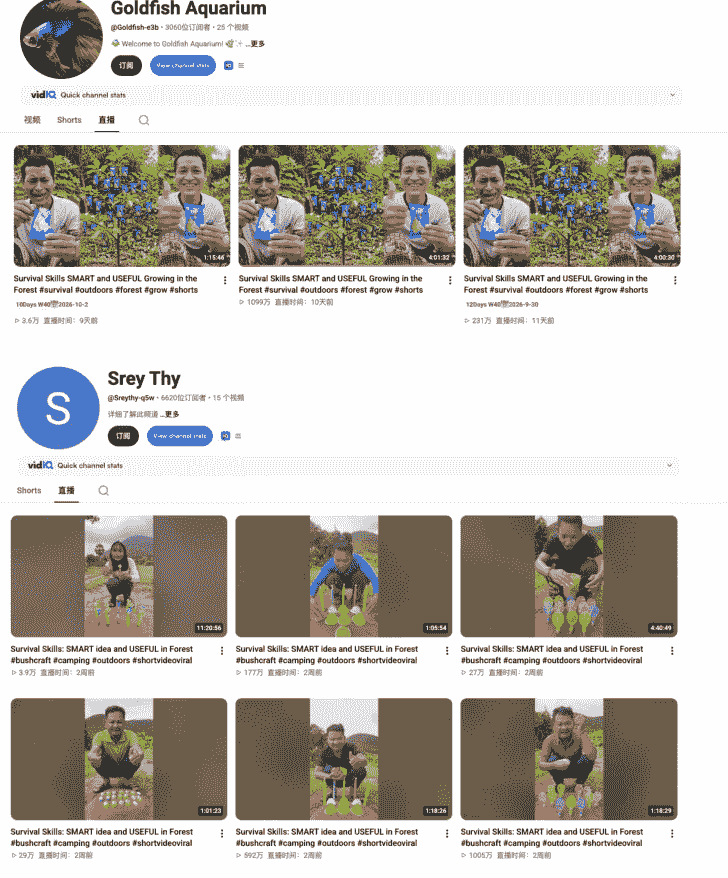
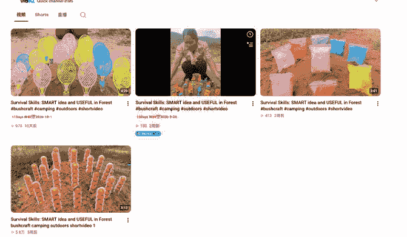

但愿这篇内容能拓宽大家对 YouTube 直播的认知，也欢迎圈友开发更多打法，一道交流出海挣美金！

————
读完这份 SOP 你或许觉得会了，但九成人一上手就卡在开头。
工具与教程不过是最浅的屏障，真正拦路的是马上开干，以及圈子里的信息差。
我们不扯虚的，只拆商业闭环、榨 AI 效率。系统里已经攒了 1000+ 跑通的套利实战局。
- □ 查看圈子完整数字资产与加入门槛：
https://lazyso.com/insider/
备注：“实操上车”，不闲聊

