# 从500万负债到9个月4000万营收：TikTok做中国入境游的实战复盘

261013 副业 SC 精华

整理：公众号懒人搜索，懒人专属群精选

懒人微信：lazyhelper1

微信：lazyhelper1

小懒点评 | 适合手上有地接资源或本地执行能力的做手，想借内容出海做入境游的人；不适合没有英语内容表达能力、想一夜暴富的人。最值得抄的是轻启动打法：就一台电脑一台手机一个号，混剪素材配英文文案起步，9个月成交4300笔做到4000万营收。最大的警示是作者此前All in禅修上游，把车房抵押、负债500万，最后被一次政策调整清零——重资产押注上游随时归零，这个教训比方法论更关键。

大家好，我是青妙，人在广州，现经营一家做入境游的旅行社，同时拿到TikTok官方跨境效果广告营销师认证。

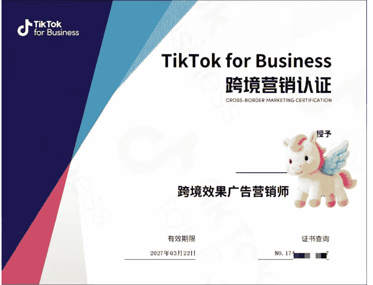

2025年4月起，我在TikTok上开始做中国入境游的英文短视频，用内容吸引海外游客来华。用户刷到视频后会来评论区或点进主页，再通过WhatsApp跟我们对接咨询并成交。

从拍片剪辑、账号打理、咨询转化，到地接资源整合、产品搭建、线路定制和落地交付，我们把前端获客到后端履约的整条链路跑通了。

2025年4月到12月，光靠TikTok自然流量就收了4300单，营收破4000万。2026年至今月均营收稳定在500万以上，按这个节奏全年有望突破6000万。

## 部分业绩统计表：

| 客户名 | 月份 | 出团日期 | 返团日期 | 总收款 |
|---|---|---|---|---|
| CHUNG BOON FOON等4人 | 2月 | 2月11日 | 2月16日 | 11550 |
| SOUL一日包车 | 3月 | 3月7日 | / | 3800 |
| SONYI4大1小 | 3月 | 3月12日 | 3月16日 | 8900 |
| BBTAN3人 | 2月 | 2月15日 | 2月19日 | 11180 |
| LIMPEINEE 2大1小 | 2月 | 2月25日 | 2月27日 | 6930 |
| nancy10大 | 3月 | 3月1日 | 3月9日 | 78490 |
| WUWU12人 | 3月 | 3月3日 |  | 6900 |
| mirror 3大1小 | 3月 | 3月20日 | 3月23日 | 28798 |
| mornica2大2小 | 2月 | 2月3日 | 2月7日 | 12400 |
| GARY4大1小 | 2月 | 2月15日 | 2月20日 | 20450 |
| evon5大2小 | 3月 | 3月3日 | 3月6日 | 11262 |
| 单包车一天 | 3月 | 3月9日 | / | 1000 |
| SLINSA | 3月 | 3月3日 | 3月6日 | 6900 |
| CHHAYLIM 3大 | 3月 | 3月10日 | 3月14日 | 9644 |
| Jenny 5大 | 3月 | 3月10日 | 3月15日 | 11000 |
| Iris tang 5大1小 | 3月 | 3月14日 | 3月17日 | 22500 |
| jasmine 12人 | 3月 | 3月16日 | 3月20日 | 20000 |
| 罗淑玲2人 | 3月 | 3月25日 | 3月29日 | 9760 |
| jovian4大1小 | 2月 | 2月18日 | 2月22日 | 14494 |
| dylan 13大 | 3月 | 3月20日 | 3月26日 | 28800 |
| shiemin 3大1小 | 3月 | 3月23日 | 3月25日 | 6025 |
| KINGSLEY2大1小 | 3月 | 3月26日 | 3月29日 | 8535 |

因为结果还不错，被TikTok官方邀请做内部分享，并颁发了跨境效果广告营销师证书。

下面按六个维度把过程摊开说：

- 1、我是怎么切入TikTok入境游的？
- 2、如何用极轻的方式拿到第一单？
- 3、从单人试水到团队化，我们9个月做到4000万的路径
- 4、入境游在TikTok上的完整操作链路
- 5、当下入境游的市场情况
- 6、0基础新手如何起步？以山东某学员为例

## 一、入局的来龙去脉

旅游创业前我在服装行业摸爬滚打。赶上电商红利，从一家店做到十家天猫店，旺季时月净利能过30万。那时我以为把店铺、供应链、客服、投放做精就能一直赢。

疫情一来，服装彻底变天。需求萎缩、退货库存压顶、平台流量费水涨船高。忙一个月，利润基本被广告费和损耗吃光。为了续命不断追加投入，最后只能减员关店。

从月入数十万到关店潮，我第一次看清：只靠平台红利的生意，抗风险极差，风一转就塌。

转行后我先研究餐饮。把快餐、小吃、火锅、茶饮、正餐、加盟单店等模型都算过一遍，坪效、人效、客单、翻台、租金、回本周期都测算过。结论是现金流看着好，实际重资产重运营，选址和模型一错试错成本极高。

回头审视自己的兴趣、优势和大方向，旅游更符合长期偏好，也能通过内容放大。我判断文旅复苏会有窗口。

2023年我成立旅行社做组团，起初靠小红书拿客卖货。团队一度扩到20多人，还做到过小红书商业化大客户。但很快发现，平台流量不归自己，产品在别人手里，交付看地接，利润和抗风险空间都很有限，基本是给平台和上游打工。

参加过集团游学和阿里产品大赛后，我开始思考旅游生意的本质。想做长远，不能只做拿货卖货的流量生意，必须转向产品思维，找细分赛道做壁垒。

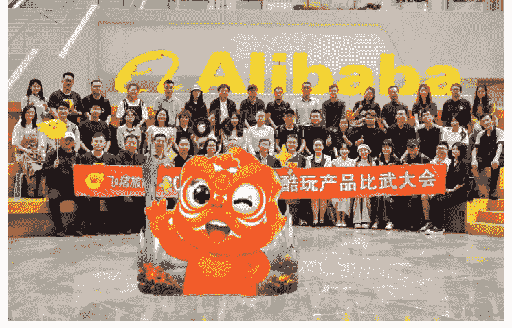

我把目光放在了禅修赛道。带着团队跑寺院、谈资源、设计产品、打磨线路，想把禅修从普通游玩升级成有文化厚度、有体验感、有资源壁垒的产品。

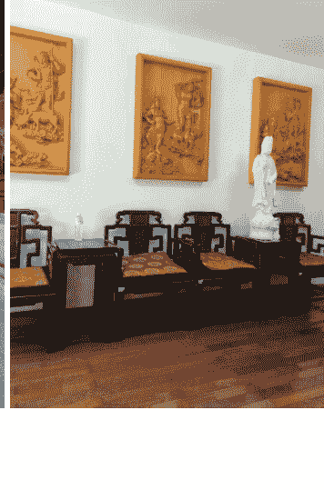

2024年6月禅修项目上线，9个月里通过抖音和小红书获客，每周固定两期，共办213期，总营收2500万。

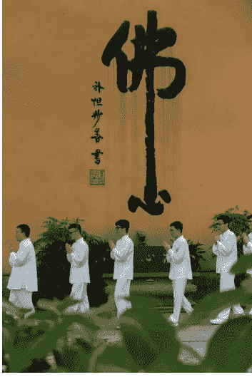

- 第60期普陀山禅修班(25)
  包含: 普陀山静修-如一师兄
- 1.31长寿慈心禅修班(16)
  包含: 普陀山静修-如一师兄
- 普陀山静修 5月23日(32)
- 普陀山静修 4月22日(44)
- 普陀山静修 4月15日(44)
- 普陀山静修 5月27日(26)
- 普陀山静修 4月25日(34)
- 普陀山静修 5月31日(22)
- 普陀山静修 4月30日(23)
- 普陀山正念静修 2月28日(21)
- 普陀山静修 4月18日(28)
- 普陀山静修 4月8日(28)
- 第60期普陀山禅修班(25)
  包含: 普陀山静修-如一师兄
- 1.31长寿慈心禅修班(16)
  包含: 普陀山静修-如一师兄
- 普陀山静修 5月23日(32)
- 普陀山静修 4月22日(44)
- 普陀山静修 4月15日(44)
- 普陀山静修 5月27日(26)
- 普陀山静修 4月25日(34)
- 普陀山静修 5月31日(22)
- 普陀山静修 4月30日(23)
- 普陀山正念静修 2月28日(21)
- 普陀山静修 4月18日(28)
- 普陀山静修 4月8日(28)
- 【普陀山心静】118期(15)
  包含: 普陀山静修-如一师兄
- 普陀山静修 104期(24)
- 【普陀山静修】105期(18)
- 普陀山静修 8月15日(17)
- 普陀山静修 103期(10)
- 普陀山静修 101期(16)
- 普陀山静修 100期(10)
- 普陀山静修 8月8日(17)

尝到甜头后我更想做大，目标是把上游资源握在手里。于是做出一个现在看很冒险的决定：把名下车房抵押，向朋友借款，把资金全部砸向寺院合作和酒店投资，想形成别人复制不了的壁垒。

结果2025年初政策一变，寺院不得由私人承接相关活动，平台也开始限流“禅修”等关键词。刚起势的项目被按停。

那一刻像天塌了。车贷房贷、借款、项目投入叠加，债务峰值接近500万。当时口袋空空，每月几万还款压力，只能拆东墙补西墙。团队从二十多人只剩我和一个销售，大办公室也退了，搬进小屋办公。

最焦虑的不是增长，而是下个月钱从哪来，公司还能不能活。

2025年3月我回小红书试水，很快发现国内游已经极度内卷，手上没人没钱投流，硬拼不占优。试过Facebook投放，海外获客成本约80元人民币/个线索，还只是咨询费，对现金流紧张的我来说不可持续。

我意识到要找的不是更贵的投放口，而是还有自然流机会、能低成本验证的平台。

2025年4月我注意到TikTok类似早期的抖音，自然推荐强，能不花钱带来大量咨询。于是开始尝试用英文短视频做中国入境游。

素材主要是城市、美食、高铁、景点、文化体验的画面，重新剪辑拼接，配上海外用户能看懂的英文文案和字幕。核心不是搬运风景，而是思考外国人对中国的好奇点：高铁、移动支付、城市安全干净便利、长城故宫兵马俑熊猫美食传统文化等。

视频发出后，客户会留言或进主页，通过WhatsApp联系。先确认国籍、人數、出行时间、城市偏好、家庭/商务/研学等需求，再匹配现有产品或做简易定制，确认后收定金。

这个粗糙流程验证了三件事：海外用户会被中国旅游内容吸引、TikTok自然流能带来真实咨询、客户愿意通过WhatsApp沟通并付款。

很多新手想把团队、系统、产品一口吃成型，我的体会恰恰相反：早期要的是快速验证。先证明有人看，再证明有人问，最后证明有人付钱。三件事成立再加人加产品，否则投入越重掉头越痛。

第一单的意义不只是回血，更是在负债、团队解散、现金流告急时，用极轻的方式打开一个新增长口。

## 三、从单兵作战到团队化，怎么做到的4000万

第一单跑通后我明白，靠一个号几条片长久不了。随着咨询量上升、需求变复杂、客单提高，后端承接能力成为瓶颈。旅游不是标准品，要跨国落地，涉及签证、酒店、用车、导游、餐饮、支付、语言、应急等全链路。

于是开始重组团队。

前端搭建内容组，持续产出适配海外受众的中国旅行内容。起初只有英文，后来扩展到日语、韩语、西班牙语等多语种。因为欧美更关心安全和深度体验，日韩偏好短途节奏和便利，东南亚更看性价比、支付和签证便利。同一套内容打全世界转化会打折。

中端建立客服和销售承接体系。客户进WhatsApp后先摸清需求：来源地、人數、时间、预算、是否带老人小孩、想去哪些城市、偏好文化还是自然、出行类型等，再做方案和报价。入境高客单不是拼低价，客户买的是合适的中国旅行方案，匹配不到需求立刻流失。

后端搭建产品、供应链、地接和履约体系。订单成交后才是硬仗：对接酒店车辆导游景区餐厅，校验行程合理性、用车时长、语言沟通、导游匹配度、航班天气等突发预案。客户不会区分前端后端问题，只记得是否靠谱。

我们筛选全国优质地接，不只看价格，看稳定导游、真实接待力、应急经验和服务意识。同时沉淀SOP：咨询记录、方案设计、报价呈现、定金收取、出行前提醒、落地建群、导游对接、行程日报、问题升级、结束后复盘和评价收集。

这些细节决定订单能否稳定交付。

2025年4到12月，TikTok自然流量带来4000万营收，不是靠一支爆款，而是内容持续生产、客服及时承接、销售完成转化、产品设计线路、地接落地执行、售后跟进反馈，整条链路协同的结果。过程中我们也积累了大量好评和转介绍。

# 入境游升温之后，短视频正在改写获客方式

最近有两类买家让我印象很深。一位印度客户在线上跟我们逐项核对行程安排；另一位哈萨克斯坦客户专程到公司，实地了解研学产品。现在不少咨询并不是刷到单条视频就立刻上门，而是先看我们的内容、案例、客户回访和团队展示，慢慢把信任建立起来。

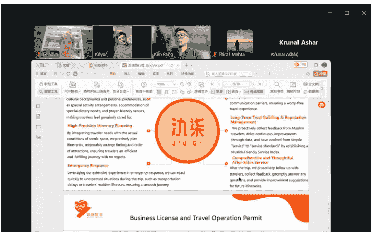

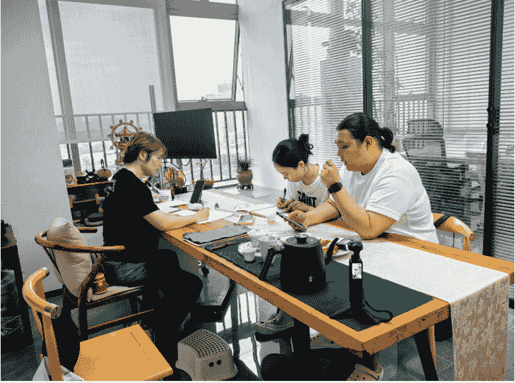

2026年，公司把业务重心整体转向TikTok入境游。

这个决定对我来说分量很重。

当自然流量、WhatsApp成交、线路产品打磨和落地执行真正跑通后，我越来越确定：这不是短期流量生意，而是一条可以长期扎根的赛道。

从自己单干到带着团队做，我最大的体会是：

起步阶段，缺的往往是被看见的机会。

订单多起来之后，真正拖后腿的，通常是团队接不住咨询、谈不下订单、交付不稳定。

有曝光却没人接待，询盘就会白白流走。

携程已经明确：未来三年拿出150亿元专项资金，用于入境游全球推广，目标是在五年内吸引两亿国际访客；同时还邀请成龙担任入境游大使。

这个信号很清楚：入境游不再只是部分旅行社的小规模试水，头部平台已经开始重仓下注。

携程集团董事会主席梁建章在采访中提到，2025年中国入境游直接收入占GDP的比重只有0.67%，泰国超过10%，欧美国家普遍在1%到3%之间。

在他看来，中国并非缺少吸引力，而是入境游潜力还没有被充分释放，这背后是万亿规模的新增空间。

对小微创业者来说，大平台入场意味着竞争会更激烈，但也意味着市场正在被教育、被放大，更多海外用户会看见中国。

大平台做声量和基础认知，细分垂直、服务能力更强的小团队，仍然可以在具体人群和具体产品里找到自己的位置。

旅游消费本质上买的是情绪和想象。用户刷到视频被一个地方打动，会产生“我也想去”的念头；如果签证流程复杂，这股冲动很容易被消磨掉。

签证越方便，甚至免签入境，用户从心动到出发的距离就越短。

过去一个欧洲家庭来中国，光签证就要准备很久；现在不少国家的游客可以免签入境，说走就走。门槛越低，潜在客群越大，短视频种草变成真实咨询和订单的概率也越高。

所以我认为，入境游不是一阵小风，而是一个正在打开的大市场。

数据也能说明问题：2024年中国接待入境游客1.3亿人次，同比增长61%；2025年突破1.5亿人次，同比增长17%，超过2019年同期；国际旅游收入达到1311亿美元，同比增长39%。

到2026年，如果免签、过境免签、国际航班恢复、海外社媒种草继续叠加，入境游客量仍有机会保持高位增长。

更值得注意的是客户结构正在变化。

以前海外游客来中国，多依赖传统旅行社、商务接待、OTA或熟人介绍；现在越来越多年轻人、家庭客户和高净值客户，会先在TikTok、Instagram、YouTube等平台看到中国内容，产生兴趣后再进入咨询和预订。

政策降低了来中国的门槛，内容平台放大了用户的兴趣。两股力量叠加，就是TikTok入境游的机会。

## 一、内容侧窗口：游客做决定的方式变了

过去海外游客来中国，常见路径是找旅行社咨询、在Google查攻略、去OTA比价、听朋友推荐，或者由商务、学校、机构组织出行。

这条路径更长，也更理性：先搜索，再比较，再筛选供应商，最后下单。

TikTok出现后，顺序被改写了。

很多人的旅行灵感不再从搜索框开始，而是从刷到一条视频开始。

可能是一段中国高铁的视频，让人发现城市之间出行很方便；也可能是一个外国人在中国逛夜市、坐地铁、用手机支付、看故宫、看熊猫、体验传统文化，然后突然觉得：

“原来中国和我想的不一样。”

“我也想去看一次。”

TikTok带来的最大变化，是不用等用户主动搜索，而是在他还没有明确计划时，先把目的地种进心里。

旅游本来就高度依赖情绪和想象力。

一条好视频，可能让用户初次对中国产生兴趣；连续几十条内容，则会慢慢消除他对语言、安全、支付、交通和文化差异的顾虑。等他真正准备出发时，第一个想到的，往往就是长期出现在信息流里的那个账号或品牌。

旧路径是：Google搜索、看攻略、OTA比价、下单购买。

新路径是：刷到视频、被内容触动、搜索标签、关注账号、发私信、在WhatsApp里对接、直接预订。

比如一条介绍成都美食的视频，播放量很快冲到几十万。

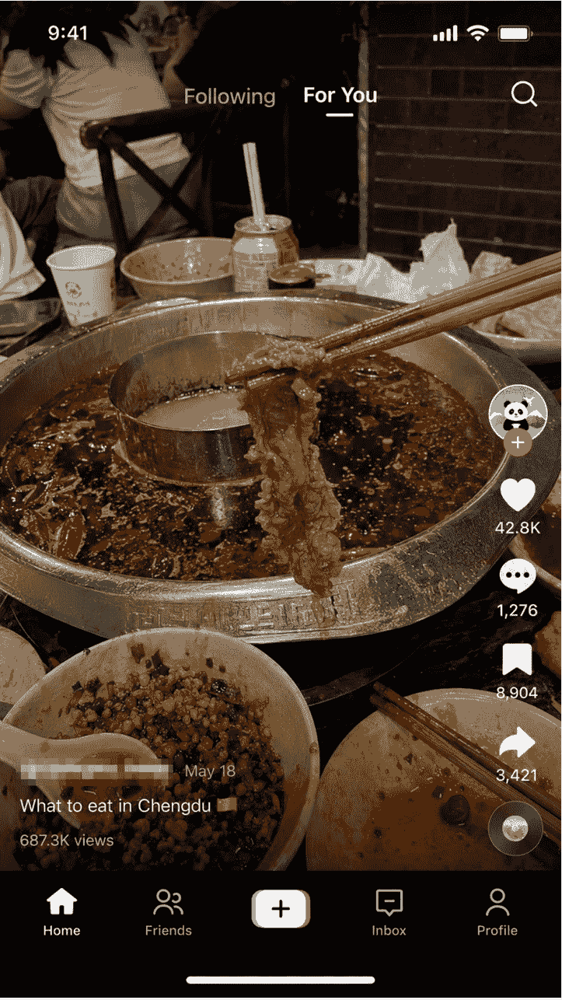

对普通创业者来说，这是一次难得的机会。

过去，获客能力更多握在平台、大旅行社、OTA和线下渠道手里。没有门店、没有广告预算、没有渠道关系，就很难拿到客户。

现在，一部分获客能力正在转移到会做内容的人手里。

只要你能持续生产海外用户看得懂、感兴趣、愿意信任的内容，就有机会通过TikTok触达全球客户。哪怕你是一个人从业，哪怕以前没做过旅游，也能直接接触到入境客源。

## 二、赛道窗口：看起来热，真正会做的人还不多

经常有人问我：“入境游已经这么热了，TikTok入境游还有机会吗？”

我的判断是：有，而且仍处在窗口期的前段。原因有两个：

第一，真正意识到这个机会的人还不够多。

大家都知道国内游、小红书、抖音、视频号很卷，但把目光转向TikTok入境游的人仍然是少数。尤其是传统旅行社，很多还停留在国内平台获客、渠道分销、地接合作的逻辑里，对海外内容平台理解不深。

第二，这条赛道本身有门槛。

开号、网络、设备、平台规则，就已经拦住一批人。很多传统旅行社老板想做，但第一步就不知道从哪下手。

而且，TikTok入境游不是注册一个账号、发几条视频就能自然成交。你要懂海外用户喜欢看什么，会用英文或多语言表达，知道怎么把平台上的关注者引导到WhatsApp，还要具备销售转化、线路设计、地接资源整合和落地交付的能力。

也就是说，这个赛道看起来门槛低，实际很考验综合能力。曝光只是入口，能不能赚钱，取决于你能不能把“靠内容找到人、在私域接住咨询、把订单谈成、把线路产品做出来、把行程执行好”整条链路跑通。

这也是我依然看好TikTok入境游的原因：

不是没人做，而是真正会做的人还不多。

## 三、新手起步：从熟悉的目的地开始

我们算业内较早一批做TikTok入境游的旅行社。因为前期业绩增长较快，也引起了不少同行关注。

2026年以来，TikTok官方邀请我做专题分享，旅业资讯、酷营等行业平台也陆续邀请我去讲实战经验。同时，不少国内外旅行社专程到广州交流，韩国、印尼、澳洲的同行都来过。他们关心的问题很相似：账号怎么起？什么内容能带来咨询？客户进来后怎么成交？成交后后端怎么交付？

2026年6月，我开了一期TikTok入境游实战营。那一期来了接近30家旅行社，大家来自不同城市，目的地资源和背景也各不相同。

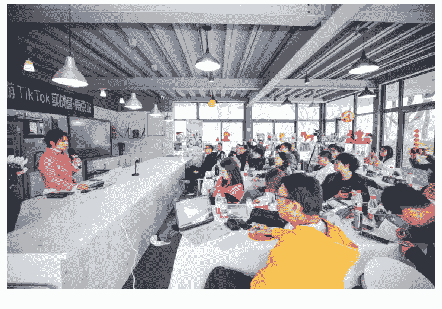

通过这些分享、培训和同行交流，我链接到全球不少优质地接社资源，也更深入地了解了不同目的地的产品、供应链和服务能力。

同时，我也收集到大量新手在实操中遇到的真实问题。

比如账号怎么注册，内容怎么定位，视频有播放但没咨询怎么办，客户进了WhatsApp后怎么聊，线路不会设计怎么办，地接资源怎么筛选，成交后怎么保证交付。

这些问题，我自己做业务时遇到过；后来带学员时，又看到了更多不同类型的案例。解决的问题越多，我对这套方法的理解也越深。

学员里，山东的小A很有代表性。他完全不懂TikTok，在我们的指导下，仅用20天就拿到第一个客资，现在每天能通过TikTok拿到上百个有效线索。

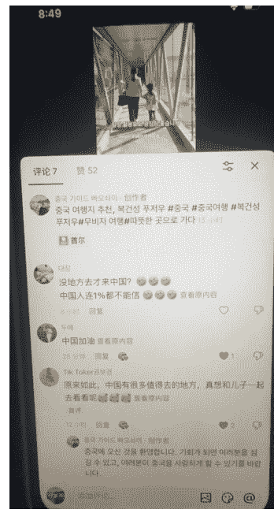

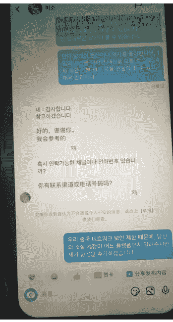

下面以他的成长路径为例，拆解新手做TikTok入境游具体怎么开始。

### 动作一：先把产品方向定窄

很多新手一上来就想做“中国旅游大全”。今天发北京，明天发上海，后天发西安，再过两天发张家界、桂林、成都。内容看起来很多，覆盖面也很广，但账号没有记忆点，客户也不知道你到底擅长什么。

所以，我们没有让小A去做全国市场，而是先帮他盘点自己的资源。

小A在山东，对本地地接、酒店、车辆、导游和线路产品更熟。最终我们给他的方向定得很清楚：

山东文化游、孔子文化游、青岛海滨加历史文化线路。

这个切口有几个好处。

不同市场的关注点差别很大：欧美客户更看重文化体验、安全感和深度旅行；东南亚客户更在意性价比、签证便利和短途出行；中东客户更关注高端接待、家庭出行、隐私和服务规格；韩国客户更看重行程效率、细节确定性和服务标准；西班牙语市场，包括西班牙、墨西哥、阿根廷、智利、哥伦比亚等国家，用户对中国文化、美食、城市变化和异国体验有很强好奇心；俄罗斯客户则更关注价格透明、路线深度、签证交通和实际体验。

这六个市场的客户画像不同，内容打法不同，转化方式也不同。只有先搞清楚人群，再去设计内容，TikTok带来的关注才不会只是热闹，而是能真正变成咨询和订单。

经过调研，小A选择了韩国市场。

### 动作三：先把账号环境搭稳

很多人想做TikTok，但第一步就卡住了：账号怎么注册？手机怎么准备？网络环境怎么搭？系统语言怎么设置？账号怎么保持稳定？能不能频繁切换地区？要不要插海外电话卡？

这些问题看起来很基础，但对新手来说就是门槛。

如果账号环境不稳定，后面内容做得再好，也可能发不出去、没流量，甚至账号频繁异常。所以我们先帮他把基础环境搭好，让账号能够正常、稳定地发布内容。

### 动作四：内容要围着“有效询盘”做

我们做TikTok入境游，目标绝不是单纯涨粉，也不是让视频看起来很热闹。

真正的目标只有一个：拿到有效询盘，拿到能转化的客资。

很多人刚开始做TikTok，会特别在意播放量、点赞量、粉丝量。视频爆了很兴奋，账号涨粉了也很开心。但做生意不能只看这些表面数据。

对入境游来说，一条视频有100万播放，如果没有客户咨询，没有人进WhatsApp，没有人愿意沟通线路和预算，那它对业务的价值其实很有限。

反过来，有些视频播放量不一定特别高，但来的都是精准客户。他们正在计划来中国，愿意询问线路，愿意了解报价，甚至愿意支付定金。这样的内容，才是真正能带来生意的内容。

所以，我们在做内容之前，不能只问“什么视频容易爆”，而要先问：我想吸引哪一类客户？他们为什么想来中国？他们最担心什么？他们愿意为什么付钱？

海外客群虽然差异很大，但有一个共同点：他们都很在意你是否真正理解他们。不是你的景点一定要多震撼，也不是你的行程一定要多复杂，而是客户看到你的内容、发来第一条私信时，就能感受到：你知道他是谁，你理解他的顾虑，你能用他熟悉的方式解决问题。

这也是做TikTok入境游非常关键的一点。

所以，我们没有让小A一上来就做简单的景点混剪，而是把内容分成几类：

兴趣型内容负责打开兴趣。

认知型内容负责打破海外用户对中国的刻板印象。比如中国安全吗？城市干净吗？交通方便吗？外国人在中国会不会不适应？这类内容负责降低陌生感。

攻略型内容负责解决实际问题。比如外国人在中国怎么用手机支付？高铁票怎么买？语言不通怎么办？机场怎么接送？签证和免签政策怎么看？这类内容最容易带来精准咨询。

决策型内容负责帮客户判断城市和线路。比如第一次来中国，北京和上海怎么选？带父母来中国，哪些城市不要排太赶？10天中国行程怎么安排？这类内容非常接近成交。

信任型内容负责让客户相信你能交付。比如客户案例、付款记录、接待现场、客户好评、团队介绍、公司办公室、线下沟通、导游服务、车辆和酒店安排等。高客单客户一定会看这些。

举几个选题例子：

- 初次来中国，北京和上海怎么取舍？
- 外国旅客在中国怎么用手机支付？
- 陪长辈来中国，哪些城市节奏要放慢？
- 中国高铁到底有多方便？
- 为什么欧美家庭来中国，最担心的是语言和安全，而不是景点？
- 初次来中国，10天线路怎么安排更舒服？
- 带孩子来中国，哪些城市更适合家庭旅行？

这些内容的核心，不是单纯展示中国有多美，而是帮助海外客户做决策、降低顾虑、建立信任。

所以，TikTok入境游真正要做的，不是“涨粉账号”，而是“客资账号”。

一个能赚钱的TikTok账号，一定不是只有播放量，而是能把陌生用户一步步带到WhatsApp，带到方案沟通，最后带到定金支付。

这才是我们做内容的真正目标。

### 动作五：把咨询落到WhatsApp里

TikTok的视频只是第一步，真正的商业转化不在评论区，而在私域沟通里。

所以账号主页必须清楚告诉用户：我们可以提供中国旅行线路建议，可以通过WhatsApp联系。

客户进来后，也不能只简单问一句“你想去哪”，而是要有专业的承接话术。

对于新手来说，前期最重要的任务不是马上学会成交，而是先把客资拿到。

只要能通过TikTok内容，把海外客户引导到WhatsApp，并且拿到真实有效的咨询，这一步就已经完成了前端获客的验证。后面的线路沟通、方案设计、报价和成交，可以先交给旅行社里更专业的销售或定制师来完成。

因为高客单入境游的成交，并不是简单回复几句话、发一个报价单就能解决的。它需要理解客户需求、判断预算、设计线路、解释服务细节，还要处理客户对安全、语言、支付、行程和交付的各种顾虑。

如果新手想自己做成交，我建议至少去旅行社系统学习半年到一年，真正接触客户、跟进咨询、看别人怎么报价、怎么谈单、怎么处理异议。

这个环节非常专业，短时间很难讲透，所以这里先不展开。

这一阶段，新手先把重点放在一件事上：通过内容拿到真实客资。只要这件事跑通，后面才有继续学习成交、产品和交付的价值。

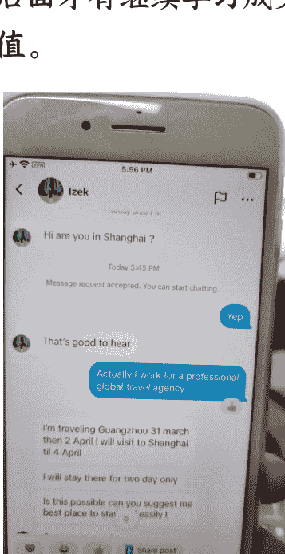

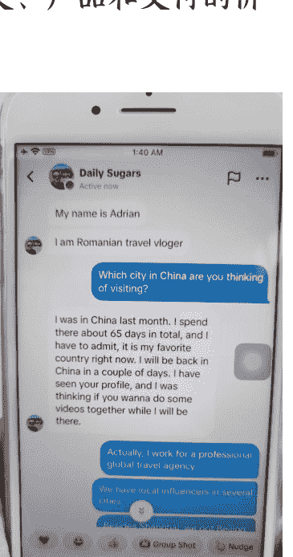

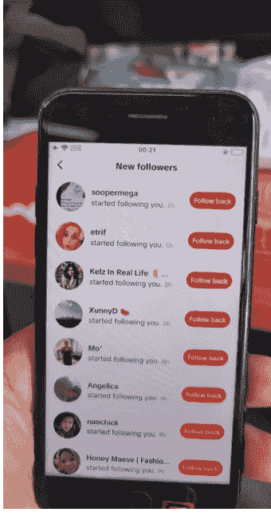

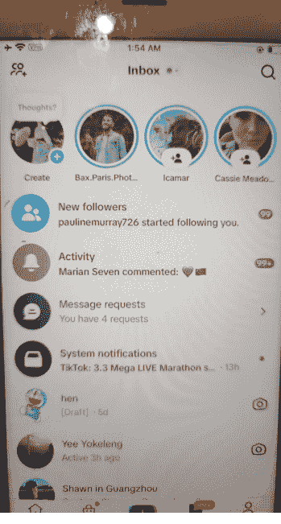

### 动作六：用本地地接资源完成交付

小A的优势就在这里。

他不一定懂TikTok，但他熟悉山东本地资源。客户如果真的对山东文化游、孔子文化游、青岛线路感兴趣，他可以更快找到本地导游、车辆、酒店和地接资源来承接。

这也是我一直强调的：新手不一定要一开始做全国市场。很多人总觉得做入境游就要覆盖北京、上海、西安、成都、桂林、张家界，好像城市越多，生意越大。

但对新手来说，城市越多，后端越复杂，产品越难控，交付风险也越高。

反而从自己最熟悉、最有资源的目的地开始，成功率会更高。

你熟悉本地，知道哪些地方值得去，哪些行程容易踩坑，哪些导游靠谱，哪些酒店适合外国人，哪些餐厅更对海外客户胃口。这些真实经验，本身就是内容优势，也是交付优势。

小A这个案例最典型的地方就在于：他不是从“我要做全中国入境游”开始，而是从“我能不能先用TikTok，把海外客户吸引到山东”开始。

新手先跑通最关键的一步：有人看，有人问，有人愿意进一步沟通。只要这一步成立，后面才值得继续学习成交、扩充产品、整合地接，甚至搭建自己的完整业务体系。

以上就是我的全部内容。

我是青妙，如果你对TikTok入境游感兴趣，欢迎交流。

——分割线——

看完这篇SOP，你觉得你懂了。但90%的人一到实操就会卡在第一步。

工具和教程只是最低级的壁垒，真正的壁垒是“立刻动手”和“圈层信息差”。

如果你想看全网最新的变现玩法，并且和一群执行力极强的极客一起下场拿结果，欢迎围观我的核心私域：【懒人专属群】。

我们不聊虚的，只做商业闭环的拆解与AI效率的压榨。系统内已沉淀1000+跑通的套利实战局。

- 查阅圈子完整数字资产与上车门槛：https://lazysoc.com/insider/

认同价值、准备好下场干活的，扫码加我微信（lazyhelper1）

备注：【实操上车】，不闲聊

微信：lazyhelper1