# 贴图号满月复盘：三个号合计10,232元，从踩坑到跑通的全流程

261013 副业 SC 精华  

我的判断 | 适合谁：手上只有一部手机、想用极低成本先把号跑起来、需要一点正反馈稳住心态的新手；不适合谁：指望靠这个赚大钱、受不了平台规则反复变化的人。最值得盯的动作，是让留言区广告位露出来——发出10到15分钟后，拿小号以普通读者的姿态去评论，凑满4条，广告才会出现。最大的坑是“创作度低”的判定：同赛道连推3篇，或者通篇截图，基本会被关禁闭；随手实拍的照片，最好占全部配图的四分之一。

大家好，我是龙哥，去年进的赚钱。刚过去的9月，三个号加起来到账10,232元。

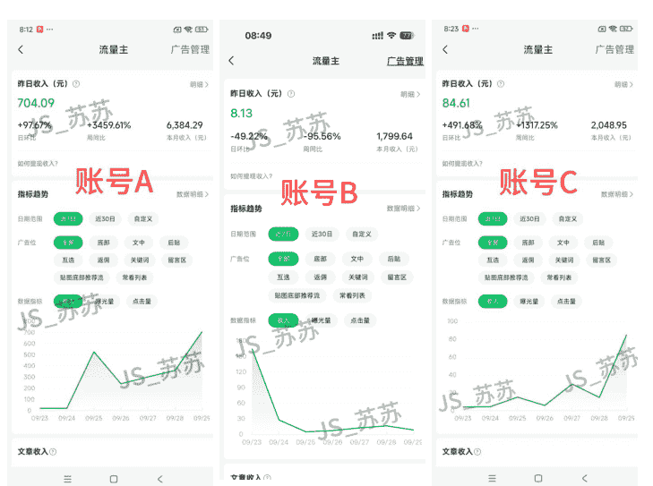

说真的，进圈之前我连📕都没注册过。刚进来那阵子，看什么都眼热，真动手又处处卡壳。📕接商单、抖音自然流带货、👸号拿AI视频挂链，路子试了一圈，大结果没拿到，但各平台什么脾气、基础怎么玩，算是摸清了。中间还跟了AI零代码自动化、Claude Code编程两次航海，业务上暂时没直接用上，不过对AI的底层逻辑有了点感觉。这一年，我把它叫作自己的“加速学习年”。

后来进了纪中老师的港湾计划，有两句话我记到现在，也正是这两句话带来的思路转变，让这个项目真正跑通。

新朋友可以琢磨琢磨：

第一，别一上来就想着挣钱。本事到位了，钱是跟着来的。

第二，新人阶段，教练怎么说就怎么做，别自己加戏，一加戏动作就走形，结果也打折。

今年6月，港湾群里有人聊起贴图号这个玩法。我把相关精华帖一篇篇翻完，确认新手也能干。这回我没急着证明什么，也不盯着收益，就按澄心老师帖子里的步骤老老实实做，正反馈来得挺快。第一个小爆款是张减脂餐图，我只是把原图里的鸡肉用AI换成了牛肉，阅读就冲到5万+。顺着这个法子又出了几个小爆款，看着后台数字往上爬，那种“总算通了”的感觉，我现在都记得。

好景不长，平台规则一收紧，这种只改局部的小动作就过不了系统了。我换了个方向——做原创，素材直接从自己的📕爆款里拿。开头流量确实好，可没多久又收到违规通知：创作度低。那明明是我在📕发过的10万+原创，还做了升级，怎么就创作度低了？我死活想不通，开始怀疑是不是号出了问题。第二个号就是那会儿注册的——把第一个号的爆款原样搬过去，第2篇就起来了。我照老路子连发3天，又栽在同一个判定上……整个7月，我都在“违规—注销—重开”里循环。想让它爆，又怕它爆，一爆就被人工审核盯上，接着就是违规、关禁闭，一夜回到解放前，确实打击人。月底翻后台，看着那点收益，我忍不住问自己：这项目真适合我吗？放弃的念头不止一次冒出来。好在圈友的报喜没断过，吴泽承学长的例子也一次次把我拉回来，看着大家陆续出成绩，我又觉得能再撑撑。

到了8月，有圈友说新号有7天冷启动期。这回再收到违规提醒，我没像以前那样注销重来，心想逃也逃不掉，不如静下心研究平台到底怎么判。我反复琢磨规则，试着在缝里找能长期做下去的玩法。违规还是有，但每次能撑的时间明显变长了。该踩的坑基本踩了个遍，后来跟圈友聊起来，反倒都成了经验。

读者点开你的贴图，留言区展示广告，你就能分到流量主分成。

## 新的创作

- 文章

- 贴图

- 视频

- 播客

草稿

新的创作保存后将存在草稿中

## 已发表内容

全部 >

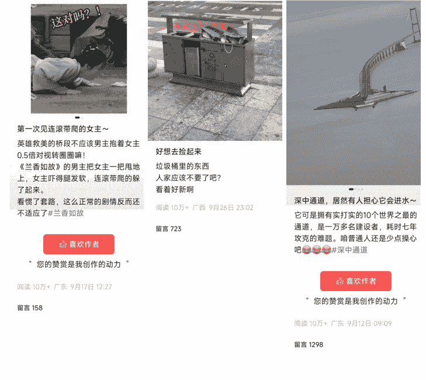

上面这三篇贴图，阅读都过了10万，收益却差出一大截——低的95元，高的1023元。差距的关键，在留言区广告的千次曝光收益（eCPM）。

## 指标数据明细

| 日期 | 曝光量 | 收入 (元) | eCPM |

|---|---|---|---|

| 2026-09-29 | 138,494 | 704.09 | 5.08 |

| 2026-09-28 | 39,658 | 356.18 | 8.98 |

| 2026-09-27 | 33,362 | 298.71 | 8.95 |

| 2026-09-26 | 27,483 | 236.75 | 8.61 |

| 2026-09-25 | 82,723 | 524.19 | 6.34 |

| 2026-09-24 | 1,818 | 16.39 | 9.02 |

| 2026-09-23 | 1,503 | 17.20 | 11.44 |

| 2026-09-22 | 2,150 | 19.78 | 9.20 |

| 2026-09-21 | 4,530 | 71.76 | 15.84 |

| 2026-09-20 | 50,778 | 396.79 | 7.81 |

影响eCPM的因素，主要就两个：

一是赛道。不过我个人不建议死磕一个赛道。

为什么？短时间内同一主题连发3篇贴图，很容易被系统盯上。

多短算短？我曾经一天发一篇，第3天就被关禁闭了。这也是我前期反复违规的原因之一。

所以别给自己上枷锁，什么火就发什么，反而更容易拿到长期流量。

二是互动量，这也是上面三篇10万+收益天差地别的另一个原因。

我们只能看到10万+这个阅读数，真实的流量只有创作者后台能看到。点赞、评论、推荐、转发，这些互动都会把内容往更大的流量池里推，触达更多读者；只要读者翻到留言区看到广告，我们就有收益。触发留言区广告的3种方法，后面细说。

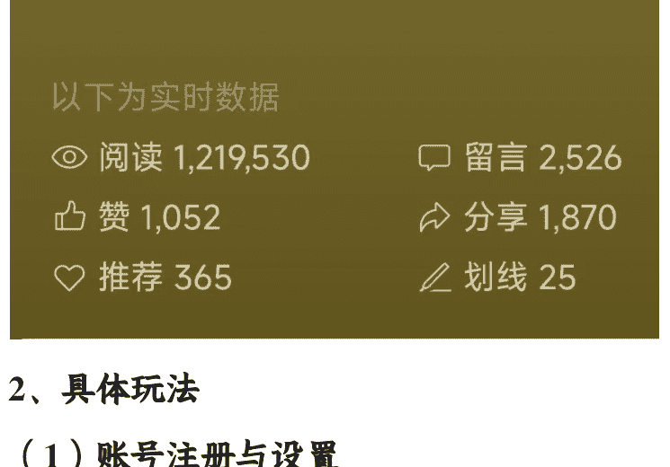

# 2、具体玩法

## （1）账号注册与设置

- 提前把头像和名字想好，多备几个，防止重名注册不了。名字里带“院、所、影视、养生、地名”这类字眼的都别起，要提供资质，否则限流。

- 👸号要🛰️实名，一张身份证只能认证一个号。哪怕你有多个🛰️，也只能认证1个；其他🛰️的实名可以换成亲友的，但得当面操作并刷脸，不然一旦触发人脸识别会很麻烦，甚至有封号风险。换好了，就用这个🛰️去注册👸号。

- 下载“👸号助手”App，给👸号做实名认证。App底部“我”，点开头像，里面就有“实名验证”。

- 发第1条内容（随手实拍，花草树木都行，标题和正文用陈述句简单写写就能发），阅读过100后找靠谱渠道上100粉。

- 满100粉后开通流量主，在App“我”里有流量主选项，点“开通”即可。

- 还是在“我”，点“广告收入”，右上角“广告管理”，把所有广告都打开。

## 广告管理

## 常看列表广告 NEW

位于👸号常看消息列表，在文章外拓展分成场景，按广告效果结算收入。

查看示意图

## 留言区广告

位于👸号留言区的广告，按广告效果结算收入。

查看示意图

## 底部广告

位于👸号文章底部的广告，按广告效果结算收入。

查看示意图

## 文中广告

位于👸号文章正文中的广告，按广告效果结算收入。

查看示意图

## 视频后贴

👸号文章内视频播放结束后出现的广告，按广告效果结算收入。

查看示意图

## 贴图底部推荐流广告

位于贴图底部更多相关贴图推荐流位置，按广告效果结算收入。

## （2）选图 + 处理图片【重点】

找对标 → 选图 → 处理图片

### 1、如何找对标

在🛰️里打开服务号，里面全是贴图。

## 🛰️

## 👸号

10:11

## 服务号

10:02

## 视频号

贴图

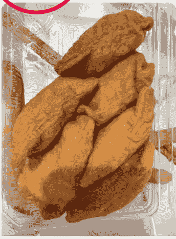

挑战一个月伙食费3万日元

圆脸老彭

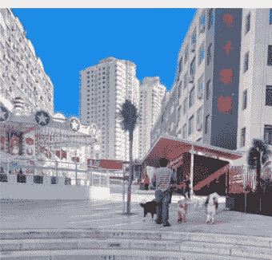

这是年轻人会不生娃的理由吗？

芊江有水芊江月

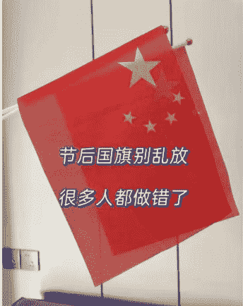

节后国旗别乱放 很多人都做错了

钱警官是上海最美的特警之一吗？

知足常乐的老吴 a12

看到10万+的贴图，点进作者主页看看其他作品，如果一个月内出现2次以上10万+，就可以拿来做对标。

### 2、如何获得素材

找到10万+的贴图后截图，去📕“上传照片”搜类似图片，或者用关键词搜也行。

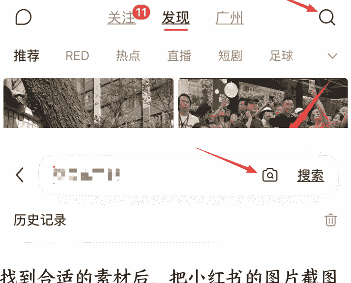

找到合适的素材后，把📕的图片截图发给自己的🛰️小号/文件传输助手，长按图片“搜一搜”，看看有没有被别人用过。

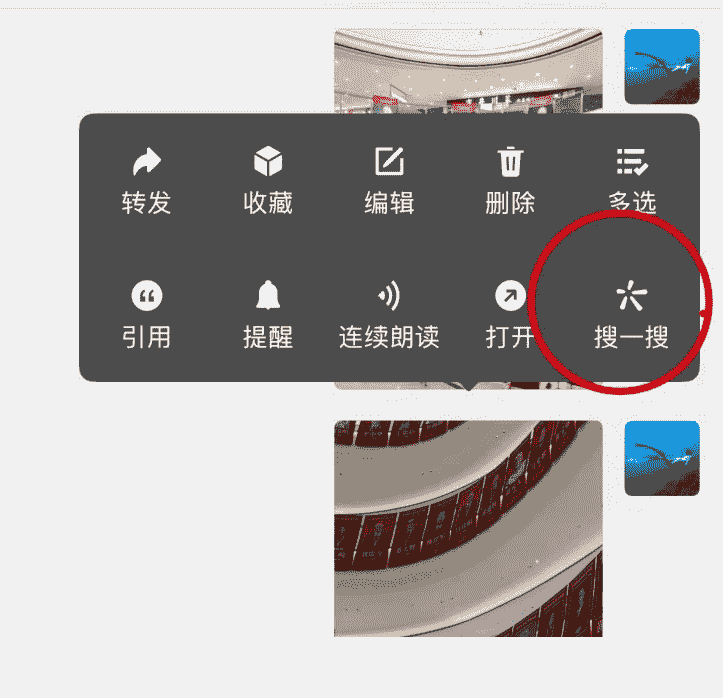

搜索结果里没有一样的图，就可以直接用；有的话，就得二创：

## 简单二创（新玩法）

特别适合对发布几小时内的10W+爆款做二创！

直接在对标图片上加“文字/贴纸”，同时附一张随手拍实况图，把整体原创度提上来。这一步非常关键，千万别偷懒，不然轻则单篇没流量，重则连发3篇容易触发“创作度低内容”进禁闭室。（后面详细讲）

## 剪映

到底哪个是男厕所

## AI搜索

哪个才是女厕所？

到底哪个是男厕所

进公园厕所犯了难，看半天分不清哪边是女厕

哪个是女厕所？

到底哪个是女厕所

到底哪个是男厕所

## AI 生图（不推荐）

实操中有时会遇到如上图的情况，连加“文字/贴纸”的地方都没有，这时候才要考虑AI生图。

简单的找豆包，复杂的用GPT。先把爆款截图发给AI，让它分析爆点，再让它按爆款逻辑给二创思路。

生图不必追求完美，有时候一点小瑕疵反而能引来评论区讨论。下面这个10万+就是这么来的□

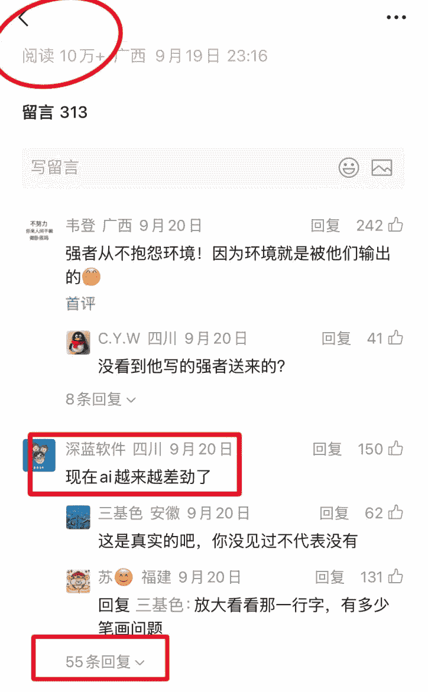

为什么不建议大家一开始就AI生图，原因有三：

- 大部分读者更愿意看真实图片，部分极端读者甚至会因为AI图拉黑作者；

- 生成图不一定尽如人意，甚至可能把爆点改没了，失去意义；

## 剪映

到底哪个是男厕所

## AI搜索

哪个才是女厕所？

到底哪个是男厕所

进公园厕所犯了难，看半天分不清哪边是女厕

哪个是女厕所？

到底哪个是女厕所

到底哪个是男厕所

正文内容直接截图对标原文发给豆包，只输入“二创”，就能得到一篇全新的正文。不满意就告诉AI，满意也告诉AI。时间长了，AI的输出会越来越贴合你的要求，效率提升很明显。

## （4）触发留言区广告【重点】

发布后要发4条评论，广告才会出现，我们也才能拿到流量主分成。

我一般用这3种方法，大家按自己的情况灵活用：

- 用小号留言：发布后10-15分钟，从服务号进去，这时你刚发的作品会排在前排。模仿正常用户的习惯，先把周边3条内容都点开看看（这也是养号的过程，慢慢你会越来越容易刷到近期爆款），最后再点开自己的内容阅读并留言。等的那10-15分钟，可以用来收集整理对标的神评论，优先选回复数量高的，复刻到自己的贴图留言区；建议给小号开通视频号，留言时通过账号身份切换，能模拟两位不同读者的评论。

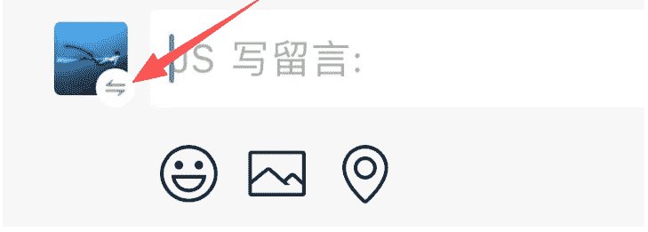

- 用自己的号留言：如果以前发过相关内容，可以直接放发布链接，给旧帖增加阅读量；

- 用自己的号留言：@元宝，两轮问答就能出广告。我一般会问元宝“怎么看？”“有什么补充？”“有什么建议？”。

## （5）发布实操细节

- 发布数量：新号第一周，每天发1条，单篇流量超过1,000后，可以逐步增加条数。

- 发布时间：无所谓，你什么时候方便就什么时候发，也没有间隔发布时间这一说。

- 特别注意：不要设定时发布，手动发布流量更好。

- 如果当天有存量待发，发布前一定要点“更多设置”确认广告按钮处于“打开”状态，否则收益只有1/10，亲测 T_T

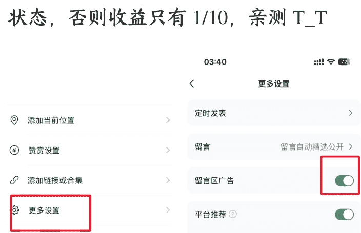

# 3、撬动流量爆发

内容做好的基础上，还可以把官方给的“创作者成长激励”用起来。

## （1）创作者成长激励是什么

官方推流辅助工具。但不是所有账号都有，我3个账号，有1个就没有。

## （2）获取激励途径

当你达成一些成就，系统就会自动送你成长激励。

## 通知(33)

## 我的足迹-收到赞赏10次达成

截至2026年9月16日，你在平台收到用户赞赏10次，可在「我 > 我的足迹」中查看。已获得300额度平台曝光激励，可让更多用户看到你的创作。前往使用

2026/9/17 08:40

## 我的足迹-发表100次达成

截至2026年9月17日，你在平台发表内容100次，可在「我 > 我的足迹」中查看。已获得600额度平台曝光激励，可让更多用户看到你的创作。前往使用

2026/9/17 08:26

## 我的足迹-第500位用户关注达成

2026年9月16日，第500位用户关注了你，可在「我 > 我的足迹」中查看。已获得600额度平台曝光激励，可让更多用户看到你的创作。前往使用

2026/9/16 23:11

## 我的足迹-被收藏100次达成

截至2026年9月14日，你的内容在平台被用户收藏100次，可在「我 > 我的足迹」中查看。

## （3）激励使用规则

- 有效期：激励上都标着有效期，到期前3天系统也会提示及时使用；

## 全部激励

500 曝光

创作者成长激励

有效期至：10/14 23:44

300 曝光

创作者成长激励

有效期至：10/13 11:06

300 曝光

创作者成长激励 已使用

有效期至：10/1 08:38

600 曝光

创作者成长激励 已使用

有效期至：10/1 08:24

600 曝光

创作者成长激励 已使用

有效期至：9/30 23:09

300 曝光

创作者成长激励 已使用

有效期至：9/29 08:40

300 曝光

创作者成长激励 已使用

有效期至：9/28 08:18

- 一个作品只能用一次成长激励，可以多张叠加，上限5000； 3□□ 只能用于1周内发布的作品。

## （4）激励使用技巧

作品阅读数在1500-2000时，使用效果最好，优先选评论数多的。

但有两种情况不建议用：

- 1. 作品正在推流（发布2小时内破1w阅读）

- 2. 账号正卡在1000/卡1w阅读的阶段，用了帮助也不大。

使用成长激励会触发人工审核，所以用之前一定要认真看看自己的内容有没有问题。有问题先删掉再用。不然就会像我之前一样，激励浪费了不说，还被关禁闭……

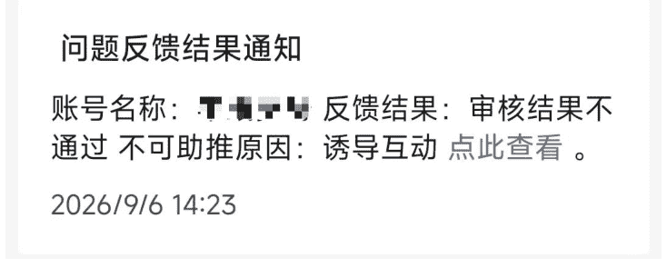

没把握的话，宁可浪费也别用。因为成长激励只是把内容推给潜在读者，算不算有效阅读，取决于读者有没有点开。如下图，为了540次阅读被关禁闭，太不值了。

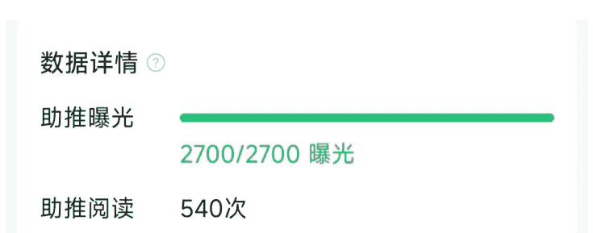

## （5）识别账号大爆前兆

2小时内破1w，都是有机会冲击10w+的好苗子，这时候你要做什么？

- 认真回复每一条留言，拉高互动，争取让作品冲进下一个流量池；

- 把二创作品分发到其他账号（同网络同IP不影响）

## （6）流量爆发时的运营动作

- 作品10w+之后，留言基本回不过来，只回部分有争议的高赞内容就行；

- 大爆期间留意账号下有没有其他作品被点赞评论，如果有，那这条可能是10w+后备役，重复（5）的动作；

- 大爆期间少发新作品，一是这时候发新作品基本没大流量，二是账号会进入人工审核期。新发的内容如果不符合推荐要求，很可能被判违规，到嘴的鸭子直接飞走；

- 作品大爆后会冒出各式各样的读者。特别注意，不要回复私信；

- 遇到恶意留言、投诉甚至举报怎么办？把作品内容、评论、举报通知等发给元宝，详细说明情况，元宝的建议还是挺可靠的。至少我9月遇到三次“已举报”的留言，一次都没收到官方的处罚通知。

# 二、常见问题

## 1、账号与基建

### （1）老账号还能用吗？

只要单篇阅读量在50以上，账号就是正常的。如果连续一周0播（内容没问题前提下），选“立刻注销”（🛰️手机端👸号——账号安全与绑定——注销👸号）

### （2）多账号管理

5个账号以内都不用IP隔离，同一个WiFi发布不影响。多用安卓手机双开软件来管理账号。网页版登录要3天扫一次码，个人不推荐。

### （3）新手运营数量

建议先把1-2个账号做好，做起来了再考虑加号。

## 2、发布条数

没有上限，也没有下限，停更不影响流量。我把日常发布看成存钱的过程。一旦账号爆了，读者会去翻你的旧作品，所有努力都不会白费。

逐项回答：

- 1. 一共发了266条（含已删除46条：10+18+18）

- 2. 平均每天每个账号2.96条（266 ÷ 30天 ÷ 3个账号；三号合计日均约8.9条）

- 3. 共计流量7,411,006阅读（约741万），篇均约2.79万

- 4. 共计16篇10w+，其中破百万3篇（部分文字被打码遮挡）

## 3、0播与违规处理

### （1）关于0播

- 原因：新账号第一周冷启动、直接截图别人的内容发布、内容擦边、涉及政治、封建迷信、医疗效果、过度营销/引流等。

- 应对办法：先做账号检测看看是否违规（👸号助手App——“我”——“账号检测”）。部分新账号没有这个功能，可以随手拍1张生活类实拍图发布，如果3小时后仍然0播，就按下面的违规处理办法操作。

### （2）关于违规

这套玩法里最容易中招的违规标签就是低创作度、不良信息和诱导互动。账号被标出来以后，先别急着申诉，连续三天稳定输出生活实拍的原创素材做热身。准备材料的时候，把违规提示和近期发布的截图一起交给元宝，让它帮你浓缩成200字以内的申诉话术。

提交申诉的路径是：打开👸号助手App，进到“我”，点账号检测，再点右下角的问题反馈，把刚才生成的申诉文案粘进去，同时附上账号检测结果截图、近期发布截图以及整改后的素材截图。非原创的配图能直接删就删，不要反复改，爆款除外，这样通过率更高。网页端登录后在近期发布里能查到删除记录，https://mp.weixin.qq.com

网页端申诉入口：

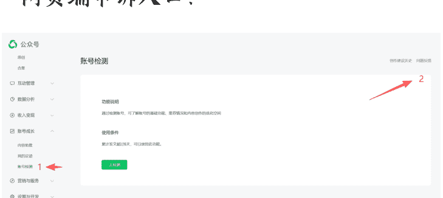

通常24小时内会给出反馈，查看位置有三个：
1. 👸号助手App首页右上角的小铃铛
2. 🛰️里点👸号入口，右上角的小人，进去我的👸号看私信
3. 网页端右下角的通知中心

如果一直没消息，可以3天后走人工。🛰️公众运营中心小程序——我的——专属客服——输入“人工”，提前把账号检测截图、整改截图和那份200字申诉稿准备好。也可以等满7天再按上面流程重申一次。人工排队时间不稳定，快的话半小时，慢的要大半天，自己权衡。

关于提升原创度的小技巧，如果一组图是3张，混进1张随手拍就够了；要是6张，就配2张随手拍，目的就是拉高整体原创权重。随手拍最好和主题沾边，无关也不影响通过，只是读者可能会觉得怪，但往往能引来吐槽互动。

### 诱导互动
被判定主要因为内容空洞，加上疑问句式、直接喊留言等引导行为。
规避做法是用完整的真实经历或故事作底，配上对应图片，把想引发的互动点直接写在图上。这样既能提高点击，又不踩线。标题尽量用陈述句，风险更低；文末的提问要做成自然的延伸，比如你们遇到过吗？而不是硬诱导。

### 争议留言
看到争议我反而会高兴，争议就是下一个流量池的入口。我习惯把有争议的留言和对应作品截图发给元宝，让它拆解对方逻辑漏洞，定制一条高情商又带钩子的回复，方便路人站队。主号回复可以加重权重，小号则可以无所顾忌，按实际情况灵活切换。

## 写在最后
这是我试过正反馈最快的方向，非常适合新手起步建立信心。只要在这个项目里赚到第一块钱，后面十块、百块就有了水到渠成的基础。

想做得更久更稳，需要做到三件事：
- 定期复盘数据，去网页版数据分析-用户分析里看人群画像，推断他们还想看什么；
- 向10w+作者学习，别只追爆款，去人家主页系统拆解；
- 持续试新赛道，玩法迭代才能不断抢占流量。
方法负责方向，坚持负责结果。

9月能破万，除了运气，就是每次卡住时都选择再撑一下的累计。我的年度金句是“随便做点什么吧，给命运转动的机会。”真的，先随便开始，再坚持一下，命运会给你铺一条有花也有刺的小路，花香是给坚持的人的。

看完SOP你会觉得懂了，但90%的人实操第一步就卡住。工具和教程是最廉价的壁垒，真正的壁垒是立刻开干和圈层的信息差。

我们只拆商业闭环和AI效率的压榨，系统里沉淀了1000+跑通的套利实战项目。
圈子数字资产和上车门槛可查：https://lazyso.com/insider/

