# 普通本科在读生的接活手记：五千块课程费起步，半年多挣出十万+

先泼一盆冷水：想找三天上手、七天变现的速成法，这里没有。下面这些金额与截图，不是包装过的战报，而是我一路试错留下的账本：课程费五千块，开张只挣十块，后来接到六百块的像样委托，最大一单两万出头，半年多接活群抽成加自己干活，净利累计十万多。真要说方法，无非敢下场、愿死磕。

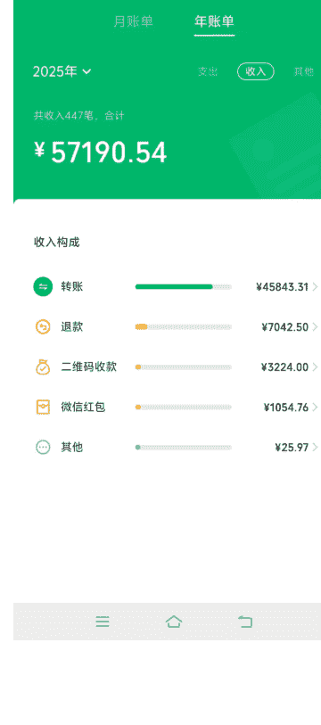

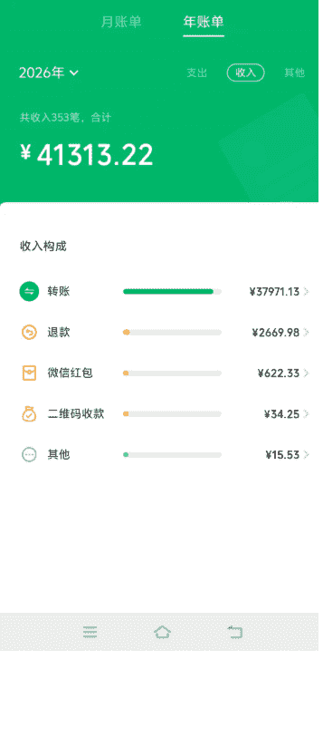

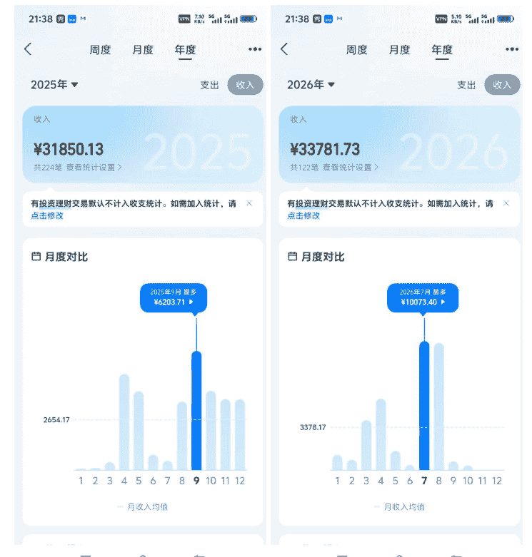

## 一、手机屏上的代码启蒙

刚进校，我对计算机突然来劲。原因不玄乎：能靠程序做出旁人做不出的东西，这件事本身够酷。二〇二四年九月十二日，我加上授课老师的微信，此后上课、答疑、请教，多绕着他转。

那时我没自己的电脑，前期练习靠手机：窄屏、软键盘，输入慢，一段程序要来回调试多轮才跑通。条件虽笨，却逼着我动手试，底子反倒扎得牢。有人靠记，我靠亲手试错磨出来。

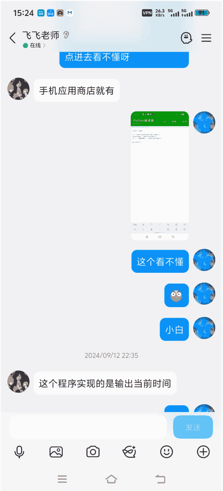

后来我报了五千块的课程，学费拆成若干期。月生活费一千五，拿五百交学费，剩一千过日子：伙食尽量在食堂，出行能走就走。报前也翻过口碑，网上有负面；入学没多久，防电诈提醒又反复讲。我有几晚翻来覆去，甚至请辅导员帮我辨真假。如今回看，挺感谢那个敢冒险、也肯扛紧日子的自己。

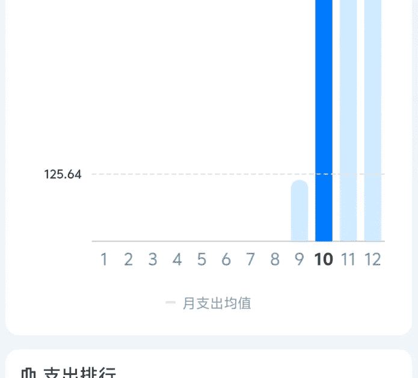

学习中也出过糗：有回对着智能助手给的答案和自己写的程序，半天没瞧出毛病；那份被判零分的作业截图我还留着，提醒自己——不懂就练，练完再复盘。

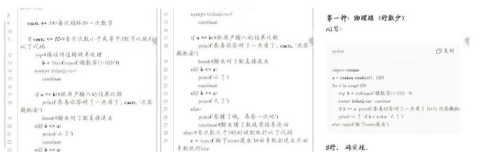

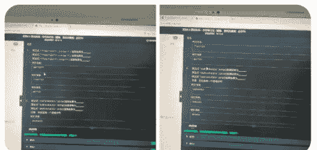

越学越确信：热情负责点火，能走多远看坐不坐得住。旁人消遣的时段，我多半耗在调试程序上。

## 二、开张：从QQ群聊板块到二手平台

起初的钱来自腾讯QQ里的群聊板块。我常蹲消息，看到新手发问就主动私聊：若愿付酬劳，我可以试试。十块、一百块，就这样陆续进账。金额不大，可“手艺真能换钱”的兴奋感到现在还记得。

也常看走眼：把难活估轻，或把自己估高，百来块的委托拖上数日，月入不过四百到五百。每次收尾，我会把踩过的雷记进笔记，下回绕着走。

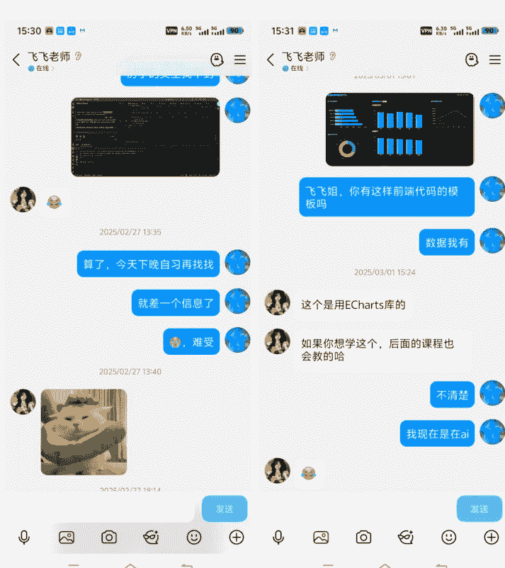

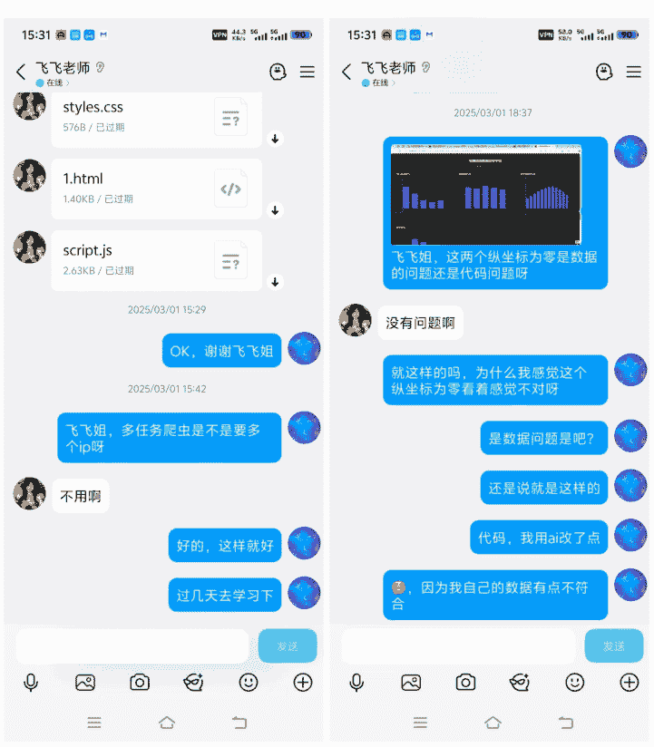

后来嫌这速度慢，我去二手平台搜数据采集、爬虫这些词，挨个问商家要不要帮手。几十家问下来，回音的没几个。又找老师朋友请教，才明白报价得看工作量与难度，做多了自然有手感。那笔六百块的委托，我磨了三天：头两天几乎都卡在浏览器页面的呈现上，翻资料、请教老师、反复试错，真正敲逻辑的时间倒不多。交付那刻才懂，硬着头皮顶一顶，沟坎会过去。

钱到账后，我给自己立了条规矩：手艺卡点、沟通措辞、报价心得，统统记进笔记。后来给爸妈转了两百，手指按确认时有点发颤——钱不算多，却让我头回觉得，自己可以少向家里伸手了。

## 三、搭自己的接活群：链路跑熟就开干

大一还有早自习、晚自习和早操，日子不轻松，但我仍感谢当时凭兴趣扛下来的自己。后来我混迹于各接活群，委托渐渐多起来，单月进账三千到四千。跑着跑着，整个流程也摸透了：先在二手平台和短视频平台发内容引流；中间人把需求丢进群；接活者来揭榜；拉小群；确认需求、交付期与报酬；交付；雇主确认；压几天款做售后；无异常再结算。

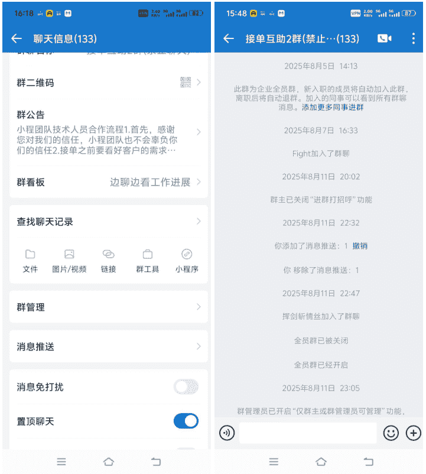

看明白后，我觉得自己也能做。二〇二五年开春，我开始搭接活群。群规先立：分成比例、接活步骤、售后边界、违规处罚，全部提前写明。整个流程里，核心岗位并非敲程序的人，而是居中牵线的人：把雇主需求翻译给接活者，把交付节奏盯住，把售后风险兜住，吃的是信息不对称与信任红利。

启动没花钱：个人账户所挂的认证主体有建群上限，那就多备主体、把群拆开；某个聊天号加满了，再换号继续。最麻烦的是让群先转起来：没人气就难派活，没活接活者也不愿留下。我先请相熟的接活伙伴进群暖场，再把以前配合顺手的接活人逐个请来。群不必贪大，早期重在质量；委托可靠、结账爽快，名声自会扩散。

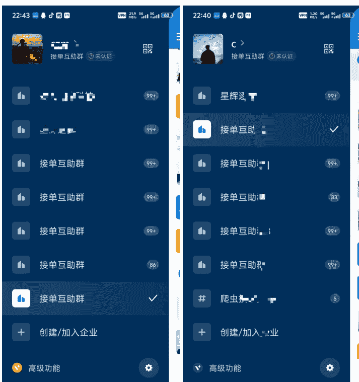

## 四、人手和客源怎么积攒

缺人手怎么办？去图文社区挂一条“在校生求数据采集代做”的帖子，一天能来几十个申请。通过后先登记拿手语言与工具链，标好备注；碰上群里没人应声，就单独戳过去问，很多时候只是消息被刷走了。

二手平台的账户也要养：常逛逛、顺手买点低价小物、完成平台任务，让系统判定你是真实活跃用户；刷到同行链接，留几句评论、点个赞、收个藏；自家宝贝记得定时擦亮、做推广。活跃度稳了，展示量才起得来。

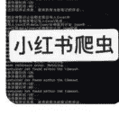

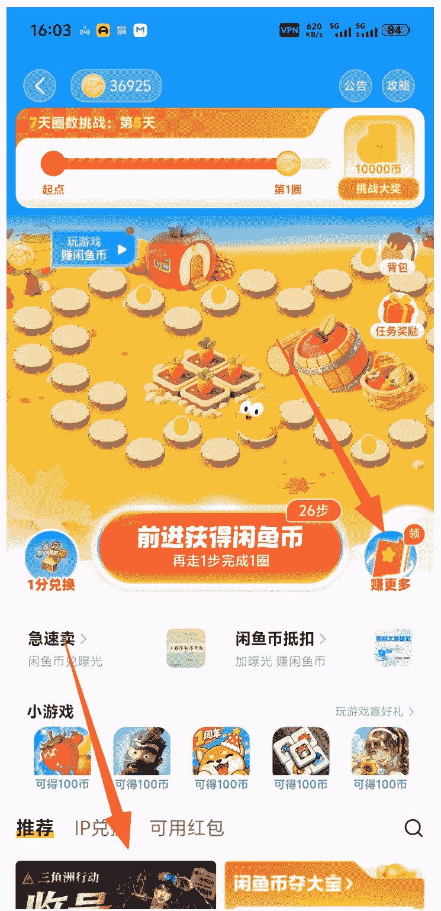

雇主把需求和交付日期谈定后，我把委托丢进接活群。有人揭榜，就在企微开小群。企微的好处很实际：可关闭私下加好友，降低被撬单概率；聊天留痕，真出现理解偏差，翻记录就能对清楚。起初我也嫌多一道工序，后来吃过亏才认：该设的卡点，省不得。

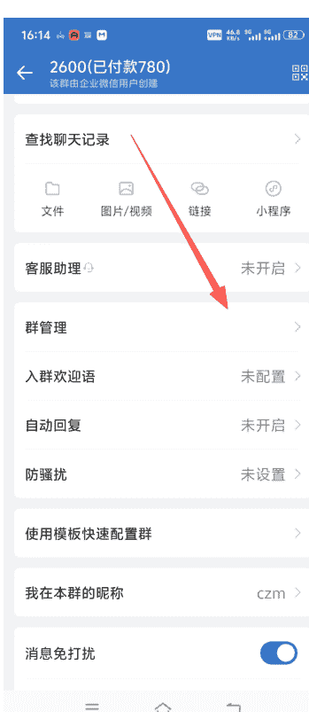

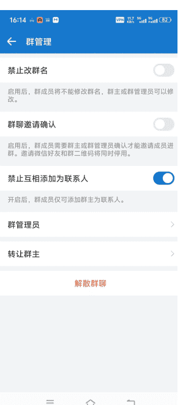

这行别做一次性生意。把体验做顺了，老客会反复回来。有位主顾前后带来的委托累计过万；群名显示有限，截图上看着像没到，实际早破万，我从中拿到的分成有三千多。满意的人还会把同行介绍过来。所以前期少挣些无妨，服务得兜住——信任建得慢，塌得快。

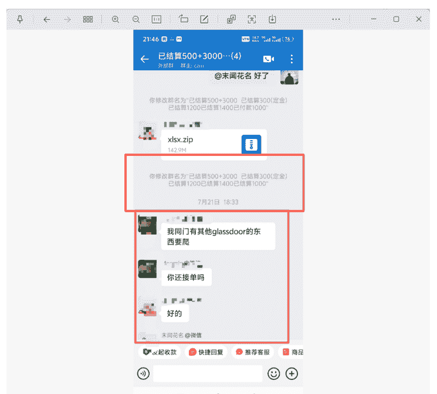

后来，一位在人工智能内容领域粉丝过百万的创作者也来谈协作。她们招生宣传物料里有相当一部分由我提供，眼下不少学员的实操安排也落在我的接活体系里。对我而言，这更像某种提示：事情做到位，资源与契机自会找门。与其眼热旁人的好运，不如把手头环节磨细。

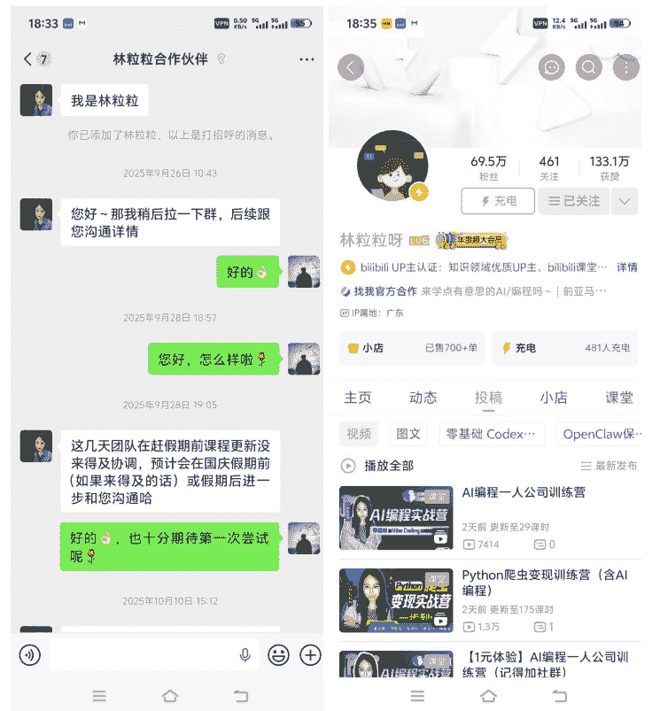

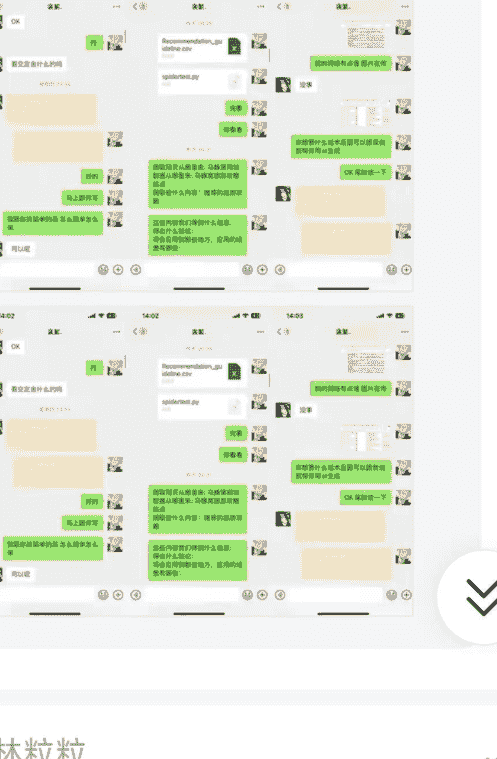

## 五、接活收款：把风险挡在前面

真正管用的风控，得放在成交之前。群规、沟通渠道、回款路径，每个环节都在给信任加锁。聊天尽量走文字，情况一目了然；若改电话，个别接活者可能私下联系雇主，把委托撬走。双方谈拢后，让雇主在平台完成支付。遇到金额偏大的商单，合同我不碰，由雇主和接活者直接签；同时把丑话说前头：后续纠纷与撮合方无关。曾有一次，双方签了千元合同，接活者收钱失联，所幸签字的是他们，雇主也念金额小没深究。此后大额委托我一律要求双方直签，我只负责牵线与收款，把责任线画清。

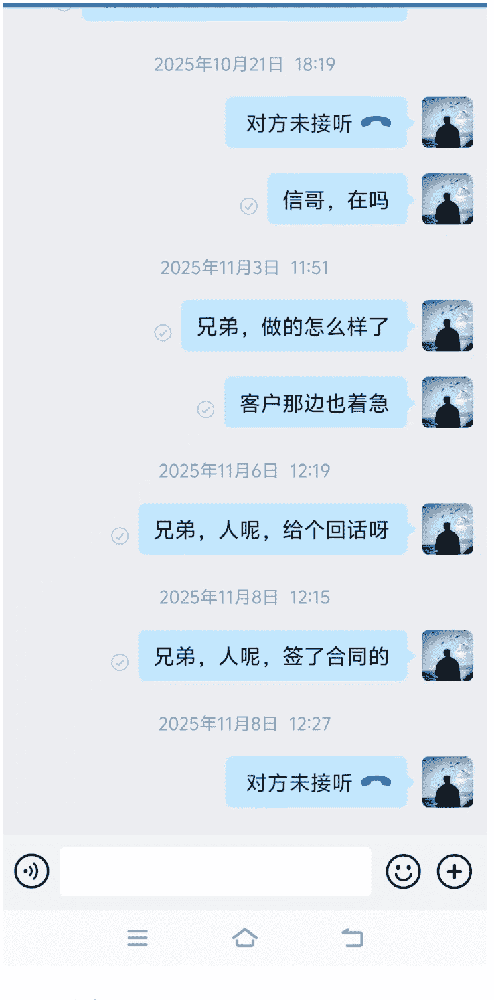

群搭好后，前端谈判交给双方，我只盯回款。雇主在平台付完，接活者即可开工。交付、确认收货之后也别急着结算，留几天售后观察，确认无异常再把钱打过去；账目透亮，合作才长久。收尾可请雇主留个评价，给账户添些信用。售后那几日我会在群里追进度、看异常。跑顺以后，单月撞上一笔，分成三成；大额签合同、绕开平台，雇主直接通过常用支付工具打给我——强调一下，收款方是我，不是接活者。印象最深的一笔两万多，分成拿了六千。那位雇主由熟人引荐，需求清晰，接活者又是磨合已久的老手，全程很顺。它提醒我：委托金额越高，越吃平日攒下的信誉。

## 六、关系维护：规矩打底，信任续航

干接活群，眼睛别只黏在接活和防撬单上；真正决定能否长做的，是人与人之间的信赖。接活者也有情绪与立场，并非款清就互不相干。对磨合久的老手，我会给特殊通道：雇主款一到，哪怕活还没收尾，我也先把该付的转过去——信他不会撂挑子，真出岔子也会退回。新面孔则照章走；活没干先伸手要定金的，多半有诈，直接拒掉。有人担心先款有风险，我当然掂量过，可配合过几十上百回的人，靠不靠谱心里有秤。制度是护栏，信赖靠时间养。雇主维护好、接活者照应好、流程守住，生意才不会停在一次性成交上。

做这行时间一长，手上自然就磨出些门道来。客户主动来询价，十有八九并不是真要进群合作，这时候就考验你的报价功夫了。倘若觉得价报低了，适当往上调一调也无可厚非，但底线是得实诚。最忌讳的是那种跟客户开口要500，转头却跟技术说客户只肯出300的做法——这么干太不厚道，路只会越走越窄。对技术伙伴坦坦荡荡，交情才能经得住时间，你看我们到现在还处得跟朋友一样。

关系这东西，挂在嘴边没用，得融进日常里去：年节到了递句问候，技术遇上坎儿主动搭把手，该结的款从不磨叽……这些看着都是鸡毛蒜皮，可日子一长，人心自个儿就往你这边靠。如今我群里那十来个顶梁柱般的技术骨干，全是这么慢慢攒下来的。

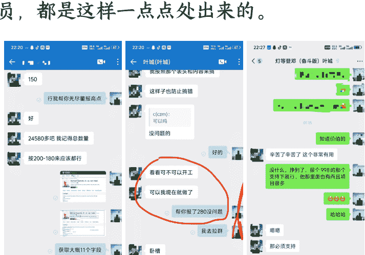

要是客户和技术之间闹起了别扭，别多想，头一件事就是把群直接散掉。这招基本就是最优解，能拦住火气在群里继续烧，把波及面压到最低。群散了之后，转头先去把客户那边的情绪捋顺，再稳住技术这一头，至于话该怎么说，就得看当时的情形灵活应对了。

万一碰上存心耍赖的客户，那就更省事了，直接拖黑，不用留情面。担心他甩差评？放宽心，碰上的要是真无赖，平台大多会替咱们撑腰：把聊天的截图都存齐全，上平台走申诉流程，平台自然会收拾他们。这事儿我亲自试过，靠谱。说到底，只要咱流程走得规规矩矩、聊天记录留得完完整整，就没什么好怕那些胡搅蛮缠的主儿。平台护的是老老实实做买卖的人，你自己越清爽，真出了岔子腰杆就越硬。

再往后，日子就这么一天天过下去。运气最爆棚的那天是8月27号，我头一回收下徒弟，进账5000元。写这些真不是想招徒弟，眼下我也没那个打算，纯粹是想把这一刻留个印记。还记得那天凌晨，徒弟刚通过好友验证，一声“兄弟”喊过来的时候，心里头翻腾得厉害——想当初我也是个啥也不懂的新手，如今竟也能领着旁人朝前迈了。

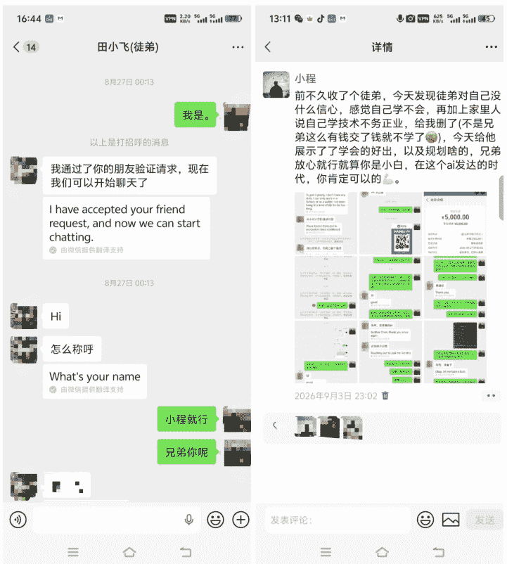

我高中班主任有句话，我一直记着：孝心这东西，也得靠自己的物质底子撑着。手头没钱，你拿啥去孝敬爸妈？兜里揣点自己的小钱是真舒服：不用再伸手跟父母讨生活费，逢年过节还能给二老发个红包，顺手给他们换部新手机。

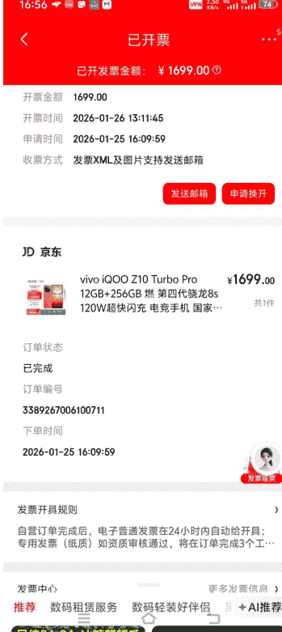

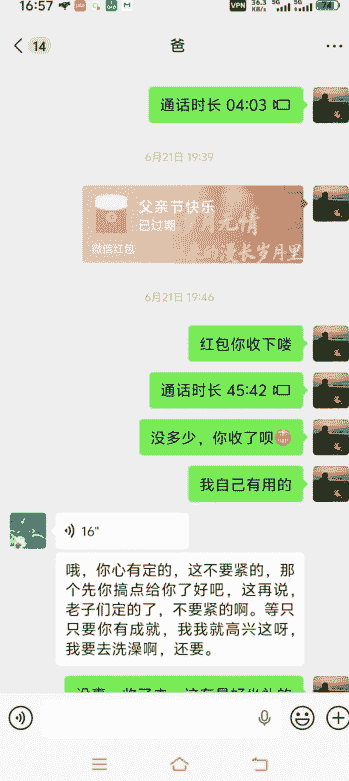

所以说，赚钱的圈友们，铆足劲儿挣钱，别从牌桌上下来，翻盘的机会总会轮到咱们。

# 七、10月4日赣州线下聚会，把圈层彻底打开了

我之所以愿意把这段经历铺开来写，也是被圈友们点着了。最让我心里起波澜的，就是10月4日那场赣州线下聚会。白天听课吸收干货，晚上跟朋友们围桌吃饭闲扯，两天的工夫嗖一下就过去了。先贴几张当天的现场照，留个念想：

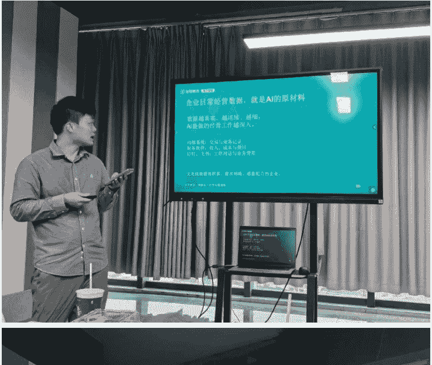

现场的干货那叫一个实在。黄有璨老师带来了“万字干货｜独家拆解：靠AI月入10万”，从嘉宾介绍、案例拆解、底层逻辑到实操，一环扣一环地给你掰开揉碎。

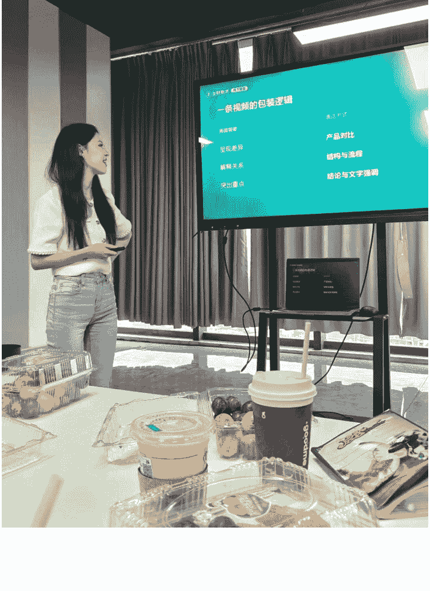

另外还有“一条视频的包装逻辑”这场分享，把表达效率、呈现差异、铺垫关系、突出痛点、表达公式、产品对比、结构与流程、结论与文字强调，统统给你梳理得清清楚楚。

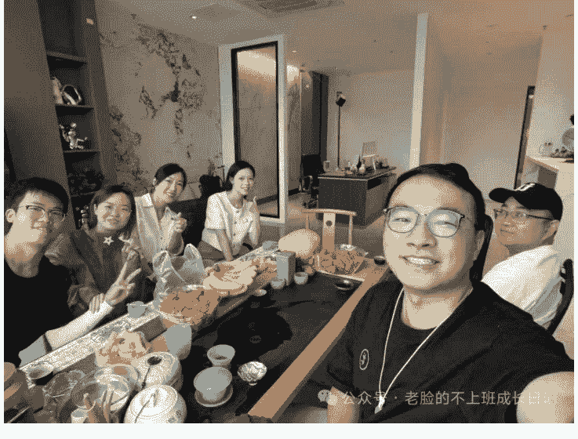

这回活动的名头是“龙哥盟·赣州聚会 & 南昌圈友赣州企业游学”，定在2026年10月4日（周日）13:50开始签到，地方是赣州市章贡区赣贤路黄金广场A栋2102-2 说到做到公司。

nana，香港大学硕士，曾在京东做流量运营，在B站带货销售额突破千万。

她讲的是“AI自媒体两个月抖音起号3.2万粉丝：如何让AI用代码做视频动效包装”，要点拢共三句：先想明白生意怎么做，再琢磨账号怎么设，从商业结果往回推定位；一个账号得整出四层变现，简单那层不过是露在外面的皮；内容不是每回都从零开始造，框架拿来复用，再用AI替掉重复劳动。接着大聪登台：旅游协会副会长、青年企业家协会理事，从前在央企，现在是贸促会合作商。

他带来的题目是“从海报到营销助手：小型 AI 服务怎么做”，核心也利索：先拎清你是在正经做业务，还是在给自己揽了份体力活；从“我一次性产出”过渡到“我一套系统”，就看这三件事能不能让你本人轻下来；走量还是走价，决定你卖出去的是“生成能力”还是“判断力”。再往下是刘智行：AI星盒创始人、说到做到公司CEO、AI千人大会分享嘉宾。

他拿出的是“AI+微信生态：蒸馏Skill，搭建内容超级生产系统，全域分发获客”，从skill到底是个啥、怎么蒸馏，到怎么搬到自己的领域里用，再到怎么搭起一套属于自己的内容超级生产系统，一层一层讲得透透的。活动地点还是赣州市章贡区赣贤路黄金广场A栋2102-2 说到做到公司，时间同样是2026年10月4日（周日）。

扫码报名

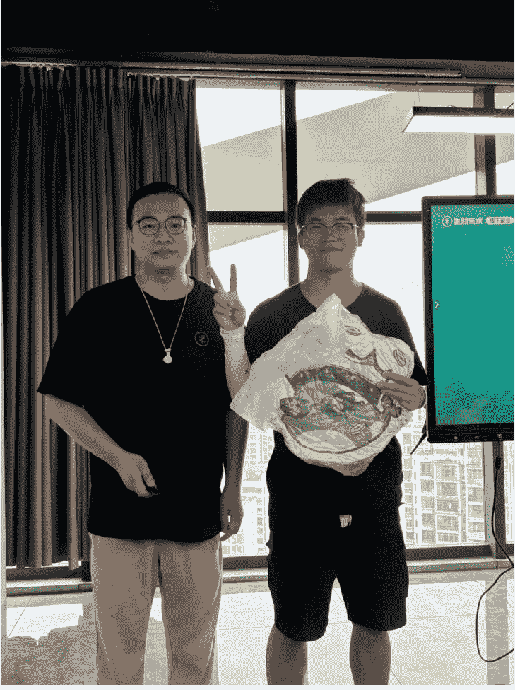

两天的赣州线下学习一晃就完了，收获比我预想的厚得多，算是把局彻底打破了。这也是我头一回参加线下圈友聚会。动身之前其实心里打鼓：年纪轻、经验浅，怕插不上话。真到了才明白，大伙儿都特别实诚，聊的全是干货和踩过的坑，两天下来，得到的东西远超预期。

从前我多半是一头扎进活儿里、闷头接单，总觉得能稳稳当当赚点钱就是顶好的状态。但这回跟各位前辈、同行坐下来深聊，又听了毛老师把商业底层逻辑拆开来讲，我才算真看明白了：赚钱靠的是执行力，能长久赚钱靠的是商业思维。这场聚会，直接把我过去一年的认知掀了个底朝天，每一条感悟都戳在本质上。

以前我判断一个账号行不行，就盯粉丝量、看数据高低。这回才算摸到门道：账号的价值压根不在表面的粉丝数，而在私域转化的快慢、社群满员的速度。数据那都是皮相，引流、沉淀、变现的效率，才是一个账号真正的硬实力。我总算学会拨开表象，直接盯本质了。

也把一件事想通了：为啥我从前那个闲鱼代写赛道，明明能挣钱，却一直做不大、拼不过人家？过去我的变现路子窄得可怜：不是自己接单自己干，就是单子多了转手派出去。哪怕最火的时候轻松月入不少，短短一阵就攒下一笔钱，甚至几分钟就进账几百。可我偏偏栽进了“小富即安”的坑里，眼光短、容易满足。没有矩阵的念头、没有生态的念头、没有多渠道变现的念头，光盯着眼前那点小钱，白白放跑了把一个赛道放大十倍、百倍的机会。现在我彻底懂了：单一路径变现永远做不大，做买卖一定得搭起生态、攥住多元变现的本事。

说到风口，也拎清了一个扎心的道理：什么红利都是短暂的，风口眨眼就过去了。毛老师讲他当年淘宝风口的经历，给我敲了一记警钟。顺势起来的红利从不会停下等你，淘宝过去了是拼多多，老风口一散、新风口立马顶上，从来不等人。撞上好项目、好风口，别磨叽、别干瞅着，想方设法死磕到底。机会不等人，敢冲、敢干、敢落地，才接得住时代给的红利。

最让我受用的是“一鱼多吃”的商业闭环思路。很多人做项目，赚一票就收场了。比如搞小红书虚拟资料，成交一单挣一单的差价，客户到手就再没下文。可真正的买卖，从来不是一锤子的事。每一个私域里的客户，都是最值钱的资产。顺着客户群体、用户需求往回摸受众的痛点，不停开发对路的新产品、新服务，就能一遍遍变现、长期反复用。

还弄明白了产品定价的底层门道：不是产品差、留不住人，是思路和模式没对。低价月卡看着门槛低、好成交，可利润薄、复购少、性价比差，很难撑得久。换成半年卡、年卡的定价路子，既贴着客户的预算，同一个客户身上还能直接拉出三倍的收益差。

最后是把整套商业闭环吃进肚子里了：前端得有顶级的引流本事，后端得有自己的专属付费产品。引流是入口，产品是底气；私域沉淀、持续变现、定期复盘，一样都不能少。从前只晓得埋头干，如今总算懂得了布局。

这两天最大的感悟：普通人靠卖力气挣钱，聪明人靠认知挣钱。别满足于眼前这点小成果，别把自己困在单一的变现模式里。少一点安于现状，多一点破局成长；少一点盲目执行，多一点复盘布局。所有的局限，说到底都是认知的局限。接下来，往深里做项目、把闭环补完整，接住每一回风口，把每一步成长都踩实✨。对我触动最深的一句话，是刘智行老师讲的：越分享，越幸运。所以这回，我先把自个儿的赛道摊出来。

这回活动里，我还结识了不少好朋友：@时间之外老师、@淼淼姐、@老脸、@毛老师、@刘智行老师、@nana老师、@大聪老师、@静静姐、@唐壹老师、@蓝狐老师、@小花老师，还有一大帮处得来的朋友，就不挨个点名了。

好了，分享到这儿就收尾。从一个月1500块生活费、连电脑都摆弄不利索的普通大学生，到一年挣出人生头一个10万+，再到赣州之行揣回这么多朋友和感悟——这条路我能趟通，你照样能。越分享，越幸运，咱们一块儿好好挣钱、别下牌桌！

这趟赣州之行，算是给大二这一年收了个漂亮的尾：带着认知回来，也带着一帮好朋友回来。感谢遇见，下回线下再碰！这篇分享写到这儿，其实还有好些细节没来得及铺开。你要是也在鼓捣类似的事，或者对哪一环有兴趣，随时找我聊。路是一步一步趟出来的，钱是一点一点挣出来的——只要不从牌桌上下来，机会总会有的。最后撂一句：我也要All IN AI自媒体了，眼下正张罗做X平台，欢迎大伙儿一块儿加油探讨。

———————————— 看到这儿，你可能觉着自己懂了。可真上手一干，90%的人第一步就得卡住。工具和教程那只是最底层的门槛，真正拦人的是“立马动手”和“圈层信息差”。想看全网最新的变现玩法，想跟一群执行力爆表的极客一块儿下场拿结果，欢迎来我的核心私域：【懒人专属群】。这儿不扯虚的，只拆商业闭环、只榨AI效率，系统里已经攒下1000+跑通过的套利实战局。查阅圈子完整数字资产与上车门槛：https://lazyso.com/insider/ 认同价值、准备好干活的朋友，扫码加我微信（lazyhelper1），备注【实操上车】，不闲聊。

