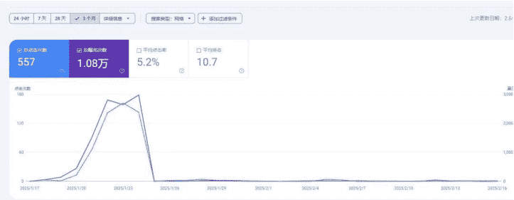
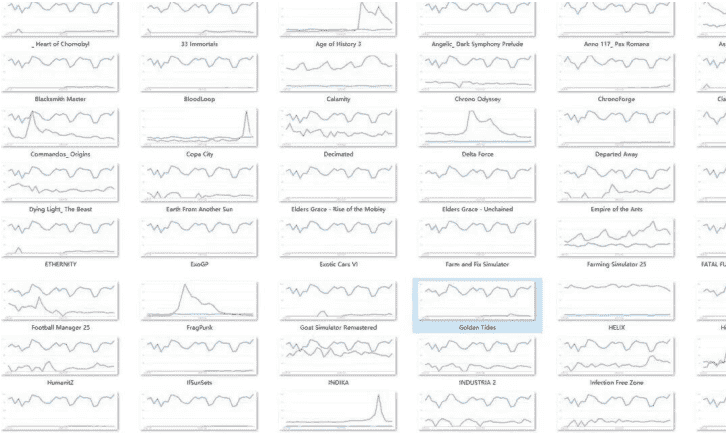
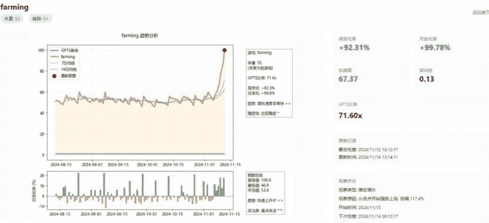
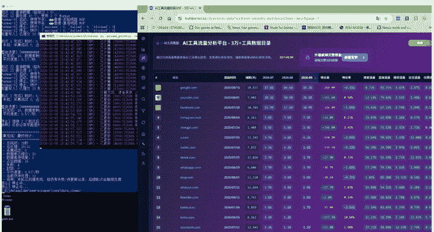
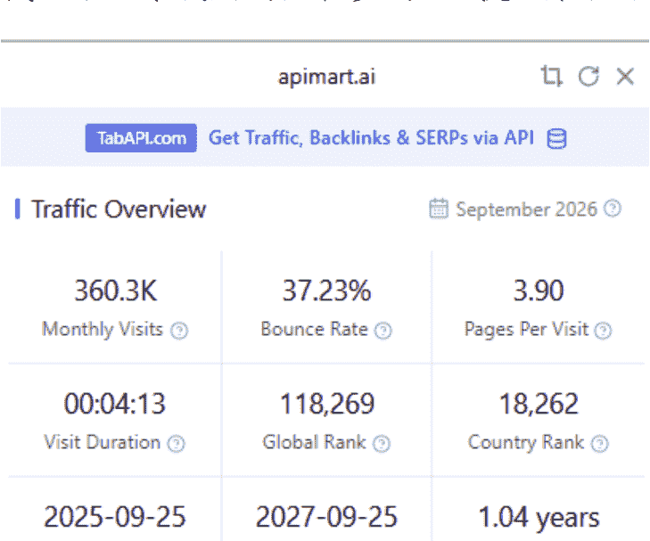
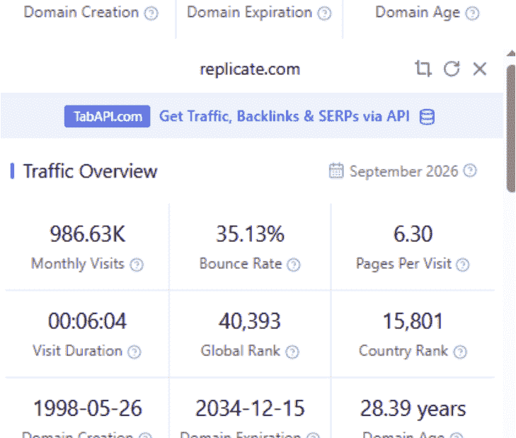
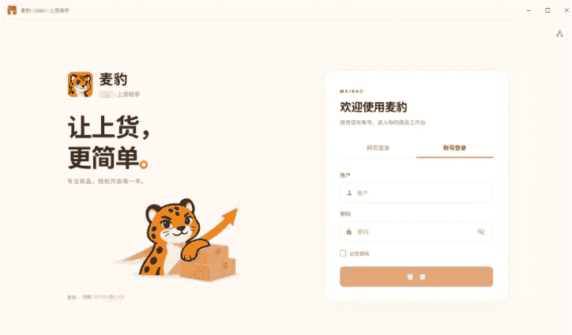

# 目标若在千万级，就别用百万级活法把自己耗干

261008 副业 SC 精华
整理：👸号懒人搜索，懒人专属群精选
懒人微信： lazyhelper1


小懒判断 | 这篇更适合那些已经在铺货型店铺、无货源项目里跑过一轮、想再上一个台阶的熟手；如果还没挣到第一笔像样的钱，先别急着照搬。全篇最让人心里一紧的，是把近百家天猫店做到亏掉七位数那段：平台先放宽入口，再让上货工具失灵，最后罚款清退，商家的节奏根本握不住。作者给出的真正出口，不是继续埋头拼执行，而是转去做影响力、卖铲子（apimart 的月访问量约 36 万）。


假如当年少把精力花在“把每个员工练成月销十万的操盘手”上，而是抽时间去经营自己的影响力，今天也许已经拥有一支更能打的队伍，以及千万级年利润的项目。这个假设，值得每个正在带团队的人反复想。

十年前，我搭过一个网页游戏导流站，靠 SEO 起步，接 CPA、CPS 广告，每月流水稳定在三万元上下，成本只有域名和服务器。后来回头看，这个项目当年只挣了三十多万，按今天的眼光，天花板被我看低了。

起初内容自己写、外链自己发，日均精准访客三千左右。做久了嫌麻烦，想靠自动化省事，采集大量资讯、简单改写后铺上去，结果被降权，流量翻车。正确动作应该是花钱补生产力：请专职编辑和外链专员把流量托住，找前端把页面做好看，同时扩充内容面，主动做商务外联换资源，多联系游戏发行方开收入口子。

那阵子国内唯一一款 3D 页游在投 CPS，有付费玩家单月开服就充两万，推广方给五成分成，持续了小半年。这笔钱，本质上是趋势给的。

早年在无货源赛道，我也打出过一些好看数字：18 年用直通车推增高鞋垫，一天烧两万广告，投产四点几，毛利七成五；19 年底一款化妆品，单月毛利八十多万；20 年底，一名员工靠单个单品做到单日成交十五万，毛利七成。类似数据还有不少。但今天回看，那些结果大多借了势，能力层面无非是执行强、肯琢磨、思路清楚。

没有势，好结果很难拿；硬要在没势的时候拿同样的结果，代价会更大，弄不好还一地鸡毛。收入体量不同，背后的思考框架和动作模式就不一样。一个卖菜小摊主要攒十万，如果每天只赚三十、一个月一千，按部就班，排除吃喝生病旷工等所有干扰，也得熬十年以上。想多赚，就必须跳出被固定死的行为和思维。

最简单的变化，是收入到某个值以后，买提效工具、加一点轻杠杆。比如先弄辆人力三轮，不守固定摊位，游走售卖，挑人流密集、需求旺、利润高的菜；资本上来再换电动三轮，效率更高；之后换面包车、小货车、大卡车。每走到有能力提效加杠杆的关口，都要有魄力执行，更关键的是跟住趋势。这样赚十万，可能两三年甚至更快。菜农和菜贩接触的人群、机会差很多，那里藏着金子。资本换了工具，收入模型和速度会变，周围人脉资源也会被带动，潜在资金和资源随之而来；后面的车不一定自己出钱，更大的杠杆会跟着圈层和影响力，像蝴蝶效应一样自己找上门。回到我身上，提升空间仍然很大。

国内商业页游的节奏很清楚：2007 到 2008 年是爆发起点，《部落战争》国服进入、《热血三国》爆火跑通联运，开心网《开心农场》把社交页游带出圈；2010 到 2015 是巅峰，2011《神仙道》、2015《传奇霸业》林子聪那句“是兄弟就来砍我”，2015 年市场收入冲到 219 亿的峰值；2016 年起手游分流、Flash 隐患、买量成本上涨、传奇 IP 纠纷叠加，2018 年后不再是主流大盘。真正红火大约八年，之后一路收缩。

我 09 年毕业时开始研究 SEO，又恰好踩中页游赛道，10 年开始起飞，同届同学当时月薪 1200 到 1500。风口上需要的能力真不多：执行到位、沉得住气、逻辑清楚。

## 第一段：页游导流站的顺风局

这个项目当年只挣三十多万，用现在的视角看，空间其实远不止于此。那时就是一个单页游戏导流站，纯靠搜索排名拿流量，接 4399、51wan 以及一些中小游戏的 CPA 广告。日均精准访客三千左右，前期内容、外链都自己干。后来犯懒，想搞自动化，采集大量资讯，简单伪原创就往上铺，最后降权翻车。

当时更该花钱提升有效生产力：招专职编辑配合外链专员，把流量继续稳住、往上推；招前端设计美化页面；同时拓宽内容覆盖面，主动做商务外联、资源置换，联系更多游戏推广发行方，增加收入渠道。

那段时间国内唯一一款 3D 页游在投 CPS，有些人民币玩家每月开服直接充两万，推广商给 50% 分成，持续了小半年。当然，生产力提得再好，也离不开趋势。

## 第二段：淘宝爆款截流

从北京回来后，我先想试二类电商。调研一周就放弃：启动资金至少百万，门槛对我来说太高。后来朋友转来方博士的淘宝无货源课程，门槛低，适合当时处境；我又找了几节拼多多课，看了三四天就上手。每个项目给自己两周测试期，业务逻辑看不懂、数据没实质反馈就立刻换。铺货加拼多多测试了将近一个月，本金投入不大，但没有像样数据，停掉。

做二类电商调研时认识的销售推荐了一款投放很凶的清洁品，我把它挂到淘宝试水，没想到这个品成了后面业务的支点。当时给自己定目标：每天赚七百，先把负债填平。半个月跑下来，负债平掉还有结余。之后在这个方向扎根，底层逻辑就是：别人在前方推爆款，我在后方捡漏。

这仍然是追趋势。先是今日头条等平台的二类电商，抖音早期靠帅哥美女、高质量 KOL 做 UGC，后来转向全民记录美好生活，再把流量商业化切入视频带货；二类电商群体整体迁到抖音，又吃到一波新红利，我正好卡在截流爆发期。

抖音的节奏：2016 年 9 月上线，起初是小众音乐短视频；2017 年尬舞机、几首 BGM 带火，App Store 登顶但还没全民；2018 年春节砸春晚广告、明星红包、挑战赛，十几天日活翻倍，从三四千万冲到近 7000 万；2018 年 6 月日活破 1.5 亿，完成全民化。2018 到 2020 是黄金红利期，普通人容易起号，直播电商进场；2021 年至今进入成熟期，算法更严、竞争更凶、买量更贵，自然流量红利消失，但平台仍是国民级。

淘宝爆款截流在 20 到 21 年达到高峰，却因为业务框架和逻辑没设计好，亲手养出不少对手。供应链、选品、运营、客服全链路技能都教给每个运营成员，原本能干四五年的项目，不到三年就被自己带出来的人卷死。半年带出熟手，一年就流失，玩法反复迭代，团队来回拉扯，22 年整个业务和团队收掉。

复盘后，我认为更稳的有两条路。

策略一：把核心选品权收回来。选品只让核心成员碰，时间大量投在选品上，人反而不累。测品出现异常值，强付费投放也由核心直接操盘；打螺丝这类替代性强的活，交给流水化基础运营岗。人才要经过长期观察和筛选，再逐步进入核心。这样，十多个百万利润单品才不会在自家开花、去别人家结果。西安有个年营收过亿的天猫无货源团队就是这么跑的：运营副总定趋势大方向、给基础词根，运营总监拆出趋势关键词列表，分给主管，主管分批给小组，组长再让专员每个词挑五到十个品上架。只要顶层方向不偏，底层做重复动作，团队规模就能稳稳长到上百人。

策略二：技术外流已经失控、明知道收不回来，就干脆放手做培训。把原本要耗在“未来对手”身上的时间，转去结交创业人群、做培训业务，一边快速回款，一边快速放大影响力。我当年只是浅尝辄止，总觉得自己能带团队，小范围培训搞了搞就收手，大把时间拿去做管理。同期赚钱圈友盗坤从淘宝蓝海起步，大量输出、放大影响力、做培训赋能，认识了很多创业者，也赚到比拉团队更轻松的收益。深入交流、有价值往来的创业人群越多，人群资产越厚，后面越容易切入信息差快钱业务，也能筛出信任度高又能打的战友。再往后，能做的就不只是信息差生意，而是合力抱团闯更大的市场。

## 第三段：天猫与抖店店群，七位数学费

这是我创业以来经济损失最重的一次，账面损失约七位数。对有些老板来说不算多，但对我而言，已经超过自己方法论里的亏损极限。

我的框架是：选好赛道，算清最多投入多少时间和钱，全力去做；过程中关键问题一个个解，仍然没有有效结果，时间到六个月或亏损碰到临界值，就果断停。

天猫店群前后开了接近一百家，期间有几个关键阶段。

第一阶段，单店启动成本八到十万。成本高、门槛高，进场对手少，产出肉眼可见往上走：单月赚五千，后来一万，再爬到两万。当时觉得只要不出大问题，扩店就能平稳赚钱。对比爆款截流，这活轻松太多，不用天天盯选品、分析同行、调直通车，机械上架、机械运营，规模也能涨。这个阶段项目本身没问题，符合我的方法论。

第二阶段，23 年 12 月中旬，天猫入驻大放宽。平台推出保证金履约方案，一千五就能抵五万保证金，卖店成本被打到地板价，自己入驻三千以内，单店成本直接降到五千以内。我马上觉得不妙：门槛没了，不只对我没门槛，是对所有人都没门槛，抢食者会暴增。当时想观望一下再加店，但拿了投资就身不由己，周围同行疯狂加店，我只能被裹挟着跟。

第三阶段，24 年加到接近一百家时，全市场的上货软件突然都不能正常用。等了两周，直觉告诉我到头了。逻辑不复杂：大批低成本店铺进来，大家都三万五万地批量铺货，天猫用户池就那么大，商品库增速比用户增速快太多，平台不可能允许保障度低的店群影响真实购物体验。我先叫停朋友那边代运营的五十家店，又逐步停掉自己团队近五十家。

第四阶段，肉少狼多之后，我只留一两家做精细化运营，用之前爆款的手法，七天把销售额从单天三四百拉到两千。可天猫又出新政策清洗批量铺货、净化生态：第三方诱导违规首次罚五千，再犯罚两万；紧接着无货源直接罚两万。两项叠加，我彻底死心，全部店铺下架关停。准备以创业失败收场时，亏损约四十万，想退又身不由己。

第五阶段，抖音店群早期收益可以，随后又走天猫同款剧本：入驻大放宽，商品信息够丰富后抢食者暴增，再上政策罚款，最后店铺清退。TK 也发生过类似的事。平台一波一波，铺货群体也一波一波。现在看，平台才是这套游戏里最大的铺货方：举着喇叭喊商家掏钱入驻，入驻后用赛马机制让商家互卷，再用商家和买家贡献的数据筛选优质商家、调整流量，同时靠罚款赚外快，留下优质马匹，给用户更好的商品和服务。循环往复，用户得实惠，商家被倒逼上进，平台躺赚。

原本我想从轻资产淘宝爆款截流，跳到高门槛天猫店群，结果平台政策一变再变，好业务变成烂业务。还有一点：爆款对运营能力要求很高，需要全方位理论和实操才能培养出合格运营；铺货多简单，电脑采集上货就能躺赚，根本不用费心培养人。

## 第四段：AI 工具出海，醒得太迟

这块做得不成功。原因之一，是受淘宝爆款截流模式影响太深：天天找新品、找新机会，天天忙、天天累，一停下来业绩就下滑，于是总想做长期且有沉淀的事，反而没拿到像样结果。这次从深圳回来，我彻底想通了，只是顿悟太晚，错过好几波风口；但再晚，也比不顿悟好。

24 年 10 月入局出海，加入哥飞社群，看了一些👸号和社群内部知识后开始实操。可一入局就排斥新词新站，因为太像之前的淘宝截流，内心一万个不要，行动上也照着这种排斥走，基本不做新词，错过好几个月入万刀甚至十万刀的机会点。

第二个拖后腿的原因，是迷恋批量化海量页面建站。AI 把开发难度打下来后，采集、重组数据很快就能完成。我做了几个小游戏和工具站，上线直接铺几万个游戏页面，四五天收录破万，流量暴涨；但实际测试发现大问题，点击量到某个临界值就一定暴跌，降权清零。


另一个没起来的原因，是 AI 把人的创造欲放大了，很容易自嗨。vibe coding 出现之前，做一个工具要攒大量编程经验；现在很多以前短期做不出来的东西，很快就能搭出来。

### 关键词趋势监控工具





### 5分钟自动内链且相关性超强的快速上站工具

### 从零开始创建一个新站点

```bash
#### Step 1: 准备产品知识库（新功能！）
##### 在 config/knowledge.yml 中添加产品相关的 URL
##### 只需粘贴 URL，系统会自动识别类型和优先级

#### Step 2: 生成知识库
##### 从 URL 抓取内容，LLM 提取结构化产品知识
python main.py gen-knowledge --force

#### Step 3: 规划主题
##### 输入“产品名 + 产品类型”，LLM 会生成完整的主题聚类
##### 例如：FLUX.2 (AI Image Generation) -> 使用 "FLUX.2 AI Image Generator"
python main.py plan-topics "FLUX.2 AI Image Generator"

#### Step 4: 生成页面种子
##### 将主题聚类转换为页面种子配置
python main.py gen-seeds

#### Step 5: 生成页面内容
##### LLM 为每个种子生成完整的页面 JSON（自动注入知识库）
python main.py gen-content

#### Step 6: 生成图片
##### 为所有页面自动生成并填充图片
python main.py fill-images

#### Step 7: 生成所有配置
##### 一键生成站点配置、首页配置、内链配置
python main.py gen-all --domain "yourdomain.com" --force

#### Step 8: 构建网站
python main.py build
```

- .git

- .wrangler

- config

- data

- docs

- out

- sitekit

- templates

- .env

- .env.example

- .gitattributes

- .gitignore

- analyze_topics.py

- list_keywords.py

- main.py

- requirements.txt

- reset.ps1

- show_keywords.py

- test_apimart.py

- test_replace.py

- test_site_images.py

- USAGE_GUIDE.md

## Explore More AI Tools

- Art Style Tools

  - FLUX.2 3D render generator

  - FLUX.2 anime generator

  - FLUX.2 cartoon art generator

  - FLUX.2 oil painting generator

  - FLUX.2 pixel art generator

- Core Brand Tools

  - FLUX.2 art generator

  - FLUX.2 anime image generator

## 想赚1000万？先别用赚10万的思维

2026年了，回头看看这两年折腾过的项目，我最大的体感并不是技术变化多快，而是“赛道”从一开始就划定了你的收入上限。很多人问我出海AI工具怎么做，我的回答有点扎心：想赚1000万，就别套用赚10万的方法论。

### 我那些“自嗨型”工具

这两年我做过不少东西：FLUX.2的角色一致性生成、图像编辑、背景移除、头像制作，还有名片、图标、插画、信息图、博客配图、电商产品图、Facebook广告、Instagram帖子、LinkedIn横幅生成器；也搞过号称日发千条的博客留言外链工具、SEMrush专版外链标注助手、AI评论生成器，甚至自动化网站流量监控平台。坦白讲，大部分都是自嗨型玩具，做完用几次就吃灰了。那时候主力AI编程工具还是Cursor，开发成本比现在人人用Codex要高不少；至于其他测试用的边角料小工具，更是没活过新鲜期。

### SEO那趟过山车

接着聊SEO。当时我冲的是老词大词赛道，圈内大佬给过明确指引：外链预算每月1000美刀，连砸三个月，时间一到基本都能起来。可我买到第二个月，看数据没什么正反馈，就动摇了，没继续执行。后来呢？等新站度过了新手保护期，流量也自己长出来了。算了下外链的投产比，居然能做到1:6左右，相当值。但问题在于，当时我奉行的创业方法论是6个月见分晓，结果到期不达标就暂停了；现在才明白，问题不在业务，而在执行。

再说说“新词赛道”。这个玩法现在依然能做，只是比之前难了、贵了。趋势新词人人都盯着，AI编程工具又大幅拉低了建站门槛，各种监控工具满天飞，新词新站注定越来越卷。说白了，它和当年的淘宝店逻辑如出一辙——反馈快、门槛低、回报高，但拼的是谁更愿意花时间执行。没有谁比谁聪明，只要时间砸得够多，把散落的趋势一个个挖出来，批量做新站，照样能赚到体面的收入。

而老词大词赛道呢？就像氪金游戏：持续买外链，基本就能站在排行榜顶端；如果氪金玩家还勤奋，那免费爆肝玩家连车尾灯都看不见。

另外还有社媒和投流两条起量路线。社媒这个杠杆，一旦撬动就是爆发式的，典型四两拨千斤；投流更看重长期回报，不能拿电商那套逻辑硬套。这两个方向我还没深度下场，但旁观到的社媒案例，爆发力惊人。

### 回到主线：想赚1000万，别做100万的活

聊着聊着就跑题了，成了业务复盘。还是把焦点拉回来：想赚1000万，就不要去做只值100万的活。

说出海AI工具站，大多数人的目标轨迹是：月入千刀→万刀→再换更大的单位；但月入百万刀，可能对绝大多数人来说就是遥不可及的天花板。在通往千万刀的路上，执行力是第一位的，而新词是性价比最高的入口。到了十万刀，就不只是执行力了（极小概率的超级大词除外），还得拼生产效率、拼工具、拼人脉。深圳以及周边的独立开发者圈子，信息密度远高于内地，多出去交流，可能别人一句话就能让你少走很多弯路。

想持续稳定地月入十万到百万刀，靠以前那种单点打法——买买外链、挖挖新词——就会非常吃力。不是完全不可能，而是难度陡增，远远不是复制10个万刀站，或者堆100个、1000个小站能解决的。

### 一个让我印象深刻的样本：apimart

挑对时机和生态位，比闷头复制100个万刀站更有机会，而且能吃到复利。我大概是25年5月从赚钱AI实验室撤回西安后，注意到apimart才刚开始萌芽；到了8、9月份，apimart离开实验室租了独立办公室，之后一飞冲天。现在，很多AI模型相关网站都能看到它的广告。

下面是我经常用的几个AI模型聚合站截图和流量数据：

kie.ai：月访问2.93M，跳出率37.93%，页面/访问3.79，平均停留3分52秒，全球排名18931；
fal.ai：月访问3.21M，跳出率42.61%，页面/访问5.08，平均停留4分48秒，全球排名14863；
openrouter.ai：月访问21.27M，跳出率30.39%，页面/访问7.82，平均停留5分51秒，全球排名1703。

apimart目前月访问约360k，差不多是replicate的三分之一、fal的十分之一，而且还在持续增长。我为什么愿意用它？因为生图够便宜——一张2K的图最低7分钱，稳定性和速度也都不错。对于做AI工具站的朋友来说，用它来提升用户试用黏性和订阅利润率，效果很明显。

这种卖铲子卖水的生意，只要AI使用量持续增长，低价引流到位、服务稳定，复利就会越来越大。上个月我在东莞帮朋友做了一个海外电商上货软件，按他们最低客户体量估算，每个月就能消耗100万次生图；扩大到最大客户群后，月生图消耗可能摸到1000万次。apimart看起来啥也没做，但好像啥都做了。

这个业务之所以能起来，就是因为入场时机正好踩在生图模型的趋势上。很多独立开发者其实有技术能力做类似的事，但大家关注面太窄，总觉得出海就等于AI工具站、游戏站，或者只盯着挣美刀。其实我上面说的上货工具，哪怕只服务国内几个铺货团队，每月GMV也能到10万+人民币。

无论出海还是做国内，找到那些想用AI工具赚钱的人，把帮他们提效的细分赛道拆出来，做出一个好用的工具，周期和门槛虽然可能更高，但比追新词有复利得多。

### 最后几句大实话

想赚到1000万，第一步不是努力，而是站上一条有可能承载1000万的道路。信息差生意的典型特征，就是快进快出。等你发现机会、研究清楚模式、复制入场，可能还没等到收获，行业已经红海了。原本计划一年完成的目标，熬上三年也未必能完成。

当你发现自己越来越忙、赚钱却越来越难的时候，先别急着“再努力一点”。停下来，抬头看：趋势是不是变了？红利是不是没了？有没有新的杠杆可以借？有没有更好的商业模式，能把手里的资源放大十倍、百倍？很多时候，限制收入的不是能力，不是努力，而是你所在的赛道和模式，从一开始就决定了上限。

记住八个字：顺趋势，借东风，才能飞。不要用赚10万的算盘，去打1000万的仗；更不要在一个天花板只有100万的赛道里，靠十倍的努力去够1000万。

工具和教程从来不是护城河，真正的护城河只有两项：说干就干的执行力，和你所在圈层的信息差。如果你想看全网最新的变现玩法，和一群执行力极强的极客一起下场拿结果，欢迎来我的核心私域：【懒人专属群】。

我们不聊虚的，只做商业闭环拆解和AI效率的压榨。圈子里已经沉淀了1000+跑通的套利实战局。

查阅圈子完整数字资产与上车门槛：https://lazyso.com/insider/

认同价值、准备好下场干活的，扫码加我微信（lazyhelper1），备注：【实操上车】，不闲聊。