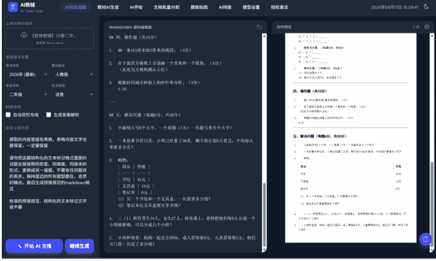
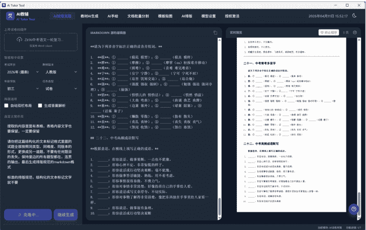
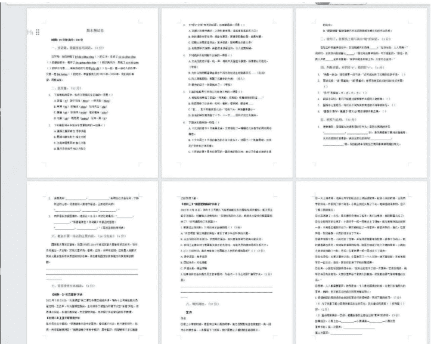
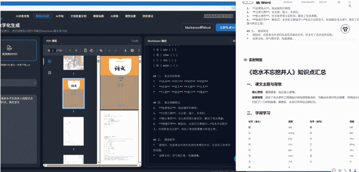
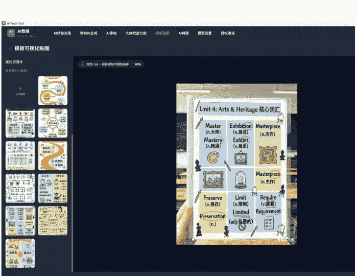
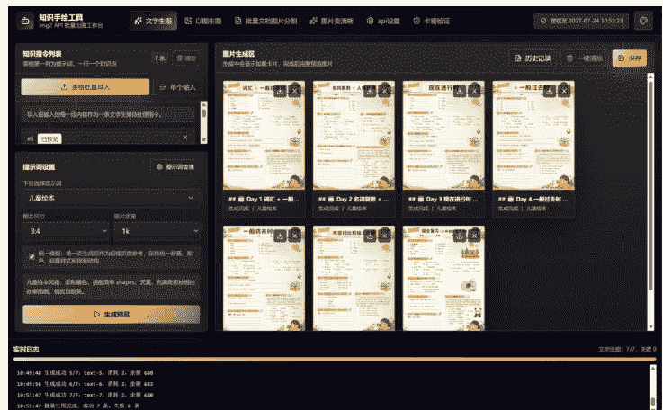
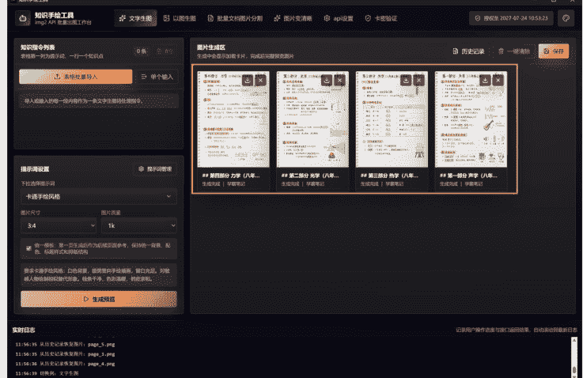
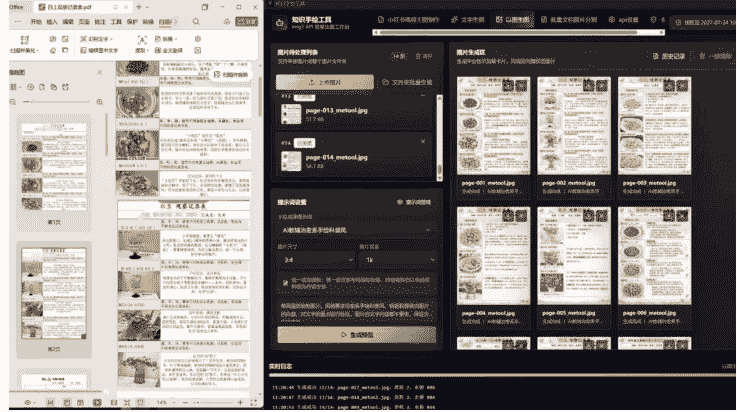
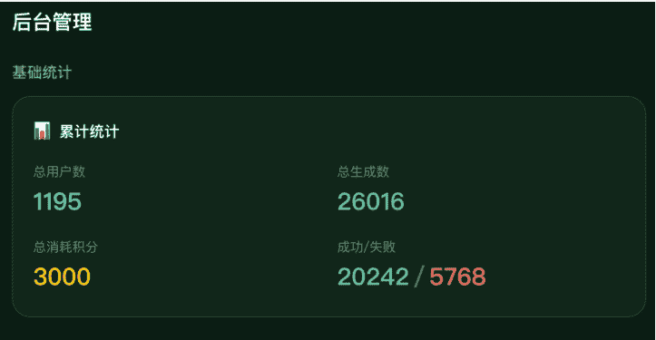
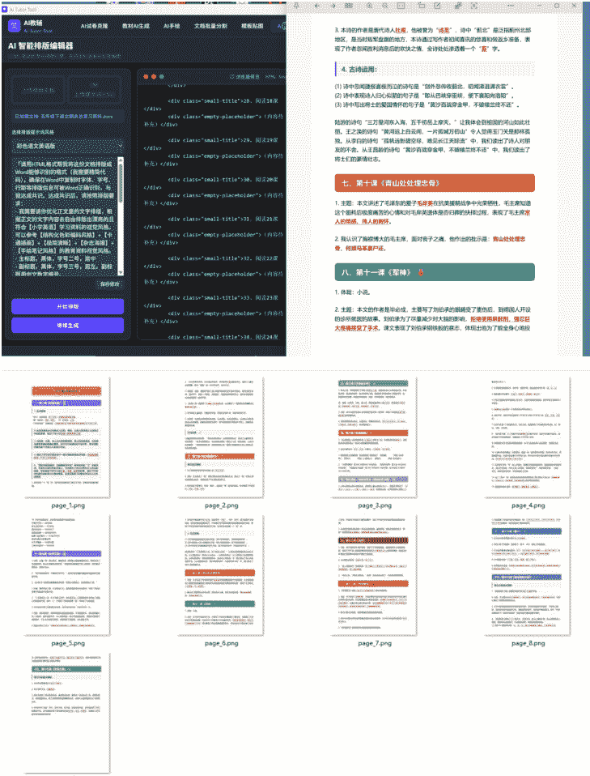

# 市面上已经有不少类似 codex workbody 的大型 AI 工作台，能做的任务看起来包罗万象——作图、视频、文案脚本，应有尽有。但问题恰恰出在入口上：环境配置、软件安装、网络账号，每一步都能劝退一大半普通用户。
作者：龙哥

我的路线截然不同：不跟大平台比功能多少，而是从整套能力里选出某个具体切面，做成一个单点工作台。只服务某一类人、只解决某一个需求、只提供某一种功能，把力气全部砸在一个点上。

从最初的“AI 教辅聚合工作台”到今天的“教辅出图平台”，这条路的转折点，正是聚焦在了资料美化、原创内容与排版设计这三件事上。

说起来轻巧，但过程并不顺。我犯过所有新手都会犯的错：把功能堆了一堆，用户打开之后一头雾水，根本不知道该拿它做什么。后来我终于想明白了一件事——砍掉 90% 的功能，只留一个点，把它做深做透，一切才真正开始。

有人问我，被同行连夜照着抄的 AI 工具工作台到底长什么样？这篇复盘，我只挑四件事讲：①聚合类工具为什么留不住用户；②如何从大而全里拆出小而美；③怎么把复杂全部藏到后台，让用户三步就出图；④为什么说“工具是样品，定制才是生意”。

目前有 1200 人用过这个工具、185 人续费，真实数据都在下面。

如果你也想用 AI 做点属于自己的产品，或者好奇一个普通人如何把一件小事做成收费生意，这篇文字也许能给你一些参考。

## 01 最开始的聚合式教辅工作台：AI Tutor Tool

第一款教辅类工具我做的是聚合产品，把资料分割、拼接、作图、排版、仿实拍这些能力都收拢到一起，当时想着“教辅资料生成中多多少少都会用得到”。

文档分割、文档图片拼接、作图，甚至资料内容的排版与仿实拍……什么功能都往里塞，试图面面俱到。

当时这个软件覆盖了六个能力模块：AI 试卷克隆、教辅 AI 生成、AI 手绘、文档批量分割、模板贴图、AI 排版。乍一看，每个需求都切中教辅资料制作的真实痛点，尤其是原创与排版这两块，更是高频刚需。

但市场给了我一记响亮的耳光。通过一段时间的用户体验和反馈数据分析，我把绝大多数功能都砍了，只留下 AI 作图这一个模块，并且把所有精力都投进去打磨它。

下面逐个说说当时每个功能解决什么问题，以及我为什么选择舍弃。

### 1.1 AI 试卷克隆功能

AI 试卷克隆功能本质上是“上传复印”：用户上传试卷，AI 根据提示词改写题目，再用 Markdown 格式重新排版，得到一份原创感十足的新试卷。

像每日习题、试卷这类场景，AI 都能生成同类型、同难度、同学科的替代题目，排版效果也很能打。

但当我拿 100 套试卷去批量测试的时候，问题开始暴露了。

客户一多起来，各种质疑扑面而来：题型怎么变了？图片怎么消失了？题干能保留吗？内容是不是超纲了？是不是有错漏？

我不得不承认，这些问题的根子，在于 AI 模型和提示词的底层能力边界。没有一套标准化的流程能兜住所有意外。

最致命的一条是：AI 目前画不出与题目严丝合缝的几何图形，而今天的练习册几乎每一道题都配着图。这个功能无论怎么调优，都解决不了这个根本问题——能处理、能排版、效果不错，但本质的坑填不上。

### 1.2 教辅 AI 生成功能

第二个功能是教辅 AI 生成。它的使用方式同样是“上传即开始”：把电子教材上传，用提示词下达指令，比如生成第几单元第几课的习题、课件、教案，AI 会直接返回排版好的成品。

但这类教材生成类工具最大的软肋，是没有标准化的模板底盘。

没有标准模板意味着什么？意味着用户要自己去琢磨提示词、自己去检查和纠正输出。这个环节会把产出周期拉得很长，也会让成品效果变得不可预期。

用户的想法其实很简单：只需要用最简单的操作，直接看到对应的效果。特别是效果型工具，**能把结果交付到手里的才是好工具。**

如果一件工具让用户反复纠正、反复尝试，那体验就变成了“抽卡”——全靠运气，谁还会为它付费？所以我越来越坚定：生成类工具的核心指标是“交付结果”，动作越少、流程越标准，付费率就越高。

### 1.3 模板贴图功能

第三个功能是模板贴图。这个功能是给“仿实拍”用的，把生成好的图片或者从 PDF 里分割出的资料，贴到书本、桌面、电视等实物场景上。

说实话，这个功能很有潜力，完全值得单独做成一个工作台来做仿实拍。如果提供足够多的场景模板——电视、教室、书本、桌面——用户直接套用，甚至背景也可以用 AI 生成，输入一个关键词就是一个新场景，整个流程就标准化了。

当流程标准了，用户只需要统一操作：把不同资料拖拽进去覆盖原有画面，一张仿实拍效果图就出来了。发笔记、做宣传都好用，用户既不用动脑也不用反复纠正。这个功能我计划要么单独做一套工具，要么嵌进现在的知识手绘工作台里，服务教辅场景的仿实拍需求。这样的工具，才称得上合格。

### 1.4 极简主义风、学霸笔记风、3D 效果……

接下来聊聊被保留下来的核心：知识手绘，也就是极简主义风、学霸笔记风、3D 效果这类手绘出图功能。

这个模块把标准化的流程全部封装进提示词里，用户点击即用，所见即所得。哪怕想自定义，也有现成流程可以套。我的工作流是：看到好看的图片，直接用豆包反推它的生图提示词，然后存进提示词管理里，以后就可以批量生成同类风格的图片了。

整套出图流程非常简单：复制知识文字 → 选择风格提示词 → 设定图片尺寸 → 点击生成预览。片刻之后，一份风格统一的手绘资料就完成了。

核心就是两句话：功能要聚焦——让任何知识变成手绘图；流程要简单——复制粘贴、选择、点击就完事。

不管多少用户在用，都不需要思考，不需要配置环境，不需要学习怎么写提示词，更不用面对生成结果反推纠正。这些多余的步骤，每增加一步，用户就会觉得“这个工具不适合我”。

所以工作台的目的，说穿了就是“简单”二字：功能简单、使用简单。

相比直接调用出图模型（比如极梦、Wordbody），这个工作台独特的价值在哪？

它只解决一件事：把文字变成手绘图。从“大而全”里拆出来的这个点，流程够标准、步骤够简单、需求够高频，而且场景足够小而垂直。

那些复杂的环境配置、账号网络问题，全都被封装到后台了。用户拿到手的就是一个软件，安装时一路“下一步”，打开后复制粘贴，几步就出活了。

做产品还有一个更深的感悟：搞清楚你的用户到底是谁。以前我做软件总想要覆盖面更广、人群属性更多，结果哪个都没做好。直到后来，我把目标人群死死锁定在“做教辅的人”上，功能方向也收窄到“资料的美化、原创与排版”。

所以，一句“让任何知识变成手绘图”就成了这个产品的灵魂。它足够简单、足够有传播力，以至于某鱼市场上的仿冒者都把它照搬了过去。

当这些条件都对齐，剩下的工作其实就是一件事：用视频、文章、平台挂载等方式，让更多人知道这个能交付结果的出图工具。

到目前为止，有效用户数（有实际使用记录的）达到了 1195 个。

这些道理都是事后才总结出来的。在开发聚合式软件的过程中，我也踩过“有需求但没有标准流程、有购买但问题不断”的坑，最典型的代表是教辅排版功能。

### 1.5 教辅排版功能

排版在教辅行业本来是高频需求。我最初的技术方案是使用 HTML 来搭建页面，时至今日市面上仍能看到这款产品在流通，也还有人在购买，但它注定不适合长期维护。

它的工作逻辑大体是这样的：

提示词（简化版）：
“请使用 HTML 格式重新编排文档内容，并根据要求设置字体、字号、行距、页边距、标题样式、加粗、背景色、顶部/左边/右边/下边距，以及对横线、等式、分式等符号进行处理，最后形成一份基于 HTML 底层排版的文本样式。”

具体执行路径：先上传原始文档，AI 提取全文，然后让它按照上述限定条件——比如正文用几号字、标题是否加粗、有没有背景色、行距多少、边距多少、符号如何处理——重新进行文字编排，最后输出一份基于 HTML 底层的排版页。

效果呢？部分案例确实不错，但学科差异非常明显：纯文字内容几乎完美，而带图形、带复杂格式、带数学公式的内容，排版就乱了。分页更不受控制，一页内容可能被硬生生拆成两页。

更要命的是这种提示词并不通用，没办法保证每份上传的文档都输出一致的效果：语文类纯文本表现最好，数学、英语类的排版就出现明显差异和错乱。

这样的限制，注定了它无法真正覆盖教辅排版的现实应用场景。流程不够标准，用户需要针对性修正，交付不了稳定结果——这已经足以宣判死刑。

从上述几个案例里，能清楚看到一条贯穿始终的教训：**想做工作台，要从“小而美”出发，使用动作必须标准化。** 任何一个环节做得不够好，都能劝退用户；用户一旦用不明白，就不会有二次付费。

这就是我那个教辅工作台演变的全过程。现在只保留了知识手绘功能，用标准化的提示词把文生图和图生图两个场景固定下来，针对性地解决教辅出图的美化、原创及排版问题。作为一个聚焦型的工作台，这已经足够。

坦率讲，我并非教辅行业出身，也不自认懂教育类目。上面谈到的每一条功能，我都用自己的软件实际验证过，其中有强烈共鸣的，也有一家之言的，写出来供你对照参考。

所谓工作台，就是能把一个行业里的一件具体小事，做成看得见、拎包入住的产品，卖给同行和企业，眼下确实是不错的机会。

那么，教辅资料出图这个机会到底是怎么被发现的？

## 02 机会不是发现的，是市场告诉我的

“懂行业 + 会 AI”的人做工作台，顺理成章。我是反着来的：先会用 AI，再用市场验证行业到底需要什么。

我翻过大量帖子、做过大量验证，一个同样的信号反复出现：出图，特别是纯彩绘版手绘图，真的是一门好生意。专门卖彩绘版手绘虚拟资料的，单品做到 10 万以上利润不在少数。

再举个更具体的例子：原创新儿童绘本，甚至能做出 30 万+ 的利润盘子。

拆解一下玩法：把教辅资料通过手绘工具批量变成手绘图，然后建一个小程序平台做总览分类，把这些资源陈列在上面。变现路径也清晰：单卖儿童绘本，单价几块到几十块不等；或者直接打包整个小程序的会员。

这些数据是实打实的：59 元卖出了 3851 份，39 元折扣价卖出了 7417 份。利润自己算。虽然现在店铺已经关闭，但从去年开始做，一年的时间赚了几十个 W。

更值得注意的是它的商业模式完全没有改变：换个平台照样能跑通。通过知识绘本、通过小程序整体、通过单个 PDF 或会员打包，任何形式都能变现。

我们要思考的不只是某个平台的利润数字，还要深挖这套模式：他靠什么盈利？用什么方式作图？怎么完成用户转化？

结论很明确：手绘知识这个方向，仍然是一条值得入手的赛道。

教辅卖家对配图的需求量极大，但大多数卖家自己不会作图；市面上的成品手绘图，要么不够精致、要么定价偏高、要么出货效率太低。

所以我干脆不去学教辅，直接做工具。行业不懂怎么办？把行业里最通用、最刚需的动作单独抽出来——把知识点变成图。这个动作不需要懂教育内容，只需要懂出图。AI 用市场验证和产品反馈，把“懂行业”这道门槛跨了过来。

再看到那句话，“一个行业有很多岗位，一个岗位有很多天天要做的事，每一件都可能长出一个工作台”，我现在格外认同。教辅行业里“把文字变图”这件小事，就足够养一个工作台了。

那么面对验证过的需求，如何做到“小而深”？我把它拆成两个具体动作。

### 2.1 从大而全里，拆出一个专而精

这个工作台并非生来如此。更早之前那款工具的教训在前面已经讲过——功能太多，用户压根没法用。做产品有个铁律我完全认同：**把极小的一个点做到透，远远好过大而全地去铺开。** 有的圈友只做主图和详情页，有的圈友只把一段文案丢进工具里出一个剪映草稿，有的圈友只做📕的细分功能，大家照样做得风生水起。

我的做法也简单——把旧工具里的出图功能拆出来，独立成板块，专而精地打磨。由此才有了现在的教辅出图工作台。功能砍到只剩三个：文生图、图生图、图片变清晰。每一个都绕着“让知识变成手绘图”的需求在转。

开发流程用的 Codex，1.0 版本大概一周就搭完了，剩下的时间全在做细节优化。有了 AI，工作台变得“搭得起了”。说句实话，软件开发本身并不难，难的是判断用户需要什么。过去这需要很强的编程能力和不菲的开发成本，如今个体也能独立搞定。

### 2.2 把“拎包入住”封装到极致

工作台的用户画像，是那些不懂 AI 的人，因此“封装”就成了一切的前提。

环境配置、账号、网络，这些问题必须在交付前全部解决掉。我见过一种有趣的观察：许多在开发者眼中再简单不过的操作，在外人看来就如同天书——满屏的命令、指令、参数。我给自己定的验收标准是：**整个操作不超过 3 步，而且全部只需要复制粘贴。**

我的目标客户是教辅卖家，其中不少是女生，很多人连“模型”这个概念都模模糊糊。所以我的理念是：**🪜、配模型、搭技能、写提示词，这些复杂的事情，一律留在后台。** 用户界面上有且只有三个动作：复制知识点、粘贴进去、挑选一个风格，然后点击生成。

为了方便用户直接上手，我把三类高频场景做成了现成的模板：封面主图、中英文对照、知识点手绘海报/课件。同时把常用风格封装成一个又一个提示词——学霸笔记、极简风格、儿童手绘、历史复古……加起来有 50 多种风格，全都放在“提示词管理”里，分门别类，一键引用，随叫随到。

另外还设了一个自定义风格区：看到喜欢的图片，用豆包反推它的风格提示词，保存下来以后反复使用。这样一来，用户自己就能扩充风格库，不用苦等我更新。

我深信封装的度就是产品的命：封装得越彻底，客户越不需要动脑，越有可能会长期用下去。我的实际体感是：用户看一遍教程就能上手，远比功能多不多重要得多。

## 03 目前的成绩：1200 人使用、185 人续费

走到现在，出图工作台注册使用人数差不多 1200 人。我自己在坚持使用，同时通过发卡网卖卡密，用户下载即用、购买后激活。

低价卖工作台，吸引来的往往是本就懂技术的人；而真正愿意付费的，是那些有明确需求、付得起钱、但不会操作的人——他们为的是定制或服务。我的体量现在还不大，但需求已经得到了验证：有人愿意为“把文字变成好看的手绘图”买单，就说明它是一门真实存在的生意。

绕不开的现实问题也有：生图接口并非自己所有，上游平台的卡顿、失败是常态，部分时段出图就是不稳定。

这种局面下我学会了一件事：**不要把宝押在单一接口上。** 尽量配备两三个备用接口，遇到平台卡顿或失败时能自动切换，不至于让用户的创作体验断在半路。

### 3.1 这几条工作台要点，我深有体会

**第一，只做一件小事，做精做透。** 对普通人和个体玩家而言，这是底线。不能贪多，功能太杂，用户不知道如何使用，自己维护起来也是巨大负担。把某个类目、某个点做到极致，已经足够有杀伤力。

**第二，封装越彻底越好。** 安装软件、配置环境、🪜、写提示词……这些门槛一律拆除，让任何人拿到手就能用。安装即用、一眼看懂，是一款工作台最理想的状态。我的用户里有很多女生，她们看一遍教程就能配置好并开始使用，这就是封装带来的价值。

**第三，看得见效果，才卖得动。** AI 的价值是隐形的，工作台的使命就是把它显性化。我的软件没有写过一行“我们很强大”的广告语，只是把效果图摆在那里，把用户最想要的结果直接生成出来。图片也好、文案也好、视频也好，只要客户能看到效果、拿到结果，工作台就能立得住。

但我想额外再补充一条：**工具和虚拟资料这类产品，复制速度太快了。**

你可能刚有起色，同行已经把名字、界面、功能全盘照搬。帖子也说，工作台本身没有壁垒，复制成本极低，被照搬是常态，周期很短。现在去某鱼搜“知识手绘”，出来的几乎全是我这边软件做的图，连发布文案和内置提示词都一模一样。我确实已经亲身体会到这种痛苦——你必须不断探索新的切入点和需求点，否则很快就被追平。

那壁垒到底在哪里？答案是“人”。**是你对这个行业的理解有多深，是你的 IP 有多强，是客户对你有多少信任。** 工具可以被抄走，但迭代速度、用户服务、信任感，都是抄不走的。

## 04 下一步：从样品走向结果

工作台是样品，定制是生意，最终交付的永远是结果。

我现在的阶段，是把样品打磨到极致：让客户在第一眼就明白，这个东西能为他创造什么价值。

下一步的计划，是从工具走向行业——不只是卖工具，而是把服务拆解成一系列“小而全”的需求产品，每一个产品都跑通同一条标准流程。

给同路人的建议，也是我自己正在执行的清单：先给自己搭一个，只挑一件小事，第一版删到不能再删，做成看得见的样子，用最简单的方式宣传出去。

如果你也在做工作台、在卖工作台，欢迎来找我交流。教辅出图这件小事，我已经打定主意做深做透。

- [ ] 查阅圈子完整数字资产与上车门槛：[https://lazyso.com/insider/](https://lazyso.com/insider/)

