# **虚拟电商选品：累计成交只是历史，增量曲线才决定当下**

很多人做📕虚拟店铺，点进链接先看累计成交，看到几千单就觉得需求稳。实际上那个数字只说明过去卖过，不说明现在是否还在动。可能前天还在走两百单，也可能最近一周只动了两三单。页面显示都是五千，今天要不要跟进，判断完全不同。

我叫锦城，目前主做📕虚拟店铺，兼带闲鱼。职场类目累计收益已破六位数，闲鱼月入三四千。最近平台收紧电子资源类目资质，我的店铺也受影响，月收入从四万左右降到一万左右。门槛提高有利有弊，我现在把玩法从全自动堆量改成半自动，脚本能做的仍让脚本跑，选品、笔记质量、合规判断重新交给人工。

选品的起点我也曾很原始。刷📕，搜检索词，看链接，觉得有意思就记录。品类少时脑子里能记住，十几条还能盘得过来。数量上百后就乱了，更致命的是会忘。今天看到一个有潜力的品，想着过两天复查，结果被别的任务打断，一周后再回头，可能窗口已过。

还有个容易误导的点：首页出现累计成交数千的链接，第一反应是需求大。可不知道这几千单用了多久。是近一个月集中起量，还是去年就到四千九，今年才慢慢爬到五千？仅看累计成交只能看到一半。

我早期用影刀做过简易版，每天定时打开链接抓一次成交，第二天再抓一次，做减法。单品店铺都是一次日更。粗糙但能看出“昨天二千九百八十，今天三千”这种变化。后来想追踪的重点变多，日更对核心品太粗，而且Codex写代码方便了，我就按自己的习惯重做了两套工具。

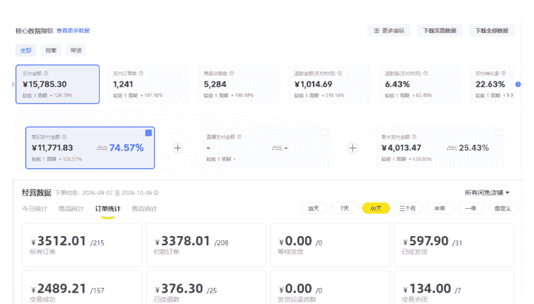

第一套做成Windows桌面程序，负责批量抓取。第二套做成Web程序，负责持续记录。

第一套首版两天上线，第二套折腾一周左右，都是我描述需求给Codex边跑边改。也没做什么完整版，七天、三十天增量还没加，店铺目前只看累计成交变化。用到什么补什么，比一开始做大而全更省事。

第一套的核心动作就几类：用检索词搜链接、按店铺名或账号ID进店、整店抓取、只抓有成交的、只抓近期上新的。再配合最低成交、价格区间、每个检索词采多少家、单店采多少条等条件，基本够用。抓回来保留：来源检索词、店铺名、标题、价格、主图、成交、详情标记、加购、上架时间、链接、粉丝数、开店时长、状态、备注、抓取时间。

抓出来不等于要做。它更像是候选池。比如准备看教师资格证，先用几个检索词把几十条链路抓回，这时只知道“存在、历史水平大概如何”。是否深入，还要交给第二套跑几天。

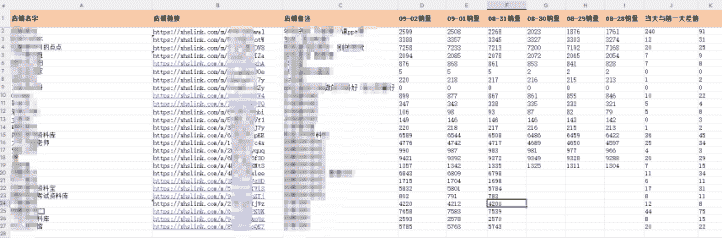

第二套的核心是定时记录成交并自动算差值。单品我设成早上十点到晚上十一点，每小时跑一次。比如十点一千，十一点一千零六，十二点一千零一十三，就能看出两个小时分别加了六和七。每天汇总后，能看到当日新增、前日新增、上一小时是否变动、过去每日累计变化。

店铺不需要那么密，一天一次就够。比如十月一日全店八千二百八十，十月二日八千四百二十，差值一百四十。这个提醒的意义不是拆哪条在卖，而是告诉我这家最近有动静，值得深挖。连续几日整体向上，再回第一套把整店抓下来，挑重点单品继续监控。

预警是我专门做的接口。监控池现在有两千三百多条单品、一百四十多家店铺，不可能人工逐条看。所以设了两条触发线：普通品最近60分钟新增达到五单就提醒；另外一条针对高客单：单价三十元及以上且最近60分钟新增超过一单也提醒。

为什么分开？两块九、五块九的资料一小时走两单，未必值得紧张。但五十九、九十八甚至更高的虚拟资料，如果一小时内连续走两单，就需要马上看。规则可按自己的选品习惯改。

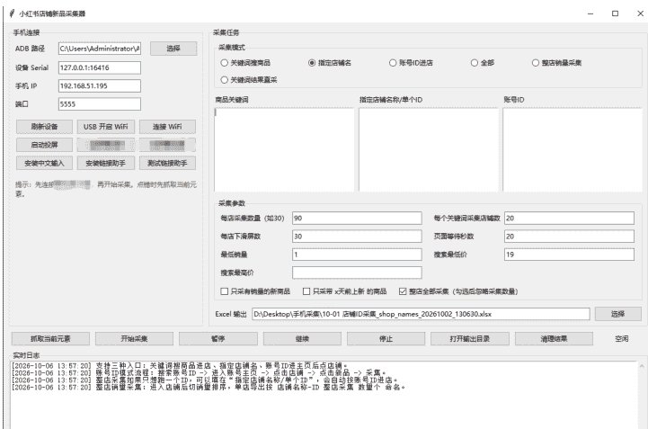

触发后会自动汇总品名、价格、当前累计成交、当日新增、最近60分钟新增、命中哪条规则，直接推送到🛰️或钉钉。我不用一直挂后台，手机收到消息再进去看。

要明确，这不是订单通知，我拿不到商家后台真实出单。它更准确的说法是“成交异动提醒”或“小时成交预警”。作用是从两千多条里把“突然卖快了”的捞出来，让我第一时间注意到。收到提醒也不代表立刻跟进，我还会再查：前几小时是否也在走、同检索词其他链接是否也在动、这家店铺其他品如何、对应的笔记长什么样、该检索词整体是否在起量。信号对齐了，才考虑测试。

现阶段我的实际流程是：第一套建候选→导入第二套监控→出现异动→🛰️钉钉推送→人工判断。第二套只负责盯，不替我决策。重复动作多的环节就自动化，能省几十次鼠标点击、几小时盯屏就值。

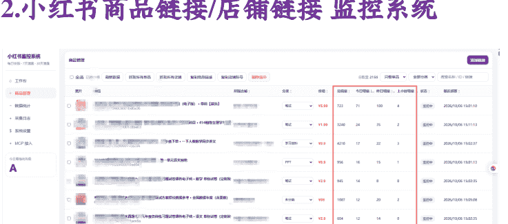

现在看一条链接，首先看它最近有没有在走。监控池里两千多条，不可能逐条翻。我会先按当日增量排序，没动的先放一边，突然冒出来的、或我原本就关注的检索词，再去翻历史。

没有死规矩说日增二十才做。品类不同标准不同。很小众的高客单职场资料，日增五单可能就值得研究；几块钱的大众考试资料，日增五单吸引力就低。比起单日数字，我更看连续性。某天突然加五十，后面三天归零，我会留意但不会马上跟。连续几日加八、十二、二十、三十，反而更值得重视。

也不能只盯一条链接。某条爆，可能只是某篇笔记火了，也可能是店铺权重高。发现上涨后，我会把样本放大：搜同检索词、看其他店铺、看这家店的其他商品。不止一条在动，才更相信背后有真实需求。

监控池里出现两条典型数据，很好说明“看到的时间点”比“看到的数字”更重要。

第一条是CPA历年真题电子资料，到十月四日累计一千四百二十六单。若那天第一次看到，只会知道历史上卖过一千四百二十六单。但历史记录显示，八月二十四到二十九日每天仍有明显新增，八月三十日降到加五，随后很快掉到日增零到一附近。九月二十九日累计一千四百二十六，九月三十到十月四日连续多天零新增。中国注册会计师协会公布的二零二六年专业阶段考试时间是八月二十九到三十日，曲线与考试时间高度吻合。考前每天二三十单，考后迅速冷却。十月才看到的人，和八月下旬看到连续增量的人，判断完全相反。

第二条是教资解析类资料，到十月六日累计五千三百六十八单。拆开看，八月十八到二十三日每天四五十单，已值得重点观察；八月二十四日起加一百零五、加一百零二、加二十七、加五十三、加八十三、加九十五、加一百一十七、加一百九十八，一路加速；九月七到十一日仍是加二百二十六、加二百三十六、加一百九十六、加一百八十八、加一百七十四；考试后迅速掉到个位数，九月二十三到二十八日出现多天零、加一、加二。同一条链接，八月下旬发现和十月初发现，结论天差地别。

基于这些记录，我现在看考试品，除了“下个月有考、提前布局”，还会多问一句：真实需求现在开始动了吗？大概从何时加速？这些曲线我会保留，明年同类考试何时重点盯，就有参照。

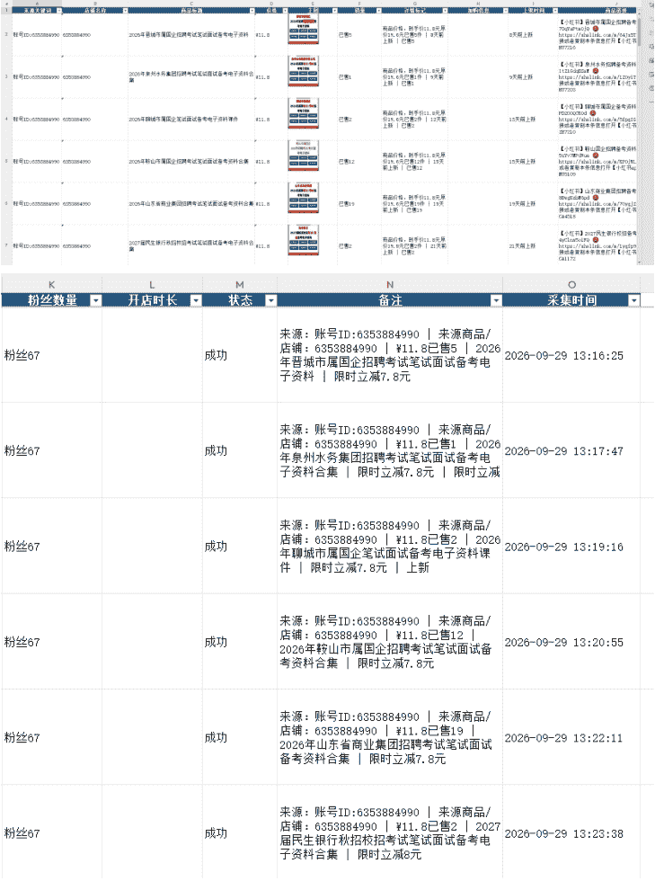

日常选品我主要走三条路：考试日历、淘宝找词、监控池里的店铺。

考试日历：先让AI把未来几个月考试列出来，大中小全列，但时间一定去官网核对。AI适合整理，不适合背书。然后把考试拆成检索词，比如教师资格证可拆成教资真题、科目一、科目二、历年真题等。词丢进第一套抓几十条，有价值的进第二套观察几天。进入明显增长期，再扩同词商品和店铺。这时再研究笔记：哪些笔记在带、标题写法、封面形式、评论区关心什么，判断能否快速复制。能，就做自己的版本测试。我不喜欢等数据百分百确定再动，考试品窗口很短，等你全确定，可能已过半。

淘宝：不是去抄品，是找需求词。搜电子资料，按自己定的价格条件往下看，看到有意思的类型，把核心词拿回📕复核。有对应链接就继续监控。淘宝找词，📕验活。

店铺：有时候检索词都不确定，就是监控池里某家店连续几日累计成交在涨，今天加一百、明天加一百四、后天还在涨，就把它当入口，整店抓下来，再挑重点单品监控。

说到底，判断一条品，先看它最近是否在走。今天没动的先放，突然排上来的再翻历史。没有固定数字门槛，小众高客单和大众低价标准不同。更看连续性，也要看样本是否足够。系统只帮我盯，最后一锤子的决定仍是人来下。

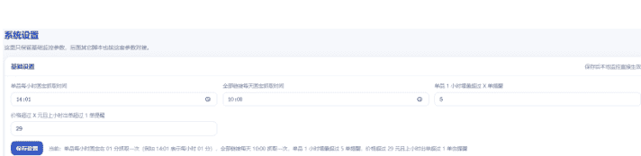
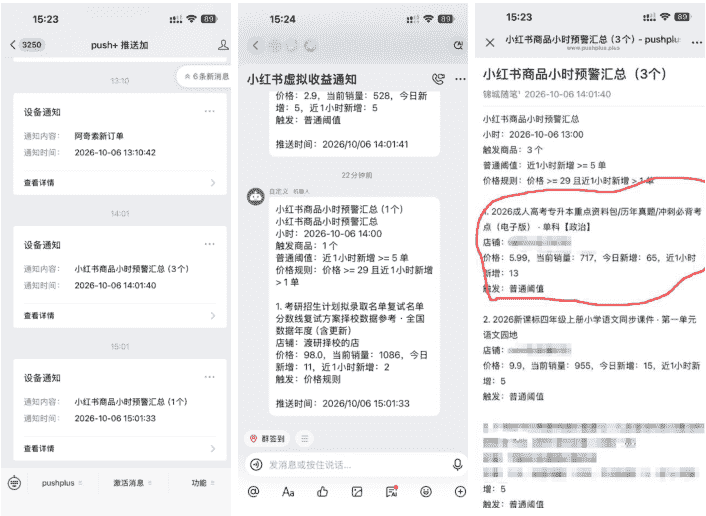
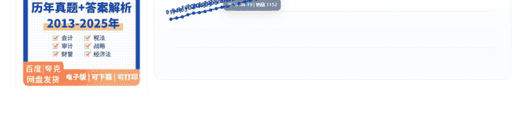
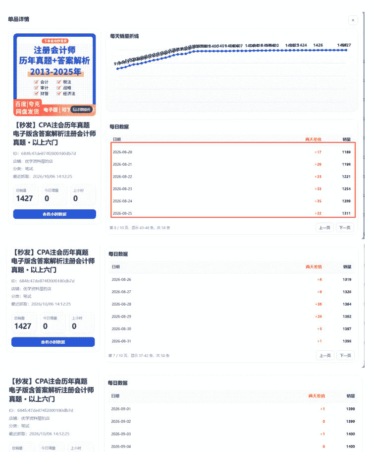
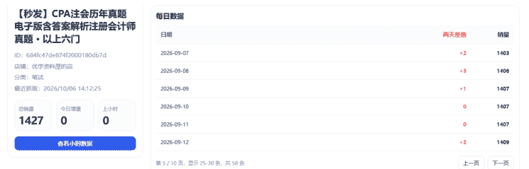
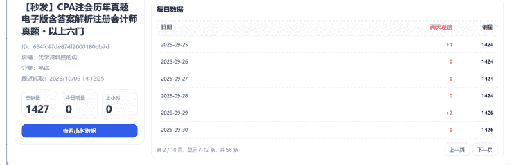
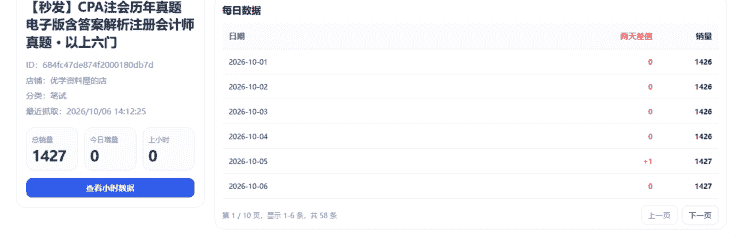
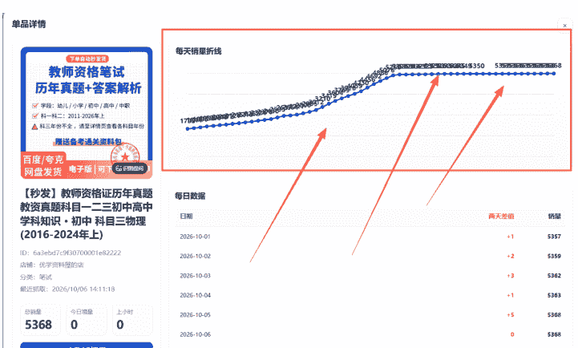
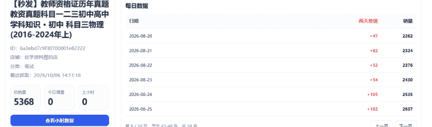
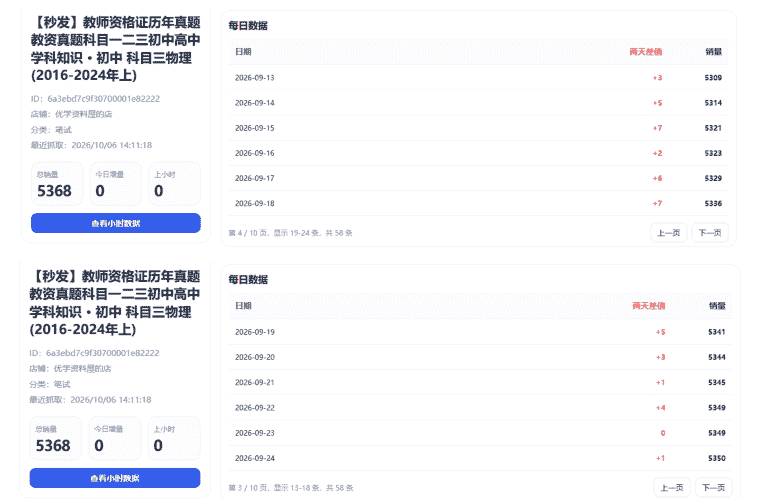

# 别被累计已售骗了：我真正盯的是这几天有没有动

很多新手打开选品页，目光先落在那串很大的已售数字上。我的习惯正相反：先问一句，这两天的数字有没有挪动。

下面分享一套我在📕卖虚拟资料时反复用顺手的方法：怎样从正在爬升的货品倒推出搜索词，怎样观察铺子，怎样先靠一张电子表格跑七天，以及为什么刚入门的人不该一上来就铺几千个监控对象。

## 入口可以随时换，先抓住增量再往回查

找货的起点并不固定。

可能先碰到某个搜索词，顺着它摸到对应货品；也可能先逛到一家铺子，从里面挑出值得看的对象；还可能先发现某件货正在起量，再反向挖出一串搜索词，最后回到内容端看别人怎么讲。

先后次序可以调，核心是先锁定“最近在动”的信号，再沿着信号往回查：货品 → 搜索词 → 内容。

## 省力的办法：把几家稳定成交的铺子放进日常视线

我会长期留几家出货稳定的铺子在视线里。

这里的“看”不是对方发什么我就照搬什么，而是盯三处：近期哪些货在爬升、哪些搜索词反复冒头、哪些内容还在带来订单。

如果一家铺子连续成交，我会把整店货品批量采下来，再把重点对象送进盯盘记录器。

确认某件货有增量后，再回头拆它的内容：题目怎么取、封面怎么排、搜索词怎么埋、评论区在问什么。然后自己重做内容去测。

卖虚拟资料这段时间，我最大的体会是：别让阅读数遮住眼睛。

阅读高当然好，但最后得看成交。有些内容阅读并不炸，只要搜索足够准，照样能稳稳接单。此前我把职场资料做到六位数营收，最早就是从这种盯盘动作里筛出来的，到现在还在用。

## 没有网页端工具也能先跑，一张表记满七天

哪怕没有那套网页端工具，也能先启动；我最早连工具都没有。

本质就是记数字、做减法。

现在就能搭张表：

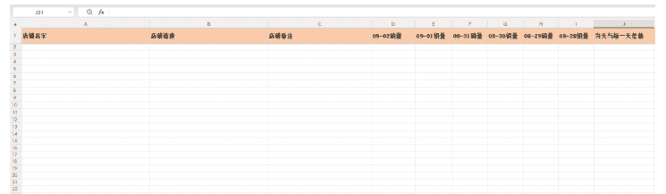

先别贪多。

挑十到二十件你本来就想研究的货，每日在同一个钟点记一笔，连着记七天再回看。

很快你会发现：有些累计已售很吓人，数字却像钉住；有些历史成交平平，最近每日都在往上拱。

对三五件特别在意的对象，可以把记数间隔缩短。

铺子也一样，每日同一钟点记一次总已售。

等监控对象从二十来件滚到两百件，手工开始折腾人，再考虑交给脚本。这一步并不需要懂多少编程。

把自己眼下手工在做的动作直接描述给 Codex：

我每日打开这些货品链接，记下此刻已卖出多少，再跟上一回相减。想要一个本机脚本按点抓取、把历史留住，列表能按当天增加量排序，详情里能看到逐日、逐时变化。

先让它给方案，再一点一点做。

我现在的工具就是这么长出来的。

起步时根本没画平台蓝图，纯粹嫌自己天天翻太累。后来一天一回不够，就改成每小时；两个工具之间复制链接烦，就做接口；需要看整店，就加整店采集；页面难看就重改。眼下没有七天增量？没关系，等我真的天天想看这个数字再加。

我让 Codex 帮忙的思路基本如此。搞项目不等于要修炼成工程师，但得摸清自己卡在哪。

只要人工流程已经跑通，能讲清“眼下怎么做、盼着以后怎样”，许多原本要外包的轻量工具，现在可以自己先试出来。

## 新人练手，先找有明确日期的需求

假设今天让我白手起步，我不会一上来铺几百件货，更不会看到数字高就直接上。

我会先找有明确日期节点的需求练手。

考试资料很适合新手，因为开考日固定，涨落相对好观察。

拿两个真实时间点举例。

成人高考：2026 年统一考试时间为 10 月 17—18 日。

考研：2027 年硕士研究生招生初试时间为 2026 年 12 月 19—20 日。

以 10 月 6 日写作时为例，这两类资料的做法完全不同。

### 成人高考：只剩十来天，抢最后窗口

成考临近时，动作要快。我会先确认这波需求有没有熄火：翻某个搜索词，看看同类货品是不是还在往上；再换搜索词，是否仍有铺子在稳定接单。

如果还在，基本可判断需求未退。

接着才看哪些内容在带这些货：近期发什么题、封面怎么做、搜索词怎么埋、评论区在问啥。

制作门槛不高，就立刻做几篇自己的内容测试。此时不是提前埋点，是抢考试前最后一段窗口。

反过来，盯上两三日发现：历史成交很高，近期却几乎不动；几家铺子日单为零或一。就算页面挂着“已售 5000+”，也别再砸精力。

这正是盯盘想解决的问题。

那个五千是旧账，今天还卖不卖，得另算。

### 考研：距考试还有两月余，反而可以慢

考研和成考完全不同。

离初试还有六十来天，不会今天看中某件货，明天就逼自己上架。

这个阶段更适合先建观察池。

先拆搜索词：考研资料、考研真题、考研英语、考研政治、考研数学、英语一、英语二、数学一、数学二、数学三……还能继续往下拆更细的词。

这时批量采集器的价值就出来了。

不用在📕逐词手翻。先批量抓货品、铺子、价格、已售、上架日期，再挑一批代表样本送进盯盘记录器。

这个阶段我愿意多等几天。

今天 +2，明天 +5，后天 +8，过几天 +15。

如果同一个搜索词下，越来越多货品走出这种曲线，就把该词优先级往上提，再扩监控范围。

原本看五件，可能扩到二十件；原本只看货品，后面把稳定成交的铺子也拉进来；铺子明显起量，再用采集器拆整店货品。

一直往下挖。

我真正想找的不是历史爆款，而是最近从日销几件慢慢爬到十几、几十件的货。这种变化更值钱，说明可能还没错过时间。

确认某个方向起量后，再去研究对应内容，自己做测试。出单就继续扩；不出单再拆：是货品问题、内容问题，还是需求本身不合我。

### 刚入门别铺两千个监控对象

我现在库里对象多，是因为已经跑了一阵。

起步完全没必要。

建议先定某个方向，挑五到十个搜索词，每个词看三到五件货，合计二三十件。

先观察。

要练的不是采集量，而是看到数字后知道下一步往哪摸。

货涨了，就找同词；同词都在涨，就找铺子；铺子也涨，就拆店；发现增量货，再回溯它的内容；最后才发测试。

整条链路是：

开考日或需求方向 → 拆搜索词 → 批量采集器找货 → 盯盘记录器看已售 → 发现连续爬升 → 扩同类样本 → 回溯内容 → 自己测试。

成考与考研的差别，也正好说明时间权重。

同样是考试资料，离考试两月余和只剩十来天，动作不可能一样。累计已售不能单独回答“现在该不该做”，得知道货处在哪个阶段。

新人用一两个有明确日期的需求把流程跑完整，比上来问“最近什么爆”更有用。哪怕最后没做成，也能真正理解两套工具在看什么。

没有工具也没关系，按前面表格手动记一样能跑。到这一步搜索词已经确定，新手不必一次盯几百上千件。挑二三十个代表样本，每日同一钟点记变化，完全顾得过来。等真要盯几百件再上脚本。

我的工具也是监控对象越滚越多后才搭的，起初同样用表格。

## 几个容易踩的坑

先说最大的误会：看见已售在动，不等于看见利润。

我盯的是公开页面能看到的成交数字变化，不是商家后台。

退款多少、投流花多少、成本多少、净利多少，全不知道。它只辅助选品，不能拿来推算别人赚多少。

另外，货爆了也不代表我照做就爆。账号、内容、铺子权重、定价、投流都会影响结果。仍会看同词其他货，自己发几篇测试。

考试品尤其抢时间。教资曲线就是例子。

9 月 11 日还是 +174，9 月 13 日只剩 +3。

若 9 月 10 日才慢慢研究、做货、做封面、备十几篇库存内容，可能还没发完，窗口就关了。

数据漂亮也不等于能做。虚拟资料要确认版权、授权、平台类目、交易规则。

这是我会额外加的一层过滤。有些东西数据再好，版权风险高、内容没法自己做，我也不碰。

我也不迷信别人整理的热卖清单。更愿意自己留一批货长期看。今天没动就搁着，明天另一件连续爬升，再进去研究。

## 最后：除了累计已售，多问一句“什么时候涨出来的”

说到底，两套工具都不玄。

采集器负责批量找货。

盯盘记录器负责替我记得每件货昨天、今天、上一小时的已售。

最初借影刀工具，一天跑一回。

后来监控对象变多、需求变细，才一点点长成今天这样。

现在它每日替我看 2300+ 件货和 140+ 家铺子。

我不需要背住两千多件货，只在某些数字异动时进去看一眼再判断。

CPA 那个例子，若只给 1426，我不知道它何时卖得最好。

教资若只给 5368，我也不知道它在 9 月 7—11 日每天还能涨一两百，考后迅速跌到单数。

所以看货时，除了累计已售，我会多问：这波数字是什么阶段涨出来的？

如果你也在📕做电商、卖虚拟资料，或其他能观察公开成交的项目，不必先开发工具。

先找十件货，用电子表格连记七天。

别只盯卖了多少，开始看：何时启动、单日增多少、连涨多久、何时停住。

七天之后若觉得对判断有帮助，再想脚本。

真记过一阵，哪里最烦自己就清楚了。到那时把重复动作描述给 Codex：

我每天在重复什么，想让它接什么。

我没变成程序员，也没打算钻很深的技术，但原先只能手点的事，现在能按自己的习惯做成轻量工具。

两套工具还会继续改，暂时够用。后面再遇到烦的步骤，大概率还是老办法：先人工跑顺，再让脚本接手。

## 附录：四个考试日期的官方出处

中国注册会计师协会公告：2026 年注会考试专业阶段定在 8 月 29—30 日，综合阶段为 8 月 30 日。

中国教育考试网：2026 年下半年中小学教师资格考试笔试日期为 9 月 12 日。

教育部办公厅文件：2026 年成人高校招生考试时间为 10 月 17—18 日。

教育部文件：2027 年硕士研究生招生初试时间为 2026 年 12 月 19—20 日。

注：文中数字来自本人定时监控，用于观察公开页面成交趋势，不代表商家后台真实成交额、退款、成本或利润。案例仅说明方法，不构成经营建议。

---

看完这份 SOP，你可能觉得已经懂了。但九成的人一到实操就会卡在第一步。

会用软件、看过教程，只是很浅的门槛；真正难的是马上动手，以及圈层信息不对称。

如果你想看全网最新变现玩法，并且和一群执行力极强的人一起下场拿结果，

我们不聊虚的，只做商业闭环拆解与 AI 效率压榨。圈内已沉淀 1000+ 跑通的套利实战局。

- □ 查阅圈子完整数字资产与上车门槛：

  https://lazysoc.com/insider/

备注：【实操上车】，闲聊勿扰

