# 因标的偏小被律师婉拒，我以 AI 辅助自助维权八个月，最终获赔 67,555 元
作者：龙哥

> > 261005 副业 SC 精华

小懒点评｜这篇适合正在被物管或保险压价、又找不到愿意接小标的律师的读者；不适用于想把全部工作丢给 AI 的甩手型读者——整件事的取证、录音、投诉、EMS 寄送都是作者亲力亲为。最值得借鉴的是把总报价拆成 17 条明细逐项对账，把模糊的“赔得太少”转化为对方难以回避的具体质疑。需要警惕的是 AI 有时会将推测表述得过度肯定，文中作者中途换到 Kimi，并坚持把原始材料与 AI 的解读分开处理。

今年 1 月 27 日，我家发生了整屋污水倒灌。

粪水从卫浴反涌出来，混杂着排泄物、杂质和刺鼻气味，向外扩散并污染到公共区域。房子建于 2000 年前，室内大量柚木地板与木作被泡后陆续出现发霉、鼓包、开裂、腐坏，最后连电气系统也受损，根本无法正常居住。

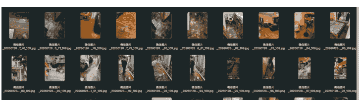

起初请人粗略评估，修复费用在数万元区间。后来我把各项损失拆解成 17 条明细，正式索赔金额定为 68,555.20 元。数月后，物管关联的保险方给出的核价只有 17,846.20 元。两相对比，差额高达 50,709 元，仅剩约四分之一多一点。

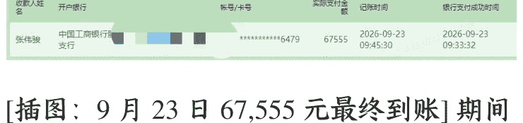

9 月 23 日，67,555 元实际到账。

期间我也咨询过律师。名专业契合的律师听完案情后认为，事实与材料充足的话案情并不复杂，可以自行诉讼；若由其全程代理，一审起价约 25,000 元，二审则 12,500 元起，性价比不高。后来我又在地图上找了一些体量很小的律所，门面甚至像小卖部，以为一万出头也能谈，结果 6 到 7 万元的案子对方直接拒绝，称占用时间不值。

那次经历让我体会到普通人维权的难度：时间、法务知识、资金、魄力、心理承受与谈判技巧缺一不可。于是后面的工作，我都借助 AI 逐步推进：现场取证、损失梳理、沟通函件、投诉材料、起诉文件核对以及协议审阅，直到款项真正到账。

下面按真实时间线复盘这八个月。

## 一、借助 AI 完成取证并厘清责任归属

1 月 27 日下午，物管通知家里“管道爆了”。我回到现场看到的不是普通渗漏，而是粪水从室内卫浴向外涌出，夹杂污物一路蔓延到楼外公共部位。

当天家人先行清理，我则同步拍摄室内受损情况、公共区域状况以及物管处置过程。第二天 1 月 28 日，卫浴再次反涌。随后我又持续记录了楼下化粪池、检查井、开挖与修复作业的全过程，尽可能把设施当时的状态留存。

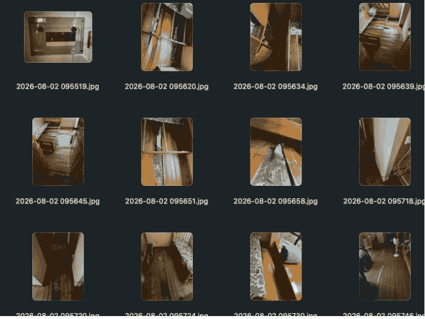

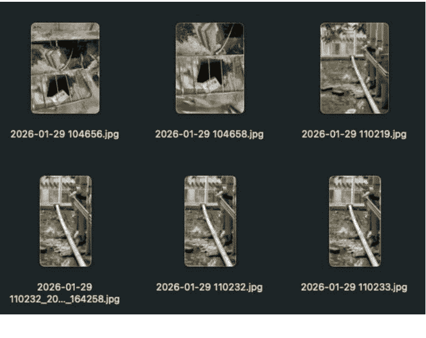

事发后我便在豆包上请教。选择豆包而非 GPT，是因为我认为它在国内常见纠纷的处理上更贴近本地资料。

首次提问很直接：

> 我家管道爆了，全屋柚木地板全废，现在该如何维护权益，争取最大化赔偿？

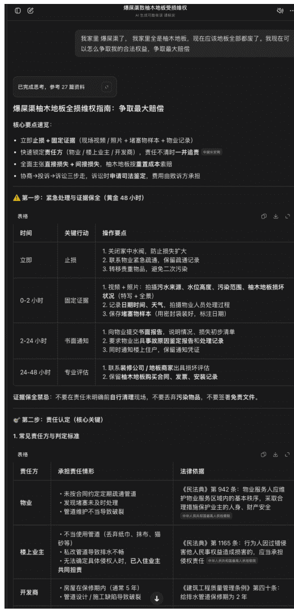

每出现新的问题，我就会继续追问：哪些位置必须拍摄、物管工作人员到场时应保留哪些记录、化粪池、检查井与公共排污设施的关系是怎样、柚木地板浸水后的损失如何量化、清洁消毒防水电路是否应计入损失。AI 在这阶段的作用主要是提醒我证据链的缺口。照片、视频、沟通记录、受损部位以及后续清理施工，只要当时没固定，现场清理后就很难补救。

在取证整理与豆包的分析后，我判断自己无任何过错，物管需承担全部责任。核心依据大致有四点：

1. 公共化粪池及管网属于物管法定维护范围，法律有明确强制要求。物管应按照约定妥善维养护、清洁、经营管理共有部位，采取合理措施保障业主人身财产安全。本次事故源头是公共化粪池堵塞致粪水倒灌，故障点落在共有设施内，本质上属于物管法定维护职责。
2. 物管存在可证实的失职。关键物证是化粪池主清掏口被违规封堵，清掏口是日常维护疏通的必要通道，被封后客观上无法开展正常清掏，直接证明长期未履行维护义务，失职是事实而非“做得不够”。
3. 我方没有任何致害行为，未私改公共排污管道，也未向管道排放建筑垃圾或杂物，对方也拿不出证明我有过错的证据。
4. 也不属于不可预见且无法避免的自然灾害。事故系长期维护缺失累积导致，并非地震、特大暴雨等不可预见自然灾害。

现场处置结束后，接下来是把损失转化为可计算的金额。

## 二、将粗略估价拆解为 17 项明细索赔清单

处理完现场后，需要解决修复问题。当时找熟人装修队看过，恢复大约需要数万元。

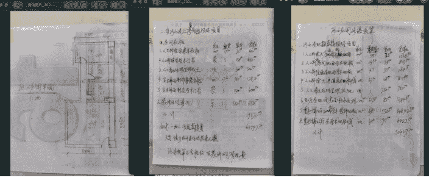

基于我做过 400 多场宴会项目的经验，很清楚不能拿一张手写草稿去跟物管和保险谈，也不能只说“修房子大概要六万”。对方只要反问一句“六万怎么来的”，谈判就容易卡住。

一场五万元的宴会，正常也不会只写“宴会 50,000 元”，而是拆成菜品、桌椅、灯光、布置、人工等细项汇总。

这次我也采用同样思路。把已有的房屋损失照片、受损区域信息交给 AI，先让其把地板、木作、墙面、清洁消毒、防水、电路等拆成可逐项核对的损失条目，再结合实际情况筛选哪些确需计入、哪些应合并，并给出对应修复价格。

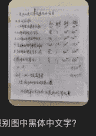

这份表格并不是我手工制作的，我只是把疑问和需求告诉豆包，由它给出方案与报价，我再粘贴到 Excel。豆包给出的报价相当细致，还指出了手写单的笔误，让我很惊讶。

现实问题在于，房子已装修多年，很多木地板木饰面早已找不到原始购买发票。因此索赔并非追溯几十年前的建造成本，而是按当前市场价，将损坏部分恢复至可正常使用状态所需的费用。

为此我与豆包及多款模型反复讨论，最终认识到：

1. 诉求应依法合理，而非狮子大开口。
2. 豆包对当前材料费与人工成本的掌握度超出预期，可能与土巴兔等家装平台存在数据互通。
3. 依据《民法典》第 1184 条，财产损失应按损失发生时市场价格计算，迟延赔偿还应计息，而非按 30 年前的建造价赔偿。这是后续谈判的重要依据。

最终，原本模糊的“数万元”估价被细化为 17 项，合计 68,555.20 元。

4 月 7 日，我把这份清单正式递交给物管。从此以后，后续的所有赔偿讨论都可以逐项核对：哪些被采纳、哪些被剔除、单价如何确定。

## 三、6.8 万元报出后首轮仅回 1.78 万元

清单递交后等待数月。7 月，对方发来一份 Excel。

总额：17,846.20 元。

我方申报：68,555.20 元。

差额：50,709 元，仅剩约 26%。

我逐行比对发现，对方并非整体打折，而是分项压低：表格里出现了 30% 折旧，部分防水项目被剔除，墙面与木饰面未纳入，清运费用被下调，诸多恢复房屋所必需的项目也未按申报价计算。

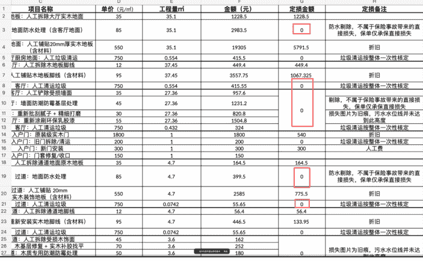

除了金额，我更在意的问题是保险公司是否真正到现场勘查过？物管可能转交了图片，但理赔人员一次现场勘查记录都没有，连化粪池现场也未看，因化粪池早已被修复。这让我判断保险与物管之间存在默契，也反映出对方对事故责任的态度。

到 7 月，我手上的沟通记录里找不到保险人员事故后到场查勘的痕迹。很多信息都是由物管转述，现场早已清理，无法复原。

因此我反复追问：如果从未实地查看过，这个 17,846.20 元的依据是什么？

豆包给出的解读是：这属于财产险理赔常见的首轮报价策略，并非针对个人，而是用低位锚定压低心理预期，筛选掉不愿耗费时间精力的维权者，以实现降赔。26% 左右的首轮比例在行业内很常见，并非随机得出。

拆解对方的定价逻辑，可以归纳为四点：

1. 只计主材，剔除施工配套。我的报价包含拆除清运、找平、防潮、人工、辅材、墙脚修复、消杀等全部必要工序，对方全部删除，只保留地板主材作为基数。按主材约 3.5 万元计，折完后落在 1.7 万元左右，与 17,846 元吻合。
2. 强制套用内部折旧规则。家装类财产险常用“5 年折旧期、每年 20%、残值 5%”，使用满 4 年即折至原值 20%-25%。3.5 万元的主材折完后落在 1.7-1.9 万元区间。
3. 间接损失被默认剔除。临时安置、资金占用利息、诉讼费用等法定项目在首轮报价中通常不予考虑。
4. 预留谈判空间。首轮报价一般在内部底价基础上再下浮 20%-30%，方便后续“努力争取”的演绎。

看清这套定价方法后，我明白这不是简单的讨价还价，而是要把每项损失、每道工序、每个法律依据都摆到桌面上。最终，这场从 1 月持续到 9 月的维权，以 67,555 元到账收尾。

- 手法一：先扔一个地板价，把你心里的秤砣砸歪

这是整套流程真正的枢纽。行为经济里有个说法叫"锚定"——只要那个极低的数字第一次落进你脑子，后面无论怎么谈，你都会不自觉围着它打转。比方说，你心里原本盘算这损失值六万，对方一开口先报一万八，你的底线就会一路松动，四万、三万五……等对方"慷慨"地加到三万五，你甚至会觉得都翻倍了，差不多能点头。可这个数跟你依法该拿的差着十万八千里。问题就在于，头一回碰上理赔的业主，潜意识里拿来当尺子的往往就是对方的首次报价，而不是法条和判例。

- 手法二：用极低报价做筛子，把没精力的人先过滤掉

说白了，这就是一种差别定价。第一次报价离谱到那个程度，实际是把维权人群切成两拨。一拨人不熟悉规则、时间紧、嫌麻烦，觉得打官司太耗神，能落袋一点是一点，于是接受了低价，对方用极小的代价就把案子了结。另一拨人懂行、有空、愿意走程序，才会被继续往上加价。等于先用低价甩掉容易处理的，只对少数难啃的对象抬高筹码，整体赔付成本就被压到最低。有数据表明，这类小区侵权索赔中，大约六到七成业主在第一次或第二次报完价后就放弃了。

- 手法三：首轮超低价顺便给你做一次"规则体检"

超低的首轮数字，通常还会配上一句"这是公估这一行的通行标准""保司算赔款都按这个来"之类的话。真正的用意，是试探你对规则掌握到什么程度。假如你只会说"太少了吧"，拿不出具体条文，对方立刻判定你是外行，接下来继续压、继续拖；假如你能当场点明——保险自己那套折旧口径，对抗不了第三方受害人；污染造成的损坏，不能按自然损耗的算法来折旧——对方马上明白你懂行，后面的报价爬升速度会明显加快。

- 手法四：把赔款压低，就是他们的饭碗

不管坐在对面的是保险公司理赔员，还是外面的公估机构，考核表上最醒目的一项都是减赔指标。赔得越少，个人奖金和机构服务费越高。所以首轮报最低价是写进流程的标准动作，跟你个人没有恩怨。哪怕你报的数字完全贴合行情，他们也必须先往下砍到底，这是岗位决定的。

豆包之前归纳的四条首轮定损思路，后来几乎被我一条一条验证了：
压锚：先把你心里的价码按下去
筛人：耗不起的直接出局
探底：看看你懂多少规则
考核：赔得少，赚得多

### 让低价看起来合情合理的五个配套动作

为了让那个数字显得"合理"、让你点头，对方一定还会打出一套组合拳。我遇到的，一个没落下：

- 拖字诀：不回消息、隔很久才回，拿"走流程""要上报审批"当挡箭牌，用时间磨掉你的耐性，让你觉得为这点钱耗着不划算；
- 互相推诿：物业让找保险，保险让找公估，公估又推回物业，能拍板的人永远不存在，你的沟通成本被无限抬高；
- 术语筑墙：一张口就是"理赔规则""行业标准""折旧规定"，用你听不太懂的词堆出权威感，让你以为事情本来就该这么办；
- 冷暴力：群里不吭声、电话不接，摆出"就这个数，爱要不要"的姿态，逼你自己降价；
- 制造假共识：时不时提一句"别人家都是这个数拿的""真打官司也拿不到更多"，用编出来的群体意见让你怀疑自己的判断。

我妈看到那个26%的方案时，已经有点想认了——拿了钱拉倒，剩下的自己贴点去修。可我一看金额，反应只有三个字：不接受。坚决不接受，绝对不接受。凭什么他们维护失职，却要我们低着头把亏咽下去？后来我还撂过一句："哪怕拖三年，我也陪到底。"所以那17,846.20元，我一个字都不会签。

到这一步，事情已经拖了好几个月。现场照片、维修清单、报损表、对方发来的Excel、跟物业的来回沟通、保险那边的疑问，再加上此前跟豆包反复讨论的内容越堆越多，聊天记录累计到了几百轮。单个对话窗口已经很难管住。

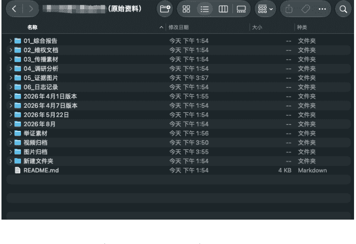

随着现场材料和沟通记录增加，我先借助Antigravity和Codex帮忙归拢过证据。但接下来有个新问题必须先解决：过去几个月积累在线上、主要沉淀于豆包中的案件资料，怎么才能完整地捞出来，然后继续往下推进。

## 四、几百轮对话管不住了：Codex把全部历史搬出来，再交给Kimi接手

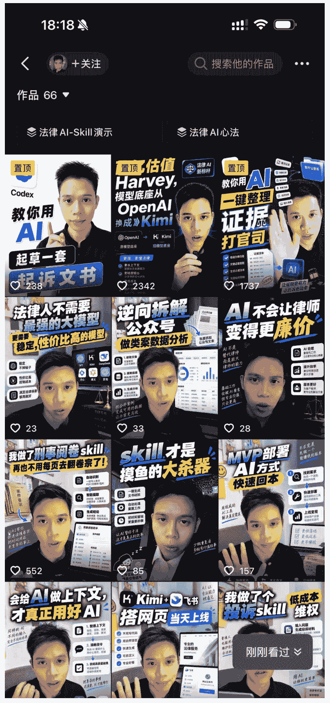

我偶尔刷抖音，看到一个律师博主提到——这位律师自己做了一套借助AI处理案件的工作台加Skill，算是律师圈里比较早吃螃蟹的。

"全世界法律AI领域体量最大的OpenAI，其孵化的Harvey最近宣布，自家的法律大模型不再使用ChatGPT，改用Kimi了。那就在8月……"

继续要处理的协议和文书。我要的不再是向AI提一个问句，而是让某个模型能长线地把整个案子兜住。

Kimi的产品和工作台已经接入华宇元典这类专业法律数据源，也在做法律检索、合同审查、文档处理这些事。更让我在意的是，Harvey原本也会调用OpenAI等模型，可在开发自家首个法律专用大模型Tenet时，它挑中了Kimi K3做底座，然后在此基础上针对法律领域做后训练、长周期任务和专业工作流。

不过前面大量内容都躺在豆包里，靠手一条条复制显然不现实。

于是我请Codex去把豆包的历史对话抽出来。

第一次抽完，我不太敢相信已经齐了。

因为我记得明明聊过某些内容，导出文件里却翻不到。

那就重新查。

查完发现确实有遗漏，接着抽，抽完再核。后来我又让子代理和其他检查环节继续排查，看有没有整段对话缺失、消息顺序错乱。

这事儿不是一次"导出成功"就能收工的，而是抽了查、查了补，反复来回。

最终归档的豆包对话约655条对话块，导出文件大概1.48MB。

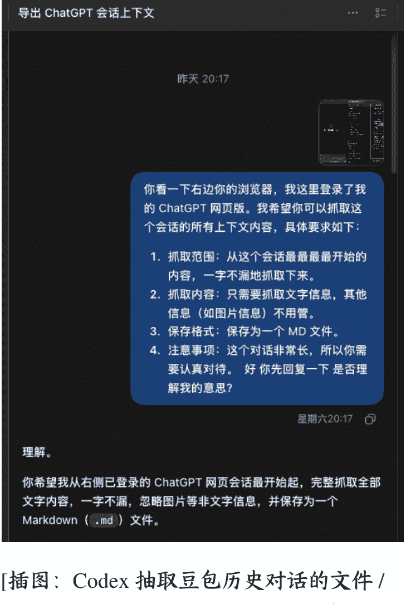

[插图：Codex 导出的豆包对话存档 / 约655条对话块、1.48MB] 但我没有请豆包先汇总一遍、再把结果贴给Kimi。

原因很直接：此前的AI解读本身就带着错误，有时候会把猜测写成事实，责任划分和赔偿判断也出现过说得太绝对、后来被证明站不住的情况。如果直接搬总结，这些毛病会被原样带进新的对话。

所以我迁移过去的不是一份"豆包总结"。

我尽量把原始材料都带上：我自己的陈述、对方的原话、聊天记录、报价表、Excel、照片、录音转写，以及此前AI做过的分析。

这些东西不能搅成一锅。

原始事实归原始事实，对方说法归对方说法，表格、照片、录音属于材料，AI从前的判断只能继续算判断。日期、金额、人物身份如果有对不上的地方，也先把矛盾留着，不让新模型自动挑一个看起来最顺的版本填上。

然后我把整理好的资料递到Kimi那边。

此后Kimi一直在帮我维护的东西，主要是：时间线、人物与权限、金额变化、证据状态，以及仍未确认的疑点。每当出现新的电话、人物、金额或文件，就把新料补进去，刷新当前案件状态，再继续推进。

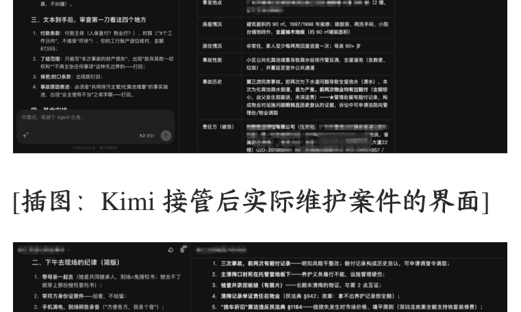

[插图：Kimi 接手后，我实际用来维护案件的界面]

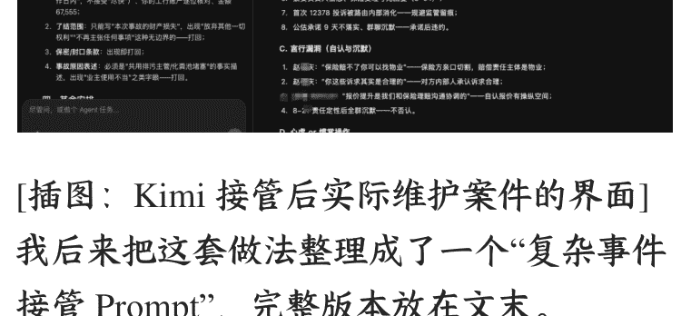

[插图：Kimi 接手后，我实际用来维护案件的界面]

后来我把这套做法固化成了一个"接手复杂案件用的提示词"，完整版放在文末。

资料重新被管住以后，越来越多的人开始卷进这件事：律师、物业、保险、不同层级的工作人员、各类投诉渠道。

我开始把整理好的时间线、金额、证据和争议点真正拿去和这些人过招。

最先撞上的现实问题，是律师这条路并没有我原先想得那么好走。

## 五、六到七万的案子律师嫌小，我只能自己动手做大量案头工作

实际上，当时即便有KIMI K3在旁边帮忙，我心里已经认定这案子必须走诉讼、进法院，而不是提前和解。理由有三：

一、对方拖的时间确实太久了，超过七个月。

二、除了问KIMI，我还打过法律援助电话，也找公益律师聊过。但那个公益律师给我的感觉不太好，态度冷淡，只丢下一句：上法院要是没律师，可能会吃亏。

三、后来我一边让KIMI帮我筛合适的人选，一边直接打开百度地图搜"律师"。我当然清楚案子金额不高，而且我百分之百确定自己在这件事上没有责任，所以想着找些最普通的律师应该就够了。

万万没想到，一上来就碰壁。律所一般扎堆在全广州最贵的写字楼里——这些我们肯定请不起，直接跳过；另外也散落在一些老旧大厦中。同时我想到，平时在街边常能看到那种门面很简陋的"律师事务所"，于是让KIMI帮我挑几家。

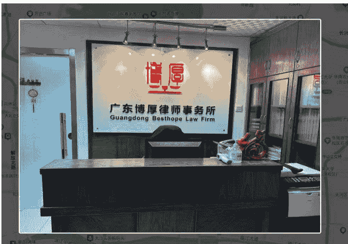

KIMI筛给我的第一家，是做房地产纠纷的律师。我想着案子六到七万，只要能赢，一万块律师费我愿意出，没多犹豫就打了过去。对方态度很好，听得也耐心，给人感觉挺专业。听完我的陈述后，他的意见是：你这个案子责任划分清楚，金额又不大，自己上就行。如果让他们全权代理，一审最低两万五，二审还要另外算，一万二千五起步，性价比很低。之后我又按百度地图找了那种"街道小卖部式"的律师，想法很简单：这种总该便宜些吧？结果一样——我预估一万的预算，还是没人肯接。

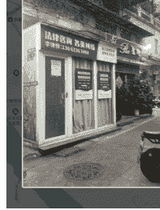

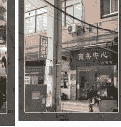

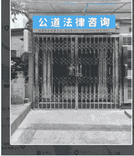

电话没人接，我就把所有律师的🛰️都加了。其中一位，我把Kimi整理好的案件资料直接发过去，对方回得很干脆：金额太小，接不了。

另一位看完材料后反问了我两个问题：a 你确定物业是百分之百的责任？b 你能拿到之前的旧理赔记录吗？

找律师没结果，但对我影响其实不大。

一方面，我本来就打算自诉。真上了法庭，我准备让Codex加Kimi先跑一遍模拟法庭，对我各种刁难攻击，把我问到说不出话，好让我提前备好各种意外情况。说实话，我更想试试借助AI打官司会是什么效果。

另一方面，我心里憋着一股劲，这件事一定要维权成功。只要不赔钱，拖多久、流程多复杂，我都认。

由此也能看明白，普通人维权为什么这么难：

一、缺乏基本的法律意识和知识；

二、怕事——我妈那种心态应该是普遍现象；

三、案子金额不到十万，未必有律师愿意接，除非是刚入行、缺案源的新人；

四、多数人根本想不到还能借助AI来协助办案；

五、对和物业、保险"掰手腕"有畏惧心理；

六、办这种事，多少得有点逻辑思维能力。

## 六、重要电话先跟AI彩排，挂断后再把录音拆开复盘

后面我开始同时面对物业、保险、投诉渠道，以及公司里不同层级的人。同一句话，从不同身份的人嘴里说出来，分量完全不一样：有人只是传声筒，有人能往上递申请，有人手里有处理权限，也有人根本做不了主。

所以凡是比较要紧的电话，我都会先把对方的身份、此前说过什么、目前已知的权限，以及这通电话最想达成什么，交给Kimi过一遍。我给每通电话定的目标通常很直接：谁负责、具体做什么、什么时候完成、什么时候给我回话。

有些电话时间比较长，我甚至把AI开着放在电脑边上。对方突然抛出一个新说法，我就趁他停顿的间隙快速敲进去："他现在这套说法有什么毛病？""下一句该优先追哪条信息？"后来我还真动手做了一个macOS上的录音加AI同步解读程序。最初的设想是：电话实时转文字；AI同步分析人物、承诺和风险；再直接提示下一句该追问什么。

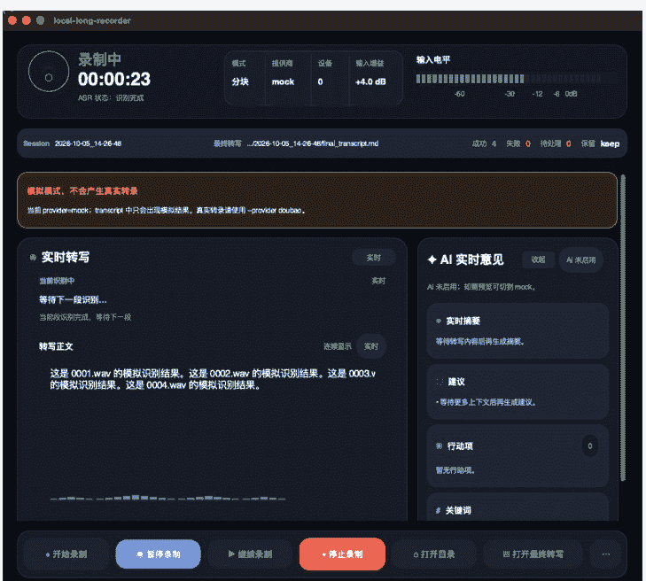

程序确实做出来了，但没做到完全可用，最后也没真正进入我稳定使用的主流程。真正留下来的，反而是最土的一套：录音 → 飞书语音转写 → 人工校对 → Kimi做复盘。

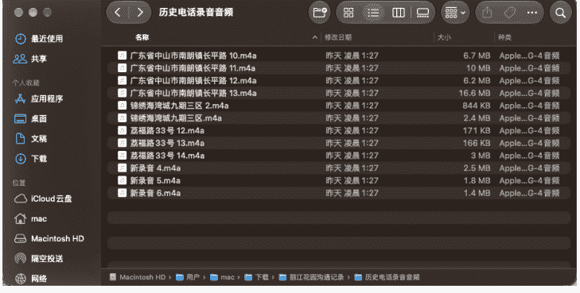

[插图：macOS 上的录音与AI同步解读程序（如有截图）] 重要的电话我都会留录音，然后先用飞书把语音转成文字。转完我自己还得再校一遍。

因为人名、金额、公司名、部门、专业术语经常识别错。原始文字一旦错了，后面的AI判断也会跟着错。

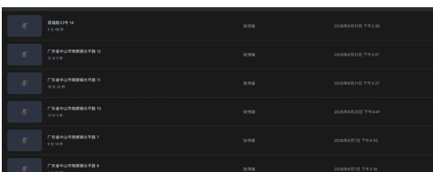

[插图：飞书转写稿原样]

校正完，我再把整段通话丢给Kimi。我不会只问一句"帮我总结这通电话"。我真正想从里面挖出来的是：

这次新敲定了什么；谁才真正握有权限；哪些话属于明确承诺；哪些只是"会反馈""会处理"；还有什么问题压根没回答；下一步该继续找谁。

### 录音拆解与事后复盘

Kimi K3参与的这轮录音拆解，其实价值很大：

一、帮你回看自己有没有说错话、漏掉什么内容；

二、帮你推敲对方的破绽和弦外之音；

三、跟不同对象通完话再分析，可以判断对手的"博弈"能力；

四、多次分析下来，你对整件事的脉络、利益点、对方的失误会了如指掌，后面当面对话也不发怵，还能当作万一上法庭前的演练；

五、借助AI协助维权最大的好处，是能让你始终保持冷静、少犯错，也更容易捕捉到对方或整个事件里的纰漏。

下面是部分Kimi K3的录音拆解，这里就不逐条列了。

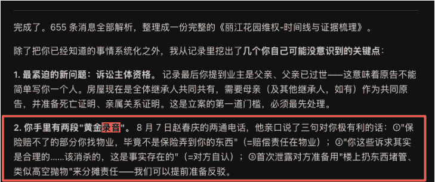

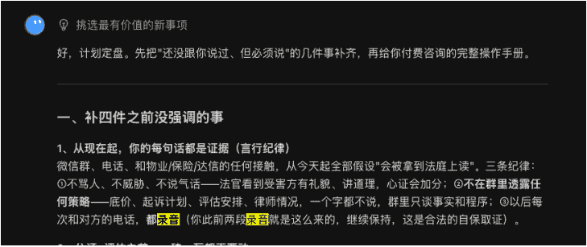

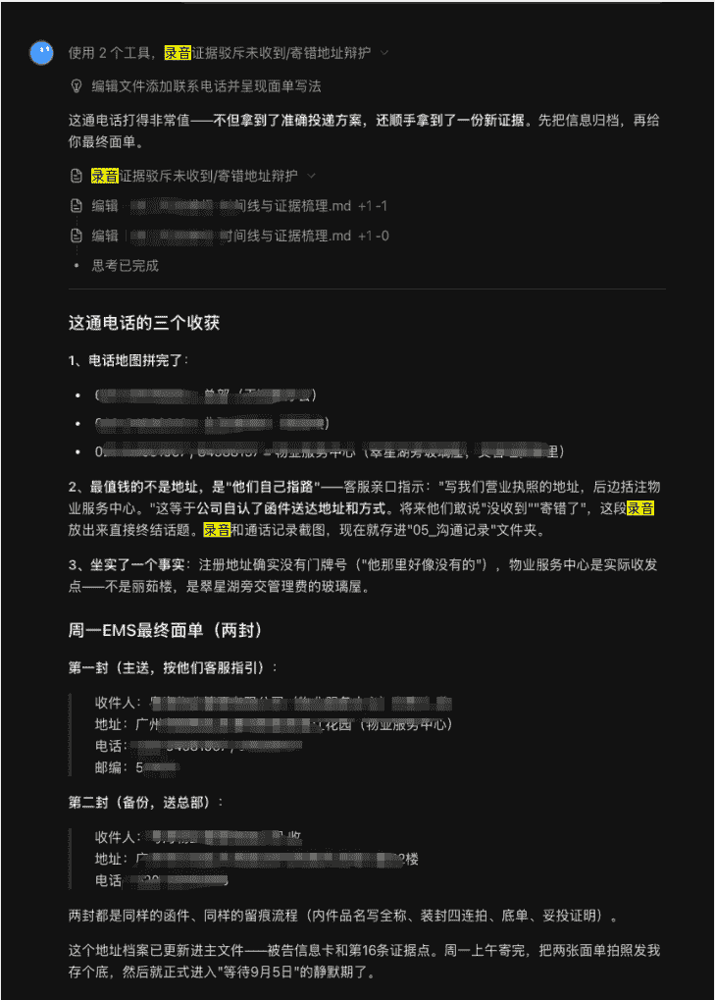

【插图：Kimi 逐句拆解一次通话】电话前的预演和电话后的复盘，两个完整提示词我都放在文末。这套电话打法很快就被我真正用到了物业、保险和投诉的推进里。

## 七、电话谈不动之后，我把事情往投诉、书面施压和总部层面推

进入八月，再靠物业和保险之间来回打电话、发🛰️，已经推不动了——单靠业主投诉，既形成不了有效压力，也不带任何法律强制力。前面几个月攒下的时间线、报价、Excel、照片和争议点都已整理成型，我开始把这些材料直接投向投诉与书面施压渠道。

8月1号，我第一次拨12378，电话被转到了人保那边的内部投诉通道，这一回没能立成监管工单。8月7号，我再次拨12378，正式登记了对人保广东分公司的投诉。当天，保险理赔人员就开始直接跟我通话，重新讨论折旧、赔偿范围这些问题。

就在当天的后续通话里，保险员回电提到，原先报损清单只有一万七千多，如今冒出了"三万出头、大约五折"这一档新的口头数字。进展已经不小，但我仍然没有点头。多个月的拉锯终于出现第一道裂缝，这让我更确信，这次维权我一定能赢。

8月13号，我又通过广州12345投诉物业。到8月28号，街道那份书面回复送到了。里面有一句关键的话：

> "经我办初步核实，基本属实。"

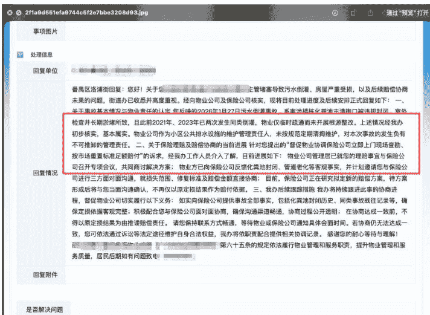

[插图：8月28号，街道那份回复]回复里还提到，小区排水管网的养护责任在物业身上；物业管理层已与保险公司开过专项会议，保险正在拟一套新的赔付办法，不会再单纯按旧定损数来赔。这不是法院判决，也谈不上"政府认定物业全责"，但这是我几个月来头一回拿到外部行政渠道的正式书面回复。

### 8月29号的书面催促函

八月底，我开始正式给对方上期限。8月29号13点05分，我在群里发出书面催促函，要求在9月5号前确定公估机构并启动评估。如果到期还没动静，我准备自己推进后续评估，并进入起诉程序。

当天我还专门打给对方物业总部，核实正式函件该寄到哪个地址。8月31号，我把催促函打印成纸质件，分成两个包裹寄出：一个寄往物业相关地址，一个寄往粤海公司相关办公地址。寄件时，我把封好包的过程和邮政底单都留了记录，后来两个包裹的物流状态都显示已签收。

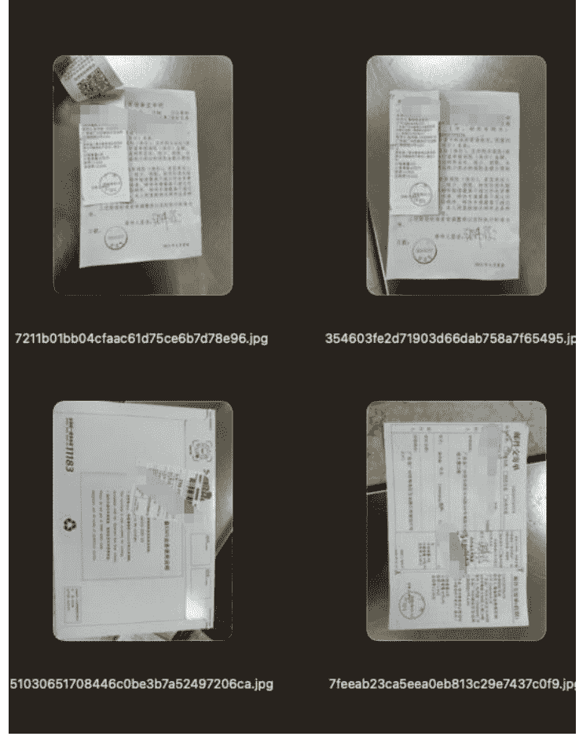

[插图：邮政底单与签收记录] 然后，联系人真的换了。9月3号一早，粤海公司运营部门的刘姓经理主动打来电话，不再是此前一直在现场对接的管理处人员。这通电话大约31分钟，我全程录了音。

## 八、总部运营经理介入，第二天就出现了67,555元的书面方案

9月3号一早，物业公司运营部门的刘经理主动来电，不是之前一直跟我对接的现场管理处人员。通话持续约31分钟，我全程录音。

电话一接通，他先自报身份和来意：自己是物业公司运营部门经理，总部收到我的催促函后，安排他来跟我沟通。他还补了一句，大意是总部那边要走回复流程，所以需要尽快跟我沟通一下。

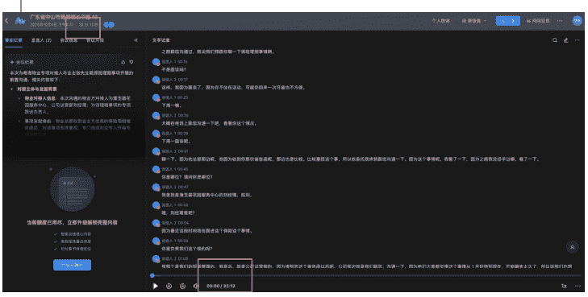

[插图：9月3号那段31分钟电话的关键转录]这通电话里，当时讨论的金额已经爬到两万九千多，而我正式提交的报损仍是68,555.20元。我继续追前面几个月一直没弄明白的问题：这个数字到底依据什么算出来的？保险究竟有没有真正到现场看过？

按照他电话里的说法，前面的金额主要是根据物业人员后期拍的照片等材料形成的。我追问保险人员有没有在事故发生后到现场实际查勘，对方的回答显示：此前并没有安排保险人员到现场实地查勘。而负责拍照的物业人员，也是等现场清理完才过去的，最原始的污染状态早已不复存在。这是到9月3号这通电话里我才拿到的信息。

紧接着，电话里第一次出现了一个接近我原始报损的数字。刘经理主动问我：如果保险愿意按接近全额的方向处理，我能不能接受？他提到的数字大致就是：

# 67,555元落进银行卡，8个月维权才真正收口

2026年9月23日09:33:32，手机银行跳出一笔67,555元。那一刻，我才把这起排污管堵塞造成业主家损失的案子（编号RZAB202 (7)）视为落地。9月24日，理赔员把转账凭证发到群里，通知我核对；我进入手机银行查看，余额确实多出这笔钱。

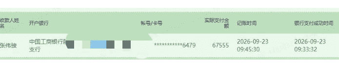

金额轨迹至此完整：起点是68,555.20元报损；对方定损17,846.20元；中间出现三万多、约29,000元的说法；9月4日文字方案写明67,555元；最终入账67,555元。

但在款项真正进账前，我始终没把这事当作结束。

## 一、电话里的六万七千五，只是口头测算

最早那通电话，对方按68,555.20元减1,000元免赔，算出大约67,500元。那还不是定案，只是交流中试探的数额。

随后对方把话头引向第三方评估（公估）：若评估结果低于68,555.20元，我是否接受；双方还谈过共同认可的评估机构与最终评估结论。再往后，对方甚至希望我预先承诺：只要继续推进评估，就认结果，并放弃其他维权路径。我没有答应。

通话结束后，我仍按自己的固定流程走：录音、飞书妙记转文字、人工逐字校对，最后让Kimi做复盘。复盘时，我把总部介入、29,000元这一现行说法、现场查勘的解释、67,500元的商量空间、评估附带的先决条件，分别记了下来。

## 二、9月4日：文字版意见落字

次日，正式意见到了。9月4日16:36，对方在群里发出文字方案：以我报出的68,555元为准，不再做折旧扣减，减去1,000元免赔，最终写67,555元。

对方称我“张先生”，核心意思是：走完内部审批与申请后同步处理意见；按常规理赔和第三方评估的行业惯例，装修已经有些年头，损失要按使用年限折减；之前也问过评估机构，初步也给不出按全新报价全额的认定。但考虑到大家为这事耗了不少时间精力，也希望妥善化解矛盾，公司另行申请特殊通融：以68,555元作为赔付基数，减掉免赔额后为67,555元，不再做折旧扣减。这是仅此一次的特殊处理，目的就是推动和解收尾。如果我点头，对方会尽快整理理赔文件与材料、安排付款，各方都不再就理赔追责。还特别注明：这份免折旧方案仅限私下和解；谈不拢就作废，案件回到保险合同与法律框架处理。

[插图：9月4日群聊中的67,555元文字方案]

可此时，67,555元仍停留在文字里，钱没有进账。

## 三、方案落字不等于到账，协议要逐条抠

9月4日，67,555元写进了意见，银行卡却没有变化。

9月5日，物业在群里文字回复，同意对方的赔付方案，并说会配合后面的赔付手续。可这段回复同时要我确认：67,555元是本次最终了结金额，以后不再向物业提其他主张。我没有在群里先点头，而是等定稿协议。

定稿协议与附件拿到后，我继续让模型帮我审。重点盯：钱是已经打过来了，还是以后才打；会不会提前写成“已收款”；“最终了结”“放弃主张”管到多大范围；本次赔款会不会和后面排水设施改造混在一起。

67,555元的方案出来了，我也没有把诉讼准备全撤。时间线、证据、17项损失、金额变动、录音等材料都留着。我还让模型换到对方律师或法官的位置挑刺，直接问：

> “换成对方律师，你会先攻我哪些点？”

> “哪些内容只靠我一张嘴，没有旁证材料托底？”

> “68,555.20元里，哪些项目最容易被挑毛病？”

对抗式挑刺和模拟庭审的提示词放在文末。

9月22日，我到现场签《和解协议》。定稿协议里夹着一句：该账户已完成收款，金额为67,555元。可实际情况是，当时钱还没进账。当天我在群里补充：签字那刻，款项尚未到账；协议里“已收款”的说法与真实状态不符；要想产生彻底了结、弃权的效果，前提必须是全额67,555元确实打进账户。同时追问大概何时到账。

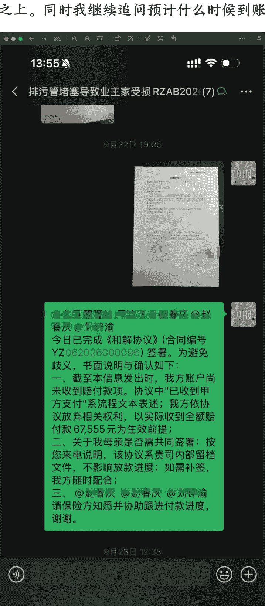

[插图：9月22日作者在群里的补充声明]

此外，这67,555元只对应本次事故的赔款部分。屋外排水管如何改造、公共排水系统往后怎么维护，以及将来若出现新事故，都是另题。我没把它们打包进这次了结。

随后，结果落地：2026年9月23日09:33:32，67,555元完成支付。9月24日，理赔员把转账凭证发到群里，通知我核对。我进入手机银行查看，余额确实多出这笔钱。

[插图：9月23日67,555元银行实际到账]

到这里，金额链条才真正闭合：68,555.20元报损 → 17,846.20元定损 → 三万多/约29,000元 → 67,555元文字方案 → 67,555元最终入账。

## 四、8个月复盘：模型放大的不只是速度

这8个月，模型并非一直靠谱。起初它对责任归属下结论太猛，甚至冒出一个“100%”式的说法，那股很典型的“豆包味”让我印象很深。后来听说Kimi更擅长法律类事务，我便把主要工作流换到Kimi。

如果只留下最核心的沉淀，我会保留五样：发生了什么；谁是谁、能管什么；钱和条件怎么变；手里有什么证据、事实到哪一步；接下来做什么。每多一通电话、一份文件、一个角色、一笔金额，就补进去、迭代一版。

模型带来的，远不止省时间。它让不少原本做不到的事有了解法：让势单力薄的个体，也能靠模型，把原本可能只能忍着接受低额赔付的局面，扭成一次站得住脚、程序正当、结果合理的维权。

以往聊模型，多半绕不开写稿、做PPT、敲代码、自动化、提效，这些当然有价值。可这轮持续8个月的维权，让我实测出另一种路径：**面对人与人、人与组织之间那些绕、久、信息不对称、利益又相冲的现实事务，模型能撬动更大的杠杆。** 一个人连着几个月周旋于物业、保险公司、律师、投诉窗口和公司各层级之间，最难的地方，并不是起草某份文档，而是别忘了此前发生过什么，理得清谁表过什么态、谁手里有权，能看出说法前后有没有变，提前为下一轮交涉做准备，把漏掉的问题补上，并在局面不断变动时一直盯下去。模型在此提供的，不是单次任务的提速，而是整理信息、做预案、事后回看以及长期盯盘的本事。

## 附：这次维权我实际整理出来的4个AI提示词

### 1. 复杂事件接管提示词

假设我手里有一组资料，全围绕同一件麻烦事：聊天、文件、表格、录音转写，还有此前模型做过的分析。请先把这个案子接过去，先别忙着给终局判断。

长期更新：事情脉络，按时间记下真实发生的经过、交流过什么、又添了哪些材料；人物与单位，写清谁是谁、挂靠哪个组织、眼下担什么职责、手里有多大权限，拿不准的就打问号；钱和条件，每笔数字由谁提出、何时提出、属于什么性质，都要标清，把我的诉求、对方口头的说法、表格里的数字、正式文书分开；手头材料，照片、视频、聊天、表格、录音、文档各自能说明什么，逐项对应；疑问清单，还没核实的事项单独列，别因为前文提过相似表述，就默认它已经坐实；接下来，依据现有信息，写明下一步找谁、核实哪一点、还缺哪些材料。

每一条都要贴标签：哪些已经坐实，哪些只是对方说法，哪些是我的推断，哪些来自旧模型，哪些还悬着。要是几份材料在时间、数字、人物身份或事实上打架，就把矛盾并排摆出，别擅自揉成一个版本。以后我每加一段聊天、一通电话、一份文件或一个结果，你就在旧稿上改，别推倒重来、从头瞎猜案情。

### 2. 关键沟通前预演提示词

我马上要和一位重要对象通电话。请结合案情和此人的过往表现，先陪我预演一遍。

先弄清：他是谁、代表哪个单位、眼下管什么、能拍板到什么程度；他以前公开说过哪些话、答应过哪些事；本轮通话必须敲实的3～5个点；他大概率会有哪几种回法；每种回法之后，我紧接着问什么；哪些点最可能被绕过去，或者把我带偏；哪些回复只是“在办了、会转达、帮你打听”这类软话，并没有真动作；如果他说自己拍不了板，我就得追问：最终谁能定、由谁递过去、什么时候给回音；挂电话之前，最少要拿到哪些准信；涉及钱数、责任划分、和解前提或弃权内容，信息没齐时绝不能先松口。收尾时给我一份精简的谈话清单。别替他脑补动机；身份、权限、事实拿不准的，统一标“未确认”。

### 3. 电话录音复盘提示词

这里有一份电话录音的文字版，已经人工逐字校过。请把它按层次拆开分析。

□ 想了解全部资料和加入方式：
https://lazyso.com/insider/

备注写：实操上车；闲聊勿扰

