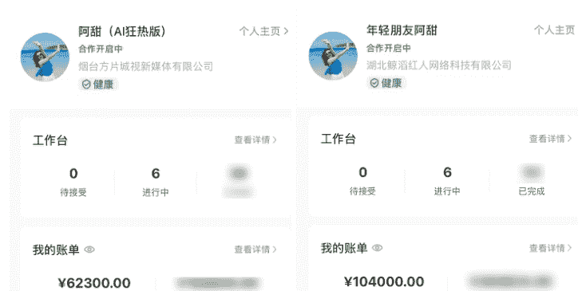
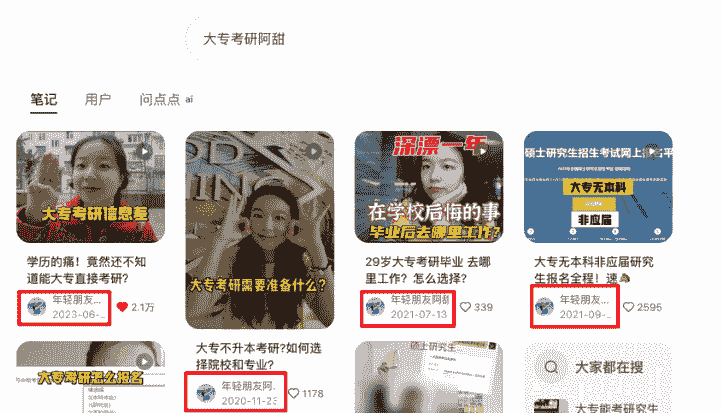
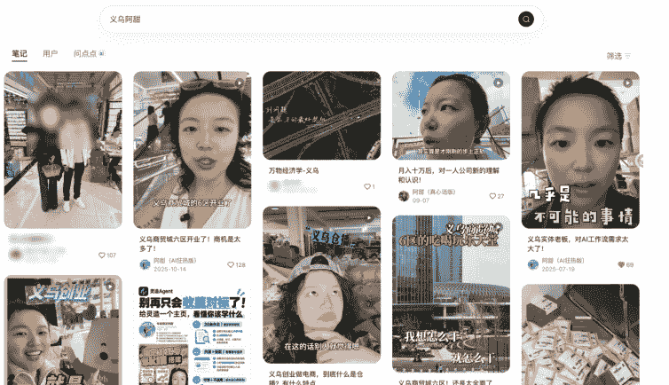
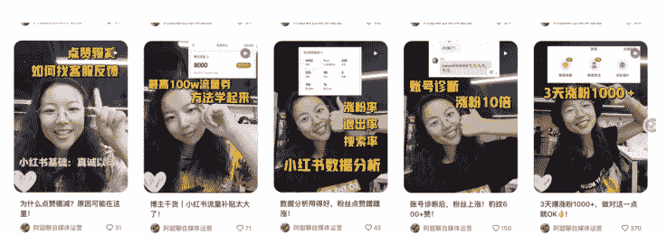
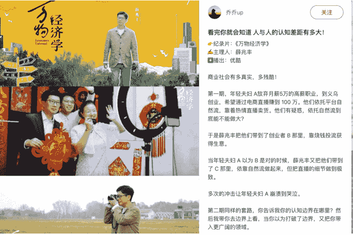
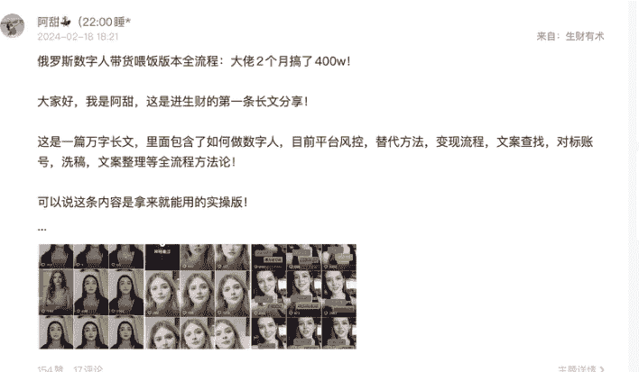
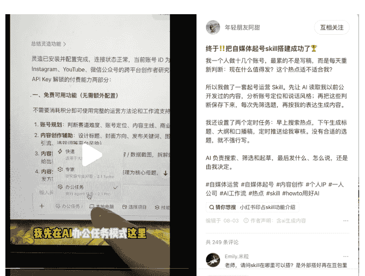

# 两个账号月商务合作过二十万：我把从义乌到智能创作的转折点拆开聊

> 261010 副业 SC 精华  
> 整理：👸号懒人搜索，懒人专属群精选  
> 懒人🛰️：lazyhelper1

> 小懒判断｜这篇更适合两类人：手里已有账号，想把内容重心挪到智能创作方向；或者正在犹豫要不要全力投入。作者两个号合计月商务合作超过二十万，重点不在玄乎技巧，而在“怎么切”。一个很值得注意的细节：做 TVC 类广告，三千多粉丝可以谈到八千多；智能硬件垂类一周能接五单。需要留心的坑是，她反复讲“选自己愿意长期折腾的事”——当年在义乌晚间开播四到七小时，整个人发灰，硬撑不合适的路线，比停下来更耗人。

## 收益页实拍：九月三十日
还有十二笔未结，水下部分另算，九月合计二十万出头。若把时间拨回 2026 年六月，这个数字我自己都觉得魔幻。

## 以前真没敢想，靠内容能跑到这个量级

### 平台报价
小号对外八千，大号一万六。

### 切换节点
小号今年一月把重心挪到智能创作，大号三月才正式跟上。

### 阿甜（AI狂热版）
平台 ID：jiav77296403；显示地区：福建  
🐎 智能绘图、智能视频、智能短剧  
🐎 阿甜的智能创作工坊｜游戏化操作台  
🐎 各类智能互动玩法集中在此，留言会回  
‼️ 内容生产流程入口在另一个号：年轻朋友阿甜  
行业标签：互联网  
关注 51｜粉丝 5.4 万｜赞藏 40.7 万

### 年轻朋友阿甜
平台 ID：tay56567878；显示地区：福建  
🎓 常有人说“阿甜你的内容生产流程真强”👏  
🐻 35 岁 ENFP 文科生｜智能内容｜商业认知  
✈️ 旅行摆摊式生活 + 大专考研 + 创投经历 + 义乌做货 + 智能创业中  
😎 状态积极，作息规律  
🛩️ 智能创作方向做了内容助手 @灵造智能助手  
教育内容创作者｜线上运营  
关注 87｜粉丝 12.9 万｜赞藏 72.5 万

## 今天把整条转折链路摊开讲
从最早拍视频，到深圳职场内容，再到义乌折腾电商、做会员群与课程，最后走到智能创作。如果你正卡在某个节点，可以让自己的内容助手对照我的切换逻辑。以前我说过，做内容可以先模仿着跑，这个“抄”字还是那个意思；用模仿式学习起步，确实能快一些。

这段也写给不了解我过去做什么、从什么时候开始的朋友。  
2020 年五月，我发出第一条视频。那时刚拿到研究生毕业的喜悦。大专一路考上去、没有本科经历，这个反差就是我第一条内容想讲的故事。

### 研究生毕业之后
读研故事讲得少了，内容转到深圳的工作、职场、求职、简历。后来和豪哥结婚，我们一起到义乌做电商，也在这个阶段跑出了自己的会员群和知识星球。

先聊一个很多人关心的问题：想做会员制群组或知识星球，第一步怎么起？  
外界常说群组难运营、卖课费力不讨好，或者把变现说得很轻松。我先把自己的经历摆出来。

## 关于会员群与课程
2022 年在深圳，我在公司做课程落地老师。最贵的课接近八千，最便宜的三百九十九，形式是给平台用户做十几分钟一对一，帮对方梳理账号。后来大家看到的灵造，可以把账号输进去自动生成商业报告，源头就是那段时间手工诊断跑顺的流程。我想说的是：你眼下做的事，也许和目标看起来离得很远，迷茫很正常，我当时也一样；但六年之后回头看，那些点居然连成了线。

卖课起初不是我的主业，是不断有人来问有没有群组、有没有课程。公司里的平台课程本来就是我录制，于是我顺势开了自己的知识星球和会员群，这段过渡比较顺。

需求不是我硬造出来的，而是有人主动找上门，这个切口很重要。放到今天也一样：有没有人向你提问、向你求解，那里往往就藏着付费起点。  
第一门课定价一百九十九，是群组形态。当时课程拆得很散：电话演员、虚拟小和尚、平台运营、平台带货、图文内容都有，价格有九十九、一百九十九，后来才合并升级到三千九百八十。  
也有人问能不能单独辅导。站在现在看，三千九百八是不少人愿意接受的中间价位，再往上还有万元级一对一。但这个价位在我这里已经停了。  
原因很直接：我的服务偏重，要通电话、看内容、逐条纠偏。每个人的经历和内容都不同，要让对方学得进去、愿意改，还不能让人觉得被强迫，这个分寸很难拿。好在当时报三千九百八的朋友，后来基本都找到了方向，也有人和其他博主合作开了自己的课。

### 万元级一对一我不再开
两个原因：
- 带人成本太高
- 现在有商务合作和灵造工具，这两块更赚钱

所以看到留言说“晒这些不就是为了卖课”，我能理解。但按万元级定价算，我给品牌客户三天就能落地完；陪跑一位客户、收一万元、跟一个月，这种事我现在不做。

如果你想做会员群，有几个关键点：
- 确实有人来问你，而不是自己想象出来的需求
- 先小范围测服务。找三到五位伙伴试跑，看服务是轻还是重、你值多少，深聊后知道自己真实水平
- 除了课程群组，你有没有主营生意。教平台运营，自己要有账号结果；教电商，自己要有店铺结果。否则带人会累，还要临时查资料、补案例

还有一个 bug：主营已经很忙，再叠课程群组，人会非常疲惫；主营很赚钱时做一对一更累。  
可以像我一样走会员群形态，从十九块九、九十九、一百九十九到三百九十九，随着人数增加慢慢丰富内容库。

## 义乌做货那段路
以前和薛兆丰老师上节目时提过，我当时没有清晰方向，只是朋友在那边赚到钱，说可以去试试。

现在看，国内电商大盘已经趋缓，甚至往下走；头部玩家很成熟，新人很难硬打。没有供应链、没有厂家资源、没有经验，我建议别轻易碰。这也是很多人问我“为什么你在义乌又撤了”的答案。  
每个人都有自己的擅长和偏好。我当时完全没有偏好，朋友说去就去，让开播就开播，让做运营就做运营，但做什么都提不起劲。  
我以为自己很喜欢说话，后来每晚开播四到七小时，白天一句话都不想说。大家都说晚间开播更容易起量，我就靠嗓子硬喊，极度疲惫。现在再让我去卖货开播，我连笑容都挂不住。  
另一个问题是，我没有真正喜欢的主推品。朋友给的货很便宜，接近成本价；卖九块九能买十双的袜子时，大家惊讶这能赚什么，确实不赚。我就是想试试、测一测。核心是我没有自己喜欢的品可分享，底层动力是分享，而不是卖货。  
用现在流行的话说，就是端自己本来就该端的那碗饭。做自己的业务时，屁股一坐就是四十分钟、一小时，一天很快过去，人是兴奋的。做电商时浑身不对劲：看货累，聊货也无聊。朋友收益页再好、投多少钱、跑多少单，我都觉得跟我没连接。服务重、要囤货的模式，不适合我们。  
我们有技术：我做内容宣传，豪哥做网页、智能体、小程序和展示类产品。那种重服务模式不是我们想要的生活。  
回看义乌阶段，整个人像罩着一层灰，不知道是手机问题还是状态问题，反正土头土脸，每天打包、做内容。后来才发现，好在我有分享的冲动——分享“我在义乌怎么做货”，而不是“我做电商多赚钱”。不是号召大家都来做电商，而是讲我在行业里的操作。我就是喜欢把东西拿出来讲。以前没意识到，现在回想，只是把过程讲出来，这件事本身就是我的天赋。  
迷茫时我花钱做过优势测评，免费的也测过，想知道方向。测评只能参考，最终还得自己选。  
判断标准很简单：哪件事你愿意反复做、越做越有劲？做的时候有没有兴奋和快乐？这里说的快乐，不包括睡觉、看电视这种日常放松。

## 我转向智能创作的过程
这条路我走得不算早。  
按接触时间线，2024 年虚拟人还少。豪哥已经在做美国虚拟人，也给我做了一个。我一直没把它当成大趋势，因为平台当时说要封禁智能内容和虚拟人，外界也说是泡沫，所以主线没放这里。  
当时收入主要靠豪哥给别人做美团虚拟人，我开了自己的小课，讲虚拟人，还和“赚钱”合作过。后来 MJ 出来，满网英文指令词，抽卡一次四张图。我还是觉得离我们远：要翻英文、要找词，图拿到手又能干什么？

### 没有主线，也没有方向
看到不少设计师在做，但对我们自己的业务来说，还是不知道能落到哪。

### 真正的转折在今年春节附近，元旦前后
网上已经有很多智能动漫内容：先在即梦出图，再做五秒钟的片段，最后接起来。现在回头看，一句话就能直接出半分钟，过去那种先图后视频的做法确实老派。现在多智能体协作工具、Lib 系视频工具进入集中买量期，因为真的能赚钱、真的消耗点数。  
一句话就能出脚本，只要愿意充值就能直接出视频。这和九个月以前完全不同，别说九个月，和三个月以前也不一样。  
那时我两个号内容完全不同：  
小号就是现在这个“阿甜（AI狂热版）”。  
往前翻，全是义乌做货。我是直接切过去的。  
现在还有人问“能不能转”，我的答案就是直接转。前面会有适应期，但粉丝结构慢慢换到智能创作方向后，旧内容就没那么重要了。我那时粉丝两万出头，切过去也算顺利开了头。

但我始终没把它当成大趋势，因为平台当时说会封智能内容、封虚拟人，外界也说是泡沫，所以主线没往这边放。

### 没有主线，也没有方向
虽然看到不少设计师在做，但对我们自己的业务、对我们自身来说，还是不知道能落到哪里。

### 真正的转折在今年春节附近，元旦前后
网上已经有很多智能动漫内容：先在即梦出图，再做五秒钟的片段，最后接起来。

现在再想，一句话直接出半分钟，过去五秒还要先图后视频，确实老派。现在多智能体协作工具、Lib 系视频工具进入集中买量期，因为真的能赚钱、真的消耗点数。

一句话就能生成全部脚本，只要愿意充值就能直接出视频。这和九个月以前完全不同，别说九个月，和三个月以前也不一样。那时我两个号内容完全不同：

小号就是现在这个“阿甜（AI狂热版）”。

往前翻，全是义乌做货。

我是直接切的。

现在还有人问“能不能转”，直接转就好。前面会有适应期，但粉丝结构慢慢换到智能创作方向后，旧内容就没那么重要了。我那时粉丝两万出头，切过去也算顺利开了头。

### 阿甜（AI狂热版）
平台 ID：jiav77296403；显示地区：福建  
智能绘图、智能视频、智能短剧  
阿甜的智能创作工坊｜游戏化操作台  
各类智能互动玩法集中在此，留言会回  
‼️ 内容生产流程入口在另一个号：年轻朋友阿甜  
行业标签：互联网  
关注 51｜粉丝 5.4 万｜赞藏 40.7 万

另一个是大号“年轻朋友阿甜”，分享我在电商里的经验。  
两个号方向不同：小号从义乌切入，讲本地商业活动、探店等；大号更偏个人感受，观察大家在义乌做货都在做什么。

### 年轻朋友阿甜
平台 ID：tay56567878；显示地区：福建  
👋 常有人说“阿甜你的内容生产流程真强”  
35 岁 ENFP 文科生｜智能内容｜商业认知  
旅行摆摊式生活 - 大专考研 - 深圳探店 - 义乌做货 - 智能创业中  
状态积极，作息规律  
智能创业方向做了内容助手 @灵造智能助手  
教育内容创作者｜线上运营  
关注 87｜粉丝 12.9 万｜赞藏 72.5 万

如果你有两个号，可以一个切自己的生意，一个分享做生意的感受，这样不冲突。前提是真有空、也愿意分享。  
再说现在两个号分别做什么。  
“阿甜（AI狂热版）”主要做智能绘图、智能视频，之前也分享一些简单技巧；“灵造”偏内容生产方向。  
大号目前几乎全是生产流程，还有一部分硬件。两边有交叉很正常，不必纠结非要完全切开。  
比如大号做内容生产、流程，可以接 Codes、WorkBuddy、千问这类合作；做图做视频的号可以接 OII、LibTV、千问系创作工具。不同广告切口是慢慢摸出来的。  
先别急着定死，按自己的喜好分享。

小号是怎么转的？  
那时我基本离开义乌，电商不做了。当时主推 LibTV 这类工具，不知道大家还有没有印象。豪哥当时分享过：一张图能生成视频，电商图文流程很好用。当时价格不低，每天等新人福利两百点数，能做几个。我自己做表情包，还开了课教表情包；那时也做了一个小程序，后来全都串起来了。  
我把过程发到平台，说自己在做可爱的表情包，静态动态都有。那时没挂网站、没有靠内容赚钱，只是记录。

### 到今年三月
一家做智能动漫的公司来谈合作，问能不能推广告。我才意识到，智能创作也许是我的新突破口。前后也就半年。  
二三月我们刚从乌兹别克斯坦回来，本来想做跨境、做运营，碰上战事，转去东南亚。在东南亚，Claude 起来了，我们正好用上。豪哥一直说，一定要用这个产品搭自己的智能生产流程。  
那时我的需求文档仍靠手写，没有借助代码助手，也没有调用任何智能体工具。是豪哥先测完给我答案，我觉得好才开始用。真正接触智能体工具只有半年，但成长很快。  
现在快到十月。春节那波传播力会很强，像之前的 DeepSeek、小龙虾都在春节前后发酵。因为大家闲下来，流量盘子大，平台也需要新刺激。今年春节会冒出什么，可以重点关注，当成账号启动切口。  
小号从做图片开始。那时每天能发很多条，呈现很简单：第一，没有挂链接赚钱；第二，本来就是小号；第三，自己录屏，手机拍桌面画面，显得很随意，像顺手记录。

可以回头翻一下我过去的发片套路，爆款一直不少。七月份讲《豆包起号 skill》就用的是这套打法，单条赞数冲到了1.8万，所以这条路现在依旧能做。

具体操作很简单：开头用一句话猛地拽住人，比如“哇这玩意儿太强了”“这AI也太离谱”“我今年用到的最好AI就是它”之类，先把好奇心点燃；后面就用手机对着电脑拍，画面看起来像随手分享，实则每一帧都是排练好的。按这个节奏跑，数据会慢慢起来，后续图片分享多了自然会接到AI制图、AI视频的商务，就像你们现在看到的这样，涨粉基本靠的是不断的爆款。

### 涨粉真正起飞是在6、7月
那段时间我陆续发了《广东大佬怎么做图》《我的表情包》《文科生怎么做APP》这几条，一下子把粉丝拉到了将近5万。

涨粉从来不是几百几百慢慢加的，是集中式的一次性突破。我扒过不少现在的AI博主，平稳期一个月涨一千粉算正常，有一条爆了当月涨一万也常见，极端情况几天涨十万也有，但拿平均数来看就行。

### 两个号是怎么分工的
现在你们看到的大号主要在做工作流相关。那会儿我对skill、agent这些词完全没概念。后来我用自己的brief让它帮我梳理内容方向，再把它做成我所谓的skill，用来起号、做多平台分发，慢慢才恍然大悟，原来这就是工作流，就是把日常重复的事串成一条线。我到现在也没学会飞书多维表格，看起来更高级也能卖钱，但我就是不会。所以我一直强调，做你真正感兴趣的事。

如果你做一件事会觉得“哇好难受，左右摇摆特别痛苦”，那就别硬撑。飞书多维表格豪哥怎么教我都学不会，培训都一年多了，看着就头疼。我喜欢做图、做视频、做手账、搭自己的工作流、搭建工作台，这些我愿意花时间，大号的突破口也就是从分享我的起号skill开始的。

这个起号skill源于6月豪哥做的灵造，本来只是想自己用，后来我们把它产品化成了大家现在看到的灵造agent。整套逻辑就是让灵造把我的素材读完，给出内容方向，这批内容在📕直接跑到了将近2万赞。对我来说这是个转型的节点。

想破圈、想涨粉，却一直盯着自己的账号，就会看不到大盘。看不到大盘是什么状态？就是每天都在问：我的内容怎么弄？怎么涨粉？怎么变现？要不要做知识付费？我缺什么？整个人陷在自己的一两个号里，只能和同赛道的人死磕。

自媒体的盘子很大，有时候稍微换个角度就能降维打击。举个例子，我最开始用AI先拍自己说“哎我看到个图，然后我做了一个图”，这种大白话反而被很多人看见。要是我是个设计师，第一反应会去抠参数、配色、封面思路，当时我一窍不通，数据却比很多专业设计师更好。因为我用自己的当下视角，去用了别的赛道想用的呈现方式。

你们也可以这么切入：现在的老师往AI切，亲子教育往AI切，好物分享往AI Vlog切，就是把AI串进去。先看大盘在做什么、哪些点数据好，让灵造把封面、选题、呈现方式提炼出来，再和你自己的赛道结合，这套逻辑很顺。

## 怎么切入AI赛道
前提是你至少有一点想做AI的意愿。别是一点都不想做却非要为了赚钱硬上，那种状态录屏、现身都会觉得累。如果你真有意愿，就直接抄我数据好的那几条，1:1复刻我说话的节奏、肢体、表情、语气、拍摄手法。这是目前模仿最快的办法。

大家学英语时听过影子跟读吧，录音放一句跟着读，语感就出来了。自媒体也一样，模仿一个博主不是抄文案，而是抄表达方式、语气、动作、神态、口吻。最好是喜欢他的风格并且觉得自己能hold住。我说话比较夸张，咬字重，你们也可以挑咬字轻、表达清晰的博主学，甚至把几个喜欢的博主混起来，形成自己的口播风格。

另外就是做垂类。垂直AI电商、垂直AI HR、垂直AI教育、AI亲子、AI老师、AI自媒体，都已经有人在做了。不会泛泛而谈，而是钻得很细。比如电商可以分国内、跨境，跨境再分国家，品类上可以是图片、视频、袜子、首饰、圣诞周边，越细越好。

不光能接AI广告，还可能接到品牌定制。AI圣诞视频做得好，品牌方直接买你的方案，不需要你去吹捧。TVC广告我看过后台报价，3000多粉就能报8000多，很多报价上万。以前手搓一个几秒的广告客单价十几万，现在AI提效后依然有需求。做TVC的博主很多画面高清、有想象力，搜一下关键词就能看到，粉丝少也能做成商业变现。

还有一种批量打法的“邪修”。现在不少Agent已经接入CLI了，像即梦、LibTV、OII都能用指令批量出片，让外国女生带货，一次出几十条直接发INS、TK做测试。我看到一个叫“纽约第一媒体人”的账号，手里几千上万个号全是这种玩法。我最近接入即梦的CLI，效果确实能用。

### AI硬件是个好方向
我这种小白之前没碰过AI硬件，上周就接到了5个完全不同的AI硬件产品。去云栖大会也明显感觉大家都在往硬件走，软件已经很成熟，硬件势必要变。手机、电脑、平板的迭代速度就说明了这一点。现在AI玩偶、AI手机、AI平板、AI眼镜、AI耳机，杭州街头的广告已经开始铺了。

做AI硬件广告也可以走“邪修”思路，不一定要买，先去线下门店实测，讲讲你的使用感受和看法，做垂直的AI硬件内容。我看到几百粉的博主专门做这个，内容质量高，广告全是AI硬件相关的。AI博主报价高是因为稀缺，就像AI老师、AI亲子这类赛道，搜索量不算大，但品牌方会从能付费的人群开始投放。

现在AI博主的赚钱状态有点像当年新能源汽车，接单接不过来，也很像之前📕大推软装的那波，家居、好物分享赛道一起起来，就是因为拉动内需、营造新鲜感。在没有全新叙事的情况下，AI依然是条好赛道。记住一句话：永远不要觉得晚。用AI的人始终是少数，问问身边的人就知道。为什么感觉人人都用AI？因为你的信息流、社群、短视频都在讲AI，点赞其实没那么高，本质还是小众。互联网推了十几年，依然有很多群体没真正用上。营销推广现在很多人还在用微商朋友圈的方式，美业很多也还在朋友圈运营，AI最多做一张图、一个自我介绍，还要花钱找人做，接受度很低。市场还在教育期，就像当年从键盘手机到触控手机花了很久。现在连全球第一台平板的噱头都还在，市场才刚开始迭代，加油！

分割线

看完这份SOP，你可能觉得懂了，但90%的人实操第一步就会卡住。工具和教程是最基础的壁垒，真正难的是立刻动手和圈层的信息差。

如果你想看全网最新的变现打法，并且和一群执行力很强的极客一起下场拿结果，欢迎围观我的核心私域：【懒人专属群】。

我们不聊虚的，只拆商业闭环和AI效率的榨取。系统里已经沉淀了1000+跑通的套利实战案例。

- 查阅圈子完整数字资产与上车门槛：
https://lazyso.com/insider/
认同价值、准备好下场干活的，扫码加我🛰️（lazyhelper1）
备注：【实操上车】，不闲聊

🛰️：lazyhelper1