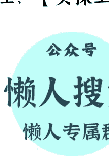
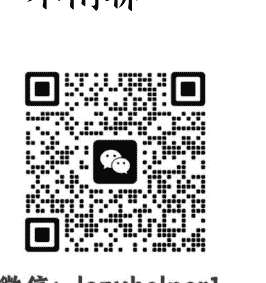

# 【超级标签 19】X 中文 AI 自媒体

261004 副业 SC 精华

小懒判断 | 若你本身已落地过 AI 项目、想经营个人品牌，或打算替自家产品拉来最早的种子用户，这波值得一试；反过来，只盼平台自动打钱、什么也不想干的人，进来大概率会失望。真该盯住的，是算法给新面孔留的那道窄门——粉丝没破五万时，原创内容有机会挤进推荐位前段；鱼总那个老号，用一年时间堆到四十万。误区则是一开始就把创作激励写进收入表——中国大陆并不在名单内，一千次通过认证的浏览才抵一美元，撑起收入的始终是商业合作。

先祝各位圈友国庆快乐！假期已经过去一半，各位歇得可还舒服？

回想两年之前，也是国庆刚过，我推出了超级标签首期，主题恰好就是 AI 自媒体。当时那篇的原话大意是：做 AI 自媒体，重点并不在于让机器替你产出内容，而在于把自己变成 AI 新品、动态、讯息以及应用场景的一条输出口。

这回借着旧题做一次回炉升级，标题定为：X 中文 AI 自媒体。说白了，就是在 X（推特改名之后）这个场子里，用母语写 AI 相关的东西。

有种声音一直存在：中文推特圈子盘子太浅，犯不着花力气。我恰恰不这么看。X 体量摆在那儿，非常庞大。

## 在 X 做中文 AI 内容，眼下恐怕是距流量最近、拿到反馈也最迅速的一扇门。

回头看看这一整年，中文推特上冒出了多少实打实的案例。

圈友鱼总，去年九月参与赚钱组织的 X 航海，拿一个粉丝仅几百的老账号发出第一篇起号内容。走完十二个月，成绩单是这样的：

- 关注数累计到 6.3 万
- 这个号带来的直接收益，加起来越过四十万
- 一条广告的报价区间在六千至一万元，网易、百度、字节跳动均与他有过签约

早前在超级标第一期里，我拿另一个朋友举例——他在📕耕耘数月，接下一条八千元的豆包推广。眼下，类似的剧情正换到 X 上重演。

之所以看好，是因为 AI 正让 X 成为中文互联网里距 AI 最近的一块地：新玩意儿在这儿首发，追新的人在这儿扎堆，等着被看见的产品也在这儿物色首批用户。

假使你能用中文把 AI 说明白、使顺手，那么读者、广告邀约以及自家产品的初始用户，这三样可以在同一处一并收入囊中。

下面几条观察，展开说说：

## 一、X 自身在演进，新面孔反而更吃香

今年春节之后，我重新把 X 当主力使用。平台规则的变化，感受相当直接。

## 二、最前沿的 AI 动态，首发阵地就在 X

- Claude Opus 5.5 由 Anthropic 放出时，官方那条帖子的浏览量逼近两千八百万
- OpenAI、Google、xAI、Meta 每次上新模型，官号、创始人与团队成员都会在 X 轮流发声
- 国内公司同样如此：DeepSeek、通义千问、智谱、小米、可灵推出新版本，照例会配一条英文帖发到 X。字节 Seed 团队甚至在今年七月注册了官方号

不少 AI 圈的热词，源头同样落在 X。

如今被挂在嘴边的 vibe coding，最早不过是 Karpathy 在 2025 年 2 月随手扔到 X 上的一条动态，后来被柯林斯词典收作年度词汇。

### 一手信息，中间不隔任何环节

原始出处就躺在你的时间线里：第一时间刷到，自己动手跑一遍，再以中文梳理它适合谁、怎么用、边界在哪。

## 三、为了追 AI 的脚步，涌向 X 的中文用户越来越多

本人便是个现成的样本。

翻了翻自己在 X 的点赞历史：2023 年全年，我点的中文 AI 作者只有 60 位；而今年前九个月，这个数字变成了 491。

其他肉眼可见的变化还包括：

- 专注中文 AI 的号中，粉丝破十万的已接近三十个，宝玉一人就有二十五万以上
- 有人做了一份「X 中文圈值得关注的 AI 账号」合集，收藏数接近一千五
- 阿西，八年增长运营背景，起初只是想让自家出海工具站多些流量才运营 X；结果两个多月从零涨到一万粉，网站不仅等来付费用户，也等来了合作邀约

这些人此前是产品经理、程序员、增长运营，也有二十出头的年轻人。路子大同小异：把自身熟悉的领域与 AI 嫁接，再用中文说给 X 上的受众听。

赚钱在去年九月和十二月各办过一期 X 航海，鱼总那第一条起号动态，正是在航海期间发出的。

上述圈友的复盘心得连同各自的收益截图，我交给 AI 汇编成了一份合集：

## 五、若要推自家 AI 产品，X 自带便利条件

产品在这里亮相、被议论、被拿来尝鲜，X 恰好集齐了这几环：

- 阿乐录了一段自己开发的采集插件跑起来的画面传到 X，当天涌进一百人，三天内🛰️好友加了六百，变现一万元。彼时插件尚未正式上架，支付通道都还没搭
- Manus 的官方号直到发布当日才注册，仅凭一段四分钟演示视频，拿下二百四十八万浏览
- 不少头部号主本身就是产品人：Orange AI 捣鼓 ListenHub，玉伯在做 YouMind。在 X，写内容与做产品往往是同一批人

另一头，AI 厂商也乐于为中文创作者掏钱：

### 首笔往往刚过一百美元

乐意公开的，通常是收益偏高的那批，数字要打些折扣来看。每一笔的原始链接，都收在上面那份合集里。

### 创作分成大致在什么水位？

- 老规则下，照圈友自报的数据估算，百万级浏览大致能兑六十到一百美元
- 新规则改成只统计付费会员的浏览，从几位博主晒出的账单看，此类浏览每一千次约兑一美元

### 新机制的准入门槛：

- 开通 Premium，且拥有至少五百名认证关注者
- 最近九十天内，来自认证用户的首页展示量不低于五十万次
- 原创才有资格：搬运、洗稿式微调、以及专教人如何赚钱的帖子，一律不计
- 香港、台湾、新加坡、日本等地区在开放名单内，中国大陆暂时缺席

审核也可能被驳回。已经有人因被系统判定为「不真实的互动」，需要等满四十二天才能重新递交。靠互赞群、刷数据养起来的账号，在这一关卡上会格外吃亏。

更关键的一点：平台激励从来不是收入主体：

- 鱼总那四十万里，平台奖励只占百分之五到十，真正的大头来自广告与工具推广返佣。他写过一篇手机号相关的教程，单是推广分成就有一千到两千美元
- 同期逸尘的广告收入一万多元，平台分成仅六十余美元
- 余温收到一千二百三十美元那天，原话是「原创收益也只是其中最小的一块」

我在今年二月就提过，若经营得当，创作者收益足以抵消各类 AI 工具的开销。把它视作额外彩蛋就好，别当作入场的前提。

## 八、生态足够开放

- 读者可以带走：帖文与主页均可直接挂链接。X 产品负责人七月公开表态，链接不必再往评论区塞了
- 规则透明：推荐算法源码对外公开，谁都能翻看它如何排序
- 触达无阻：任何人你都能直接回复或 @，包括 AI 企业创始人与研究员
- 全球可见：自动翻译机制让中文内容有机会触达其他语种的读者。有圈友留意到，某 App 作者用中文配了段演示视频发布，内容同时被推送给英文、日文与中文用户，十九小时收获两万浏览

我的判断再进一步：已经把 AI 玩转的人，是时候向外输出了。

赚钱内部有个 Token 消耗榜，名为 TokenRank。以 10 月 3 日为例：

- 当天有二千一百七十一位圈友登榜，合计烧掉四千七百五十一亿 token
- 单日消耗跨过十亿大关的，达一百零八人
- 即便排在第两百位，单日也有六亿多

我早些时候在群里讲过：外面那些做培训的 AI 讲师、自封的 AI 大神、以及各类 AI 自媒体，一天烧掉一亿 token 都够呛。日耗十亿这个量级，出了 TokenRank 到哪儿都能挺直腰板。

榜单上不少人 AI 使得极溜，唯独缺一个对外展示与分享的出口。

余温在 X 上留过一句话：「在这里……可能就是因为你无意间展示了一下你的长处，从而得到一个大的机缘」。

我愈发笃定：往后分发的重要性会压过做产品，价值也更大。产品门槛越降越低，分发反倒愈发艰难。会用 AI 的人，该着手对外表达、分享，把个人 IP 与影响力立起来。

X 就是一处不错的切口。

上文那些圈友，靠一个账号接广告、替产品拉用户、甚至签下企业客户，走的全是这条路径。

往远看：X 官方称日本是其日活与使用时长最高的市场，一门非英语语言在 X 上长成了最大的市场之一。有了自动翻译，今天你用中文写下的好内容，日后有机会被更多语种的读者读到。

AI 的迭代还会持续许多年。每冒出一个新模型、新工具，就会带出一批新疑问。

谁能源源不断地用中文把这些疑问答漂亮，谁的读者、客户与产品就会越滚越多。

## 几点提醒：

- 广告单有冷暖：随 AI 风口与品牌预算浮动；代充、代开账号、API 中转这类灰色生意，价钱再诱人也别碰
- 中文推特的池子偏小：不及英文圈，挤进前列不难，要做大则需长期沉淀
- 账号安全要上心：封号、限流均有人中招，用真实身份运营，远离灰色操作

## 起步怎么做：

- 挑一件近期你真正用 AI 办成的事：交代清楚用了哪些工具、解决了什么难题、卡点在哪、最终结果如何。配上截图、录屏，再附上你个人的判断
- 先写一篇自我介绍：说明你过往做过什么，别人关注你能收获什么
- 认真去回大号的帖子：比一个人闷头更新更容易被注意到
- 以下几件事别碰：互赞群、搬运洗稿、伪造所在地、找人代开会员

最新的模型在 X 首发，最想追上新潮流的中文读者在 X 浏览，最渴望曝光的 AI 产品在 X 寻人。而能用中文把 AI 讲透彻、用溜的人，恰好立在这三者交汇处。

这条内容若点赞够多，我们会考虑再启动一期 X 航海。

（最后补一句：以上全部内容，含调研与成文，均出自我的 AI 助理之手——除本句外，我只给了大致方向，其余由它独立完成。各位看下来感觉如何？我觉得已经甩开我一大截了。）

——————分割线——————

看完这份 SOP，你或许觉得自己已经明白。可真到动手那一刻，九成人会僵在原地。

工具与教程不过是入门级的门槛，真正卡人的，是「马上开干」的魄力，以及圈层之间的信息落差。

这儿不谈空话，只拆商业闭环，只榨 AI 效率。圈内已攒下 1000+ 经过验证的套利实战局。

- 想看圈子完整数字资产与加入门槛：https://lazyso.com/insider/

加好友请备注：【实操上车】，不闲聊。

