# AI时代的第一批“个体开发者”：零编程基础，烧掉1351亿Token，他做出了一款上架App

有人会写代码，有人不会写代码，但在今天，后者的故事可能比前者更值得研究。一位在美容行业摸爬滚打了15年的老板，完全不懂编程，却靠着一堆AI工具，把自己原来的微信小程序重做成了一个App，并且成功通过了App Store审核。他前后花了多少算力？1351.51亿Token，在龙哥盟的TokenRank上排到了全站第20名。


这篇文章之所以值得转给你的朋友，不是因为它告诉你可以“一句话生成App”，而是因为它把这套流程里最繁琐、最没人愿意讲的代码之外的手续链，全部摊开来了。如果你也有一个小程序或网页想做成App上架，或者你正在为备案、软著、提审这些环节头疼，这篇文章应该能帮上忙。先说两个最容易让人误判的结论：一是提交审核不等于上架，官方说1-3个工作日，实际排队6天多很正常；二是个体户在苹果公司眼里根本不算“组织”，你的卖家名只能显示个人真名，AI没办法替你绕开这些。

## 他是谁？用了什么方法？

这位主人公是李可，美容行业15年经验，自己开3家美容院，还帮20多家门店做线上代运营。他同时也是龙哥盟7年圈友，接触AI已有4年。这次做App，他把Claude Code当成“项目经理”，负责拆任务、验收，而写代码的重活主要交给Codex。就这样，他把原来58个页面的微信小程序，一点点改造成了面向美容门店的「销冠营」App。

「销冠营」解决的是门店的实际问题：员工学习专业知识、跟AI扮演的顾客练话术；门店提前告知顾客后，用智能工牌记录服务过程，自动生成复盘卡片。6月20日动工，9月21日上架，前后约三个月。


## 真实时间线：排队6天多，加急两次

- 6月20日：整理迁移文档，58个页面逐个定去留，开工；
- 8月19日：改名为「销冠营」（此前改过两次名）；
- 9月14日：提交iOS 1.0.0审核，勾选了“手动发布”；
- 9月18日：排队3天多没动静，第一次申请加急；
- 9月21日：审核通过，手动点“发布”，1.0.0上架；
- 9月22日：因iOS 27一打开就闪退，发1.0.1修复版，第二次加急，不到一天通过并发布。

注意，他曾按照旧手册以为1-3个工作日就能审完，结果首版排了6天多。审核通过也不代表能松口气，1.0.0发布前几小时，外测朋友就发现有闪退问题，他只能先发旧版、第二天紧急补上修复版。所以，如果你有固定的上线日期，提审至少留出一周以上的余量。

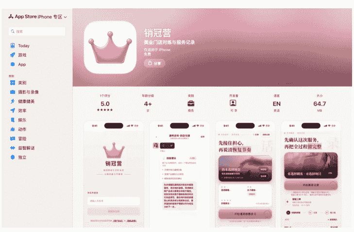

## 成本到底高不高？

他把自己付过钱的账单全部列了出来，可以说相当透明：

- 苹果开发者账号（个人）：688元/年
- 电子版权证书（普通时效）：600元
- 阿里云服务器、数据库等：8月约567元，9月截至28日约707元
- App调用大模型：9月头8天约21元

以上还不包括AI编程助手的订阅费。如果只做一个给门店用的垂直工具，这个成本是完全可以接受的。

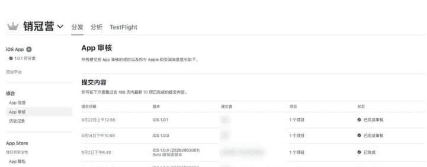

## 最大的坑：代码之外的手续链

作者反复强调，AI能帮你写代码，但身份选哪种、账号怎么开、软著声明怎么写、备案先办哪个，全都得自己来。他亲身踩过的坑包括：

- 用个体工商户注册，苹果不认个体户为“组织”，只能走个人开发者账号，结果App Store上的卖家名显示的是自己的真名。
- 办电子版权证书时，平台要求“签章页盖章”，他起初交手写签名被退回，后来用iPhone备忘录的“扫描文稿”重新扫描才过。
- 国内安卓商店上架基本都要软著，而他卡在了“未使用AI开发”的声明上，最终放弃软著，改办电子版权。

这些坑，光靠AI是避不开的。

## 什么人适合？什么人不适合？

适合：

- 不会写代码，但手里有一个具体小问题想做成App的人；
- 已经做了小程序或网页，想升级成手机App的人；
- 已经在用AI写代码，但卡在打包、备案、提审等“代码以外”环节的人。

不适合：

- 期待“一句话生成App”神器的人——每一步还是要自己看结果、做判断；
- 做游戏、新闻、直播、医疗、金融这类需要特殊许可证的业务，应先跟主管部门确认；
- 想在App里卖会员、卖数字内容的，苹果要求走App内购买，这套流程没有展开讲收款。

## 怎么读？两条路线

作者把内容拆成了18章，并提供两条路线：

- 路线一：先练手。跟着“跟进小本”小项目从第6章做到第12章，不办任何手续，也不需要营业执照，只需要一个AI编程助手和一个免费的Expo账号。
- 路线二：决定公开发布。先花一天读第一部分（第1-5章），启动所有需要排队的手续，然后开发和排队同时跑。等到能跑的版本出来，再办软著/电子版权；包名和签名定好后，再办App备案；网站开通后30日内完成公安备案。最后才是提审上架。

大致的时间表是：第1周办执照、开开发者账号、查商标、买服务器做网站备案；有能跑版本后，软著需要受理后60日内审完，电子版权普通10-15个工作日；App备案约20个工作日。这里有个原则要记住：所有手续的主体尽量从头到尾保持一致，中途换主体，很多步骤要重来。如果是特殊行业，开发前先确认许可证，别等做完了才发现缺证。

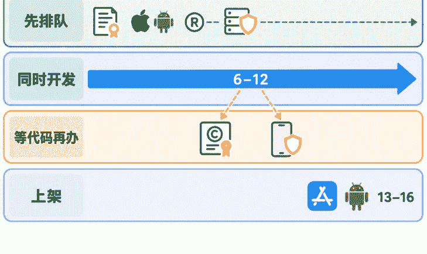

## 身份选择：三个问题帮你决策

作者用第1章的亲身经历，给出了一个极简决策法：

1. 只是想练手，做给自己和朋友用？个人身份就够。
2. 要上国内商店、要备案、以后可能收钱？至少办个个体户，成本最低。
3. 有任意一条就用公司：不想在App Store显示真名；想上国内安卓市场尤其是小米；做金融、医疗等严管行业。


苹果官方对这个问题写得很直白：独资、个人经营这一类，按个人身份注册。所以个体户在苹果那里只能注册个人账号，卖家名自然就是真名。还有一个细节：他一开始没刻公章，结果办电子版权证书时被要求“签章页盖章”，最后补了盖章才通过。这些坑，如果没人提醒，真的很难提前想到。

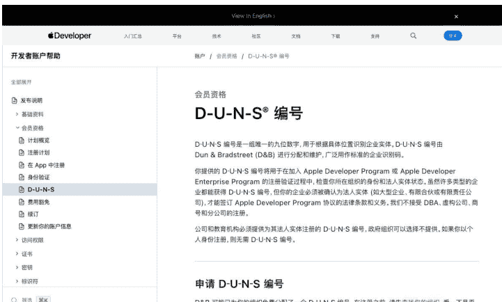

## 总结：一份用Token换来的避坑地图

从完全不会写代码，到App成功上架，李可烧掉的1351亿Token，换来的是一套完整的“0→1”方法论。它包括18个章节、49段可直接复制的提示词、105个勾选项、一个练手小项目、16个踩过的坑和一个“小白术语小抄”。但比这些更值钱的，是一条核心结论：代码只是起点，真正稀缺的是代码之外的手续链，以及愿意把每道手续一步步跑通的耐心。如果你想做一款自己的App，别急着写代码，先把要排队的事情启动起来，再让开发和手续并肩跑，最后给审核留足余量。因为在这个时代，AI负责帮你实现想法，而你负责把现实世界里的门一扇扇敲开。

# App 上架的第一步：把主体、账号和名字一次想清楚

## 第一章 先注册一个能用的经营主体

**1. 定名称**
登记名称通常按“地区 + 字号 + 行业 + 组织类型”拼凑，比如“某区某网络科技工作室”。建议先准备几个备选，然后去查重，确定不与现有个体户或公司同名。

**2. 定经营范围**
经营范围要包含“软件开发”相关类别。后续做单位备案时，App 的实际业务不能越过这个范围，所以一定要圈对。

**3. 确认注册地址条件**
住宅能不能作为经营场所，各城市规则不同。别听二手经验，直接看本地政务服务网站上的最新指南。

**4. 在线提交申请**
进入你所在省份的政务服务网，或当地市场监管局的官网，搜索“个体工商户设立登记”，选择网上办理。全程免费，不花一分钱。有些地方是独立页面，比如上海。

**5. 准备材料并做人脸核验**
把经营者身份证、本人实名的手机号、经营场所信息准备好，按页面引导完成人脸识别，然后提交。

**6. 等待结果并领取执照**
材料如果齐全，有的窗口会当场办结；没法当场办结的，3 个工作日内完成。审核通过后，在微信或支付宝里搜索“电子营业执照”，就能拿到电子版。执照上出现“统一社会信用代码”，就说明注册成功了。

**7. 建立一个“主体资料包”文件夹**
后面每个环节都可能要提交这套材料，提前整理成一份清单：
- 营业执照原件照片或扫描件，四角要完整；
- 经营者身份证正反面各一张；
- 手持身份证照片（部分平台要求）；
- 本人实名手机号、常用邮箱；
- 签字页模板，便于需要签章时直接使用；
- 对公账户不是必须的，但如果开好，安卓平台打款认证会快很多。

**8. 提前想好“盖章还是手写签字”**
个体户可以不刻公章，但电子版权证书、部分商店的资质页都需要“签章”。我第一次交手写签名，结果被电子版权平台退回要求补章，白白等了一轮。要办电子版权证书的话，建议一开工就去刻章。签字页可以用 iPhone 备忘录里的“扫描文稿”存成 PDF，比拍照清楚得多。

（图 1-3）用 iPhone 备忘录“扫描文稿”扫签字页，比随手拍清楚

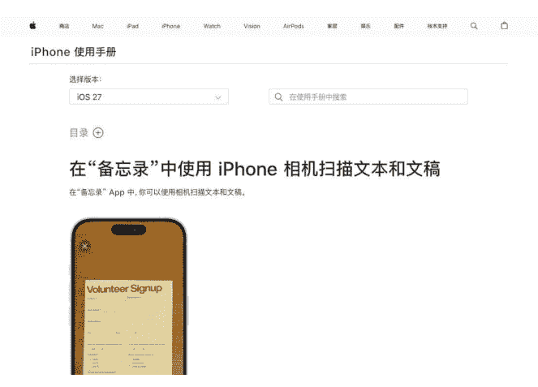

如果想请 AI 帮忙列个检查清单，可以把下面这段提示词发给它。它只能辅助整理，政策以官方页面为准：

“我准备用 AI 开发一个手机 App，想在中国大陆上架。请对比‘个人、个体工商户、公司’三种登记主体，并针对以下信息列出方案：目标平台（iOS/华为/小米等）、App 是否收费、行业（如美业门店培训）、能否接受 App Store 显示真实姓名。请逐个平台说明：该主体能否注册开发者账号、要准备哪些材料、审核大约要多久。每一条都要附官方来源；没有官方依据时请注明‘需要我自己去官方页面确认’，不要猜测。”

**完成这一章的标准**
- 主体名称一旦确定，后续的域名实名、ICP 备案、电子版权证书、安卓开发者账号都要用同一个名字，中途变更很麻烦。
- 苹果个人开发者账号会在商店展示真实姓名；如果不想暴露真名，只能用公司主体开通组织账号，并提前申请 D-U-N-S。
- 资料包里是隐私证件，千万别传到公开网盘，也别把整包发给 AI。

---

## 第二章 开发者账号：今天先做这些，其他等一等

**总原则**：现在可以完成的是“注册+实名”；而创建应用、完善商品信息、购买云资源这些事，要等包名和签名确定后再操作。不为用不上的服务先花钱。

> 动手时间约半天；审核快的几分钟，慢的一两周。费用方面：Apple 开发者 688 元/年；Google Play 25 美元一次性；国内安卓市场注册免费；AI 工具和云服务按方案付费。

### 我的实际体验

先说说我的选择：
- **Apple 开发者用的是个人账号。** 平台不认个体工商户为组织身份，所以只能以个人名义注册。最终，“销冠营”在中国区 App Store 的卖家名就是我的真名。注册之前一定要想清楚这一点。
- **表格填写交给 AI，关键动作我自己来。** App 名称、隐私网址、隐私标签、测试组这些，我让 Codex 操作浏览器完成；但登录、双重认证、同意协议这类敏感步骤，它会停下来等我处理。
- **云服务全部在阿里云。** 服务器、数据库、录音文件存储都放在那里，ICP 备案也在阿里云的系统里弄的（后文详述）。
- **微信开放平台改过一次名。** 应用定名“销冠营”之后，开放平台里的移动应用名称也跟着改，重新审核花了 1—3 个工作日，AppID 没有变化。
- **iOS 首发版暂时藏起了微信登录，** 只放手机号登录，原因后文说明。
- **安卓商店当时在等电子版权证书，** 我先用正式签名的安装包直装给门店使用（这不等于上架）。我让版权证书上的权利人、安卓开发者账号的注册主体，统一落在同一个个体户名称下。
- **两个 AI 助手一起用。** Codex 负责大部分编码，Claude Code 负责拆任务、查代码、调界面。具体支出到后面会公开。

### 哪些账号可以今天就开通，哪些要排队？

用文字梳理一遍：
- **AI 编程助手**：所有人适用，开通即用。今天把账号和客户端搞定即可。
- **Apple 开发者（个人）**：要上 iOS 就注册，688 元/年，付款后一般 24 小时内确认。但创建 App 要等包名定下来。
- **Apple 开发者（组织）**：公司上架用，也是 688 元/年。D-U-N-S 申请最多 5 个工作日，同步要 2 个工作日，再等苹果审核。先办 D-U-N-S，拿到编码后再注册。
- **国内安卓市场**：注册和实名可以先做，费用免费，实名时间从几分钟到 3 个工作日不等。创建应用要等软著/电子版权和备案号到位。
- **Google Play**：出海才需要。25 美元一次性费用，个人新账号还要经历 14 天封闭测试。建议确定出海就尽早注册，拿到正式包后再建应用。
- **阿里云**：有后端或备案需求时用。注册免费，企业实名通常几分钟到 7 个工作日。先注册实名，等确定要买资源时再下单。
- **微信开放平台**：需要微信登录才用。今天可注册并完成资质认证；创建应用要等包名和签名齐全。
- **Expo**：跟着本文练习时用，免费额度足够。现在注册。

真正等待时间长的不是账号，而是软著（或电子版权证书）和备案，后文会详细说。账号先注册、先认证，应用和资质等数据集齐再提交。

（图 2-1）哪些账号今天就能注册认证，哪些要等信息齐了再建应用

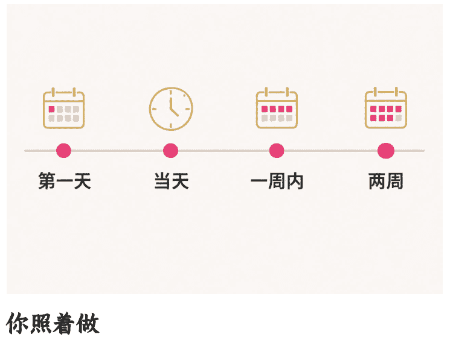

### 逐个开通指南

#### ① AI 编程助手：Codex 和 Claude Code 二选一

两者对比：

| 维度 | Codex | Claude Code |
|---|---|---|
| 登录账号 | ChatGPT | Claude |
| 免费版 | 可用，但配额少 | 不可用，至少 Pro 套餐 |
| 新手入口 | Codex 桌面 App（ChatGPT 桌面 App 里也可以） | Claude 桌面 App 里的 Code |
| 官方资料 | Codex 快速开始 | Claude Code 安装说明 |

操作步骤：
1. 打开官方文档页，按照指引下载桌面客户端。Codex 以下载方式以官网为准。暂时不学命令行也没关系；后续有可选的命令行安装，不急。
2. 用对应账号登录。Claude Code 需要在 claude.ai 先订阅 Pro 或更高级别。
3. 付费前，先核对两家的“支持国家和地区”名单（OpenAI 和 Anthropic 官方页面）。就 2026 年 10 月看，名单里都没有中国大陆，最终情况以官网为准。

#### ② Apple 开发者账号：个人还是组织？

| 对比项 | 个人 | 组织 |
|---|---|---|
| 年费 | 688 元 | 同样 |
| 等待时间 | 付款后 24 小时内确认 | D-U-N-S 最多 5 个工作日 + 同步最多 2 个工作日 + 苹果审核 |

**个人账号操作路径（手机官方 App 最方便）：**
1. 准备：一个开启了双重认证的 Apple 账户；身份证；一台有锁屏密码或面容 ID 的 iPhone；Apple 账户里已绑定付款方式（余额和礼品卡不行）。
2. 在 App Store 下载“Apple Developer”官方 App，进入“账户”登录，同意开发者协议，点“现在注册”。
3. 填写个人信息并验明正身：姓名、地址都用拼音，别写昵称或店名；实体类型选“个人”；按要求自拍验证。
4. 付款：同意许可协议，购买年度会员，688 元/年，默认自动续订。全部在同一台设备上完成。
5. 怎么判断成功：收到会员确认邮件（若 24 小时内没收到，联系苹果）；电脑访问 developer.apple.com/account 能看到会员资格；App Store Connect 可以正常登录。

（图 2-2）苹果注册页：个人和组织在商店里显示的名字不一样

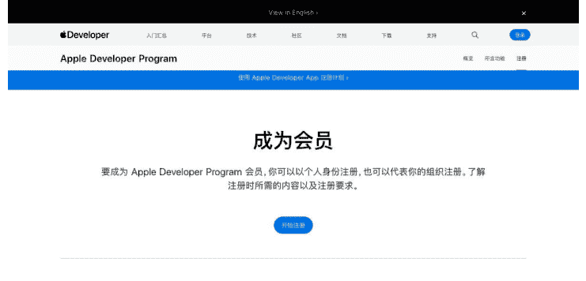

（图 2-3）苹果官方 App 注册说明：中国大陆 688 元/年，身份证加自拍验证

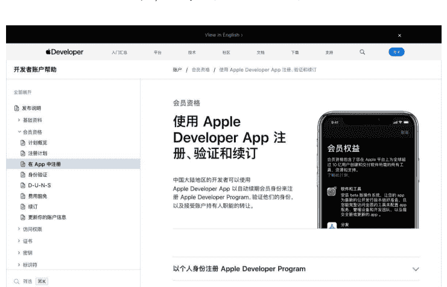

**组织账号需要多三步：**
1. 先到 D-U-N-S 查询页查公司是否已有编码，没有就免费申请。最多 5 个工作日，催也没用；拿到编码后，还要再等最多 2 个工作日苹果才会同步。
2. 准备一个公开可访问、域名属于公司的官网，以及域名邮箱。注册人要有权代表公司签协议。
3. 按上面的流程走，实体类型改为“组织”。提交后等苹果审核邮件，再回 App 点“继续注册”并付款。

（图 2-4）销冠营的 App Store 商品页，卖家名显示的是我的真名（已打码）


苹果的价格与流程核对于 2026 年 10 月，以官方最新说明为准：注册说明、用 Apple Developer App 注册、D-U-N-S 说明、购买与激活。

#### ③ 国内安卓市场：逐家注册和实名

安卓这边没有统一入口，需要分别去各个开放平台注册。本章只做注册+实名，安装包和资质上传放到后面。

各平台情况如下：
- 华为（developer.huawei.com）：个人可发 App，部分类目不向个人开放；企业可以。
- 小米（dev.mi.com）：个人不能发；企业可以。
- OPPO（open.oppomobile.com）：个人只能发快应用、主题、壁纸等；企业可以。
- vivo（dev.vivo.com.cn）：2026 年 9 月宣布有序开放个人通道；企业可以。
- 荣耀（developer.honor.com）：官方曾表示暂时不开放个人；企业可以。
- 应用宝（app.open.qq.com）：个人政策说法不一，以注册页为准；企业可以。

个体工商户能否按“企业”认证，各平台没有统一公开说法。小米那边，有开发者反馈 2024 年底起已不接受个体户。其他平台，以注册当天页面上的选项为准：如果在“企业”下拉菜单中能看到“个体工商户”，就说明支持。

做美业、上门服务的人要注意：华为的审核指南里写明，暂不收录以个人名义提交的上门保健类应用（如按摩、SPA、足浴）。

**通用操作：**
1. 用常用手机号注册，开发者类型选“企业”；如果页面有“个体工商户”选项，就选它。
2. 实名认证。有对公账户就选“打款认证”：平台向账户打几毛钱，你回填金额。OPPO 需要 72 小时内填，只有 3 次机会。没有对公账户就选“人工审核”，传执照和身份证，一般 1—3 个工作日。
3. 成功标志：后台显示“已认证”，并出现“创建应用”入口。
4. 暂时不要创建应用。等软著（或电子版权证书）和 App 备案号齐了，再一起提交。

以上政策核对至 2026 年 10 月，变化很快，注册前请以官方页面当天信息为准。

#### ④ Google Play：出海才需要

1. 打开 Play 管理中心注册页，用 Google 账号登录。
2. 接受开发者分发协议，支付 25 美元一次性注册费。
3. 选择账号类型：个人或组织。组织必须提供邓白氏编码。按页面要求完成身份验证，可能需要政府证件和信用卡。
4. 个人新账号多一步：正式发布前，至少 12 个测试人员连续参加 14 天封闭测试。要出海就从注册第一天开始算，把时间留出来。
5. 成功标准：Play 管理中心首页能点击“创建应用”。

核对至 2026 年 10 月：注册说明、个人账号测试要求。

#### ⑤ 阿里云：作为云服务账号

1. 访问 aliyun.com，右上角“登录/注册”，可手机号+验证码，也可以用阿里云、支付宝或钉钉 App 扫码。
2. 在账号中心完成实名。买任何资源、充值前必须实名。企业实名支持以下几种方式，个体户也能用：

| 方式 | 需要什么 | 多久 |
|---|---|---|
| 法人扫脸 | 经营者/法定代表人的支付宝 | 通常几分钟 |
| 企业银行卡收款 | 对公账户 + 营业执照照片 | 1—7 个工作日 |
| 法人支付宝 | 支付宝 + 营业执照照片 | 1—3 个工作日 |

#### ⑥ 微信开放平台：做微信登录才需要

1. 打开 open.weixin.qq.com，右上角“注册”，用邮箱注册并激活。
2. 完成“开发者资质认证”：提交主体资料并支付审核服务费，具体金额以后台显示为准。
3. 进入“管理中心 → 移动应用 → 创建移动应用”，填写 App 名称、图标、简介；iOS 填 Bundle ID 和通用链接，安卓填包名和签名。
   - Bundle ID 和包名：商店用来识别 App 的唯一标识，后续章节再确定。
   - 通用链接：用于用户在微信里同意后，跳回 App 的网址。
   - 签名：安卓安装包的“指纹”，后面章节生成。
4. 成功标志：移动应用状态为“已通过”，拿到 AppID，并已获得“微信登录”能力。

包名和签名需要留到后续步骤才能定下来。今天可以先完成注册和认证，应用之后创建。iOS 若要用微信登录，还要注意后文提到的苹果审核规则。

#### ⑦ Expo：练习时使用

Expo 是一套用来快速开发 React Native 应用的工具，自带云端打包能力（React Native 可以一套代码同时产出 iOS 和安卓 App）。

1. 打开 expo.dev/signup，邮箱注册。
2. 免费档每月提供 15 次安卓和 15 次 iOS 云打包，排在低优先级队列，练习完全够用（官方价格页核对至 2026 年 10 月）。
3. 成功标志：登录后能看到自己的账号主页；到后文练习时，电脑端登录会显示你的用户名。

“销冠营”由于要接蓝牙工牌，打包是在本机完成的，没用 Expo 云打包；但练习项目“跟进小本”走 Expo 最省事。

### 最后：记录账号信息

账号一多，最怕第二年在续费或换机时想不起注册邮箱。可以直接把下面的要求发给 AI：

“请帮我创建一张账号登记表（Markdown 表格），字段包括：平台、用途、登录邮箱/手机号（只写我认得出的提示，不写全）、注册主体、认证状态、年费和续费日期、双重认证设备、权限人。平台先列出：Codex 或 Claude Code、Apple 开发者、App Store Connect、华为、小米、OPPO、vivo、荣耀、应用宝、阿里云、微信开放平台、Expo。表格里不要出现用于记录密码、验证码、密钥的列。”

**完成这一章的标准**
- 苹果主账号、双重认证手机、签名文件永远自己掌控。即便请人协助，也只给“团队成员”权限。
- 苹果会员过期后，新用户无法下载你的 App，你也无法提交更新（已安装用户不受影响）。认准 Apple Developer Program，企业计划（Enterprise）上不了 App Store。
- 安卓开发者账号主体、电子版权证书权利人、备案主体必须同名，否则上传资质时会被卡住。

---

## 第三章 名称、商标、域名和包名，提前对齐

**核心原则**：先把 App 名字定下来，再同步检查商标、域名、商店和包名；名字定了就不要再改。

> 查重大约半天到一天；商标从申请到拿证一般要 7 个月以上。查询免费，商标网上申请官费 270 元/类；域名价格按后缀和注册商而不同。

### 我的改名教训

这个产品最早叫“美业话镜”。到了 8 月中旬，我决定改名。前后想过“运筹”“锦囊”“长红”“回头客”等好几个名字，都只是“有点感觉”。8 月 16 日先定了“销冠之家”，三天后又改成“销冠营”。

第一次定名后，我立刻让 AI 把代码里的名字全部替换。三天后再次改名，那轮工作等于白费。所以我的教训是：名字没敲定前，别让 AI 动代码。

最终这次改名影响了很多地方：
- 手机桌面显示名：iOS 和安卓各有一处，需要改代码。
- 系统权限弹窗：iOS 有 4 条权限说明，里面写着 App 名，也要修改。
- 录音时的麦克风提示：提示文案中包含名字，需同步更新。
- 微信开放平台：移动应用名称要改，改完重新审核，这一步我在后台手动操作。
- App 备案名称：备案时直接使用新名。
- App Store 商店名：9 月 9 日在后台填为“销冠营”。

给 App 起名、办证、走备案，我踩过的坑和能照抄的做法

我这只 App 对外叫「销冠营」，正式全称是「销冠营销助手软件」，报材料时就用这个新名字填。

这回换名没受什么罪，胜在动手早：苹果后台还没递审，安卓那边的上架材料一片空白，版权登记也没提交。要是等这些动作都做完再想换，市场、备案、证书每一处都得重走一遍变更流程，代价翻几倍。

名字换了，里子我一点没动：安卓包标识、苹果唯一标识、应用之间跳转用的协议名、工程目录、云主机上的资源路径，全部保持原样。包标识里如今还留着老名字的拼音，终端用户根本接触不到，也没带来任何麻烦。改完我把三处对外用字核了一遍——应用内、微信那边的开放后台、应用备案——统一成「冠军」的那个「冠」。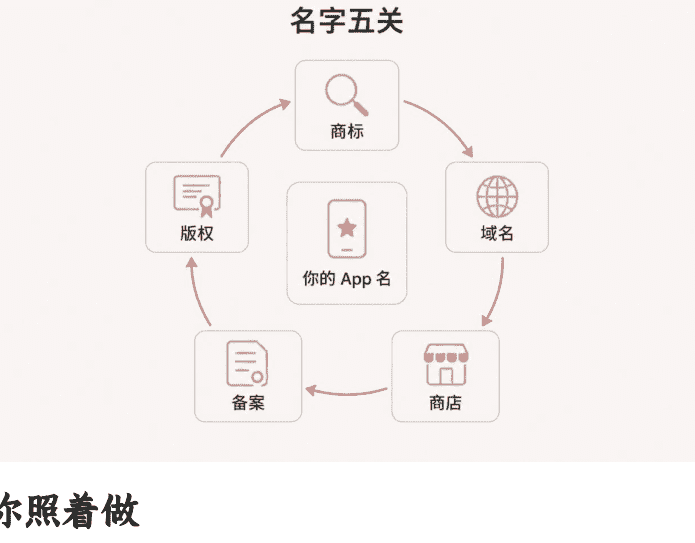

一个名字想真正落地，得依次过五关：品牌注册、网址、市场撞名、备案、版权登记。

**第一步不是定名，是攒名字。** 一口气想三到五个，别只抱一个不放。判断标准就四条：朗朗上口；跟产品干的事对得上；手机拼音敲一次就出得来；避开「中国」「国家」这类字眼。之所以要多备，是因为查一圈下来，十有八九有几个已经被别人抢了。我当时丢给 AI 的指令大致是：「我在做一款手机应用，帮【谁】解决【什么问题】。给我 10 个中文候选：2 到 4 个字，好记，拼音输入一次打对；不含『中国』『国家』『官方』等字样；每个附一句起名理由；标出最容易与已有大厂应用撞车的几个。只要候选，别替我做决定。」

**第二步，上商标主管部门的查询入口查重。** 进中国商标网，找到「商标近似查询」，头一回用要按页面提示注册登录。国际分类先勾第 9 类——计算机软件和应用必看；再按业务补：软件服务、在线平台勾 42 类，广告与商业经营勾 35 类，带培训属性的（「销冠营」就属于这种）还得看 41 类。查询方式选「汉字」，把候选名填进去，看同一类里有没有完全相同、或者读音与字形高度接近的在先注册。撞上了就换下一位。这个网站自己也提示：数据并非实时，存在滞后，仅供参考——「查不到」并不代表「能顺利注册」。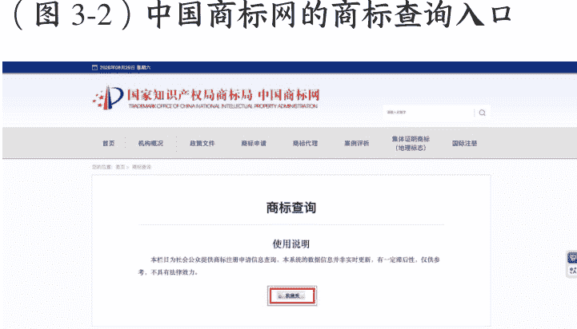

**第三步，把各大应用市场搜一遍。** App Store、华为、小米、OPPO、vivo、应用宝，逐个搜。要是同名应用已经扎堆，用户搜你的时候根本翻不到，这种名字趁早放弃。

**第四步，买网址，而且当天做身份核验。** 网址相当于官网的门牌。建议在阿里那家云服务商或腾讯那朵云这类大厂处注册，最好跟你放服务器的那家保持一致，后面办备案会顺畅不少。后缀优先 .com，其次 .cn；只要服务器在国内，两种都得备案。买完当天完成核验，持有人填你日后拿去备案的那个主体：拿着个体经营执照的，填执照上的名称；公司填公司全称；个人填本人。什么时候算成？网址状态从「暂停解析」恢复正常。帮助页说得很清楚：.com 与 .net 注册成功后五天内没通过核验，注册局会把它锁住；核验信息同步到工信部另需两三天，之后才能拿去备案。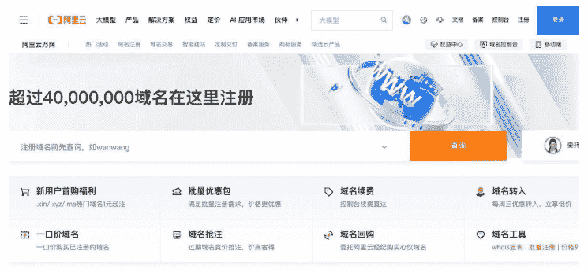

**第五步，品牌注册要不要办，看你打算做多久。** 试水性质的，查个重就行，不必花钱；想长期做、想做成品牌，越早递越好，毕竟周期长，先报先受保护。谁能报：公司凭公司经营执照；有执照的个体经营者，要执照加经营者身份证；没有执照的自然人报不了——主管部门的答复是，自然人必须具备个体经营执照（或农村土地承包合同）。入口在国家知识产权局那套商标网上服务系统，从中国商标网首页能进去，也可以委托中介，中介费另计。官费我核于 2026 年 10 月，以官方最新口径为准：线上申请 270 元/类，含 10 个商品项，超出部分每项加 27 元；线下纸质 300 元/类。审查周期官方口径约四个月，之后还有三个月初审公告，再往后才轮到注册公告与发证，前后大半年。递交后先拿到受理通知书——证书没影，但它能证明你申请在先。多报一类就多掏一份官费，应用至少报第 9 类，其余按业务和预算取舍。

**技术标识要早定，定完就别动。** 安卓包标识与苹果唯一标识，是应用市场和备案系统识别这款应用的「身份证」。用户看不见，却会跟它一辈子。格式通常是反写域名加一个词，例如 com.你的域名.app 名。对外显示的名字能换，包标识不能。苹果官方明确：上传首个构建之后，唯一标识就锁死。安卓换包标识，市场会视作一款全新应用，历史下载量与评分都迁不过来。应用备案里也登记了包标识，一改就得走变更。所以现在先把它写在纸上和账号登记表里，建工程时再落进去。

**真到了非改不可那天，先列清单再动手。** 我给 AI 的指令是：「我准备把应用对外名称由【旧名】改为【新名】。请先只读检查，别动任何文件：1. 列出代码中所有用户可见旧名之处，如桌面图标名、权限弹窗、提示文案、关于页；2. 列出包标识、唯一标识、跳转协议名、工程名所在位置——这些我不打算动，只求心里有数；3. 提醒我代码之外还要改的后台，如微信侧的开放后台、应用市场、备案、版权登记。等我确认清单，再只动第 1 类。」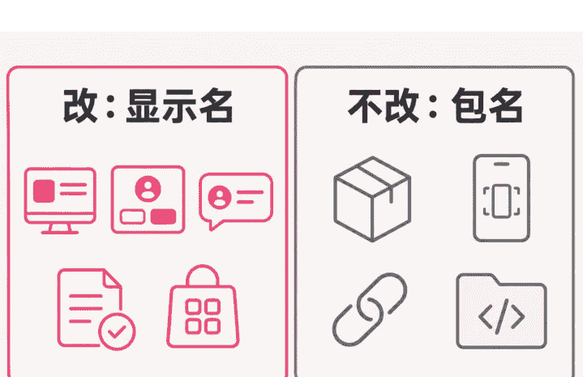

这一段收尾，三条得记牢：没有执照的自然人办不了品牌注册，想办要么先办个体经营执照，要么挂靠公司；唯一标识一旦上传过构建就改不动，安卓换包标识等于重做一款新应用——名字可以晚定，包标识必须早定、定死；名字没敲定之前，别让 AI 碰代码，我改过两回名，头一回的活儿全白干。

---

接下来说证书。国内安卓市场上架，通常要一张版权凭证。如果你的应用是 AI 帮着写的，这一章建议读完再动手。

「计算机软件著作权登记证书」由版权保护中心登记发放，本质是把这个软件登记到你名下。电子版权认证则由市场化机构出具——比如易版权平台，运营方是北京版信通——通常包含「APP 电子版权认证证书」与「软件著作权认证证书」两页。它不顶替著作权登记，但部分安卓市场认。苹果商店两样都不要。国内安卓市场普遍要，只是各家口径不同，我核于 2026 年 9 至 10 月：小米、OPPO、vivo 的公开规则写明接受电子的版权认证；360 的普通应用必须有著作权登记；华为、应用宝我没查到明确原文；荣耀的答疑页与上传页说法互相打架。易版权自家页面声称华为、应用宝同样适用，可这两家官方页面我找不到对应条款——投递之前，先去市场后台问明白。报材料时直接用新名：全称「销冠营销助手软件」，简称「销冠营」。

我自己是卡在「未使用 AI 开发」那句话上的。最初递交著作权登记后进入补正，平台要求签一份模板固定的签章页，原文写着「未使用 AI 开发编写代码、撰写文档或生成登记申请材料」，后面还得手抄一段承诺——如有失实或欺骗，自愿进版权登记失信名单、并计入个人征信——再签名、写身份证号。页面上压根没有「AI 辅助」这个选项。可实情是，这款应用从代码到说明书全程有 AI 参与。签下去，等于跟我另写的如实说明自相矛盾，还得背上失信风险。我给自己划了三条线：不谎称没用 AI；不为躲检测去重写文档；不伪造研发日志。于是我停手，不再补正——按规定，补正期满仍未补齐，申请视为撤回。

后来转去办电子版权认证。下单前我把易版权的公开协议读了一遍：里面没有「未使用 AI」的表述，但有「原创、权属合法、材料真实」的承诺。AI 参与算不算原创？我拿不准，就书面问客服。对方回复：这就是我的情形——需求、设计、验收由我主导，代码主要由 AI 产出——可以如实申报。有了这句明确答复我才付款。主体核验走企业通道：个体经营执照加经办人身份证，当晚通过。选普通时效，600 元，10 到 15 个工作日。填报共 6 步：全称、简称、包标识、版本编号，再传源码与说明书。填到第 4 步才发现，源码页眉、说明书、填报表三处的版次各不相同，只好重做两份 PDF。交上去，审核意见里仍挂着一条：说明文档与代码顶端标注的版次同填报值对不上。签章页那边，我的执照没刻公章，就用了经营者手写签名扫描上传，审核第一条就是「签章页盖章后提交」，手写不认。提交后我自查一遍，又申请退回改了一次：说明书里有重复截图、两处图文配错、十来页不足 30 行，封面还留着旧材料的字眼。换成 21 页定稿后重新提交。写这篇时，平台状态是「待补正」——要盖章，要统一版次，证书还没到手。打算拿到后先投 OPPO；小米得先登开发者后台，看「企业」类型里有没有「个体经营」这一项，没有就只能等公司主体。没证书这段时间安卓版怎么发，见第 16 章。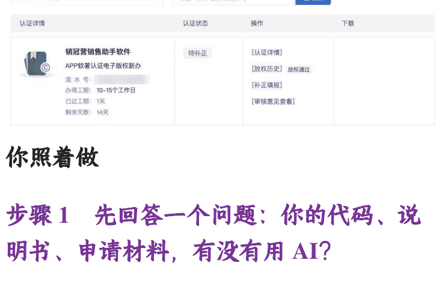

如果你也站在这个岔口，先分清自己属于哪类：全程没碰 AI 的，直接走版权中心那条路，官方不收钱；用过 AI 的，先把当次看到的签章页声明逐字读完，对得上才签，对不上再考虑电子版权；实在拿不准，先打电话或书面问登记机构，把答复存下来。要留意，那句声明管的范围不止代码——用 AI 写说明书、排源码 PDF，同样算在内。如实申报，对不上就别签。我的选择是停手、转办电子版权，但电子版权同样可能因主体、盖章、版次被打回，我就是活例子，走哪条路都得备好补正。

著作权登记的具体流程：打开中国版权登记业务平台，注册账号、完成核验（入口在版权保护中心官网，注册页路径 registerSoft）；选「软件登记」在线填表，简称就填应用名，市场要求名称对得上；「主要功能」照实写 500 到 1300 字。传两份材料：程序鉴别材料取源码前后各连续 30 页，每页 50 行以上；文档鉴别材料取说明书前后各连续 30 页，每页 30 行以上；不足 60 页就整本交。每页顶端标注软件名与版次，底部标页码。点「确认填报」后打印签章页，落笔前逐字念完，内容、格式、打印比例一律不许调整。签字或盖章，扫成 PDF 上传。官方规定受理后 60 日内审定；需补正的要在 30 日内补齐，逾期视为撤回；通过后在官网用户中心下载电子证书。官方登记免费。主体方面，公司凭公司经营执照核验；有执照的个体经营者可用本人身份，具体看平台选项；著作权人须与之后开安卓开发者账号的主体保持一致——小米答疑页里就写着这一条。

电子版权这条路，先书面问清再掏钱。可以照这个发：「您好，我想申请 APP 电子版权认证证书，先确认一件事：我的软件由我主导需求、设计和验收，代码及部分文档借助了 AI 编程工具。1. 这种情况能否如实申请？2. 申请或签章页中，是否存在『未使用 AI』一类的声明？3. 需提交哪些材料，对说明书有何要求？麻烦文字回复，谢谢。」拿到「可以申请」的答复后，去易版权官网注册并核验身份：个人用身份证正面加手持证件照；有执照的个体经营者和公司用执照加经办人身份证。下单「APP 电子版权认证」，普通时效 10 到 15 个工作日，另有加急档，价格看页面。按 6 步填报，最后打印签章页，盖章扫描上传。没公章就先去刻，别学我交手写签名被打回。

说明书自查这块，我踩过其中好几条。源码 PDF 可以交给 AI 排版，前提是你已问清对方允许 AI 参与；走版权中心、签章页又要求声明未使用 AI 的，请自己来。给 AI 的指令可以这么写：「请从我当前项目里挑出能代表核心功能的真实源码文件，生成一份程序鉴别材料 PDF：1. A4 纵向，取连续前 30 页与后 30 页，共 60 页，每页 50 行非空代码；2. 顶端写『【软件全称】【版次】』，底部写页码；3. 不得包含密钥、密码、服务器地址、配置文件和第三方版权声明；4. 完成后告诉我总页数、单页排多少行，并把首页、末页渲染给我看。不要改动项目里任何代码文件。」

最后一句话得记住：递交不等于拿证。状态显示「办理中」，只能说明材料到了对方手里；PDF 证书真正下载下来，这一步才算走完。

---

再说备案。国内一款应用要应付三套手续：网站报备、应用备案、公安侧那套联网手续。前两套归工信部，在云厂商那边办；后者归公安部，在全国互联网安全管理服务平台办。应用备案是 2023 年新增的要求——工信部 2023 年 8 月 4 日发文，新上线的应用须先备案、再开展业务；没备案，云厂商不给接入，市场不给分发。同一主体下，网站与应用共用备案编号的前半段：网站是「某 ICP 备 XXXXXXXX 号-1」，应用就是「某 ICP 备 XXXXXXXX 号-2A」这种形态。有官网时，顺序是：网址核验 → 服务器 → 网站报备 → 应用备案 → 公安那套手续 → 挂图标。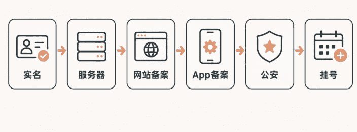

我上架苹果市场时也碰到过备案信息确认。做法是在苹果开发者后台填写应用信息的那一页，核实提供商就是备案主体或其附属主体。我本人正是这家个体经营的经营者，情况属实，就照实确认保存，当晚 22:59 提交审核通过，9 月 21 日首版上架。

具体办哪几套，看你的情形。只做应用、没有网站，直接走应用首次备案，不必先搭网站。完全不联网、不挂服务器的应用，工信部通知写明可由网络接入服务提供者代办，也可由应用分发平台代办——不妨问问你要上架的市场能不能代办，未必非得为备案专门买台服务器。既有官网又有应用，两套都要办，可在同一主体下先后新增。应用或网站开通之后，都要在 30 日内完成公安那套联网手续。

先确认主体资格。个人能办，但网站或应用内容不得涉及企业或商业经营，做生意的应用别挂个人名下；有执照的个体经营者用执照，负责人通常是经营者本人；公司用执照，负责人可为法定代表人或指定人员。另外有条规矩：一个账号只对应一个备案主体，个人号与公司号别混着用。材料清单按后台提示逐项备齐即可，具体以平台和属地要求为准。

名字、证书、备案这三块，都是上架前最容易被低估的硬骨头。名字早点敲定，证书如实去办，备案按顺序推进，能省掉大量返工。

移动端开发最容易踩的坑就是上来就让助手写代码。先把合规路径梳理清楚、确认问题是否值得投入、把需求收敛成一页纸、把本地与手机的环境搭好，步步走下来能省下大量返工。下面把要点重新梳理，全是可直接落地的操作。

### 合规要点，细节别漏
正式签名没定型，这一步先放一放。等第13章把正式签名做出后，第一步不是打包上传，而是先把签名文件拉回本地备份。用EAS构建的工程，先执行 `npx eas-cli@latest credentials --platform android` 把文件取回来。拿到手后可以让助手教你怎么在电脑上查证书的MD5指纹和公开密钥，命令里不要写死密码，由你在终端自行输入；签名文件也不要搬到其他目录。

图个省事也可以走阿里云上传安装包的通道，平台会自动解析包名、签名和公开密钥，两条路都能通。

主体审验通过以后：
- 网站走「新办网站」
- 客户端走「APP业务 → 新增APP」
按页面要求填写接入服务商、域名持有方等。审验通过后，记得把公安机关备案编号和图标放到站底。时限是站点或客户端上线之日起30日内。公安备案是另一套系统，不会自动与工信部备案同步，审验时长以平台为准。

备案编号的展示位置：
- 客户端内部显眼处，比如「我的」页底部：放应用备案号，点击后打开工信部查询页 https://beian.miit.gov.cn/
- 网站每页底部：放网站备案号、应用备案号，同样指向工信部
- 网站每页底部：放公安机关备案编号和图标，指向公安平台给的链接
- 苹果应用商店后台「应用信息」：填写ICP备案号，苹果核验后会在商店页展示
- 各安卓商店的上架表单：填写应用备案号

苹果的要求是，你填写的ICP备案号和应用信息里的资料，必须与工信部备案保持一致。

在客户端的「我的」页面底部加一行备案号时注意：
- 文案就是你的备案编号，字号小、颜色浅，不要抢视觉
- 点击后用系统浏览器打开 https://beian.miit.gov.cn/
- 放在用户容易找到的位置，别藏在多层菜单后面
- 改完后在手机上截一张图给我，并确认该行能正常显示且可触达

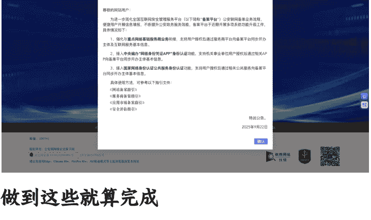

能提交不代表登记成功，能在工信部网站上查到号才算这一步完成。

补充提醒：
1. 应用备案时登记了安卓签名证书的指纹和公开密钥。正式签名文件一旦确定就不要更换，更换后需要做备案信息变更，否则备案信息与实际安装包对不上会被拦截。
2. 备案不等于经营许可。客户端内做收费经营性业务可能还需ICP经营许可证，提前向属地面管部门确认。
3. 域名实名、备案主体、商店开发者账号三处主体尽量保持一致。不一致时会被要求说明关系，就像我在苹果那边遇到的情况。

---

### 第6章 先找到一个值得做的微小问题
核心思路：先别让助手写代码，先把「服务对象是谁、帮他省掉哪一步、完成后能看到什么变化」说清楚。

耗时约半天到两天，大部分时间花在找真人聊，成本为零。

我自己的经历：销冠营最初有一套小程序，决定做客户端时手里有58个页面的迁移清单，第一反应是全部搬过去。后来定的规矩是：每一页都要标注去向，是本版做、后续做还是不做；本版不需要把58页全部实现。功能清单越长，越要先锁定一条用户真正会走通的主线。


问题不会一次想清楚。2026年9月25日，我发现客户端里的「服务卡」内容很全，门店却用不起来。于是让助手回到最初的问题：这张卡对美容师、店长、老板各有什么价值？拿掉它，谁会受损？

梳理下来，这张卡该做的事是把一小时的服务过程，变成美容师、店长、老板第二天各自要完成的事。最终收敛成一句话：所有功能都围绕「让美容师把当前顾客成交」。

到9月底我还会回头问这几个问题，第一天就问清楚，后面能少很多返工。

照着做的步骤：

步骤1：拿纸回答四个问题。谁会用到？先具体到一种人；他在哪种场景下遇到麻烦；现在怎么解决，哪里不方便；完成后能少做哪一步，或得到什么新结果。以虚构的「跟进小本」为例，面向的是手上有多件事、需要按日期跟进的人。麻烦点是答应周三前回复，到周三却忘了。现在记在备忘录或聊天收藏里，翻找混乱，看不出完成情况。目标是打开手机一眼看到未完成项。

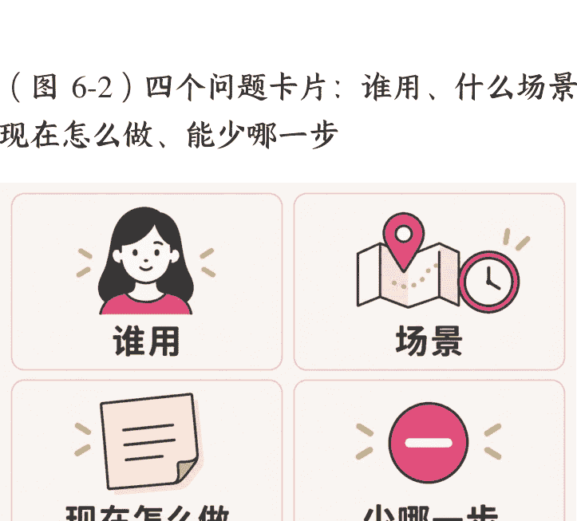

步骤2：把需求缩小到能继续拆的程度。可拆的说法是：「我想记录几件需要在指定日期跟进的事，打开手机就能看见哪些还没做完。」不可拆的说法是：「做一个给所有门店用的大平台。」判断方法很简单：这句话里能否找到具体的人、具体的操作。找不到就继续缩。


首版客户端最好同时满足：
- 你或身边的人每周都会碰到这个麻烦，随时能找到人验证
- 首版可用三个操作描述完
- 不涉及医疗、金融、复杂支付等需要额外资质和审验的业务
- 不依赖特殊硬件。销冠营要连智能工牌这种录音硬件，难度明显更高，第一个项目不建议这么选

步骤3：去看别人怎么做、缺什么。在应用商店和搜索引擎找同类产品，重点看评论区，只记一件事：用户在抱怨哪个具体操作，比如「每次都要点三下才能标记完成」。不用收集几十个竞品，三五条真实抱怨就够了。

步骤4：找一个真实的人，问他「上一次」。不要问「如果有这个客户端你会用吗」，几乎所有人都会说会。改成：
- 「你上一次遇到这事是哪天？当时怎么处理的？」
- 「能打开手机给我看看你现在是怎么记的吗？」
- 「那次最麻烦的是哪一步？」
让对方讲最近一次真实过程，或者展示现有做法，才能确认你想优化的那一步是否真的存在。

步骤5：把材料交给助手，先判断值不值得做。用第2章装好的编程助手，或网页聊天也行，把调研内容发过去，【填写】处换成自己的内容：

```
先不要写代码，帮我确认一个应用是否值得做。

目标使用者是【填写】。
他最近一次遇到的问题是【填写真实过程】。
现在用的办法是【填写】。
我希望改善的是【填写一个具体动作】。

先指出缺少的事实，再问我最多三个关键问题。

比较手机 App、网页、小程序和现成工具是否适合。
给出一个推荐及理由，不要罗列一大串技术选项。
如果现成工具已经足够，请直接说。
不要把我的猜测写成已验证需求。
```

助手追问的问题能答就答，答不上来就回到步骤4再去问人。

步骤6：写下一句话结论。格式：
> 【谁】在【什么场景】下，现在要【现有做法】，很麻烦；
> 首版只帮他做到【单一步骤】，完成后他能在手机上看到【单一反馈】。

写在纸上或备忘录里。暂时说不清，就先继续了解问题，别急着进第7章。记住：不要问「你会用吗」，要问「你上次怎么做」；如果助手说现成工具已够用，认真考虑一下，不做客户端才是最省钱的结果；自己的猜测和用户亲口说的真实经历要分开记，未经访谈的部分都只能算猜测。

---

### 第7章 把首版压成一页说明
思路：把「用户怎样完成一件事」写成一页需求说明，让你和助手讨论的是同一件事；助手跑偏时，把它拉回这一页。耗时1-2小时，只需现有编程助手，免费。

需求单示例：
- 核心操作：新增事项、查看事项、标记完成
- 输入项：标题、日期、可选备注
- 输出项：待办列表与完成状态
- 数据位置：当前手机本地
- 首次打开：展示空态与新增入口
- 输入错误：提示原因，保留已填内容
- 首版不做：登录、云同步、助手、支付、录音、蓝牙、推送

空态就是没有数据时页面的展示，比如「还没有事项，点这里新增一条」。

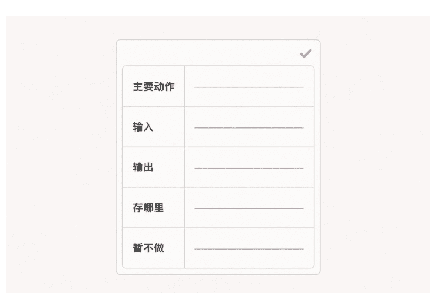

写五条你能亲手检查的要求：
1. 输入事项后，能在列表里找到它
2. 空白标题和无效日期不能保存，并有明确提示
3. 每条事项可单独标记完成
4. 两条同名事项不会互相覆盖
5. 退出再打开，事项及完成状态仍在

「页面要好看」「体验要流畅」只是方向，替代不了这五条。

步骤3：让助手把需求整理成一页说明。把步骤1、2的内容和第6章的一句话结论一起发给编程助手，再加提示：
> 请根据已确认的需求，生成一页首版说明。写清用户路径、页面、输入、输出、数据保存和错误提示。首版只保留三个核心操作。把每条完成标准写成我在手机上可执行的检查。列出首版不做的功能和仍待我决定的问题。再按依赖顺序拆成小任务，每个任务只改变一件主要事情。这一轮只讨论和写说明，不写实现代码。

拿到结果后，让助手用自己的话复述需求。复述和你想的不一样，当场改，不要带着分歧开工。

步骤4：保存成文件，新想法放进「以后再做」。确认后让助手把说明存成「需求说明.md」，放在当前文件夹，并告知完整路径。.md是纯文本文件，助手最方便读取。第8章建好工程后，再让助手把文件拷进去。后续新想法先写到文件末尾的「以后再做」，不要每次讨论都把首版改大。

步骤5：每个小任务开工前，先问五句：
1. 这个功能首版真的要做吗？
2. 项目里有没有已能用的？
3. 手机系统或平台自带能力够不够？
4. 已安装的工具包能不能做到？
5. 前四项都不行，才写一段最小的新代码。


第2到第4句的意思是：通用功能先找成熟方案。登录、推送、上传、监控、自动测试、打包发布等功能，早有大量开源可用方案。2026年8月28日我立了这条规矩，因为之前自己从零写了一套「打包、装到手机」的流程，花了好几天仍不稳定；而 fastlane 这类现成工具更可靠。

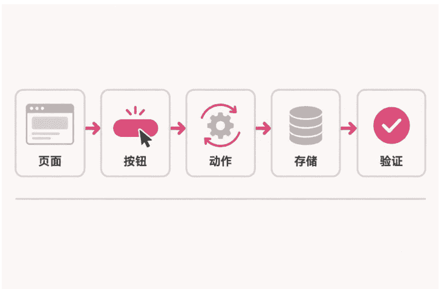

本章完成标准：
- 新想法一律先进「以后再做」。每次聊天都把版本放大，是做不完的常见原因
- 「文件存在、代码可编译」只说明了一层。要说功能已接入，必须查清哪个按钮真的调用了它
- 通用功能先找成熟方案再动手，自己从零写往往更费时且不稳定

---

### 第8章 准备工具，让第一个页面在手机上显示
目标：把电脑和手机环境搭好，让Expo的默认页面真正出现在手机屏幕上。

首次安装约需1-3小时。Node.js、Expo、Expo Go均为免费；编程助手按第2章套餐收费。

说明：销冠营实际工程用的是React Native，上架时还用了Xcode等更重的工具。这里给你的Expo路线是简化练习，更适合第一个项目，不是当初我原样走过的路径。工具上，第一天只用一个编程助手即可，用熟后再增。从2026年8月中旬起，我的分工是：Claude Code负责拆任务、检查结果，Codex负责写代码。

我们把「先查当前官方文档」写入给助手长期规则，因为模型记忆的用法不一定对应最新版本。写这篇文章时按规矩重新核对了本章命令，2026年10月发现几处与旧教程不同：
- iPhone上Expo Go从2026年9月3日起，要求电脑与手机登录同一个Expo账号，才能打开项目
- 新建工程的首页文件在官方文档中为 src/app/index.tsx，与不少旧教程不一致
- Codex的官方起步页已更换网址

按旧教程操作会在这些点卡住，还会误以为是安装问题。

步骤1：确认编程助手已装好。第2章已装桌面客户端并成功创建过hello.txt的可跳过。未安装的先按第2章开好账号、装好桌面客户端；使用国内助手的按官网说明安装。只有想改用命令行版才需要看选项A/B。

为什么必须装？普通网页聊天只能把代码「说」给你，编程助手能直接读写本地工程文件、运行命令。先认识终端：它是输入命令的窗口。Mac按Command+空格搜「终端」；Windows在开始菜单搜「PowerShell」。

选项A：Codex
官方说明见Codex CLI安装页，原developers.openai.com/codex页面会自动跳转。不想用命令行就用第2章装好的Codex桌面客户端。

Mac/Linux在终端运行安装命令：
```
curl -fsSL https://chatgpt.com/codex/install.sh | sh
```
Windows在PowerShell运行：
```
powershell -ExecutionPolicy ByPass -c "irm https://chatgpt.com/codex/install.ps1 | iex"
```
装好后输入codex回车，首次会提示选择“Sign in with ChatGPT”登录。官方定价页说明，ChatGPT免费档也包含Codex，但定位是尝试小任务。

选项B：Claude Code
官方说明见Claude Code安装说明。
Mac/Linux在终端运行：
```
curl -fsSL https://claude.ai/install.sh | bash
```
Windows在PowerShell运行：
```
irm https://claude.ai/install.ps1 | iex
```
装完新开终端窗口，执行下面一行，能打印版本号即为安装成功：
```
claude --version
```
再输入claude，按浏览器提示登录。Claude Code需要Pro、Max、Team、Enterprise或Console账号，免费版不包含。也可以下载Claude桌面客户端。
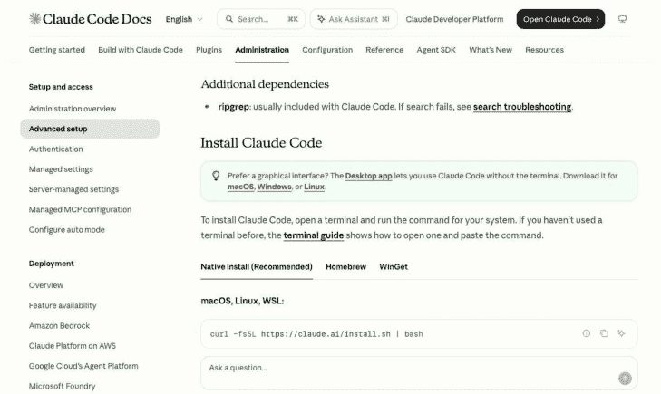

步骤2：在电脑上安装Node.js，选LTS版。Node.js是运行JavaScript工具的基础，Expo依赖它运行。安装Node.js时会一并安装npm，它像一个下载工具包的应用商店。
- 打开Node.js下载页
- 选择带LTS字样的版本，2026年10月初为v24.21.0
- 下载对应系统的安装包：Mac选.pkg，Windows选.msi，双击后一路「继续/下一步」
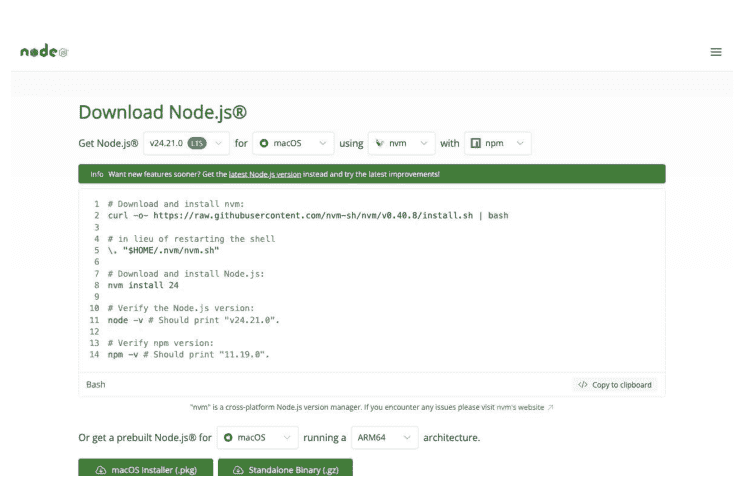

步骤3：在终端确认安装成功。安装完成后关闭终端再重新打开，分别执行以下两行：
```
node --version
npm --version
```
两行均返回版本号，第一行类似v24.21.0，才算成功。
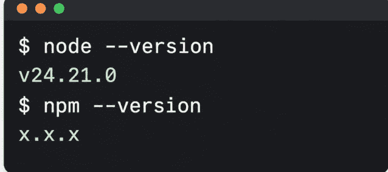
若提示找不到命令，先重开终端；仍不行，把系统类型和完整报错原样贴给编程助手。

步骤4：在手机安装Expo Go。

到此电脑和手机环境基本就绪。接下来用Expo启动默认页面，让它在手机上真正显示出来，这是开发路上一个重要的里程碑。

第8章 先把手机端跑起来：认识 Expo 与 Expo Go

Expo 可以理解为面向 JavaScript 开发者的移动应用工具集，帮你省掉不少底层折腾。它的手机端配套客户端叫 Expo Go：桌面端保存代码后，用手机里的 Expo Go 扫一下终端中的方形码，界面就会立刻呈现，无须事先打包安装。

安装方式按设备区分：

- 苹果手机：进入 App Store，搜索“Expo Go”后下载。
- 带 Google Play 的安卓机：在 Play 商店找到同名应用并安装。
- 华为、小米、OPPO、vivo 等国内安卓机往往没有 Google Play。官网 expo.dev/go 的 Android 区域里，「Install」会跳去 Google Play，所以这条路走不通。可以换成下面这个办法：
  1. 用手机浏览器访问 Expo 在 GitHub 上的 expo-go-releases 发布页，安卓安装包（.apk）都放在那里。
  2. 挑选与你要用的 SDK 相匹配的包。文件名会带版本标记，例如 SDK 57 对应 Expo-Go-57.x.x.apk 这类名字。
  3. 点开文件安装；系统弹出安全提醒时，按手机上的指引允许这一次安装。
  4. 如果下载迟迟不动，或者找不到合适文件，可以让编程助手按官方页面帮你确认当前安装办法。
- 核对信息：2026 年 10 月，expo.dev/go 显示的是“SDK 57 (latest)”。
- **苹果用户还多一道手续**：到 [expo.dev/signup](https://expo.dev/signup) 免费开一个 Expo 账号，再在 Expo Go 首页右上角点头像完成登录。

（图 8-4）Expo Go 官网页面，标着当前支持的 SDK 版本

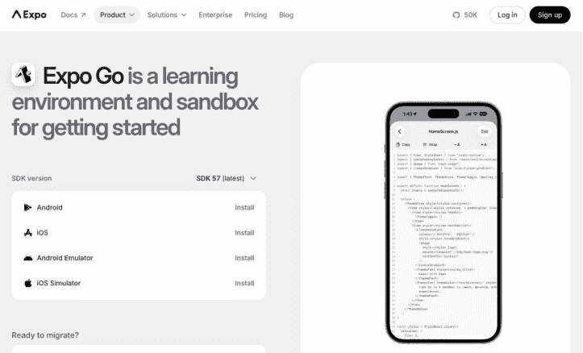

**第 5 步：在电脑上建一个只用于练习的目录。** 别在已有产品工程里做试验。在终端中依次输入下面四行，**每行输完按回车**；某一行报错就停住，把完整报错发给编程助手，不要继续往下贴。

Mac（终端）：

```bash
cd ~/Documents
mkdir app-practice
cd app-practice
pwd
```

Windows（PowerShell）：

```powershell
cd $HOME\Documents
mkdir app-practice
cd app-practice
pwd
```

最后一行 pwd 会告诉你当前所在位置：Mac 通常是 `/Users/你的用户名/Documents/app-practice`，Windows 通常是 `C:\Users\你的用户名\Documents\app-practice`。前半段对不上没关系，末尾是 app-practice 就行。打开 Mac 访达里的「文稿」或 Windows 的「文档」，也能看到这个新目录。不会操作，就把这几行发给编程助手，让它按你的系统一步步带，并回读当前路径。

##### 第 6 步：创建工程，启动开发服务。

依次运行下面三行：

```bash
npx create-expo-app@latest followup-notebook
cd followup-notebook
npx expo start
```

国内网络下，下载慢或报 ETIMEDOUT（连接超时）很常见，不是你装错了。镜像源相当于国内的下载加速站：同一批工具包，改从国内服务器获取。它和第 13 章后端说的“镜像”（打包好的服务器程序）不是一回事，只是名字相似。把完整报错发给编程助手，再加一句：

> 请按官方方式把 npm 的下载地址换成国内镜像源，告诉我改了什么、以后怎么改回去。

改好以后，重跑出错的那一行。

- 第一行会创建一个叫 followup-notebook 的新工程。中途如果让你选模板或 SDK 版本，选和手机上 Expo Go 对得上的那一版，并记下你实际选了什么。
- Expo 把每一代工具叫一个「SDK 版本」，比如 SDK 57。手机上的 Expo Go 只认它支持的那一代，对不上就打不开。（别处说的 SDK，一般指别人做好的功能模块，见附录 C。）
- 2026 年 10 月初，官方教程写的是选 SDK 57。SDK 58 在 9 月 15 日出了测试版，官方说正式版发布后不久，商店里的 Expo Go 会跟着升级到 58。
- 第三行跑起来后，终端里会出现一个方形码。这个终端窗口要一直开着，关掉了，手机上就看不到页面。

###### 用 iPhone 的，在第三行之前先登录：

```bash
npx expo login
npx expo whoami
```

第一行按提示登录，用你在 Expo Go 里登录的同一个账号；第二行会显示电脑上当前登录的账号名，确认和手机上一致。

##### 第 7 步：用手机扫码。

1. 手机和电脑连同一个 Wi-Fi。
2. 安卓：打开 Expo Go，点“Scan QR code”，扫终端里的方形码。
3. iPhone：直接用系统相机扫方形码，按提示用 Expo Go 打开。
4. 手机上出现 Expo 的默认欢迎页面，就成功了。

（图 8-5）电脑终端显示方形码，手机用 Expo Go 扫码后出现默认页面

官方参考：Expo 项目创建说明、Expo 首次运行教程。

##### 第 8 步：环境卡住时，先分清是哪一类问题。

| 你看到的现象 | 先查什么 |
|---|---|
| 终端说找不到命令 | 运行环境：Node.js 装没装好、终端有没有重开 |
| 依赖装不上、下载报错 | 包管理器（npm）和网络 |
| 工程能打开，但某个功能“不存在” | 依赖版本和官方文档 |

“依赖”就是你的工程用到的、别人写好的工具包。三种问题，不要都用“删光重装”一种办法处理。

卡住时，把完整报错贴给编程助手，再加上这段：

> 先回读当前 Node、包管理器、框架和目标依赖的版本。
> 把第一条有效错误与这些版本对应起来。
> 查 Context7 或官方文档，给出适用于当前版本的修法。
> 保留锁文件，不要同时更换框架版本和依赖版本。
> 说明这次修复后，重新执行哪一条命令会出现什么结果。

“锁文件”是工程里记录每个工具包精确版本的清单（比如 package-lock.json），别让 AI 随手删掉它。

###### Context7 是什么？

它是一个让 AI 编程助手能查到第三方工具包最新文档的插件，GitHub 上有 6 万多颗星，用的是 MIT 开源许可证。想装的话，按它的 GitHub 页面说明运行：

```bash
npx ctx7 setup
```

装不上也没关系。它查不到或结果对不上时，直接让 AI 去该工具的官网确认。

#### 做到这些就算完成

注意：

1. 只在电脑浏览器里看到页面，不算完成。这一章要的是在手机上看到。
2. Expo Go 是官方定位的学习“试验场”，不支持你自己加的原生能力（比如连接特殊的蓝牙硬件）。需求里一开始就有这类功能，先让 AI 查清要不要改用“开发构建”（自己打的调试包），第 13 章会讲到打包。
3. iPhone 两边没登录同一个 Expo 账号，会提示 “You need to be signed in to Expo Go and Expo CLI”。按步骤 6 登录后，在手机上点 “Try Again”。

### 第 9 章 一次只做一件事，把页面变成能用的 App

一句话：按“改标题 → 新增、查看、完成 → 再调视觉”三步走，每一步都在手机上验证完，再进下一步。

□ 半天到 1 天 | □ 免费（只消耗编程助手的用量）

#### 我当时是怎么做的

2026 年 8 月 23 日以前，我习惯让 AI 一次性撸一大批改动，再一起装到手机上验收。结果每次都一下子冒出一堆问题，每次都有，很烦。从那天起我改成一次只打磨一个页面；这一页改到我满意，再动下一页。

做界面时，我踩过三个典型的坑：

1. 改错了控件。2026 年 8 月有一次，需求是“右侧语音气泡随说话时长变长”，结果做成了底部按钮上的进度条。后来我把“改界面前先看图，确认位置”写进了交接规则。
2. 重复设计。服务页面已经有三轮设计稿，新接手的执行者不知道，又从头做了一轮。后来先让 AI 在工程和文件里查现有设计、确认选定的是哪一版，再把改动落进 App。设计稿存在，也并不等于安装包里已经做出来了。
3. 按钮是摆设。有一版建档页，返回需要的参数没传进页面，进去以后没有返回入口；还有几个“开关”其实只是固定文字，点了没反应。

这三个坑有个共同点：看截图觉得都对，真去点才发现不对。

#### 你照着做

##### 步骤 1：让编程助手先认清工程，只改一个标题。

第 8 章跑方形码的那个终端别关。再开一个新的终端窗口，进入工程文件夹，启动编程助手（Windows 把第一行换成 `cd $HOME\Documents\app-practice\followup-notebook`）：

```bash
cd ~/Documents/app-practice/followup-notebook
claude
```

用 Codex 的，把最后一行换成 codex。用桌面 App 的：在 App 里选「打开文件夹」，选中 文稿/app-practice/followup-notebook（Windows 在「文档」里），后面的提示词照样发。

打开以后，先对它说：「把我第 7 章存的需求说明.md 复制到这个工程文件夹里，和 package.json 放在同一层，告诉我完整路径。」 package.json 是工程的配置清单，它所在的那一层就是工程最外面一层。

再让它确认路径和实际文件结构，然后动手。第一次任务只改标题，发送：

> 读取当前工程，告诉我工程绝对路径、Expo 版本和首页文件位置。
> 本次只把首页改成“跟进小本”，加一句“今天只完成一件小事”。
> 不要按旧教程猜文件位置。
> 不加依赖，不接 API，不部署。
> 完成后告诉我改了哪些文件、怎样在手机验证。
> 你看不到我的手机，就明确让我确认，不要替我写通过。

几个词的意思：“依赖”是工程用到的外部工具包；“API”是 App 和服务器之间传数据的接口；“部署”是把东西发到线上服务器。这一步三样都不碰。

AI 改完保存后，手机上的 Expo Go 一般会自动刷新。没刷新，就摇一摇手机打开开发者菜单，手动重新加载。手机上看到了新标题，再进入下一步。

（图 9-1）三步走：改标题 → 新增、查看、完成 → 调视觉

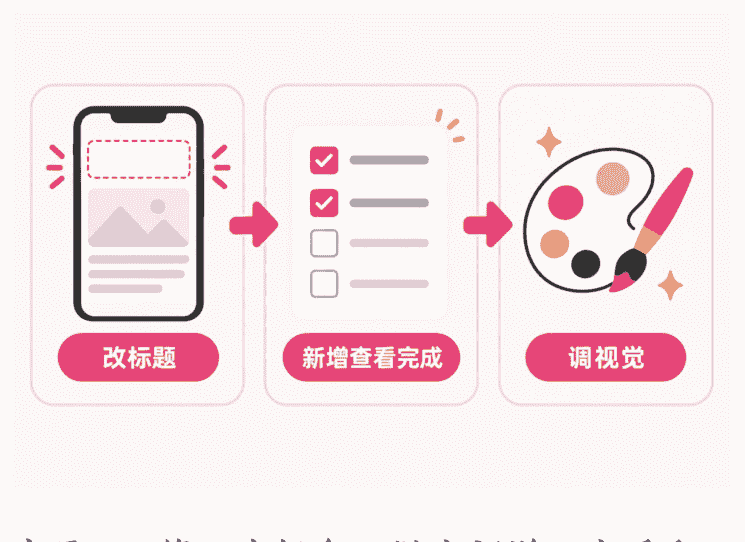

##### 步骤 2：第二次任务，做出新增、查看和完成。

按需求说明实现新增、查看和完成状态切换。

- 标题去掉首尾空白后不能为空，最多 40 个字。
- 日期采用 YYYY-MM-DD，必须是有效日期。
- 备注可以不填，最多 200 个字。
- 保存成功后在列表出现，并清空已成功提交的表单。
- 每条事项有独立标识，两条同名事项不能互相覆盖。
- 可以标记完成，也可以改回待办。
- 键盘弹出时，保存按钮仍能操作。

这一阶段先保存在内存，重开丢失属于已知限制。

不加入需求说明以外的功能。

完成后给我五条实际操作步骤。

“内存”是 App 运行时临时放数据的地方，App 一关就清空。所以这一步做完，关掉再打开、数据没了是正常的，真正存下来放在第 10 章。

AI 会给你五条操作步骤，拿手机一条条做。大致是这样：

1. 什么都不填，直接点保存 → 应该提示标题不能为空。
2. 日期填 2026-02-30 → 应该提示日期无效，已填的标题还在。
3. 填“给王姐回电话”和一个有效日期 → 列表出现这一条，表单清空。
4. 再新增一条同名的“给王姐回电话” → 列表里有两条，互不覆盖。
5. 点第一条的“完成” → 只有它变成已完成；再点一次 → 改回待办。

（图 9-2）跟进小本的三个状态：空态、有待办、已完成

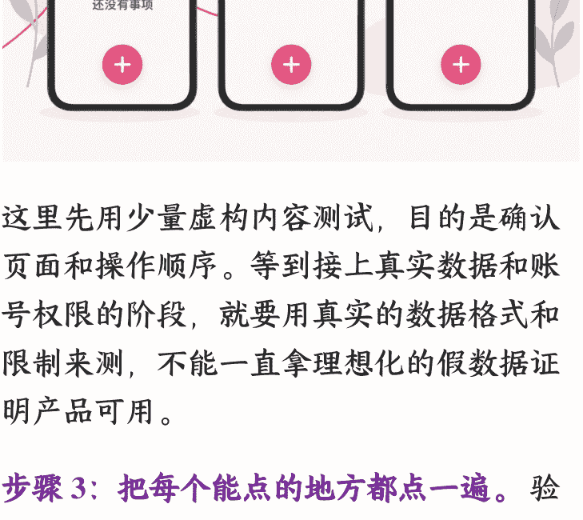

这里先用少量虚构内容测试，目的是确认页面和操作顺序。等到接上真实数据和账号权限的阶段，就要用真实的数据格式和限制来测，不能一直拿理想化的假数据证明产品可用。

##### 步骤 3：把每个能点的地方都点一遍。

验收时别让 AI 评价“整体美不美观”，而是把页面上每一个能点的东西——按钮、开关、返回、输入框——都亲手点一次。点了没反应、进去出不来，都记下来交给 AI。

如果你做的是网页或管理后台，可以多用两样工具：浏览器开发者工具里的 Network 面板（看点击后有没有发出请求）和 Console 面板（看有没有报错）。再用 Playwright 把稳定的操作路径录下来反复重跑，它的 Trace Viewer 能回看每一步动作、截图和网络请求。

##### 步骤 4：功能都对了，再调视觉。

###### 4.1 给参考图，说清借鉴哪一部分。

找一张你认可的 App 截图发给 AI，说明想借鉴的是哪一部分，比如字号、留白、按钮位置。一次只改一个页面，改完把步骤 2 那五条操作重走一遍，防止“美化”把功能改坏。

给 AI 截图时要指明三件事：**哪个区域、什么动作、改之前和改之后有什么不同**。只说“让它动起来”，AI 很容易理解成别的东西。我那次“语音气泡变成进度条”，就是这么来的。

###### 4.2 第一版界面一般都“喘不过气”，提前给留白下死命令。

2026 年 8 月 23 日，我看一版答题页截图，第一感觉是“一点呼吸感都没有”：框太多，很拥挤，文字和框贴得很近，很别扭，那一轮等于白做。之后我做所有界面，都把留白要求写成数字放进提示词：

> 调整这个页面的版式，只改样式，不改功能：
> 1. 屏幕左右边距不少于 20；卡片内边距不少于 20。
> 2. 任何文字离最近的边框不少于 16。
> 3. 元素之间间距 12 到 16，区块之间间距 24 到 32。
> 4. 行高不低于字号的 1.5 倍；标题和正文的字号要有明显层级。
> 5. 不要框里再套框，能用留白分组就不加边框。
> 改完告诉我改了哪些地方，我在手机上确认。

（图 9-3）留白对比：左边拥挤贴边，右边有呼吸感

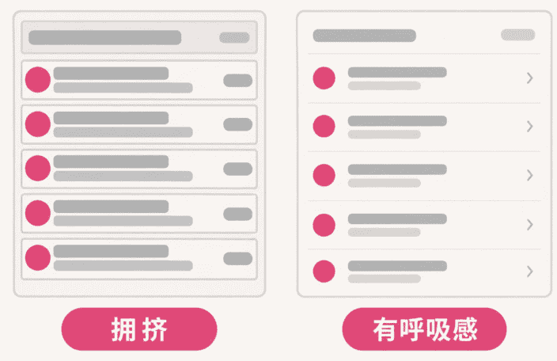

还有一点：一定要在真机上看。2026 年 9 月 20 日，我在自己手机上看到字整体偏大、两边很挤。查下来有两个原因：我手机的系统字号调大了一档，而页面没考虑这种情况；我们自己定的标题字号也偏大。电脑上的预览看不出这种问题。

###### 4.3 说不清“高级感”，就让 AI 先画一张参考图。

2026 年 9 月 3 日，我给一版首页打了 65 分：“还是差点意思，不高级，说不出来。”对比几个方向后才明白：我要的“高级”不是删到一片白，而是页首一张有质感的真实影像、排版有层次，下面的列表用同一种颜色的线条小图标，图片别堆。

自己说不清时，最有效的做法是让能生图的助手（比如 Codex 或 ChatGPT）先画参考效果图当样本，再照着改代码：

```
先不要改代码。我想让跟进小本的首页更有质感，但我说不清具体要什么。
请先画两张首页参考效果图：一张克制简洁，一张更丰富（有图片、图标和少量渐变）。
保持现在的功能和文字不变，只改视觉。
我选一张后，你再按它改代码。
```

###### 4.4 App 图标：让 AI 生图，别让它用代码画。

2026 年 9 月 1 日做销冠营图标时，我先让 AI 用代码一笔一笔“画”皇冠（用坐标描出图形），连着两轮都不好看；改成让 Codex 直接生图，大约 30 秒一张。可精致的细线皇冠放到手机桌面上，小得几乎看不见。我这才想清楚，图标要满足三条：

- 显眼：在手机桌面上，一眼能看到；
- 直观：一看就懂是什么意思；
- 简单：越简单越记得住，不要细线和复杂装饰。

我还圈出自己手机桌面上最喜欢的 3 个图标给 AI 当样本。前后出了几十张候选，当天定稿：白底，一顶亮玫红、带玻璃光泽的三尖皇冠，占画面宽度的 82%。

（图 9-4）图标对比：左边是用代码手画的细线皇冠，右边是 AI 生图定稿的亮玫红皇冠

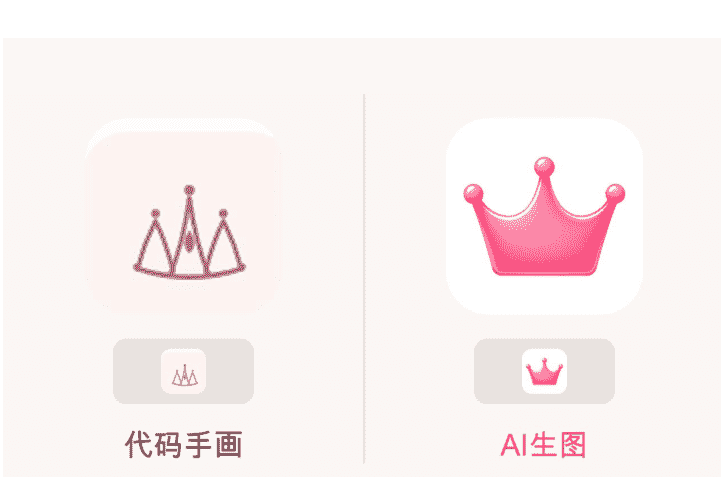

你可以这样让 AI 出跟进小本的图标：

```
帮我生成一个手机 App 图标，先出 4 个不同方向的候选。
App 名字：跟进小本。用途：记住要在哪天跟进的事，做完打勾。
要求：
1. 显眼：放在手机桌面上，一眼能看到。
2. 直观：一看就能联想到“记事、日期、打勾”。
3. 简单：只用一个粗一点的实心符号，不要细线、不要文字、不要复杂装饰。
4. 白色或单一颜色背景，符号占画面宽度的六到八成。
5. 正方形。
每张图说明设计思路。我挑一张后，再让你细修颜色和大小。
```

挑的时候，把候选缩小放进手机桌面截图里，和别的 App 图标并排看。放大时好看的，缩小后不一定还认得出。

#### 做到这些就算完成

关掉 App 再打开、数据没了，在这一章是正常的，第 10 章解决。

注意：

1. 截图只能说明页面长什么样，亲手操作的结果才说明按钮有没有用。
2. AI 看不到你的手机。它说“已完成”，要你自己在手机上点一遍才算数。
3. 网页测试工具替代不了原生 App 的蓝牙、麦克风和系统弹窗验收，这些要在真机上验，第 12 章会讲。

### 第 10 章 接上数据：本地保存、云端和后端

一句话：让跟进小本关掉再打开、记录还在；再弄清楚什么时候才需要后端，云端出了问题怎么一段一段查。

□ 本地保存练习：一次对话，加十分钟手机验收；接后端：按功能算，通常以天计 | □ 本地保存免费；云端看你选的方案

#### 我当时是怎么做的

销冠营的数据大多要上云：员工的服务录音要传到服务器转写、生成服务卡，店长还要看到员工的记录。本地保存只是起点，真正花时间的是云端。

而云端最耗人的，不是写代码，是“代码没错，线上就是不通”：

- **2026 年 8 月 14 日**，一天查出三个配置坑。最离谱的一个：对应的 AI 分析从部署到服务器起，一次都没成功过——线上配置里，密钥那一项名字在，值是空的。
- **8 月 27 日**，学习页打不开、话术页读不出门店数据，前后排查了 8 轮。根因全在线上：缺了 5 个配置项，数据库账号少了 6 张表的读取权限。本地测试一次都复现不出来。

## 第 10 章 先让本地存储足够可靠，再琢磨上云

### 上传模块的教训：别再让 AI 从零写

录音上传这部分，最初完全交给 AI 自由发挥。9 月 10 日夜里，我跟它说：“换个角度再测一次……这感觉像在反复碰运气，行业里有没有已经跑通的解法？”9 月 12 日又补了一句：“早说过了，优先采用被验证过的做法。”后来我们换成了云服务商官方提供的上传 SDK，再加上服务器签发的短期临时凭证，才算彻底消停。

这段经历让我留下两条深刻记忆：第一，系统出了问题，先把整条链路切成几截，定位到具体是哪一个环节出了岔子；第二，凡是上传、登录、日志这类到处都要用的基础能力，优先采用现成方案，而不是从零去写。

### 跟着做

- 117. 调出多任务切换界面，把 Expo Go 的卡片整体划掉。
- 118. 再次启动 Expo Go，进入同一个项目。
- 119. 这两条记录都还在，勾选状态也和退出前一致，才算通过。

（图 10-1）关掉 App 再打开，两条记录与完成状态都还在

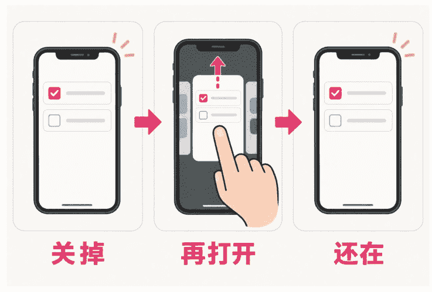

### 先问自己：到底要不要引入后端

后端说白了就是一台远程替你干活的服务器：接收请求、检查身份、处理数据。数据库则是它用来存记录的仓库。

只有下面四种情况，才值得上后端：

- 需要账号登录；
- 换手机、或者几台设备同时要看同一份数据；
- 多人要共用一套记录，比如店长查看员工的跟进情况；
- 需要使用不能放进手机里的密钥。API 密钥等于免费服务的“付费钥匙”，谁拿到谁就可以花你的钱。

四条全都不沾，就继续待在本地存储。跟着小本练到这里已经够用，可以跳过本章后半部分，从第 11 章继续。

| 对比项目 | 只保存在手机 | 保存在云端 |
|---|---|---|
| 数据放在哪里 | 当前这台设备 | 服务器和数据库 |
| 换手机还在吗 | 不在 | 在 |
| 别人能看到吗 | 不能 | 按授权可以 |
| 要花钱吗 | 免费 | 需要支付云资源费用 |
| 出错查哪里 | 只查本机 | 五个环节都要查（见下文） |

（图 10-2）本地存储与云端存储的差别

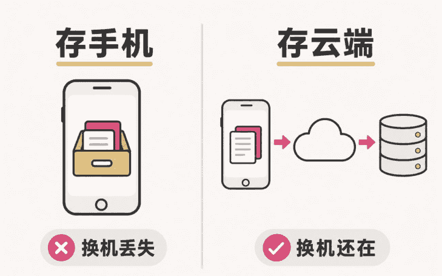

### 先让 AI 出方案，别急着买机器

没必要第一件事就去租一台大服务器。先让 AI 把整盘思路讲明白：

> 我计划增加【某类云端能力】。
> 暂时不要购买或部署任何资源。
> 请结合目标地区、预计使用人数、数据类型和预算，推荐一套已经被大量验证的方案。
> 讲清楚数据库要存哪些字段、哪些角色能读取、哪些角色能修改。
> 说明本地数据如何迁移过去，迁移中途失败如何回滚。
> 列出开发环境与正式环境的差异、成本项目和退出机制。
> API 密钥只能放在服务端对应的环境里，绝不能写进手机应用。
> 资料不够时先向我提问，不要擅自替我开通服务。

拿到方案后，再追问一句：有没有别人已经做好的现成东西可以直接用（见第 7 章步骤 5）。同类问题第二次冒出来，就立刻切到成熟方案，不要试图再修第三次。

还有一条：开发测试用的环境和正式上线的环境必须分开，各自搭配独立的数据库。9 月初我们单独开了一个测试库，每月开销也就几十元。

### 接入完成后，做四项真机检查

每一项都要拿真机亲手操作一遍：

- 120. 账号甲能正常保存它名下的数据；
- 121. 账号乙看不到账号甲的私密记录；
- 122. 断网状态下，App 会明确告诉用户发生了什么；
- 123. 快速连点几次保存，不会出现来路不明的多余数据。

接入了 AI 能力以后，再补四类记录：模型调用失败、请求超时、自动重试，以及每次调用扣了多少钱。AI 回过来的一段文字，也要核对是不是你约定好的那批字段。

保存功能还要覆盖“退出、重试、并发操作”的场景。销售冠军训练营有一轮线上问题就是这样暴露的：录音数据已经加密写入设备本地，但上传进度标记还没来得及更新，就在这段空档里被后台清理任务当成废弃文件删掉了。修完以后，我们用同一套用例验证：改动前必然复现，改动后全部通过。

### 云端故障，按五个环节定位

你在手机上点一下“保存”或“生成”，背后可能穿越五个环节。只说“云端出错了”太含糊，先让 AI 去判断卡在哪个环节。（图 10-3）那次上传一直被打回，我们就是先拿一次真实的上传路径去对照权限规则，一个环节一个环节地过，才最终放通。

**④ 后台任务：服务器在用户看不见的地方继续加工，比如转写录音、调用 AI 生成卡片。** 8 月 14 日那次就是典型：日志里 AI 分析一步的耗时记录只有 1 毫秒，等于根本没把请求发出去。同一天还查到另一处问题：转写程序读取的配置项名称，和真正存放密钥的配置项名称对不上；失败信息又被一段空的异常处理掩盖，所以一直没人留意到。

**⑤ 返回结果：交给客户端的内容合不合格。** 9 月初，我们跑了 135 个 AI 测试用例，结果 135 个全被系统校验退回，统一替换成备用模板。逐条看下来，没有一条是模型回答得不好，问题全部集中在格式上：示例里混用了两套字段命名，又正好缺了必填项；还让模型把系统本来就知道的信息又抄了一遍。后来按照附录 A.2 清单第 7 条把字段约定改好，135 个用例全部恢复通过，所有验证条件保持原样，一条都没有放宽。病根在“约定”上，换再好的模型也没用。

遇到阻塞，就把下面这段发给 AI，让它只做定位、不作改动：

> 请以只读方式排查这次失败，不要修改任何东西：
> 1. 先确认：当前是哪个环境、手机装的哪个版本、具体操作时间、这次请求的编号。
> 2. 查看相同时间窗口里的接口日志、上传日志和后台任务日志。
> 3. 汇总成三类：已经有证据证明成功的环节、已经有证据证明失败的环节、完全找不到证据的环节。
> 4. 如果查不到日志，先核对时间范围、查询条件和程序是否真的写了日志，不要直接断言“请求从未发生”。
> 不要重复创建记录，不要再次上传，不要改动权限，也不要发布新版本。

“这次请求的编号”也叫请求关联标识，是系统为这次操作生成的唯一代号。使用它，才能把分散在五个环节里的日志拼成同一条完整线索。

等你真正接上后端、又卡住时，附录 A.2 有一份更细的云端排查清单：配置、权限、日志、接口、上传、后台任务、AI 返回字段。第一次做可以跳过不看。

### 本章验收标准

**注意**

- 1. 存在手机本地 ≠ 已经备份：一旦卸载 App 或清除应用数据，记录就可能彻底消失。AsyncStorage 本身不加密，不能存放任何真实的客户信息或密钥。
- 2. 只走通账号甲的顺利流程，证明不了权限配置正确。必须让账号乙实际验证“这条数据我看不到”。
- 3. 密钥只能留在服务器上，不能埋进手机 App。请 AI 核对配置时，只让它回答“是否存在、是否是空字符串、长度多少”，绝不把密钥原文贴进聊天窗口或文档。

---

## 第 11 章 报错怎么修、版本怎么留、换对话怎么接着干

核心做法：出错时把已知事实一次性交齐；每闯过一关就留一个能退回的存档点；聊天记录再长、哪怕换了助手，也能从某个明确的进度继续推进。

□ 每次存档只用几分钟；第一次做恢复演练大约半小时 | □ 全部免费（Git 免费；备份可以放你现有的外接硬盘或私人代码仓库）

### 四个真实教训，换来这一章规矩

本章每一条经验背后，都有一笔实打实的学费：

- 2026 年 8 月 16 日：App 主线攒了 121 次存档记录，却从没有备份到别处，唯一一份就在这台电脑上。同一天，磁盘可用空间一度只剩 221MB，AI 为了腾位置还执行了删除命令。离全军覆没只差一步误操作。从那天起，我规定自己每完成一阶段就立刻备份。
- 8 月 30 日到 31 日：一晚上部署失败 6 次，而这 6 次全是外层部署工具自身的问题——把成功误报为失败、取不到运行日志、测试用的临时凭证 15 分钟就过期但整套流程要跑 30 分钟。我们自己的应用逻辑一次都没出错。当时我忍不住问 AI：“官方明明有完整方案，为什么我们还要自己折腾一套？”
- 9 月 1 日：有个清理脚本在终端里被我重复粘贴、执行了两次。第二遍运行时，把第一遍存好的约 40 份补丁全部截成空文件再删除，最后一份都没找回来。
- 9 月初：两条开发分支各自测试全绿，内容却互相不包含，最终缺了 177 个文件。两批工作全部白费，只能先把两条线合并，再重新安排任务。

### 实操要点

#### 要点一：报错时用固定模板把信息给全

别只丢一句“又坏了，帮我修一下”。把你能看到的证据，一次发给 AI：

```
我使用的工程与版本是【填写】。
刚才依次做了【操作步骤】。
原本应该看到【预期结果】。
实际看到【现象】。
完整错误和发生时间是【填写，先去掉敏感信息】。
```

先复现问题，再确认最后一次成功的步骤和第一次失败的步骤。不要同时改页面、动接口、调模型设置。做最小范围的修复，并说清楚改动前和改动后要怎么对比。同一套做法连续两次失败、又没有新线索，就给出阶段总结和接下来的探路方向。

（图 11-1）报错提示词模板：五个空填满再发出

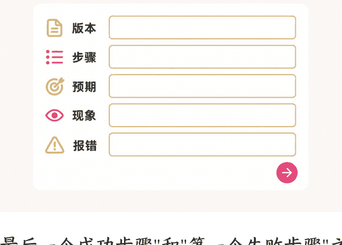

“最后一次成功的步骤”和“第一次失败的步骤”之间，往往就是问题藏身的位置。

#### 要点二：同一处两次没过，立刻换路

反复重试不等于真正的努力。同一处连着失败两次、又没有新的发现，第三次大概率只是把失败再复制一遍。

9 月 10 日出门前，我给 AI 定了一条硬规矩：真机上的每一步最多试两次；第二次还是失败，就必须回到日志和代码里去挖原因，换一个层面下手。

停下来的时候，让 AI 先交一份阶段总结：目前已确认什么、还不知道什么、下一步打算走哪条路。如果你心里已经冒出“是不是该换成官方方案”这个念头，那一次就应该停下来认真回答它，而不是硬撑到第六次。

#### 要点三：修好一阶段，就留一个存档

第一次用 Git 时：Mac 用户先在终端里运行 git 的版本检查命令（--version 参数），如果弹出安装开发者工具的提示就点“安装”；Windows 用户去 Git 官网下载安装包。装完以后能正常输出版本号，再继续下一步。

Git 的作用是记录文件每一次发生变化，可以把它理解成电子游戏里的存档位：每“提交”一次，等于存了一次档；那一串提交号就是这次的存档标识，以后凭它可以找回当时的完整工程。（Git 官方中文教程）

（图 11-2）Git 像游戏存档：每过一关存一次


**在真机上验收通过以后，把下面这段发给 AI：**

```
这一阶段已由我完成手机验收。
允许你为本练习建立本地 Git 版本记录。

先检查现有 Git 和改动，保留其他人的内容。
列清这次源文件，排除密钥、.env、依赖目录和构建产物。
只提交确认清单里的文件，报告分支与提交编号。
不创建远程仓库，不推送，不公开。
说明怎样在另一个副本中恢复和验证这个版本。
```

.env 文件用来存放密钥和配置；依赖目录、构建产物是电脑自动生成的大体积文件，这些都不该进入存档。

完成后，你自己到工程目录里再确认一遍：

```
git log --oneline -5
git show --stat HEAD
```

怎样算成功：第一条命令最顶上那一行，显示的是刚才这次提交的编号和说明；第二条命令列出的文件里，只有本次相关的源文件，没有 .env、node_modules、build 这类不该出现的内容。

#### 要点四：备份到另一个地方，并且真的恢复一次

本地 Git 仓库还在这台电脑上，电脑要是坏了，备份也一起没。所以必须把源文件和移交说明再做一份，放到你个人能掌控的另一处，比如外接硬盘或私人代码仓库。

备份需要经历一次真实恢复才算可靠。把这段话发给 AI：

> 请在一个全新的恢复目录里打开我的备份，绝不能覆盖正在使用的原目录。
> 根据移交说明恢复依赖，然后启动工程。
> 启动完成后告诉我，怎么用手机扫描二维码打开预览。

然后你亲自扫码确认：页面能正常打开，添加记录和标记完成都还能用。

（图 11-3）备份的检验标准是恢复一次：备份→新目录恢复→扫码验证

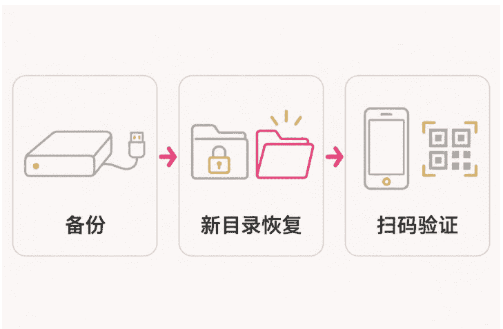

另外要记得：源码的备份，和手机里的业务数据（比如用户记录）是两件不同的事，需要分别安排。

#### 要点五：对话变长或要换助手，先写移交说明

聊天记录越积越长，模型就会“失忆”；新换一个助手，它对项目更是全无概念。所以在这些情况发生之前，先让 AI 写一份移交文档：

```
请写一份下一次能直接继续的交接。

产品目标和本轮范围
工程目录、分支和提交编号
启动方式及实际依赖版本
已经通过的检查及证据位置
还没完成的地方和已知失败
目前谁在改哪些文件
下一步只做什么

不要把计划写成已完成，不抄整段聊天记录。
```

新对话开工之前，先让 AI 核对两个要点：工程目录对不对得上，当前版本是不是移交文档里写的那个。之前差 177 个文件那次，就是省掉了这一步。

还有两条经验：

- 同一个工作目录，同一时间只能有一个 AI 动手修改。第二个 AI 可以先做纯查看层面的检查，不动任何代码。
- 想验证某个修复是否起作用，在一个隔离的副本里撤销它、再重新运行测试。如果预期会变红的结果依然是绿的，说明这个测试根本没覆盖到那件事。绝对不要在正在使用的工程里随便回退代码。

#### 要点六：记得看程序返回码

程序执行结束，系统会留下一个返回码：0 表示顺利结束，非 0 表示出了状况。如果 AI 用“测试命令的输出直接管道给 tail 来看末尾”这种办法，它最终拿到的是 tail 这个工具的返回码——测试本身失败了，也可能被显示成成功。

正确做法：把完整日志保存到文件，先看返回码，再看文末内容。

```bash
npm test > test.log 2>&1
echo "测试退出码: $?"
tail -n 30 test.log
```

上面三行是 Mac 终端的写法；如果使用 Windows PowerShell，让 AI 换成对应的命令。另外，项目的测试命令也可能并不叫 npm test，要 AI 先确认实际该用哪一条。

#### 要点七：清理和备份，都要验证“再跑一次”

开发久了，电脑会被临时文件慢慢塞满。9 月初，我磁盘的可用空间从原来的 60G 一路缩到只剩 13G，光临时数据库的目录文件夹就有 558 个，占掉 20.5G。清理工作确实把空间救回到 35G，但同期还埋了三个雷：

- 有 AI 按名称做模糊比对去强行终止进程，差一点把别的任务正在跑的测试也一起关掉；
- 有 AI 图省事采用“把所有变更一次全部提交”的写法，把 106 个自动生成的构建文件也并进了提交记录；
- 就是开头那次：清理脚本被跑了两遍，第二遍把备份截空，约 40 份补丁全部丢失。

所以，判断“备份成功”要同时看三样：文件还在、大小正常、能够恢复。判断“清理安全”还要多看一条：再执行一遍会怎样。一个合格的清理脚本，第二次运行时应保持安静——旧备份还在，就不去覆盖；目录已经不在了，就跳过。

让 AI 写任何清理脚本之前，先发这段要求：

> 先列出准备清理的路径、清理原因和对应的备份，不要实际执行删除。
> 验证备份确实能在独立位置恢复。
> 脚本必须允许反复运行，第二次不覆盖已有备份、不新增任何删除动作。
> 只结束本任务自己启动的进程，不要按模糊名称成批终止进程。
> 请一并给出“再次运行后状态不再发生改变”的验证方法。

恢复和删除要分成两个独立步骤来做，不要塞进同一条没法中途停下的长命令里。

（图 11-4）清理脚本跑第二遍：应该什么都不做

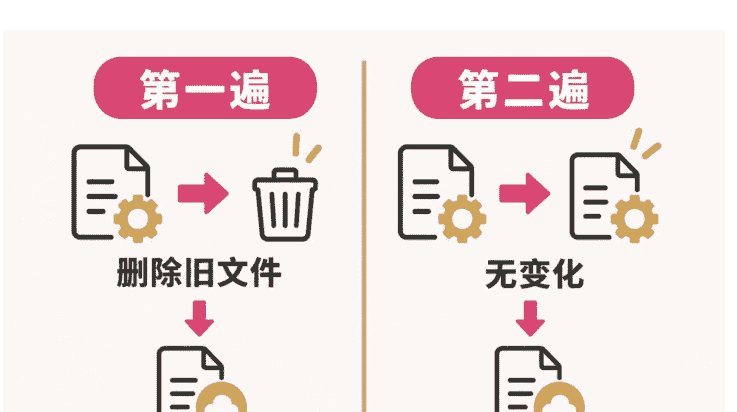

### 本章验收标准

**注意**

- 1. 测试全部变绿，只能说明“在被测的那份代码上是正确的”，不能说明这份代码就是你要的那份。想知道某个修复到底在不在某个版本里，让 AI 按 commit 的完整编号去核对，不要凭提交标题猜——我们真的遇到过两条分支上各有一条标题完全相同的提交，部署一切顺利，修复却根本不在里面。
- 2. 传到远程仓库或备份到别处之前，先确认 .env、密钥文件没有被记入存档；并且只能放到只有自己能访问的位置。
- 3. 清理属于不可逆操作：先出清单再删除；只结束自己启动的进程；绝不允许 AI 使用“提交所有改动”这种偷懒命令。

---

## 第 12 章 先在真机上验收，再把重复动作交给电脑

核心观点：自动用例全部通过，只能说明代码没写错；用户真正看到的是页面、提示和结果。本章的做法是：先在真机上照着用户的操作逐项验收，当同样的动作反复出现，再放开手让电脑去自动化执行。

□ 手动验收表约半小时；在模拟环境里跑通第一条自动化流程约一到两小时；物理 iPhone 第一次搭环境请预留大半天 | □ 免费（Maestro 与 Appium 都属于开源工具；在实体 iPhone 上跑自动化需要在苹果开发者账号下做设备签名，第 2 章开的账号已经够用）

### 三次翻车记录

最开始，每改一版我都要把它装到自己手机上亲手点一遍，结果我成了整条流水线上最慢的一环。2026 年 8 月 13 日，我立下第一条规矩：代码装到我手机之前，AI 必须先在自己电脑的虚拟设备里自测通过。

9 月 12 日凌晨，同一个导入问题连续两次都是被我亲手点出来的。我跟 AI 说：“你最起码自己跑通了，再让我来验收吧？”从那天起，凡是能自动化的步骤，先让电脑在实体设备上做；只有说话、听感、按工牌按键这类事，才轮到我出马。

最沉的一课发生在 9 月 20 日到 21 日。一天之内，我和外测用户先后撞见 7 个问题，而当时 6000 多条自动用例全是绿的。最要命的一个是：所有安装包在装了 iOS 27 的 iPhone 上一打开就闪退。

原因是苹果的新系统规定了一种新的启动方式（UIScene 生命周期，可以理解成 App 向系统报到的新仪式），我们没跟上。我自己用 iOS 26，电脑里只有 iOS 26.5 的模拟器，所以一直没踩到。修好的 1.0.1 在 iOS 27 实体机上能正常进到登录页。

四天后安卓又来了一次：9 月 25 日，1.0.6（内部测试版，没有提交到任何商店；App Store 里始终是 1.0.1）在一台 Android 10 手机上完全冷启动、连续崩了 3 次，而那一版的 7975 条自动用例同样全绿。从那以后，“在最低和最新两个系统版本上各做 3 次干净冷启动、不能崩溃”被纳入出包流程。这之后，测试全绿我只称它为“代码检查通过”，再也不会说“可以交给用户用了”。

### 操作清单

#### 第一步：拿着验收表，在手机上一项一项过

用第 10 章完成的本地保存“跟进小本”，逐行真实操作。每一行旁边标注“通过 / 失败 / 未测”，并写明测的是哪个版本。

| 你实际做的动作 | 预期结果 |
|---|---|
| 初次进入 App | 页面正常显示，没有数据时的引导也清楚易懂 |
| 新建两条事项 | 两条都各自保存，内容正确 |
| 标题只输空格，或日期填错 | 保存被拦截，并说明原因 |
| 新建两条名称相同的记录 | 两条同时存在，互不干扰 |
| 连续点几次完成/未完成，再重新打开 | 保留最后一次成功保存的状态 |
| 键盘弹出时 | 不遮挡必要按钮 |
| 退出后重新打开 | 原有数据都还在 |
| 保存出错时 | 把错误说清楚，之前的数据和刚敲进去的内容都不能丢 |

最后一种情况很难靠人工制造，让 AI 在测试环境中去模拟：

> 请在测试里模拟“本地保存不成功”的情形，检查 App 是否会：
> 1. 明确告知用户保存失败；
> 2. 保留之前已经存好的事项；
> 3. 保留用户刚输入、但尚未保存成功的内容。
> 只能在测试里模拟，不要改动或删除我手机上已有的资料。

#### 第二步：找一个人做“盲测”

请一位愿意帮忙的朋友，在你的手机上独立完成“新增、标记完成、退出重开”这一组操作。你只在旁边看，不要提前教他点哪里。他犹豫、点错的地方，就是下一版要优先修改的地方。

#### 第三步：App 复杂以后，按五个层级往上验收

练习用的 App 一张表就够了。正式产品功能变多时，按照下面五个层级自下而上逐层验收，下一层不过，就不去碰上一层。

（图 12-1）五层验收：正常启动 → 接口连通 → 权限控制 → 一条完整任务 → 设备原生能力

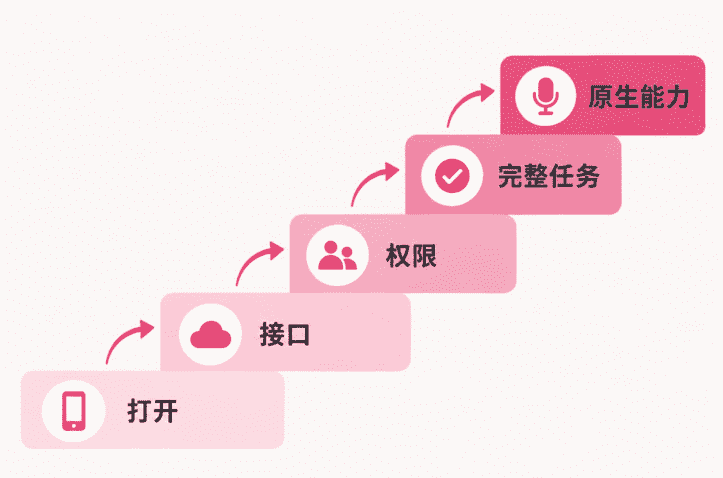

| 层级 | 验证事项 | 来自实战的例证 |
|---|---|---|
| 1 打开 | 能否顺利安装、启动并进入目标界面 | 装上以后底部五个页签均可正常访问 |
| 2 接口 | 返回的数据是否真实，出错时错误码是否吻合 | 每个页签的关键信息确实由服务器提供 |
| 3 权限 | 不同身份看到的内容是否符合预期 | 店员与店长所见的版块有所区别 |
| 4 完整流程 | 一条闭环链路能否自始至终走通 | 创建、递交、再查看结果均无阻碍 |
| 5 系统能力 | 对硬件特性和持续运行的支撑如何 | 拾音器、超长录音、蓝牙挂牌，维持三十分钟无异常 |

这五关指向同一个问题：应用本身跑得对不对。而另一组“发布状态”需要分开追踪：代码是否已完成、是否合并、是否部署、用户是否已在设备上看到。走到哪一关，就只标注哪一关。

###### 第五阶段的亲身测试：一百二十分钟录音

2026 年 9 月中旬，我们拿实体 iPhone、仿真挂牌和合成的语音，验证一段长录音能否完整送达云端。整套验证折腾了四遍才过关：第一次被锁屏打断；第二次传至一半就退出，问题出在进度上报机制——通知只能发出一次，体积小的文件勉强幸免，61MB 则一定会失败，后来改为不断广播“事件”才解决；第三次又暴露出发送权限欠缺。直到第四次，云端才收齐了全部数据，随即开始转写。

这次验证并不能证明真实挂牌的传送速度，也不能证明真实顾客交谈的分析品质。用什么条件测，就只宣称什么样的结果。

##### 第 4 步 把重复点击交给程序

这一步可以放到后面再考虑。等到你发现每次改版都要反复做“启动、填写、保存、关闭、再启动”，十几遍下来实在难熬，就回来处理。

首次仍要人工完整走通；当流程与预期结果稳定后，再交给脚本循环执行。挑选工具时，先确认它兼容你手头的设备，然后写清楚“替我在哪一点、看什么”。

（图 12-2）按设备挑选自动化方案

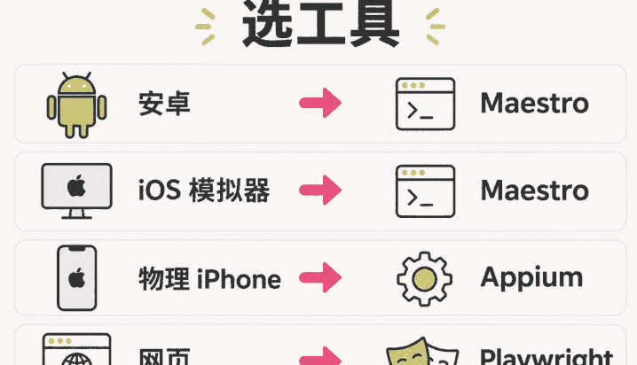

| 待测设备 | 优先选用 |
|---|---|
| Android 模拟器或实体机 | Maestro（实体机需打开 USB debugging） |
| iOS 模拟器 | Maestro |
| 实体 iPhone | Appium + XCUITest 驱动 + WDA（见附录 D） |
| 网页、管理后台 | Playwright |

我们趟过的一些坑：

- 2026 年 8 月，我们用 Maestro 在 Android 模拟器上固化了 6 条基准流程。它靠 YAML 来描述“打开、点击、等待文字、抓图、校验”，结构直观，入门门槛很低。
- 在 iOS 模拟器上验证底部导航时出现过怪事：脚本反馈已经点击，界面却纹丝不动。定位符、显示文字、坐标都换过一遍，依旧如此。我们宁可保留失败状态，也不愿把“未跳转”硬标为通过。

实体 iPhone 必须切到 Appium 那条路线，环节多且坑深，我把它放在附录 D，等真正需要深入时再细说。接下来只讲 Maestro。

请先准备 Java 17 或更高版本。在 Mac 的终端里确认 Java 环境，随后安装 Maestro：

```
java -version
curl -fsSL "https://get.maestro.mobile.dev" | bash
```

一份流程大致如下（仅作示意）。appId 取第 3 章确定的包名，到第 13 章再写进项目；界面上的文字提示请换成你应用里的真实文案。如果还在通过 Expo Go 跑工程，启动方式并不一样，可让程序助手查看官方指引来处理：

```
appId: com.example.followupnotebook
---
- launchApp
- tapOn: "新增"
- inputText: "周五回访"
- tapOn: "保存"
- assertVisible: "周五回访"
```

不必动手写，把需求交给助手：

> 我想借助 Maestro 为“客户跟进簿”搭建第一个自动化用例。请先翻阅 Maestro 最新的官方文档，确认它可以配合我手中的设备：<填：Android 模拟器 / Android 真机 / iOS 模拟器>。
>
> 场景只有一个：打开应用 → 新建一条待办 → 存储 → 检查列表里是否出现该待办。
>
> 要求如下：
>
> 1. 每次点击后都要附带断言，断言不过就判失败，不得删除断言把红灯刷绿；
> 2. 开始之前先说明准备安装什么、可能改动电脑上的哪些内容，等我确认后再执行；
> 3. 跑完后把抓图和结果放进同一个目录，并告诉我路径。

Maestro 已经提供 MCP 能力，Claude Code、Codex 可以直接调用它在模拟器里进行点击、观察与校验。以 Maestro 官网发布的信息为准

#### 做到什么程度才算完成

**注意**

- 尚未覆盖的地方，不能贴一张成功画面来充数。画面只代表它记录下来的那一个瞬间。
- 任何时刻只能由一名操作者控制设备；收尾时，仅关闭你本人开启的进程。
- 脚本所验证的，只能是它能读到的屏幕元素、事件与文件。声音、听感、实体按键这些部分，仍要真人确认并另行标注。

## 第三部分 发出去

### 第 13 章 做出能独立安装的包

核心一句话：项目在 Expo Go 里跑得通，并不代表你拥有独立的应用。这一章要把工程转成不依赖开发机也能安装运行的分发包，再产出交给应用商店的候选版本。

- 前期设置约需半个小时；云端打包每次都要排队，免费档排队优先级较低，单次最多约 45 分钟。
- EAS 免费档不收费：官网写着同时覆盖 Android 和 iOS。

| 要办的事 | 与 Mac 的关系 |
|---|---|
| 借助 EAS 云端服务为 iOS 打包（详见第 13、15 章） | 无需 |
| 在本机通过 Xcode 打 iOS 包（我走的路） | 依赖 |
| 在 iOS 模拟器里做全新启动核验、准备商店展示图（第 14、15 章） | 依赖 |
| 安卓侧的全部环节 | 无需 |

若没有 Mac，全新启动核验和商店展示图可以用实体机替代：前者把 TestFlight 版本装到系统最新的 iPhone 上，按第 15 章第五步操作；后者用屏幕尺寸匹配的实体 iPhone 来制作，或请一位有 Mac 的朋友在模拟器里代劳。

#### 动手之前

#### 先认清四种产物

（图 13-1）四种构建产物：Expo Go、development、preview、production

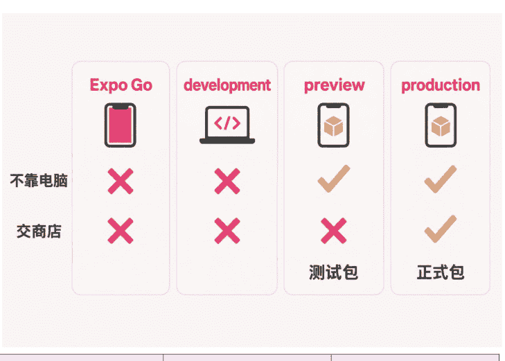

| 名称 | 定位 | 能否当成品 |
|---|---|---|
| Expo Go 预览 | 在 Expo 的公共容器中加载你的项目 | 不能 |
| development 构建 | 相当于你私有的 Expo Go，可加入原生模块并携带调试工具 | 不能 |

```
"ios": { "bundleIdentifier": "com.example.followupnotebook" },
"android": { "package": "com.example.followupnotebook" }
}
}
```

已经存在的配置只调整这两个字段，其余保持不变。如果项目使用 app.config.*，可请程序助手按实际目录结构处理：

> 请核验本项目的应用唯一标识：
> 1. 先从 app.json（或 app.config.*）中读出 ios.bundleIdentifier 与 android.package 的当前值；
> 2. 把它和目标包名 <填你的包名> 相比；若有出入，只修改这两处，其他配置保留；
> 3. 操作后再读一次给我确认。

助手给出的值，还要和苹果开发者后台以及 App 备案中登记的包名逐字比对。

##### 第 2 步 登录 EAS，建立构建配置

在项目根目录里依次运行：

```
npx eas-cli@latest login
npx eas-cli@latest whoami
npx eas-cli@latest build:configure
```

只要 whoami 显示的是你自己的 Expo 登录名，就说明连接正常。随后工程里会出现 eas.json，其中预设好 development、preview、production 三套方案。结构参考下方；若已有配置，请让程序助手合并，不要整份覆盖：

```
{
  "build": {
    "development": {
      "developmentClient": true,
      "distribution": "internal"
    },
    "preview": {
      "distribution": "internal"
    },
    "production": {}
  }
}
```

构建序号是商店用来区分每次产物的内部标记，同一个编号不能重复提交；用户实际看到的是版本号，例如 1.0.0。

顺手解决“序号撞车”问题：让 EAS 在云端自动接续编号，每次正式产出自动加一。以 2026 年 10 月的信息为准，官方做法是在 eas.json 里补充下面两段，并请助手合入现有文件：

```
{
  "cli": { "appVersionSource": "remote" },
  "build": {
    "production": { "autoIncrement": true }
  }
}
```

构建配置详情 · 版本号与构建序号

##### 第 3 步 先做 preview 安装件，装到设备上再测一轮

选择 Android，执行这一条：

```
npx eas-cli@latest build --platform android --profile preview
```

当 preview 方案用于内部发放时，Android 会得到一个能直接安装的 APK。获取方式：打包结束后登录 expo.dev，在该项目最近的构建记录中打开对应详情；在“Build artifact”区域点击 Install，页面随后给出设备安装选项，用移动设备扫码，或把“Send a link to a device”提供的链接发到设备上打开（界面文案以 2026 年 10 月的 Expo 内部发放文档为准）。确认文件来自当前这次构建，再按设备提示允许安装。

首次打安卓包，终端会询问是否生成签名 keystore，选 Yes。完成后运行 npx eas-cli@latest credentials --platform android，把签名文件和口令备份到两个由你控制的地方。

至于 iOS，请先登记那台将要安装的 iPhone，再开始构建：

```
npx eas-cli@latest device:create
npx eas-cli@latest build --platform ios --profile preview
```

iOS 的 ad hoc 属于“面向指定设备”的安装方式，它需要开发者付费账户，每 12 个月最多绑定 100 台 iPhone；以后新增设备必须重新打包或再次签名。不要以为把一个链接转给任意一台设备就能装上。参见 Expo 的 internal distribution 说明。

终端会要求输入 Apple ID 和双重验证码；这两项请亲自在键盘上完成，不要交给程序助手。

装完后，先停掉本地调试进程：回到第 8 章显示二维码的那个终端窗口，按 Ctrl + C，等待提示符恢复即可。然后打开你发布的应用，把第 12 章的检查清单完整跑一遍；创建、存储、退出、再次开启都正常，才算真正离开开发环境。

装不上时，先留下构建序号、所用配置方案、设备系统版本和完整报错，再请助手定位。

请等到“正在处理构建”的提示出现；在此之前重新提交，只会和既有构建序号撞在一起。

- 若 1.5 小时后依旧没有反应：多半是新增依赖调用了“运动与健身”类数据接口，而 Info.plist 没有说明使用原因，苹果会打回并报告码 ITMS-90683。这种失败不进后台队列，只会通过邮件通知，反复刷新界面也看不到。补上用途说明，换一个更新版的构建序号重新提交，当天就能放行。

#### 提交卡住时，让助手按这六点逐项排查：

> 现在 TestFlight 的交付遇到异常，请依次调查以下六项，并为每项附上依据：
> 1. 本次制作与发送以哪份源码快照为基础；
> 2. 拟采用的构建序号是否已被占用；
> 3. 制作与签名环节是否成功，产物应如何验证；
> 4. 平台是否收到了同样的序号，是否已经处理完毕；
> 5. 指定的测试群组是否关联，受邀者是否确实完成了安装；
> 6. 失败发生在哪个环节，哪些前置动作已经做完、无需重来。

（图 13-4）App Store Connect 的 TestFlight 记录页：同一屏可以看到构建序号与处理状态

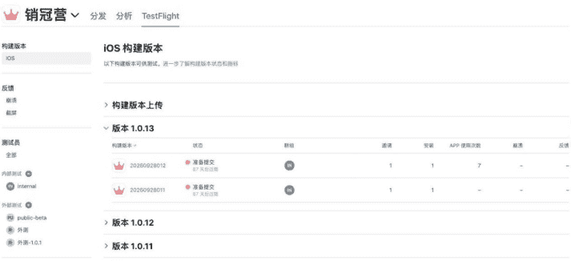

#### 如果带有后端：能打包 ≠ 已部署 ≠ 用户用上

只有自带云端的应用才需要关心这一点。服务器端的功能，例如录音转写、AI 汇总，必须单独发布；客户端更新并不代表服务端也已经同步更新。

#### 上架材料一次备好

关键原则：按下“送审”之前，资料、账户、隐私说明和收费方式都要与“当前这一版”严格对齐，别让审查人员第一眼就被劝退。

- 我实际用了约 5 天（9 月 9 日至 14 日），和开发同步推进。
- 送审本身免费；若隐私文档需要律师复核，费用另算。

#### 实战过程回顾

9 月 9 日晚上，我给自己定了“iOS 版 9 月 15 日上线”的目标，随后立刻把苹果后台的基础资料理了一遍：展示名称、副标题、技术支持链接、隐私说明链接、适龄等级、应用类别。隐私文档与用户条款此前已经定稿，并发布成可访问的网页。之后在后台的“App 隐私”区域，我按照助手整理的数据明细，如实勾选了 9 类数据。

这一章有三处险些翻车：

1. 微信登录。我原先以为国内应用没什么人会用苹果登录。助手查阅苹果审查规范 4.8 后发现，条款直接点到了 WeChat 的名字：若把它作为主要登录方式，就必须另外提供一个对等入口。短信验证码要采集手机号，因此并不对等。当天夜里我就决定：iOS 首个正式版先隐藏微信入口，只保留自有验证方式。

2. 送审用的演示账号。审查人员拿不到我们门店的真实账号，所以我建立了一个仅含员工权限的演示身份；临提交前复查，才发现后台登记的账户……

「套装 ID」是苹果用来唯一识别一个应用的编号，安卓把它称作“包名”。它早在第 3 章就已经确定，这里只需要核对三处是否一致。

##### 第 2 步 开发身份与使用身份分开

- 开发侧：苹果开发者账户、云平台账户、AI 辅助工具账户，都只归你个人持有。
- 使用侧：应用内供店长、员工登录的普通账户。
- 对审查人员和测试者，只发使用侧里单独建立的最小权限演示号，绝不要把自己的管理员账户交出去。

##### 第 3 步 让助手从源码反推隐私说明

不要从网上找份模板、替换个名字就提交。把下面的提示发给程序助手：

> 请以只读方式检查当前应用的代码与第三方依赖，不要改动任何文件，然后形成一份《真实数据使用记录》：
>
> 1. 逐项写清楚：数据类别、收集时机、用途、存放位置、交付给哪些外部服务、用户如何清除；
> 2. 把“已经上线的行为”和“未来计划中的功能”分开，后者暂不写入；
> 3. 列出应用申请的全部系统权限（含麦克风、相机、蓝牙、定位等），以及用户拒绝后会出现什么；
> 4. 如果应用支持注册账户，请确认是否存在删号入口，并给出操作路径；
> 5. 基于这份记录起草隐私文案；我尚未确认的事实（如主体名称、联系方式、保留期限）先留空并标出来，不要虚构。

##### 第 4 步 按苹果规范准备隐私文案与删号机制

以下信息核对至 2026 年 10 月，最新要求以苹果审查规范为准。

- 两处链接先备好，并且必须能公开打开。

（图 14-1）苹果官方“在应用内提供删号入口”的说明：若要删除整个账户及个人数据，入口必须足够明显

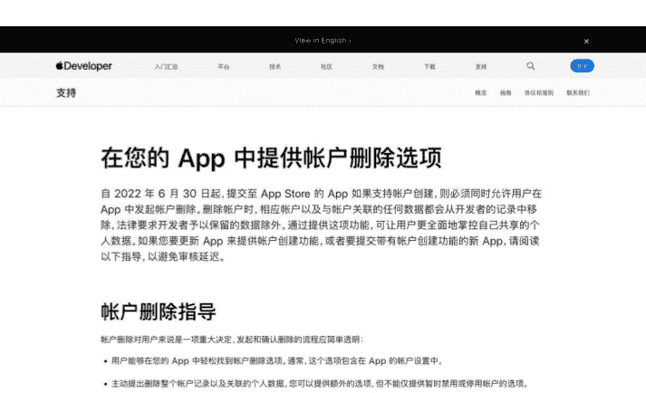

##### 第 5 步 在后台逐项登记「App 隐私」

进入苹果开发者后台对应的产品页，在左侧选择“App 隐私”，再按照第 3 步产出的记录逐类勾选，说明用途以及是否关联使用者，然后发布。页面显示“已发布”，即为完成。

（图 14-2）苹果开发者后台的“App 隐私”页面：依据真实功能勾选被采集的数据类别

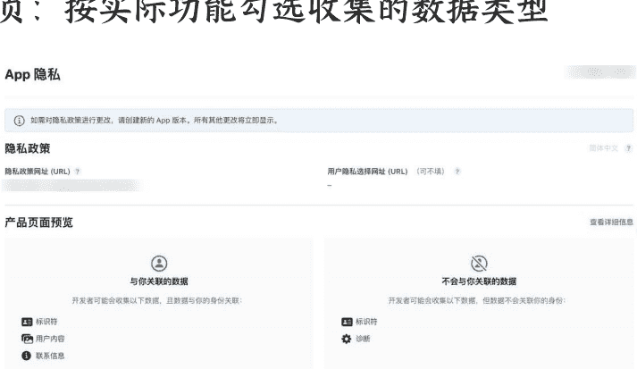

##### 第 6 步 第三方登录要对照 4.8 审查条款

4.8 的要点是：只要把微信、Google 等外部账户作为首要登录手段，就必须额外提供一个同等地位的登录选项，并且该选项要满足三条：只采集姓名与邮箱；使用者可以隐藏邮箱；未获许可不得用于推广。比较常见的做法是接入“通过 Apple 登录”。

例外情况：应用只用自有账户体系，例如只凭手机号码登录，就不必这样处理。

因此你有两条路径：接入 Apple 的登录服务；或者像我一样，iOS 首版只保留自有登录方式，等以后要恢复外部登录时，再把 Apple 登录一并加上。

（图 14-3）苹果审查规范 4.8“登录服务”条款原文，其中明确点到 WeChat Login

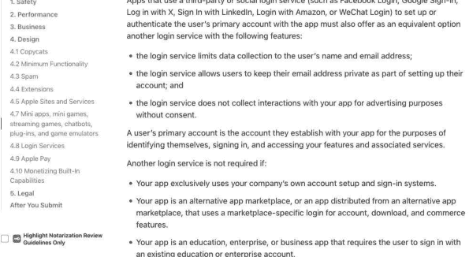

##### 第 7 步 收费模式要在开发阶段想清楚

先回答一个问题：用户付钱，得到的到底是什么？

- 如果是解锁应用内的数字权益，比如会员、课程、进阶功能，按 3.1.1 必须走苹果的应用内购买。
- 如果用户买到的是实体商品，或需要到线下场景享受的服务，3.1.3(e) 则规定不能使用应用内购买，应换用其他支付方式。

支付要等模式清晰后再接入。能够弹出付款页面，并不等于收款方案已经闭环。

##### 第 8 步 填好审查信息

在版本页下方找到“App Review Information”区域：勾选“该应用需要用户登录”，填入体验账号与验证码，再加一段备注。备注可以参考下面的模板：

这次 iOS 版本从送审到能在商店搜到，整体花了六天多。把过程中容易踩坑的点按时间线和要点整理如下。

```
Demo account: <11 位手机号> (11 digits, no country code, do not add +86)
Verification code: <固定验证码> (fixed for this demo account, no SMS needed)
After login you can try: <核心功能 1>, <核心功能 2>.
<某功能> requires a physical hardware device that is not included; it is shown as unavailable in the demo account.
Our backend service will stay online during the review.
```
**审阅材料里需要填写的演示信息**

- 127. 演示账号：只填 11 位纯数字的手机号，去掉国家前缀，也不要写 +86。
- 128. 验证码：使用一个固定的校验码，该演示账号不会真正接收短信。
- 129. 登录后可体验的功能：请用英文列出核心能力，例如 create task、mark done。
- 130. 如果某个能力必须配合实体硬件才能演示，而提交资料里没有对应设备，就在演示账号里把它标成不可用；项目里没有此类能力就整行去掉。
- 131. 审阅期间，后端服务保持常 Cleared 状态，无需改动。

苹果审核指南 2.1 的原话是：只要有登录就必须提供可用的演示账号，并且保证后端保持运行。

**从送审到上架的时间轴**

- 9 月 14 日 22:59：把 1.0.0 送出，发布模式选手动。
- 9 月 18 日：排队约 90 小时仍在等待，第一次提交加急。
- 9 月 20 日：开放 TestFlight 公共链接，限 50 人，分享给朋友安装。
- 9 月 21 日凌晨：有朋友反馈测试版一打开就闪退。
- 9 月 21 日 03:27：状态变为等待开发者发布。
- 9 月 21 日 06:35：点击发布此版本，几分钟后变为可分发，正式上线。
- 9 月 21 日白天：修复闪退问题，版本号升到 1.0.1，先在真机自测。
- 9 月 22 日 00:57：1.0.1 再次送审，01:04 第二次加急被受理。
- 9 月 22 日晚：1.0.1 通过，手动放出。

**关键节点的复盘**

**1. 排队 90 小时后申请加急**
官方说明多数情况 24 小时内有结果，我拖到第四天仍是等待中。9 月 18 日按规则写明首次上线且 9 月 21 日有线下活动，提交加急。两天后通过。加急是否起效苹果不会明说，但免费且符合条件可尝试。

**2. 通过通知延迟**
实际 03:27 已通过，但我用 AI 写的小程序定时轮询恰好在那几个小时没推送，直到 06:35 才发现。

**3. 当天上线导致新系统闪退**
这是一次有代价的选择，不建议模仿。刚升级到 iOS 27 的用户打开即退出。事后看，如果用户群体以换机或刚升级为主，应先发修复版。

修复方式：依据苹果与 Expo 官方文档调整 iOS 启动逻辑，在 iOS 27.0 与 26.5 上各做两次冷启动均稳定。重新给朋友安装后，iOS 27 能正常进入登录页。

**4. 1.0.0 上线后不能再往同一版本推送新包**
必须抬版本号到 1.0.1 才能再次送审。此次商店信息只换了 4 张新截图，尺寸为 6.5 英寸 1284x2778，其余沿用。

**5. 第二次加急差点提交失败**
先让 AI 用脚本自动填充加急表单，提交后苹果回退 “we didn't receive your request”。改成手打 App 名称，手动从下拉选择 销冠营，Apple ID 才自动带出，页面显示 We'll expedite review for 销冠营。当天通过，当晚发布。

**6. TestFlight 邮件邀请不可靠，公开链接更稳**
先用邮件邀请两位测试者，一直卡在已邀请，链接无法打开，因为收件邮箱不是 Apple ID。改用公开链接后一次成功。也正因公开链接带来未覆盖的机型，才在上线当天抓到 iOS 27 闪退。

**练习线：可跟着走但别乱送审**
用第 13 章的 production 包练习，但练习线做到步骤 5 TestFlight 内测与新系统冷启动即停止，不要把练习 App 送审：功能太少易被拒，还占用开发者账号。步骤 6 以后留给正式项目。若真实项目已用 Xcode + Fastlane 上传，可跳过步骤 2 的命令。

**第一步 建立 App 记录**
App Store Connect → App → 左上角 + → 新建 App → 平台 iOS，填写名称、主要语言、套装 ID 必须与工程一致、SKU 自行设定。页面打开即成功。

**第二步 上传构建**
在工程目录执行：
```
npx eas-cli@latest submit --platform ios
```
按提示选择刚构建的版本，核对版本号与构建号。首次建议把打包与上传分开，不要加 --auto-submit，方便定位问题。
成功标志：10~15 分钟后 TestFlight 里出现该构建且处理完成。此命令仅上传，不会送审。

**第三步 内部测试先自测**
TestFlight → 内部测试新建群组 → 加入自己，团队最多 100 人免审 → 手机装 TestFlight 安装 → 走核心流程：新建待办、填日期、标记完成。

**第四步 外部测试用公开链接**
- 132. TestFlight → 外部测试 + 新建群组。
- 133. 把构建加入群组，填说明，提交 TestFlight App 审核。首个构建需完整审核，后续多为基础审核。
- 134. 审核通过后在测试员页创建公共链接 → 选择向所有人开放 → 勾选设置上限并填人数。
- 135. 发给朋友，先装 TestFlight 再点链接。

成功标志：群组里能看到安装记录。
注意：前一个构建在外测审核中时，新构建无法加入外测群组，会提示 Another build is in review。等前一轮结束再加。

**第五步 最新系统冷启动**
冷启动指彻底退出后再打开。每次升级 Xcode 或苹果发布新系统，送审前至少在最新模拟器或真机上冷启动一次。
无 Mac 时用真机替代：把步骤...

**第七步 两步提交**
- 136. 右上角点添加以供审核，状态变可供审核，尚未交给苹果。
- 137. 在草稿面板确认信息后点提交以供审核。

（图 15-2）提交前页面，按钮为提交以供审核


提交后可通过后台状态判断进度：

（中文以苹果状态说明为准，核对 2026 年 10 月）：

| 后台状态 | 含义 | 你该做的 |
|---|---|---|
| 准备提交 | 资料未填完 | 补齐 |
| 可供审核 | 已加入草稿未提交 | 点提交以供审核 |
| 正在等待审核 | 已送达未开始 | 等待，期间不可改截图 |
| 正在审核 | 已开始审 | 等待 |
| 被拒绝 | 未通过 | 查看原因修复后重交 |
| 等待开发者发布 | 已通过待发布 | 点发布此版本 |
| 可分发 | 已发布 | 到商店确认可搜索 |

**第八步 被拒的处理**
在 App Store Connect 打开拒绝说明，复制原文给 AI 分析：
> 我的 App 审核被拒。下面是苹果原文、条款编号、版本号与构建号。
> 请先只读分析，不要改代码：
> 1. 用通俗语言说明违规点；
> 2. 定位代码中对应功能，给出可在手机上复现的步骤；
> 3. 给出最小改动方案及需同步修改的商店资料，确认后再动手。
> [粘贴拒绝原文]
先复现再改，不要盲目改描述反复送审。若认为误判，可向 App 审核委员会申诉，每次仅一次机会。

**第九步 必要时申请加急**
苹果允许的情形：修复严重缺陷，或配合开发者直接参与的活动。
- 138. 打开加急申请页登录开发者账号。
- 139. 在 App 名称框内手动输入，从下拉列表选取，Apple ID 自动带出。
- 140. 填写理由。修 bug 需附当前版本复现步骤；配合活动需写活动名称、日期及与活动的关系。理由必须真实，写不出就不要申请。可参考：

```
(修 bug) Version <新版本号> fixes a crash on launch for users on <系统版本>.
Steps to reproduce on the current version:
install <当前版本号> on a device running <系统版本>, open the app, and it closes immediately.

(活动) We plan to launch the app at <活动名称> on <日期>. <你和活动的真实关系，例如: We are exhibiting at this event.>
```
逐行含义，二选一：修 bug 用前两行，配合活动用最后一行；行首标签提交时删掉；尖括号内换成真实信息：
- （修 bug）第 1 行：<新版本号> 修复了 <系统版本> 用户打开即闪退的问题。
- （修 bug）第 2 行：复现步骤：在装 <系统版本> 的手机上安装 <当前版本号>，打开即退出。
- （活动）我们计划在＜日期＞的＜活动名称＞发布此 App。后续写与活动的真实关系，例如参展。

- 141. 提交后页面出现 We'll expedite review 类提示才算成功。

（图 15-3）加急申请表：从下拉选择 App 后 Apple ID 自动填充

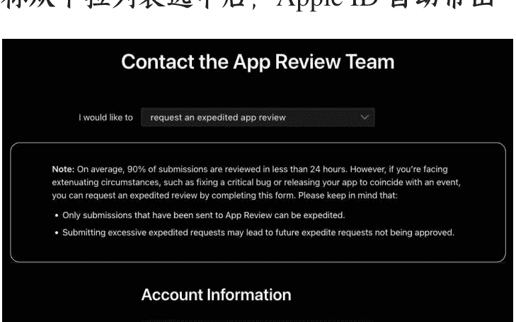
**第十步 通过后发布并核验上架**
- 142. 状态变为等待开发者发布 → 在版本页点发布此版本。
- 143. 苹果称发布后 24 小时内上线。我 06:35 操作，几分钟后变可分发，但商店搜索稍晚才出现。
- 144. 用目标地区的 App Store 搜索名称，核对版本号可下载才算真正上线。

（图 15-4）版本页状态等待开发者发布，右上角发布此版本

---

安卓部分结论：到 10 月初，销冠营仍未在任何一家国内安卓商店上线。下面是卡点与当前可用方案。

**卡点：软件著作权**
申请到补正阶段，平台签章页为固定模板，要求声明未使用 AI 开发。该 App 为 AI 辅助开发，无法签署，最终放弃，详见第 4 章。

**9 月 22 日安卓盘点**
让 AI 梳理安卓市场结论：目前上不了，因签名包、截图与资料未准备。先做两件事：
- 145. 生成正式签名安装包，在荣耀手机上跑通核心流程。
- 146. 安卓内测改走蒲公英等分发平台，设密码防外传。从此 iOS 与安卓共用同一代码出包。

**签名坑**
本地有两份签名文件。AI 报告称主副本为其一，实际使用的是另一份，报告口令不匹配。签名文件混淆或丢失将导致后续无法更新。

**权限坑**
Android 10/11 扫描蓝牙设备需定位权限。9 月 29 日补回定位权限后，荣耀 Android 10 真机才扫到工牌。权限改动虽代码量小，但会牵动隐私政策与商店权限声明，需同步调整。

**无软著的替代路径**
9 月 28 日软著受阻后查证：小米、OPPO、vivo 明确接受 APP 电子版权证书，小米对个体户需先确认。
9 月 29 日起办理电子版权证书：先与客服书面确认 AI 辅助开发可如实申请，再以个体工商户主体实名提交源码与说明。10 月初状态为待补正，需签章盖章与版本号统一，证书未到手。

**安卓上架操作指引**

**第一步 选渠道**
- 国内普通用户：优先用户量大的品牌商店。
- 国内企业或门店内部使用：商店 + 自有域名下载并行。
- 海外用户：Google Play。
首次无需覆盖全部市场，挑 2~3 家目标用户集中渠道。

**第二步 国内市场的通用流程**
认证 → 建应用 → 传包 → 填资料 → 送审 → 返修

（图 16-1）国内安卓上架通用顺序

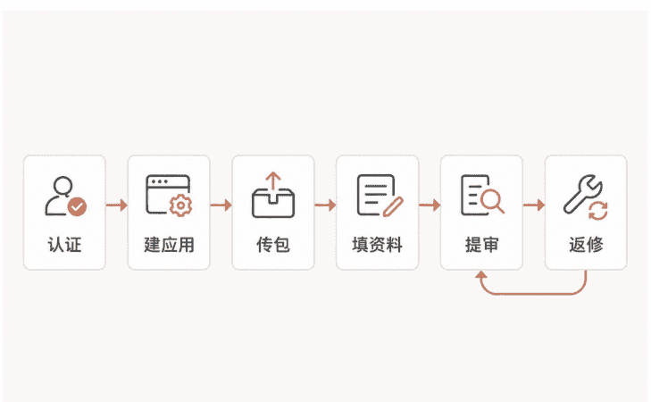
- 147. 注册开发者账号完成主体认证。个人/个体户/企业按平台要求选，主体需与版权证书、备案一致。
- 148. 创建应用。填写包名与应用名称，名称须与版权证书上的软件名称一致。
- 149. 上传正式签名安装包。多数市场要求 APK，即可直接安装的文件，不能用测试签名。
- 150. 填写资料并上传资质：隐私政策、权限说明、截图、描述、版权证书、App 备案号等。
- 151. 后台提交审核并截图保存状态。
- 152. 被拒按原文返修。通过后需用真机在该商店搜到并安装成功才算上线。

**第三步 无软著时可用的替代证书**
以下核对 2026 年 10 月公开信息，提交前以后台清单为准。
- 小米：软著、APP 电子版权证书、软件著作权认证证书三选一。无软著可用电子版权证书，个体户需先确认。
- OPPO：支持官方渠道申请的电子版权证书，两页齐交。
- vivo：上架需提供上述三类之一，可用电子版权证书。
- 360：必须提供计算机软件著作权登记证书，普通应用暂不可行。
- 华为/应用宝：公开页未核到明确原文，提交前工单确认。
- 荣耀：FAQ 写三选一，上传页标可选，提交前工单确认。

官方原文：小米应用资质 FAQ、OPPO 上传流程、vivo 常见问题、360 上线材料。

（图 16-2）国内市场是否接受电子版权证书对比

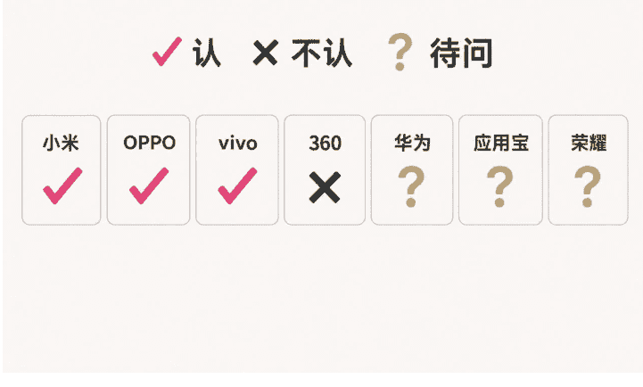
（图 16-3）小米开发者平台应用资质 FAQ 三选一原文

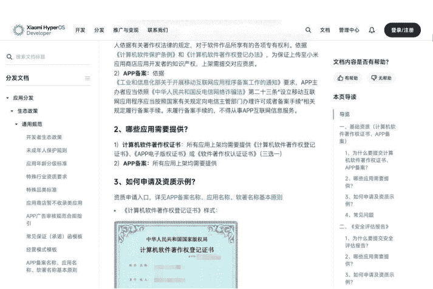
**三个易忽略点**
- 电子版权证书为市场化认证机构颁发，非中国版权保护中心软著登记证，仅在明确接受的市场可用。
- 承诺函、商标、备案号不能替代版权证书栏。
- 证书上的软件名称与主体须与商店填写的应用名称、开发者账号主体一致。

**第四步 办理电子版权证书**
流程见第 4 章，提醒两点：
- 153. 实名主体须与日后注册安卓开发者账号的主体相同。
- 154. AI 辅助开发前先询问客服是否可如实申请，确认后再付款。

**第五步 等证期间先让客户用上**
- 内测分发平台如蒲公英：上传 APK 生成安装页可设密码，仅用于内部小范围测试，使用范围依平台协议。
- 正式客户临时路径：自有域名下载 + App 内显著展示备案号 + 正式签名。即在已备案官网放 APK 下载链接或二维码，App 内显著位置挂备案号，安装包为正式签名。可先用，但不等于上架，商店流程仍需走。

合规必须项：
- 155. 先完成 App 备案，并在 App 显著位置展示备案号并链接备案系统网址。如放在我的 → 关于，点击可打开查询页。
- 156. 隐私政策、账号注销入口、权限说明同样不可缺。

# 独立开发后半程：交付、上架、回话、协作和成本控制的实操笔记

功能跑通只是起点。真正耗神的，往往是交付安装文件、过商店审核、处理客户意见、安排多人协作，以及盯住每月账单。下面按实际推进顺序，把我踩过的坑和后来定下的做法重新梳理一遍。

## 一、给客户的安装文件：发布证书要延续，版本编号要递增

同一款产品面向客户发布时，尽量从第一版到后续版本都使用同一套正式发布证书；每次出新包，只把版本编号往上抬。否则客户覆盖安装时很容易被系统拦住，提示信息还常常让人摸不着头脑。

装机说明不要写成技术手册。只需要告诉对方：手机弹出什么提示，就按提示允许本次安装。不同品牌的弹窗样式不同，千万别指导客户去关闭系统安全防护。真装不上，请对方把屏幕提示截图发来，再一起判断。

交付前可以让模型先做一次只读核对，只看问题，不动代码：

```
我的安卓 App 暂时没上商店，要在自己已备案的域名下
```

核对重点有四项：产品内是否展示备案编号，点击后能否跳到工信部查询页面；隐私文本、注销账号通道、各项权限说明是否齐全；这份安装文件是否使用正式发布证书，版本编号是否高于上一版；再帮拟一份客户装机说明，写清下载地址、如何辨认是你发出的正式版本、安装时如何按弹窗允许。

## 二、出海准备：Google Play 的注册、密钥与包格式

面向海外发布，Google Play 这边要提前准备。开发者账号注册费为 25 美元，只交这一笔。进入 Play Console 后创建应用，再按 Expo 的提交文档准备 Google 服务账号密钥，并在工程目录执行：

```
npx eas-cli@latest credentials --platform android
```

配置选择 production，按提示填入服务账号密钥。密钥文件只放在自己电脑上，不要发到聊天窗口、截图里，也不要提交到代码仓库。

上传时使用：

```
npx eas-cli@latest submit --platform android
```

新应用默认先进入内部测试轨道。2021 年 8 月以后创建的应用，必须使用 AAB 这种 Google Play 专用打包格式；它不能像普通安装文件那样直接点开安装。2023 年 11 月 13 日之后注册的个人账号还有额外约束，具体以 Play Console 当时给出的提示为准。

## 三、客户意见：先归类，再只挑最碍事的一项处理

收到意见后，最忌讳把所有内容一股脑变成开发清单。先分类，再决定先动谁：

- **卡点类**：客户想完成的事被挡住了，比如卡死、报错、找不到入口、等待过久。这类排最前，每轮只处理一项。
- **能力缺口类**：客户确实需要，但产品目前没有。先放进待讨论池，攒够证据再议。
- **口味偏好类**：换配色、改措辞，不影响任务完成。先记下，不急着动。

举个真实例子。9 月 25 日，我在手机上试“语音对练”，第二轮顾客语音一直停在播放提示上，底部按钮锁在“顾客正在说”，我根本没法开口。这就是卡点，练习直接进行不下去。

处理分两层：先加兜底，播放时间超过这段语音本身长度再多 3 秒，就自动把话筒交还使用者，同时给一个重播入口；再补日志，查清播放结束信号为什么没回来。同一天还有另一条意见——“练习要有目标、能设难度”，那属于能力缺口，我单独拉出来做方案，没有和卡死问题混在一起改。

交给模型的提示可以这样写：先别动代码，完成四项准备——把每条意见归入卡点、能力缺口、口味偏好；从卡点里挑出最影响核心任务的那项，并说明选择理由；针对这一项列出要改哪些页面、哪些旧功能需要重验、是否涉及数据变化、出问题如何退回上一版；其余内容放进待讨论池，标清是谁、哪天提出。改完后，用客户当初出问题的那个操作再走一遍，确认无误再报告。

## 四、异常收集与服务探活：接上不等于验好

异常收集可以用 GlitchTip，它兼容 Sentry 的上报组件，自架在国内云服务器上就能跑。接入时守住几条底线：

- 等使用者同意隐私政策后，才开始启动收集；
- 上报内容不能夹带手机号、姓名、录音、聊天记录等个人信息，默认收集开关要关掉，发送前再筛一遍；
- 每条异常带上版本编号和所处环境（试用／正式）；
- 预发环境留一个只有自己能触发的“测试异常”入口。

接完还要验，四步都要亲眼确认：在试用环境主动触发一条不含个人信息的异常；在后台能找到它，版本编号和手机上装的那份对得上；点开详情，确认没有带出手机号、请求内容这类不该出现的东西；负责处理的人确实收到了邮件或消息提醒。

后来我们也写过 Sentry 的接入代码，但代码写完只是开头。上报地址得填对、真的发一条出去、确认有人能收到；这一轮没走完，就不能算“已接好”。

服务探活也值得配上：每分钟去敲一下你的服务。

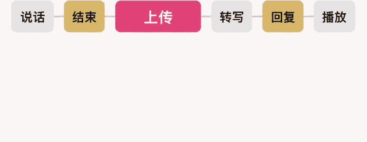

性能问题同理。客户抱怨“某某页面等太久”，别急着改代码，先测时间。把一次完整操作拆成若干段，例如：开口说话 → 松手结束录音 → 上传 → 转成文字 → 模型生成回复 → 语音开始播放。每段开头和结尾各打一个时间点，在试用环境跑 5 遍，给出一张表：各段耗时几秒、哪一段最长。只报实测数字，不要猜原因；也别急着在界面上加“正在思考”之类的提示来遮盖等待。

## 五、释放节奏与多人协作：拆小批次、留退路、有人接

发版要拆小批次。每轮只放少量修改；攒一大坨再发，问题会一起炸开，你根本分不清是哪处改坏的。先放小范围试用。我们新版对练提示词，先只对几个内测白名单开启，自己拿手机亲自试过觉得靠谱，才考虑扩大。

还要准备回退方案。代码能退回去，不等于数据能退回去。凡是会改动数据的变更，释放前让模型分别写清楚：代码怎么退、数据怎么退。

绕过商店的在线补丁也别越界。那种不重新上架、直接给已安装用户推小修改的做法，苹果审核指南 2.5.2 写得很明白：产品不能下载并执行会引入或更改功能的代码。改文案、修小问题可以评估，加新功能必须走审核。我写这段时还没有正式用过在线补丁，每轮改动都是重新打包发版。

第一个产品用一个模型就够了。等你同时开好几个时，再看下面这些规矩。9 月 4 日，我派出去的几项活儿做完或失败后没人接，整整积压 8 小时才被发现：单独启动的 Codex 任务完成后，不会通知任何人。

从那以后定了三条：派活时把结果文件写成完整路径，从硬盘根目录写起，模型才不会塞进它自己的文件夹；每项活儿做完都要有人盯结果、接下一步；同一个文件夹同一时间只允许一个模型动手。

每次派活，派工单写清八项：

1. 这轮的目标和边界；
2. 从哪个版本开始；
3. 你必须知道的已确认事实；
4. 允许改哪些文件；
5. 做完怎么验、输出什么；
6. 遇到什么情况必须停下来报告；
7. 结果存在哪里，写完整路径；
8. 下一位接手的人要做什么。

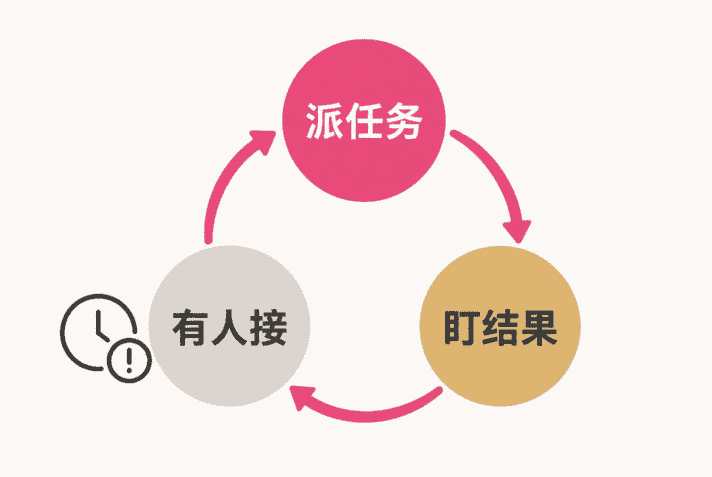

派任务、盯结果、有人接，缺了哪环都会积压。

## 六、用量账本：记录“换回了什么”，省钱也要有硬规矩

只盯着消耗了多少词元没意义，关键看换回来什么。从现在起，每完成一项工作记四列：这次要解决什么、花了多少时间和用量、留下了什么、怎么确认有效。

拿“对练顾客回复慢、不像真人”来说：三轮改提示词，约 600 个自动对话回合，留下一版更短的新提示词；自己拿手机亲自试，体感好很多；回复耗时中位数从 2.25 秒降到 1.0–1.3 秒。

这里藏着一个坑：机器打分高，不等于客户觉得好。9 月 24 日，我们让另一个模型当裁判，给对话的“像真人程度”打分。同一套配置，这轮 4.22 分，下轮 3.42 分，分数压根没法跨轮比较。旧版本分数还更高，可我在手机上一试，还是不像真人。后来改成：机器裁判只负责先筛掉明显差的，最后一步由我拿手机亲自试拍板。第二天再试，新版本的感受是“好很多”。

省用量的办法，后来定成了硬规矩：

- 别把整份测试日志塞进对话。当时最大一份有 150MB，是几千条测试逐条打印出来的。改成只把失败的那几条和汇总数字交出去，完整日志留在电脑里。
- 全套测试每批只跑一遍。以前一个改动要过“实现、复查、返工、最终核实”三四个模型，每个都从头读资料、各跑一遍全套。改成：中途只跑相关几项，收尾跑一次全套，复查直接引用前面的结果。
- 卡住了先接着原对话干。一卡住就开新对话，所有资料又得重读一遍。但同一个任务也别反复续：每续一次都要把前面的对话重放一遍。同一任务卡两次，就先想清楚方案再续一次。
- 派活前先检查派工单。当时约有 10 次白跑，是我给的派工单前后矛盾，或者没告诉模型哪些失败是老问题。派工单按上面八项写，发出去之前自己从头读一遍。
- 大活拆小。9 月 12 日，一个任务连跑 15 小时、用掉约 160 万词元后对话崩溃，什么都没交出来。现在的规矩：预计超过 3 小时就拆；2 小时没有阶段性成果，就停下来汇报。
- 每次都要读的固定说明要精简。模型每开一次对话，都会先读你给的长期说明和技能清单。我把常驻技能从 64 个减到 14 个，说明文件压到每份几 KB。
- 别让模型满硬盘搜索。有两次它全盘乱翻，把一大堆无关结果灌进对话。给它具体的文件和行号范围。

最后再补一句：少输出不等于少验证。登录权限、数据隔离、发布上线这类一旦出错代价极大的事，不能为了省用量跳过检查。简单的活用便宜的模型，难的、风险大的才用贵的。

## 七、费用：先拆八项，再看首年档位

先把两种钱分开看。

我真实付过的：苹果开发者 688 元/年；电子版权证书 600 元；阿里云 8 月约 567 元、9 月截至 28 日约 707 元；产品内调用大模型 9 月头 8 天约 21 元。写代码用的智能订阅不算在这一列。同一台服务器上还跑着别的监控，8 月账单约 86 元/月。

下面的数字是粗估，因人而异，不是预算承诺，只帮你心里有个数，以各家实际报价为准。

八类开销可以这样看：

- **写代码的智能订阅**：动代码就会碰到。省着用每月 20 美元档起步，常规可到 100–200 美元档；额度耗尽要等重置。
- **电脑与手机**：备工具和真机测试。用现有设备最省；二手 Mac mini 约 2000–4000 元。本机打 iOS 包必须有 Mac，用 EAS 云构建可以绕开。
- **构建服务（打包）**：做安装文件时遇到。本机打包或用免费额度；付费每月 19 美元起，另加超额费，还要算排队时间。
- **域名与云端资源**：有后端、对外服务时遇到。只存手机本地可以 0 元；有后端通常每月几百元，数据库、存储、试用环境都算在里面。
- **产品内模型调用**：接上 AI 后遇到。开发期很少，正式用按量计费，客户每用一次就花一次。
- **商店开发者账号**：签名、上架时遇到。苹果 99 美元/年，每年都要续。
- **材料办理**：上架前遇到。备案自己办 0 元；软著官费 0；电子版权证书按平台页面价；找代理几百到几千元，还得留出补正、返工、等待的时间。
- **维护**：上线以后持续发生。自己盯监控最省；也要算监控服务、客服时间，以及域名、服务器续费。

表外再补几句：ChatGPT Plus 含 Codex 每月 20 美元，Pro 每月 100 美元起；Claude Pro 含 Claude Code 按月付 20 美元，Max 每月 100 美元起。Expo 云端打包 EAS，免费档每月 15 次安卓、15 次 iOS；付费档 19 美元/月起，另加超额费用。苹果开发者账号每年 99 美元，国内约七百元，以注册页为准。国内主流安卓市场注册开发者一般不收费，以各市场页面为准。商标网上申请 270 元/类，10 个商品以内，一次注册管 10 年。软著官方登记费 2017 年 4 月起已停收，自己办是 0 元。电子版权证书我下单时普通时效 600 元。备案的基础服务不收费，但要先有一台符合要求的云服务器。域名一般几十到一百元左右一年，以注册商报价为准。

首年大概准备多少？最省验证版，只做本地保存的小产品，先上架试水，千元级，主要靠自己动手；自己加 AI 做正式版，有后端、有云端，约 1–3 万元，大头是智能订阅和云端资源；外包或请设计，十几万元以上。每年都要续费的主要是苹果开发者账号、域名、云服务器。商标是一次注册、管 10 年。

## 八、用量数字参考

我 2026 年 10 月 2 日读到的数：全部历史从 2025-11-17 起，209 天有用量，共 1351.51 亿词元；其中 Codex 950.95 亿，占 70.4%，Claude Code 400.52 亿，占 29.6%。近 90 天，7 月 5 日到 10 月 2 日，共 1156.59 亿，日均 13.00 亿。个人页显示近 90 天 1156.59 亿词元，全站第 20 名。

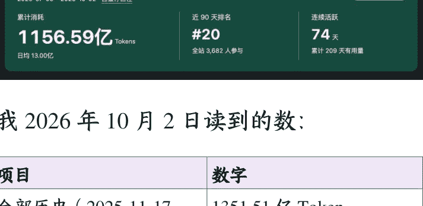

近 90 天的用量构成里，缓存读取占绝大部分，新输入输出只有约 21 亿。

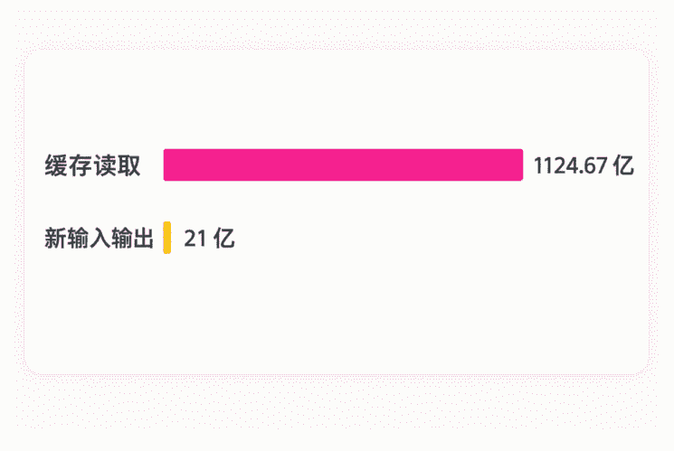

练习项目的用量会小得多。

## 九、卡住时查哪个工具

不用第一天就把工具装齐。先判断自己卡在哪一步，再拿能回答这个问题的工具。工具最后要帮你找到一个事实，而不是多一份看起来很忙的日志。

- 需求越聊越多：先用一页需求单、产品逻辑图，明确这轮只改什么、什么算完成。
- 模型总写错某个库的用法：查 Context7 或该库当前官方文档，拿到你这个版本的准确用法。
- 页面位置不对、按钮点了没反应：用截图、模拟器、真机；网页用浏览器开发者工具或 Playwright，弄清点的是哪个按钮、点完发生了什么。
- 改完代码旧功能坏了：跑类型检查、代码检查、自动测试，找到哪条测试失败、真实报错是什么。
- 反复手点手机太慢：安卓手机或模拟器、iOS 模拟器用 Maestro；苹果真机用 Appium，自动点完、截图、给出明确的对错判断。

最后再提三句：用量页面上的“预估成本”是按公开单价估的，不等于你的实付账单；云端按量计费的资源，不用也在计费，给账户设余额预警，月底看一次账单；文中的价格都会变，正式付款前以官方页面为准。

这些步骤看着琐碎，但每一步都在减少“装不上、说不清、退不回、花冤枉钱”的概率。先把最小闭环跑通，再逐步加监控、加协作、控成本，独立开发这条路会稳很多。

# App 出现停滞，定位关口比盲目重试更重要

脚本在设备端无法建立连接时，iOS 侧通常要回到 Xcode 以及官方原生工具链去排查，Android 侧则先确认 adb 的连通性。常见卡点集中在设备是否被识别、签名是否匹配、驱动是否就位、连接是否真正建立这几块。设备端跑通了而云端没有任何反馈，就要借助请求调试工具、云日志以及只读式数据库查询，沿着同一条请求链条向下追踪。遇到大文件上传失败，先采用对象存储厂商提供的官方上传 SDK，结合错误码核对，检查文件是否完整抵达、临时授权是否已失效、服务端是否给出确认。

下面这份索引把云端排查、后端发布、回滚以及真机自动化串成一条排查线。第一次不必全背，遇到问题时拿来对号入座即可。

## 一、云端出现阻塞，先判断停在五段里的哪一段

一条请求从客户端发出到结果返回，可拆成五个顺序环节：

1. 客户端是否已把请求发出
2. 后端接口是否收到请求并返回了什么状态码
3. 对象存储是否已完整收敛文件
4. 后台异步任务例如转写、生成是否已入队且执行完毕
5. 结果是否写回并被客户端取到

五段的展开说明、示例以及只读排查的提示词，详见第 10 章步骤 5。这里只把顺序收拢，方便对照。

（图 A-1）一次请求的五段：手机、接口、文件存储、后台任务、结果

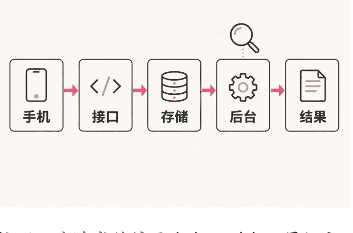

排查时以同一个请求编号为准，不要在一屏红色报错里凭感觉猜测。同一时间段内其他接口的异常，未必与本次失败相关。

确定区间后，逐项对照清单。

### 1. 配置类问题：代码无误，线上就是连不上

让助手列一张表格，字段包含：用途、代码实际读取的配置键名、部署环境、模型名称、运行中的进程是否拉取到。

配置存在于配置文件、控制台、运行进程，三者是不同环节，都要分别验证。即使控制台提示保存成功，也要发一次最小可行的真实请求去验证。

曾经踩过的坑：键名存在但值为空；代码读取的键名与密钥存储的键名不一致；模型名称沿用已被官方停用的旧名；复制密钥时多带了一对引号导致 401，去掉引号后变为 200。

### 2. 理论可通、实际不通：先花五分钟做两个只读检查

- 对比服务器上实际存在的配置键名与代码中引用的键名。
- 使用线上真实的服务账号，检查其对各表的读写权限。

第 10 章开头 8 月 27 日的那次排了 8 轮，正是因未先做这两步。本地测试库通常自带授权，所以权限类问题在本地难以复现。

### 3. 日志定位：用 SLS 找到最后一次成功的阶段

进入控制台 → 选择项目 → 打开日志库

```
总耗时 %{time_total} 秒\n" https://你的接口地址/只读路径
```

网页端可同时打开浏览器开发者工具的 Network 面板对照。

curl 返回 200 并不等于用户在 App 内完成任务。包含 Authorization、Cookie 的完整日志禁止外泄。

### 4. 文件上传：官方 SDK 负责传输方式，权限仍需逐条核对

最终采用的是阿里云官方 OSS SDK 配合服务端签发的 STS 临时凭证，流程参考《使用 STS 临时访问凭证上传文件至 OSS》。

SDK 解决的是如何传输。文件归属、读取权限、传输后的处理仍由项目自行负责。

大文件走分片上传。若要实现断点续传，还需要 ListParts 权限。能传小文件不代表续传可用，应专门做一次传到中途中断再恢复的测试。权限应依据服务端实际签发的文件路径配置，而非配置文件中的路径推测。

### 5. 异步任务：未到达终态就记为“尚无结果”

每个后台任务需记录：任务编号、输入版本、当前状态、查询时间。

曾有一次复测，30 个任务在观察窗口内全部停在“处理中”。正确记录应为“尚未产生终态，指标不可测”，既不填 0，也不重复提交，以免重复付费。

### 6. 模型返回字段：先写清字段契约

示例与字段说明要完整，需要模型填充的每一项都要明确列出。

系统已知的資訊应由程序在校验前补齐，不要让模型自行抄写。

校验前增加归一化：同义词映射为标准词、大小写统一。例如要求填写“开放”，模型给出“进行中”，需转回标准表述。

涉及来源与证据的字段，若缺失则留空，绝不替模型编造。

### 7. 成熟组件也要用自有输入验证

曾用 30 份合成文件试验文档解析。普通文档、跨页表格、扫描件、手机拍摄照片的表现各不相同。可抽取文字不代表能保留表格的行列结构。

## 二、后端发布阻塞：先看构建，再看上线

后端发布分为两步：先将代码与运行环境打包成镜像存入阿里云镜像服务 ACR，再由应用托管服务 SAE 运行。

因此构建成功不代表上线成功。曾遇到镜像构建通过，部署阶段在数据库检查处失败并自动回滚。后来改用云平台官方发布接口。第一步修复不等于第二步自动通过。

查看顺序：

- 镜像服务的构建记录：使用哪份代码、卡在哪一步、最终状态 → 判断包是否生成
- 镜像服务版本列表：标签与唯一编号 → 判断准备上线的是哪个包
- 应用托管变更记录：拉取、启动等每一步状态 → 判断上线停在哪
- 应用托管运行实例：实际运行的包 → 判断线上到底在跑什么
- 日志加一次真实请求：启动结果与真实响应 → 判断新版本行为是否正确

网页端理清后，可让助手通过阿里云官方命令行工具执行同样的只读查询，保存时间与结果。

官方文档：ACR 镜像构建诊断 · SAE 变更发布单（截至 2026 年 10 月）

## 三、回滚后要核对实际运行版本

新版本异常时常见做法是退回上一个可用版本，即回滚。

回滚是否生效，要看服务器实际运行的是什么，而不是设置页填写了什么。曾出现设置已改回旧版，运行实例仍是新版的情况。只看设置会误判回滚完成。

三项做法：

1. 先收集证据再回滚。失败时先抓取报错与日志。改为先取证后回滚后，有次失败当场拿到明确错误码，此前只能事后翻日志推测。
2. 回滚完成后同时核对：设置、实际运行版本、用户侧效果。
3. 数据库仅只读检查。排查时只看状态、权限、迁移记录。若需改表或恢复数据，需另行编写执行与回滚方案，确认后再操作。

（图 A-3）回滚后核对三项：设置、实际运行版本、用户效果

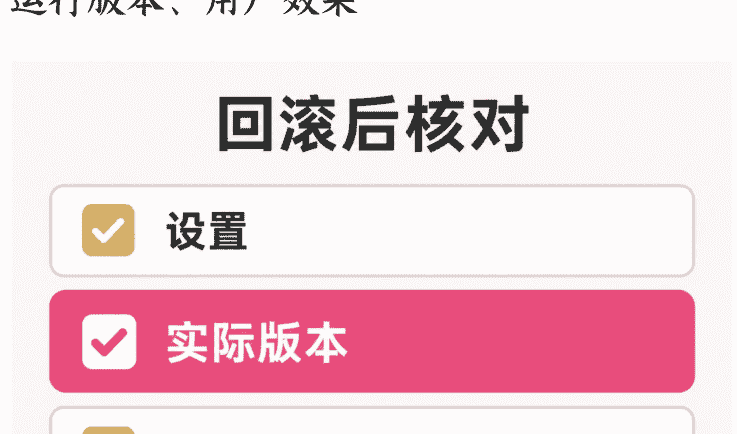

## 四、十六个常见坑

前面章节已覆盖高频问题。此表供检索之用，无需开发前全部掌握。

对照时先看“发生了什么”是否与现状相符。例如仅按钮无法点击，先查页面与测试，无需研究服务器回滚。

1. 为追求贴合项目自行编写上传与安装工具，耗时多日仍不稳定。下次先对比官方方案与高分开源工具，再决定是否自研。
2. 仅在一条分支验证过就宣称“手机与后台均生效”。下次分别确认合并、发布、安装到设备、实际可用四件事。
3. 自动化检查数秒通过，真机 20 秒后失败。下次使用真实数据格式、多账号测试，再上真机走一遍。
4. 回滚只改设置，服务器仍运行新版。下次设置、实际运行版本、用户效果一起核对。
5. 修复只写在临时脚本，清理文件后修复消失。下次写进正式代码并归档，说明恢复方式。
6. 临时登录凭证在未使用前过期。下次临用前再获取，或先查看有效期；凭证不贴入聊天。
7. 检查工具无法解读真实日志，把成功判为失败。下次先用一条确定成功的样本校准。
8. 测试名称写查 A，实际只查 B。下次对照需求逐条核对测试证明的内容。
9. 两次存档标题相同，误以为修复已上线。下次让助手核对线上版本是否包含该修复，再验证效果。
10. 一晚发布六次，均卡在自写发布脚本。下次相同失败无新线索即停止，先修复工具或换官方路径。
11. 自测任务长时间空转无人察觉。下次关注新产出、进程存活、结果文件是否写入，超时即停止。
12. 测试库为手写简化版，错误仍通过。下次测试库采用与正式库相同的建表流程。
13. 一轮验收标准多处写错。下次先确认检查工具能读取到该结果再编写标准。
14. 复查进行一半，被查代码被修改。下次复查前锁定版本，新改动重新查。
15. 清理脚本执行两次，约 40 份备份被覆盖。下次脚本重复执行应安全，备份永不覆盖。
16. 向外部专家请教时凭记忆写错语音服务商。下次从当前代码与配置中查证，查询时不打印密钥。

归纳四句话：能用成熟方案别自研；“我这边好”不等于“用户那边好”；检查工具也会出错，先校准再信任；一切操作要可重复。

## 五、术语速查

### 准备阶段
主体、包名/Bundle ID、ICP 备案、App 备案、公安备案、软著、电子版权证书

### 开发阶段
终端/命令行、Node.js、npm、镜像源、Expo、Expo Go、上下文、Token、缓存读取、前端/后端、API、数据库、云服务器、Git/提交、分支、worktree、模拟器/真机、自动测试、日志、SDK、Expo SDK 版本

### 打包上架
构建、ipa/APK/AAB、签名、keystore、证书/描述文件、App Store Connect、TestFlight、元数据、隐私政策、权限用途说明、提审

### 上线后
错误监控、部署/发布、镜像

## 六、物理 iPhone 自动化先认清三个角色

到真机阶段才需要以下三者：

- Appium：运行在电脑上的自动化服务，接收打开应用、点击等指令。
- XCUITest 驱动：Appium 连接 iOS 的驱动，负责将指令翻译为系统可识别形式。
- WDA：安装在 iPhone 上真正执行点击的组件。

（图 D-1）自动化三件套：电脑 Appium 与驱动、手机 WDA

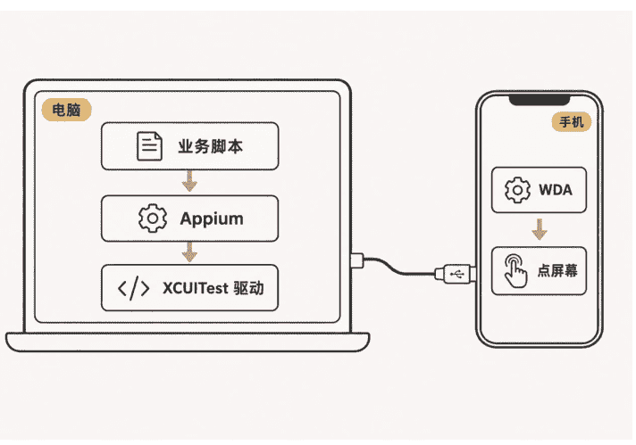

需要自行编写的只是业务流程例如进入服务页、选择录音、检查结果，以及启动前的设备检查。手机驱动无需重造。

首次准备时建议按顺序：

```
我要对自己指定的 iPhone 做 Appium 自动化。
先核对当前 Xcode、Appium 和 XCUITest driver 的兼容要求。
按以下顺序检查，不要一开始就跑整段业务。
```
1. 手机数据连接是否可用
2. 手机是否已解锁并信任本机
3. WDA 的开发团队与签名是否匹配
4. WDA 能否在目标手机真正启动
5. Appium 能否建立 session 并获取截图与页面源
6. 目标控件能否定位，点击后页面是否按预期变化

同一时间只允许一个操控者，不要让其他驱动或保活进程抢占设备。

涉及信任、系统确认或需人工操作时，明确停滞点。

记录每一步的结果、错误与证据位置。

让助手先说明安装会改变的内容，再按当前官方文档准备。已有环境先检查，避免重复安装或升级到不兼容组合。以下命令用于在 Mac 终端查询版本、设备与驱动；

```
xcodebuild -version
xcrun devicectl list devices
appium --version
appium driver list --installed
```

缺什么再装。截至 2026 年 10 月的官方安装命令为：Appium 通过 npm 安装，需先有 Node.js

```
npm install -g appium
appium driver install xcuitest
```

WDA 的签名团队与安装目标需按实际环境确定。

Appium 安装 · XCUITest 驱动官方指南 · Apple 命令行工具

安装完成后在终端启动 Appium，保持日志持续输出；

```
appium
```

不要按进程名批量结束。手机上名为 Runner 的进程是另一日常应用，与 WDA 无关。

### 真机自动化的五类典型问题

1. 电脑显示已连接，自动化仍找不到设备。实际仅完成网络配对，数据通道未建立。更换支持数据传输的线缆，手机点击信任，Xcode 能识别后再继续。
2. WDA 构建成功但未在手机运行。签名、安装、启动、会话是不同关卡。保存首条有效错误与 .xcresult 文件，不要仅凭退出码推测。
3. 可截图但找不到按钮。控件列表中根本没有该元素。查看页面源或使用 Appium Inspector，为关键控件添加固定标识。
4. 两套自动化同时控制一台手机。保活或另一会话重复启动 WDA。只保留一个入口，先排查占用、版本、驱动、会话，再执行业务。
5. 自动化声称“听到”声音，却无法证明录音正确。电脑外放导致收音不稳；脚本可能把自身气泡误认为用户回复。说话、听感、物理按键、锁屏、插拔、首次信任等交由人工处理。

补充说明：第一类问题停在此层时，无需让助手去修改 App 页面。

## 收尾

从设备、云端、打包、回滚到自动化与真机验收，省时关键在于先弄清停在哪一环、拿到哪份证据、确认哪个版本真实在跑。有成熟方案就优先使用；本地“好了”不等于用户“可用”；检查工具本身需校准；操作必须可重复。牢记这些原则，面对满屏报错时至少知道从何查起。

这一年做移动端自动化，真实环境里撞到的坑比教程里写的多很多。今天挑几个印象最深的来讲，并用两张老截图说明一个容易被忽略的判断原则：单张结果图并不能说明全貌。

第一个容易被神化的习惯。出包阶段偶尔蹦出 65、74 这类异常码，端侧的任务调度程序也出现过加载即刻退出掉的情况。有一次尝试过重装并重新签名，问题依旧，最终把整机关机再开机后才恢复正常。需要强调的是，那一次的恢复只是个例，不能养成“出问题就硬重启”的条件反射，下一次很可能还是卡在原地，根因没查清就掩盖了问题。

第二个更隐蔽的交互问题。弹窗在屏幕上明明清晰可见，可在元素树里就是找不到对应节点，只能靠人工点一次来推进。后来遇到页面结构看不清的情况，就直接打开 Appium Inspector，在截图上定位对应的控件，工具会立刻反馈出它识别到的名称和坐标，省去盲猜。

第三个是流程收敛。我们把前置校验聚合成一个入口，先核对设备空闲、系统版本匹配、驱动可连，全部通过后再进入页面操作。顺序固定后，很多莫名其妙的失败就不再出现。

下面两张存档截图并排放，就能看出为什么不能只看一张图。

（图 D-2）历史 iPhone 自动化截图：本地带回了一段原音

20:34

智能工牌 ****W001 已连接

- 电量：100%

- 剩余空间：59424 MB

- 录音状态：空闲

- 固件：待确认

换一台智能工牌

完成，返回服务记录

已带回 1 段原音，智能工牌里的原文件保持不动。

连接诊断

只含时间、命令码、帧长、耗时、错误码和状态迁移，不含音频或手机号。

- 复制诊断

- 分享诊断

智能工牌录音 目录读取完成

- 今天 12:17：约 15 分钟 · 1.7 MB · 记录

- 9月9日 02:07：47 分钟 · 11.9 MB · 记录（已复制到本机）

图里标注的已复制到本机，只能说明文件已经抵达本地终端，并不意味着已上传、已转写或已生成报告。截图再漂亮也不等于流程结束。

（图 D-3）历史 iPhone 自动化截图：导入失败与诊断入口

00:42

- 录音状态：空闲

- 固件：待确认

- 换一台智能工牌

- 带回选中的 1 段

- 继续上次导入

导入没有完成，请再试一次。

(recordpen_existing_capture_requires_review · ready)

查看诊断

连接诊断

只含时间、命令码、帧长、耗时、错误码和状态迁移，不含音频或手机号。

- 复制诊断

- 分享诊断

智能工牌录音 目录读取完成

- 昨天 20:17：约 7 分钟 · 1.7 MB · 记录

- 昨天 23:32：约 3 分钟 · 797 KB · 记录

失败时第一件事是把当时的错误提示和页面状态一起保存，再回溯是数据状态、授权、网络还是脚本层的问题。这张图把原始错误码直接暴露给用户，普通人根本看不懂，也是当时界面需要改进的地方：提示必须用大白话写清楚，并给出下一步该怎么操作。

### D.5 Android 和网页

配套资料

- 本文政策类信息核对于 2026 年 10 月，以官方最新为准。销冠营的经历按文中日期理解，不代表每个人的审核结果和完成时间都一样。

看完这份 SOP，很容易产生“我都懂了”的错觉。实际上九成的人一到实操就会卡在第一步。教程和工具只是入门级的敲门砖，真正拉开差距的是马上开干和圈内信息差。

如果你想持续看到最新可落地的变现思路，并和一批执行力很强的人一起实操拿结果，可以关注我的核心私域：【懒人专属群】。这里不讲空话，只拆商业闭环和 AI 效率的压榨，内部已沉淀 1000+ 跑通的套利实战案例。

- 查阅圈子完整数字资产与上车门槛：https://lazyso.com/insider/

认同价值、准备好下场干活的，扫码加我微信（lazyhelper1）

备注：【实操上车】，不闲聊


👸号

懒人搜索

懒人专属群


微信：lazyhelper1