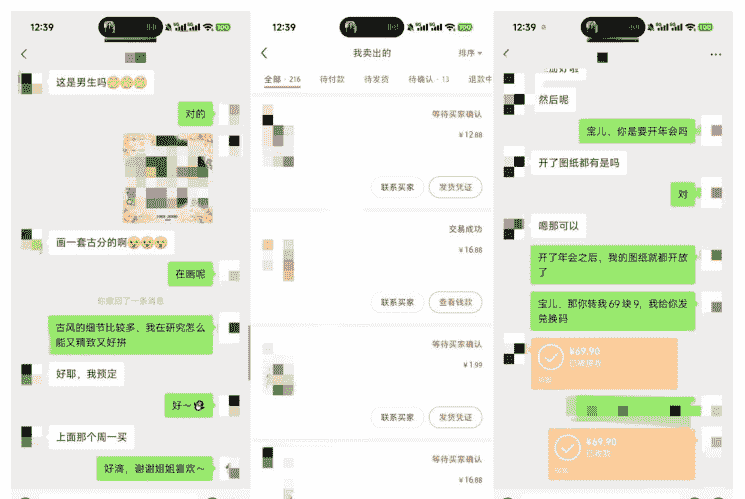

### 教辅苦做 90 天只换回 1000 元，随手做的拼豆设计稿 15 天卖了 6000 多

编号：261003 / 副业 SC 精华  
来源：懒人搜索👸号 / 懒人专属群精选  
🛰️：lazyhelper1

> 小懒点评 | 这期适合做 AI 内容产品、却总在拼命优化细节的人看——作者在教辅资源上耗了 90 天，销售额才 1000 元；换到拼豆设计稿后，15 天就卖了 6000 多。差距不是认真与否，而是赛道选没选对。其中最值得关注的是：9月15日单日收入 1273.91 元；限流之后，靠存量设计稿每天仍能收到 100 多元。但要提醒一句：9月16日作者因“不当操作”被限制发文 30 天，如果平台底线没摸清，再爆也白搭。

先说最近的一波正反馈：拼豆设计稿开始稳定出单了。想把这个过程拆开聊聊，因为这几个月让我重新想明白了两个问题：买家为什么付费，以及付出到底值不值。

### 一、最初做教辅，90 天换来一笔“学费”

最开始，我押注在教辅资料上。当时的想法是：把内容做得比市面上的更精良，配图要对孩子理解知识点真正有用，而不是装饰。准确是底线，容不得差错。

后来，成品挂上内容平台后，陆续有人下单。

模型输出的插图，第一眼常常很完整，凑近看就会发现局部错误。这种错误落到教辅里，会直接影响孩子的理解。所以那段时间我一直在重复：修改、重新生成、再核对。

我一直觉得质量好就能被认可。但同行大多靠低价和数量取胜，我做得慢、产量少，明显处于下风。90天下来，教辅销售只带回约1000元，还没扣掉 AI 工具月费。

质量上的功夫也没白费。后来有商家找我定制插图，又带来约3000元收入。不过这些订单几乎把订阅套餐的额度吃光了——实际用量接近20倍。而且这类定制需求不大，很快就饱和了。

那段经历给我的体感是：产品确实更扎实了，但投入产出比非常不友好。

### 二、转折来自九月那次拼豆体验

九月那回拼豆体验，我坐在店里突然想到：能不能自己画一份拼豆设计稿？最初纯粹是给自己用，压根没想卖。但做出来后，我把稿子发到了内容平台，还顺手挂了个人的售卖入口。9月12日下午发布，当天传了八张超大图和八张52格的小图。

结果帖子爆得非常快。两天涨粉1000，通知栏一打开就是99+。而且当天就有人付款。之后的收入像爬坡一样，一天超过一天，到9月15日单日卖了1273.91元。

对一个90天只卖千元的人来说，这种正反馈太猛烈了。

然而热度没能一直保持。9月16日，我因为账号操作不合规被平台限流，同时禁发文和私信，时长30天。收入随之下滑。但即使在处罚期，到9月底，旧设计稿每天仍能带来100多元。从9月12日下午到月底，累计卖了6000多元。

这暴露了两个事实：第一，平台流量直接决定收入的高低；第二，已经发布的设计稿，在流量退去后还能持续产生成交。这让我有了继续投入的动力，但要谈长期稳定，还得看解除限制之后的表现。

### 三、两类产品的付费动机，差别在哪

对比两个项目后，我看到了付费动机的明显差异。

教辅的买家主要是家长，他们精打细算，会反复比较价格、资料数量和实用性。我花大量时间保证准确性、打磨细节，这是产品本该有的本分，却不一定能转化为更高的购买意愿。用户可能认可我的质量，最后还是买了更便宜、更全的那一家。

拼豆设计稿则不同，购买理由更多是情绪和喜欢。看到好看的图案，就想亲手拼出来，愿意为这份喜欢掏钱。当然，设计稿也必须真实可用，不能只是好看。而且这类兴趣型买家的粘性很强，完成一个作品后，还会继续找下一个喜欢的图案。

对我来说，做的同样是精修视觉内容，只是换到另一个使用场景，得到的市场反馈却直接太多了。

### 四、把流程搭好，质量和交付才稳定

开始卖设计稿后，我逐步把流程摸出来了：先列出稿子从概念到交付会遇到什么问题，再决定哪些环节让 AI 做、哪些环节必须人工判断。现在主要抓四块：动工前锁定目标，减少试错；留出样稿检查阶段，确认后再做成品；分别检查视觉效果和实际可拼性；整理版本、交付文件和归档，方便后期更新。具体做法和参数这里先不展开。

流程的真正价值，是把容易出错、反复消耗精力的地方理顺，让质量和交付更稳定。教辅时期养成的检查习惯也被我带了过来，只是用户群和付费理由变了。

现在还在继续探索。一方面看后续成交情况，另一方面也要把平台规则弄清楚，杜绝再次因为操作问题断掉收入。

这次最大的收获，是我开始把“能做什么”和“用户愿意为什么付钱”放在一起考虑。

如果你也在用 AI 做内容产品，或者对拼豆设计稿的项目流程、质检方法、流程搭建感兴趣，欢迎来找我交流。我可以分享这几个月踩过的坑，以及哪些投入真正得到了回报。

可能你看完这篇 SOP 会觉得已经懂了，可实际上手时，90% 的人都会卡在第一步。工具和教程只是最表层的门槛，真正的分水岭是“立刻行动”和“圈子里的信息差”。想看当下正在跑的变现玩法，并且和一群执行力很强的玩家一起拿结果，可以来我的核心私域：【懒人专属群】。我们只讲商业闭环和效率挖掘，不搞虚的。内部已经沉淀了 1000+ 跑通的套利实战案例。点击查看完整数字资产和入群要求：https://lazyso.com/insider/ 如果认同价值、准备好下场干活，就加我🛰️ lazyhelper1，备注【实操上车】，不闲聊。