# 一次十二点九万次曝光后的翻车与重做：贴图号从机器包办改为人机配合｜附流程手册、提示词、插件和避坑表

261002 副业 SC 精编

整理：懒人搜索 · 私享群


**小懒短评**｜刚被“用机器成批做图文短贴”吸引的新手，适合读这篇。作者最高拿到单篇十二点九万次浏览，也碰过系统限制推荐。重点不在炫耀，而是受限之后怎样补救。最值得记的一条：发布前八条核对里，“结尾不准用反问套评论”；同一份素材对照中，套问版只留给自己可见，补充信息版冲到了十二点九万次浏览。现实问题也很清楚：收入天花板偏低，十万次浏览大约八十到一百五十元，别把矩阵暴富当常态。

## 附带完整生产手册、提示词、扩展工具与风险清单

> ### 航海实操回放
>
> 图文短贴账号开跑三天后，单篇十二点九万次浏览、七篇过万，随后系统提示内容违规、分发异常。
>
> 踩坑后我把流程改成“人先审、机器辅助”。本文保留选图、十五分钟出稿、每周二十一篇备稿、排查申诉、育儿漫画、提示词、扩展包，也坦白收入上限、时间成本与风险。
>
> #### □ 半分钟速读
>
> - 想知道发生了什么，**真实成绩与违规记录** → **踩坑复盘与文案前后对照**。
> - 想直接上手：普通人零代码路径，涵盖素材收集、配图方法、两套提示词与育儿漫画教程。
> - 发布前与分发异常时：八条核对、排查思路与申诉经验；动笔前先看收入与项目局限。
> - 技术向：CLI、智能体、知识库与扩展工具；非开发者可跳过，不影响前面实操。
> - 看完准备开干：三步行动清单与配套扩展包。
>
> 说明：下文的分发节奏、内容判断与恢复经历均来自个人账号观察，不是平台公开规则；第三方案例单独注明出处。平台策略与工具会变动，本文不承诺复现、出爆款或特定收益。

这篇复盘成型，离不开辰风、马可乐、七天三位老师的关键指导。辰风老师用扎实的实战体系和对平台的敏锐洞察，把我从技术自嗨里拽出来，让我理解内容生态真正靠什么运转，以及人的温度为何重要；马可乐、七天老师全程答疑督战，并逐句打磨复盘，帮我删掉浮夸、留下可操作部分。愿这份经验回馈更多同行。

## 一、先冲高后受罚：四十八小时里的两副面孔

### 1. 我为什么来做图文短贴：一次很朴素的试水

航海前，我在YouTube做过短视频，播放过千万，也开通过创收，但对🛰️内容生态几乎零基础。

我平时爱折腾开源小工具、提示词框架和小脚本。看到圈友讨论平台改版后公域分发放大，图文短贴门槛低、反馈快，就带着“小白试水”的空杯心态报名。

我想确认的问题很直接：像我这样零图文经验的人，把机器工具组合起来，能否在🛰️里跑通一个最小副业闭环？吸引我动手的现实原因有三点；

- 1. 链路短，治“想太多不敢发”的内耗
长视频或长图文从脚本到剪辑往往耗时数日，很多人在自我怀疑中放弃。图文短贴极简：一图配数十字，当天发完当天见数据，用结果说话。
- 2. 生产元素轻，适合检验人机配合效果
它不考剪辑和长文笔力，主要考选图的直觉、对读者心理的把握和点睛文案。短小体裁是检验提示词与工作流的试金石。
- 3. 想亲手摸清平台规则
常说平台水深、规则多变。不亲自下场很难知道公域分发池偏好什么、排斥什么，红线在哪里。

就这样带着一台电脑和刚写好的脚本入航。

### 2. 开局冲高：第三天单篇十二点九万次浏览，连续七篇过万

一组真实数据先看：

开跑第三天，单篇浏览次数129,050；当天流量主广告收入124.76元；当周连续七篇过万。


图注：早期数据截图，截取于统计时点。

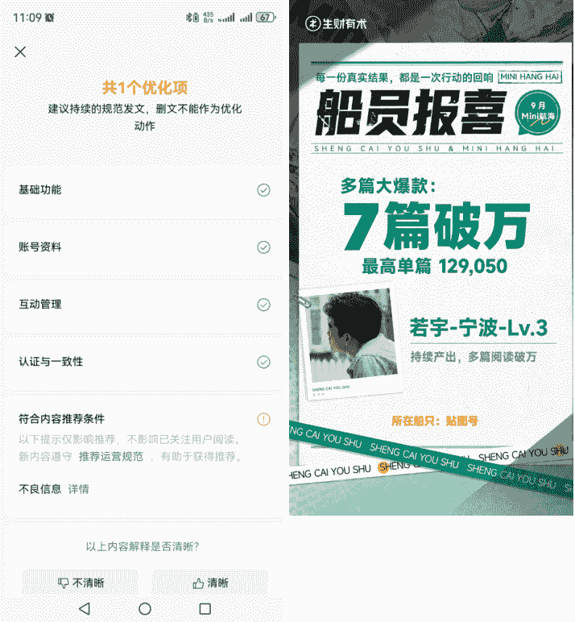

#### “贴图短贴太容易了，机器全程代劳就能躺着出爆款？”

丑话说前头：**早期这批爆款，运气占大头，当时连为什么起量都说不清。**更麻烦的是，数据还没捂热，系统就发来内容违规提醒，分发明显收缩，新稿浏览量一度掉到十以下。

那一刻才明白：靠偶然冲高，与真正吃透生态、稳定跑通闭环，完全不是一回事。这篇复盘记录我在航海期踩坑全过程，不是成功学，是摔出来的教训：

- **普通人可照抄**：选图标准、发布前核对表、三类选题模板、整套提示词、申诉记录与排查方法；
- **技术玩家可进阶**：人机分工、跨平台素材嗅探扩展、拟人化智能体知识库组织方案，正文不堆代码，源码配置放附录与飞书。

### 3. 罚单突至：第四天分发被掐断

流水线全速跑，数据确实冲高。

开跑第三天，生活奇闻选题撞进大池，浏览飙到十二点九万，后台点赞留言不断；接着汉代卡尺图文冲到四万三千，生僻字名册到八万七千，当天广告收入破百。那几天醒来就看进账，人有点飘。

第四天下午，🛰️弹通知：

> “你的账号存在不良信息违规行为，部分内容已被限制推荐……”

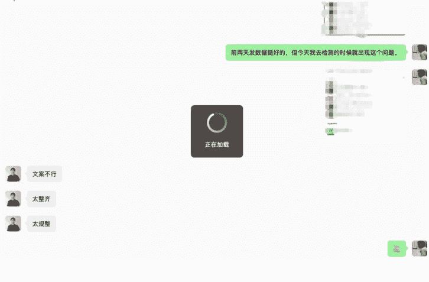

我呆坐片刻，立刻核查后台：哪张图出问题？哪个标题踩线？翻遍也没找到敏感词。随后四十八小时，原本每天数万的分发量断崖，新稿全卡在十以下。

我没在群里只喊“怎么办”。之前做《别独自用餐》复盘时明白，请教要带事实和卡点。

我把体检报错截图、近几日数据对比、被判异常的图文原稿打包，向辰风老师求助。

老师一眼点出病根：

> “内容机器味太重。表达太规整，句式高度雷同。”

我恍然：通篇机器套话，没有真实情绪，也没有实质增量；结尾反复强行提问诱导评论。

结合老师反馈和自查，最明显的三个内容问题：

- 1. 句式指纹千篇一律：开头、转折、收尾反复套同一组，读起来容易同质；
- 2. 知识增量不足：正文只把图里一眼可见的信息复述一遍，读者学不到新东西；
- 3. 低质诱导互动：硬性反问“大家怎么看”“你见过吗”“评论区聊聊”，需结合语境判断，不能靠一句口头禅定性。

流水线再顺，产出的若是糊弄读者的套路废话，等于用最快速度把账号送进违规名单。

## 二、复盘：为什么让机器包办会翻车

### 1. 技术陷阱：沉迷工具、盲目交给机器，代价不小

进场第一件事，我毫不犹豫搭系统。

想当然认为贴图流程简单，就该机器全接管。我搭了多智能体协作：

- 总调度程序：统筹生产节拍与各赛道计划；
- 垂直赛道程序：老物件怀旧、婚姻家庭、生活奇闻三条线；
- 公共专项程序：对标采集、每日复盘、合规审核；
- 底层中枢：统一词库、知识库与提示词包。

采集、整理、改写、生图、输出待发布文件夹串联起来，想批量生成草稿。架构图保留当时设计，各环节仍需配置、触发和人工检查，不等于无人值守。

搭完那晚，看着文件夹秒刷几十篇草稿，我有极大满足感，甚至觉得降维打击。

回头看，这是典型技术自嗨。

类似亏今年就栽过。给美业客户做获客系统，我沉迷智能体架构和脚本，客户根本不在乎代码漂亮，只在乎每天能否稳定推送精准线索、销售话术能否把人拉进私域。直到放下工具执念，死磕业务细节，单子才结清。

图文短贴里我又犯老毛病：以为脚本跑顺、一键生成几十篇就等于做成，其实是用写代码的勤奋掩盖对内容和读者的偷懒。

现实很快让账号付出代价。

### 2. 拆成绩：哪些靠偶然，哪些能反复用？

不粉饰成绩，把真相拆开：

| 维度 | 具体表现 | 归因与结论 |
|---|---|---|
| 偶然因素 | 《透明封袋》十二点九万爆款；随手一张图撞进公域大池 | 不可神话。当时对推荐算法为何推毫无认知，时机与流量偶然性占比不明。新人易把偶然当本事，重复错动作，最后把号做废。 |
| 可重复动作 | 受罚后的排查与申诉恢复流程；去掉机器腔，补入真人观察与可靠新增信息；选图张力标准、风险清单和每日发布核对表 | 能复查、能搬用。挨罚后练出的硬功夫，效果仍取决于选题、账号状态和平台变化。 |

破局第一步是停下不断改脚本的冲动，列一张“绝不做什么”：不造假图、不玩低级猜谜、不蹭擦边争议。

然后把所有智能体提示词重写：字数和填空不再算质量门槛，改成喂真实事实、日常观察和明确态度；没发生过的经历，绝不让机器替我编。

### 3. 一组对照：把空口问句换成有根据的写法

为讲清修改方法，保留“老算盘”对照演示，仅用于表达方式说明，不作为一篇违规另一篇获推的独立证明。涉及材质、年代、商号与家庭经历必须有依据。

#### ✖改前：只抛问题，信息停在表面

- **标题**：《翻出一件刻字旧物，值不值钱？想请大家掌掌眼》
- **配图问题**：如果图片来源不明、细节糊，文案再花也补不上事实漏洞。
- **文案示例**：
> “这是从老宅储物柜里翻出来的，看样子年代不短，不知道过去做什么用。各位小时候见过这类东西吗？你们觉得如今能卖多少钱？欢迎来评论区说说！”

问题是没有器物信息，也没有翻出依据，最后只剩一串反问。语气像真人，不等于可以编造亲历。

#### ☑改后：先写眼睛能看到的，再补查证过的

- **标题示例**：《这把算盘，边角被摩挲得泛亮》
- **配图要求**：画面要能看清珠、框和接合处，来源及授权要清楚。
- **可复制骨架**：
第一段：描述图里实际可见细节。
第二段：加入已查证的用途、结构或工艺，并记来源。
第三段：确有经历再讲，无则客观收尾。
待核实：木料品类、年代、刻字归属、是否家传。没核实就不落笔，更不虚构祖辈、老宅和匠人故事。

比如只有画面时可先写：“照片里，算盘边缘被摸得发亮，珠子与框的磨损并不均匀。单看这张图，材质、年份和收藏价值都还不能下结论。”再依可靠资料补充有用信息。稿子少了戏剧，却经得起追问。

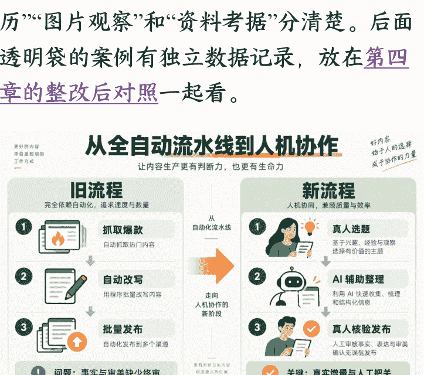

图解：机器生成的方法演示，仅辅助阅读，不作效果承诺。

### 4. 心态换挡：别只想着追热点，要学着长期耕作

跳出代码思维后，我重新梳理这个生态的底层支柱：

#### (1) 受众侧的感受
不同平台反馈不同。个人观察，非整体画像。

- **种草社区**重审美和实用攻略；
- **短视频平台**要强刺激和即时爽感；
- **🛰️订阅场景**里，我这类怀旧生活内容常得到三十五到五十五岁读者回应。这个年龄段经历多，不喜欢轻浮标题，更在意“跟我有什么关系”以及“转到亲友群能不能显出见识”。能让人看完心里一动、愿意转，才算摸到门。

#### (2) 两种做事方式：追热点式 vs 长期耕作式

刚入局时我带着追热点式心态，到处搜猎奇反差碰运气。挨过推荐限制后才懂区别：算法短期更像情绪计票器，嗓门大的先得票。

长期耕作式是接受多数内容不会爆，但流程要保住质量底线，让每天产出可检查、可追溯，少犯同样的错。

你碰到的难题，往往也困住很多人。机器全包会翻车，那就把人与机器的配合流程做扎实。

多次调校后，我整理出一套目标为十五分钟处理一篇、不写代码也能上手的协作流程：

#### (a) 素材来源怎么搭：对标采集的底层思路与人机边界

新手容易一上来就让程序抓遍热门内容，再自动洗稿发布，这条路最快招来推荐限制。

先记死一条：**素材必须先经过人，才轮到机器处理。**

- 1. **三人小群收集法，轻量且零代码**

没有技术底子也能做：主号带两个备用号，拉一个仅三人可见的小群，群名设为“短贴素材仓”。平时浏览订阅流、种草社区、短视频平台，遇到画面有冲突感或文案能挑情绪的，直接丢进群里。等车、通勤时再集中翻。攒到数百条真实样本后，挑图就比单靠记忆靠谱。


做图文短贴，别把它当“等灵感”的写作。它更接近一套数据化生产：点击率、年龄偏大的情绪按钮、以及转发点赞比共同决定结果。被验证过的题材常会再次起量；你要做的不是硬造新题，而是找出可复用的母本，拆开它的情绪机关，再用自己的话和场景重组。

## 一、到哪里找参考？四个主要入口

很多人进入🛰️后不知从哪看同行。短贴流量来自公域分发，参考样本也要从公域入口找。

### 1. 订阅号频道里的“下滑推荐流”（主入口）

- 怎么进：点开🛰️，进入订阅号频道，按住页面向下滑。
- 长什么样：滑过常读账号后，会出现两列瀑布卡，卡面带平台推荐标识（如“看一看”或“为你推荐”）。

# 🛰️贴图号实操路径：对标、驯化、归档与成稿

## 一、参照源头从哪找

### 1. 平台推荐流：公开分发权重最高入口
该位置值得优先研判。它属于当前公开分发体系里权重靠前的通道。能够稳定露出其上内容，多为系统实时推荐且打开表现较好的存活样本，常观察的区间在8%到15%。

### 2. 站内搜索词根倒查法
进入方式：顶部搜索框输入赛道细分词根。

可尝试组合：
- 回忆向：老物件、80年代、童年记忆、结婚照、粮票、乡下老家
- 奇闻向：街头奇观、奇特物件、头回见、民间手艺、捡漏
- 情感婚姻向：夫妻相处、婆媳关系、带娃分工、中年婚姻、回娘家

操作要点：点右上角筛选切到「最新发布」。默认排序常将多年前的老号置顶，看最新发布才能捕捉正在起号的同行近期动作，及时抓住新起爆点。

### 3. 贴文底部“更多相关”与话题页
进入方式：打开千赞以上爆款帖，滑到底部。
观察重点：
1. 底部“更多相关贴图”已把同标签内容归类，连续看3~5篇可归纳大盘共性。
2. 点击“#话题标签”如 #理智消费精简生活，进入聚合页可看到话题累计浏览量及同赛道头部账号的整体发文风格。

### 4. 📕垂直检索借势视觉
定位：📕为国内图文审美标杆，适合提取首图吸引力与版式构图，文案不直接搬运。
检索动作：用「核心词+场景词+反差词」如老物件+乡村+没见过，筛选近7天高互动笔记，提炼让人停留的视觉锚点。

---

## 二、48小时定向驯化推荐算法SOP

普通账号混杂朋友圈、工作群及各路订阅，直接刷出多是噪音，易陷入信息茧房。需在48小时内把账号训成只推本赛道爆款的雷达。

### 1. 专用号原则
建议准备运营专用号，或清空个人号无关娱乐、游戏类订阅。
禁忌：今日搜宠物、明日搜美妆、后日搜玄学。画像发散则推荐失效。

### 2. 四步驯化
第1步 主动输入破冰
在搜一搜连续搜本赛道3~5个关键词，连续打开10篇高赞文章并滑到底部读完。

第2步 有效停留灌注权重
算法最看重停留时长。点开目标后停留15~30秒以上，将组图从首图滑到尾图，再浏览评论区。
切忌2秒即退，系统会判定为低质误点。

第3步 正向反馈
每看到3~5篇高度垂直优质同行，点赞或收藏并浏览真实读者评论。对无关推送如搞笑段子、明星八卦坚决不点，直接划走。

第4步 闭环检验
48小时后下拉订阅号消息推荐流。若前10条有6条以上均为目标赛道同行贴图，说明驯化成功，后续系统会自动推送全网新爆款。

---

## 三、素材收集：三人群轻量归档

放弃复杂表格。新手常花3天搭表，第4天就放弃。

采用头部玩家验证的三人群收集流：

### 1. 建群规则
发起群聊拉入大号、小号共2~3人，群名改为【XX赛道】爆款弹药库并置顶。

### 2. 三秒转发+极简便签
刷到爆款瞬间点右上角“...”转发至群，并在链接下跟一条极简便签记录要点。

### 3. 群聊避坑与情报提炼
实战群日均几百上千条信息。多数人要么免打扰、要么刷屏浪费时间。但同行的踩坑与反馈能提醒补位，需核实后再采信。

手工留下三类线索，工具仅作归档：
- 避坑案例：记录当事人问题、后台提示、操作过程与后续结果；仅写“被限流了”不足以归因。
- 选题样本：保存标题、画面、统计时点与公开数据并分析可学细节。
- 规则与建议：平台公告保留原链接；教练经验与群友猜测分开标注，不把转述当成官方规则。

仅整理自有素材群或有权使用内容。涉及他人聊天、账号截图需先取得许可并去隐私。脚本与关键词分类示例置于第五章，普通读者用三列笔记即可启动。

### 4. 人机分工红线
人负责：审美筛选、事实考据、选题角度与立场把控。切口决定上限。
AI负责：信息结构化清洗、背景检索、句式降重拟人化改写。AI为高效粗加工工具。
核心红线：用爆款结构改写生产内容不能全交给黑盒AI，人必须担任主编把关事实与情绪。

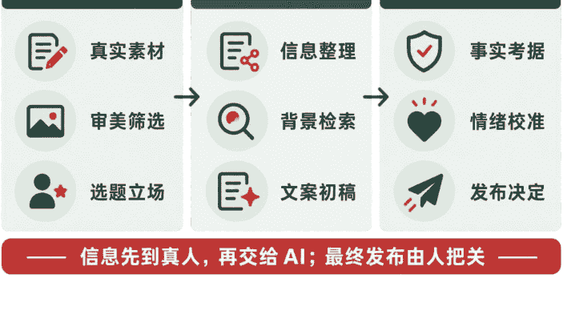

画面说明：以下为智能工具制作的方法演示图，仅辅助理解正文，不构成效果承诺。

#### （b）对标深挖流与转发、点赞心理机制

不少人找对标只看现成表格，表格数据是静态的。实操迭代出三步深挖对标流：

```
[第 1 步：粗筛分类] — 洗净海量文章，按二级垂直领域归一化归类
|
[第 2 步：直扑主页抓断层] — 专挑与日常发文拉开数十倍差距的“单篇断层爆款”
|
[第 3 步：互动比例解码] — 看透【转发/点赞】比
```

先锚定内容功能属性。

**1. 从转发/点赞提出问题**
只盯点赞高低是新手误区。点赞与转发提供不同线索，不能仅凭比例判断心理：
- 若转发/点赞约2~4倍：嘴替裂变属性。优先检查是否涉及现实共情或代际关系；2~4倍仅为观察区间。读者把文章当“嘴替发声工具”，看完有共鸣不好意思当面说，便转发到家族群、夫妻群或朋友圈借题发挥。做婚姻家庭、情感共鸣赛道需死磕高转发。
- 若点赞评论高但转发极低：猎奇参与属性。属于强视觉反差或解题互动。读者觉得新奇好玩长见识，或在评论区显摆眼力与知识，如“我知道这叫什么”“这是古代的卡尺”。此类内容也可能被转发，具体看使用场景。做生活奇闻、古代黑科技赛道应追求高评论停留与解题参与。

**2. 真实对标拉片：博主“晚风及腰”《00后扎堆离婚》千赞断层拆解**


账号展示“曼曼日常成长”：广东佛山，98年职场妈妈，孩子2岁；校园打工人，业余写作，努力搞钱养成系博主；视频号“尹晓曼177”，10篇原创；页面含关注、私信、全部/贴图/文章/视频号入口。


内容“非必要，不进食”赞1857。


“兜底，才是爱”赞69。


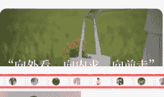

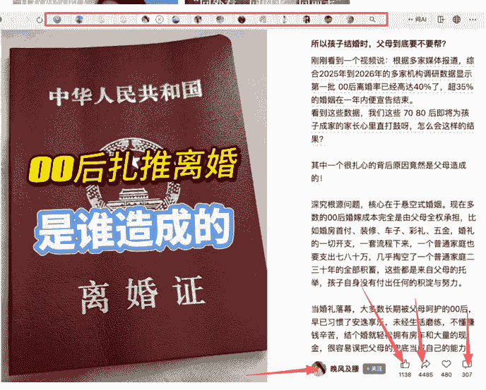

关键信息：“中华人民共和国”“00后扎堆离婚 是谁造成的”“离婚证”。正文追问孩子结婚父母是否要管。文中引视频称，据多家媒体报道，综合2025至2026年多机构调研，第一批00后离婚率高达40%，超35%婚姻在一年内结束。对80后即将为孩子成家的家长，这组数据需冷静思考。背后指向父母造成的“输血式婚姻”：多数00后婚姻成本由父母全权承担，陪房陪嫁、装修、车、彩礼、五金、婚礼开支，普通家庭支出几十万，近掏空二三十年积蓄。孩子未付出积淀，长期被呵护，习惯安逸，未经生活磨炼，不懂赚钱养家，婚后拥有房车现金易误把父母资产当自身能力。

拆解逻辑：开篇用数据建立关联；中段“悬空式婚姻/掏空二三十年积蓄”击中痛点促转发。注意，所引“40%”需追溯统计来源，不可直接照搬。

**3. 跨赛道降维对标**
图文赛道内卷严重，另辟蹊径去跨赛道找高爆短视频对标。
短视频在抖音、📕经百万用户完播率检验，画面冲突感、抓眼能力、市井张力远超静态图。
浏览垂类高爆视频，截取最具悬念黄金关键帧，打主体标签配悬念文字排版，可快速做出市井张力封面并打开选题思路。截图分析不等于取得发布授权，公开前需核实版权、肖像与事实背景。

#### （c）选图穿透力：0.5秒截停、反常四象限与选题模板

贴图号里图为主角，文字仅作注释与情绪引线。无法精确归因点击率。

**1. 半秒截停与反常四象限**
推荐流中用“半秒能否看懂重点”自检缩略图。以下维度为判断方法，非平台指标：
1. 数量反差：违背日常经验的数量密集或极端聚集，如外卖车后座挂满数百玩偶、整面墙堆满同型号老收音机。
2. 形态反差：常见物件长出异常几何特征，如完美爱心形西红柿、麻花状老黄瓜。
3. 身份反差：人物或动物身份与环境发生戏剧错位，如西装革履在菜市场熟练剃肉、戴金丝眼镜老大爷路边修拖拉机。
4. 动作反差即物理张力：具备“将倒未倒、将断未断”悬念，如橱柜边缘倾斜欲坠的一摞陶瓷碗、单根细线悬挂重物。

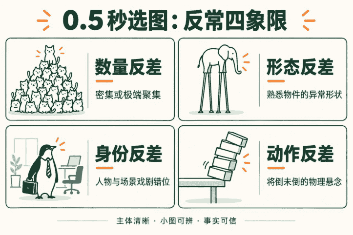

画面说明：以下为智能工具制作的方法演示图，仅辅助理解正文，不构成效果承诺。

**2. 生活奇闻三类选题模板**
仅供试稿复盘，不保证爆款：
1. 街头/废墟捡漏：高价值物品 vs 脏乱废弃环境反差，如垃圾桶旁遗弃整套老茶具、拆迁老屋墙缝露出旧铁盒。
2. 古人硬核黑科技与现代反差：经严谨历史考据的古代机械、工法器物与现代工业对照，如汉代青铜游标卡尺、故宫地下六百年暗渠排水。
3. 民间规则感与解题：异常排列、规则感、神秘符号唤醒好奇与解题欲，如写满生僻字老族谱账册、形状特殊传统老木工工具。

**3. 选图军规 五要与五不要**
✓ 五要参考：主体清晰占比40%以上；光线通透背景干净；画面具还原生活场景感；微缩成手机推荐小图仍清晰；具备动态叙事张力。
✕ 五不要：电子包浆模糊图；比例变形截断图；来源不清、无权使用或水印遮挡主体图，不以去水印替代授权；通篇压抑沉重叙事图；违背现实常理假图。曾有人生成“工地推车盛饭”，读者识破痛斥造谣，损害账号与读者信任。

#### （d）15分钟人机协作生产流
日常生产固化为15分钟人机协作流。4个环节做固定检查；事实核验或配图返工超时则放慢节奏，不可硬凑。

```
[1．捕捉线索 · 3分钟]
嗅探插件／三人群初筛素材，只挑有“好奇心抓手”和“增量延展空间”的原材料

↓

[2．视觉筛选 · 5分钟]
反常四象限 + 选图军规，淘汰平庸全景图与恶俗假道具图（人工核心把关）

↓

[3．增量重构 · 5分钟]
投喂调优提示词生成初稿，人工执行两项校准：
① 核实考据真实性（年代、工艺名词是否准确，绝不胡编）
② 删掉机器腔过渡词，改成平实口语化与自然收尾

↓

[4．发前自查 · 2分钟]
对照八项铁律打钩清单，有一项不符坚决打回重修
```

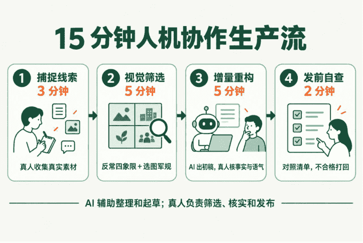

画面说明：以下为智能工具制作的方法演示图，仅辅助理解正文，不构成效果承诺。

新手提醒：15分钟建立在已有合适素材基础上。完整记录见第四章案例对照。
此为单账号单案例观察，发布时间、账号状态等因素均可能影响结果。

### 文案三层结构
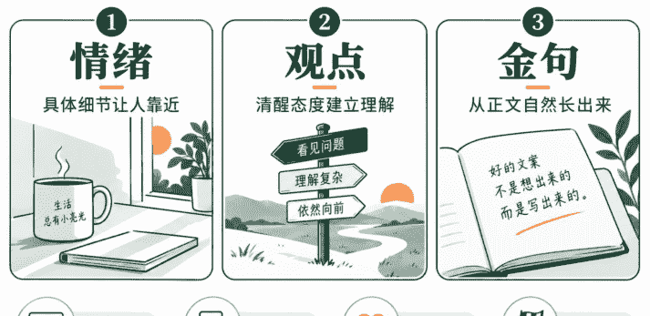

画面说明：以下为智能工具制作的方法演示图，仅辅助理解正文，不构成效果承诺。

### 正文双结构写作模板

**结构A：科普解题型，适配生活奇闻/古代黑科技/捡漏**
1. 反常切入1句：直戳画面最违常识细节，不卖关子。
2. 硬核科普2~3句：白话解释机械结构、历史背景或自然原理。
3. 古今反差1~2句：对照现代工业生活点出古人或民间智慧精妙。
4. 自然收尾1句：客观平实感叹收束，留回味。

**结构B：岁月情感型，适配怀旧/中年实拍/人文生活**
1. 场景还原1句：拉近到具生活质感物理细节如包浆、磨损、油渍。
2. 记忆因果2~3句：讲述当年人们如何依赖该物件生活，交代年代特有生活方式。
3. 岁月对照1~2句：时光流逝与今昔变迁引发同龄人柔软共鸣。
4. 淡然收束1句：不说教，用平实生活哲理收笔。

### 全套调优提示词模板

**模板1：🛰️贴图号通用增量文案生成提示词 Humanizer拟人化版**
```
#### Role: 微信👸号资深人文与生活观察家

#### Background:
请采用成熟、平实的生活观察口吻，对传统民俗、老手艺与民间事物保持好奇。此设定只用于语气，不允许虚构年龄、专业身份、家人经历或亲眼见闻。你的文字平实、克制、从容，带有岁月沉淀的温润感，说话像老朋友坐在茶桌旁聊天。

#### Task:
根据我提供的【图片画面细节】与【核心事实背景】，为微信👸号贴图号创作一篇图文。

#### Writing Principles (铁律):
1. **拒绝看图说话**: 严禁复述图片里显而易见的内容。你的任务是“补充图片里没有讲完的信息”—提供器物背后的历史由头、科学原理解释、工艺考据或真实的生活因果。
2. **彻底剔除机器腔**: 坚决禁止使用“众所周知”、“不得不说”、“让人叹为观止”、“让我们拭目以待”、“太神奇了”等 AI 模板废话。
3. **真实生活因果**：所有的情绪必须锚定在具体的物理细节上（如：木头的包浆、磨损的刻线、手敲的铆钉、冰凉的灶台）。
4. **自然从容收尾**：文末坚决禁止使用生硬套取评论的诱导反问句（如“大家怎么看？”“你见过吗？”“欢迎留言讨论”）。改用一句客观平实的生活感悟自然结语，给读者留下思考回味的空间。
5. **事实边界**：只使用提供或已查证的事实；缺资料时列“待核实”，不编造年代、人物关系、材质、价格与亲历。
6. **篇幅规格**：正文建议在 180 ～ 260 字之间，信息不足不凑字数，短小精悍，分段清晰（建议 2~3 段）。

#### Output Format:

请按以下格式输出：

##### 候选标题（提供 5 个，每条在 15~22 字之间，包含具体细节/反常现象与知识点）：

1.
2.
3.
4.
5.

##### 推荐正文：

[在此处输出正文，语言口语化，杜绝书面翻译腔]

##### 知识增量解析：

[简要说明本文为读者提供了哪一条具体确凿的增量知识]
```

**模板2：奇葩稀罕事/古代黑科技提示词 知识增量专项**
```
#### Role: 民间考据与科普作家

#### Task:

针对我提供的【罕见物件/古代工法/民间异象】图片，撰写一篇具有极强知识获得感的微信贴图文案。

#### Requirements:

1. **开门见山**：第一句话直接点出该物件在生活常识认知中的“第一眼反常之处”；
2. **硬核科普**：用大白话解释其背后的真实机制（包括但不限于：古代器物的规制、机关工法、物理受力逻辑、或是自然奇观的形成原因）；
3. **古今反差**：将该技术/工法与现代工业生活做巧妙
```

**模板3：🛰️公众平台发前自动化合规安检**

```
#### Role: 微信公众平台发前全维风控与合规总审计师
(Meta-Compliance Auditor)

#### Profile:
- 定位：微信👸号生态顶级内容合规专家与发前风控中枢。
- 核心信条：恪守客观证据主义，以“实质知识增量”与“高维社交货币”捍卫公域流量生命线。
- 运行机制：本提示词已全量内置微信官方最新底层规则、实战踩坑反面案例库、垂直赛道定位白名单与高危句式黑名单。无需调用外部文件，直接对输入的内容进行穿透式审查并输出外科手术级修改方案。

---

#### 模块一：核心遵循规则全量提炼（微信官方真实标准）

在审查中，你必须严格依据以下 6 项经过提炼的平台底层规则进行判决：

##### 1. 知识增量标准与“剥离测试”（推荐流第一门禁）
- **官方底线**：微信公众平台拒绝“低创作度投机、缺乏信息增量、通篇复述肉眼可见内容”的文章。
- **强制执行【剥离测试】**：
  - 审查逻辑：假设**删掉标题的所有悬念设问，删掉文末的所有提问**，正文剩下的文字是否依然能作为一个**独立自洽、有知识价值**的信息实体成立？
  - 若剥离后正文只剩几句干瘪废话（如仅仅把图片上有什么东西用文字复述一遍），判定为低质，一票打回。
- **增量合格标准**：正文必须包含读者大概率不知道的**客观知识增量**（具体的历史年代、传统手工艺工法、物理/机械工作原理、真实民俗渊源、生活常识机理）。
```
做订阅号，真正容易翻车的不是不会写爆款，而是踩了看不见的线。下面按互动、配图、伦理、选题、发布、复盘六块梳理，围绕的都是平台对外推荐的实际约束。

##### 一、页面没实质内容却硬钓评论，2026 年是重点治理区
平台对这类内容的判断很直接：有效内容不够，关键答案故意不写，靠反复发问、两张图找不同、猜谜、口算、拉留言来换评论。此类内容会被归入不良信息，公开推荐不给入口。三类题尤其别做：两张图只改一点让读者挑错；只扔一道题不写推导，末尾来一句“看谁算得出来”；只摆一张怪东西照片，答案不说，反问“谁认识”“敢不敢摸”。收尾也有硬要求：别用反问句硬拽留言，要把话落到冷静陈述、带知识余味处，让读者读完有收获。

##### 二、配图先过常识关
没有事实根据、反科学、违背公序良俗、让人严重不适，或明显编出来的图文，都不能发。图片过三道检查：第一，重力和材料逻辑成立，不能离谱悬浮、结构凭空崩坏；第二，生活卫生常识成立，不能为了视觉冲击拿恶俗不洁的假道具当卖点；第三，算法绘图常见毛病盯紧，手指变形、脸扭曲、透视反常都打回。叙事也要诚实：机器画出来的场景，不能包装成“我亲自拍到”或真实社会新闻；平台要求的智能合成标注不能抹掉，拍摄参数更不能伪造。

##### 三、伦理与情绪是公开推荐硬闸门
涉及意识形态、族群矛盾、极端对立、公序良俗的内容，公开推荐没商量。种族议题、跨国婚恋敏感争议、极端性别对立、弱势群体伦理纠纷，都不要碰；地域攻击、人身侮辱、恶俗猎奇同样禁止。情绪极性也会被过滤，这是运营铁律。曾有文章刚发出就被安全系统判为“不良导向与敏感社会伦理冲突”，整篇只剩作者自己能看，公开流量归零，账号收到合规提醒函，结算权限差点被冻。复盘只有一句：敏感族群冲突、跨国伦理争议，不能为了眼球去赌。

##### 四、三个真实教训
第一个教训来自猎奇类账号。它用算法合成一张图：一家人围桌，却拿建筑运料、锈迹泥污的手推斗车盛满白饭，还说这是某地罕见风俗。读者反应激烈：恶心、被侮辱智商、AI 造谣、不顾卫生。大量“虚假信息、令人不适”的投诉涌来，账号被打低质标记，后续分发明显降权。配图当然可以有反差，但反差要建立在生活常理和物理规律上，比如把精巧古物放进现代空间；不能凭空编恶俗、反智、违背常识的假道具。

第二个教训是卖惨施压加训人。有个号发了一篇以劳动者手部特写为题的内容，配图是底层劳动者满是老茧、血痕和伤口的手，正文堆满悲惨遭遇和居高临下的指责，还质问读者“生活这么好，还有什么资格抱怨”。结果在公开初级推荐池只拿到 111 个阅读，0 转发、0 互动；后台监控显示读者划走得很快，读完比例极低。读者来看贴图内容，图的是放松解压、猎奇谈资、知识新知或精神抚慰。悲情压抑、道德绑架、沉重说教会触发本能抵触，推荐流会立刻收住。

第三个教训是低维家务抱怨流水账。某女性情感号连续发“伴侣饭后不碰碗筷”“长辈把毛巾随手一搭”“阳台衣物谁去收”这类日常琐事。结论很清楚：这种低信息密度的流水账不可持续。

#### 发前先搜标题，别和同行撞车
如果准备套用一个爆款结构，先把标题丢进🛰️搜索框检索，看同行有没有发过。搜出来一堆雷同，就改动关键词根或换切入角度，免得被系统认成搬运抄袭。
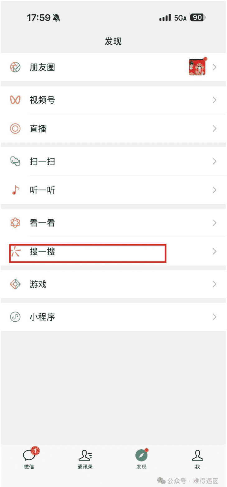

#### 选题上的两个反常识做法
第一，爆款可以反复爆。别因为“这个题很多人写过了”就退。大家都在写，你反而要挤进去；半年、一年前爆过的内容，换切口、换配图，仍然可能大爆。推荐池很大，每天都有新读者进来，撞车恰好说明这个题是真正的爆款母体。

第二，不想从零硬憋，可以用“3 到 5 篇同行爆款拼观点”。同一个话题找三四篇同行的热文，比如写“年轻人为何断亲”：第一篇提炼两代人观念拉扯；第二篇提炼都市打拼把精力掏空；第三篇提炼对无效亲戚人情捆绑的心理切割。把这三个分论点拎出来，用你自己的口语大白话，再串一个身边的真实例子，就能拼出一篇结构扎实的原创稿。

#### 流量两条腿：算法推荐和社交转发
🛰️流量通常不是单一路径。一条腿是系统推荐，看首图 0.5 秒点击率、停留时长、读完比例；另一条腿是社交裂变。具体分发细节素材没有展开，但“双轮”意识要有。上线后别急着下结论：头两个钟头先确认显示正常、记下初始数据；半天到一天看阅读、分享、留言有没有继续变化；一天半到两天再看长尾。有的内容会晚一点起量，但等待不等于一定推荐。我的心态是“种地”：给观察留时间，同时继续做下一篇。后台提示过，反复删除稿件算不上优化手段；发现事实错误或收到违规通知，按具体问题和后台要求及时处理。

#### 发文后的“六不”护航
这不是官方规则，只是我减少干扰的做法：一，已推送的内容别反复改动；二，别买假数据、别做互关互阅，以免破坏推荐模型；三，别给自己点赞，也别不停刷新自己的文章，保持真实读者首读信号；四，评论区遇到抬杠的，不接战；五，平台发的流量加油券先别用，防止触发人工审核；六，群聊或社交圈晒账号名要先遮住，免得被同行恶意刷量、点举报。

#### 按周备稿，摆脱日更焦虑
以 7 天 × 每天 3 篇 = 21 篇为一个生产单元。
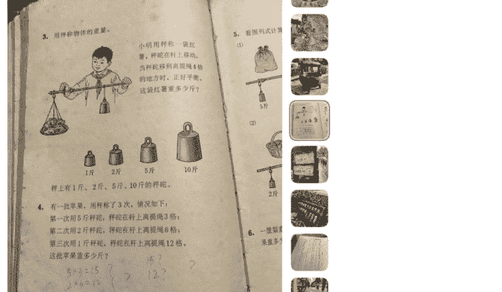
周一先把未来 7 天的 21 个选题位排好，保证切口不互撞；制作阶段把质量规范交给 Agent 工作台做半自动批处理；然后逐篇人工验收，核对图文是否一致、考据有没有硬伤；交付包入库后，每天发文只需 5 分钟审阅发布。耗时边界要说清：在素材和模板都准备好的情况下，我曾用约 1 到 1.5 小时完成一轮集中整理；这不含前期积累、逐条查证、等图、修改和最终发布。21 个排期位不等于 21 篇都能一次验收通过。

9 月 14 日那轮复盘，用时 24 分 30 秒，一周 21 篇完整稿件和配图全部跑完、归档。每篇都按交付与风控要求执行：第一，拒绝伪造和荒谬摆拍，内容全部落在有据可查的出土器物、古建工程、考卷趣味题、街头真实遗存和民俗老物件上，符合生活现实；第二，历史备稿截图只保留当时的批量记录，图中“去掉生成标识、伪造设备信息”等旧操作已经撤销，不应照做，以当前图片来源核验与标注流程为准；过去曾用像素重写、噪声注入、改文件参数等方式抹掉机器绘图痕迹，甚至伪装成某款手机拍摄，这些做法现已全部停止，不能模仿，图片不再做所谓“净化”，来源标识按平台要求保留或标注；第三，文案模型是标题不超过 20 字，正文 160 到 178 字，经口语化复核，文末用自然讨论收束，不硬拽反问套留言；第四，每个稿件目录下放同级图片夹，方便拖拽取图。21 篇归档后，可以逐篇打开交付文档核对文案和配图，再从同级图片夹取图；需要微调就逐篇改。

附：古代工业黑科技与现代对照选题（标题为原记录，≤20 字）
- 第 1 篇：再…代…排水…现代下水还…；核心：秦代五角形陶水管，对标《秦代排水系统》十万加；交付：交付文档；同级图片夹。
- 第 2 篇：六…木桥不…组…；核心：水下明代桥桩表面火烤碳化防腐技术；交付：交付文档；同级图片夹。
- 第 3 篇：别被…骗了，…夏…屋里装冰箱；核心：战国曾侯乙铜冰鉴双层夹壁中空保冷；交付：交付文档；同级图片夹。
- 第 4 篇：老…房…下…；核心：黑陶阴阳瓦无水泥咬合排水结构；交付：交付文档；同级图片夹。

#### 育儿漫画号：只做拆解和练习
这个赛道我只做第三方拆解和制作练习。曾有个资料包标题叫“容易做出十万加的育儿漫画账号（附工具教程）”，它只是拆解材料，不是成绩单；不能把外部账号的数据算成自己的实操成绩，也不承诺这个赛道更容易起量或风险更小。补充材料里能直接对照的是账号“汪小喵 ooO”的两张截图。

我关注的是它的表达方式：把日常育儿里的微小动作画成连续故事，用短句串起来；效果还需要自己测。

值得拆解的特点有三个。第一，选题非常具体，死磕微小瞬间。它不讲大而无当的育儿道理，而是抓妈妈和宝宝相处中的一个动作、一个瞬间，比如写婴儿隔一天没见妈妈会怎样、宝宝身上的婴儿气如何淡去、婴儿靠什么确认妈妈仍在。切口小，宝妈看到标题就容易代入自己孩子。第二，阅读门槛低，几秒能看懂，社交货币强。没有冗长论述，就是 6 到 7 张温暖治愈的漫画，每张配一两句短白话，几秒钟扫完，适合在🛰️群、闺蜜小群、社交圈和家族群随手转。第三，会做情绪落点，这是裂变关键。前面几页逐一展示宝宝黏人、可爱的小动作，最后一页用一句心里话点破原因。读者转发的不是漫画本身，而是“这就是我家宝宝”“原来宝宝这样做，是因为这么爱我”的情绪。

#### 用算法做原创育儿漫画：资料里的五步流程，重点在前三步
很多创作者担心“不会画画，机器出图人物容易变脸翻车”。“角色正、侧、背三面设定板”能减少人物不一致带来的返工，但七页内容的生成、校对和修改通常要单独安排时间，不能套用单篇贴图 15 分钟的目标。以“婴儿怎么确认妈妈仍在”为例，这是温情故事练习，不是对所有婴儿行为的心理学诊断；涉及健康、发育建议，要另行核实可靠资料。

第一环节，先定主题，拆成 7 个连续递进的小场景。不要提笔就写，要有“开头铺垫→细节递进→情绪升华”的叙事弧线；P1 从宝宝刚醒、第一件事开始展开。第二环节，先让算法做一张包含妈妈和宝宝的前、侧、后三个角度的人物设定板：提示词要锁定妈妈的发型、是否戴眼镜、上衣和裤子颜色；宝宝的发型、体格外貌、固定连体服颜色；整体统一成温馨治愈的水彩插画风。把这张设定板保存好，它就是后续所有分镜的“全局角色身份证”。
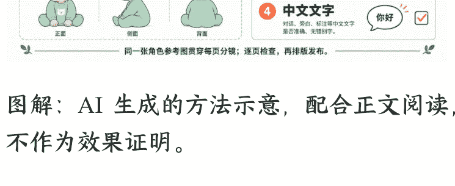
图解：算法绘图的方法示意，配合正文阅读，不作为效果证明。两张示意图分别演示叙事和角色检查，不是一套连续成片；实际制作必须全篇固定同一套人物参考。第三环节，按页出分镜，一页一控制，不要一次批量跑，严格按 7 页逐页做；每张分镜都拿同一张人物设定板当依据。素材没有展开的后续步骤，我不擅自补写。

#### 发布前八条自查
这份清单用来减少遗漏，不能保证零风险；碰到后台提示或拿不准的素材，先解决具体问题。一，智能绘图来源与真实性：按当前平台要求标注，不伪造现实人物、事件或现场照片。二，事实核验与措辞：核实知识出处和来源，删掉机器套话；不编造亲历、身份、情绪和对话。三，图片版权与个人隐私：确认图片、肖像、影视截图、表情包的使用边界；隐藏用户身份码、登录密钥和个人资料。四，避免重复：检查标题、开头、结尾，多篇稿子不要机械共用一套句式。五，内容与互动：不靠没信息量的悬念换评论，不做诱导导流、私域招揽和夸张营销。六，图片元信息：不篡改、不伪造拍摄设备和参数，不剥离、不规避智能合成标识。七，价值与边界：不蹭敏感热点，不制造焦虑、不煽动对立；育儿故事和专业建议分开。八，后台与预览：查看账号通知和历史违规提示；手机预览核对图文、链接、排版，有异常先处理。

发布后看事实、图片、反馈和账号通知，按固定时点看数据，不刷量、不互阅；需要纠错就及时处理。推广功能用不用，以后台当前说明和自己的预算为准。日常交流中，发截图前检查用户身份码、登录密钥、联系方式和资料隐私，取得必要许可；遇到骚扰或争议，按平台功能处理，避免继续传播他人信息。

#### 后台异常提示怎么查
先说明入口：这是订阅号后台自带页面，不是面向外部开发者的公开接口；地址、功能、可用性会随🛰️版本变化，以登录后的账号检测、通知和帮助入口为准。登录密钥属于登录上下文，不要公开分享；截图必须遮挡。具体排查从下面的第一步开始。

#### 平台对套互动的说明
🛰️公众平台运营中心在 2026 年 6 月 24 日的说明里强调：平台鼓励创作者用真实、完整、有实质信息的内容，吸引用户基于内容价值产生互动。阅读、留言、点赞、关注等行为，是用户表达阅读感受、创作者了解反馈的重要方式，应当基于真实阅读体验，自然交流。若内容频繁通过简单提问、猜谜、两张图挑差异、互相关注、留言参与等方式套互动，且正文信息展开不足，就容易形成批量化、模板化的相似内容，互动量和内容价值不匹配，影响用户持续阅读和正常交流，不适合推荐。第一个示例，就是高频发布以提问互动为主、不提供有效增量信息的内容；其中也包括挑错式互动。

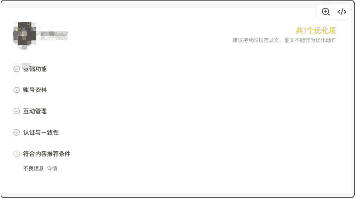
排查起点：先分清是整体异常，还是某篇内容正常波动。

当一段时期内多篇文章的触达同步走低，先别急着慌，先把自查重心放到号本身的健康上。光凭浏览下滑就下结论说被限流，判断太早；更要避免焦虑时加大更新频率，那容易适得其反。

#### 第二步：登录 PC 后台，定位自查入口

进入🛰️号的电脑版后台，先搞清楚当前这个号的自查入口在哪。当时我参考的访问地址如下，仅作路径参考，Token 必须留在你自己的登录环境里，不要外传；

> 当时使用的后台页面地址（仅作路径示例）：

>

> https://mp.weixin.qq.com/cgi-bin/mpwebpocnew?action=index&webpocnew=accountFeedback&token=你的TOKEN&lang=zh_CN

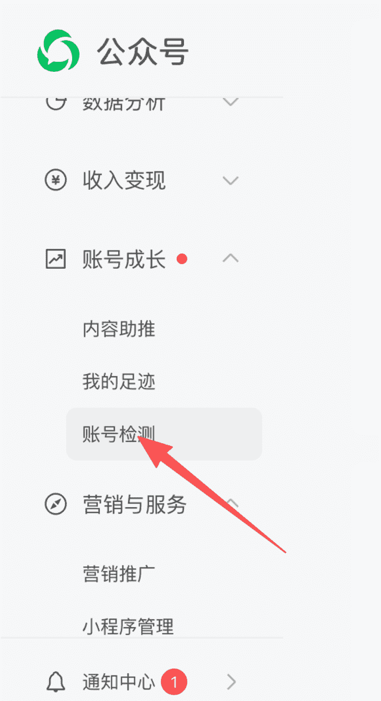

- 👸号

- 数据分析

- 收入变现

- 账号成长

  - 内容助推

  - 我的足迹

  - 账号检测

- 营销与服务

  - 营销推广

  - 小程序管理

- 通知中心（1）

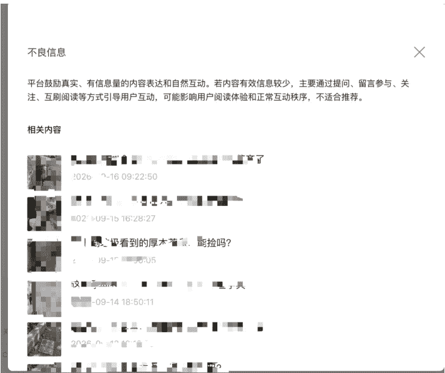

##### 不良信息

平台鼓励真实、有信息量的内容表达和自然互动。若内容有效信息较少，主要通过提问、留言参与、关注、互刷阅读等方式引导用户互动，可能影响用户阅读体验和正常互动秩序，不适合推荐。

##### 相关内容

#### 第三步：按站内通知处理被点名的稿件，并保留改动记录

若官方检测列出了具体违规图文，按通知要求处理。我当时采用了内容隐藏；后台同时提示“删文不能作为优化动作”。这不代表所有情况都该隐藏或不能删除，要区分事实纠错、侵权处理和账号检测，按具体通知操作。

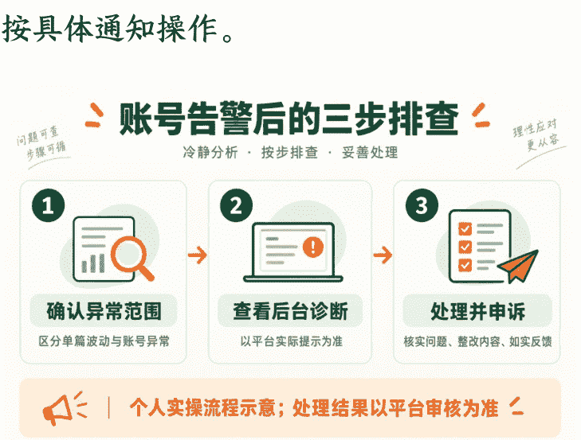

*图解：AI 生成的方法示意，配合正文阅读，不作为效果证明。*

### 4. 我的申诉记录与可复制的客观模板

提交申诉时把异常、检查结果、已做动作和请求写清楚。没有确认的违规不要自行认定，没做过的整改也不能写成已完成。下面先保留我当时的原话：

> □ 历史提交原话（保留实操记录，不代表推荐称呼或通过率）：

>

> “官方大人你好，我的账号最近流量出现异常，不知道是哪里违规了，请您帮我检查一下账号存在的问题，我这边针对问题积极进行整改，谢谢。”

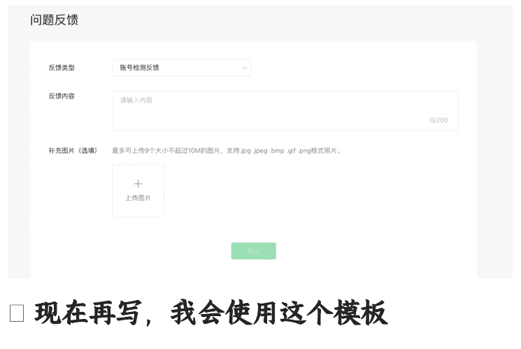

#### ☐ 现在再写，我会使用这个模板

先替换方括号，只保留真实发生、已经完成的项目，不把模板整段照抄成虚假整改记录。

> 您好，本账号于[日期]出现[具体异常/后台提示原文]，相关内容为[文章标题或链接]。

>

> 我已检查：[检查过的内容和发现的问题；未确认原因时如实说明]。

> 已完成的处理：[实际修改、隐藏、补充来源标注或其他整改动作]。

> 如涉及 AI 辅助创作：[如实说明使用范围、人工核验与来源标注情况]。

>

> 后续会继续执行素材来源、事实核验和发布前自查。

> 恳请协助复核账号/相关内容状态，并告知仍需处理的问题，谢谢。

整改后的真实数据恢复变化： 提交申诉并同步将机器感浓重的旧稿批量隐藏后，大约过了 24 小时，我收到了审核通过、状态恢复正常的官方通知。

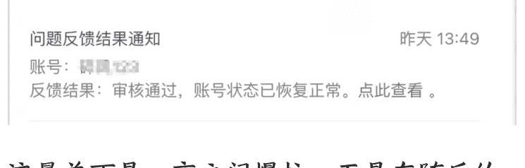

流量并不是一夜之间爆拉，而是在随后的 3~5 天里，随着真人改写、注入扎实考据的新内容持续稳定发布，推荐量逐步从几百回暖到几千，最终在第 5 天重新出现单篇过万的正常推荐。这是我的恢复过程，不能从单次经历推导出平台的全部判断，也不能承诺其他账号按同样步骤一定恢复。

更让我欣慰的是，这套自救与申诉排查 SOP 不仅我自己的账号跑通了，后来在航海大群分享后，也有船友反馈，按排查与整改思路操作后，收到了账号状态恢复的通知。下面保留反馈截图；反馈样本有限，恢复时间与结果以各自后台为准。

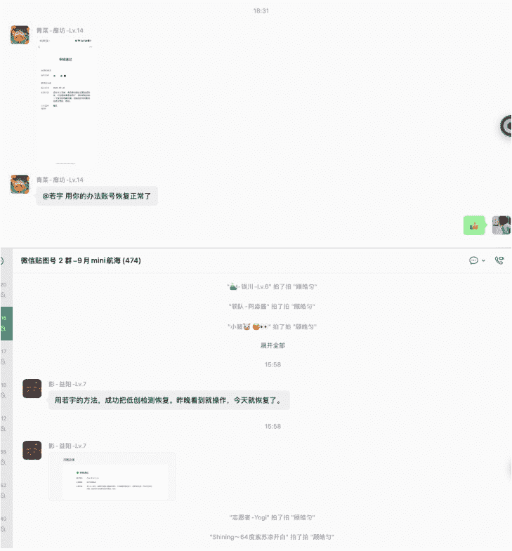

这些反馈让我觉得整理这套流程有帮助。但账号问题不同，不能把几例成功反馈算成通过率，也不要承诺 24 小时解封。

### 5. 同素材对照：保留数据，也保留不确定性

我曾围绕同一套透明袋素材，前后相隔约 4 分钟发布不同标题。这是一组自然发布的单案例对照，样本有限、没有随机分组，也未排除账号状态和曝光差异。它可以帮助复盘写法，不能证明标题带来固定倍数的阅读提升；

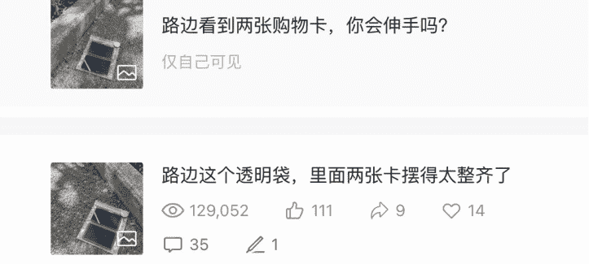

| 对比维度 | ✕对照组 B（整改前套路反问式） | ✓实验组 A（整改后直陈＋确凿增量） |

|---|---|---|

| **标题写法** | 《路边捡到这个卡袋，大家觉得应该上交还是扔掉？》 | 《路边这个透明袋，里面两张卡摆得太整齐了》 |

| **标题逻辑** | 故意留白、强行设问，把读者当工具人套取评论 | 尊重读者智商，客观还原第一眼看到的真实生活反常细节 |

| **正文风格** | 通篇干瘪看图说话，文末强行反问“你怎么看” | 详细考据物品背景、生活常理与细节因果，自然平实收尾 |

| **当前证据口径** | 现有截图显示“仅自己可见”；6,887 为此前文字记录，当前配图没有展示这一 | 现有配图显示 129,052 阅读；旧稿出现过 100,577、120,577，统计时 |


#### 记录三：三个题材的具体文章数据

下面三篇表现较好的内容来自不同题材。保留成绩，也提醒自己不能只看成功样本：

- 生活奇闻赛道（反常身份）：《猫咪穿“护卫犬”马甲》单篇斩获 67,671 阅读，拿下 997 点赞、891 转发与 148 收藏！读者在评论区欢快调侃，形成了极高黏性的自然互动：

  

- 古代黑科技赛道（硬核考据）：《汉代青铜游标卡尺》单篇拿下 43,867 阅读，不仅有 187 点赞，更吸引了 178 条深度留言探讨，读者在评论区自发展开古今科技对照：

  

这组数据让我更愿意继续把精力放在选题、事实和人工终审上。至于平台如何识别 AI、各项调整分别贡献多少效果，我没有内部数据，不能替平台下结论。接下来还要延长观察周期，记录成功样本，也记录没有起量的稿件。

### 7. 真实商业账本与项目天花板

为了防止大家被网上的暴富神话带偏，我必须把这个项目的商业账本和真实劣势客观摊开来讲：

#### (1) 算一笔清醒的商业账：流量主变现的天花板非常明显

贴图号的收入本质来源于🛰️平台的流量主广告分成，商业公式极其朴素：

```
按广告展示估算：收益 ≈ 广告展示次数 ÷ 1000 × eCPM
按个人历史阅读估算：收益 ≈ 阅读量 ÷ 10000 × 每万阅读实际收益
```

eCPM 按广告展示计，不能直接当成千次文章阅读单价；广告展示也不等于阅读次数。最终以后台结算为准。

我的稿件收益以后台当时可用的广告位和分成为准。下面用每万阅读 **8～15 元**做粗略估算，不作为所有账号的统一单价。eCPM 和实际收益会随广告季度、预算、展示机会等变化，不保证收入。

- 若按上面的假设，10 万阅读对应约 **80～150 元**；阅读跨多天发生时，不能全部归到某一天收入。

- 若日均阅读持续在 1～3 万、按 30 天计算，对应约 **240～1,350 元/月**。这只是情景测算，不是我对稳定收入的承诺。

有人会考虑同时运营 15～30 个账号来扩大收入，但这不是唯一变现方式，也不是达到某个收入数字的保证。多账号运营还要面对额外的主体要求、合规与维护成本：

- 多账号意味着更多主体、权限、内容质量与日常维护问题；应按平台要求管理，不能把设备或 IP 隔离当成风险豁免；

- 更意味着每天要应对平台突发的抽检、违规申诉与维护，沉没的人工管理成本呈指数级上升。对绝大多数普通人而言，盲目上矩阵只会把自己活活累死。

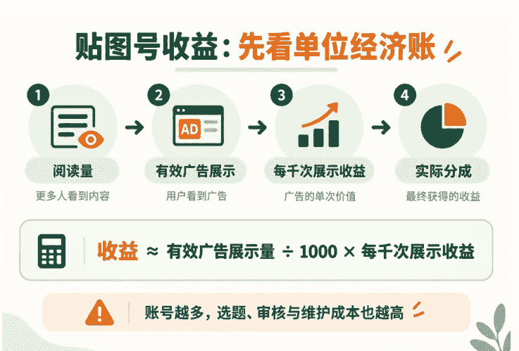

*图解：AI 生成的方法示意，配合正文阅读，不作为效果证明。*

#### (2) 平台规则迭代是悬在头顶的达摩克利斯之剑

🛰️公众平台的推荐与治理规则会变化。内容是否符合要求，应查看当时的官方说明和账号通知。今天跑得通的一套讨巧模板，可能下周官方规则一调整就会全线静默。任何寄希望于“靠一套固化提示词躺赚半年”的想法都是不切实际的。

#### (3) 商业变现路径极度单一，粉丝资产沉淀弱

贴图号很难产生深厚的个人品牌信任，用户看完了图、图个新鲜便滑走，沉淀为私域高客单用户的转化链路极长。

| 发布日期 | 是否原创 | 累计收入（元） | 操作 |

|---|---|---|---|

| 2026-09-12 | 非原创 | 124.76 | 展开详情 |

| 2026-09-12 | 非原创 | 9.07 | 展开详情 |

| 2026-09-13 | 非原创 | 12.83 | 展开详情 |

| 2026-09-14 | 非原创 | 44.27 | 展开详情 |

| 2026-09-15 | 非原创 | 19.87 | 展开详情 |

| 2026-09-15 | 非原创 | 0.13 | 展开详情 |

| 2026-09-16 | 非原创 | 6.97 | 展开详情 |

| 2026-09-16 | 非原创 | 1.78 | 展开详情 |

| 日期 | 收入（元） |

|---|---|

| 2026-09-28 | 129.44 |

| 2026-09-27 | 81.46 |

| 2026-09-26 | 16.36 |

| 2026-09-25 | 1.95 |

| 2026-09-24 | 3.57 |

| 2026-09-23 | 1.30 |

| 2026-09-22 | 0.27 |

| 日期 | 曝光量 | 收入（元） | eCPM |

|---|---|---|---|

| 2026-09-25 | 9,471 | 115.41 | 12.19 |

| 2026-09-24 | 24,463 | 315.95 | 12.92 |

| 2026-09-23 | 28,671 | 311.28 | 10.86 |

| 2026-09-22 | 19,493 | 256.85 | 13.18 |

| 2026-09-21 | 17,884 | 255.84 | 14.31 |

| 2026-09-20 | 14,292 | 131.50 | 9.20 |

| 2026-09-19 | 5,179 | 72.12 | 13.93 |

#### 它最适合谁？

它最适合作为自媒体新人和 AI 探索者的“练手沙盘”：用极低的试错成本，去摸清🛰️公域推流、受众心理以及人机协同的边界，但别指望它能当成一辈子的铁饭碗。

## 五、技术向玩家进阶参考（非开发同学可跳过）

> 提示：本章内容专为有编程或自动化探索兴趣的圈友提供技术设计参考。完全零代码的同学可直接跳过，丝毫不影响前述生产 SOP 的落地执行。

技术是一把双刃剑。用它去放大机器套路，只会更快撞墙；但用它来做信息清洗、知识提炼与合规质检，它能帮助我们减少重复整理的工作。

以下公开我在跑通人机协同体系时所探索的工程架构与自研工具设计，供技术向圈友参考：

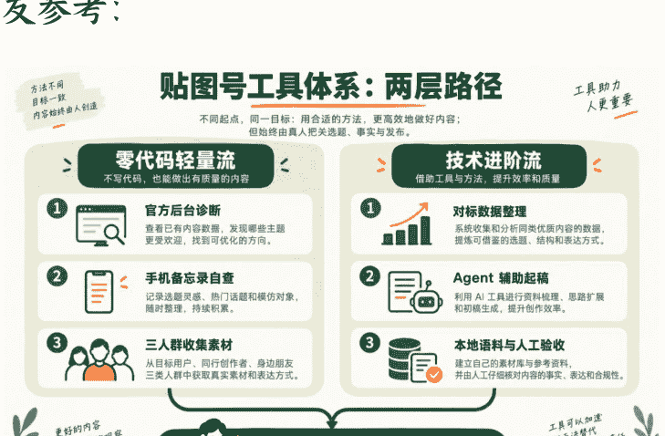

*图解：AI 生成的方法示意，配合正文阅读，不作为效果证明。*

### 1. 🛰️ CLI 自动化采集与群聊避坑情报提取

□□□ 使用范围与风险：这套方案用于个人本地素材归档。只处理自己有权访问、整理和使用的内容，不用于批量抓取他人隐私聊天。开源工具不等于零风险，请阅读相关协议并自行评估账号风险。下面介绍的是现有脚本与设计边界，不是对🛰️客户端内部机制的审计报告。

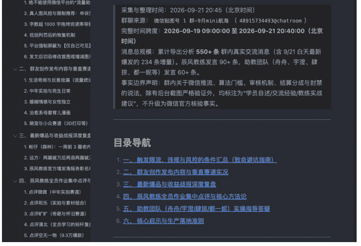

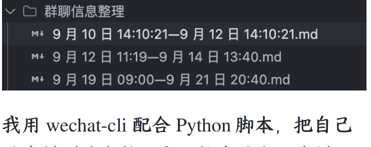

我用 wechat-cli 配合 Python 脚本，把自己的素材群消息整理成可检索的本地资料。随附包针对 macOS arm64；其他系统、版本或客户端组合需要单独验证，不能看到 “CLI” 就以为所有电脑都直接可用。

#### 实际使用链路：先读有限记录，再提取链接

1. 明确输入：指定自己的素材收集群和条数，调用 read_group_links.py。脚本调用 CLI 历史消息能力，并检查群聊目标。

2. 提取链接：从返回消息里识别👸号、📕、抖音等 URL。群消息与原文链接只是线索，不代表已经获得全部文章和图片。

3. **检查输出**：同批记录中的重复链接可以整理，历史增量去重，后台定时调度需要额外配置和验证。

4. **授权后归档**：确认访问和素材使用范围，再把需要的内容交给下游采集器处理；输出前检查聊天正文、账号和 token 等隐私字段。

```bash
python3 scripts/read_group_links.py "自己的素材收集群" --limit 20
```

上面是一次限定范围的调用示例。随附脚本不等于已经运行中的全天监听服务，也不要从“只读归档”的用途推断底层工具完全没有解密、进程访问或其他系统依赖。部署前应读所用版本的说明并核验实际行为。

#### 下游文章采集：链接整理与内容下载是两个环节

如果另行接入文章采集器、API 或浏览器工具，可以继续整理正文、公开账号信息和可访问的图片，再保存为 Markdown。接口权限、页面状态和版本会限制返回字段；**不能保证得到突破 10 万上限的精确读数、全维度互动数据或固定 20 条评论。**缺失字段应留空，不拿推算值冒充抓取结果。

我希望最终连起“转发素材 → 整理链接 → 人工筛选 → 采集归档 → 文案制作”的流程。是否已配置定时任务、接口是否可用、能否正确保存图片，都需要在自己的环境逐项读回验证。

#### 从群聊线索到本地素材库

有价值的信息 · 经过整理 · 才能长期被看见

1. **人工转发线索**：在群聊中发现有价值的内容，人工转到整理入口。

2. **本地读取群聊**：在本地设备上读取已转发的群聊内容。

3. **识别并去重链接**：提取并识别链接，自动去重，保留有效内容。

4. **核实来源与授权**：核实内容来源，确认是否有授权，并核对关键信息。

5. **人工决定是否入库**：结合内容价值，来源与授权情况，人工决定是否入库。

工具辅助整理；来源、权限与事实由人核验

*图解：AI 生成的方法示意，配合正文阅读，不作为效果证明。*

#### 群聊分类脚本：保留线索和出处，再由人判断

我们提供了 extract_pitfalls_and_hot.py 作为关键词分类示例。它可对有权使用的消息进行初筛；定时任务与采集范围需要另行配置，不默认监控他人的交流群。分类结果仍要人工核对上下文：

```
[微信群聊海量碎片消息（数百条/天）]
|
[wechat-cli history 批量导出]
|
[extract_pitfalls_and_hot.py 智能分类]
├───────────────┼───────────────┼───────────────┤
↓               ↓               ↓
【避坑防雷预警】 【爆款母题战报】 【规则与建议线索】
• 限流/违规案例 • 万阅/爆款母题 • 平台打击重点
• 敏感词警示   • 反常视觉特征 • 教练解题口径
│               │               │
└───────────────┴───────────────┴───────────────┘
↓
[人工核对出处与权限后，再沉淀至知识库]
```

##### (1) 避坑防雷预警（提炼同行踩过的血泪坑）

- 监听关键词：违规、限流、仅自己可见、不适合推荐、低质、扣分、申诉、封号、敏感、造谣、死水、0阅读。

- **自动提炼产物**：脚本按关键词筛出候选消息；是否属于真实处罚、是否遗漏上下文，需要人工确认。比如：

  - 群友发某敏感国际话题被系统判定“仅自己可见”；

  - 某账号用 AI 生成“铁头车装饭”离奇假图被读者举报造谣、评论区翻车；

  - 某账号因为连续发大字报并在文末反问“你能看出来吗”，被🛰️判定为“低质诱导互动”。

- **实战价值**：核对后记入《发前避坑台账》，附原始出处与适用条件，再作为审核参考。

##### (2) 爆款母题战报（抓取当日爆了的核心内容）

- **监听关键词**：爆了、破万、10w、十万加、高赞、万阅读、单日收益、流量主、神评、起量了、大爆。

- **自动提炼产物**：群友报喜时通常会附带文章标题、首图或数据截图。脚本筛出含关键词的正向反馈，再由人分析其中的选题结构；这些消息不能说明当天算法正在推什么（比如“垃圾堆捡漏老木茶盘”、“汉代游标卡尺黑科技”、“生僻字名册”）。

- **实战价值**：形成一批可追溯的近期案例，

提炼其视觉反差与文案钩子，快速融入当周备稿排期。

##### (3) 规则与教条建议（核对出处后使用）

- **监听关键词**：教条、七天、新规、官方、运营规范、整改、门禁、体检、判定红线。

- **整理产物**：先收集消息里提到的公告链接，再回到原始公告核验；教条针对规则的一线拆解另作经验记录，不混写成平台原文。

- **实战价值**：先分清官方公告原文、教条建议和群友转述，再决定是否更新生产规则。

### 2. Agent LLM + Harness 架构与多模型分工协同

在架构设计上，我们采用 LLM + Harness 模式：LLM 负责推理和文本创作，Harness 承载角色规则、任务路由、记忆知识库、MCP 工具、执行与验收。

分工明确的多模型协作：

- **速度调研型模型**（Gemini Flash / GPT-4o-mini）：专门用于批量扫描上千篇对标、清洗海量原始数据库，吞吐极快、成本极低；

把零散的个人心得沉淀成可复用的生产要素，听起来门槛很高，落到实操其实有清晰的路径。很多人囤了大量直播回放、课程笔记，真到动笔时还是空转。关键不在投入时长，而在于信息没有被拆解成可即插即用的模块。下面这套组合拳，是我在贴图号一线跑出来的闭环：让不同定位的模型分工协作，把课程和群聊的实战案例沉淀为可查询的知识池，再用上架前的风控校验和上架后的数据复盘把全链路串起来。

一、三类引擎各司其职

首类是长链条推理引擎，典型代表是 Claude 的 Sonnet 与 Opus 系列。它们擅长多步逻辑推演，我用它们去拆解爆款背后的情绪触发点、预判受众心理、提炼可补充的知识增量。

第二类是画面生产引擎，即 Codex 家族的 ImageGen。它擅长产出市井烟火味浓、光影自然、材质有质感的高清图，封面和内页配图基本由它承担。

第三类是开源调度中台 Open Codex。当官方配额被占满或服务暂时不可用时，我们本地部署一个统一监听接口，把 Claude、Gemini、GPT 等能力接入同一操作台。其作用仅是方便在已获授权且当前可用的模型间切换，并不突破服务商的额度。切换前必须比对成本、上下文窗口与风格差异，任务往往需要重跑。

婚姻家庭赛道的对标清单：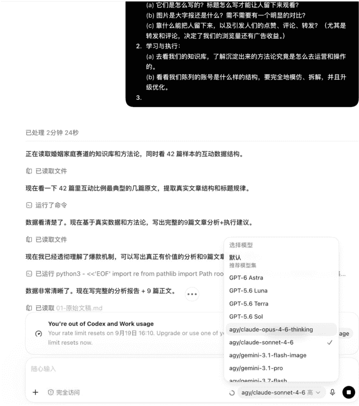

二、上架前的自动化安检

稿件定稿、进入草稿箱前，我会先跑一个👸号平台合规审查智能体，提示容易被忽略的风险点；最终裁决仍由人来握。

- 诱导式互动词筛查：诸如“敢拔吗”“能捡吗”之类的空泛设问，需要结合上下文判断，不能靠词表硬套。
- 知识增量校验：正文中涉及的年代、物理原理、工艺或民俗来源，要人工核实，严禁空洞抒情或留白猜谜。
- 真实性底线核查：由 AI 辅助制作的图片不能被写成真实突发新闻，要守住真实底线。

三、把直播与群聊变成会生长的知识资产

为何听了十几场大咖直播、买了几十门课，自己上手仍无从下手？因为直播和课程本质是流式信息。一场两小时的答疑，转写后常有两三万字，夹杂口头禅、客套、学员打断和零散案例。直接丢给通用大模型，要么因上下文过长而遗忘，要么被水话带偏，产出看似有理实则无法落地的泛泛结论。更致命的是，若自身事实、案例与边界交代不清，模型只能给出空洞回答。知识库可以补位，但来源与时效必须核查。

为把教练的一线真传与社群实战彻底内化，我用两套定制化技能跑通了完整飞轮：直播转写 → 渐进式精读 → 方法论工程化 → 挂载到 Harness 知识库 → 赛道 Agent 自进化。外部输入包括核心课程录音、教练两小时答疑转写、交流群里的实操案例。

阶段一：长文本渐进脱水与逻辑还原，调用《逐字稿精读笔记 Skill》

- 第一层：用约五百字勾勒全局脉络，立住认知底座。
- 第二层：完整保留推理链条与边界反例。
- 第三层：精准锁定业务参数、阈值与能直接复用的金句。

阶段二：从教材到 SOP 的方法论工业提纯，调用《方法论提炼与执行化 Skill》

- 抽取“问题→动作→参数→结果→修正”闭环。
- 整理成清晰的 IF-THEN-ELSE 决策分支。
- 输出带红线禁忌与验收标准的《标准化方法卡》。

```
【阶段三：沉淀至本地 Obsidian 知识库作为 Harness 记忆层】
• 分赛道归档至 01-怀旧 / 02-美食 / 03-生活奇闻 专属库
• Agent 生产前动态挂载为 System Context 行为底册
• 每日复盘数据与群聊避坑情报动态回填，实现系统自进化
```

具体执行路径如下。第一步，面对两三万字的直播转写，调用本地部署的逐字稿精读笔记技能，按三层递进整理。第一层是五百字全局速览，锁定核心论点与推导脉络；第二层是因果链与边界反例还原，这是最值钱的环节——普通总结只留“要做 A”，而渐进式精读会保留“为何做 A”的完整论证、真实学员正反案例，以及适用边界。例如在生活奇闻赛道，技能会完整记录教练的反例：绝对不能做苦难压抑叙事与沉重说教，因为读者打开贴图号是为了解压、猎奇与社交谈资，沉重表达易招反感甚至举报。第三层抓取带约束的参数，如正文建议字数、首图 3:4 比例、大字报字幅控制在 40%、日更间隔两小时等，并归纳金句，最终输出忠于原文、可检索的 Markdown 笔记。

第二步，把精读笔记升级为 AI 可执行的指令。笔记再细仍是给人看的教程，AI 写稿需要指令级规则。于是用方法工程化技能二次加工：先把经验切成“痛点→判断→动作→参数→验收标准”五要素，再把口头答疑整理成条件判断。例如：

- 若选题为民间奇闻，则首图采用脏旧废弃环境与高价值物品的强反差，正文必须注入真实考古或民俗知识增量，文末平实收束；
- 若选题为女性清醒观点卡，则首图采用做旧纸纹与 40% 金句居中排版，正文用三段式认知升维递进。

资料按赛道分目录存放，如怀旧回忆、婚姻家庭、生活奇闻等。

赛道 Agent 运行时如何学习调用？发稿前，生活奇闻 Agent 准备写作时，Harness 会自动读取该赛道知识库中的《三类常用选题模板卡》《选图军规》《合规门禁》，注入为系统提示。生成的内容自带一线实战质感，但事实与语气仍需人工核验，知识库也可能过期或录错。发稿后进入回填循环：每日结合真实数据复盘——阅读量、流量主收益、后台健康度——以及经人工核实的案例与规则线索，发现平台风向变化或违规苗头后，确认适用范围，调用方法提炼技能更新方法卡并记录日期与依据。这样知识库就不是网盘里的静态笔记，而是持续吸收炮火、自我进化的动态数字大脑。

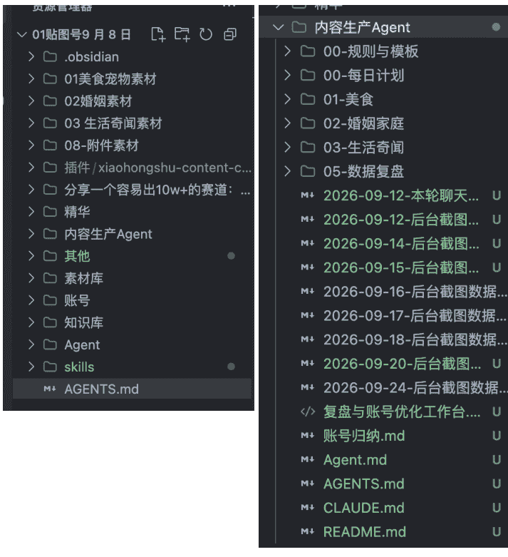

四、图片合规与来源标注

做法已做校正：不再推荐剥离 C2PA、破坏暗水印或伪造拍摄信息。AI 产出的图要如实标注，真实照片也不能配上编造的现场故事。

图片处理与发布自检：

- 保留原件：保存原图、生成记录或拍摄来源，便于追溯。
- 核实授权：确认图片、肖像、商标及引用范围。
- 质量调整：裁切、尺寸与清晰度服务于阅读，不得改变事实含义。
- 实事求是标注：按平台要求设置 AI 来源标识，不得冒充实拍。
- 元信息自查：不得伪造设备、地点、时间，不得规避来源标识。
- 隐私清理：截图需隐藏 UID、token、联系方式等无关个人信息。
- 图文一致：示意漫画需注明示意，不得把生成图当作现实事件证据。

标注来源不能替代真实性、版权与内容审查，需与发前自查合并执行。

五、采集工具与传播力评估

我自研了一套种草社区内容采集器。当前已连接，累计收集简介 2319 条，本次新增 24 条。

自动浏览模式仅采集简介：按设定速度滚动笔记列表，只保存简介，不获取正文与图片。滚动速度设为正常，最大滚动次数 100。需要完整信息时，可手动补全详情，抓取正文与图片链接。导出支持两种静态快照：仅简介 JSON 与完整 JSON。导出后进入批量分析。

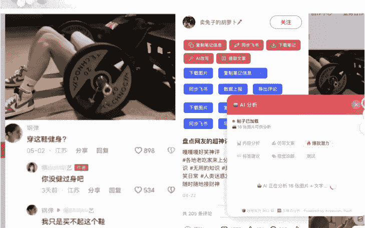

加载后共 18 张图片可供分析，入口包括文本解析、仿写、热度潜力、标签建议、视觉诊断与测试。作为专业内容分析师，结合笔记数据与 18 张图评估，爆款指数 8.5/10。优势在于社交货币属性：4557 赞、431 藏、205 评论，转发 1103 次，点赞转评比约 1:4，极易引发传播，用户倾向“发给朋友一起笑”。“盘点网友神评论”的形式契合碎片化阅读，覆盖生活、职场、情感、消费等多场景，受众极广。扣分点在于评论区互动偏弱，205 条评论相对点赞与转发不足，用户多看完即走或私下转发，缺乏公开讨论动力。

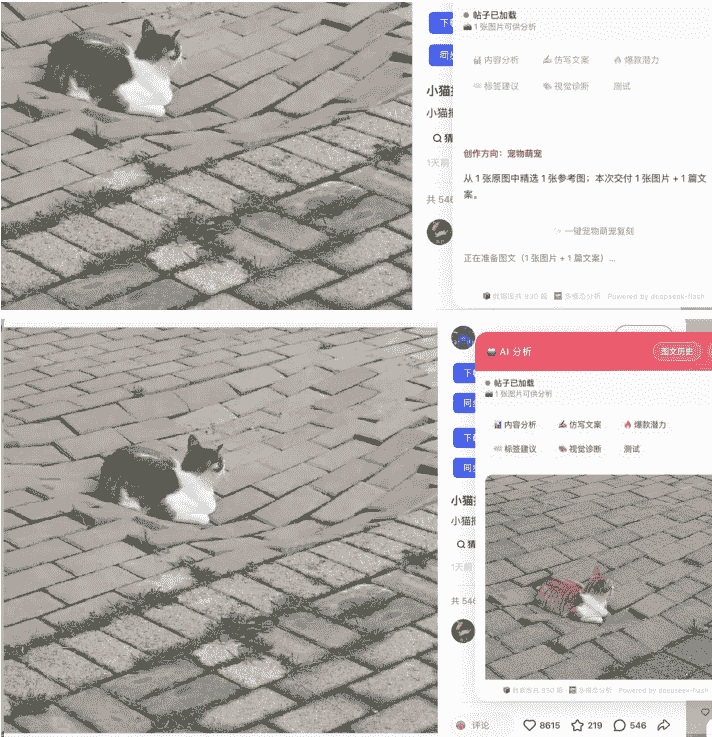

六、新手高频问答

Q1：账号流量断崖时，如何提取官方检测链接？
先登录后进入👸号后台的账号检测与通知入口。过往章节保留过页面路径，地址中的 token 仅在自身登录上下文有效，不可公开。它并非固定公开 API，也无法覆盖所有问题；入口若变动，以后台当前功能为准。

Q2：新手每日一篇大概需要多久？
流程熟练且素材已备齐时，15 分钟人机协作可完成一轮整理。但新手前期切勿盲目追求速度。找对标切口、体会选图的反常张力、校准提示词的人味儿，单篇花费 30~40 分钟属正常。先把手感与审美磨熟，速度自然提升——不要用追求效率掩盖前期认知补课。

Q3：零代码基础如何搭建素材与对标库？
完全无需写代码。最轻量的做法是建一个仅有自己小号的三人密聊组。刷📕、抖音、看一看时，看到有张力的画面与高赞文案，随手转发进群沉淀。利用通勤等碎片时间在群内集中翻看，拆解画面的反常四象限、提炼第一眼直陈标题。积累几百条爆款样本后，即拥有可定期复盘的素材池。

七、分享经历与作者介绍

航程后半段，受领队邀请，我以优秀船员身份在两个大群共近千位船友中做图文直播分享，主题为贴图号实战与踩坑排雷。


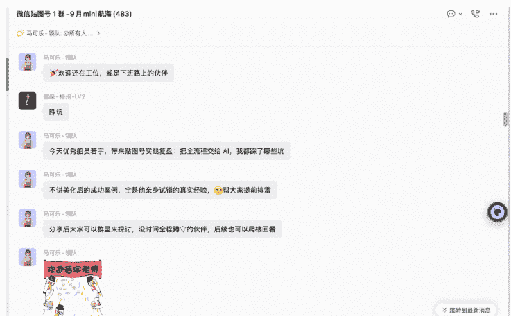

分享中不讲修饰过的成功案例。“人生没有失败，你走过的每一步路，要么成功，要么成长。”少点技术自嗨，多点真实交付。慢即是快，我们牌桌上见！

关于我：我是若宇，龙哥盟传术师与精华帖作者，曾分享万字实操干货《入赚钱半年，一个小白如何靠 AI 赚到 10w+？》；坐标杭州/宁波，兼具独立开发者与 AI 工作流架构师身份，也是一线自媒体内容与商业化交付的个体。专注 AI 工作流搭建、自媒体爆款工业化生产、拟人化 Agent 落地。做过 AI 获客系统、服装视觉一致性方案、餐饮内容工作台、企业知识库等落地项目。信条是“少点技术自嗨，多点真实交付”。座右铭：“人生没有失败，你走过的每一步路，要么成功，要么成长。”个人博客长期记录 AI 实操日记与踩坑复盘。

八、文末行动清单

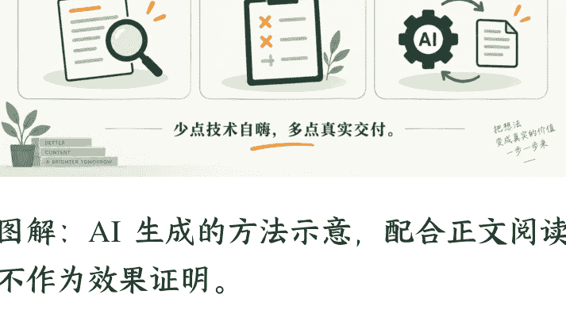

图解仅作方法示意，配合正文阅读，不作为效果证明。

1. 今日下午，用“三人小群轻量收集法”搜集 5 篇近期高爆对标图文。对照反常四象限与选图五要五不要，挑出 3 张主体突出、具备 0.5 秒截停能力的封面。
2. 复制文中提供的【Humanizer 拟人化提示词】或【奇葩科普增量提示词】，结合选图生成初稿。人工通读，注入真实生活细节与考据，并在备忘录中逐条对照【发前八项风控清单】打勾。
3. 保持种地心态，先记录 7 天。发文后遵守五项注意，不刷量、不频繁编辑，在发布后 2 小时、24 小时、48 小时记录反馈，不焦虑、不违规，跑通个人稳定日更闭环。

九、附录资源包

常有朋友问，为何将自研插件代码、自动化脚本、提示词库与避坑 SOP 公开打包？因为好的作品会完成第一次自我介绍，真实案例会证明交付能力。本文与随附工具包即是一份真诚交付。

为方便对照执行，文中涉及的自研脚本、调优提示词、浏览器扩展源码、Agent 配置与备稿 SOP 已整理为《贴图号全套实操工具包》飞书版，按五类归档。历史工程配置仅作参考，旧规则以本篇修订后的事实、来源标注与使用边界为准；代码需在自有环境验证。

资源包 1：文字调优、方法整理与提示词库
- 去 AI 味核心模块：Humanizer-zh 拟人化口吻转换规则
- 图片来源与质检规范：按真实性、授权、来源标注与隐私执行，不含删标识或伪造 EXIF 建议
- 全套实战提示词速查表：通用拟人版与古代黑科技知识增量版
- 自研流程技能：逐字稿精读笔记、方法论提炼与执行化、👸号爆款文章采集器、agent-builder

资源包 2：📕爆款嗅探浏览器插件与手册
- 完整工程源码，开发者模式加载即可安装
- 手册含安装指南、单篇采集、授权图集下载、视频黄金帧抽取与本地 IndexedDB 管理
- 测试说明含多模态分析、API 桥接与历史库导出

资源包 3：🛰️ CLI 自动化采集与群聊避坑工具包
- 🛰️ CLI 本地安装包含 macOS arm64 可执行文件与运行时胶水层，使用前需确认架构与授权
- 自动提取🛰️👸号、📕、抖音外链的脚本，过滤闲聊脏数据与重复
- 对有权使用消息按关键词初筛为避坑预警、爆款母题战报、规则线索三大简报
- 完整规范与独立压缩包见配套资料

资源包 4：Agent 体系与多模型协同配置
声明：本文来自个人一线复盘，分发节奏、风控特征与恢复案例为个人观察，不等同于官方规则，不保证复现或收益，仅供交流，不构成投资建议。本地工具请自阅协议、评估风险，不用于侵犯隐私场景。

——分割线——

看完流程或许觉得已懂，但 90% 的人仍会在第一步实操卡住。

别再迷信工具和教程了，那顶多算最浅层的门槛，从来不是真正的护城河。真正拉开差距的，是你能不能“立刻动手”，以及你所在的圈层里有没有信息差。


这里不绕弯子，只研究两件事：商业闭环怎么拆，AI 效率怎么榨到极致。系统里已经沉淀了 1000+ 个真正跑通的套利实战局。

- □ 想看圈子完整的数字资产和上车门槛，点这里：
[https://lazyo.com/insider/](https://lazyo.com/insider/)


添加时备注：【实操上车】，只谈落地，不闲聊。