# 俩人、双蓝V、月入50万+：我们如何把商业买量从“不敢碰”做成了一笔算得清的生意
作者：龙哥

要是你还卡在“要不要花钱买量”的门口，纠结丢一笔预算进去能听见多大动静，这篇文章值得看完。我们俩最早也是死磕自然内容的人，从80元一篇图文的外包单子做起，直到被客户逼着去研究商业投流工具，才慢慢把“花钱找客户”这件事琢磨明白。

先声明一句：文中所有数字，都只对应各自项目当时的统计口径，别拿去做别的行业的收益预测。

接下来说说我们为什么变。

最早，我们自己代运营，纯靠自然内容也做出过一些成果：一个灵活用工平台的项目，每周涨粉上千，最后导了900多个🛰️好友。但单子没有续，因为对方后端的产品和转化根本没有准备好。那一课很深刻：把流量做出来，和把生意做出来，中间隔着一整条路。

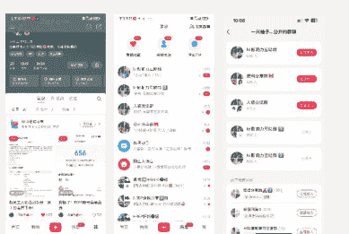

然后我们接到第一位顾问式服务的客户。对方是心理咨询老师，看了👸号文章后花了199元做一对一分析。聊完之后，她问我们能不能带着她做，最终以3000元、两个月的价格签下。从那时起，我们的业务慢慢长出了三条线：自己做号、帮别人做号、教别人做号。

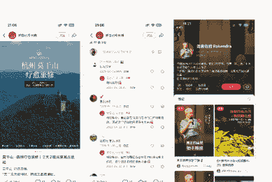

真正的转折来自一个备考寄宿自习空间的项目。那位老板有两百多个床位，场地租金、人员工资每天都在烧，最怕的就是客源断档。我们给的解法很简单：两个内容号继续吃自然推荐，再单独开启认证蓝V主页，同时测试商业流量。

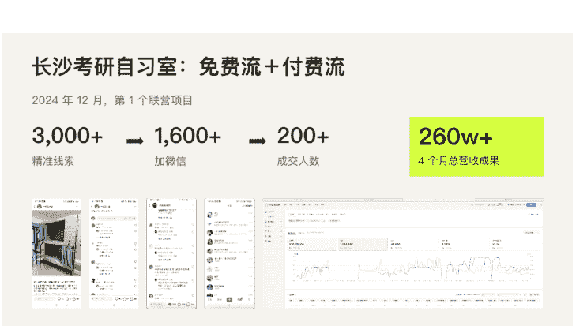

客户愿意承担预算做试验。我们也在那一个多月里，把平台的商业投放工具从零摸了一遍，完成了从“靠天吃饭”到“自己调节水量”的跨越。

一百多天下来，3000多份高意向客户信息入池，近1700位加了🛰️好友，签下200多单，合计流水超过260万。这里必须强调统计口径：这些收入是自然内容与商业投流共同创造的，谁的贡献都没法单独拆出来。如果有人拿总流水去除广告花费，声称这就是投流赚到的钱，那从算法第一步就错了。

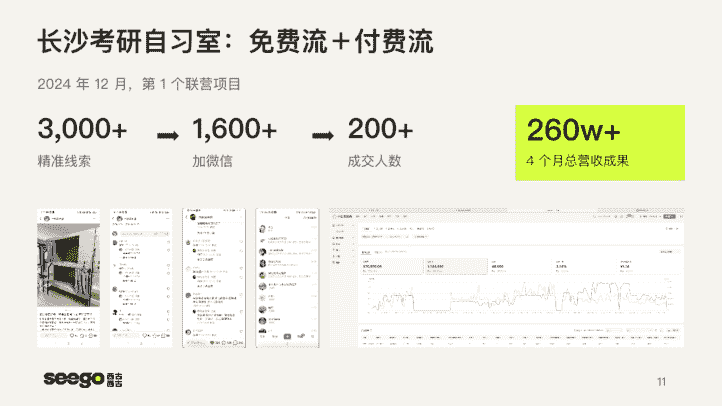

这个案例真正带给我们的，不是一笔营收，而是经营的主动权：当内容物料被验证有效，就可以继续加预算买量，销售排班和场地安排也有了提前量。自那之后，凡是需要稳定客源的业务，我们都会建议至少留一条能调节大小的付费路径。

再说一个情感方向的项目。首月数据很难看：广告账户花了1.3万，只有43位留下信息，签了4单。折算下来，单条信息的获取成本308元，而每签一单，要在广告上垫三千多块。按这个模型，后端再努力也填不平。

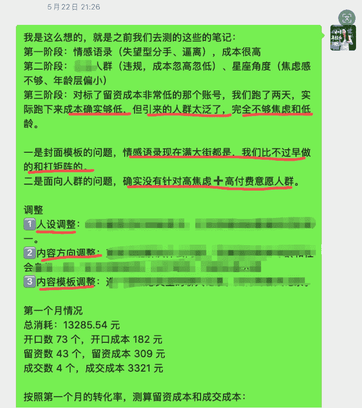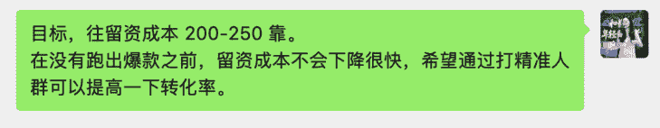

问题出在哪里？我们起初照搬同行的内容方向，引来的都是看客。后来把账号的定位、内容架构、询单路径全部推翻重做，连续优化了几个月，才在第七个月跑正。当月广告账户支出约10万，获取671条咨询信息，单条均价降到150元，销售端反馈：签单比例接近两成。

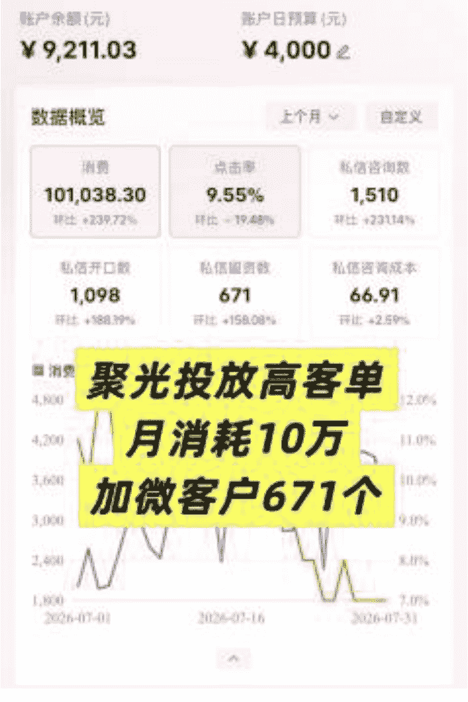

这个项目给我们最重要的提醒是：低价的线索和值钱的线索，完全是两码事。低价信息进十拨，只能成一单；贵一半的信息进十拨，反而可能成两单——后者的签单广告负担更小。我们后来复盘买量效果，不再执念于后台那个均价数字，而是看这批信息进了跟进流程之后，最终变成了多少订单。

然后是一个AI方向的内容IP项目。对方在视频里很有感染力，圈子里也有一定名望，但知识产品一直卖得不够稳。我们的分法是：他负责出镜立信任，我们负责做图文，把“卖的是什么、为什么值得买”讲透，再在图文下面叠一层商业流量做测试。

项目跑下来，单月广告支出10万上下，对应流水50万左右。招徕客户这一侧，配置相当轻：一位同事负责策略和账户，一位兼职配合内容，每月产二十来篇图文。但要澄清，这不代表单枪匹马就能扛起一门月入50万的生意——对方自己还要出镜录内容、开直播，最后还要负责交付，销售同事也得持续回访。我们说的人手少，只是少在“招徕客户”这个环节。

这个模式能转，产品设计也很关键：9.9元的体验课负责让用户迈出第一步，往上有完整课程和一对一咨询；IP本人的信任、销售的回访、产品的梯度，再和买量叠在一起，才形成闭环。

我们还对比过两种引路方式：直接获取咨询信息，或先卖9.9元体验课。后者付费信号更清晰，综合开支也更省。但这不构成一个通用答案——具体怎么投，要看付款之后，几位真的留下来、几位到课、几位复购、几位退款。

再说一个叫停的项目。瘦身陪伴营，每月299元，商业买量能带来订单，账面流水和广告支出大约3:1。单看这个比例，似乎可以继续加码，但我们还是喊停了。顺带提醒一句：圈子里常说的“一比三”“一比五”，往往只是流水和广告花费的比值，听见这类数字先问清楚它怎么算出来的，别直接当成利润。

卡点不在买量，在交付。这类服务非常耗人：一位教练能带的会员有限，订单变多之后只能不停加人；产品只有单一价位，后面没有更贵的东西可卖，盘子一旦变大，利润就慢慢被工资耗干了。

还有一家公司礼品定制的陪跑项目也补一句：客单价从100出头到1000多都有，经历了三个月的爬坡，各月的客户问询量逐步变化，2月份的单月流水做到了74万。

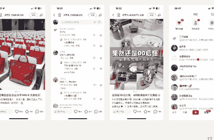

把瘦身陪伴营和礼品定制的经历放在一起看，道理很直白：把人带进门只是第一棒，后面能接住多少成交、多少交付，才真正决定规模的上限。你能做多大的盘子，从来不只取决于预算多少。

下面说说这个平台找客户的几类常见玩法，以及各自匹配什么阶段。

一、素人种草。消费者下单前，习惯翻别人的真实体验；真实场景、真实感受、横向对比，比品牌自己吆喝管用。它可以是纯自然传播，也可以配合平台的商业推广来放大。纯靠自然传播要看内容运气；想规模铺开，选题、找人、审稿、沟通也都是钱。适合从0到1的冷启动，也很适合内卷赛道里从10做到100的阶段。提醒一句：商业化内容要遵守平台规则、标明推广身份，别编造虚假体验当素人证言。

二、截流打粉。去热门帖子底下或者需求密集的评论区，找意向明显的用户私信建立联系。它离需求很近，但用户对原作者的信任并不会转嫁给你，销售还是得重新讲清楚“我是谁、能帮你什么”。越是依赖信任的行业，这个环节越费劲；频繁生硬的私信也容易惹人反感，当不了长期稳定的渠道。

三、短视频IP。粉丝长期看你的观点，慢慢认可你的判断，付费就是顺水推舟的事。代价很明显：本人要出镜、观点要立得住、脚本和剪辑都要跟上；哪怕信任攒够了，自然推荐依然会起伏。我们看到不少有表达力的博主，开始用商业流量托底，对冲这种不平稳。

四、蓝V自然流。企业认证主页也有自然推荐。我们服务过一家本地财税公司，几个认证号轮流覆盖本地搜索词，再配小预算做付费测试。这套能起效，和本地化生意、服务承接基础、内容持续投入分不开。别以为多开几个号就有用，号多了，人员、产出和管理都是成本。还没验证渠道的团队，可以先拿自然内容试水，但要定好检验节点，别把“天天在发”误当成了进展。

五、商业投流工具。平台里常用的有聚光、千帆：聚光多用于收集咨询信息，千帆多用于直接卖货。选哪个，要看业务形态、推广目标和账户资质。付费玩法的最大优点是可调节：内容和转化稳定之后，预算就像水龙头，需求多就开大些，跟单的同事接不过来就关小。但“水龙头”只表示能收能放，不代表拧大就一定会流出更多的客户——竞争、内容疲劳、销售承载力，都会影响最终结果。

研究同行怎么投，也有门道。别拿搞创作的标准去衡量广告帖：点赞收藏少不代表没效果，有明确需求的人可能看一眼介绍直接私信，根本不会先点赞再收藏。去搜行业词，看哪些认证号长期在买量，评论里是否有人提价格、提地点、提问怎么约，看他们怎样介绍服务。但记住：长期买量只能说明对方有预算或信心，并不等于一定能赚钱。

再谈预算和团队。起步不需要豪华配置，单枪匹马也能跑起来。关键是分工：谁稳定产出内容，谁盯数据调价，谁响应咨询，出问题谁负责调整。钱怎么给，要结合预估的线索单价和所需样本量。比如你预计一条信息50～150元，每天投入300元还能攒几个样本；如果预计单价200～500元，同样的钱一天只能拿到一两份记录，测试周期会拖得很长。动手之前，先把“最多亏多少、多久复盘一次”写清楚，比花完钱天天焦虑有用得多。

最后，把投钱前的账本彻底摊开。

一、数据要打通。一旦开始买量，每天记录的不只是支出和点击，还有几位进咨询页、几位开口、几位留下联系方式、几位通过好友、几位最终付款。涉及到店、试听、预约的，把对应环节也加进记录。只有这样，你才能知道用户在哪一环掉了队。

二、前后台对齐“有效”的定义。需求在不在服务范围？地域能不能覆盖？联系方式能不能用？这些口径先统一。否则，引流的同事报来一堆信息，卖货的同事说全是废料，双方很难达成共识。

三、费用拆三层。第一层，平台信息成本：总支出÷平台记录到的信息数，用来判断广告表现，但只是链条上的一环。第二层，有效信息成本：总支出÷确认有效的信息数，更接近真正值得跟进的人。第三层，拿下一个新客户的买量代价：对应支出，再除以同一茬信息里新签下的客户数。这一层最容易被忽略的是：从留下信息到真正付款，往往隔着一段时间。这个月留下的信息，可能下个月才付款，不能拿本月买量开支对应全部订单。

四、成交比例只看同一茬人。同一茬信息最终签下多少，才反映这轮买量与销售配合的真实效果。产品决策周期长的，新进的人暂时没签，不代表之后不会签。

五、别只盯着信息单价。举两组数字：A做法，100份有效信息，每份100元，签单比例10%，买量花1万，签10单，摊到每单的广告支出1000元。B做法，同样100份有效信息，每份150元，签单比例20%，买量花1.5万，签20单，摊到每单的广告支出750元。单价贵了，整体反而划算，差别就在签单概率。我们更关心信息进了销售手里之后能变成什么，而不是后台某个读数的最小值。

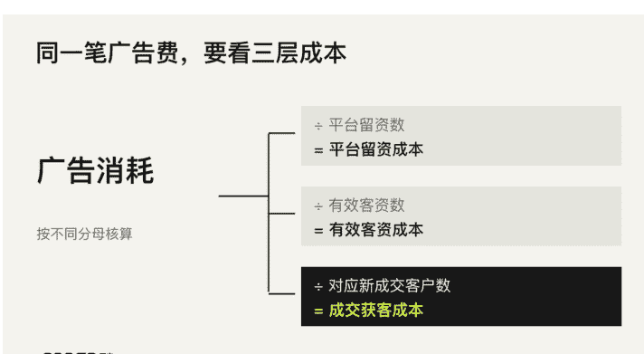

最后收个尾。

要是你还在摸索这个平台的成色，自然内容可以先跑，但一定要设一个检验节点，别把“每天发东西”当成业务推进。准备花钱买量之前，先确认三件事：产品是不是有人愿意买单？销售能不能接住询单？后续的服务质量和利润空间，能不能承受规模放大？商业买量是一面放大镜，无论好事坏事都会照着放大。把账盘明白了，再去拧水龙头也不晚。

算总账要算到利润层面。除了投放花费，还要扣除退款支出、履约开销、销售分成、运营人头费、外包采购以及摊销到每一单上的固定成本。不少标价低的陪跑型产品，前端 ROI 看似尚可，实则被后端人力占用拖垮。

历史数据趋于平稳后，就可以倒推投入。先明确期望增加的成交数量，推算所需的高质量线索量，再依据当前线索获取成本估算预算规模，最后检验销售与交付端的消化能力。

以上测算只是决策参考，并非收益承诺。产品、客群或渠道发生迁移，原有转化率必须重新校验。

## 六、蓝 V 项目起步测试方法

### 先完成准入与接单准备

投放前，先核对业务是否符合平台现行推广规范。营业执照、类目、资质、实际交付内容是否一致，是否涉及保证金，账户开通、广告充值流程是否齐全，都要确认。

这些要求会动态调整，建议按行业与具体账号向官方核实。别照搬他人的历史经验，也别把保证金、待消耗余额与已产生费用混同计算。

与此同时，产品说明页、咨询入口、销售承接流程要提前跑通。咨询进来后，谁负责响应、响应时效、记录跟进方式，都需明确分工。

### 首批素材要验证多元购买理由

启动阶段通常会一次性准备 5 篇以上笔记，同时试探选题、封面样式与表达角度。早期重在找到有效表达，而非追求视觉统一。

部分企业号看上去风格高度统一，往往是因为已沉淀出适配模板。盲目模仿表层样式，未必复制出同样效果。

以咨询获客为目的的内容，优先讲清服务对象、具体痛点、交付内容与咨询价值。干货有助于建立认知，但若目标是把有购买意图的人推入咨询，仅仅做“看起来专业”是不够的，必须把服务说透。

前面提到的个人 IP 案例亦然：短视频持续建立信任，长图文补充产品细节，两类内容分工不同。

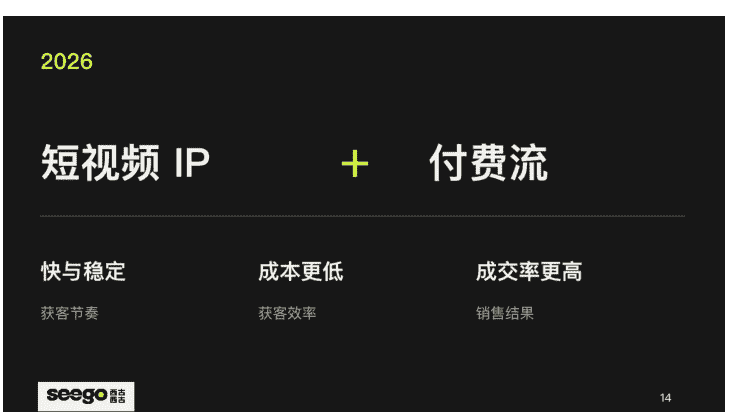

### 用计划做假设验证

搭建投放计划时，先明确本轮想验证的假设。例如同一服务面向不同年龄层或区域，获客成本与后端成交是否有差异；同一客群更换选题后表现是否改善。

把这些理解为独立实验，每轮仅变动核心变量，通过数据判断，避免一次性改动过多导致归因不清。

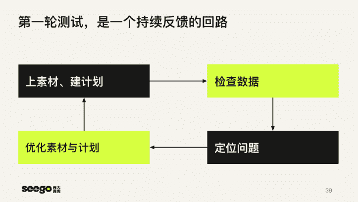

首轮测试需尽快得到几个关键判断：预算能否正常消耗，内容能否带来咨询，咨询质量如何，整体成本是否在可承受区间。

有的业务一周内就能找到方向，也有的像情感咨询类，前 30 天表现平平，调整后才转好。测试节奏受业务属性、素材质量、样本量与后端配合影响。

### 有效素材后看经营承接能力

内容一旦有效，并不意味着要无休止高频更新。只要持续带来合适线索即可保留，同时补充新内容。我们部分项目前期 30 天产出约 25 篇笔记，稳定后降低频率，把精力转向数据监测与迭代。

### 小团队扩量的参考样本

最佳成绩

1-2

蓝 V 账号

1-2

运营人员

25-50

篇笔记 / 月

50w-100w

30天

业务结果

扩量不能只看预算是否能花掉。预算快速消耗可能意味着还有测试空间，但必须结合线索质量与成交反馈。若前端热闹后端无收入，属于典型陷阱。

当销售已饱和时，应主动收紧预算。此前提及的礼品定制项目，便卡在承接环节。

## 七、复盘从哪里开始找问题

### 同时观察四个时间维度

账户基本每日查看，但不会仅凭单日数据做决策。

日维度主要排查异常：消耗波动、审核问题、咨询响应及时性、销售记录是否补齐。

滚动 3 天适合判断新素材的初步走向。首日成本偏高不一定持续，首日表现好也不代表能稳定，需要看样本而非机械等待满三天再处理。

滚动 7 天用于对比素材与人群的阶段表现，决定下一轮调整方向。滚动 30 天更接近经营复盘，需把成交、净回款、综合投入与交付容量一并审视。

### 四个观察窗口各自回答不同问题

| 观察窗口 | 关注维度 | 主要观察内容 | 结论或动作 |
|---|---|---|---|
| 每日 | 异常检查 | 消耗、审核；承接、记录 | 处理异常，补齐数据 |
| 滚动 3 日 | 素材趋势 | 新素材表现；客资质量趋势 | 有样本支持时调整 |
| 滚动 7 日 | 方向判断 | 人群、素材；阶段成交 | 确定下一轮测试方向 |
| 滚动 30 日 | 经营决策 | 净回款、综合投入；交付容量 | 扩大、收缩或暂停 |

单篇笔记是否下架，需综合窗口判断。若长期有效仅近期成本上升，先排查原因；若成本明显超出承受范围且后端质量亦差，则应及时调整或暂停。

### 沿客户路径排查

有曝光无点击，先审视选题、标题、封面与目标人群的匹配度。点击率可作参考，但行业基线差异大，需自行积累。

有点击却少咨询，说明内容未讲清服务价值与购买动机，或入口不顺畅，或人群需求本就错位。

咨询进来却无后续互动，需检查欢迎语与首次回复速度。用户通常多家比价，回复延迟容易被其他消息覆盖。

有互动却未留下联系方式，需确认双方需求是否对齐，用户为何愿意继续沟通。引导下一步时，使用平台合规入口，并清晰告知后续能获得的服务。

线索充足但成交下滑，需双向排查。销售人员、跟进节奏、产品定价是否变化？前端人群是否迁移？近期客户是否仍处于决策期？

成交尚可但利润不佳，需回到退款、交付成本、销售提成与获客成本。此时单纯加量无法解决问题。

### 用数据代替主观感受

常听到“最近流量变差”。若缺乏完整的加微与成交记录，很难定位真实问题。

曾有项目原触达人群支付能力明确，后期进入更年轻群体，后端转化下降。排查人群后，新建更匹配年龄段的计划，再观察后续。

年龄并非通用判断标准，关键是找到具体变化。若销售只说“线索不行”，流量只说“我已提供充足”，协同优化难以展开。

对流量操盘手而言，最终要兼顾两点：获客成本在经营所能承受范围内，线索质量能支撑满意的销售转化。两者需同步评估。

## 八、免费流与付费流的现状判断

多轮项目后，我不认为所有业务都应放弃自然流。自然内容帮助品牌被认知，真实体验影响购买决策，个人 IP 沉淀信任，付费投放让测试与获客更可量化。

同一业务在不同阶段，策略会迁移。初期可能先验证需求，中期需要稳定线索，后期会把 IP、种草与直接投放结合使用。

我更倾向将投放归为两种作用。验证期，用有限投入看清产品表达、人群匹配与销售环节的问题；模型跑通后，在成本与承接能力允许范围内放大业务。

我们也曾尝试从前端获客延伸到后端产品，研究过宠物生意，也测过其他服务，越发体会到：获取流量与做好交付是两种能力。找到可靠合作方、理解行业成本，都需重新学习。

因此目前仍聚焦📕获客服务，把可控部分做扎实。

准备启动时，建议先盘点自身业务，厘清四件事：面向谁、验证到哪一步、可承受的获客成本、客户到手后谁来完成销售与交付。

想清这些后再选账号、内容与投放方式，决策会更清晰。你也能明确下一笔预算在验证什么、何时可加码、何时应先止损处理其他问题。

📕应服务于你的生意。我们持续记录与优化数据，目的在于让每一轮投入都能推动经营前行。

——分割线——

看完这份 SOP，你可能觉得已掌握。但实操时九成的人会卡在第一步。

工具与教程只是基础壁垒，真正的壁垒是即刻行动与圈层信息差。

我们不谈空话，只拆商业闭环与压榨 AI 效率。系统内已沉淀 1000+ 跑通的实战案例。

□ 查阅圈子完整数字资产与上车门槛：

https://lazyso.com/insider/

备注：【实操上车】，不闲聊

