# 72小时内私域新增600人、到账过万：X 从冷启动到变现的实操拆解

260930 副业 SC 精华

整理：👸号懒人搜索，懒人专属群精选

懒人🛰️：lazyhelper1

> **小懒判断**｜适合手上已有能变现的手艺，正在私域缺流量入口的人，国内平台还没玩明白的小白先别急着🪜。最值得关注的是 X 开源算法的权重表：一个转发顶 20 个赞，破圈就看发出后两小时有没有人帮你转。坑在于成品号有被找回封禁的风险，第一个号宁可自己注册慢慢养。

大家好，我是阿乐，2002年出生，目前在杭州做AI获客方向的工作。

先说一个刚跑完的案例。

前几天在X上丢了一条插件演示短视频，没有投放也没有买粉。

> 72小时里，私域新增600个好友，同期回款1万元。

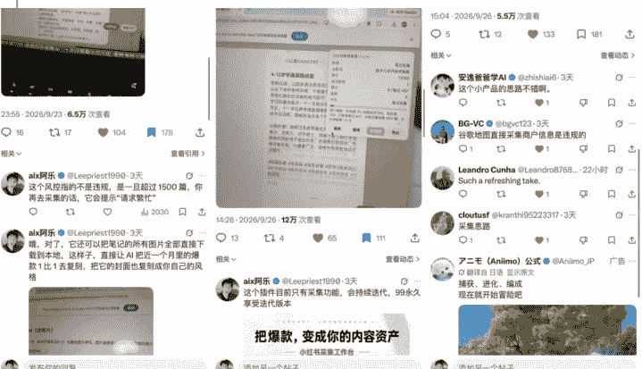
放在赚钱的语境下，这个体量谈不上顶尖，但足以验证一件事：同一套内容搬到X，跑出来的反馈和我之前的预期差距很大。

本文分两部分，前半讲投入理由，后半把0到起号再到出圈的链路拆开，都是近两个月自费验证的结果。

阅读地图：

- 一、当下为什么值得把资源放X
- 二、第一步：帐号怎么来
- 三、第二步：资料完善与养号
- 四、第三步：起步期做什么
- 五、第四步：如何实现破圈
- 六、破圈后怎样守住
- 写在最后

上月在赚钱发过一篇帖子，讲中秋期间把X流量导到🛰️、成交百单、72小时回款一万，被龙哥点赞，激励挺大。

之后我想把观点说清楚：现在X是一个值得配置的渠道。

不止我这么看。身边做私域的几位朋友判断一致——还在找稳定进流口的，X别跳过。

我归纳成两点，后续补充到三点。

第一，用户画像差异。

愿意注册并常驻X的人，本身已被筛过一遍。那里有创始人、创业者、独立开发者、海外华人，还有一批跟你一样在做项目的人。

这些人的共性是：能读懂你的表达，且付费意愿相对强。

早年做AI出图时，我在X发一条介绍，带来上百人来聊，最终成交10个代理权。同样素材放到其他平台，曝光更大，但问到价格就没了音讯。

第二，平台容忍度更高。

国内平台只要带联系方式就易限流封号，养起来的帐号一张二维码就可能消失。

X相对宽松。🛰️二维码、群二维码、个人主页链接都能直接放，平台不会因为你导流就打压。

那批600人，全是X直接导过去的。放到国内基本不可行。

具体怎么操作、从0要准备什么、如何设置、如何养号、如何破圈，我整理成飞书文档，阅读更顺：

路径四段：帐号自注册或购号→资料与养号→起步运营互动、与大V交流、带评转发→破圈来时路、请大V转发、熟人站台。

最后说一句实话：这篇写出来，我也在给自己起号。要是这篇能起来，我的号基本就起来了。觉得有用的点，帮我转一下或评论区留个言，我都会看。

有在玩X的圈友，留个号，我去互关。

https://fcn0gp5yt13z.feishu.cn/docx/BQthdexmioQIBV...

## 一、当下为什么值得布局X

两个亲身踩出来的结论。

### 理由一：受众质量我见过顶尖

国内平台发内容，评论区多是吃瓜和挑刺。

X不同。能留下来的人，本质已被筛选。创始人、创业者、独立开发者、投资人、海外华人都在。

这批人看得懂价值，也有支付能力。举例。

做AI绘画时，X一条介绍带来上百咨询，转了十个代理。

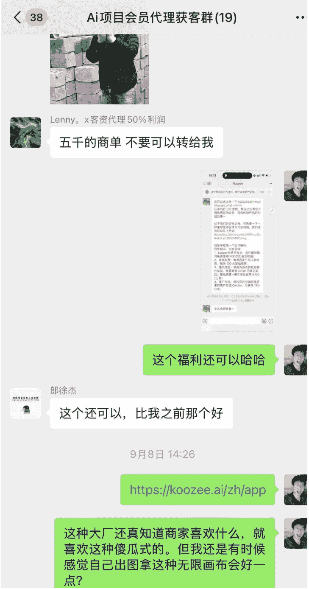
同样素材放到别处，曝光可能更高，但转化极低。X来的人基本带着明确需求，要么现在就想解决，要么正在付费解决。

> X带来不是泛流量，是愿意付钱的人。

### 理由二：变现方式比想象多

我和朋友验证过的方向：

- a. **售卖服务、产品、代理权。** 最快。赚钱学到的手艺搬过来基本有人买，因为用户习惯为问题买单，不需要大量教育。
- b. **做付费社群。** 有复利。X适合立人设，长期有人看你。养三个月、半年再开群，进来的人都是被内容喂熟的，转化成本低。
- c. **接海外单、做出海。** 国内平台给不了。X是英文圈和华人圈的交汇，想接海外客户、了解外部趋势，这里最顺。信息差就是钱。
- d. **平台分成。** 顺带收益，不用单独设计内容，有就有。

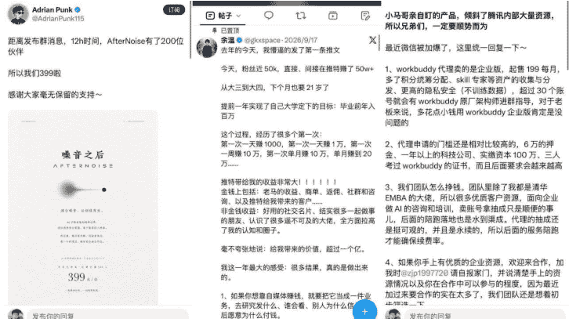
#### 具体能赚多少？两个参考：

- 万粉博主，月变现三五万比较常见。
- 我自己，运营两月涨三四千粉，变现也在几万。

号不大，但说明不是只有大V才能赚钱。三四千粉就能开始收钱。赚钱里已有成果的人搬过来，起量只会更快。因为X现在最缺的就是有实战结果的人。

### 理由三：引流管控相对宽松

这是X最值钱的地方。

国内平台放个联系方式就限流封号，辛苦养的帐号可能毁在一张图上。

X你可以直放🛰️二维码、群二维码、主页链接，平台不会为此打压。

这意味着每条内容都能直接变成私域里的一个好友。不用让用户评论扣1，不用藏谜语。

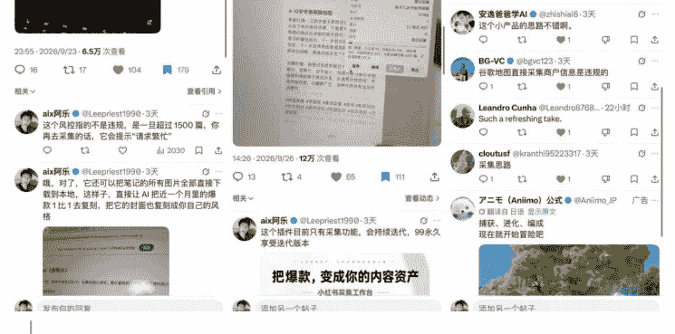
> 我那72小时600人，全是X直接导过去的。国内根本做不到。

如果你在做私域，或在找一个能持续加人的入口，X值得放进清单。别的地方辛苦加几十个，这里给你一个可反复用且不被拦的通道。对私域的人来说，这一条的价值远超前面。

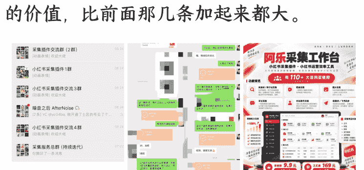

## 二、第一步：账号怎么来

先说路径，两条任选。

### a. 自行注册【新手建议】

现在最稳的是Chrome注册。

Chrome环境干净，不容易被判定为批量号。

做法：

- 准备干净邮箱，Gmail最优，和帐号绑定。
- 用Chrome打开注册页，选“用Google登录”，比手机验证码顺畅。
- 节点固定。选美国就一直美国，别今天美明天日。
- 注册完立刻把资料填全，不要空号放着。

好处是干净安全，后期不易出事。缺点是慢，有养号期。

### b. 购成品号【求稳求快】

适合等不了养号期，或要做矩阵的。

购前想清楚三点：

- 有被找回、封禁的风险，别贪便宜。
- 粉丝不精准。那点粉丝大概率是僵尸或不相关，别指望带流。
- 买回来先改密码、换绑邮箱，用一周正常互动再发内容。

渠道圈里一问就有。我的建议是：首个帐号自己注册，你才更上心。

## 三、第二步：资料完善与养号

帐号到手，先别发。

### 先把门面整理好

**头像。** 真人照。别用LOGO或网图，X是看人的地方，真人脸是基础信任。

**昵称。** 真名或常用名，我就用“阿乐”。

**ID。** 能改一次，想好再改，最好是拼音或英文，方便被@。

**简介Bio。** 一句话讲清：你是谁、帮谁解决什么问题。

aix阿乐

@Leepriest1990

⚡02年连续创业者｜内容营销顾问

靠着获客系统2个月累计变现10w

现在专注📕增长获客

分享AI获客方法论·私域转化营销·AI搞钱项目实战

📍Tetouan morocco　▣ 2011年2月加入 ›

308 正在关注　3,962 关注者

分享个人资料　　编辑个人资料

我的写法是：专注📕增长获客。别写“热爱生活、喜欢旅行、专注成长”。

没人关心你热爱什么，关心的是你能帮他做什么。

**主页链接。** 放🛰️、社群、产品页。很多流量来了没地方接，白费。

**置顶帖。** 选一条最能代表你的内容钉上去，新访客第一眼就看到。

已置顶

余温 @gkxspace · 2026/9/17

去年的今天，我懵逼地发了第一条推文

今天，粉丝近 50k，直接、间接在推特赚了 50w+

从大三到大四，下个月也要 21 岁了

提前一年实现了自己大学定下的目标：毕业前年入百万

这个过程，经历了很多个第一次：

第一次一天赚 1000，第一次一天赚 1万，第一次一周赚 10 万，第一次单月赚 10 万，单月赚到 20 万......

推特带给我的收益非常大！！！！！

金钱上包括：老马的收益、商单、返佣、社群和咨询、以及推特给我带来的客户.....

非金钱收益：好用的社交名片、结识很多一起做事的朋友、认识了很多遥不可及的大佬，全方面拉高了我的认知和圈子。

毫不夸张地说：给我带来的价值，超过一个亿。

我这一年最大的感受：很多结果，真的是做出来的。

- 1、如果你想靠自媒体赚钱，就要把它当成一件业务，去研究发什么、谁会看、别人为什么信你、愿意为什么付钱。

### 养号期

新号别猛发，先像个正常用户用几天。

- 前两天：刷内容、点赞、评论、关注同行。让平台判定你是个活人。
- 第三四天：发第一条，不用长，真诚的想法即可。
- 一周后：进入常规节奏。

> 记住：X是社交平台，不是公告栏。当公告栏，它就把你当广告。

## 四、第三步：起步期做什么

前期做三件事，都是往外走。

### a. 多互动

去关注的大V下面认真回复。

注意是认真回复，不是“好文”、“学习了”。这种没权重也没人看。

认真回复是：你看了内容，有补充、有经验、有反对意见，写出来。

我涨粉最快的时候就靠这个。大V一条推几千人看，你一条有观点回复，等于在几千人面前露脸。

### b. 跟大V交流

不止点赞回复，要有真实交流。

看到有价值内容，可私信或评论聊两句，说明你是谁、在做什么、他哪句话对你有用。

第一次别推销，目标是让他记住你这个人。

### c. 多转发

看到好内容转，转发时加上你自己的判断。

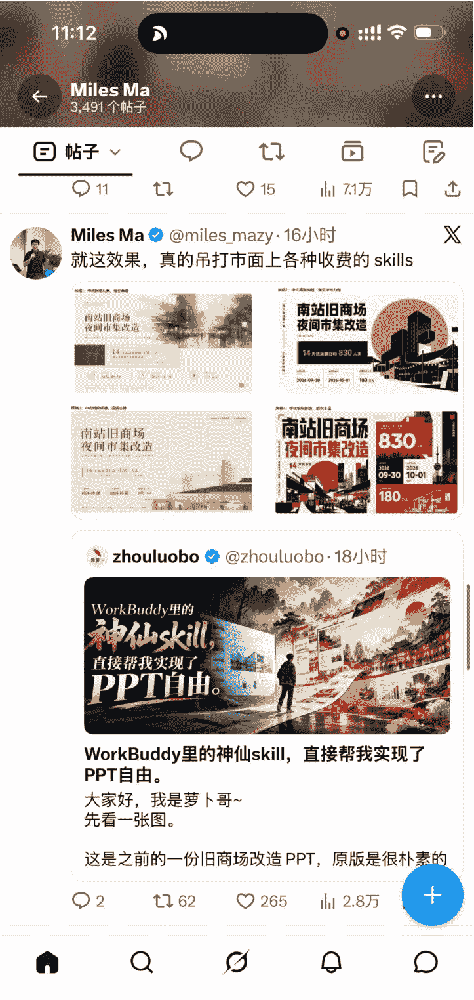
加一句判断很关键。纯转别人只记原作者，带上你的看法，大家才会注意到你有思考。

> 前期逻辑一致：你先出现在别人的网络里，别人才可能发现你。新号主页空，你不主动走，没人会来找你。

## 五、第四步：如何实现破圈

前三步让你活下来，这步让你被看见。

### 1. 写一篇“来时路”

破圈前，先有一篇让别人认识你、记住你、信你的内容。

这篇叫来时路：讲你以前什么样，做过什么，拿到什么结果，踩过什么坑。

我当时讲在杭州半年五件事全翻车，反而成了最被记住的一篇。后来很多人加我，说看完觉得我真实，愿意聊。

#### 帖子

aix阿乐 @Leepriest1990

来杭州半年，做了五个项目全翻车了。

宠物摄影——有产品没流量，死。👸号搞了10w+——有流量没产品，变现不了，死。AI服装软件——产品不稳、合伙人目标不一致、我一个人扛全链路，死。

回头看每个项目都在用体力弥补认知的短板。不是说努力没价值，是努力的方向如果一直是错的，越努力沉没成本越大。

这半年最大的收获不是赚了多少钱，是终于知道自己不该做什么。

18:00 · 2026/8/3 · 28万 次查看

蜗牛King @isnail · 2026/8/3 会好起来的，不对已经好起来了

Asten @0xasten · 2026/8/3 最后的总结很到位 👍

为什么失败比成功管用？因为X上吹牛的人太多。你讲你怎么赢，别人觉得又要卖课；你讲怎么输、输在哪、怎么改，别人更信。

不是卖惨，要踩得具体：哪年、什么项目、亏多少、错哪一步、后来怎么改。有细节才算一篇东西。

#### 帖子

aix阿乐

@Leepriest1990

从独立摄影师到一人opc，五年换了五条路，最终一事无成：我撕光了我身上的所有标签，从零开始，all in AI

2026年初，我拖着行李箱到了杭州。

来杭州是因为女朋友。之前一直在全国各地旅拍、旅居，漂了很多地方。她说想在这边稳定下来，我就来...

14:33 · 2026/7/14 · 2.2万 次查看

天策 @Leobai825 · 2026/7/14

好好加油兄弟，多折腾多赚钱

aix阿乐 @Leepriest1990 · 2026/7/14

好的，策哥

### 2. 礼貌请大V转发

最直接的破圈动作，也最难开口。

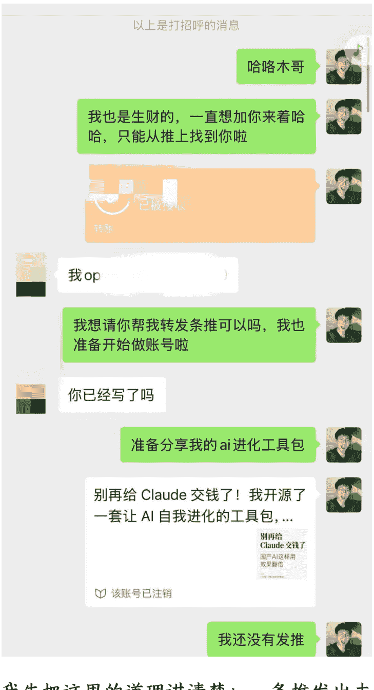
先说明白逻辑：一条推发出后，前两小时是黄金窗口。互动够猛就被推给更多陌生人，两小时凉了基本就沉了。

X的推荐算法是开源的，权重很清晰：

| 动作 | 权重 |
| --- | --- |
| 转发 | 20 倍 |
| 引用转发 | 15 倍 |
| 回复 | 13.5 倍 |

### 3. 找熟人站台

三五个人一起转，就能把两小时内的互动顶起来。熟人站台快、真、不花钱。

### 4. 破圈的前提：内容要值得转

很多人找人转发，人家点进去主页空荡、内容单薄，想帮也帮不了。

开口前先自问：这条讲清楚了什么？能给读者带来什么？说不清就别开口。转没留住，流量白来。

## 六、破圈后怎样守住

破圈是一下子，留住人靠日常。

### a. 破圈后连发两三天干货

大V带来一批陌生人，他们为什么留下，看你主页最近内容。

所以这两天要连发干货，立住价值。别发广告。

我长期用的配比是六分水帖、三分方法论、一分人设。有人传过，前辈经验：

- 水帖让你保持活跃，天天被看到；
- 方法论立威，让人信服；
- 人设让人喜欢、愿意长期跟。

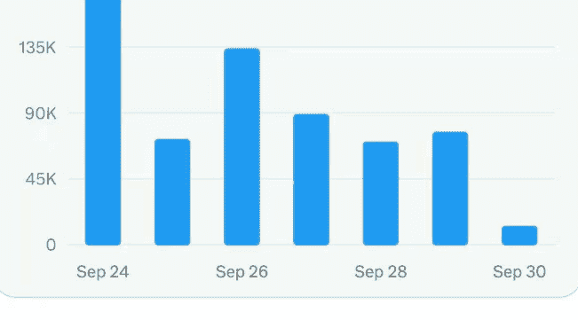
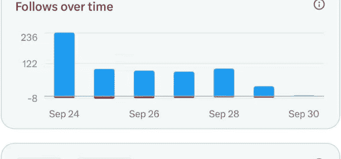
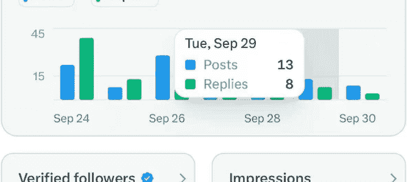
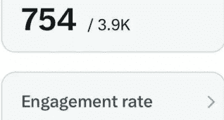
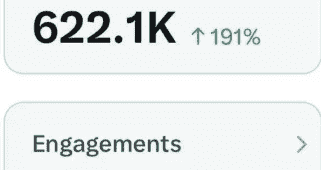
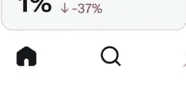

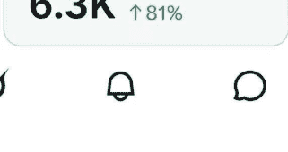

### 靠灵感硬顶日更，顶不住；把系统搭起来，才转得久

做日更，最磨人的不是某一篇写不出来，而是你根本没法保证每天醒来都有新东西可写。

后来我慢慢想透了：自媒体真正卡人的，不是单篇质量，而是持续有货、还能稳定发出去。它考验的也不是你多能扛，而是有没有一套机制。

咬牙硬撑，半个月就见底；机制顺了，转上一年也不难。

所以，我给自己搭了一套能自行运转的东西。不复杂，四块拼图：

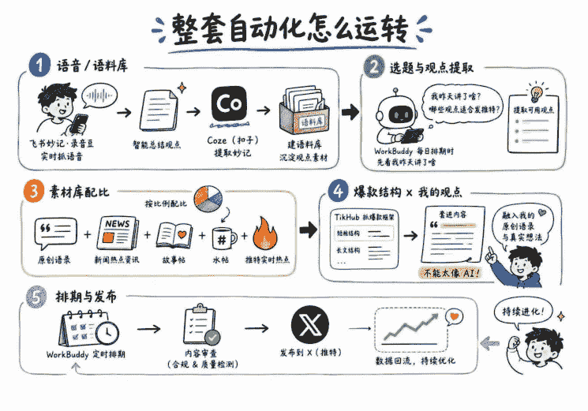

**第一块，个人语料仓。** 平时跟人聊天，或者脑子里突然冒出个念头，我会用“飞书妙记”录下来；转成文字后，再让 AI 提炼里面的观点，归档进语料库。

这一步为什么重要？因为账号要像个活人，而不是 AI 仿写。别人愿意关注你，往往就因为你的说话方式、常用词和看事情的角度。

**第二块，素材池。** 只靠自己的观点，日更迟早断粮，所以得有一个池子。我通常从三处进水：知乎的民生热点、推特的热门趋势，以及 AI 圈的信息。但有一条不能忘：每条素材都得带上我自己的判断。只搬运资讯没人爱看，真正有人看的是你对这件事的解读。

**第三块，选题判断。** 有了料，还得会挑。我让 AI 去扫近期中文区最火的帖子，拆它们的开头、段落推进和整体骨架。早期我靠三段式短帖吃到过几篇流量；后来平台算法调整，我又重新拆了一轮，转向长帖，曝光从几乎为零拉到日均两三万。

**第四块，发布与复盘。** 发布用的是 Typefully，月费 8 美元，接推特接口，可以定时排期。每天在系统里敲几个字，当天内容就自动排好并发出。每周复盘一次数据：哪条好、哪条差、和上周比怎么样，再把结论回灌素材库，下一周就能再优化一点。

从采料、排期、发布到复盘，一圈跑完再喂回去，账号就慢慢自转起来了。

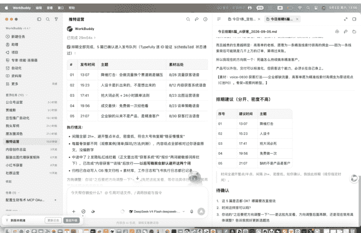

### 不过有句话必须讲明

自动化再强，也只是工具。

它能让内容按时铺出去，像准时出摊，却替不了你的真诚。用户点进来后愿不愿意留下、信你、跟你走，靠的不是流量，而是你这个人：你亲自踩过的坑、拿到的结果、说出口的真话。

吸引眼球只能把人带到门口，真正留住人的，始终是真诚。

### 写在最后

我知道不少人对推特发怵：🪜麻烦、英文看着累、总觉得那是别人的地盘。

可也正因为多数人嫌麻烦，那里的人均质量才高。门槛本身就是一道筛选器。眼下推特中文圈正处在特殊窗口：真有实战结果的人还不多，好内容也稀缺。你在赚钱学到的东西搬过去，很容易被看到。

最后说点心里话。

这篇不只是经验分享，也是我给自己起号加的一把火。若它爆了，这个号基本就能立住。所以这波真希望圈友搭把手：

- 哪句对你有用，帮忙转发或点个赞；
- 你也在玩推特，评论区留个号，我去关注；
- 觉得哪里不对、哪步没讲透，直接拍砖，我改。

接下来两三天，我会在推特连着更干货帖。想看就来推特找我：@Leepriest1990。

我们推特见。

——阿乐

看完这份 SOP，你或许觉得已经懂了；可真到实操，十个人里九个会卡在第一步。

工具和教程从来只是最浅的门槛，真正拉开差距的，是立刻动手，以及圈层里的信息差。

如果你想知道全网最新的变现打法，还想跟一群执行力拉满的极客一起下场拿结果，欢迎来看我的核心私域【懒人专属群】。

这里不讲空话，只拆商业闭环，也把 AI 效率压到极限。系统里已经攒下 1000 多个跑通的套利实战局。

想看圈子完整数字资产和上车门槛：

https://lazyso.com/insider/

认可这套价值、也准备动手的人，扫码加🛰️（lazyhelper1），备注：【实操上车】，不闲聊。

